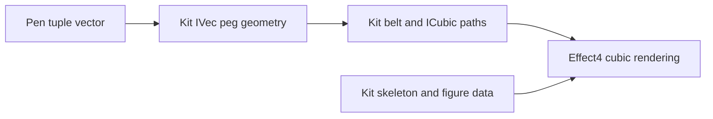

# Peg adapter placement

Status: research plan. The kit owns generic geometry after the first peg landing.
Effect4 keeps tuple vectors and cubic results as conversion arrows.
Every peg and figure carrier becomes a kit alias.

Concept: initial algebras and folds, concept 7 in `docs/core/semantics.md`.
Property: the existing exact normal laws cross the representation connector.
Registry role: tool laws under decisions row 334, point 3.
Consumers: `PegRender` and the legacy tuple-facing belt probes.
Requirement served: the R14 inspection tool boundary, without an Effect semantic claim.

| Obligation | Observation | Scope | Consumer | Bound |
| --- | --- | --- | --- | --- |
| Existing `normal_inset` in `tools/Tools/View/Tube/Belt.lean` | Optional integer normal equality | Every kit peg and integer inset | Shared casing normals | Kit law, no real-curve claim |
| Existing `normal_move` in `tools/Tools/View/Tube/Belt.lean` | Optional integer normal equality | Every kit peg and tuple vector | Tile placement | Kit law, no global contour claim |
| Existing `Skeleton.tour_move` in `tools/Tools/View/Tube/Skeleton.lean` | Contour equality after translation | Every kit skeleton and grid vector | Figure movement | Alias of the kit law |
| Existing `Skeleton.walk_head`, `Skeleton.walk_last`, and `Skeleton.walk_closed` in `tools/Tools/View/Tube/Skeleton.lean` | First and last walk vertex | Every kit skeleton | Rooted-tree observation | Aliases of the kit laws |

The adapter retains each observation and transports the kit's proof.
The skeleton and figure modules become aliases of their kit owners.
The SVG trust boundary remains unchanged.
