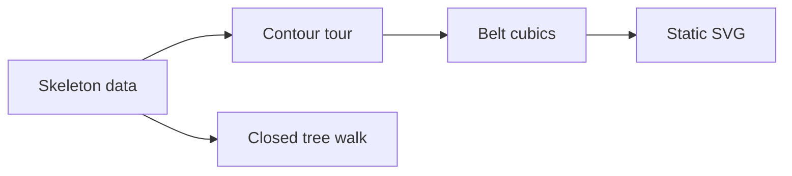

# Peg geometry placement

Status: research plan. This note proposes tool properties outside the Effect semantics registry.

The contour tree stores integer points, signed sizes, and ordered children.
A grid point means an integer position at the slot step.
A contour tour means the ordered pegs that the belt visits.

## Placement before proof

Concept: initial algebras and folds, concept 7 in `docs/core/semantics.md`.
Property: a data fold commutes with translation.
Registry role: proposed tool law, outside the Effect registry under decisions row 334, point 3.
Consumers: static glyphs and the coordinator's tile composition.
Requirement served: the tool projection of the program interface, without a new Effect requirement claim.

| Declaration | Question | Observation and hypotheses | Consumer | Bound |
| --- | --- | --- | --- | --- |
| `Skeleton.tour_move` in `tools/Tools/View/Tube/Skeleton.lean` | Does translation commute with the contour fold? | Ordered `GridPeg` lists, every finite skeleton and integer vector | Tile placement | No real-geometry claim |
| `Skeleton.walk_head` in `tools/Tools/View/Tube/Skeleton.lean` | Where does the tree walk start? | First grid vertex, every finite skeleton | `Skeleton.walk_closed` | No contour validity claim |
| `Skeleton.walk_last` in `tools/Tools/View/Tube/Skeleton.lean` | Where does the tree walk end? | Last grid vertex, every finite skeleton | `Skeleton.walk_closed` | No contour validity claim |
| `Skeleton.walk_closed` in `tools/Tools/View/Tube/Skeleton.lean` | Is the rooted walk closed? | First and last grid vertex agree, every finite skeleton | Tour API | No self-intersection claim |

The signed-peg belt stays in Effect4 during the kit merge.
The kit seat reserves its later generic move.
The skeleton owns ordered local decorations, rather than inferring angles from coordinates.

The rounded tangent and casing checks remain finite probes.
They establish no exact G1 theorem over real curves.
The view does not change machine judgments or the host boundary.
