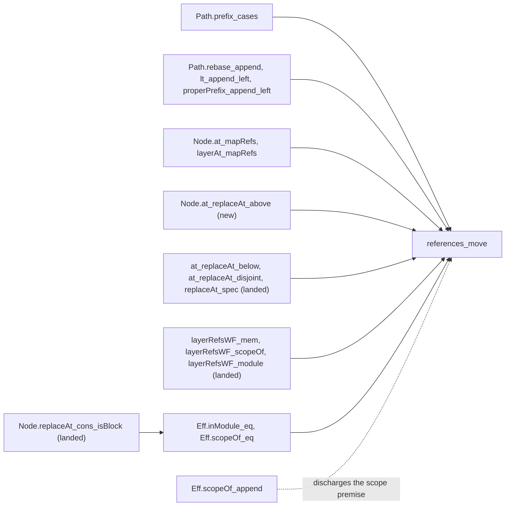

# Seat ADDRESS: receipt (2026-10-13)

Status: receipt (history, not authority). Brief: `docs/research/2026-10-13-seat-address-brief.md`.
Decisions rows 336 (6) and (7), 373 (9), 376 (1) and (3).

## The one thing to know before merging

Commit `041b1b6e6` regenerates `src/Effect4/Store/Domain/Derived/Program.lean`. So the merge rebuilds
the law graph above that file, about 350 law modules, which this seat did not build. The seat built
every direct reader of the regenerated file: 60 modules, the core root among them. The other commits
add new modules and one import at the end of each root. If the sweep must wait, cherry-pick
`d6fdd5081`, `d1723f49f`, `cfb5508fb` and the receipt, and leave `041b1b6e6`.

## What landed

- **`references_move`** is proved (the proposed claim `references-move`, seat ORG's L9, decisions
  row 336 (6)). It is in `src/Effect4/Laws/Program/AddressMove.lean`. A subtree whose references
  stay inside it keeps every reference well formed when it is pasted with `Node.rebaseRefs`. The
  address must be below the root, outside the module's layers, and in one scope.
- **`Node.rebaseRefs`, `Eff.rebaseRefs` and `Path.rebase`** are in the new core module
  `src/Effect4/Program/Address.lean`. The rewrite is one fold of `EffAlgebra.onRef` at each sort.
  The expansion of references (`expandAlgebra`, `src/Effect4/Program/Refs.lean`) uses the same
  algebra.
- **The address algebra under a move**: two paths nested or split (`Path.prefix_cases`), a path
  relocated, and program order past a common prefix. It also holds the third lookup around an edit
  (`Node.at_replaceAt_above`), beside the two that `Laws/Program/Address.lean` and
  `Laws/Program/References.lean` hold.
- **`Content (Eff NativeOp)` at kind `program`**, generated through the existing generator. The
  manifest's Program group gains one kind request and one import. The store's address lattice and
  round trip now reach a whole program (the proposed claim `program-digest-exact`).

## Base and head

- Base: `cdcedb4b4` (`refactor/phase1-phase3`).
- Head: the commit that adds this receipt, on `seat/address`.

## Commits

| Commit | What |
| --- | --- |
| `d6fdd5081` | the core module `Program/Address.lean`, the laws `Laws/Program/AddressMove.lean`, the battery `Test/Program/AddressMove.lean`, one import at the end of each root |
| `041b1b6e6` | `Content (Eff NativeOp)` at kind `program`: the manifest entry, the regenerated `Derived/Program.lean`, the battery `Test/Store/ProgramContent.lean` |
| `d1723f49f` | the move law reads the host's scope through the existing readers; the general reader `layerRefsWF_inScope` goes |
| `cfb5508fb` | `Path.eq_append_of_below` goes: no proof used it |
| this commit | this receipt |

## Files

- New: `src/Effect4/Program/Address.lean`, `src/Effect4/Laws/Program/AddressMove.lean`,
  `Test/Program/AddressMove.lean`, `Test/Store/ProgramContent.lean`, this receipt.
- Changed:
  - `src/Effect4.lean`, `src/Effect4/Laws.lean` and `Test/All.lean`: imports at their ends.
  - `tools/Effect4Gen/manifest.json`: the Program group's `Kinds` gains
    `Effect4.Program.Eff@Effect4.Program.NativeOp=program`, and its `Imports` gains
    `Effect4.Store.Domain.Node`, where `Content` lives.
  - `src/Effect4/Store/Domain/Derived/Program.lean`: regenerated. The driver reports the manifest's
    output, with one instance, one public import and the recorded command.
- `src/Effect4/Program/Refs.lean` and `src/Effect4/Laws/Program/References.lean` are unchanged.
  Their importers number 1,095 and 523, so the new definitions and laws sit in new modules beside
  them.

## Commands and results

Every `lake` command ran through `/Users/pooks/Dev/lean4-effect4/scratch/lean-slot.sh`, from the
worktree. Scratch files are in the session scratchpad under `address/`.

| Command | Result |
| --- | --- |
| `lake build Effect4.Laws` at the base | 1,069 jobs, restored from the cache |
| `lake env lean AddrCensus.lean`: every theorem whose statement names an address operation | 1,138 statements; 247 name only address operations and syntax, most of them generated equations |
| `lake build Effect4.Program.Address` | built |
| `lake env lean -DwarningAsError=true src/Effect4/Laws/Program/AddressMove.lean` | two errors, then clean |
| `lake build Effect4.Laws.Program.AddressMove ProofGraph.AxiomAudit`, then the audit | 73 declarations within `[propext, Quot.sound]` |
| `lake build Effect4 Effect4.Laws Test.Program.AddressMove` | 1,489 jobs; both roots and the battery built |
| `lake exe effect4gen Main --group Program … --kind Effect4.Program.Eff@Effect4.Program.NativeOp=program …`, into scratch | the difference is the recorded command and one instance |
| `lake env lean --run tools/Effect4Gen/Driver.lean --group Program` | `same`; after the import was added, `CHANGED` once |
| `lake build Effect4.Store.Domain.Derived.Program Test.Store.ProgramContent` | first refused: `Unknown identifier Content`; built after the manifest's import |
| `lake build` of the regenerated file's direct readers: `Effect4`, `Effect4.Api.RefusalsDerived`, `Effect4.Api.RunnerDerived`, `Effect4.Laws.Program.SketchWire`, `Effect4.Laws.Codegen.Metadata`, `OCaml5.Eff.Metadata`, `Tools.Session.Snapshot` and six batteries | 882 jobs, 60 modules built |
| `#axiom_audit Effect4.Store.Domain.Derived.Program Test.Store.ProgramContent` | 1,785 declarations within `[propext, Quot.sound]` |
| `#auto_census Effect4.Laws.Program.AddressMove using aesop`, before `d1723f49f` | 1 of 22 theorems closes from its statement (`Node.at_ref_cons`) |
| `lake build Effect4.Laws.Program.AddressMove Test.Program.AddressMove`, after `d1723f49f` and `cfb5508fb` | built |
| `#axiom_audit Effect4.Program.Address Effect4.Laws.Program.AddressMove Test.Program.AddressMove`, at the head | 71 declarations within `[propext, Quot.sound]`, no planned goal |

Not run:

- `lake build Effect4.Laws` after `041b1b6e6`: it rebuilds 350 law modules above the regenerated file.
- `Test.All`, the whole-tree axiom gate and the behaviour gates. The regenerated file gains an
  instance and an import; no codec, wire byte, printed program or run changes.

The regenerated file's new public import makes `Effect4.Store.Domain.Node` visible in 62 modules
that did not see it. Nine of them open `Effect4.Store`. None of the nine uses a bare name of that
module outside comments and strings (`git grep`), and all nine built.

## Axiom output

- The address modules and their battery: 71 declarations within `[propext, Quot.sound]`.
- The regenerated module and the store battery: 1,785 declarations within `[propext, Quot.sound]`.
- No planned goal rests in either set.

## Placements

Concept `initial-algebras-folds` (`docs/core/semantics.md` §2.7), requirement R14, unless the row says
otherwise. "Step" names the claim a theorem serves and its consumer.

| Declaration | Question: claim, role | Reach | Does not establish | Consumer, unlocks |
| --- | --- | --- | --- | --- |
| `references_move` | proposed `references-move`, preservation; its pointer | every alphabet; the premises of the statement above | typing; references that leave the subtree; a paste into the module's layers; variable levels; row positions; any run | row 336's V4 graph operations; a piece's paste after ruling 3 |
| `Path.prefix_cases` | step of `references-move` | every pair of paths | anything of nodes | `references_move` |
| `Path.below_append`, `Path.rebase_append` | steps of `references-move` | every base | a path outside the base, which the battery evaluates | `references_move` |
| `Path.lt_append_left`, `Path.properPrefix_append_left` | steps of `references-move` | every common prefix | the reference order across the module test | `references_move` |
| `Path.spineIndex_append`, `Eff.scopeOf_append` | steps of `references-move` | every node that is no spine of a block's bodies | a path at the root of a block | the scope premise, at the battery's reader |
| `Node.at_replaceAt_above` | step of `address-composes`, compatibility | every alphabet | typing | `references_move`; a third lookup beside `at_replaceAt_below` and `at_replaceAt_disjoint` |
| `Node.at_ref_cons`, `Node.layerAt_congr` | steps of `references-move` | every alphabet | nothing beyond the lookup | `references_move` |
| `Node.child_mapRefs`, `Node.at_mapRefs`, `Node.layerAt_mapRefs`, `LayerTerm.mapRefs_eq_ref` | steps of `references-move` | every target map | the expansion, which replaces a reference by a term | `references_move` |
| `at_of_mem_refSites` | step of `references-move` | every program | the order of the sites | `references_move` |
| `Eff.inModule_eq`, `Eff.scopeOf_eq`, `Eff.refBefore_of_inModule_eq`, `Eff.refFault_isNone_of` | steps of `references-move` | every program and path | typing | `references_move` |
| `instContentEff` (generated) | proposed `program-digest-exact`, concept `exact-codecs`, compatibility, requirement R8 | a whole program with a well-formed payload | a subtree's key; sharing; hash injectivity, which `address_inj` takes as a named premise | the store keying a program (MCP slice M4); a table cache keyed by digest |

## Proposed semantics registry entries and decisions rows

The semantics registry (`tools/ProofGraph/Registry.lean`) and the decisions register are the coordinator's.

- **`references-move`**: concept `initial-algebras-folds`, role `.preservation`, pointer
  `Effect4.Program.references_move`. Title: a subtree whose references stay inside it keeps the
  host's references well formed when it is pasted with `Node.rebaseRefs`. The address is below the
  root, outside the module's layers and in one scope. Nothing of typing, of references that leave
  the subtree, of variable levels or of row positions.
- **`program-digest-exact`**: concept `exact-codecs`, role `.compatibility`, pointer
  `Effect4.Store.address_eq_or_collision`, reach programs through `instContentEff`. Title: the store
  keys a whole program by an exact digest. Equal addresses of two programs with well-formed
  payloads are equal programs, or two node byte strings with one digest.
- **`address-composes`**: its title can name `Node.at_replaceAt_above`, the lookup above an edit.
- **A row for `Eff.strengthen`** (see Stops): the generator emits a monadic frontier map, and
  `ScopedOp` gains coherence laws, or a lawful subclass does.
- **A row for the order on paths**: `Path.lt` becomes `Field.ltKey`, and `PathOrder.lean`'s five
  order laws become `FieldOrder.lean`'s (see the duplicates below).

## Gathered and reused declarations

### Reused

The proofs use these landed declarations, each at its own name:

- `Node.at_append`, `Node.replaceAt_append`, `Node.at_replaceAt_below` (`Laws/Program/Address.lean`);
- `Node.replaceAt_spec`, `Node.at_replaceAt_disjoint`, `Node.layerAt_eq_some_iff`
  (`Laws/Program/References.lean`);
- `Node.exists_at_of_mem_foldList`, `refYield`, `mem_refSites_of_at`, `layerRefsWF_mem`,
  `layerRefsWF_scopeOf`, `layerRefsWF_module` (`Laws/Program/PathFold.lean`);
- `Eff.inModule_append` (`Laws/Program/PathOrder.lean`), `Eff.refFault_isNone`
  (`Program/Refs.lean`);
- `Eff.isBlock` and `Node.replaceAt_cons_isBlock` (`Laws/Program/Typing/PartsTable.lean`);
- `EffAlgebra.onRef`, `cata_eff` and its six siblings (`Program/Fold.lean`);
- `address_eq_or_collision` (`Store/Domain/Node.lean`) and `get_put` (`Store/Domain/Store.lean`), at
  programs, in the store battery;
- the generator (`tools/Effect4Gen/Main.lean`, `tools/Effect4Gen/Driver.lean`), unchanged;
- the battery programs of `Test/Program/ReferenceExpansion.lean` (`leaf`, `around`, `oneRef`,
  `moduleDecl`).

### Duplicates found and not gathered

The statement census (`AddrCensus.lean`) found these. In-degrees count uses along proof terms at the
base. None is gathered, for one of two reasons:

- **Out of bounds.** `src/Effect4/Laws/Program/Typed/**` is seat COUNTDOWN's to edit (the reuse
  census's boundary map).
- **Too wide a rebuild.** Every other edit rebuilds 248 to 1,095 modules, against "narrow builds
  only" with two slots shared by six seats.

| Family | The home | The copies | Plan |
| --- | --- | --- | --- |
| one more child index | `Node.at_child` (`Laws/Program/Address.lean`, 7) | `Typed.node_at_child` (`Laws/Program/Typed/Denotation/Terms.lean`, 22); `Typed.at_snoc1`, `Typed.at_snoc2`, `Typed.at_frame` (`Laws/Program/Typed/Commands/Clauses/Gen.lean`, 2, 1, 2); `Agreement.Node.at_append` (`Laws/Program/Agreement.lean`, 10, the native alphabet's form) | state the generic `Node.at_snoc` in `Laws/Program/Address.lean`; the copies' users name it or `Node.at_child`; the copies go |
| a machine point's child | `Sched.at_child_of`, `Sched.at_childWith_of` (`Laws/Program/Intro/Weight.lean`, 18, 6) | `Agreement.at_child`, `Agreement.at_childWith` (`Laws/Program/Agreement.lean`, 13, 10), their instances, upstream of them | move the general pair into `Agreement.lean` under the instances' names; `Intro/Weight.lean` reads them there |
| a layer's node | `Node.layerAt_eq_some_iff` (`Laws/Program/References.lean`, 3) | `Node.at_of_layerAt` (`Laws/Program/Typed/Scope.lean`, 4), its forward direction | the four users name `(Node.layerAt_eq_some_iff _ _ _).mp` |
| the order on keys and paths | `Field.ltKey` with `ltKey_irrefl`, `ltKey_trans`, `ltKey_asymm`, `ltKey_total`, `lex_trichotomy` (`Data/FieldOrder.lean`) | `Path.lt` (`Program/Refs.lean`) with `Path.lt_irrefl`, `lt_trans`, `lt_asymm`, `lt_total`, `lt_trichotomy` (`Laws/Program/PathOrder.lean`; 5, 6, 2, 4, 1) | one function with four equal equations, equal only extensionally (`rfl` fails); `Path.lt` becomes `Field.ltKey`, and its laws become the key order's |
| the bodies' spine | `Path.spineIndex_append` (new, `Laws/Program/AddressMove.lean`) | `spineParams_append` (`Laws/Program/Typed/Scope.lean`), the parameters' form | derive it through `spineParams_index` there |
| stranded basis | the address modules | `Table.under_self`, `Table.under_append`, `Table.under_prefix_false`, `Table.under_sibling_false` (`Laws/Program/Typing/PartsTable.lean`, `Typing/Splice.lean`; 3, 2, 2, 5); `Node.child_add_three` (`Typing/Splice.lean`); `Node.at_stmts_nil`, `Node.at_layers_nil`, `Node.replaceAt_eff` (`Typing/Replace.lean`); `Node.replaceAt_defs_body`, `defs_main`, `effs_head`, `effs_tail`, `layers_cons` (`Typing/PartsTable.lean`) | move them when `Table.under` moves into the address core module, after seat APPCHECK |
| dead access lemmas | `Node.replaceLayerAt_spec` (`Laws/Program/References.lean`) | `Node.layerAt_replaceLayerAt` (0 uses, its projection), `Node.replaceLayerAt_eq_replaceAt` (0 uses, `rfl`) | delete at the next edit of `References.lean` |

One duplicate of this seat's own was found and removed. `layerRefsWF_inScope` made
`layerRefsWF_scopeOf` and `layerRefsWF_module` special cases proved apart, and it went in
`d1723f49f`.

### The reuse census, checked as leads

Gemini's census (`docs/research/2026-10-13-authoring-obligations/gemini-reuse-census.md`, §5) was
read when it appeared.

- Its reuse list matches what the proofs use.
- Its claim that the generator derives `program-digest-exact` does not hold. The generator emits the
  instance, and the claim rests on the general store laws.
- `Path.properPrefix_trans` and `Path.append_prefix` name no declaration.
- Its boundary map lists the manifest as read-only for this seat. The brief asks for the generator
  route, and the brief is followed.

## Stops

- **A piece's key** (the MCP note's ruling 3, `docs/research/2026-10-09-mcp-code-mode-design.md`
  §10.2) is untouched. The store battery shows why it is a ruling. One program, and the same program
  one slot deeper (`Eff.weaken 0`), have two addresses.
- **`Eff.strengthen`** is named by seat ORG's map (rank 5) and not built. It needs two things that the
  tree lacks.
  - An option-valued traversal of the term frontier. The generator emits the pure `frontierMap`
    only. The full family's monadic fold (`foldM_eff`) would also rewrite the closed layer bodies,
    which `Eff.weaken` leaves as they are. So the generator must emit a monadic frontier map, and the
    brief says to stop and propose a generator change.
  - Exactness at every alphabet needs `ScopedOp.term?` and `ScopedOp.mapTerm` to cohere. The class
    has no such law.
  - With both, `Eff.strengthen cut` and `Eff.weaken cut` form an exact embedding. The typing law
    then follows from `check_weaken`. The consumers are a move to a shallower environment (V4) and a
    piece's extraction (ruling 3).
- **A path bank for aesop** is not added. A new bank edits `src/Effect4/Laws/Auto/RuleSets.lean`,
  which the whole law graph imports. Plain aesop closed one of the module's 22 theorems at the
  census, so a bank waits for a consumer.

## Open obligations

- The semantics registry entries and rows above, by the coordinator.
- The law graph's rebuild above `Derived/Program.lean` at the merge of `041b1b6e6`.
- The duplicates' plans, at a sweep that can rebuild their importers. The `Typed/**` ones go through
  seat COUNTDOWN.
- `Laws/Program/Address.lean` still says that the checker's base law is not stated (the 2026-10-09
  overwatch). A docstring edit there rebuilds 494 importers, so it waits for that module's next edit.
- `references-move` has no built consumer: the graph operations of row 336's V4 are not built.

## Bounded evidence

- The batteries are finite controls.
  - `Test/Program/AddressMove.lean` evaluates seat ORG's probe both ways and applies the law at the
    probe's paste. It breaks each of four premises at its own fault: `inner`, `outside`, `hmod` and
    `hscope`.
  - `Test/Store/ProgramContent.lean` evaluates the instance's kind, applies two store laws at
    programs, and shows a position-dependent address.
- The theorems are general. No evidence is host-only.
