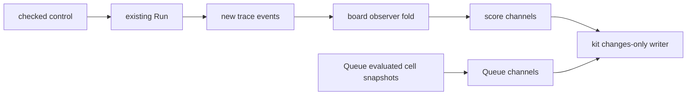

# The board observer and the films

Status: research plan. Base: `25c97480f797c17cd89b2e7adb7e2c66c67d6c15`.

The Queue film reads cell snapshots. Trace events contain no store changes.
The score reads the trace produced by checked controls.

## Definitions

The board observer pairs an existing state with its projected marking.
Its arrows are a state transition, an observed change, and an action on markings.
`Board.fold` folds these arrows over an existing command list.
It defines no second machine or program syntax.
The kit owns changes-only writing through `Smil.marking` in `Whatwg/Html/Node/SvgBoard.lean`.

## Proof placement before work

| Property | Placement |
| --- | --- |
| Concept | `initial-algebras-folds`, the required agreement of folds |
| Proposed question | `view-board-projection-fold`, tool invariant under row 334 (3) |
| Role | invariant |
| Pointer | `Board.fold_projection` in `tools/Tools/View/Tube/Board.lean` |
| Observation | equality of the board marking and the selected projection after each command prefix |
| Fragment | finite command lists with a supplied transition and observed change |
| Hypotheses | the change action agrees with the projection at every transition |
| Cuts | row 362 keeps the view outside Effect semantics; row 374 selects the board |
| Register boundary | no counterexample register entry changes |
| Requirement | R14 tool groundwork; no core requirement status changes |
| Consumer | `Score.record` in `tools/Tools/View/Tube/Score.lean` uses the observer |

`Board.fold_append` serves this question by exposing command-list concatenation.
Its observation is equality of observer results on a concatenated command list.
It assumes no projection law.

These conditional laws leave transition agreement open for each chosen machine projection.
They establish neither progress nor liveness.
They establish no event-only store projection.
The host boundary stays in `docs/core/host-boundary.md`.
The strong store law needs snapshots or future store events.

## Film scope

The score draws its final staff geometry once.
Its units, hollows, exits, and ticks change only on recorded control boundaries.
The Queue draws fixed pipework once and places contents from evaluated snapshots.
The Queue film fixes the inlet at its greatest recorded load.
This film omits the old inlet sag interpolation and pressure swells.
Neither film samples path morphs.
The kit's discrete replay law supplies each written channel's tick observation.
Browser execution remains a host observation.

## Fixed-structure admission

The public film boundary checks each snapshot before writing any animation.
Each snapshot has distinct keys.
A repeated key keeps its tube, direction, layer, tone, fill, level, and cap fields.
A filled mark also keeps its width and dash.
Stroke width and dash remain scalar channels.
The writer refuses a changed invariant field at its snapshot and key.
The unchecked writer stays private.
The proposed tool question is `view-board-fixed-admission`, under `initial-algebras-folds` and R14 groundwork.
Its role is formation of fixed-structure snapshots at the tool boundary.
Its observation is the refusal or admission returned by `Board.check` in `tools/Tools/View/Tube/Board/Film.lean`.
Its scope is finite mark snapshots under row 362.
Finite red controls cover a changed path and a repeated key.
No theorem claims admission against an independent geometric judgment in this slice.

## Checks

Build the touched modules with `LEAN_NUM_THREADS=3`.
Audit their exact names through `#axiom_audit`.
Record rendering dependencies separately if they reach `Classical.choice`.
Run finite controls for repeated markings, parked fibers, and waiting Queue requests.
The coordinator measures page generation and output sizes after integration.
