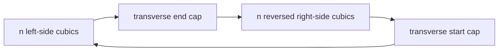

# Emitted connector contour diagnostic

The coordinator must keep the current output red until the connector constructor changes.
Do not treat one SVG fill group as one contour.

## Base, head, and files

The base is `98d32093df7bc3f7a0a670c727e14800cf28b6d4`.
The implementation head is `81f05752ca1105f6a6b0ab61b78cbfc68cc1761a`.
The branch is `codex/connector-check`.
The worktree is `C:/Users/kokok/Dev/effect4-peg-board`.

`tools/view/check_connectors.py` owns the diagnostic.
`docs/research/2026-10-13-connector-check-evidence/` holds its measured JSON results.
The generated SVG directories remain unchanged and uncommitted.

## Observation and format

A contour is one closed sequence of emitted cubic segments.
The finite profile selects filled forward connectors whose existing `data-key` contains `→`.
It selects the named organic `bumpY` fixtures, not arbitrary SVG drawings.

The constructor format has four parts.

The diagnostic requires one path element and one closed subpath per connector key.
It requires an even cubic count of at least six.
It derives `n` as half that count, minus one.
The transverse caps occupy indices `n` and `2n+1`.
Both caps must use the producer's straight-cubic encoding.

The diagnostic checks every internal side junction, including each flare neck.
It does not use producer metadata or discard failing joints.
The last explicit cubic must return to the moveto within `1e-6` logical units.
Side endpoints must agree within the same tolerance.
Oriented side tangents must agree within one degree by default.
A zero first derivative uses the first nonzero endpoint control difference.
A constant cubic has no admitted tangent.

`inspect_svg.validate_svg` in `tools/view/inspect_svg.py` checks XML, references, and path grammar first.
The diagnostic then reads the emitted absolute `M/C/Z` profile.
It refuses nonfinite coordinates and unsupported path commands.

## Commands and results

The baseline input is `C:/Users/kokok/.codex/worktrees/pegs-port/lean4-effect4/tools/view/out/graph-flows-final`.

| Command | Result | Evidence |
| --- | --- | --- |
| `python tools/view/check_connectors.py --self-test --json docs/research/2026-10-13-connector-check-evidence/SelfTests.json` | Exit 0; 15 finite controls pass | `SelfTests.json` |
| `python tools/view/check_connectors.py <baseline> --json docs/research/2026-10-13-connector-check-evidence/Baseline.json` | Exit 1; 16 files, 103 connectors, 98 findings | `Baseline.json` |
| `python tools/view/check_connectors.py --kink-fixture <baseline>/009.svg --json docs/research/2026-10-13-connector-check-evidence/Kink.json` | Exit 0; the retained defect's signature agrees | `Kink.json` |
| `git diff --check` | Pass | Command output |

All baseline findings are `MULTIPLE_PATHS`.
Five already-single connector bodies supply 70 checked side junctions.
Those junctions meet the default tolerance.
The controls reject multiple pieces, multiple subpaths, a side kink, reversed tangents, and a hidden closing edge.
They also reject a curved cap, an open contour, an odd segment count, and a nonfinite coordinate.
The controls admit a smooth contour and a valid zero-handle endpoint tangent.

## Retained geometric counterexample

The retained frame is `009.svg`, the handler around a scope.
Its SHA256 is `e243cdadda487aa6c12034965ff2ad65b55e88ca36671534361233c9408b2af9`.
The route key is `[]/fork→[1]`.
Its body is path 5, and its target collar is path 6, in one-based document order.
The body cubic index is 9, and the collar cubic index is 2, in zero-based order.
`check_connectors.KINK_BODY` and `check_connectors.KINK_COLLAR` retain their exact emitted controls.

The finite crossing probe finds `(93.78543469309432, 508.58693118927243)`.
The tangent angle is `43.256558967551` degrees.
At `y=508.5`, the body supplies the outer right boundary.
At `y=508.7`, the collar supplies it.
The recorded crop is `89 503 14 12`.
These observations concern the emitted cubic data, not browser pixels.

## Placement and limits

This diagnostic serves R14 inspection under the concept `initial-algebras-folds`.
It supplies finite controls for the connector renderer, not a new registry theorem.
No Lean source changes, proof obligations, or axiom exemptions land in this slice.
No Lake build or axiom audit applies to this Python-only change.

The constructor format bounds the check.
Its two cap junctions remain deliberate exceptions.
An arbitrary `stepY` corner needs a separate named fixture profile.
One degree is a finite numerical tolerance, not a proved universal rounding bound.
The diagnostic establishes neither global simplicity nor correct docking, width, curvature, clearance, or program semantics.
It does not compare browser pixels or interpret unbounded executions.
The coordinator must run it against the replacement constructor's generated output.

No external runtime behaviour gate is reached.
The remaining host boundary is Python floating-point arithmetic and local file reading.
