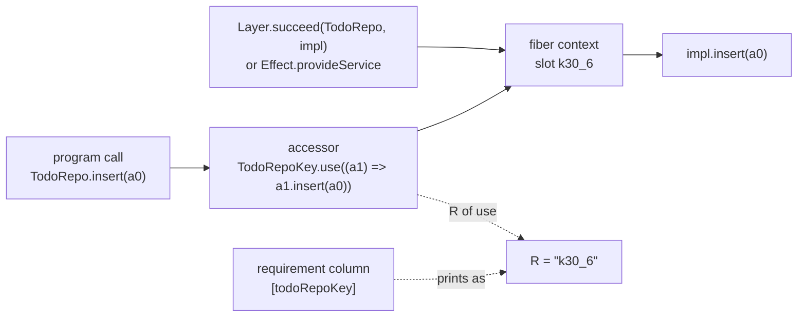

# Seat ROWS receipt: host rows as Effect services, slice E3 (2026-10-13)

Status: receipt (history, not authority). Seat ROWS, branch `seat/rows`, worktree
`~/Dev/lean4-effect4-rows`. The brief is the coordinator's prompt of 2026-10-13. The plan is
`docs/research/2026-10-13-emitted-services/README.md`, slice E3, under decisions row 378 (19).

## The one thing to know before merging

E3 landed as option A, which the coordinator chose during the seat. The call site still prints
`TodoRepo.insert(a0)`. The module declares the namespace as the service key with one accessor per
method, and each accessor is the ruled `Key.use((r) => r.method(x))`. So no printer, no reader and
no law moved. The to-do's rows now require `todoRepoKey`, so every request's requirement row is
`[todoRepoKey]`, and lane S's `ocaml/engine/test/scenarios/todo.txt` changes with it. The
coordinator regenerates that file. The ruled form at the call site, option B, is the open slice of
section 6. Its law map is there.



## Base, head and evidence words

- Base: `c2620b4ac`, as the brief names. Before its first commit the seat fast-forwarded to
  `6f32c88cd`, the key spelling's move to `Types.lean`. Before this receipt it fast-forwarded to
  `c4f56a879`, the coordinator's merge of E3.
- Commits: `36df578e2` (`serviceKeyDecl`), `99c686d6e` (E3, option A), `9b577e378` (the paged
  to-do's rows). Head: the commit that adds this receipt.
- Evidence words: **proved** means the kernel checked it and `#axiom_audit` passed its module.
  **Tested** means a `#guard` or a gate ran green at the head. **Reproduced** means a scratch
  evaluation printed the result. **Assumed** means read in the source and not run.

## 1. What landed

| Commit | Files | What |
| --- | --- | --- |
| `36df578e2` | `src/Effect4/Codegen/Print.lean` | `serviceKeyDecl name identity fields`: `const name = Context.Service<"identity", { fields }>("identity")`, the half of `printService` that prints a key. `printService` calls it; seat SVC calls it for the application's service |
| `99c686d6e` | `src/Effect4/Codegen/RowServices.lean` (new), `src/Effect4.lean` (one import at the end of the block), `src/Effect4/Program/Authoring/Declare.lean`, `Test/Dogfood/Scenario/Todo.lean`, `harness/truth/session/Keyed.lean`, `keyed-bindings.ts`, `keyed-observation.ts`, `run-keyed.ts` | the service rows, their declarations and refusal; `eff_rows … key k`; the to-do's key; the keyed lane's provision |
| `9b577e378` | `Test/Dogfood/Scenario/TodoPaged.lean`, `src/Effect4/Codegen/RowServices.lean` (one line wrapped) | the paged to-do's three `TodoRepo` rows take the key, so the namespace stays one service |

### 1.1 The declarations (`src/Effect4/Codegen/RowServices.lean`)

| Declaration | What it is |
| --- | --- |
| `splitDot`, `serviceParts` | a spelling `Ns.method` split on its one dot, read off its bytes and decoded by `Store.decodeString`: no traversal of a `String` |
| `Row.serviceCall?` | a call row with no trailing argument and no declared type argument, whose requirement column names one key and whose spelling is `Ns.method`, is method `method` of service `Ns`. The column is read first |
| `serviceKeyMembers` | the names an accessor may not take: the key's members in rc.112, each cited (`Context.ts:64-69`, `:98-103`, `:395-410`, `:419-447`; `Effect.ts:117`; `Pipeable.ts:44-45`; `Inspectable.ts:126-129`; `internal/core.ts:66-79`, `:100-113`) and `Object.prototype`'s |
| `RowService`, `rowServices` | the services of a table, one per namespace, in table order |
| `rowBreaksServices`, `rowServiceFault` | the located refusal: the first row that breaks the services, by its spelling (section 1.2) |
| `rowMethodField` | a method's field in the shape: `readonly m: (a0: Request) => Effect.Effect<A, E, never>`, through `typeRefOf` and `declarationType` |
| `rowAccessor` | a method's accessor: `m: (a0: Request) => NsKey.use((a1) => a1.m(a0))` |
| `rowServiceDecls` | the envelope's function: per service, `export const NsKey = serviceKeyDecl …` and `export const Ns = Object.assign(NsKey, { … })`; `.unsafeName spelling` where `rowServiceFault` names a row |

The key's identifier is `keyText K` (`"k30_6"`), the spelling that `requirementType` prints. So
the requirement of `NsKey.use(…)` is the requirement row that the checker computes. Both
constants are exported, as the reading boundary's envelope check asks (`layersPlain`,
`src/Effect4/Codegen/Admit.lean`; seat SVC's note).

### 1.2 The located refusal and its red controls

`rowServiceFault` refuses a table by the spelling of the first row that breaks its services. Six
cases break them:

- the row requires a key and is no service row;
- a row of a service's namespace names another key or none;
- a method's name is a key member, which `Object.assign` would shadow;
- two methods share a name;
- two services share a key, which is one context slot;
- `NsKey` is another service's name.

`rowServiceDecls` also refuses a service whose key is the signature's scope. The battery holds three
red controls (tested, `Test/Dogfood/Scenario/Todo.lean`, section 8): a method `TodoRepo.use`, a
plain row `TodoRepo.find`, and a keyed row `find` with no namespace.

### 1.3 The requirement column (item 2)

`eff_rows TodoRepo key todoRepoKey …` writes `requires := [todoRepoKey]` on each row. The typing
statement is `checkRow` (`src/Effect4/Program/Typing/Rules.lean`): a row call's type has the
requirement `Requirement.ofList row.requires`. For a closed row, `rowTy_closed_some`
(`src/Effect4/Laws/Program/Template.lean`) states it, proved before this seat. The battery reads it
at the real table: each of the four requests builds with `requires = [todoRepoKey]` (tested).

`todoRepoKey` is `⟨30, 6⟩`. The name `30` is free (`Env.firstFreeName` is `4`). The code `6` is the
built-in code whose carrier is `unit`. Admission needs a carrier for every required key
(`SigApp.serviceTy`). The machine never reads the service's value, because the host answers the
rows (assumed: read in `Program/SigApp.lean` and in the to-do's runs).

## 2. The printed to-do call, before and after

Reproduced by a scratch render of `request (add (str "milk"))` through `Api.printModule`.

Before (the rows with no key; the header bound `TodoRepo` by `scenarioRows`):

```ts
export const main: Effect.Effect<{ readonly done: boolean; readonly id: number; readonly title: string }, readonly ["SqlError", string] | readonly ["EmptyTitle", "a title is required"], never> = ifCase(() => eq("milk", ""), () => Effect.fail(pair("EmptyTitle", "a title is required")), () => TodoRepo.insert("milk"))
```

After (the same call; the requirement names the key, and the module declares the service):

```ts
export const TodoRepoKey = Context.Service<"k30_6", { readonly insert: (a0: string) => Effect.Effect<{ readonly done: boolean; readonly id: number; readonly title: string }, readonly ["SqlError", string], never>; readonly all: () => Effect.Effect<ReadonlyArray<{ readonly done: boolean; readonly id: number; readonly title: string }>, readonly ["SqlError", string], never>; readonly setDone: (a0: readonly [number, boolean]) => Effect.Effect<Option.Option<{ readonly done: boolean; readonly id: number; readonly title: string }>, readonly ["SqlError", string], never>; readonly "delete": (a0: number) => Effect.Effect<boolean, readonly ["SqlError", string], never> }>("k30_6")
export const TodoRepo = Object.assign(TodoRepoKey, { insert: (a0: string) => TodoRepoKey.use((a1) => a1.insert(a0)), all: () => TodoRepoKey.use((a0) => a0.all()), setDone: (a0: readonly [number, boolean]) => TodoRepoKey.use((a1) => a1.setDone(a0)), delete: (a0: number) => TodoRepoKey.use((a1) => a1.delete(a0)) })
export const main: Effect.Effect<{ readonly done: boolean; readonly id: number; readonly title: string }, readonly ["SqlError", string] | readonly ["EmptyTitle", "a title is required"], "k30_6"> = ifCase(() => eq("milk", ""), () => Effect.fail(pair("EmptyTitle", "a title is required")), () => TodoRepo.insert("milk"))
```

The method `delete` is a keyword. It is a legal property name, so `serviceParts` checks the method
with `SourceBindings.identifierBytes`, which admits keywords, and not with `targetIdentifier`.

## 3. Commands and results

All Lean runs went through `/Users/pooks/Dev/lean4-effect4/scratch/lean-slot.sh` from the worktree.
`<scratch>` is `/private/tmp/claude-501/-Users-pooks-Dev-lean4-effect4/e1e92e6e-f6fa-4134-946a-d08ffba1e7ca/scratchpad`.

| Command | Result |
| --- | --- |
| `lake build Effect4.Codegen.Print Effect4.Laws.Codegen.Services Effect4.Laws.Codegen.Module Test.Codegen.ServicesPrint` (at `36df578e2`) | green, 404 jobs |
| `lake build Effect4.Codegen.RowServices Effect4.Program.Authoring.Declare Test.Dogfood.Scenario.Todo Test.Dogfood.Scenario.Todo.Claims Test.Program.AuthoringDeclare` | green, 1176 jobs |
| `lake build` of the to-do's direct importers and the host lane's modules: `Test.Program.CallInstance`, `Test.Program.DenoteRowsContract`, `Test.Api.SessionMeaning`, `Test.Dogfood.Scenario.Tape`, `Test.Dogfood.Scenario.TodoPaged`, `Test.Dogfood.Scenario.Todo.Tree`, `Test.Api.HostSessionContract`, `Test.Api.KeyedHostContract`, the five other scenarios, `Tools.ProfileJson` | green, 1372 jobs |
| `lake build Test.Dogfood.Scenario.TodoPaged` (at `9b577e378`) | green, 1118 jobs |
| `python3 scripts/check-host-protocol.py` (at `9b577e378`) | `PASS host-protocol`; keyed host 57 rc.112 runs; keyed scenarios 86 scripts in 295 runs on effect 4.0.0-rc.112 under bun 1.4.2, the to-do 13 of them, through the provided service; 47 red controls; bun test 56 pass |
| `#axiom_audit Effect4.Codegen.RowServices Effect4.Codegen.Print Effect4.Program.Authoring.Declare Test.Dogfood.Scenario.Todo Test.Dogfood.Scenario.TodoPaged` (`<scratch>/lean/Audit.lean`, `lake env lean`) | `#axiom_audit: 346 declarations within [propext, Quot.sound], 0 of them modulo planned goals; 0 planned goals` |
| tsgo 7.0.0-dev.20260629.1, the pinned `@typescript/native-preview`, on `<scratch>/tsfix/fixture.ts`: Lean's two declarations verbatim, `yield* TodoRepo.insert("x")` and the other three methods, `Layer.succeed(TodoRepo, impl)`, `Layer.succeed(TodoRepoKey)(impl)`, `Effect.provide` to `R = never` | exit 0 |
| the same with its two `@ts-expect-error` markers removed (`<scratch>/tsfix-red`) | two errors: `Type '"k30_6"' is not assignable to type 'never'` for the unprovided program; `Type 'string' is not assignable to …` for an `insert` that answers a string |
| `bun --no-install run.ts` in `<scratch>/tsfix`, effect 4.0.0-rc.112 from the pinned install (printed by `version.ts`), bun 1.4.2 | `closed` and `closedByKey` answer the to-do, the list, the updated to-do and `true`; the unprovided program fails with `Service not found: k30_6` |
| `check-ts-reader` | not run: none of its inputs changed (`ts/eff` untouched; the printer and the corpus unchanged) |

The tsgo and rc.112 rows are finite checks on one fixture, host-only evidence.

## 4. Placement

No theorem landed. The landing is definitions, finite evaluations and controls. Its placement for
the record: concept `exact-codecs` and the faces (R8) for the printed form; R5 (typed
requirements) for the requirement column. It unlocks E4: the to-do module, its consumer under tsgo
7 and its run on rc.112 against a recorded `TodoRepo` layer.

## 5. Open obligations

1. **Option B, the ruled form at the call site.** Section 6.
2. **`R` reads as `"k30_6"`.** Section 7.
3. **The envelope does not call `rowServiceDecls` yet** (assumed: no caller outside the battery and
   the keyed lane). The module emission (`Codegen/Checked.lean`, seat SVC's) must call it, place the
   declarations before every declaration that calls `Ns.m`, and refuse the module where it refuses.
4. **The readers.** `Api.readModule` and `ts/eff/read.ts` read no row-service declaration (assumed:
   read in `readModule`'s declaration split, not run). The declarations are a function of the
   table, so a reader may recompute them and compare.
5. **A program that reads the key itself.** `Effect.service(todoRepoKey)` prints a second key
   (`printKey`: `Context.Service<"k30_6", void>("k30_6")`, the carrier of code `6`). Refuse it, or
   type the key's carrier as its shape; not decided.
6. **The other scenarios** (routing, workers, timeout, atomic, queue-workers) still bind their
   namespaces in the header. Only the to-do and the paged to-do moved. Each moves by `key k` on its
   rows (`Row.host` rows by `{ r.row with requires := [k] }`).
7. **The paged to-do's cursor type** `TodoRepo.Cursor` prints in the shape as a type reference.
   No module declares that type (assumed: read in the type printer, not run). No lane type-checks
   that module yet.
8. **The class-aware header reader** (the coordinator's offer) did not fit this box. A sketch:
   - `Classes.readTyIn classes : TypeRef → Option Ty` reads a class name as its payload record;
   - it owes `readTyIn_ofTy` and its exactness;
   - `readDefHead` and `readParam` take the module's classes, and `DefDecl.readable` reads them;
   - `readDefHead_printDef` and `readModule_printModule_defs` are proved again;
   - `ts/eff/read.ts` changes in the same way.
9. **Proposed decisions row text** for row 378 (19), in three parts:
   - the printed form is the namespace as its key with one accessor per method;
   - each accessor is `Key.use((r) => r.method(x))`, and the call site prints `Ns.method(x)`;
   - option B, the form at the call site, stays open with its law map in this receipt.

## 6. Option B: the law map of `Ns.use((r) => r.method(x))` at the call site

The print of `perform` changes, so the row-call steps of `read_print` and `read_exact` move. A
draft (not landed) dispatched at the template's `rowCall` arm. The functions printed by
`printRow`, `printCall` and `printPerform` stay as they are, so their lemmas keep their statements.

| Place | Change |
| --- | --- |
| `Codegen/PrintLeaf.lean` | `printServiceCall n row ns m request` (`.call (.member (.ident ns) "use") [Binders.write n [0] (.method (.ident (Var.name n)) m args)]`, the request at `n + 1`); `printRowCall` (service row, else `printPerform`); `printRowCall_of_none`, `printRowCall_cases`; `serviceParts_spelling : serviceParts s = some (ns, m) → ns ++ "." ++ m = s` (drafted; the kernel accepted it in a draft build of `PrintLeaf`; not audited; steps `splitDot_some`, `decodeString_exact`, `String.toByteArray_append`) |
| `Codegen/Templates.lean` | the `rowCall` arm prints `printRowCall` |
| `Codegen/Print.lean` | `print_perform` states `printRowCall`; `print_perform_of_none` |
| `Codegen/PrintTyped.lean` | `printPerformAt`'s `none` case is `printRowCall`, so `noneHom` stays `rfl`; its `some` case refuses a service row |
| `Codegen/PrintEliminators.lean` | `perform` refuses a service row, or prints its form typed |
| `Codegen/Read.lean` | `readService` (the form, the spelling `ns ++ "." ++ m`, the row's `serviceCall?`, the binder `a{n}`, the request at `n + 1` and in scope at `n`); `readPerformRow` (the service reading first, else `readPerform` and a refusal of a service operation); `readRow`'s `rowCall` arm reads by it |
| `Laws/Codegen/ReadLeaf.lean` | `Signature.atFaces` also clears `requires`, so `print_rowAnswer` and the five face lemmas keep their statements; `readPerform_exact` concludes `printPerform`; new `readPerformRow_exact`, `readService_exact`, `readService_printServiceCall`, `readPerformRow_printRowCall` |
| `Laws/Codegen/ReadPrint.lean` | `rowPrint_inv`'s `rowCall` case names `printRowCall`; `printRowCall_head` (none or the spelling) carries `matchT_none_of_reserved`, `readT_action_none_of_printRow` and `earlier_none_rowCall`; `readRow_rowCall_print` and the node step's `rowCall` case |
| `Laws/Codegen/Read.lean` | the exactness arm of `readRow` uses `readPerformRow_exact` |
| `Laws/Codegen/PrintReadable.lean` | the printer's success on the readable domain at the `rowCall` row |
| `Laws/Codegen/PrintTyped.lean` | `rawPerform_as_call`, `perform_erases_children`, `eraseRowChildren_printPerformAt`, `printPerformAt_rowHeadOwned`, `printPerformAt_nodeLike`, `printPerformAt_exprHead`, `eraseNode_printPerformAt`, `eraseExprRow_typedPerform`, and the typed connector's `rowCall` case |
| `ts/eff/read.ts` | the reading of `Ns.use((aN) => aN.m(x))`: oxc gives `call(ident "Ns.use", [lambda])` |

Two traps the draft met. `splitFunction` splits the service form, whose last argument is a function
of the binder `a{n}`, so the service reading must come before it. And `TodoRepo.delete` needs a
property-name check that admits keywords.

## 7. `R` reads as `"k30_6"`

A user's type shows `Effect<Todo, SqlError, "k30_6">` where a hand-written service shows
`TodoRepo`. A spelling by name needs a map from keys to names, and `Types.ofTy`, `requirementType`
and `readRequirement` see the key alone. The smallest map is a signature hook,
`Signature.keyName : ServiceKey → Option String`, with `none` by default. `nativeSignature table`
fills it from the row table: `rowServices table` gives each service's key and namespace, and
`rowServiceFault` makes the map a bijection on the table's keys. `keyIdentifier` takes the map, so a
named key prints as the literal of its namespace and every other key as `keyText`. The reader
inverts it through the same table, and the key declaration's identity becomes the namespace. The
cost is one parameter of the key spelling in `Types.lean`. Its callers pass it: the declaration
printer, the type printer at `Context.Context<R>`, and both readers.
