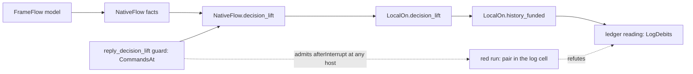

# Seat WORKERS receipt: the Workers application's log goal (2026-10-13)

Status: receipt (history, not authority). Seat WORKERS, branch `seat/workers`, worktree
`~/Dev/lean4-effect4-workers`. The brief is `docs/research/2026-10-13-seat-workers-brief.md`.

## The one thing to know before merging

The brief's route cannot close `Workers.Assertions.logs_step`, and the goal is still a goal
(measured). The route carries facts through `PlaceFunding.NativeFlow.decision_lift` and
`PlaceFunding.LocalOn.decision_lift`. Both extend `SourceScope.reply_decision_lift`, whose command
guard is `CommandsAt`. `CommandAt` is `True` for `afterInterrupt`, `finish` and `closeParAwait`, at
every host fiber. Every fact such a lift carries therefore survives these commands at any fiber
(`carried_commands`, proved). On the built crew, one guard-admitted `afterInterrupt` at the
root's second allocation shifts the allocation order: `assigned` takes cell 1. Worker 1's
assignment note then writes the pair `[7, 1]` into the log cell (reproduced, a finite evaluation).
So no fact these lifts carry implies `LogDebits` (`not_carried`, proved from that evaluation). The
same run refutes the route of `QueueWorkers.Assertions.logs_history` (reproduced in a scratch probe).
The fix is a stronger command guard; the tree already has one for Timeout (§5). This branch adds
one control module and one import; it changes no statement.

## Base, head and evidence words

- Base: `38a784c86` on `refactor/phase1-phase3` (the brief names `fa6b133df`; `38a784c86` adds
  only the brief). Head: the commit that adds this receipt; the code commit is `106b0d439`.
- Evidence words: **proved** means the kernel checked it, audited at `[propext, Quot.sound]`.
  **Reproduced** means a finite evaluation on the built program printed or guarded the result.
  **Measured** means a tool's output at the named head. **Assumed** means read in the source, not
  checked.

## 1. What landed

Commit `106b0d439`: `Test/Dogfood/Scenario/Workers/CommandGuard.lean` (new), reached from
`Test/All.lean` (one import at the end of the import block).

| Declaration | What it states | Evidence |
| --- | --- | --- |
| `step`, `drive`, `live` | one command on a machine with the returned queue dropped; a command list; liveness before each command | definitions |
| `carried_commands` | every fact `J` that a decision lift with the `CommandsAt` and `TasksAt` guards carries survives every source-owned command list from live machines | proved |
| `deliver_at`, `commands_at` | every command of the red run is source-owned | proved |
| `foreignEntry`, `foreign_refutes` | a log entry other than `nat 1` and `nat 2` refutes `LogDebits` | proved |
| `not_carried` | given the two finite evaluations, no carried `J` implies `LogDebits` | proved, premises reproduced |
| `flow_not_logs` | `not_carried` at `NativeFlow.decision_lift`: no flow from the crew's load implies `LogDebits` | proved, premises reproduced |
| `red`, `green`, two `#guard`s | the red run is live and ends with a foreign log entry; the green twin is live and ends with an empty log | reproduced |

## 2. The obstruction

### 2.1 The red run (reproduced)

The run starts at `Api.load b.program 2000` for `b` the built `crew 2`. Each command runs alone
through `driveStep … m c []`:

1. `deliver ⟨0⟩` four times: the root allocates `opened` (cell 0), then pushes the binder of
   `released` and waits at its `refMake`.
2. `afterInterrupt ⟨0⟩ false (.awaitAll [])`: the root's current code becomes the void await.
3. `deliver ⟨0⟩` 28 times: the void await answers `unit` to the binder of `released`. The
   remaining allocations give `assigned` cell 1 and `count` cell 2. The root forks both workers
   and parks on the gate.
4. `deliver ⟨1⟩` 25 times: worker 1 notes `opened` (cell 0) and parks on `take` with token 1.
5. `resume ⟨1⟩ 1 (.success (.nat 7))`, a terminal reply, then `deliver ⟨1⟩` three times: the
   assignment note appends `[7, 1]` to cell 1.

The probe printed the heap `[[1], [[7, 1]], 0]`: three cells, not four. `Workers.Assertions.log`
reads `[[7, 1]]`. The green twin (`twin`: 31 root deliveries, 25 of worker 1, the reply, three
more) leaves `log` empty.

### 2.2 Why every carried fact holds there (proved, with the evaluations as premises)

`DecisionLift.step` asks for `Guarded J I O ts w m (c :: rest)`: `J w m`, and on a live machine
`I w m (c :: rest)` and `O w m ts`. With `I := CommandsAt root` and `O := TasksAt root`, a single
command `c` with `CommandAt root c` and the empty snapshot meets it. `carried_commands` iterates
`step` along any list. `commands_at` proves `CommandAt` for the red run's commands; `red` checks
liveness. So `J` holds at the red run's end, for `J` the carried fact of `NativeFlow.decision_lift`
(`ConfigurationAt ∧ Flows G worldOf`) or of `LocalOn.decision_lift`
(`(ConfigurationAt ∧ Q) ∧ Holds L cap`).

### 2.3 Why real histories differ (assumed, read in the source)

The machine queues `afterInterrupt h` only after `h`'s own interrupt action: `interruptAs`,
`interruptAll` and `raceCancel` in `src/Effect4/Machine/Fibers.lean`. There the host's saved stack
takes the action's void answer. The lift's guard does not record that producer state. The claim
`ReleasesOnce` reads cell 1 by index, so it depends on allocation order, and so on that state.
`Atomic.cleans_once` survives the same lift because `Atomic.Writer.heapCount` sums over every cell,
and each note writes a literal identity.

### 2.4 The sibling goal (reproduced in a scratch probe, not landed)

QueueWorkers allocates the queue's cell, `opened`, `released` (cell 2, its log cell), `assigned`
and `count`. The commands `deliver ⟨0⟩` ×7, the same `afterInterrupt`, `deliver ⟨0⟩` ×34,
`deliver ⟨3⟩` ×25, `resume ⟨3⟩ 1 (.success (.nat 7))`, `deliver ⟨3⟩` ×20 and `deliver ⟨1⟩` ×55 stay
live and end with `QueueWorkers.Assertions.log = [[7, 1]]`. So the route of
`QueueWorkers.Assertions.logs_history` through these lifts fails the same way. The probe is
`QProbe.lean` in the seat's scratchpad; `Test/Dogfood/Scenario/QueueWorkers/` is outside this
seat's files. The two Timeout goals were not probed.

## 3. Placements (AGENTS.md, Trust)

| Theorem | Concept and question | Reach | What it does not establish | Unlock |
| --- | --- | --- | --- | --- |
| `carried_commands` | scope-lifetime-finalization R11; a step of the control `not_carried` | every root, row table, carried fact and admission of a lift with the `CommandsAt`/`TasksAt` guards | any property of an admitted history | names the guard as the missing premise of `logs_step` |
| `not_carried`, `flow_not_logs` | scope-lifetime-finalization R11; the control of the route of `logs_step` | the built crew at two jobs, compile budget 2000, the red run | that `logs_step` is false: it holds or fails on admitted histories only | redirects the goal to a stronger guard (§5) |
| `commands_at`, `deliver_at`, `foreign_refutes` | readers of `CommandAt` and of `LogDebits` | the red run's commands; every machine | nothing beyond their statements | steps of `not_carried` |

## 4. Reused declarations

- `src/Effect4/Laws/Machine/Lift.lean`: `DecisionLift` (its `step` field), `Guarded`, `StepKeeps`,
  `unitOrder`.
- `src/Effect4/Laws/Program/NativeConfiguration.lean`: `CommandAt`, `CommandsAt`, `TasksAt`,
  `ConfigurationAt`, `TerminalReply.success`.
- `src/Effect4/Laws/Program/NativeHistory.lean`: `load_at`.
- `src/Effect4/Laws/Program/PlaceFunding/Flow.lean`: `NativeFlow`, `NativeFlow.decision_lift`.
- `Test/Dogfood/Scenario/SourceFragment.lean`: `workers_built_fragment`.
- `Test/Dogfood/Scenario/Workers/Assertions.lean`: `log`, `LogDebits`.
- `Test/Dogfood/P3WorkerQueue.lean`: `built?`.
- New only where nothing fit: no tree function drives one command at a time with the returned queue
  dropped (`driveState` keeps it; `Guard.executePrefix` runs decisions).

Codex's `MachineWorkersSlots` model was read, not adapted: §2 shows that no model carried through
these lifts can reach `LogDebits`, whatever its answer classes.

## 5. The route that remains: options and recommendation

The decision belongs to the coordinator. The tree already holds the stronger guard in one
instance. Timeout's `stale_never_applies` route drives every command under `Guard.guardI`
(`GuardState`, `GuardQueue`, `RegistrationQueue`; `src/Effect4/Laws/Program/Guard/Driver.lean`).
It adds a class-carrying `HostTimeoutState.CommandAt` whose `StackDemand` requires a unit-class
saved stack at each `afterInterrupt` and `raceCancel` host (`Test/Dogfood/Proofs/HostTimeoutState.lean`,
`HostTimeoutDriver.command_state`, `drive_state`). A Workers analogue of that demand rejects the
red run's `afterInterrupt`: the root's saved binder takes the class of `cell 1`, not `unit`.

Options:

- (a) Restate the answer-flow producer over the guard driver: a lift whose queue predicate is
  `guardI` with a class-aware command predicate, the overwrite demands as parameters (as
  `StackDemand`). `AnswerFlow.Commands` then reads those demands in `Ready`. No machine change.
- (b) Strengthen `SourceScope.CommandAt` with the overwrite demands and re-prove
  `reply_decision_lift`. One guard for all claims, but a shared definition changes.
- (c) Make the machine check the producer state before these commands overwrite a frame. A machine
  change away from rc.112's transcription.

Recommendation: (a), generic in the class model, so Workers, QueueWorkers and the two Timeout goals
share it. Then the Workers instance (Codex's `MachineWorkersSlots` classes), the three ledgers and
`logs_step` follow the brief's steps 1 to 4 over the new lift.

Proposed decisions row (for the coordinator to file): "The answer-flow producer's command guard.
`NativeFlow` and `LocalOn` extend `reply_decision_lift`, whose `CommandsAt` guard admits
`afterInterrupt`, `finish` and `closeParAwait` at any host. A claim that reads a cell by index is
false on that reach (control `Workers.CommandGuard.red`). Options (a) to (c) above; recommendation
(a)."

## 6. Commands and results

All in the worktree, through `/Users/pooks/Dev/lean4-effect4/scratch/lean-slot.sh` (two threads).

| Command | Result (measured) |
| --- | --- |
| `lake build Test.Dogfood.Scenario.Workers.Assertions` | passed, 1264 jobs |
| `lake env lean <scratch>/Probe1.lean` (the red run, step by step) | the heap and log of §2.1 |
| `lake build Effect4.Laws.Program.PlaceFunding.Flow` | passed, 561 jobs |
| `lake env lean Test/Dogfood/Scenario/Workers/CommandGuard.lean` | passed, no messages: both `#guard`s hold |
| `lake env lean <scratch>/GuardEcho.lean` (`#eval red`, `#eval green`, the red log) | `true`, `true`, `[(Val.list [(Val.nat 7), (Val.nat 1)])]` |
| `lake build Test.Dogfood.Scenario.Workers.CommandGuard` | passed, 1267 jobs |
| `lake build ProofGraph.AxiomAudit ProofGraph.Plan` | passed, 17 jobs |
| `lake env lean <scratch>/Audit.lean` | §7 |
| `lake build Test.Dogfood.Scenario.QueueWorkers.Assertions`, `lake env lean <scratch>/QProbe.lean` | passed, 1269 jobs; the run of §2.4 ends live with `log = [[7, 1]]` |

`<scratch>` is `/private/tmp/claude-501/-Users-pooks-Dev-lean4-effect4/e1e92e6e-f6fa-4134-946a-d08ffba1e7ca/scratchpad/workers`.

## 7. Axiom output and plan status

`#axiom_audit Test.Dogfood.Scenario.Workers.CommandGuard`, from `<scratch>/Audit.lean` run with
`lake env lean`:

- `#axiom_audit: 28 declarations within [propext, Quot.sound], 0 of them modulo planned goals; 0 planned goals`

`#plan_status`, same file:

- `Test.Dogfood.Scenario.Workers.Assertions.logs_step: goal; nearest []; 0 lemmas, 0 definitions`
- `Test.Dogfood.Scenario.Workers.Assertions.history: modulo [Test.Dogfood.Scenario.Workers.Assertions.logs_step]`

## 8. Open obligations

- `Workers.Assertions.logs_step`: open. It needs the stronger guard of §5 first, then the class
  model, the ledgers and the reading over it.
- `QueueWorkers.Assertions.logs_history`: open, blocked the same way (§2.4).
- `Timeout.cleanup_keeps`, `Timeout.retries_declared`: not probed; their FLOW route uses the same
  lifts, while Timeout already has a class-carrying driver (§5).
- A QueueWorkers twin of this control belongs in `Test/Dogfood/Scenario/QueueWorkers/`, with the
  command list of §2.4.

## 9. Bounded or host-only evidence

The red and green runs are finite evaluations: one program (`crew 2`), one compile budget (2000)
and one command list each. `not_carried` and `flow_not_logs` take those evaluations as premises.
No host ran. No statement in the tree changed.

## 10. Files changed

| File | Change |
| --- | --- |
| `Test/Dogfood/Scenario/Workers/CommandGuard.lean` | new: the control |
| `Test/All.lean` | one import at the end of the import block |
| `docs/research/2026-10-13-seat-workers-receipt.md` | this receipt (force-added) |
