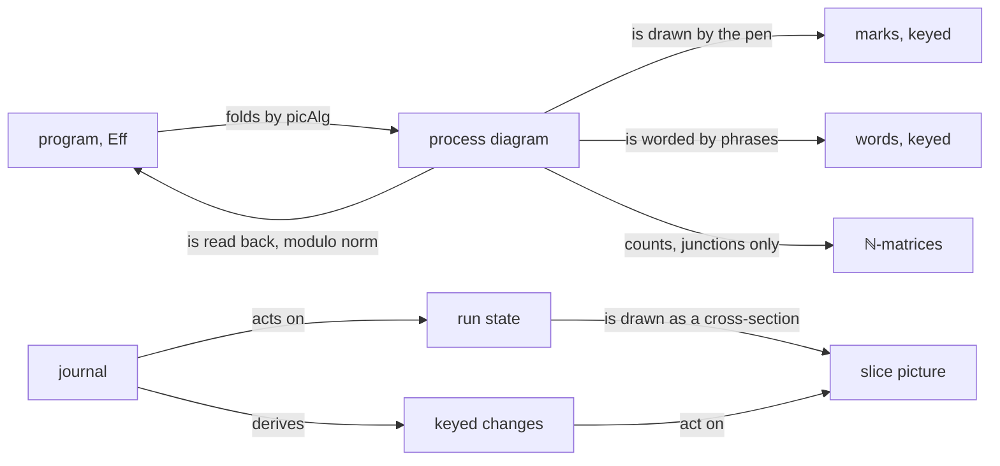
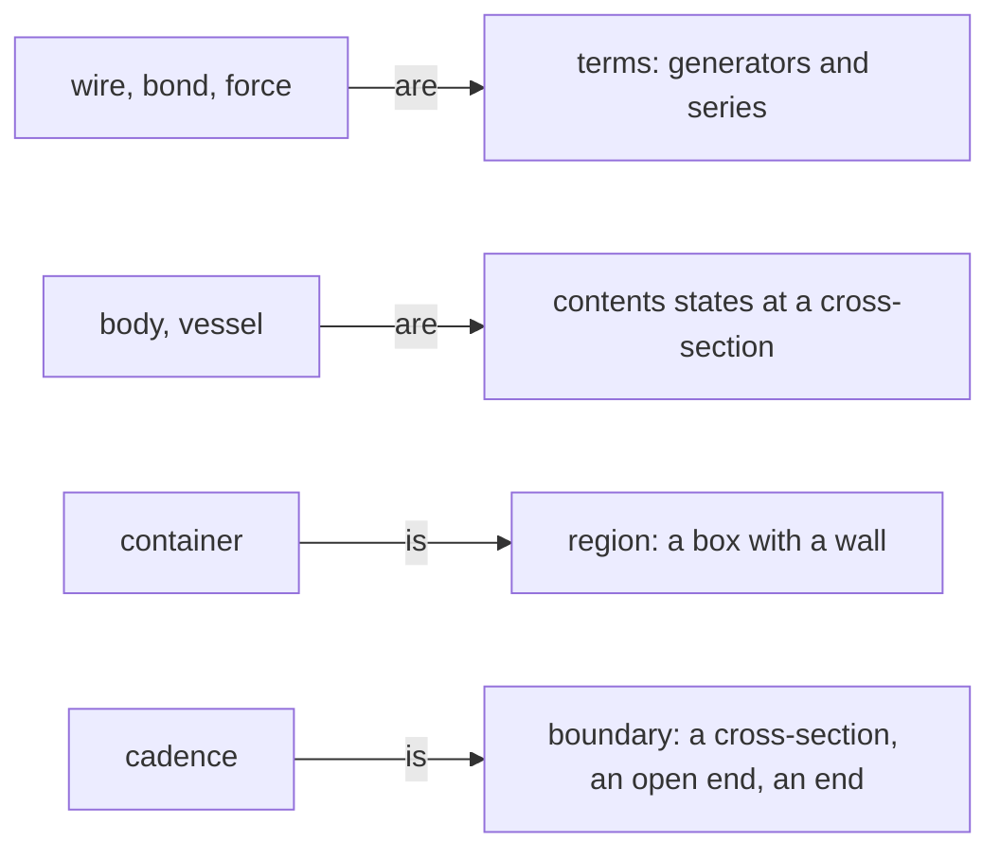

# 2026-10-13 The tube language as a diagram algebra

Status: research note (history, not authority). Base: `63e1177e9` on `refactor/phase1-phase3`.
Seat FORMAL wrote it from the brief `docs/research/2026-10-13-seat-formal-brief.md`. The finite
probe beside it is `docs/research/2026-10-13-tube-algebra/Probe.lean`. Gemini's sign side is
`docs/research/2026-10-13-tube-algebra/gemini-semiotics.md`, answered in §9.

**The one thing to know first.** The design language can be formal now: one signature of six
generators over five wire sorts, and one fold of `Eff` into it. The fold reads back exactly, up to
bind's associativity, on every program of a 2,238-program enumeration (finite probe). Its second
law finds a real gap. The machine's events record no change of its store, neither a cell's make or
write nor a deferred's make or completion. So the store's contents cannot follow the machine from
its events alone.

## Question

The owner asked on 2026-10-13:

> i'm wondering if we should be formalizing our design language better within our algebra... what
> does the lit say woudl be the most mathematically accurate representation based on our existing
> algebras with a goal of simplifying, deepening representations

The brief states the coordinator's reading in six points. It asks this note to test each point
against the literature and the tree. It asks for the algebra, and for a probe of a fragment in
Lean.

**The answer, in one paragraph.** The literature's most accurate representation is a string
diagram over a typed signature, read in a symmetric monoidal category (Joyal and Street; Selinger).
Each fiber's control is a threaded wire, so its operations keep their order (Jeffrey; Román). The
junctions form a commutative bialgebra, whose diagrams count as ℕ-matrices (Lack; Bonchi,
Sobociński and Zanasi). A loop is control's iteration (Selinger), and a region is a box with a
wall. A run is a firing sequence of a process (Meseguer and Montanari; Baez and Master). A film is
the derivative of a change action (Alvarez-Picallo and Ong). This deepens the tree's own algebras.
The picture is one more `EffAlgebra`, folded by `cata_eff`, and its first law is an exact embedding
in the dictionary's sense. Its motion is the journal's monoid action. It simplifies too: six
generators and four classes in place of 37 cases and seven kinds.

Words. The view's words are the motion plan's
(`docs/research/2026-10-13-motion-everywhere/README.md`, its words table): picture, film, still,
beat, keyed match, junction, contents state, staff. Five more are new here, each defined at its
first use: generator, wire sort, string diagram, spider and cross-section.

## What was read or run (each with its evidence word)

**Reading, in the tree.**

- The tube language's notes: `README.md`, `glyphs.md`, `semiotics.md`, `fills.md`,
  `graph-alignment.md` and `algorithms.md` in `docs/research/2026-10-13-tube-language/`.
- Decisions rows 334, 336, 337, 354, 362 to 372. Row 372 reached this seat by the coordinator's
  message during the work. `graph-alignment.md` at `00e01fb2b` is byte for byte the copy read
  (finite probe: `md5`).
- The pen: `Form.lean`, `Draw.lean`, `Motion.lean`, `Glyphs.lean` and `Score.lean` under
  `tools/Tools/View/Tube/`, and `tools/Tools/View/Glyph.lean`; the flow fold `ofProgram`
  (`tools/Tools/View/Flow.lean`).
- The algebras: `EffAlgebra`, `cata_eff` and `hom_eq_cata_eff` (`src/Effect4/Program/Fold.lean`);
  concept 7 of `docs/core/semantics.md`; `docs/core/controlled-english.md` §2, §3 and §3.5.
- The kit at its pin `a8a8e7b`: `join` (`.lake/packages/whatwg/Whatwg/Svg/Scene/Join.lean`), its
  laws (`Join/Laws.lean`, `Join/Whole.lean`) and `Motion.Respects` (`Whatwg/Svg/Scene/Score.lean`).
- The view model note `docs/research/2026-10-11-view-model/README.md` and the motion plan.
- The earlier string-diagram frame, which the brief does not name: `docs/design/design-language.md`
  §8 and §9, and `docs/design/string-diagrams-notes.md` (2026-09-08). It already adopts the runtime
  wire, a completion spider and three wire grades, and it rejects Petri nets as the drawing.
- The machine's events: `RunEvent` and `RunDecision` (`src/Effect4/Machine/Fibers.lean`),
  `FrameEvent` (`src/Effect4/Machine/Frames.lean`); the footprint `SyncOp.refFootprint` and its
  frame rule `syncOpStep_refPeek_other` (`src/Effect4/Laws/Machine/RefFootprint.lean`).
- The pinned runtime's mask: `uninterruptible` and `setInterruptible`
  (`vendor/effect-4.0.0-rc.112/src/internal/effect.ts:4300-4322`).

**Read, in the literature.** Each source was fetched in this session, its text extracted in the
scratchpad, and the named part read. The locators below come from that reading; the citations
audit (`docs/research/2026-10-01-semantics/citations-audit.md`) holds none of these sources yet.

| Source | Mark | What was read |
| --- | --- | --- |
| Mackinlay, "Automating the design of graphical presentations of relational information", *ACM TOG* 5(2), 1986, pp. 110–141 | read | the abstract; §5, the two expressiveness conditions |
| Kindlmann and Scheidegger, "An algebraic process for visualization design", *IEEE TVCG* 20(12), 2014, pp. 2181–2190 | read | §1 to §3.2: Equation (1), Table 1, the three principles and their failures |
| Selinger, "A survey of graphical languages for monoidal categories", arXiv:0908.3347v1, 2009 | read | Theorems 3.1, 3.12, 5.22, 6.1, 6.3, 6.6; Remark 6.7; Proposition 6.8 |
| Joyal and Street, "The geometry of tensor calculus I", *Advances in Mathematics* 88(1), 1991 | by name | through Selinger's Theorems 3.1 and 3.12; the publisher refused the fetch |
| Bonchi, Sobociński and Zanasi, "Interacting Hopf algebras", *J. Pure Appl. Algebra*, arXiv:1403.7048v4 | read | the abstract, §2.2, Definition 3.6, Proposition 3.7 |
| Lack, "Composing PROPs", *TAC* 13(9), 2004, pp. 147–163 | read | the abstract, §1, §5.3, §5.4, §5.7 to §5.8 |
| Jeffrey, "Premonoidal categories and a graphical view of programs", University of Sussex, December 1997 | read (its abstract) | the author's announcement on the Types list, 15 January 1998; the report itself is not read |
| Román, "Promonads and string diagrams for effectful categories", ACT 2022, *EPTCS* 380, 2023, pp. 344–361 | read | §1; Definitions 2.1, 2.2, 2.4, 2.8; Theorem 2.14; Corollary 2.15 |
| Román and Sobociński, "String diagrams for premonoidal categories", *LMCS* 21(2:9), 2025 | read | §1; Remark 2.8; Theorem 3.14; Corollary 3.15; §4: Definition 4.1, Remark 4.2, Proposition 4.3 |
| Meseguer and Montanari, "Petri nets are monoids", *Information and Computation* 88(2), 1990 | read (LICS 1988 abstract); by name | the conference abstract; the journal's content through Baez and Master §2 |
| Baez and Master, "Open Petri nets", arXiv:1808.05415v6 | read | the abstract and §2 |
| Cai, Giarrusso, Rendel and Ostermann, "A theory of changes for higher-order languages", PLDI 2014 | read | Definitions 2.1 to 2.4 in arXiv:1312.0658v1; the venue from the authors' page |
| Alvarez-Picallo and Ong, "Change actions: models of generalised differentiation", FoSSaCS 2019 | read | §2 of arXiv:1902.05465v3: Remark 2.1, Definition 2.2, Lemma 2.3, Definition 2.5 |
| Melliès, "Functorial boxes in string diagrams", CSL 2006, LNCS 4207 | read | the abstract and §3, in the HAL version of 20 July 2006 |
| Di Lavore, de Felice and Román, "Monoidal streams for dataflow programming", arXiv:2202.02061 | read (its abstract) | the abstract |
| Murata, "Petri nets: properties, analysis and applications", *Proc. IEEE* 77(4), 1989 | by name | not reachable; the place invariant is restated and proved in the probe |
| Moody, "The physics of notations", *IEEE TSE* 35(6), 2009 | by name | the four anomalies through secondary summaries |
| Power and Robinson, "Premonoidal categories and notions of computation", *MSCS* 7(5), 1997 | by name | through Román's bibliography |

**Run.** One command, from the checkout, on 2026-10-13:
`LEAN_NUM_THREADS=2 lake env lean docs/research/2026-10-13-tube-algebra/Probe.lean`. It printed
nothing, so every `#guard` held, and the `#guard_msgs` of its audit matched (tested). It took about
55 seconds. Scratch copies with `#eval` lines measured the counts that §3, §4 and §6 report. No
`lake build`, no `make` target and no check of the tree ran.

**The tree moved during the work.** HEAD advanced from `63e1177e9` to `1f25ccd66`, and another
session rebuilt the pen for the motion plan's slice M7. The probe imports the built pen. Its last
run, at 11:03, loaded the pen as built at 11:02, and passed. No guard compares the pen's marks with
stored values; the guards compare pictures with one another. So no result rests on the pen's exact
geometry.

## Findings (each with its evidence)

### 1. The hypothesis, point by point

| Point | Verdict | The amendment, and its evidence |
| --- | --- | --- |
| 1. Correct encoding is two laws (Mackinlay; Kindlmann and Scheidegger) | holds, amended | Mackinlay's expressiveness has two halves, all the facts and only them (read). Kindlmann and Scheidegger have three principles; the brief names two and leaves out Invariance (read). Injectivity on `Eff` is false: bind's associativity draws two programs alike. The law holds modulo a named normaliser (§4; finite probe). |
| 2. The vocabulary is a string-diagram language | holds | Wires, boxes, series, the air gap as the tensor and the crossing as the symmetry: a symmetric monoidal signature, whose equality is isomorphism of diagrams (Selinger Theorem 3.12, read). A loop is the iteration operator of control flow (Selinger Remark 6.7, Proposition 6.8, read), not feedback of data. A cut end is a boundary of an open diagram. |
| 3. Two spiders, after graphical linear algebra | amended | The solid wye is a commutative monoid and the air-gap header a cocommutative comonoid; together they form a bialgebra, whose diagrams count as ℕ-matrices (Lack §5.3, read; tested). Neither is a full spider: a spider needs the mirror of each, and the machine has the mirror of merge only as a decided split, and none of copy. On ordered values the bialgebra law needs one decision for both merges (tested). |
| 4. Effects need a threaded wire (Jeffrey; Román) | holds, amended | Román's Theorem 2.14 and Corollary 2.15 say what the 2026-09-08 note says (read). That note reads the runtime as the tape; the brief reads it as a fiber's staff. Both hold, at two grains. One wire per fiber orders that fiber's operations, and one wire per cell orders that cell's writes. The tape is the one wire that orders a whole run, drawn as the score's bar lines. Román and Sobociński's Remark 2.8 says why the wire must be drawn: without it, substituting a part is not local (read). Their §4 gives a cell its laws and a race its outcomes (Proposition 4.3, read), which `pRaceY`'s two final values instance (tested). |
| 5. State is a Petri net | amended | A module's counts form a net, and conservation is a place invariant (proved in the probe for every net; tested for the Queue's and the Semaphore's counts). The machine is not a net and a fiber is no unit, as `design-language.md` §8 ruled. The score is a firing sequence; the process is that sequence up to the order of firings with disjoint footprints. |
| 6. Motion is a change structure | amended | Change actions fit better than change structures: the journal is a free monoid acting on runs, and keyed changes act on pictures (Alvarez-Picallo and Ong §2, read). The square holds on the real machine from events for every decision that leaves the store unchanged, and fails at each change of the store (tested). |

### 2. The signature

As `binders.json` gives the program's syntax signature, the tube signature gives the picture's.
Its **generators** are its operation symbols with fixed legs; its **wire sorts** type the legs. A
**string diagram** is a term over the signature up to the laws of its category. A diagram is drawn
by the pen. The geometry stays the pen's: the signature says what connects to what, and the pen
says where.

**Wire sorts.** The grades of `docs/design/string-diagrams-notes.md` §4, with two linear sorts
added for the threaded wires.

| Wire sort | Copy | Drop | What it carries | Drawn as |
| --- | --- | --- | --- | --- |
| value | yes | yes | a value of a type: a `Term`'s answer | a pipe of the carrying bore |
| handle | yes | no: a drop is a close | the name of a fiber, a cell, a deferred, a scope | a fine pipe; a collar names it |
| park token | no | no | a continuation, resumed once | a hollow unit |
| control | no | no | one fiber's control: the order of its operations | the fiber's staff |
| vessel | no | no | one resource's state: a cell, a deferred, a buffer | a vessel; its length is its capacity |

**Generators.** Six families. Each row gives the generator's legs, its picture and what the
machine does. A **spider** is a junction of any number of legs such that any connected network of
one kind's junctions equals one junction. It needs a junction and its mirror related by the
Frobenius equations: the cospans of Lack §5.4 (read). Merge and copy below are halves of spiders.

| Generator | Legs | Picture | What the machine does |
| --- | --- | --- | --- |
| merge, and its start | `A ⊗ A → A`; `I → A` | a solid wye inward; a sealed start | amounts add: offers from two producers enter one inlet; two layers' contexts merge (`LayerTerm.merge`); two arms of a choice rejoin |
| copy, and its drop | `A → A ⊗ A`; `A → I` | an air-gap header and its taps; a sealed end | one value reaches each reader: a deferred's completion its waiters, a fiber's exit its observers, a publish each subscriber; a variable used twice, or not at all |
| split | `A → A ⊗ A`, a relation | a solid wye outward | an amount divides; a decision fixes the shares |
| valve | `A → A`, open or closed | a parting across a pipe | open passes, closed passes nothing; a phase or a decision sets it |
| box | `R ⊗ A → R ⊗ B`, labelled | a body on the staff | one operation of the fiber whose control is `R`: an `Eff` leaf, a row of the application, a module's step; an interrupt is a box with two controls |
| fork | `R → R ⊗ R ⊗ H` | a staff born an air gap below its parent's | `forkChild`: the child's control and its handle |

**Operations and structure.** Four operations build diagrams, two of them from a diagram.

| Name | Kind | Picture | Meaning |
| --- | --- | --- | --- |
| pipe | structure: the identity | a tube | a wire carried on |
| crossing | structure: the symmetry | the lower tube parted round the upper (`cutOf`) | wires that change places; which passes over is no fact |
| series | operation: composition | one part runs into the next | `bind`; the continuation |
| air gap | operation: the tensor | side by side, an air gap apart | no wire shared: independence |
| region | operation on one diagram | a container round it | a scope, a mask, a provided layer; its wall is a boundary |
| loop | operation on one diagram | a returning tube | the iteration of a body `X → A + X` (control flow); a stream's feedback is the other, delayed, form |

**Equations.** Each with its source and its limit.

| # | Equation | Source | Where it holds |
| --- | --- | --- | --- |
| E1 | associativity and units of series and air gap; interchange of boxes with no common wire; the crossing natural and its own inverse | Joyal and Street, through Selinger Theorem 3.12 (read) | everywhere: diagram equality is isomorphism of diagrams |
| E2 | boxes on one control wire, or one vessel wire, do not interchange | Román Definition 2.8, Theorem 2.14 (read); Jeffrey (read, its abstract) | the effectful part; a box with no control leg is central |
| E3 | merge is associative and commutative, with start its unit | Lack §1.3 (read) | counts (tested); on ordered values, as sets of outcomes over every decision (tested on three short sequences) |
| E4 | copy is coassociative and cocommutative, with drop its counit; a tree of copies is one header, the fusion the 2026-09-08 note names | Lack §1.3 (read) | values; a handle copies, but its drop is a close |
| E5 | a copy after a merge is the merges of two copies, crossed; start copies to two starts; a merge dropped is two drops; start dropped is nothing | Lack §1.3, §5.3; Bonchi, Sobociński and Zanasi §2.2 (read) | counts: tested as ℕ-matrices. Ordered values: tested to hold with one decision for both merges, and to fail with two |
| E6 | an open valve is a pipe; a closed valve is a drop then a start; a selector is a split then one open and one closed valve | — (this note) | counts (tested for the valve) |
| E7 | the iteration law and the diagonal property | Selinger Proposition 6.8 (read) | the limit only: a budget cuts an approximant (`iter`, dictionary §3.9) |
| E8 | a mask over a mask is the inner mask | reading: a nested mask returns its body (`effect.ts:4306`) | the mask; no region distributes over series (tested for the mask, below) |
| E9 | a cell's get and put on its vessel wire: get twice is one get copied; a get dropped is nothing; two puts keep the last; a get put back is nothing; a put then a get is the put copied | Román and Sobociński §4, Definition 4.1, Figure 16, Remark 4.2 (read) | allocated cells. The tree proves three: `put_get`, `get_get` and `put_put` (`src/Effect4/Laws/Program/StoreComodel.lean`); a cell never allocated breaks them (`E4-DEN-CE-002`). Get-drop and get-put have no theorem (reading) |

**Two refusals.** E8 marks the one equation a region keeps. A mask over a series is not the series
of two masks. An interrupt recorded during the first part is delivered where its mask ends
(`setInterruptible`, `effect.ts:4312-4320`, reading). The probe's part 8 runs it on the machine: a
child writes a cell twice and is interrupted while it yields. Under one mask the run ends with the
cell at 2; under two masks, at 1 (tested). So a region is a box with a wall, not Melliès's
functorial box, whose functor keeps series: `F (g ∘ f) = F g ∘ F f` (§3, read). Second, no wire
bends back: the signature has no cup and no cap, as the 2026-09-08 note ruled.

The order of the parts, from a program to what a reader sees, is below. It shows the folds and the
maps between them, and claims no law by itself.

### 3. The derivation of the vocabulary

Each of the 37 marks of `Shape` (`tools/Tools/View/Glyph.lean`) is one of four things. It is a term
of the signature, a contents state on a wire at one moment, a region, or a boundary of a diagram.
The probe's part 7 classes every mark of the tree's `Shape` (tested: 13 terms, 12 states, 6 regions,
6 boundaries). A **cross-section** is a line across every wire of a diagram at one moment; what each
wire holds there is its contents state. Most marks of a kind of row 368 (4) fall into one class, as
the diagram below shows; it claims no law. Eight marks cross over (tested). `box`, `value`, `probe`
and `call` are bodies that are terms. `hole` and `enter` are boundaries. `panel` and `cells` are
containers that are states.

| Mark | Kind | In the algebra | Class |
| --- | --- | --- | --- |
| `box` | body | a box: `box[op] : R ⊗ A → R ⊗ B` | term |
| `value` | body | a box whose output is a value: `box[succeed] : R → R ⊗ A` | term |
| `atom` | body | a literal on a value wire | state |
| `call` | body | a box named by a definition (`invoke`): `box[invoke]`; its body is a diagram elsewhere | term |
| `tag` | body | a name on a handle wire | state |
| `probe` | body | a read: `box[read] : R ⊗ V → R ⊗ V ⊗ A`; the vessel passes unchanged, since a linear wire has no copy | term |
| `enter` | body | the start of a fiber's control wire | boundary |
| `cross` | body | a typed failure on the failure arm | state |
| `hash` | body | a defect on the failure arm | state |
| `reasons` | body | a cause: its reasons in order | state |
| `hollowDot` | vessel | a vessel of one unit, owed | state |
| `filledDot` | vessel | the same vessel, kept | state |
| `hollowBox` | vessel | a park token, owed | state |
| `filledBox` | vessel | the same token, resumed | state |
| `hole` | vessel | the place a frame's result returns to: a diagram with a hole | boundary |
| `slot` | vessel | an option on a value wire | state |
| `openBracket` | container | a scope's region whose closing wall is owed | region, open |
| `bracket` | container | a scope's region | region |
| `region` | container | a provided layer, service or context | region |
| `rail` | container | a mask | region |
| `block` | container | a `gen` block: a series in a wall, which marks the syntax only | region |
| `library` | container | named definitions, then the body | region |
| `panel` | container | a record: named wires side by side | state |
| `cells` | container | a list or a tuple on a value wire | state |
| `series` | wire | `box[a] ; box[b]`, a value wire between | term |
| `parallel` | wire | `merge` | term |
| `alternative` | wire | `split ; (valve open ⊗ valve closed)`: the selector of row 372 (3) | term |
| `loop` | wire | `loop (box[body])` | term |
| `rest` | wire | `valve` on the control wire, closed for a turn; a decision opens it | term |
| `arrow` | bond | `fork` | term |
| `spider` | bond | `copy ; (copy ⊗ pipe)`: one exit to three waiters | term, overloaded (below) |
| `port` | bond | `box[row]` of the application's rows: the request leaves the diagram, the answer enters | term at a boundary |
| `blockedArrow` | force | an interrupt: `box[interrupt] : R ⊗ R → R ⊗ R`; a rail holds it | term |
| `barLine` | cadence | a decision: a cross-section of every control wire | boundary |
| `exitBar` | cadence | the end of a control wire, its exit after it | boundary |
| `fermata` | cadence | a frontier: a diagram with a control wire still open | boundary |
| `caesura` | cadence | a halt: no generator applies, so no wire continues | gap: no term draws it |

**Named gaps and overloads.**

1. **`spider` draws three operations.** The glyph table gives it to `awaitFiber` and the observers
   (copy). It also gives it to `awaitAll`, a gather of several exits into one waiter, and to
   `raceAll`, a decided choice where the first exit passes. Moody's check, `check` in
   `tools/Tools/View/Glyph.lean`, passes it, since the variants differ (reading). The algebra
   refuses it. A header with taps claims that each tap holds a copy of one thing, which a gather
   and a race do not.
2. **`caesura` is no term.** A halt is the absence of a next generator. It is a boundary only.
3. **An interrupt is the one box with two control legs.** The coordinator's list had no generator
   for it; it is a labelled box here.
4. **`hole` needs a diagram with a hole.** The 2026-09-08 note names the theory (monoidal contexts,
   Román, by name); this note did not read it.
5. **`port` draws every `perform`.** The glyph table gives `Eff.perform` one mark, so a cell's
   write is a port as a host row is (reading). In the algebra only a host row stands at the
   boundary; a store operation is a box on its fiber's control and its cell's vessel.
6. **`cross` is drawn as a crossing.** The typed failure `×` is two tubes, the lower one parted
   round the upper (`bodyFigure`, `tools/Tools/View/Tube/Glyphs.lean`). Row 370 (2) draws a wire
   crossing the same way. Gemini's note reads `cross` as the crossing (§9), which shows the
   overload. In a whole diagram the two differ by what the tubes connect to; at a glance they do
   not.

**The graph marks**, under rows 371 and 372 and the rest of `graph-alignment.md`.

| Graph mark | Ruled form | In the algebra |
| --- | --- | --- |
| node box | a vessel, its label outside (row 372) | a box in a program's graph; a resource's vessel in a module's; a claim's vessel in a proof graph, its status its contents state |
| lit band | a contents state (row 371 (1)) | the contents state of the node's vessel |
| control edge | a tube | a control wire |
| data edge | a tube | a value wire |
| fork edge | an air-gap drop | the fork's child output |
| exit edge | a tube | the exit wire from a child's end to its waiter, copied to each waiter |
| back edge | a tube, a tapered arrival (row 372 (2)) | two meanings: a loop's returning tube, or a cross edge of an await (row 337 (9)), which is an ordinary exit wire |
| relation edge | a strut for syntax and subtyping; a fine tube for proof status (row 372 (1)) | a strut is outside the signature: it relates sorts and carries nothing. A proof tube carries a status |
| self loop | a tube | a loop round one box |
| arrowhead | gone (row 372 (2)) | a wire's direction is its domain to codomain; the taper draws the codomain end |
| UML flow bar | gone | a merge where amounts add; a fork where a fiber starts; a gather where exits meet |
| UML diamond | a selector valve (row 372 (3)) | a split and two valves |
| region frame | a container | a region |
| organic trunk | a solid split | a split, its shares by width |
| collar flare | the source's flared joint | the domain end of a wire: geometry |
| status text | words | the words algebra |
| link anchor | kept | outside the signature: an affordance, no fact |
| a tube through a scope's wall | no mark yet (row 372 (4)) | a port of the region's wall: each wire that crosses a wall is an input or an output of the region |

Two graph findings follow from the algebra.

- **A proof graph's junctions would claim a false fact.** Status does not add. At a node the
  worst status wins, and a fan-out copies a status to each dependent. So a solid wye of status
  tubes would claim a conservation that does not hold. Each dependency tube should enter its
  node's vessel at a port of its own (§8, Q6).
- **A back edge has two meanings.** A loop's return is the iteration; a cross edge of an await is a
  plain exit wire drawn against the layout. One mark draws both.

### 4. The fold and its first law

**The fold.** The picture of a program is one algebra over `Eff`'s seven-sorted signature,
`picAlg : EffAlgebra NativeOp (fun _ => Build)` in the probe, folded by the tree's own `cata_eff`
(`src/Effect4/Program/Fold.lean`). Its carrier is a builder. A builder takes the ports of the values
in scope and the current fiber. It draws a program's boxes on that fiber's control, and answers the
port of the program's value. So by `hom_eq_cata_eff`, any homomorphism into that algebra is this
fold.

**Its categorical reading.** The fold is no functor on its own: `Eff` is a term algebra, not a
category. Programs become arrows of a category only after bind's associativity is quotiented,
which is the normaliser `norm` below. Then a program's picture is a diagram of a free symmetric
monoidal category, whose generators are the leaves, each with its fiber's control leg. Its
equality is isomorphism of diagrams (Selinger Theorem 3.12, read). One fiber's boxes are Román's
case of one runtime, that fiber's control. His Theorem 2.14 makes them an effectful category, and
his Lemma 2.13 fixes a functor out of it by its generators (read). A run adds one more wire through
every box, the tape, and only the run is premonoidal as a whole. So "the fold is a premonoidal
functor" is right per fiber after the quotient; across fibers the program picture is monoidal.

**The normaliser.** `norm` reassociates every bind to the right. A binder is inserted at the outer
level, so each variable at that level or above moves up by one. It is the monad's associativity
law, read as a rewrite. It applies no other law: a bind whose first part is a `succeed` stays.

**Law 1, as stated.** For the picture fold `draw` and the normaliser `norm`:

> `draw p = draw q ↔ norm p = norm q`, and a reader `readPic` with `readPic (draw p) = some (norm p)`
> that refuses a picture which is the drawing of no program.

Left to right is no confuser (Kindlmann and Scheidegger's Unambiguity; Mackinlay's first condition).
Right to left is no hallucinator (their Invariance). With the reader, the pair is an exact embedding
modulo a named normaliser (`docs/core/controlled-english.md` §3.5). `draw` writes, `readPic` reads,
and `norm` is the normaliser. Mackinlay's other half, only the facts, falls to the conventions. Each
junction must claim only what the machine does (§2's E3 to E6, §5).

**The fragment.** Five constructors of the real `Eff`: `succeed`, `bind`, `withFiber` of a `fork`,
`awaitFiber`, and `perform` of `refMake` and `refSet`. The probe enumerates every well-scoped
program of one, two or three leaves, the three nested either way. A leaf holds one of two literals
or a variable in scope, and each leaf but a fork has a fork of it. That makes 2,238 programs.

**What the probe showed** (finite probe; each line a `#guard` that held).

| Check | Result |
| --- | --- |
| distinct programs | 2,238 |
| normal forms under `norm` | 1,374 |
| process diagrams `draw p` | 1,374 classes; the pairs with normal forms also 1,374: one partition |
| what a reader sees: the pen's marks, keys erased, and the words | 1,374 classes, one partition with the normal forms |
| the reader, over all 2,238 | `readPic (draw p) = some (norm p)` for every program |
| exactness | a picture whose await joins the wrong fiber reads as no program |
| the pen's bend law | every tube of every picture keeps it: 19,116 marks |
| red: no normaliser | 2,238 programs in 1,374 pictures: bind's two nestings draw alike |
| red: geometry alone, no words | 684 classes: a literal is in the words, not in the marks |
| red: a fold that forgets which fork an await joins | 1,230 classes |

So the words are part of the encoding, not decoration: row 367 (1)'s second algebra is needed for
Law 1 to hold.

### 5. The token semantics

**Nets from roles.** Row 367 (5) gives each module's cell a role per field, and the motion plan
(§4.2 there) maps the roles to plumbing. Read as counts, each role is a place of a net, and each
step of the module a transition. A **net** here is a list of transitions, each a count taken from
each place and a count given to each. Its marking is a count per place. Markings form the free
commutative monoid on the places (Meseguer and Montanari, through Baez and Master §2, read).

| Role (row 367 (5)) | Place | Transitions that touch it |
| --- | --- | --- |
| buffer, with a capacity | `buffer`, with `free` beside it | an offer takes a free slot; a take frees one |
| a count that comes back (permits, items) | `available`, `held` | an acquire, a release: the circuit |
| waiters at the input | offers waiting | an offer waits; a waiting offer takes a freed slot |
| waiters at the output | takers waiting | a take waits; a waiting taker meets a waiting offer |
| phase | a valve | a transition enabled only while the valve is open |
| a broadcast value | the header, a tap per subscriber | a publish; the copy to each tap |

**Conservation is a place invariant.** A weighting is a place invariant when every transition takes
and gives the same weighted sum. Then every firing keeps the weighted sum: `fire_keeps`, proved in
the probe (`docs/research/2026-10-13-tube-algebra/Probe.lean`). The kernel accepts it, and the
gate's walk finds it and its step `fire_sum` within `[propext, Quot.sound]` (tested by the probe's
`#guard_msgs`). No gate of the tree reads the probe.

| Net | Weighting | Result (tested) |
| --- | --- | --- |
| the Queue's counts | `free + buffer` | invariant: the capacity |
| the Semaphore's counts | `available + held` | invariant: the circuit |
| the Queue's counts | offers and takers waiting | not invariant (red control) |
| a broadcast's counts | every place weighted one | not invariant: the sum a solid junction would claim (red control) |
| the broadcast without its publish | the header weighted as many as the taps | invariant: copying keeps a weighted sum, not the count |

**What a net does not hold.** A net keeps counts, not values and not order: the "collective token
philosophy" of Baez and Master §2 (read). The Queue's units are distinct messages in FIFO order,
so the net is the counting reading of the cell, not its meaning. No theorem connects a module's
step terms to its net yet; that connector is owed (§7).

**The score as a process.** A **process** of a net is a run of the net drawn as a partial order of
its firings (Goltz and Reisig, by name). The score (`tools/Tools/View/Tube/Score.lean`) draws a
firing sequence: one beat a column, in the order of the tape. Two firings whose footprints are
disjoint commute, by the frame rule `syncOpStep_refPeek_other`
(`src/Effect4/Laws/Machine/RefFootprint.lean`) and the tree's schedule-independence work (row 361).
So the process is the score up to that commutation, and the score is one of its linear orders. The
brief's "a run's score is a process" is amended to this.

### 6. Motion: the commuting square

**The model.** A run is the journal acting on the loaded machine: the dictionary's monoid action,
`replay` (`src/Effect4/Api/Runner.lean`) and `journal_replays` (`src/Effect4/Laws/Run.lean`). Keyed
changes act on a picture, and they compose by concatenation. Alvarez-Picallo and Ong call a set with
a monoid acting on it a change action (§2, read). A map between two change actions is differentiable
when `f (a ⊕ δ) = f a ⊕ ∂f (a, δ)`. Cai and others' change structures need a difference `⊖` and a
change set per value (Definition 2.1, read). Change actions fit the tree better, since the journal
is already a free monoid. Their Remark 2.1 says that a change structure gives a change action by its
free monoid.

**Law 2, as stated.** For each machine decision `m` from a state `s`, a change `∂(s, m)` exists
with:

> `slice (s ⊕ m) = slice s ⊕ ∂(s, m)`, and `∂(s, m₁ m₂) = ∂(s, m₁) · ∂(s ⊕ m₁, m₂)`, so a film
> of several beats is its beats' films in order.

Its **strong form** reads `∂(s, m)` from the decision's events alone, never from the next state.
The law is Kindlmann and Scheidegger's Equation (1), its data change a machine decision. The strong
form is row 371 (3), "fills follow the machine", made checkable. The second clause is the
regularity of a derivative (Alvarez-Picallo and Ong, Definition 2.5).

**What the probe showed** (finite probe, on the real machine). The probe runs every tape of enabled
`fire` decisions, as `Test/Machine/Runtime/ScheduleIndependence.lean` does, over seven programs of
the fragment and the battery. Two of them leave the fragment: `pRaceY` adds `yieldNow` to reach two
schedules, and `pKahnY` keeps a deferred. A slice picture draws each fiber by its flags, each cell
by its value and each deferred as owed or kept, in the pen's marks.

| Check | Result |
| --- | --- |
| decisions explored | 23, over 8 programs; one program has 2 runs |
| the strong form, at the 8 decisions that leave the store unchanged | holds at every one |
| the strong form, at the 15 that change it: 6 make a cell, 7 write one, 1 makes a deferred, 1 keeps it | fails at all 15: no event records them |
| the law, with the store's difference added to the events | holds at all 23; the difference touches only the store's keys, so the events account for every fiber change at every decision |
| the events' entered and dropped keys against the kit's keyed match (`join`) | agree at all 23, and are not empty |
| a whole run's change, its decisions' changes in order | takes the first slice to the last, for every run |
| red: a derivative that forgets an exit | fails at a decision with no cell change |

**The gap.** `RunEvent` and `FrameEvent` have no constructor for a change of the store (reading:
`src/Effect4/Machine/Fibers.lean`, `src/Effect4/Machine/Frames.lean`). The trace records what fibers
do, and a store's contents state cannot follow the machine from it. Two repairs exist, each a
proposal (§7). The film can read the store's difference, as row 367 (5) already says for a module's
cell. Or the machine can record a store event with its footprint, `SyncOp.refFootprint`.

**What stays outside the square.** The square compares end pictures. The order and the timing
inside a beat belong to `Motion.Respects` (`.lake/packages/whatwg/Whatwg/Svg/Scene/Score.lean`).
The morph between two pictures is the pen's `Tube.mix`, and every moment of it keeps the bend law
(`Tube.mix_ok`, `tools/Tools/View/Tube/Form.lean`).

### 7. What it replaces and what it costs

**What it would cut or turn into theorems.**

| Today | With the algebra |
| --- | --- |
| the 37 hand-drawn figures (`Glyphs.lean`), each a case | each a term of six generators; the pen interprets a generator once; `figure_ok` becomes a theorem by induction on terms |
| Moody's check by constructor labels (`check`, `tools/Tools/View/Glyph.lean`) | Law 1 over whole programs: the reader's retraction and exactness; the label check remains its cheap first half |
| `Flow`'s series-parallel terms with `waits` beside them (`Flow.lean`) | wires: an await's exit is a wire, so the cross edges of row 337 (9) need no second structure |
| the seven kinds and their motion grammars (`Kind.grammar`, same file) | four classes: term, contents state, region, boundary, which cross the kinds at eight marks (tested); a motion is a change of contents at a cross-section, or a term's growth |
| the guards "no two marks drawn alike" and `distance` | Law 1's partition, over programs instead of marks |
| a module's conservation stated per module | one place-invariant theorem (`fire_keeps`) and a decided check per net |
| the step-by-step comparisons of `tools/Tools/View/LiveChecks.lean` | Law 2 per fold: the derivative law the view model asks for (R-V3 there) |

**The motion plan's slices.**

- **M3** (roles): each role table is a net; its check gains the place invariant beside the red
  controls.
- **M4** (timings from events): unchanged in kind. Law 2 shows the events cover fibers and not the
  store; a store timing needs the store event or the difference.
- **M5** (a run as a film): the score is a firing sequence of the run's process. Its check gains
  Law 2 at every decision, as the probe runs it.
- **M9** (graph figures): the spider's three meanings split, and a proof graph's tubes enter their
  node at ports of their own.

**What stays the pen's.** Every length, radius, width, curve, fillet, easing and timing: `Form`,
`Draw`, `Outline`, `Kit`, `Physics`, the kit's S23 and S24, and all of `algorithms.md`. The
signature fixes connectivity and contents. Two diagrams equal by E1 may be laid out differently, and
the layout is the pen's choice.

**What it costs.**

- A diagram type and a reader in the view tool. The probe's fold, layout and reader take about
  500 lines, its parts 2 and 3. A landing's would use the tree's term fold, where the probe
  matches on `Term` by hand.
- Law 1 as a theorem needs two lemmas: the builder under an inserted binder, for `norm`; and the
  reader's induction. Both stay a tool's laws (row 334 (3)) unless the owner moves them.
- The store's film: a store event is a machine change, scheduled with the machine's own slices; the
  difference costs nothing new.
- Splitting the overloaded marks (Q5) changes the glyph table and its figures (row 367 (6)).

## Proposals (not rulings)

1. Adopt the signature of §2 as the design language's meaning layer, beside `Glyph.table`. It
   holds one row per generator, operation and wire sort, with its equations.
2. Build the program's picture as one fold into diagrams, with a reader. Law 1 is then an exact
   embedding modulo `norm`, a tool's law at concept `initial-algebras-folds`.
3. State Law 2 per fold, as the view model's R-V3 asks, and run it at every decision of the
   score's check (M5).
4. Close the store's gap first by the difference, which needs no machine change. Propose a store
   event only if a film needs a write's moment inside a beat.
5. Split each mark that draws two generators (Q5): `spider`, `port`, `cross`, the back edge and
   the loop.
6. Give each net of a module's roles its place invariant, checked by the one theorem.
7. Record the locators read here in the citations audit.
8. State the two global-state laws the tree lacks, get-drop and get-put (E9), beside `put_get`,
   `get_get` and `put_put`. Their concept is a guess: `store-typing`, or the denotation's.

**Placement of the two laws.** Each is a tool's law (row 334 (3)), not a registry claim.

- Concept: `initial-algebras-folds`; property: a fold's exactness modulo a normaliser (Law 1), and
  a fold's derivative (Law 2).
- Question: no registry claim; the tool laws of the view (rows 334 (3), 362 (12)). Consumer: the
  motion plan's checks M3, M5 and M9.
- Reach: Law 1 on the well-scoped five-constructor fragment, at `norm`. Law 2 on the slice picture
  of fibers, cells and deferreds, at machine decisions over `fire` tapes.
- Does not establish: any program outside the fragment; any reader study; the layout; Law 2 for
  scopes, frames, the clock or the host.
- Unlocks: rows 354, 367, 369 to 372. It serves no requirement R1 to R14.

## 8. Questions for the owner

| # | Kind | Question | Recommendation |
| --- | --- | --- | --- |
| Q1 | representation | Does the design language take this signature (six generators, five wire sorts, four operations) as its meaning layer, with the pen as its geometry? | Yes. It is small, it derives the 37 marks, and the probe shows its first law holds where it should. |
| Q2 | meaning | Does the program's picture draw syntax up to bind's associativity only, so two programs equal by another law still draw apart? | Yes. An agent edits syntax (row 336 (1)); a picture of meaning belongs to the run, not the program. |
| Q3 | representation | Do Law 1 and Law 2 stay a tool's laws (row 334 (3)), or become registry claims at `initial-algebras-folds`? | Tool laws now. Move Law 1 when an agent edits through the picture (R14). |
| Q4 | domain | Does the store's film read the store's difference, or does the machine gain store events? | The difference now. Store events later, only if a film must show a write's moment inside a beat. |
| Q5 | meaning | Does each mark that draws two generators split: `spider` into copy, gather (`awaitAll`) and race (`raceAll`, a selector valve); `port` into a host row and a store operation; `cross` apart from a wire crossing; the back edge into a loop's return and an exit wire; the loop into control's iteration and a stream's delayed feedback? | Yes. Each pair obeys different equations, and one mark claims one set of them. |
| Q6 | meaning | Does each dependency tube of a proof graph enter its node at a port of its own, with no solid junction? | Yes. Status meets at a node, the worst winning; it does not add. |
| Q7 | representation | Does a wire through a scope's wall show as a port of the wall (row 372 (4))? | Yes, a collar in the wall: every crossing wire is an input or an output of the region. |
| Q8 | representation | Which sign does each wire sort take? | Control keeps the staff's pipe, as the score draws it; a value takes a fine tube; a handle a fine tube with a collar, its name; a park token a hollow; a vessel its own bore. Gemini proposes a fine tube for control (§9); either works if the five sorts stay apart. |

## 9. Gemini's sign side

Gemini's note is `gemini-semiotics.md` in this folder, 329 lines when read. It gives each generator
a sign and audits the two spiders. It proposes two signs for the threaded wire, asks which
equations a reader sees, and decomposes ten figures. Its text is data for this note. The answers
follow its order.

| Gemini's point | Answer |
| --- | --- |
| eleven generators, with `vessel`, `drain` and `collar` among them (its §1) | Six generator families here. A vessel is a wire sort: a resource's state, threaded through the boxes that touch it. A drain is copy's counit, the drop (§2). A collar is a name: it belongs to the words or to the handle wire, and it has no legs. |
| the adding spider does "merge or split", a Semaphore's permits (§1.4) | Merge and split are mirrors. Merge is a function; split is a relation that a decision resolves. A release merges into `available`; an acquire takes from it. |
| a loop is "feedback, state recurrence, or cyclic recursion" (§1.8) | Two operations: control's iteration (Selinger Proposition 6.8) and a stream's delayed feedback (row 367 (9)). They obey different laws (§8, Q5). |
| `alternative` is neither spider (§2.1) | It is the adding family's mirror, the split, resolved by two valves: row 372 (3)'s selector. |
| `cross` is the monoidal braiding (§2.1, §5.3) | `cross` is the typed failure `×`. That the reading came out this way is the finding of §3, gap 6: its figure is a wire crossing. |
| the UML bar is overloaded; the exit edge is a copy (§2.2) | Agreed, as §3's graph table derives. |
| two signs for control and values (§3.3) | Agreed that the sorts need distinct signs; five sorts, not two. Which bore each takes is Q8. |
| "equal terms draw alike" (§4) | It is Kindlmann and Scheidegger's Invariance, the right-to-left half of Law 1. It holds for the equations the picture quotients: the diagram isomorphisms (E1) and the n-ary forms of E3 and E4. |
| flatten nested copies into one header; contract cascaded wyes into one manifold (§4.2, §4.3) | Yes: a tree of copies, or of merges, with the same leaves is one generator in every reading the machine has (Lack's PROPs of commutative monoids and comonoids). |
| the bialgebra equation as a morph (§4.5) | No: its two sides differ in meaning wherever order counts (E5, tested). Drawing them alike, or morphing one into the other, would claim a fact the machine does not keep. |
| the trace of a pipe is a ring (§4.4) | A loop whose body always continues never exits: at a budget, a live frontier. A ring with no outlet draws that. |
| ten figure decompositions (§5.1) | They agree with §3's table, but for three: `call` and `tag` take their collars as names, not generators; `hole` is a diagram with a hole, not a vessel between pipes. |
| `blockedArrow` and the cadences do not decompose (§5.3) | An interrupt is a box on two control wires; its surge is its motion. The cadences are boundaries and cross-sections of a diagram, not generators: inside the algebra, outside the fluid. |
| `hash` is the negation of a generator (§5.3) | It is a value on the failure arm, as `cross` is (§3). |
| its question 1, a braiding generator | Yes, the crossing is structure (§2). Which tube passes over is no fact, and `×` must not look like it. |
| its question 2, cadences as a separate grammar | Yes for their signs, no for their meaning: they are the diagram's boundaries. |
| its question 3, flattening nested spiders | Yes for copies and merges (E3, E4); no for the bialgebra law (E5). |
| its question 4, a fine control wire | Q8. |
| its question 5, proof status as an adding spider ("token nets") | No. Status meets, the worst winning, and a fan-out copies it; nothing adds. That is Q6. |

## What this does not establish

- **Every number is a finite probe.** Law 1 is tested on 2,238 programs of a five-constructor
  fragment, Law 2 on 23 machine decisions of 8 programs. Neither is a theorem.
- **The one theorem is about nets, not about modules.** `fire_keeps` holds of every net; no theorem
  says a module's steps fire its net.
- **The probe's fold is not the tree's.** It is an `EffAlgebra` folded by the tree's `cata_eff`,
  but it lives outside the tree. It matches on `Term` by hand, and it draws every other constructor
  as an opaque box.
- **No reader study.** Whether a person tells the pictures apart is not measured. Law 1 says only
  that the pictures carry the facts.
- **The slice picture is small.** It draws fibers by three flags, cells by value and deferreds by
  whether they are kept. Scopes, frames, the clock and the host are outside it.
- **The bialgebra's ordered failure is one example**: two sequences, decision words of length
  three.
- **The mask test is one pair of programs**, each with one run. It refutes the distribution of a
  mask over series; it states nothing about other regions.
- **The figures stay hand-drawn.** The thirteen term marks have typed terms in the probe, but no
  pen draws a figure from its term yet. The class of each mark is this note's reading, which the
  probe pins and does not derive.
- **The categorical reading is by citation.** That the fold factors through the free effectful
  category rests on Román's Theorem 2.14 and on `norm`; no theorem here states it.
- **Literature marks.** Joyal and Street, Murata, Moody, Power and Robinson, Goltz and Reisig, and
  the journal version of Meseguer and Montanari are by name. Jeffrey, and Di Lavore and others, are
  read in their abstracts only.
- **The reach.** The note serves rows 354, 367 and 369 to 372. It serves no requirement R1 to R14,
  and it moves no host boundary.

## Sources

- Mackinlay: <https://courses.ischool.berkeley.edu/i247/f05/readings/Mackinlay_APT_TOG86.pdf>
- Kindlmann and Scheidegger: <https://vis.cs.ucdavis.edu/vis2014papers/TVCG/papers/2181_20tvcg12-kindlmann-2346325.pdf>
- Selinger: <https://arxiv.org/abs/0908.3347>
- Bonchi, Sobociński and Zanasi: <https://arxiv.org/abs/1403.7048>
- Lack: <http://www.tac.mta.ca/tac/volumes/13/9/13-09.pdf>
- Jeffrey's announcement: <https://www.engineering.upenn.edu/~sweirich/types/archive/1997-98/msg00263.html>
- Román: <https://arxiv.org/abs/2205.07664>
- Román and Sobociński: <https://lmcs.episciences.org/15593>
- Meseguer and Montanari, LICS 1988: <https://lics.siglog.org/1988/MeseguerMontanari-Petrinetsaremonoids.html>
- Baez and Master: <https://arxiv.org/abs/1808.05415>
- Cai and others: <https://arxiv.org/abs/1312.0658>; the venue: <https://pl.cs.uni-tuebingen.de/publications/cai14theory/>
- Alvarez-Picallo and Ong: <https://arxiv.org/abs/1902.05465>
- Melliès: <https://hal.archives-ouvertes.fr/hal-00154243>
- Di Lavore, de Felice and Román: <https://arxiv.org/abs/2202.02061>
