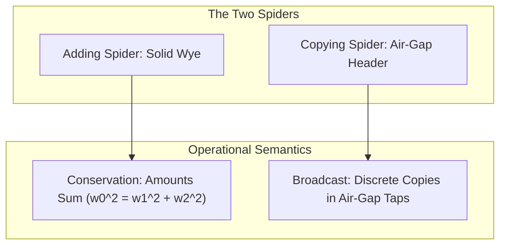
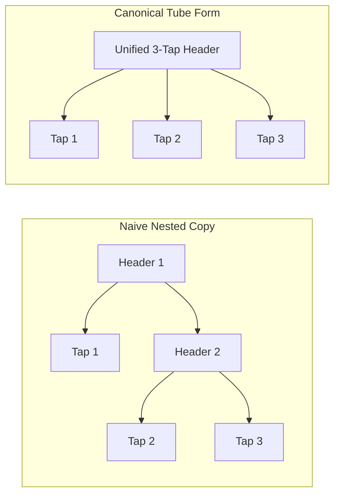

# The Sign Side of a Diagram Algebra for the Tube Language

Status: research note. 2026-10-13.
The brief is `docs/research/2026-10-13-seat-formal-brief.md`.
The algebra note is `docs/research/2026-10-13-tube-algebra/README.md`.
The pen is `tools/Tools/View/Tube/`.
This note establishes the semiotic foundations for a formal diagram algebra of the tube language.

---

## 1. Each Generator as a Sign

The diagram algebra models programs and runs as string diagrams in a monoidal category.
Each generator of the algebra maps to a physical plumbing sign in the solid-tube pen.

| Generator | Pen picture | Peircean class | Operational semantics meaning | Nearest neighbour and distinction |
| --- | --- | --- | --- | --- |
| `pipe` | Conduit of bore ladder 4, 6, 8, or 10 px | Icon | Identity transmission of value or control | `vessel`: a pipe has uniform bore; a vessel widens |
| `series` | Collinear fusion of two conduits | Icon | Sequential composition (`bind`, `;`) | `pipe`: series contains an intermediate operation station |
| `tensor` | Parallel conduits separated by air gap | Icon | Concurrent execution (`zip`, parallel branches) | `series`: tensor places conduits across space, not in time |
| `adding_spider` | Solid wye fitting with smooth G2 crotch | Icon, Symbol | Conservative merge or split (Semaphore permits) | `copying_spider`: adding spider shares fluid; copying has air gaps |
| `copying_spider` | Distributor header with air-gap taps | Symbol | Broadcast duplication (`PubSub`, exit delivery) | `adding_spider`: copying spider duplicates across air gaps |
| `vessel` | Body of width 28 px with lumen slot | Icon, Index | Storage cell (`Ref`, `Queue` buffer, `Deferred`) | `pipe`: vessel expands to width 28 px with fixed capacity |
| `valve` | Conduit parted by 4 px air gap | Icon, Index | Barrier or condition gate (`Latch`, Queue wait) | `pipe`: valve possesses rounded closed ends facing a gap |
| `loop` | Conduit curving back via bend-law arcs | Icon, Symbol | Iterative feedback or recursion (`repeat`) | `tensor`: loop re-enters upstream; tensor runs forward |
| `port` | Cut square end crossing boundary or hairpin | Symbol | External host boundary (`perform`, `HostSession`) | `pipe`: port ends with square cut line at canvas border |
| `drain` | Vertical branch venting to ground | Icon, Symbol | Value disposal (`Effect.asVoid`, discarded result) | `adding_spider`: drain vents to ground without joining a trunk |
| `collar` | Clamp of 3 px protrusion around conduit | Icon | Named definition call or store tag (`call`, `tag`) | `vessel`: collar encircles a pipe; vessel expands lumen |

### 1.1 The Pipe
The `pipe` generator draws a straight or curved conduit.
It uses a bore from the ladder: 4, 6, 8, or 10 px (`LADDER`, `tools/Tools/View/Tube/Draw.lean`).
The body width steps across 10, 14, 20, and 28 px (`WIDTHS`, `tools/Tools/View/Tube/Draw.lean`).
It represents the identity computation.
A pipe transmits a value or the fiber's control without alteration.

### 1.2 Series Composition
The `series` generator joins two conduits end to end.
The joint preserves G2 curvature continuity (`Tube.route`).
It signifies sequential composition (`bind`, `andThen`, `;`).
The execution of the first part finishes before the second part begins.

### 1.3 The Air-Gap Tensor
The `tensor` generator places conduits side by side.
An air gap of at least 4 px separates adjacent conduits (`GAP`, `tools/Tools/View/Tube/Draw.lean`).
It signifies the monoidal product of independent computations.
Tubes in a tensor run concurrently without exchanging state.

### 1.4 The Adding Spider
The `adding_spider` generator forms a solid wye or tee fitting.
The crotch blends smoothly via a cubic smooth minimum (`algorithms.md` Section A3).
The conduit widths obey da Vinci's rule: w0^2 = w1^2 + w2^2 (`Grow.split`, `tools/Tools/View/Organic.lean`).
It signifies conservative resource summation or partitioning.
It models permit accounting in semaphores and mass conservation in hydraulic streams.

### 1.5 The Copying Spider
The `copying_spider` generator draws a distribution header.
Takeoff taps hang an air gap of 4 px below the header (`spider`, `tools/Tools/View/Glyph.lean`).
It signifies information broadcast.
A value entering the header duplicates, sending an independent copy down each tap.

### 1.6 The Vessel
The `vessel` generator provides a widened chamber of body width 28 px (`WIDTHS`).
The interior lumen holds a discrete capacity slot (`unitLen`, `tools/Tools/View/Tube/Draw.lean`).
It signifies a mutable cell or synchronization place in a Petri net.
It models `Ref` storage, `Queue` capacity, and `Deferred` completion cells.

### 1.7 The Valve
The `valve` generator draws a conduit interrupted by an air gap of 4 px (`GAP`).
Each tube end facing the gap finishes with a rounded cap (`round := true`).
It signifies an execution gate or synchronization barrier.
Under motion, an opening valve closes the air gap and fuses the tube ends (`partCubics`).

### 1.8 The Loop
The `loop` generator curves a conduit back from an outlet to an inlet.
Every turn respects the long bend radius of 24 px (`BEND`, `tools/Tools/View/Tube/Form.lean`).
It signifies feedback, state recurrence, or cyclic recursion (`repeat`, `forever`).

### 1.9 The Port
The `port` generator terminates a conduit with a square cut end (`round := false`).
It extends across the canvas margin or forms a hairpin to the world (`port`, `tools/Tools/View/Glyph.lean`).
It signifies an unmanaged external host boundary (`HostSession`, `docs/core/host-boundary.md`).

### 1.10 Missing Generators: Drain and Collar
Two supplementary generators complete the sign vocabulary:
- **`drain`:** A relief branch that vents discarded values into ground tone (`_ <- a; b`).
- **`collar`:** A mounting ring that clamps a pipe to attach a symbol name or store handle (`tag`, `call`).

---

## 2. The Two Spiders on the Page

A core achievement of graphical linear algebra is the separation of copying and adding spiders.
The tube language embodies this distinction through solid joins versus air gaps (row 370 (2)).

### 2.1 Audit of Joining and Splitting Figures in `glyphs.md`
We audit every mark of `tools/Tools/View/Glyph.lean` that joins or splits:

1. **`parallel` (`Shape.parallel`):** Adding spider.
Two half-width pipes join solidly into one trunk, conserving area under da Vinci's rule.
2. **`alternative` (`Shape.alternative`):** Neither spider.
It draws a branching choice between mutually exclusive paths.
Only one branch executes at runtime.
It represents a physical two-way selector valve.
3. **`arrow` (`Shape.arrow`):** Neither spider.
A child lane begins an air gap below the parent lane.
It allocates a new concurrent fiber without copying parent data or summing resources.
It is an air-gap bond.
4. **`spider` (`Shape.spider`):** Copying spider.
An exit result enters a distribution header and duplicates across air-gap taps to each waiter.
5. **`reasons` (`Shape.reasons`):** Neither spider.
It draws three distinct failure beads in sequential order.
It represents an ordered list of failure causes, not a junction.
6. **`cross` (`Shape.cross`):** Neither spider.
One conduit passes over another with a haloed air gap.
It represents monoidal braiding without topological interaction.
7. **`port` (`Shape.port`):** Neither spider.
It draws a bidirectional hairpin to the outside world.
8. **`loop` (`Shape.loop`):** Neither spider.
It represents a feedback trace from an exit to an entrance.

### 2.2 Audit of Graph Marks in `graph-alignment.md`
We audit joining and splitting marks from graph representations:

1. **`Control edge` sequence:** Neither spider.
It represents pure series composition.
2. **`Fork edge` (`fiberGraph`):** Neither spider.
It spawns a child fiber across an air gap via mark `arrow`.
3. **`Exit edge` (`fiberGraph`):** Copying spider.
A fiber exit fans out to waiting fibers through mark `spider`.
4. **`UML flow bar` (`FlowMark.bar`):** Overloaded sign.
When branches divide work, it is an adding spider.
When branches broadcast data, it is a copying spider.
5. **`UML flow diamond` (`FlowMark.diamond`):** Neither spider.
It represents a conditional branch, rendered as a selector valve.
6. **`Organic trunk` (`Grow.split`):** Adding spider.
Branches divide trunk width under da Vinci's conservation rule.
7. **`PubSub.publish`:** Copying spider.
Messages duplicate to all registered subscriber taps across air gaps.
8. **`Semaphore.release`:** Adding spider.
Permits recirculate into the shared pool through solid junctions.

---

## 3. The Threaded Wire

Effectful languages require a control wire that threads through every operation (Jeffrey 1997, Román 2022).
This section examines how the fiber's control wire interacts with value wires.

### 3.1 Operational Semantics of the Threaded Wire
In Effect4, a fiber evaluates an operation sequence step by step (`Run.controlOnce`, `src/Effect4/Run/Basic.lean`).
The fiber's control wire represents the active execution thread.
In the score view, the control wire forms the horizontal staff (`tools/Tools/View/Tube/Score.lean`).
A single unit travels along the staff: hollow when parked, filled when running.

### 3.2 Control Wires Beside Value Wires
A program manipulates two distinct entities:
1. **The fiber's control token:** The linear capability to execute steps.
2. **Data values (`Store.Val`):** Immutable data payloads produced and consumed by operations.

In a simple sequence `a; b`, the control token passes from `a` to `b` along a conduit.
If `a` produces a value consumed by `b` (`bind`), the value travels along the same path.
However, control and values diverge in three cases:
- **Discarded values (`_ <- a; b`):** The value terminates at a drain, but control proceeds to `b`.
- **Concurrent fork (`Effect.fork`):** Control forks into two fibers, but values do not duplicate.
- **State mutation (`Ref.set`):** A value enters a storage vessel, while control advances to the next step.

### 3.3 The Need for Two Signs
One sign cannot serve both control and value wires without category confusion.
If both wires look identical, a reader cannot tell whether a conduit carries execution capability or data.
Rule: Two signs are required.
- **The control wire:** A continuous fine conduit of bore 4 px and body width 14 px (`WIDTHS`).
It threads through every effectful operation station.
It carries the fiber's execution unit.
- **The value wire:** A standard process pipe of bore 6, 8, or 10 px (`LADDER`).
It connects specific output ports to input ports.
It carries discrete data payload pills.

---

## 4. Equations a Reader Can See

A diagram algebra is sound when algebraic equations correspond to visual isomorphisms.
If two terms are algebraically equal, their tube drawings must look alike.

### 4.1 Pipe Composition: `pipe ; pipe = pipe`
In category theory, the composition of two identity wires equals the identity wire.
In the solid-tube pen, two fused straight pipes form one continuous straight pipe.
The pen blends collinear segments with G2 continuity (`Tube.route`).
No visible seam or weld line appears at the junction.
Verdict: The two sides look identical.
A reader trusts this equation immediately.

### 4.2 Copying Coassociativity: `copy ; (copy ⊗ id) = copy ; (id ⊗ copy)`
Coassociativity states that nesting two broadcasts produces an identical three-way copy.
In naive tree drawing, the left side draws a two-level binary tree.
The right side draws an opposite binary tree.
Neither resembles a balanced three-way distribution header.
A reader sees structural hierarchy where the algebra asserts flat equivalence.
Verdict: The naive drawings do not look alike.
Redrawing rule: The diagram algebra must apply a flattening rewrite rule.
Nested copying spiders must redraw as a single canonical distributor header with three air-gap taps.

### 4.3 Adding Associativity: `(add ⊗ id) ; add = (id ⊗ add) ; add`
Associativity states that merging three streams in pairs equals merging all three together.
Under da Vinci's rule, the final trunk has width w = sqrt(w1^2 + w2^2 + w3^2).
A cascaded wye creates intermediate conduit steps of width sqrt(w1^2 + w2^2).
A simultaneous 3-to-1 manifold transitions directly to the final width.
Verdict: The drawings do not look identical at intermediate steps.
Redrawing rule: The layout engine must contract adjacent solid wyes into a single symmetric 3-to-1 manifold.

### 4.4 Trace of an Identity: `trace(pipe) = ring`
Connecting the outlet of a pipe directly to its inlet forms a closed loop.
A naive drawing shows a straight pipe with an external return loop.
The canonical mark for a closed loop is a symmetric circle (`Shape.enter`, `filmCircuit`).
Verdict: A looped straight run does not look like a symmetric ring.
Redrawing rule: When an edge loops from an outlet to an inlet without intervening nodes, contract it into a circular ring.

### 4.5 The Bialgebra Equation
The bialgebra equation relates copying and adding:
`add ; copy = (copy ⊗ copy) ; (id ⊗ swap ⊗ id) ; (add ⊗ add)`
The left side draws one wye followed by one distributor header.
The right side draws two headers, a crossing, and two wyes.
Verdict: The two sides cannot look alike at rest.
The equation represents a non-trivial theorem of concurrent interaction.
It must animate as a continuous morph rather than appearing identical in a still picture.

---

## 5. Decompositions

We decompose ten tube figures and five graph marks into terms of the diagram generators.

### 5.1 Ten Decompositions of the 37 Tube Figures
1. **`Shape.value`:** `pipe(unit)`
A pipe conduit holding one ink unit pill at its leading end.
2. **`Shape.call`:** `collar("enter") ; pipe ; collar("exit")`
A pipe conduit bracketed by two flanged mounting collars.
3. **`Shape.hollowBox`:** `pipe ; vessel(promised) ; pipe`
An incoming conduit entering a vessel holding a hollow promised pill.
4. **`Shape.filledBox`:** `pipe ; vessel(units) ; pipe`
An incoming conduit entering a vessel holding a kept unit pill.
5. **`Shape.hole`:** `pipe ; vessel(empty) ; pipe`
An incoming conduit entering an empty vessel awaiting a return value.
6. **`Shape.parallel`:** `adding_spider(2, 1)`
Two incoming conduits merging solidly into a single trunk.
7. **`Shape.spider`:** `copying_spider(1, 3)`
A distribution header distributing a single input to three air-gap taps.
8. **`Shape.port`:** `pipe ; loop_to_boundary ; vessel(promised)`
A request pipe exiting to the world and returning as a hollow reply socket.
9. **`Shape.rest`:** `pipe ; valve(parted) ; pipe`
A conduit interrupted by a 4 px air-gap valve.
10. **`Shape.tag`:** `collar(id) ; pipe`
A short pipe clamped by a central identifying collar tag.

### 5.2 Five Decompositions of Graph Marks
1. **Control edge:** `pipe_control`
A fine conduit of bore 4 px carrying the fiber's execution token.
2. **Data edge:** `pipe_data`
A process pipe of bore 6 to 10 px carrying evaluated data payloads.
3. **Fork edge:** `tensor(pipe_parent, bond_arrow ; pipe_child)`
Parent and child conduits running in parallel across an air gap.
4. **Exit edge:** `copying_spider(1, n)`
A broadcast header fanning out exit units to n waiting fibers.
5. **Region frame:** `container(items)`
A four-corner bracket enclosure surrounding items across an air gap.

### 5.3 Figures That Do Not Decompose
The following visual marks refuse decomposition into string diagram generators:
- **`Shape.blockedArrow` (`⊣`, force):** An interrupt is an impulse shockwave colliding with an impact stop.
It is an active dynamic event, not a conduit or algebraic fitting.
- **Cadence marks (`barLine`, `exitBar`, `fermata`, `caesura`):** Cadence marks represent score punctuation and temporal boundaries.
They possess zero bore, carry no fluid, and have no connection ports.
They belong to a distinct temporal grammar.
- **`Shape.hash` (defect):** A fractured conduit sheared into disconnected pieces.
It represents abnormal program breakdown.
It is the negation of a lawful generator.
- **`Shape.cross` (crossing):** An under-and-over conduit crossing.
It is the monoidal braiding operator, which must be taken as a primitive generator.

---

## 6. What This Alignment Does Not Establish

This note establishes semiotic sign classes and decomposition rules, not a formalized Lean library.
The generator terms are described in plain words and await formalization by seat FORMAL.
Algebraic normalization rules for spiders are structural proposals, not verified compiler passes.
No code in `src/` or `tools/` is modified by this document.

---

## 7. Questions for the Owner

Each question below states one decision in one sentence with a concrete recommendation.

1. Should the diagram algebra include an explicit braiding generator for tube crossings, as recommended to formalize monoidal braiding with haloed air gaps?
2. Should cadence marks remain a separate temporal punctuation grammar, as recommended to keep zero-bore score markers outside the fluid calculus?
3. Should nested copying spiders be flattened into canonical multi-tap headers by algebraic rewrite rules, as recommended so that equal terms draw alike?
4. Should the fiber control wire use a fine 14 px conduit while data wires use standard process pipes, as recommended to distinguish control from data?
5. Should proof dependency propagation be modeled as an adding spider distributing evidence fills, as recommended to represent verification proof graphs as token nets?
