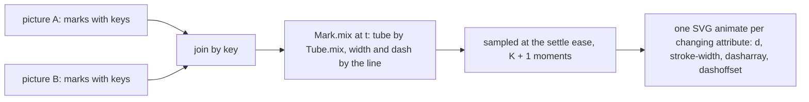

# One body: the tube language

Status: research note (history, not authority). 2026-10-13. The page is `tubes.html`
(`tools/view/v -V tubes`). The code is `tools/Tools/View/Tube/`.

**The one thing to know first.** Every glyph is now one body, a tube, and every transition is a
morph between tubes. Every moment of a morph keeps the bend law (`Tube.mix_ok`, proved). So any
glyph can turn into any other with no case written for the pair.

## 1. The owner's steer

The owner rejected the literal mechanisms of the tissue-and-metal sketch
(`docs/research/2026-10-13-organic-mechanical/sketch.html`). In the owner's words, they look like
"crappy physics drawings from a high school test". The owner asked for these instead:

- solid bodies or curves, with movement that is easy to animate and to abstract;
- one consistent line style, "thicker smooth";
- pipes with weight, bending and stress, and fittings after plumbing;
- flow semantics after hydrology;
- simple, consistent, reducible integer filling.

Then, mid-turn, the owner named the reason. With one thick-pipe body, solid-body transitions can
turn any shape of the grammar into any other. The glyphs must be "provably transformable".

## 2. The one body

A **tube** is a centreline swept by one width (`Tube`, `tools/Tools/View/Tube/Form.lean`). It is
given intrinsically:

- its start and its heading there;
- its bore, the width of its contents;
- its **pieces**, each a length and the angle it turns over that length.

A piece with no turn is a straight run; any other piece is a circular arc. This is the medial-axis
idea of Blum (1967): a shape is a skeleton with a width. Here the width is one per tube.

**The bend law.** No piece bends tighter than one radius, `BEND` (15 px), whatever the tube
(`Piece.ok`). For a piece of length `ℓ` that turns `θ`, the law is `BEND · |θ| ≤ ℓ`, and a piece
turns at most half a turn. Transit maps draw every corner at one radius. A long-radius pipe elbow
bends at one and a half times its size (ASME B16.9). The shortest routes under such a law are arcs
and straights, at most three pieces (Dubins 1957), so three pieces suffice for a route.

**Drawing.** Each half of a piece is one cubic Bézier: the arc's chord `(ℓ/2)·sinc(θ/4)` and its
handle `(ℓ/6)·tanc(θ/8)` (`Piece.draw`). `sinc` and `tanc` are Taylor series in whole numbers
(`tools/Tools/View/Tube/Trig.lean`), so a straight piece needs no case of its own.

**One pen** (`tools/Tools/View/Tube/Draw.lean`). Every mark is a stroke of a tube's centreline:

| Layer | What it draws | Width | Tone |
| --- | --- | --- | --- |
| walls | every tube's wall; every collar | body = contents + 2 × clearance + 2 × wall | wall |
| lumens | every tube's lumen | contents + 2 × clearance | lumen |
| plugs | a closed valve | the lumen's | wall |
| contents | every unit | the contents' | fluid |
| hollows | the inside of a promised unit | the contents', less a rim | lumen |

Every wall is drawn before every lumen, as a cartographer draws road casings. So where tubes meet,
the lumen is one, and a junction needs no shape of its own. The three tones are mixes of the
look's ink and ground. So the paper look works with no second palette.

## 3. The morph

**Intrinsic blending.** `Tube.mix` mixes what a tube is, not where its points stand. It mixes each
piece's length and turn: `(1000 − t)` thousandths of one tube and `t` of the other. This is the intrinsic
solution of Sederberg, Gao, Wang and Mu (SIGGRAPH 1993). A turning shape does not shrink on the
way, and no kink appears that neither end has.

**Why it is provable.** The bend law is linear in `(ℓ, θ)` and holds at zero. So the pieces that
keep it form a convex cone, and a mix stays in it. The rounding keeps it too: a length is rounded
up, a turn toward zero.

| Theorem | Statement | Path |
| --- | --- | --- |
| `Piece.mix_ok` | every moment of a morph between two lawful pieces is lawful | `tools/Tools/View/Tube/Form.lean` |
| `Tube.mix_ok` | the same for two tubes, padded to one piece count | same |
| `Piece.mix_zero`, `Piece.mix_full` | a morph starts at its first piece and ends at its second | same |
| `round_bend` | the bend law survives the rounding of a mix | same |
| `ladder_divides` | every width of the ladder divides the unit's area | `tools/Tools/View/Tube/Draw.lean` |

`#axiom_audit` over the five modules: the theorems rest on `propext` and `Quot.sound` only. The
SVG writers (`node`, `film`, the plates) reach `Classical.choice` through the package's SVG node,
as `SvgOut`'s writers do.

**Three consequences.**

1. **Any two tubes morph.** A tube of fewer pieces is padded with pieces of no length, which keep
   the law and draw nothing.
2. **A tube grows from nothing.** A tube with its pieces at no length is its root, so appearing is
   a morph from the root (the branch film).
3. **A tube is mixed from its root.** A tube whose far end must stay on what it runs into is given
   from there and drawn reversed (`Mark.fromEnd`, `Tube.reverse`). The circuit film needs this:
   the inlet is rooted at the vessel.

**What the theorems do not establish.**

- Two tubes that meet at both frames can part in the middle of a morph. Only a tube's root stays
  put. A loop closes at its end frame, not on the way.
- No theorem bounds the cubic's distance from the true arc. A quarter turn's cubic is within
  0.03% of the radius, a known figure, not a checked one.
- No theorem says the marks stay inside the picture. The circuit film needed a taller picture.
- A morph of headings goes the way the numbers go. A caller gives each heading on the side it
  means.

**Why SMIL.** WebKit does not animate CSS `d` (found 2026-10-11, row 354's probe), and the
Hammerspoon viewer is WebKit. So the animator writes each beat's samples as SVG `animate` elements
(`film`). The samples come from the exact morph, and the browser draws straight lines between
close samples. A film starts half a second after the page loads, again on a click, and holds its
end. SMIL does not read `prefers-reduced-motion`, a gap this note leaves open.

## 4. Plumbing semantics: the pipework is the invariant, the contents the state

This restates the earlier rule, "an invariant is metal; state is tissue". The pipework is fixed by
the program: a vessel's length is its capacity, a valve is a strategy, a loop is a conservation
law. The contents are what the run carries. So an invariant is read from how the tubes connect,
never from a drawn mechanism.

| Construct | Plumbing | Drawn on the page |
| --- | --- | --- |
| a bounded queue's capacity | a vessel as long as its capacity in units | yes |
| backpressure (an offer suspends) | a float valve that closes when the vessel is full; offers wait behind it as backwater | yes |
| dropping (a new offer is lost) | an overflow before the vessel | yes, still |
| sliding (the oldest is lost) | a relief at the vessel's front | yes, still |
| a taker that waits | a hollow unit at the outlet's end: hollow is a promise, filled is kept | yes |
| a semaphore's permits | a closed circuit: what leaves comes back, so the count holds | as a morph |
| a split or a merge | a tee or a wye: the counts add | the junction plate |
| a broadcast (PubSub) | a manifold: every branch receives a copy, so the counts do not add; a fitting of its own | proposed |
| a deferred | a vessel of one unit with a closed outlet valve, opened once | proposed |
| the journal | a pipe with no outlet: it only fills | proposed |
| a scope's finalizers | drains opened in reverse order at close | proposed |

A broadcast is the one fitting that does not conserve. It must look unlike a tee, or the picture
claims a conservation that does not hold.

## 5. Hydrology: flow semantics

- **Continuity.** A vessel's storage changes by what enters less what leaves, `dS/dt = I − O`, the
  storage equation of level-pool routing. In whole commands, `S' = S + offered − taken`.
- **A unit moves by volume, not by length.** A unit's place is a volume along the line of tubes
  (`Queue.fronts`). In each tube it stands at `(v − the volume before the tube) / the tube's
  width`, an affine function of `v`. So a unit that moves linearly in volume moves linearly in
  every tube, and its speed in each is inverse to the tube's width.
- **Counts step.** A count changes only at a command, so a vessel's fill moves in whole units. This
  repairs finding 2 of the earlier review: no curve between commands.
- Proposed, not built: a hydrograph for the totals of a run, and Strahler order for widths in a
  tree. A confluence of two equal orders raises the order by one, so widths become whole steps.

## 6. Integer filling

- **One amount.** A unit is `AREA` (192) square pixels in every tube. In a tube of contents width
  `c`, a unit is `AREA / c` pixels long. That is 24 in a pipe of 8, 12 in a vessel of 16, and 48
  in a pipe of 4.
- **Reducible.** Every width of the ladder (4, 6, 8, 12, 16, 24, 32, 48) divides the area
  (`ladder_divides`). So `AREA / c` reduces to a whole number, and every unit is a whole number of
  pixels long.
- **Countable.** Units stand a meniscus (2 px) apart.
- **Conserved.** A unit keeps its area through a change of width, as water does. This repairs
  finding 1 of the earlier review: no width is truncated, since a count is drawn as units, not as
  a width.
- Proposed: above a limit of units a unit stands for a whole multiple, as `Phyllotaxis.perMark`
  does.

## 7. Weight, bending and stress

- **Weight bends a span.** A beam on two supports under an even load turns at its ends by
  `wL³/24EI`, linear in the load. So the inlet's end slope is `SAG0 + SAG_PER × n` for `n` waiting
  messages (`Queue.Layout.inlet`). The span is drawn as the circular arc of that end slope. The
  beam's own curve is a quartic. At equal depth the arc departs from it by about 4% of the depth,
  under half a pixel here. That figure is computed by hand, not checked.
- **Bending** is the bend law and the arc pieces.
- **Stress is not drawn.** Hoop stress is `σ = p r / t` (Barlow), and the pressure behind a closed
  valve is the backwater. Two ways to draw it wait for the owner (question 4).

## 8. What the earlier work becomes

- **The living organism stays as a page until the owner rules** (question 1). The soft field,
  Physarum, Murray and the phyllotaxis stay in `tools/Tools/View/Living/`.
- In the tube language a junction needs no soft field, since the casing layers merge the lumens.
  A vessel needs no spiral, since its capacity is its length.
- Of the earlier review's ten findings, two no longer arise: the truncated cores (finding 1) and
  the curve between counts (finding 2). The rest belong to the living organism and wait with it.

## 9. Package asks (proposed, for `docs/research/2026-10-12-whatwg-requests.md`)

| Ask | What | Law |
| --- | --- | --- |
| W30 | the tube form: pieces, the bend law, `mix`, `reverse`, drawing by cubics | `mix_ok` and the endpoints, as here |
| W31 | cased layers: walls, then lumens, then contents, over any set of tubes | a junction's lumen is one |
| W32 | a shape track in `Scene/Motion`, written as SMIL `animate` for WebKit and as CSS `d` where it is supported | the samples are the morph's |

## 10. Questions for the owner

1. **Is the tube the one body?** If so, the Queue's living organism (`living.html`, `play.html`)
   retires once the tube page carries the run. The soft field and Physarum stay in history.
2. **SMIL for shape morphs?** Row 354 rules one CSS-exact motion value. A morph's path needs SMIL in
   WebKit. The amendment: a shape track, written as SMIL samples of the exact morph.
3. **Units: square segments, or rounded pills?** Pills read softer. A pill needs `AREA / c` at least
   `c` plus the meniscus, so the vessels narrow to 12 px or the area grows.
4. **Stress:** none, the wall's tone darkened by hoop stress, or the lumen widened by strain? Strain
   changes a unit's length (one amount in a wider bore), so it breaks whole-pixel units under load.

## Sources

- Sederberg, Gao, Wang, Mu, "2-D shape blending: an intrinsic solution to the vertex path
  problem", SIGGRAPH 1993, *Computer Graphics* 27, pp. 15–18:
  <https://history.siggraph.org/?p=118584>
- Dubins, "On curves of minimal length with a constraint on average curvature…", *American
  Journal of Mathematics* 79 (1957), pp. 497–516, doi:10.2307/2372560
- Blum, "A transformation for extracting new descriptors of shape" (1967), via
  <https://en.wikipedia.org/wiki/Medial_axis>
- ASME B16.9 long-radius elbows, centre to end 1.5 × size:
  <https://blog.projectmaterials.com/pipe-valves-fittings-charts-pdf/fittings-b16-9/>
- Road casings drawn before fills (OpenStreetMap rendering):
  <https://help.openstreetmap.org/questions/10088/mapnik-rendering-road-cores-and-casings>
- Level-pool routing and the storage equation: <https://web.itu.edu.tr/~bulu/water_resources_files/lecture_notes_08.pdf>
