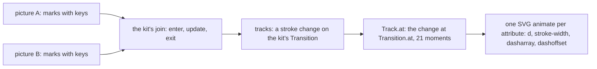
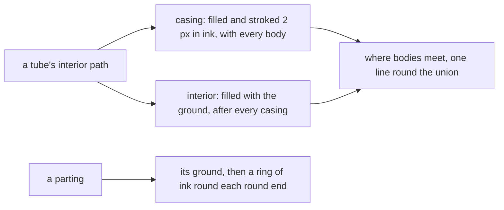

# One body: the tube language

Status: research note (history, not authority). 2026-10-13. The page is `tubes.html`
(`tools/view/v -V tubes`). The code is `tools/Tools/View/Tube/`. The owner ruled the note's
questions on the same day: decisions row 369 (§12). The styling pass that followed changed the
pen: decisions row 370 (§13). Where §2 and §13 differ, §13 holds.

**The one thing to know first.** Every glyph is now one body, a tube, and every transition is a
morph between tubes. Every moment of a morph keeps the bend law (`Tube.mix_ok`, proved). So any
glyph can turn into any other with no case written for the pair.

## 1. The owner's steer

The owner rejected the literal mechanisms of the tissue-and-metal sketch
(`docs/research/2026-10-13-organic-mechanical/sketch.html`). In the owner's words, they look like
"crappy physics drawings from a high school test". The owner asked for these instead:

- solid bodies or curves, with movement that is easy to animate and to abstract;
- one consistent line style, "thicker smooth";
- pipes with weight, bending and stress, and fittings after plumbing;
- flow semantics after hydrology;
- simple, consistent, reducible integer filling.

Then, mid-turn, the owner named the reason. With one thick-pipe body, solid-body transitions can
turn any shape of the grammar into any other. The glyphs must be "provably transformable".

## 2. The one body

A **tube** is a centreline swept by one width (`Tube`, `tools/Tools/View/Tube/Form.lean`). It is
given intrinsically:

- its start and its heading there;
- its bore, the width of its contents;
- its **pieces**, each a length and the angle it turns over that length.

A piece with no turn is a straight run; any other piece is a circular arc. This is the medial-axis
idea of Blum (1967): a shape is a skeleton with a width. Here the width is one per tube.

**The bend law.** No piece bends tighter than one radius, `BEND` (15 px), whatever the tube
(`Piece.ok`). For a piece of length `ℓ` that turns `θ`, the law is `BEND · |θ| ≤ ℓ`, and a piece
turns at most half a turn. Transit maps draw every corner at one radius. A long-radius pipe elbow
bends at one and a half times its size (ASME B16.9). The shortest routes under such a law are arcs
and straights, at most three pieces (Dubins 1957), so three pieces suffice for a route.

**Drawing.** Each half of a piece is one cubic Bézier: the arc's chord `(ℓ/2)·sinc(θ/4)` and its
handle `(ℓ/6)·tanc(θ/8)` (`Piece.draw`). `sinc` and `tanc` are Taylor series in whole numbers
(`tools/Tools/View/Tube/Trig.lean`), so a straight piece needs no case of its own.

**One pen** (`tools/Tools/View/Tube/Draw.lean`). Every mark is a stroke of a tube's centreline:

| Layer | What it draws | Width | Tone |
| --- | --- | --- | --- |
| walls | every tube's wall; every collar | body = contents + 2 × clearance + 2 × wall | wall |
| lumens | every tube's lumen | contents + 2 × clearance | lumen |
| plugs | a closed valve | the lumen's | wall |
| contents | every unit | the contents' | fluid |
| hollows | the inside of a promised unit | the contents', less a rim | lumen |

Every wall is drawn before every lumen, as a cartographer draws road casings. So where tubes meet,
the lumen is one, and a junction needs no shape of its own. The three tones are mixes of the
look's ink and ground. So the paper look works with no second palette.

## 3. The morph

**Intrinsic blending.** `Tube.mix` mixes what a tube is, not where its points stand. It mixes each
piece's length and turn: `(1000 − t)` thousandths of one tube and `t` of the other. This is the intrinsic
solution of Sederberg, Gao, Wang and Mu (SIGGRAPH 1993). A turning shape does not shrink on the
way, and no kink appears that neither end has.

**Why it is provable.** The bend law is linear in `(ℓ, θ)` and holds at zero. So the pieces that
keep it form a convex cone, and a mix stays in it. The rounding keeps it too: a length is rounded
up, a turn toward zero.

| Theorem | Statement | Path |
| --- | --- | --- |
| `Piece.mix_ok` | every moment of a morph between two lawful pieces is lawful | `tools/Tools/View/Tube/Form.lean` |
| `Tube.mix_ok` | the same for two tubes, padded to one piece count | same |
| `Piece.mix_zero`, `Piece.mix_full` | a morph starts at its first piece and ends at its second | same |
| `round_bend` | the bend law survives the rounding of a mix | same |
| `ladder_divides` | every width of the ladder divides the unit's area | `tools/Tools/View/Tube/Draw.lean` |
| `ladder_pills` | every width of the ladder leaves room for a pill in its slot | same |
| `Track.at_done` | a track whose transition is over stands at its change's end | `tools/Tools/View/Tube/Motion.lean` |

`#axiom_audit` ran over the six modules of the language, the page aside. Of 537 declarations, 5
reach `Classical.choice`: the SVG writers `pathNode`, `node`, `still`, `film` and `smil`. Each
reaches it through the kit's `SvgNode`, as `SvgOut`'s writers do. Every theorem rests on `propext`
and `Quot.sound`.

**Three consequences.**

1. **Any two tubes morph.** A tube of fewer pieces is padded with pieces of no length, which keep
   the law and draw nothing.
2. **A tube grows from nothing.** A tube with its pieces at no length is its root, so appearing is
   a morph from the root (the branch film).
3. **A tube is mixed from its root.** A tube whose far end must stay on what it runs into is given
   from there and drawn reversed (`Mark.fromEnd`, `Tube.reverse`). The circuit film needs this:
   the inlet is rooted at the vessel.

**What the theorems do not establish.**

- Two tubes that meet at both frames can part in the middle of a morph. Only a tube's root stays
  put. A loop closes at its end frame, not on the way.
- No theorem bounds the cubic's distance from the true arc. A quarter turn's cubic is within
  0.03% of the radius, a known figure, not a checked one.
- No theorem says the marks stay inside the picture. The circuit film needed a taller picture.
- A morph of headings goes the way the numbers go. A caller gives each heading on the side it
  means.

**Why SMIL.** WebKit does not animate CSS `d` (found 2026-10-11, row 354's probe), and the
Hammerspoon viewer is WebKit. So each track is written as SVG `animate` elements (`smil`). The
samples come from the exact change, and the browser draws straight lines between close samples. A
film starts half a second after the page loads, again on a click, and holds its end. SMIL does not
read `prefers-reduced-motion`. So a film's figure carries its last picture still (`filmFigure`). A
rule of the page shows that picture alone to a reader who prefers reduced motion.

## 4. Plumbing semantics: the pipework is the invariant, the contents the state

This restates the earlier rule, "an invariant is metal; state is tissue". The pipework is fixed by
the program: a vessel's length is its capacity, a valve is a strategy, a loop is a conservation
law. The contents are what the run carries. So an invariant is read from how the tubes connect,
never from a drawn mechanism.

| Construct | Plumbing | Drawn on the page |
| --- | --- | --- |
| a bounded queue's capacity | a vessel as long as its capacity in units | yes |
| backpressure (an offer suspends) | a float valve that closes when the vessel is full; offers wait behind it as backwater | yes |
| dropping (a new offer is lost) | an overflow before the vessel | yes, still |
| sliding (the oldest is lost) | a relief at the vessel's front | yes, still |
| a taker that waits | a hollow unit at the outlet's end: hollow is a promise, filled is kept | yes |
| a semaphore's permits | a closed circuit: what leaves comes back, so the count holds | as a morph |
| a split or a merge | a tee or a wye: the counts add | the junction plate |
| a broadcast (PubSub) | a manifold: every branch receives a copy, so the counts do not add; a fitting of its own | proposed |
| a deferred | a vessel of one unit with a closed outlet valve, opened once | proposed |
| the journal | a pipe with no outlet: it only fills | proposed |
| a scope's finalizers | drains opened in reverse order at close | proposed |

A broadcast is the one fitting that does not conserve. It must look unlike a tee, or the picture
claims a conservation that does not hold.

## 5. Hydrology: flow semantics

- **Continuity.** A vessel's storage changes by what enters less what leaves, `dS/dt = I − O`, the
  storage equation of level-pool routing. In whole commands, `S' = S + offered − taken`.
- **A unit moves by volume, not by length.** A unit's place is a volume along the line of tubes
  (`Queue.fronts`). In each tube it stands at `(v − the volume before the tube) / the tube's
  width`, an affine function of `v`. So a unit that moves linearly in volume moves linearly in
  every tube, and its speed in each is inverse to the tube's width.
- **Counts step.** A count changes only at a command, so a vessel's fill moves in whole units. This
  repairs finding 2 of the earlier review: no curve between commands.
- Proposed, not built: a hydrograph for the totals of a run, and Strahler order for widths in a
  tree. A confluence of two equal orders raises the order by one, so widths become whole steps.

## 6. Integer filling

- **One amount.** A unit is `AREA` (384) square pixels in every tube. In a tube of contents width
  `c`, a unit's slot is `AREA / c` pixels long. That is 32 in a pipe of 12, 24 in a vessel of 16,
  and 96 in a pipe of 4.
- **Reducible.** Every width of the ladder (4, 6, 8, 12, 16) divides the area (`ladder_divides`).
  So `AREA / c` reduces to a whole number, and every slot is a whole number of pixels long.
- **A pill.** A unit is drawn as a pill, a liquid plug with a round meniscus at each end, 2 px from
  the next. Every width of the ladder leaves room for one, `c (c + 2) ≤ AREA` (`ladder_pills`).
- **Slots.** The vessel's units are the kit's slots (`Units.slots`): the front in slot 0 at the
  outlet's end, the order kept, the room shown. The units that wait are its lane (`Units.lane`).
- **Conserved.** A unit keeps its area through a change of width, as water does. This repairs
  finding 1 of the earlier review: no width is truncated, since a count is drawn as units, not as
  a width.
- Proposed: above a limit of units a unit stands for a whole multiple, as `Phyllotaxis.perMark`
  does.

## 7. Weight, bending and stress

- **Weight bends a span.** A beam on two supports under an even load turns at its ends by
  `wL³/24EI`, linear in the load. So the inlet's end slope is `SAG0 + SAG_PER × n` for `n` waiting
  messages (`Queue.Layout.inlet`). The span is drawn as the circular arc of that end slope. The
  beam's own curve is a quartic. At equal depth the arc departs from it by about 4% of the depth,
  under half a pixel here. That figure is computed by hand, not checked.
- **Bending** is the bend law and the arc pieces.
- **A sudden load passes its rest.** A load that lands at once carries a span past its static
  deflection before it settles. The inlet passes through a pose 35% beyond its new slope
  (`Picture.via`), then settles.
- **Stress is not drawn yet.** Hoop stress is `σ = p r / t` (Barlow), and the pressure behind a
  closed valve is the backwater. It belongs to the styling pass (§12).

## 8. What the earlier work becomes

- **The living organism retired** (row 369). Its modules (`Tools.View.Living`: the soft field,
  Physarum, Murray, the phyllotaxis, the organism) are deleted, and with them `living.html` and
  `play.html`. Git keeps them.
- The marking of a run moved to `tools/Tools/View/Tube/Marking.lean`.
- In the tube language a junction needs no soft field, since the casing layers merge the lumens.
  A vessel needs no spiral, since its capacity is its length.
- Of the earlier review's ten findings, two no longer arise: the truncated cores (finding 1) and
  the curve between counts (finding 2). The rest went with the living organism.

## 9. The library underneath

The owner asked that the language stand on `lean4-whatwg`'s abstractions, so it is coherent and
smooth. What it takes from the kit, at the pin `80bb06b`:

| The kit's | Used for | Where |
| --- | --- | --- |
| `join` (`Whatwg/Svg/Scene/Join.lean`) | a step: what enters, what is kept, what leaves | `Picture.step` |
| `Transition`, `Transition.at` (`Whatwg/Svg/Scene/Motion.lean`) | every change's delay, duration and easing, read as a browser reads it | `Mark.move`, `Mark.shape`, `Track.at` |
| `Easing`: `stops`, `linear`, `cubicIn` | the eases of a step | `Queue.picture` |
| `Spring.critical` (`Whatwg/Svg/Geometry/Spring.lean`) | the settling ease, a critically damped spring | `settle`, its stops guarded against the spring |
| `mix` | a width or a dash between two poses | `Stroke.at` |
| `Units.slots`, `Units.lane` (`Whatwg/Svg/Scene/Units.lean`) | the vessel's slots and the lane of waiting offers, with their laws | `Queue.place` |

What the kit lacks is here in its shape, to move into it after the decomposition pass (§12):

| Ask | What | Now in |
| --- | --- | --- |
| W30 | the tube form: pieces, the bend law, `mix` and its laws, `reverse`, `cut`, drawing by cubics, whole-number trigonometry | `Form.lean`, `Trig.lean` |
| W31 | cased layers over any set of tubes | `Draw.lean` (`Mark.layer`) |
| W32 | a writer of tracks as SMIL `animate`, for WebKit, beside the CSS writer; a film's still for reduced motion | `Motion.lean` (`smil`, `film`, `filmFigure`) |
| W33 | three changes for a stroke: the intrinsic bend, a width (and a swell), a window along it; each through a pose where given | `Motion.lean` (`Stroke`, `Pose`) |

## 10. Effects, each for a meaning

Every effect carries a meaning and has a source. Chang and Ungar (UIST 1993) group cartoon
animation's principles for interfaces under solidity, exaggeration and reinforcement. Heer and
Robertson (InfoVis 2007) ask that a transition keep the graphic valid at every moment. They also
ask that it stage a complex change, stagger starts, and last as long as needed and no longer.

| Effect | Meaning | Source | Where |
| --- | --- | --- | --- |
| a pill with round menisci | one message is one solid amount | Bretherton 1961, plugs and bubbles in tubes; Chang and Ungar, solidity | `unitOf` |
| a bubble that grows where it stands and, kept, shrinks there | a taker's promise, made and kept | Chang and Ungar, arrivals and departures | `hollowOf`, `Queue.picture` |
| the world off the picture | offers come from the world and messages go to it | Chang and Ungar: things enter from offscreen and leave the way they came | `Queue.Layout` (`OFF`) |
| the front first, each unit after the one ahead | FIFO order, as a queue of cars leaves a green light | Heer and Robertson, staggering; the queue-discharge wave of traffic | `Queue.picture` (`STAGGER`) |
| a valve opens, then the offer moves | the valve's cause before its effect | Heer and Robertson, staging | `OPENING` |
| an offer meets the closed valve and stops hard | the refusal of backpressure | Chang and Ungar, follow-through; the stop as an impact | `Easing.cubicIn`, `IMPACT` |
| a surge runs back up the inlet | backpressure reaches the source | Joukowsky, `Δp = ρ a Δv`, the surge travels upstream | the `surge` events |
| the tube swells round a moving unit | the unit is carried now | peristalsis (Shapiro, Jaffrin and Weinberg 1969) | `swellOf` |
| a loaded span passes its rest | the weight arrived at once | a beam's dynamic deflection; Chang and Ungar, follow-through | `OVERSHOOT`, `Picture.via` |
| a valve opens and closes within a step | a slot freed and taken again | the float valve | `Stroke.window` through a pose |

The traffic source is lecture notes on shockwave and kinematic-wave theory, read from a search
result, not the full text.

## 11. Smoothness and crispness

- **One pixel to the pixel.** A picture's width is its view box's; a page narrower than it scales
  it down. Every width is a whole, even number of pixels. A straight run's axis lies on a whole
  pixel, so its edges fall on pixel edges.
- **Open ends are cut, closed ends are round.** A pipe to the world is cut square, off the picture;
  a vessel has round heads.
- **Twenty-one samples a change.** A change is sampled at twenty-one moments of its transition, so a
  pose moves by a twentieth at most between samples. The settling ease is the kit's spring.
- **Every moment is lawful.** A bend keeps the bend law at every sample (`Tube.mix_ok`). A tube is
  mixed from its root, so a pipe stays on the vessel it leaves.
- **A unit keeps to its pipe.** The units on a pipe whose shape changes take the pipe's time for
  their path (`Mark.shape`), so they bend with it.
- Not yet: curvature-continuous joins (clothoid transitions between straights and arcs), and a
  check that a picture's marks stay in its room.

## 12. The owner's rulings and what comes next

Decisions row 369, from the owner's answers of 2026-10-13: the tube is the one body, morphs are
written in SMIL, units are pills.

- **The styling pass** follows the owner's direction, in the owner's words: "plumbing drawing
  precision but designed emphasized deliberately as a custom drawing does". It uses "simple
  algorithms for using known techniques of depth shading noise". So it has no hand-drawn wobble.
  The candidates are known, simple techniques:
  - depth by tone and haloed crossings (row 354 (10));
  - a tube's shading as a lit highlight and a shaded side along its centreline;
  - a grain of noise that a look turns on (row 354 (9));
  - stress shown on the wall.
- **The decomposition pass** then carries the tube language to the rest of the visual semantics,
  and the asks W30 to W33 move into the kit.

## 13. The styling pass

Decisions row 370 records the owner's rulings, made over four rounds of prototypes in the browser
pane. The order mattered, so it is kept here:

1. A cutaway look with bevels, inner shadows and highlights: refused ("ugg no thats bad").
2. Four flat directions; the owner chose line art. Then the owner asked to "start with solid
   fills and think of joining", with air gaps "for some semantics" and "smooth no kinks".
3. Solid bodies with round partings and wide fillets; the owner asked for "everything with a
   smooth outline ... organic rounded docks like tree branch widening".
4. The look of the docs' tree and graph figures. In the owner's words: "colors and line style
   are still all wrong make it look more like the docs / tree and graph look".

**The pen now.** A body is a ground fill inside a one-pixel line of ink, as a node of the docs'
plan trees is. Contents are solid ink pills, and a promised unit is an ink ring. No tone stands
between ink and ground.

**Joins carry meaning.**

| Join | Meaning | Drawn |
| --- | --- | --- |
| one fill | the bodies share their fluid: a tee or a wye conserves | the branch leaves on its tangent; its crotch is rounded by the widest fillet that fits, 18 px down (`crotch`, `tools/Tools/View/Tube/Outline.lean`) |
| an air gap | nothing passes | a closed valve parts its pipe, each end round (`plugOf`); a broadcast's taps stand a gap from their source; the tube below a crossing is parted round the one above (`cutOf`) |

**Smooth, with no kink.**

- A body's outline is its two exact parallels and its caps. The parallel of an arc is an arc of the
  same turn (`Tube.offset`).
- A change of width is eased by the smoothstep, whose slope is nothing at both ends
  (`stretchWidth`, `patchCubics`). A vessel is one stretch whose ends ease to its pipes' widths.
- The bend law's radius is 24 px, a long radius, so the inside of a bend is round (`BEND`,
  `tools/Tools/View/Tube/Form.lean`). The two step lemmas of `Piece.mix_ok` follow the constant.
- The inlet is clamped level at the vessel and sags in three arcs, so it meets the vessel on its
  tangent (`Layout.inletAt`, `tools/Tools/View/Tube/Queue.lean`).

**Motion.** A film samples each mark under all its tracks at once (`Mark.under`). So a filled
outline follows its tube and its width together. A swell rides the pipe that sags under it, and a
crotch's fillet follows both its bodies. A body's path is defined once and drawn twice by `use`.

**What the pass does not establish.**

- No theorem says an outline has no kink. The smoothness is by construction and by eye. The
  parallels are exact, and the easings have zero slope at their ends. The fillet touches both
  edges at points found by search, to a twentieth of a pixel.
- The fillet assumes a parent that is straight near the join and a branch that leaves on its
  tangent.
- A valve that opens shows a brief notch while its round ends fuse.
- Noise is not used. The line pen leaves no area for a grain, and row 354 (9) keeps noise at zero
  by default.

**What moves next.** The owner asked that these abstractions move into `lean4-whatwg`, made the
way d3-shape makes shapes: its slice S23, briefed in
`docs/research/2026-10-13-tube-language/seat-kit-brief.md`. Ask W31 (cased layers of walls and
lumens) is withdrawn: the casing of §13 replaces it.

## Sources

- Sederberg, Gao, Wang, Mu, "2-D shape blending: an intrinsic solution to the vertex path
  problem", SIGGRAPH 1993, *Computer Graphics* 27, pp. 15–18:
  <https://history.siggraph.org/?p=118584>
- Dubins, "On curves of minimal length with a constraint on average curvature…", *American
  Journal of Mathematics* 79 (1957), pp. 497–516, doi:10.2307/2372560
- Blum, "A transformation for extracting new descriptors of shape" (1967), via
  <https://en.wikipedia.org/wiki/Medial_axis>
- ASME B16.9 long-radius elbows, centre to end 1.5 × size:
  <https://blog.projectmaterials.com/pipe-valves-fittings-charts-pdf/fittings-b16-9/>
- Road casings drawn before fills (OpenStreetMap rendering):
  <https://help.openstreetmap.org/questions/10088/mapnik-rendering-road-cores-and-casings>
- Level-pool routing and the storage equation: <https://web.itu.edu.tr/~bulu/water_resources_files/lecture_notes_08.pdf>
- Chang and Ungar, "Animation: from cartoons to the user interface", UIST 1993, pp. 45–55 (read in
  full): <https://bibliography.selflanguage.org/_static/animation.pdf>
- Heer and Robertson, "Animated transitions in statistical data graphics", IEEE TVCG 13(6), 2007
  (sections 3.2 and 4 read): <https://homes.cs.washington.edu/~jheer/files/2007-AnimatedTrans-InfoVis.pdf>
- Bretherton, "The motion of long bubbles in tubes", *J. Fluid Mech.* 10 (1961), via later work:
  <https://www.math.tamu.edu/~daripa/pubs/reprints/jstat-feb10.pdf>
- Shapiro, Jaffrin and Weinberg, "Peristaltic pumping with long wavelengths at low Reynolds
  number", *J. Fluid Mech.* 37 (1969), pp. 799–825:
  <https://resolve.cambridge.org/core/journals/journal-of-fluid-mechanics/article/peristaltic-pumping-with-long-wavelengths-at-low-reynolds-number/792DAD9B680C5074E3E674844DDB79FE>
- Joukowsky's equation: <https://neutrium.net/articles/fluid-flow/joukowsky-equation/>
- d3-shape 3.2.0 (ISC licence, Mike Bostock), read locally under
  `~/Dev/skygest-cloudflare/node_modules/.bun/d3-shape@3.2.0/node_modules/d3-shape/src/`
- Riškus, "Approximation of a cubic Bézier curve by circular arcs and vice versa" (2006),
  recalled: the handle of a circular arc as one cubic (`arcC`)
- Queue discharge as a kinematic wave (TU Delft lecture notes):
  <https://ocw.tudelft.nl/wp-content/uploads/6._Traffic_analysis__characteristics.pdf>
