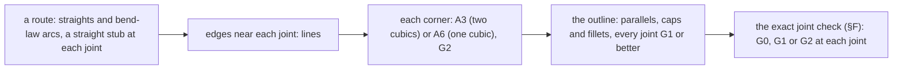

# Smooth joins, branches and units: algorithms for the tube pen

Status: research note (history, not authority). 2026-10-13. A research seat wrote it for the
coordinator. It reads the pen at `5445a75f0` and the kit `lean4-whatwg` at `eac9121` (worktree
`~/Dev/lean4-whatwg-svg`). It changes no code and proposes no ruling.

**The one thing to know first.** The defects the owner sees sit at joints, not along strokes. A
joint between two straight runs takes a curvature-continuous fillet of one or two exact cubics.
So most repairs need no new numerics: they need straight runs at every joint.

## Summary of the recommendations

Most impact first. Give every graph edge a straight stub at each port and a bounded bend, so its
collar meets a straight run. Today a shallow edge turns at a radius of 1.4 px inside its collar.
Route the edges of one port as one trunk that forks once, with one collar, as dot's edge
concentration and flow maps do. Replace the quarter-circle collars and the circular fillets by
curvature-continuous (G2) corners: the cubic `(T1, C, C, T2)`, or the two cubics of the cubic
smooth minimum. Both are exact in rationals. The smoothstep ramp's curvature jumps at both ends,
and its middle reads as a straight chamfer. Replace it by a G2 spline of five exact cubics. Draw a
swell as a bulb round its unit. Add an exact G0/G1/G2 joint check, with red controls, beside the
×5 combs. Keep every centreline to arcs and lines, so every outline is an exact parallel and no
inner side reverses. Snap only straight runs and rest poses. Write every morph as plain `C`
commands, sampled more densely where marks turn far. For units, draw a pill as a cut of its tube:
it bends with the pipe and keeps its area exactly. Keep Newell's time shift for the queue and the
kit's exact springs for settling. Overshoot only places, never counts or tones, as Material's
spring tokens do. Fuse two units with a neck that grows as the square root of time.

## How this note knows what it says

- Reading: `tools/Tools/View/Tube/Outline.lean`, `tools/Tools/View/Tube/Draw.lean`,
  `tools/Tools/View/Organic.lean`, `tools/Tools/View/Graph.lean` and `tools/Tools/View/Look.lean`.
  In the kit: `Whatwg/Svg/Geometry/Tube/Stretch.lean`, `Tube/Dock.lean`, `Spring.lean`,
  `Natural.lean` and `Smooth.lean`.
- Observed by eye: the coordinator's inspection pages `tools/view/out/proto/inspect-graph.html`
  (the docs graph at ×4.6, with combs and corner marks) and `tools/view/out/proto/ratios.html`.
  Both are gitignored prototypes, seen in the browser pane on 2026-10-13.
- Tested: scratchpad scripts in Python 3, in floats except where the appendix says. They are
  finite host runs, not theorems, and the scratchpad does not keep them. The appendix gives their
  method.
- Each source carries a literature mark in the source list: read, by name, or standard.
- "Unverified" marks a claim that no primary source behind it was read.

## 0. Where the pen breaks now

| Joint | Construction now | Continuity | What breaks |
| --- | --- | --- | --- |
| a graph edge meets a box | `Grow.collar`: two quarter circles of radius 6 px, axis-aligned, closed by a line 6 px out | G1: curvature jumps 0 → 1/6 px⁻¹ at both ends | the closing line shows as a flat stub where the edge bends within 6 px; the stroke meets the arc in a notch (observed) |
| a graph edge's end | `Graph.stepDown`, d3's vertical link, handles half the drop | G1 to the stub | end radius `3h²/(2Δx)`: 2.7 px for 80 px across a 24 px drop, 1.4 px for 156 px (reading and derivation) |
| two edges share a port | each edge has its own stroke and collar | G0 where they overlap | a tooth with crossing arcs and V notches under `decision_preserves` (observed) |
| a back edge arrives | `Graph.arrowhead`: two strokes along the last leg's dominant axis | none | up to 45° off the arrival direction on a diagonal (reading) |
| a stretch eases its width | `stretchWidth` with the smoothstep, 8 stations per ramp, `throughC` | G1: curvature jumps at both ramp ends | the ramp reads as a straight chamfer (observed in `ratios.html`; measured in §B) |
| a branch docks | `crotch`, `forkAt`; the kit's `Tube.fillet` and `dock` | G1 at both touching points | a circle's curvature starts at once (reading) |
| a valve opens | `partCubics`: round ends eased to nothing | G0 while fusing | "a brief notch" (the tube note, §13) |
| a sampled outline | `throughC` and the kit's `Anchor.through`: handles a third of the segment along the neighbours' chord | G1 | curvature steps at every station (standard for cardinal splines; not measured here) |

The trunk is 2.4 px wide, so its half width is 1.2 px. An end radius of 1.4 px leaves its inner
side 0.2 px from a cusp. Levien and Uguray state the limit: a parallel curve alone is correct only
where `|κ| ≤ 1/h`, `h` the half width.

## A. Smooth joins and blends

The continuity classes follow Rhino's guide. G0 joins position, G1 joins the tangent, G2 joins
the curvature. In a curvature graph a G1 joint shows as a step and a G2 joint shows none.

Every corner here is between two edges. An edge near a join is a line or an arc. The formulas
below use the end curvature of a cubic (standard, Farin):

```
κ(0) = (2/3) · ((P1 − P0) × (P2 − P1)) / |P1 − P0|³
κ(1) = (2/3) · ((P2 − P1) × (P3 − P2)) / |P3 − P2|³
```

So `κ(0) = 0` exactly when `P0`, `P1` and `P2` are collinear. Figma's corner relies on the same fact.

### A1. The circular fillet (rolling ball): what the pen has

- **What.** A circle of radius `R` touches both edges outside both bodies. Its centre lies on both
  edges moved out by `R`. d3-shape rounds the corners of an arc so (`cornerTangents`), and the
  kit's `Tube.fillet` follows it.
- **Formula.** Line and line: the centre is the meeting point of two parallels. Line and arc: a
  line meets a circle of radius `ρ ± R`, one square root.
- **Continuity.** G1. The curvature jumps from the edge's to `1/R` at each touching point.
- **Cost and fit.** Closed form. One cubic per arc by Riškus's handle. Exact for line and line,
  with one square root otherwise.
- **Verdict: keep as the fallback.** It is the G1 member of the family below.

### A2. The quadratic smooth minimum

- **What.** Quilez's polynomial smooth minimum blends two distance fields `a` and `b` inside a band
  `|a − b| < k`. Outside the band it is the plain union. Its code subtracts `h²k/4` from the minimum.
- **Formula.** `h = max(k − |a − b|, 0) / k`; `smin = min(a, b) − k h² / 4`. For two straight
  edges `a` and `b` are affine. With `s = (a + b)/2` and `d = a − b`, the blend is
  `s = k/4 + d²/(4k)` on `|d| ≤ k`: a parabola.
- **Bézier form.** The parabola is the quadratic Bézier `(T1, C, T2)`. `C` is the corner. `T1` and
  `T2` lie `k / sin φ` from the corner along each edge, `φ` the angle inside the crotch.
- **Continuity.** G1 at the touching points, where its curvature is not zero.
- **Evidence.** Tested: the traced zero set lies within `2·10⁻⁴` px of `(T1, C, T2)` for
  `k = 10` at 90° and at 60°. That figure is the sampling error of the check.
- **Verdict: adapt.** It is the cheapest exact G1 fillet. A3 is better for the same work.

### A3. The cubic smooth minimum: the recommended line-and-line join

- **What.** The same blend with `h³k/6`. Inside the band it is a cubic in `d` on each side, so its
  edge is two cubic Béziers exactly.
- **Formula.** `smin = min(a, b) − k h³ / 6`. On `0 ≤ d ≤ k`: `s = d/2 + (k − d)³ / (6k²)`.
- **Bézier form.** In distance coordinates `(a, b)` the half that meets edge A has the control
  points `(k/6, k/6)`, `(0, k/3)`, `(0, 2k/3)`, `(0, k)`. The other half mirrors it. The map
  `p = C + a·eA + b·eB` takes them to the plane, where `(eA, eB)` solves `nA·p = a`, `nB·p = b`. The
  map is affine, so the control points stay rational when the edges' normals are.
- **Continuity.** G2 where it meets each edge: `(0, k/3)`, `(0, 2k/3)` and `(0, k)` lie on the edge,
  so its curvature there is zero. The two halves meet with one curvature in the middle.
- **Shape.** The touching points stand `k / sin φ` from the corner, and the curve passes
  `(k/6) / sin(φ/2)` from it (tested at 60°, 90°, 120° and 150°). So from one `k`, an acute crotch
  gets a deep fillet and an obtuse corner a long, shallow one. That is the tree fork's look: a deep
  rounded crotch, and a branch that widens gently into the trunk on its outer side.
- **Evidence.** Tested: the traced zero set lies within `10⁻⁴` px of the two cubics at 90° and 60°.
  At 120° a coarser check found it within `2.3·10⁻³` px, its own sampling step. The end curvature
  is `0`, and the two middle curvatures agree.
- **Cost and fit.** Two cubics and one 2×2 solve. Exact on rationals. No search.
- **Verdict: adopt** for every corner between two straight runs: forks, collars, crotches.

### A4. The exponential and root smooth minima

- **What.** Global blends: `−k·log₂(2^(−a/k) + 2^(−b/k))`, or `(a + b − √((a − b)² + k²))/2`.
- **Continuity.** C∞ in the field, so the edge is smooth.
- **Fit.** The blend never ends, so it moves the whole outline a little. Its edge is no polynomial,
  so it needs tracing and fitting.
- **Verdict: reject.** It moves the parts that must stay exact. The exact formulas of the page are
  unverified: the page returned 404 on 2026-10-13.

### A5. Fields traced back to curves: soft objects and convolution surfaces

- **What.** Blinn's blobby field, Wyvill's soft objects and Bloomenthal and Shoemake's convolution
  surfaces sum a kernel over points or a skeleton. The outline is an iso-line of the sum.
- **Known problem.** Summed fields bulge where parts meet. Bloomenthal treats bulge elimination
  later (by name). Gourmel and others use the field's gradient to stop it (by name).
- **Fit.** Contouring and curve fitting are needed. The retired `Tools.View.Living` soft field did
  this with a Wyvill kernel and marching squares, and the tube note's §8 retired it.
- **Verdict: reject.** The lesson stays: a union must add material only in the concave corner.
  A3 does exactly that.

### A6. The G2 corner of one cubic

- **What.** The cubic `(T1, C, C, T2)`, both inner control points on the corner `C`. Each end has
  its two neighbours on its edge, so the curvature is zero at both ends.
- **Shape.** Its curvature rises to one peak in the middle and falls back. For a right angle and
  equal legs `L` the peak is `3.77 / L` and the curve passes `0.177 L` from the corner. A quarter
  circle with the same touching points has `1 / L` and `0.414 L`. Tested: legs 6 px give a peak of
  0.629 px⁻¹ and a pull-in of 1.06 px.
- **Legs.** Unequal legs give an asymmetric flare. A long leg along a branch and a short one along
  the trunk widen the branch gradually, as a tree's branch widens into its trunk.
- **Continuity.** G2 at both ends. **Cost.** One cubic. **Fit.** Exact, since `C` is the meeting
  point of two lines.
- **Verdict: adopt** for collars. Use A3 where one parameter must size both sides of a crotch.

### A7. Figma's smoothed corner: an arc between two transition cubics

- **What.** Furse's corner for Figma: a circular arc in the middle, and on each side a cubic
  whose first three control points are collinear. The cubic ends on the arc with its curvature.
- **Smoothing.** A parameter `ξ` lengthens the curvature ramps and shortens the arc. The post says
  `ξ = 0.6` matches the iOS corner (read; the equations in the post are images and were not read).
- **Continuity.** G2 at all four joints.
- **Verdict: adapt** for a bend that must keep a constant radius, such as the bend law's arc.

### A8. One cubic from a straight edge into an arc (geometric Hermite)

- **What.** De Boor, Höllig and Sabin fit a cubic to two points, two tangents and two curvatures
  (by name). With zero curvature at the start, the two handle lengths have a closed form.
- **Formula.** Derived here from the end curvatures. `a = T2 − T1`, unit tangents `t0`, `t1`,
  target curvature `κ1`:

  ```
  δ1 = (t0 × a) / (t0 × t1)
  δ0 = (a × t1 − (3/2) κ1 δ1²) / (t0 × t1)
  P1 = T1 + δ0 t0        P2 = T2 − δ1 t1
  ```

- **Continuity.** G2 at both ends when `δ0, δ1 > 0`.
- **Evidence.** Tested: for an arc of radius 12 the cubic starts at curvature `0` and ends at
  `1/12` exactly. Its curvature rises monotonically for 12 of 15 offsets at turns up to 45°. At 60°
  one of five offsets passed, and none at 75° or 90°.
- **Literature.** Walton and Meek's cubic Bézier spirals give conditions for monotone curvature
  (by name; unverified here).
- **Verdict: adopt** for a dock whose branch edge is an arc. Check monotone curvature with the
  comb. Split a large turn into two transitions and an arc, as A7 does.

### A9. Euler spirals, Spiro, and Levien's stroke expansion

- **What.** An Euler spiral's curvature is linear in arc length. Levien's thesis finds it the best
  all-round generator of fair splines (read, abstract). Levien and Uguray offset Euler spiral
  segments and output arcs or lines (read).
- **Correct strokes.** Where `|κ| > 1/h`, a correct outline needs pieces of the evolute as well as
  the parallels (read). The bend law keeps the pen out of that case.
- **Fit.** Fresnel integrals give cubic output only within a tolerance. The paper uses 0.25 px.
- **Verdict: adapt as the reference curve,** not as the pen's primitive. A cubic transition (A8)
  approximates a short Euler spiral within a curvature-comb check.

### A10. κ-curves and the fairness criteria

- **κ-curves (read §3–§4).** Quadratic pieces interpolate the user's points at their curvature
  maxima. Adjacent pieces meet G2, except at inflections, where they meet G1 with equal magnitude.
  The control points come from an iterative global solve with square roots.
- **Minimum variation of curvature (by name).** Moreton and Séquin minimise the variation of
  curvature. The integrand `(dκ/ds)²` is unverified against their text.
- **Verdict: reject both as the pen's construction.** Take the criterion instead: the curvature
  graph should be continuous and consist of few monotone pieces (Farin and Sapidis, by name).

### A11. The answer to section A's question

The question asks for a tree-branch widening with no visible corner and no flat spot, exact, as
cubics. The answer is the cubic smooth minimum (A3) where both edges are straight at the join. The
G2 Hermite cubic (A8) serves where one edge is an arc. Both need straight runs at the join, so
the pen should build joins between straight runs:



## B. Width changes along a tube

The owner's words: "it looks like a straight edge on the bulge with the pipes". A ramp is a
profile `f` on `[0, 1]` with `f(0) = 0`, `f(1) = 1` and zero slope at both ends. A side is
`y(x) = Δ · f(x / L)`. On a straight tube the side's curvature is about `f''`, so a profile's
curvature graph is its second derivative.

### B1. What the smoothstep does wrong

- The smoothstep `3u² − 2u³` has `f''(0) = 6` and `f''(1) = −6`. The pipe has none. So the side's
  curvature jumps at both ends of the ramp: a G1 crease.
- Between the ends `f''` falls linearly through zero. So the middle of the ramp has little curvature
  over a long run, and reads as a straight chamfer between two creases.
- Tested, for the reducer of `Draw.reducerLen` (rise 4 px over 16 px): the curvature jumps to
  0.094 px⁻¹ at each end. A fourth of the ramp's arc has under a fifth of the peak curvature. A run
  of 10.5 px, 63% of the ramp, stays within 0.1 px of a straight chord.
- The smoothstep's graph is exactly one cubic, `(0, 0) (1/3, 0) (2/3, 1) (1, 1)`. The pen samples it
  at 8 stations instead and draws `throughC` through them. That adds a curvature step at every
  station.

### B2. The candidate profiles

Tested values for the reducer (rise 4 px over 16 px). "Straight run" is the longest run through the
inflection within 0.1 px of its chord. "Flat middle" is the share of the arc, in the middle half,
whose curvature is under a fifth of the peak.

| Profile | Formula `f(u)` | At the pipe | Least radius | Straight run | Flat middle | Exact cubics |
| --- | --- | --- | --- | --- | --- | --- |
| smoothstep (now) | `3u² − 2u³` | G1 | 10.7 px | 10.5 px, 63% | 25% | 1 |
| raised cosine | `(1 − cos πu)/2` | G1 | 13.0 px | 10.0 px, 60% | 16% | no |
| circular biarc | two arcs of radius 17 | G1 (and G1 in the middle) | 17.0 px | 6.7 px, 40% | 0% | 2 arcs |
| smootherstep (3-4-5) | `10u³ − 15u⁴ + 6u⁵` | G2 | 11.7 px | 8.1 px, 48% | 10% | no (quintic) |
| cycloidal | `u − sin(2πu)/(2π)` | G2 | 11.0 px | 7.6 px, 45% | 9% | no |
| 4-5-6-7 polynomial | `35u⁴ − 84u⁵ + 70u⁶ − 20u⁷` | G2 (and G3) | 9.4 px | 7.0 px, 42% | 8% | no |
| piecewise cubic | `4u³`, then `1 − 4(1 − u)³` | G2 (G1 in the middle) | 9.1 px | 5.3 px, 31% | 0% | 2 |
| C2 spline, triangle curvature | `f''` linear 0 → 8 → −8 → 0 at ¼ and ¾ | G2 | 8.8 px | 7.8 px, 46% | 13% | 3 |
| C2 spline, trapezoid curvature | `f''` 0 → 16/3, held, → −16/3, held, → 0, knots at ⅛ ⅜ ⅝ ⅞ | G2 | 12.1 px | 7.3 px, 44% | 7% | 5 |

What the table says, each claim tested on these inputs:

- Every G2 profile removes the crease where the ramp meets the pipe.
- Of the profiles that are G2 everywhere, the trapezoid spline has the gentlest peak and the
  smallest flat middle.
- A gentle rise over a long ramp reads partly straight in any profile. Shortening the ramp to 8 px
  does not lower that share: the smoothstep goes from 63% to 68%, the trapezoid spline from 44% to
  51%.

The names and laws of the profiles:

- **Smoothstep, smootherstep and the rational family.** Quilez lists the cubic (C1), the quintic
  (C2) and `xⁿ / (xⁿ + (1 − x)ⁿ)`, of class C(n−1) (read). Perlin replaced the cubic by the
  quintic in 2002 for its second derivative (by name). A rational profile is no polynomial Bézier.
- **Cam laws.** A ramp between two flat runs is a cam's dwell-rise-dwell. The peak acceleration
  coefficients are 6.28 (cycloidal), 5.77 (3-4-5), 5.53 (modified sine) and 4.88 (modified
  trapezoid) (read, from a vendor's table). Norton's guidelines call 3-4-5 and modified sine the
  "workhorse" double-dwell choices (read). The trapezoid spline is the modified trapezoid with
  linear ramps instead of sine ramps, which makes it polynomial.
- **Railway transitions.** The clothoid's curvature is linear and has corners at both ends.
  Smoother transitions (Bloss, cosine, sinusoid) remove them (read, secondary sources only).

### B3. The trapezoid spline as exact cubics

On a straight tube the side is a graph of a cubic on each piece. A cubic graph is exactly a cubic
Bézier with its control points at thirds of the piece. In units of the ramp's length `L` and rise
`Δ`, the five pieces are (computed in exact fractions):

| Piece | P0 | P1 | P2 | P3 |
| --- | --- | --- | --- | --- |
| 1 | (0, 0) | (1/24, 0) | (1/12, 0) | (1/8, 1/72) |
| 2 | (1/8, 1/72) | (5/24, 1/24) | (7/24, 1/8) | (3/8, 19/72) |
| 3 | (3/8, 19/72) | (11/24, 29/72) | (13/24, 43/72) | (5/8, 53/72) |
| 4 | (5/8, 53/72) | (17/24, 7/8) | (19/24, 23/24) | (7/8, 71/72) |
| 5 | (7/8, 71/72) | (11/12, 1) | (23/24, 1) | (1, 1) |

The first three points of piece 1 lie on the pipe's edge, so the curvature there is zero. The
triangle spline is three pieces: `(0,0) (1/12,0) (1/6,0) (1/4,1/12)`, then `(1/4,1/12) (5/12,1/4)
(7/12,3/4) (3/4,11/12)`, then `(3/4,11/12) (5/6,1) (11/12,1) (1,1)`.

On a bent tube the side is a variable parallel of an arc, and no exact cubic form exists. There,
sample as now, but draw the samples with the kit's natural spline (`Curve.natural`,
`Whatwg/Svg/Geometry/Natural.lean`), which is C2 instead of C1.

### B4. A swell as a bulb

- **What.** A swell round a carried unit is the union of the pipe and a circle round the unit,
  joined by concave fillets. Here the circle has radius 12 (the pipe's half width 10 plus `SWELL`).
- **Why.** The outline then follows the unit, so the bulge reads as carried and has no flat flank.
- **Evidence.** Tested: the smoothstep swell over 20 px has 23% of its arc under a fifth of its
  peak curvature. The bulb with 3 px or 6 px fillets has none.
- **Construction.** The circle is one arc. Each fillet is the kit's line-and-circle fillet (G1), or
  later an A8 transition (G2).
- **Verdict: adopt** for `swellOf`. Keep the trapezoid spline for reducers and sleeves.

### B5. Rejected profiles

- **Gaussian bumps.** Never reach the pipe's width. Truncating them leaves a jump.
- **The bump function `exp(−1/(1 − x²))`.** C∞ with compact support, but not rational.
- **Superellipse ends.** A pill's ends are round by meaning: a meniscus. A plain superellipse also
  meets a straight edge with a corner, per a CSS working-group thread (read, secondary).

## C. Branching and merging of edges

### C1. Edge concentration and confluent drawings

- **Graphviz.** `concentrate=true` merges edges and lets partially parallel edges share part of
  their paths in `dot` (read).
- **Confluent drawings.** Dickerson, Eppstein, Goodrich and Meng merge edges into tracks, like
  train tracks (read). A track's curve has no sharp turn: no point where its two tangents meet at
  90° or less. The layered form covers bicliques with tree-like junctions (by name).
- **Verdict: adopt the rule.** Edges of one port share one trunk. A path through a junction keeps
  a turn under 90°, and in our pen a turn under the bend law.

### C2. Flow maps

- **Phan and others (2005, read).** A binary clustering of the targets makes the tree. A branching
  point stands halfway between its parent and the near side of the child cluster's box. Each edge
  is a Catmull–Rom spline
  with width by its flow. At each split the children are moved apart by their widths, so the widths
  add up visibly.
- **Spiral trees (read §1 of the journal version).** Every arc's tangent stays within an angle
  `α < π/2` of the direction to the root. The optimal trees are logarithmic spirals and straight
  lines. The authors want trees that merge quickly, seen from the leaves, but smoothly.
- **Force-directed origin-destination maps (Jenny and others 2017, read §2–§3.3).** Each flow is
  a quadratic Bézier: no loop, never an S. Its control point stays in a rectangle whose side is 50%
  of the chord, which bounds the curvature. Flows keep 4 px from nodes they do not join.
- **Verdict: adapt.** Take the halfway branching point, an angle restriction toward the target,
  and a bound on curvature by construction.

### C3. Edge bundling

- **What.** Hierarchical edge bundles (Holten 2006) and force-directed bundling (Holten and van
  Wijk 2009) gather many edges into curved bundles (by name).
- **Verdict: reject** for our small layered graphs. Both are iterative and float. Concentration
  (C1) gives the merge without them.

### C4. Metro maps

Fink and others draw metro lines as Bézier curves that pass straight through stations (by name).
**Adapt:** an edge passes straight through its port, on a stub.

### C5. Width and angle at a fork

| Rule | Law | Symmetric split, each branch | Reads as |
| --- | --- | --- | --- |
| sum (Sankey, Minard, Phan) | `w = w1 + w2` | `w/2` | conservation of amount, visibly |
| da Vinci (the pen's `Grow.split` and the `WIDTHS` √2 ladder) | `w² = w1² + w2²` | `w/√2` | a tree; branches look heavier than their share |
| Murray | `r³ = r1³ + r2³` | `r/2^(1/3)` | blood vessels; least work in laminar flow |

- Eloy measured Leonardo's exponent between about 1.8 and 2.3 across species (read, abstract).
- Hagmeijer and Venner restate Murray's cube law and show it is necessary, not sufficient, for
  least power (read §I).
- **Murray's angle.** The standard form `cos θ1 = (r0⁴ + r1⁴ − r2⁴)/(2 r0² r1²)` gives about 37.5°
  per branch, 75° in all, for a symmetric split under the cube law. Unverified: derived here, not
  read in Murray's paper.
- **Verdict.** Keep da Vinci for widths: the pen uses it in both places. Use a fork angle near
  Murray's 75° as the default of an organic fork.

### C6. The fork the graph needs

A construction for the layered graph, from C1 to C5:

1. Group the edges that leave one port. If there is more than one, draw one trunk from the port.
2. Give the trunk a straight stub from the port, at least as long as the collar's reach.
3. Fork at a point halfway down the drop, or where the branches must part to clear a box.
4. Let each branch leave the fork on a short straight run at half the fork angle.
5. Round the crotch between the two runs with A3, and each outer corner with A3 or A6.
6. Bend each branch toward its target with bend-law arcs, then a straight stub into the target.
7. Merge the edges that enter one port in the same way, read upward.

## D. Arrival and the direction of an edge

- **Node-link studies.** Holten and van Wijk (2009) found the standard arrowhead not the best. A
  tapered edge, wide at its source and narrow at its target, did best. Holten and others (2011)
  confirmed tapering among the static forms (by name; findings through summaries, unverified).
- **Flow maps.** Jenny and others (2017) state that arrowheads indicate direction best on flow
  maps (read). They scale a head's length and width to 1.6 times the flow's width. The thinnest
  flows get heads 20% larger (read). A survey suggests long geographic paths favour arrowheads
  (secondary, unverified).
- **What the pen draws.** A forward edge flares into a collar at both ends, so its shape shows no
  direction. The layout's downward order shows it. A back edge ends in two strokes along the last
  leg's dominant axis.

Recommendations:

- **Back edges:** a filled head aligned with the end tangent, not with an axis. Size it 1.6 times
  the line, larger for the finest line, and end the line at the head's base.
- **Forward edges:** keep direction by layout, and make the joints asymmetric. Give the source the
  full flare, as a branch grows out of a trunk, and the target a smaller flare or none.
- **The arrival itself:** arrive on a straight stub perpendicular to the frame. Join the stub to
  the frame with A6 corners whose curvature is zero on both lines. Then the edge, the flare and the
  frame read as one line.
- **A taper** toward the target remains an option for organic trunks. The pen already narrows a
  growing tip (`Grow.stroke` with `tip`).

## E. Units in tubes: deformation, turning, inertia, merging

Each model below is judged on its look, on whether it runs in closed form or in a few exact steps,
and on determinism.

### E1. The amount, through bends and narrows

- **A pill is a cut of its tube.** Draw a unit's slot as `Tube.cut` of its centreline with round
  ends. In a bend it then bends with the pipe, and its orientation is the tangent's.
- **Its area holds exactly.** A band of width `c` along a centreline of length `ℓ` has area `cℓ`
  while `c/2` is under every radius of curvature. For an arc of radius `ρ`, the annular sector has
  area `(θ/2)((ρ + c/2)² − (ρ − c/2)²) = cρθ = cℓ`. Derived here. Weyl's and Hotelling's tube
  formulas generalise it (by name). With `BEND` 24 px and `c ≤ 10` the condition holds.
- **So a slot of length `AREA / c` keeps `AREA` round any bend.** This is a one-line lemma
  candidate beside `ladder_divides`.
- **Through a reducer** a plug moves by volume. Its slot spans equal area under the ramp's width,
  found by bisection in rationals, deterministically.
- **No rotation-minimising frame is needed.** Wang and others compute them for space curves (by
  name). In the plane the frame turns with the tangent and has no twist to minimise.

### E2. Squash and stretch

- **The rule.** Lasseter: however much an object squashes or stretches, "its volume remains
  constant" (read, p. 36). In the plane that means area: scale by `σ` along the path and `1/σ`
  across. Both factors are rational.
- **Against strobing.** Lasseter stretches a fast object until its positions overlap from frame to
  frame (read, p. 37). At 21 samples a change, stretch a unit whose step per sample exceeds its
  length, by at most the ratio of the two.
- **Inside a full bore** a unit cannot widen. Show an impact there as the wall's swell (the pen's
  `swellOf` and its surge), which is the physical reading: pressure, not compression. A unit may
  squash where the lumen is wider than it, as in a vessel.

### E3. A queue with inertia and spacing

| Model | Rule | Exact | Verdict |
| --- | --- | --- | --- |
| Newell's lower-order model | a follower repeats its leader's path, later by `τ` and back by `d` | yes: a shift | adopt: it is the pen's `STAGGER` already; the start-up wave runs back at `d/τ` |
| Nagel–Schreckenberg with no random braking | speed `v ← min(v + 1, vmax, gap)`, then move by `v` cells | yes: integers | keep in reserve for per-tick runs; the pen's steps are per command |
| Intelligent Driver Model | `dv/dt = a(1 − (v/v0)^δ − (s*/s)²)`, `s* = s0 + vT + vΔv/(2√(ab))` | no: roots and powers | reject for the pen; a reference for how braking looks |
| a chain of critically damped followers | each unit springs toward its slot | yes: the kit's linear recurrences | adapt where a lag must grow with distance from the front |

The IDM's equations come from secondary summaries, and the authors' abstract names the model only.
Both the IDM's form and Newell's rule are unverified against their papers.

### E4. Settling, overshoot and turning

- **Settling.** The kit's `Spring.critical` is a critically damped spring as an exact recurrence
  `x(i+2) = p·x(i+1) − q·x(i)` (reading). Adopt: it is deterministic and exact.
- **Overshoot.** `Spring.under`, or a pose passed through as the pen's `Picture.via`. Both exist.
- **Lean in a turn.** A unit could shift toward the outer wall within the margin, in proportion to
  `v²κ`, its centripetal acceleration. This is a proposal with no animation source read.

### E5. Merging two units, and parting

- **Physics.** In two liquids' coalescence the bridge between the drops first opens at a fixed
  speed. Past a Reynolds number of about 1.5 the neck grows as the square root of time (Aarts and
  others 2005; the abstract, read through search).
- **Exact timing.** Sample the neck's half width at equal steps `H·k/n`, at the moments
  `T·(k/n)²`. SMIL's `keyTimes` takes those moments, so the square root needs no number.
- **The outline.** The neck is two round ends joined by a fillet whose radius grows from nothing.
  That removes the notch of `partCubics` while the ends fuse. The merged slot's area is the sum.
- **Verdict: adopt** for a valve that opens and for two units that merge.

### E6. Rejected solvers

- **Position-based dynamics and shape matching.** Müller and others project positions onto
  constraints, iterating (by name). A unit's place is one number along its tube, so the projection
  is a single sweep from the front: `s_i = min(s_i, s_(i−1) − d)`. That is Newell's rule again.
- **Metaballs for merging.** A field with tracing (A5). E5 gives the same look exactly.

## F. Inspection instruments

- **The curvature comb (porcupine).** A tooth stands on the normal at each sample, its length the
  curvature times a scale. The line through the tooth tips is the envelope. Speed Punk draws one
  for Glyphs and RoboFont (by name). Rhino's `CurvatureGraph` draws hairs (read).
- **Reading a joint** (Rhino's guide, read). G0 leaves a gap in the graph, G1 a step, and G2 none.
  An inflection crosses the envelope over the curve.
- **The curvature plot.** Curvature against arc length, one strip per outline, joints marked. Fair
  means continuous and few monotone pieces (Farin and Sapidis, by name).
- **An exact joint check.** Decide each joint's class from control points, in rationals:
  - G1: `(P3 − P2) × (Q1 − Q0) = 0` and `(P3 − P2) · (Q1 − Q0) > 0`, for segment `P` then `Q`.
  - G2: the end curvatures agree. With `x = (P3 − P2) × (P3 − 2P2 + P1)` and `y = (Q1 − Q0) ×
    (Q2 − 2Q1 + Q0)`, test `x² · |Q1 − Q0|⁶ = y² · |P3 − P2|⁶` and equal signs. Every term is rational.
  - A zero-length handle needs the next control leg instead: the pen's `Grow.line` has two.
  - The kit's `Cubic.Smooth` already states equal velocities at each joint, which gives G1 where
    the velocity is not zero. `Cubic.bend0` and `bend1` give the second differences, so a G2
    predicate is one step from them.
- **Red controls** for the check. The smoothstep ramp must fail G2 at its ends, and so must the
  quarter-circle collar. A3 and A6 must pass. Each control keeps its fixture.
- **The straight-run measure of the appendix.** It finds a chamfer that combs show only as low
  teeth.
- **Large renders.** Draw each glyph and joint at ×5 to ×8, with combs and joint classes. The
  coordinator's `inspect-graph.html` does this for the graph already.

## G. Detailing of strokes and outlines

The owner asked for "research techniques for nailing the details, stroking, outlines". This
section takes each detail in turn: the stroke's own geometry, offsets, optical corrections, the
pixel grid, and morphs.

### G1. The stroke as a shape: joins and caps

- **What SVG asks** (SVG 2, §13.5.7, read). A stroke is the union of each dash's band, its caps and
  its joins. Implementations may deviate for speed, and the stroke of a tight curve may differ
  across platforms.
- **Joins** (§13.5.5, read). A miter extends the outer edges until they meet. Its length is
  `w / sin(θ/2)`, and it becomes a bevel when `1 / sin(θ/2)` exceeds `stroke-miterlimit`. A round
  join is a circular sector, and a bevel a triangle.
- **Caps** (§13.5.4, read). A butt cap ends at the point. A round cap adds a half circle, and a
  square cap half the width.
- **In the pen.** The pen fills its outlines itself. The browser strokes only the casing line and
  the plain graph edges. The prototype's casing paths use round joins (observed in `ratios.html`).
- **Verdict: adopt round joins and caps** for every stroked line. They are the parallels of a
  point, so they never spike. Keep miters for corners that must stay square, at SVG's default
  limit of 4, which keeps corners down to about 29°.

### G2. Inner joins and tight bends: stroke expansion

- **The problem.** On the inner side of a corner, or of a bend tighter than the half width, the
  parallel curve crosses itself. Filled by the nonzero rule, the overlap still paints the right
  region if its winding stays consistent.
- **Skia** (reading of `src/core/SkStrokerPriv.cpp`). Every joiner routes the inner side through
  the corner point itself (`HandleInnerJoin`). Its comment says a direct inner edge can show
  through when the stroke is wider than its segments.
- **Levien and Uguray** (read). Euler spiral segments are offset and output as lines or arcs
  within 0.25 px. Where `|κ| > 1/h` they add evolute pieces, output twice to keep the winding.
  Vello runs this on the GPU (the project page, read).
- **Nehab** (abstract read). Account for evolutes beside offsets in high curvature, and keep the
  painted set continuous with the input.
- **Kilgard's polar stroking** (abstract, through search). Step uniformly in tangent angle, with one
  method for segments, joins and caps. A supplement bounds each facet under twice the step angle.
- **Blend2D** (by name). Yzerman's paper on its site offsets quadratics within a deviation, G1 at
  every junction, against AGG's flatten-and-offset.
- **For the pen.** A tube needs none of this while no centreline bends tighter than its outline.
  The casing's ink stays inside the body (reading of `Draw.lean`). The interior is a `LINE`
  narrower on each side, and its 4 px stroke reaches back to the body's edge. The widest body in
  `WIDTHS` is 28 px. `BEND` is 24 px, more than its half, so no inner parallel reverses.
- **Verdict: reject general stroke expansion.** Adopt a guard instead: `BEND > body/2` for every
  width, a one-line lemma over the constants. For graph strokes, change 1 of the ranked list gives
  the same bound.

### G3. Exact offsets of arcs and approximated offsets of cubics

- **Arcs.** The parallel of an arc is an arc of radius `ρ ± d` (`Tube.offset`). The pen's only
  approximation is one cubic per half piece.
- **That cubic's error** (tested). The radial error is 4.3·10⁻⁶ of the radius at 45° and 2.7·10⁻⁴
  at 90°. A quarter turn at 24 px is off by 0.0065 px, and at 100 px by 0.027 px. The error grows
  about as the sixth power of the angle: a half turn in one cubic would be 1.8% off.
- **So the pen's rule bounds it.** A piece turns at most half a turn, and each half is one cubic,
  so no cubic draws more than a quarter turn. This repeats the tube note's 0.03%, now tested.
- **Cubics.** The exact parallel of a cubic is an algebraic curve of degree 10 (Levien, read;
  Farouki and Neff, by name). Tiller and Hanson move the control polygon, and the error falls
  slowly under subdivision. Levien fits a cubic by area and moment, and its error falls as the sixth
  power of the subdivision. Cusps sit where `κd + 1 = 0` (read). Elber, Lee and Kim compare the
  classical methods (by name).
- **Pythagorean-hodograph curves** have rational parallels (Farouki and Sakkalis, by name). SVG
  draws no rational cubic, so they do not help the output.
- **Verdict: adopt arcs and lines as the only centrelines,** graph routes included, so every
  parallel is exact. Where a cubic centreline stays, fit its parallels by Levien's method at
  0.05 px.

### G4. Optical corrections for a monoline drawing at 2 px

| Correction | Type practice | At our scale | Verdict |
| --- | --- | --- | --- |
| overshoot | round and pointed forms pass flat lines, about 1–3% for an O; Karow gives 3% for O and 5% for A (secondary) | 0.1–0.3 px on a 10 px unit | adapt: only where a circle shares an alignment line with a flat mark; units in pipes are centred and need none |
| horizontals against verticals | horizontals look thicker; an even-looking square has verticals about 7% thicker (de Waard and others 2019; Hoefler 2019) | 0.14 px on a 2 px line | reject at 1× and 2×: it breaks whole-pixel edges; reconsider for large renders only |
| darkening at junctions | acute joins fill in; ink traps cut notches there, as in Carter's Bell Centennial; tapering the joining stroke is the alternative (secondary) | a fork of two 2.4 px ink strokes closes its crotch into a dark wedge | adapt: keep each crotch's ground at least a line wide, and taper a branch into its fork instead of widening it |
| curves against straights | round strokes are drawn a little heavier than stems (type practice, unverified) | under a pixel | ignore |
| irradiation | light on dark looks bolder; fonts lower a grade axis in dark mode (secondary) | a 2 px light line on the dark ground | adapt by tone, not width: the dark look's ink is already off-white, `#ece6dc` on `#14110d` |

The casing pen already avoids darkening at joints. It draws one line round the union of the
bodies, so a join adds no ink. Only the graph's ink strokes add ink where they meet.

### G5. Pixel snapping at 1× and 2×

- **The rule** (MDN's canvas example, reading). A line of even width is crisp when its centre lies
  on a whole pixel. A line of odd width needs its centre on a half pixel. At a device pixel ratio
  of 2, both whole and half pixels land on device pixels.
- **What the pen does.** Every width is a whole, even number of pixels (the tube note, §11). Every
  straight run across or down lies on a whole pixel (the glyph guard).
- **The graph's trunk is 2.4 px** (`--e4-organic-trunk`), so it can never be crisp at 1×. Its
  straight stubs would be crisp at 2 px on whole pixels, or at 3 px on half pixels.
- **Curves.** Never snap a curve's control points: snapping adds kinks. Snap straight runs only.
- **Motion.** Snap only the rest poses, a film's first and last moments. Snapped middle moments
  make a slow move step a pixel at a time. This is derived, not read.
- **`shape-rendering: crispEdges`** turns antialiasing off (by name). Reject it for curves.
- **Verdict: adopt** whole-pixel stubs for graph edges, with a 2 px trunk or a 3 px one on half
  pixels. Keep every curve free of snapping.

### G6. Smooth SMIL morphs

- **One command structure** (SVG 2, §9.3.2, read). Two path values interpolate only when their
  commands match in number, kind and order. Otherwise the browser animates discretely. Arc flags
  interpolate as fractions, so an `A` whose flag flips jumps.
- **The kit's writer.** `Html.Smil.curves` (`Whatwg/Html/Node/SvgSmil.lean`) writes every segment as
  an absolute `C`, with `calcMode="linear"` (reading). Keep it for every film, and draw arcs as
  cubics, not as `A`.
- **Exact samples, straight lines between.** Each moment's outline comes from the mixed tube
  (`Mark.under`), so every sample is exact. Between two samples the browser moves each control
  point on a straight line.
- **Sampling density.** A point that turns through `θ` at radius `r` in `n` steps cuts chords whose
  sagitta is `r(1 − cos(θ/2n))`. Tested: 20 steps keep a quarter turn at 100 px under 0.08 px. A full
  turn at 50 px reaches 0.62 px.
- **Rule.** Take `n ≥ θ / (2 arccos(1 − ε/r))` for the control point that turns farthest, with
  `ε = 0.1` px. Or place `keyTimes` so that the fastest point moves equal distances between samples:
  sampling by arc length.
- **Correspondence.** Mix intrinsically, piece by piece in length and turn (Sederberg and others,
  in the tube note), and pad with pieces of no length. The pen does both, so points travel short
  paths.
- **Verdict: adopt** arc-length `keyTimes` for films whose marks turn past a quarter turn or move
  far. Keep 21 samples otherwise.

## H. Motion detailing

### H1. Easing for physical motion

- **Apple** (WWDC23, "Animate with springs", read). A spring keeps position and velocity
  continuous. It can start with a gesture's velocity, and it keeps its velocity when its target
  moves. Apple sets a spring by a perceptual duration and a bounce.
- **Apple's bounce values.** Bounce 0 is critically damped and the default. About 0.15 feels brisk
  and about 0.3 bouncy. Above about 0.4, the talk advises care.
- **Material 3** (androidx token sources, read). Spatial springs move position, size and shape.
  Effects springs move colour and opacity, and always have damping ratio 1: no overshoot. Spatial
  springs have damping ratio 0.9 in the standard scheme and 0.6 to 0.8 in the expressive one.
- **Material 3 curves and durations** (read). Emphasized `(0.2, 0, 0, 1)`, emphasized decelerate
  `(0.05, 0.7, 0.1, 1)`, emphasized accelerate `(0.3, 0, 0.8, 0.15)`. Durations run from 50 to
  1000 ms. Which curve suits entering or leaving is unverified: the guideline pages gave no text.
- **Overshoot of a damped spring** after a step is `exp(−ζπ / √(1 − ζ²))` (standard). Tested: damping
  ratio 0.6 overshoots 9.5%, 0.8 overshoots 1.5%, 0.9 overshoots 0.15%, and 1 not at all.
- **The kit.** `Spring.critical` and `Spring.under` are exact recurrences. The resume laws keep
  place and velocity when a target moves (reading). So the kit already has Apple's retargeting.
- **Verdict: adopt Material's split.** Overshoot only a place or a shape with weight: a unit's
  arrival, a loaded span. Never overshoot a count, a width that carries an amount, or a tone. Use
  damping ratio 1 by default and about 0.8 for a weighty arrival.

### H2. Squash and stretch that reads

- **Lasseter** (read). Keep the volume. Stretch along the path until positions overlap from frame
  to frame. Let rigid parts squash less than soft ones.
- **In a full bore** a unit cannot widen. Show its impact by the wall's swell instead (E2).
- **Limits.** No source read gives a number. Proposal: stretch at most to the strobing ratio, and
  never past the lumen's room. Squash at most 15% in a vessel. Judge both on the ×5 page.

### H3. Many units

- **Stagger.** Heer and Robertson ask that starts be staggered, and that a change last as long as
  needed and no longer (read, in the tube note).
- **The start-up wave.** Newell's rule repeats the leader's motion later by `τ` and back by `d`, so
  the wave runs back at `d/τ` (by name). The pen's `STAGGER` follows that rule.
- **Bound the wave** (proposal). With `n` units the last starts `(n − 1)τ` after the first. Cap
  `τ` so the wave ends within the step, or stagger the first few units and move the rest as one.
- **One easing per group** (proposal). Units of one queue share one easing and one duration. Then
  the eye reads the wave, not each unit.
- **Overlapping action.** Properties may finish at different times, and Apple calls that natural
  (read). The pen's inlet span settles after its units arrive (`Picture.via`).

### H4. What keeps motion legible

| Principle | Source | In the pen |
| --- | --- | --- |
| slow in and out, arcs, timing gives weight, follow-through | Lasseter, after Thomas and Johnston (read) | springs and poses; units follow their tubes |
| solidity, exaggeration, reinforcement | Chang and Ungar (read, in the tube note) | units keep their area; menisci; the surge |
| valid at every moment, staging, staggering | Heer and Robertson (read, in the tube note) | `Tube.mix_ok` at every moment; `OPENING` before the move; `STAGGER` |
| velocity kept through a retarget | Apple (read) | the kit's resume laws |
| no overshoot for effects | Material's tokens (read) | proposal: no overshoot for counts and tones |
| a still picture for reduced motion | the tube note, §3 (reading) | `filmFigure` |

## Questions for the owner

1. **Meaning: how does a forward edge show its direction at arrival?**
   - (a) Layout alone, with collars at both ends, as now.
   - (b) A smaller flare at the target than at the source.
   - (c) A taper toward the target.
   - (d) An arrowhead on every edge.
   - Recommendation: (b). It keeps the organic look, encodes direction in the joint, and needs no
     new mark. Studies favour (c) in node-link drawings and (d) on flow maps.
2. **Representation: how does a trunk fork?**
   - (a) An angled wye: each branch leaves on a straight run at half the fork angle, and A3 rounds
     the crotch.
   - (b) A tangential split: the branches curve off the trunk's direction, as train tracks do.
   - Recommendation: (a), with the angle near Murray's 75°. It is exact and G2, and A3's long
     crotch fillet makes it read as a tree's fork.
3. **Meaning: should a conserving split show its amount by width?**
   - (a) Da Vinci widths, as now.
   - (b) Widths that add, as Sankey diagrams do.
   - Recommendation: (a) for the graph's organic look. In the tube language units carry the
     count, so the width rule need not.

## What this note does not establish

- No theorem: every claim about curves here is a reading, a derivation by hand, or a finite test.
- The ramp measures use one rise, one length and two thresholds. Other proportions give other
  shares, and the thresholds are not a perception study.
- A3 is exact only between straight edges. Between an edge and an arc it needs A8 or a sample.
- A8's monotone range comes from one scan at one radius, not from Walton and Meek's conditions.
- Murray's angle formula and the IDM's and Newell's equations are not read in their papers.
- The pen's sampled outlines were not measured for curvature steps. The claim rests on the
  standard property of cardinal splines.
- The optical corrections' figures come from type at text sizes. Their effect on a 2 px drawing
  is not measured.
- No motion recommendation was tested with readers. The spring values come from Apple's talk and
  Material's tokens, made for interfaces, not for diagrams.
- That snapped middle moments stutter is derived, not read.
- Nothing here was rendered by the pen. Each recommendation needs its own landing and look.

## Appendix: how the measurements were made

- A ramp is sampled at 800 points (4000 for the curvature shares). Curvature comes from central
  differences: `y'' / (1 + y'²)^(3/2)`.
- A straight run is the longest run through the inflection whose points lie within ε of the
  chord between its ends. A bisection on the run's end finds it, every fourth start tried.
- The smooth minima are traced along 60 rays from the corner by bisection on the field's sign.
  The distance to the claimed cubics is the nearest of 40 000 samples per cubic.
- The A8 scan places an arc of radius 12 at offsets 0.25 to 3 px off a line, with turns from 15°
  to 90°. It reports the first start point whose cubic has monotone curvature over 120 samples.
- The arc error is the largest radial distance of 20 000 points of the cubic with handle
  `(4/3) tan(θ/4)`. The sagitta and the overshoot are closed forms, evaluated.
- The exact control points of B3 come from integrating `f''` in exact fractions.
- All are finite host runs in floats, but B3's fractions (tested). None is a theorem, and the
  scripts are not kept.

## Ranked changes for the pen (most impact first)

1. **Stubs and a bend law for graph edges.** In `Graph.stepDown` and `Graph.segments`
   (`tools/Tools/View/Graph.lean`), start and end every forward route with a straight stub at least
   as long as the collar's reach. Between the stubs use bend-law arcs and a straight. Then each
   collar meets a straight run, and no end turns at 1.4 px. Put the stubs on whole pixels, with a
   2 px trunk, or a 3 px trunk on half pixels (G5). Check: the inspection page shows no flat stub
   and no notch at any port.
2. **One trunk per port, forked once.** Group the edges of a port (C6). Draw one stroke and one
   collar there, fork with an A3 crotch, and merge arrivals the same way. Check: no overlapping
   collars under `decision_preserves` or over `countdown_parks`.
3. **G2 corners in the kit.** Add `(T1, C, C, T2)` (A6) and the cubic smooth-minimum pair (A3) as
   exact constructions beside `Tube.fillet` (`Whatwg/Svg/Geometry/Tube/Dock.lean`). Rebuild
   `Grow.collar` and the kit's `Stroke.collar` on A6, in the edge's own frame rather than the axes.
   Rebuild `crotch` and `forkAt` on A3 where both edges are straight at the join, and on A8 where
   the branch edge is an arc.
4. **The exact joint check, with red controls (§F), and the bend guard (G2).** The check turns
   "smooth by construction and by eye" (the tube note, §13) into a guard over every outline the pen
   draws. The guard `BEND > body/2`, for every width, keeps every inner parallel from reversing.
5. **G2 ramps.** Replace the smoothstep in `stretchWidth` and the kit's `Stretch.width` by the
   trapezoid spline. On a straight tube emit its five cubics exactly instead of sampling eight
   stations per ramp.
6. **Bulbs for swells.** Rebuild `swellOf` as the union of the pipe and a circle round the unit,
   with fillets (B4).
7. **Natural splines for what stays sampled.** Draw sampled sides (stretches on bends, organic
   strokes) with `Curve.natural` instead of `throughC` or `Grow.through`.
8. **Arrival.** Tangent-aligned, filled heads for back edges; asymmetric flares for forward edges
   (D).
9. **Motion detail.** Overshoot only places and shapes with weight, never counts or tones (H1).
   Sample films by arc length where marks turn past a quarter turn (G6). Bound the start-up wave
   of a long queue (H3).
10. **Units.** Pills as cuts of their tubes, with the area lemma (E1). Squash only where the lumen
    has room (E2, H2). Fuse with a neck that grows as the square root of time, on `keyTimes` at
    squares (E5).

## Sources

Literature marks: **read** (the named part was read for this note), **by name** (named, not read),
**standard** (textbook material).

### Joins, fillets and fair curves

- Inigo Quilez, "Smooth minimum" (article): <https://iquilezles.org/articles/smin/>. By name: the
  page returned 404 on 2026-10-13. A search snippet showed the quadratic code and the band reading
  of `k`. The polynomial forms used here are derived and tested in this note.
- Inigo Quilez, "Smoothsteps" (article): <https://iquilezles.org/articles/smoothsteps/>. Read.
- Raph Levien, "Parallel curves of cubic Béziers", blog post, 2022-09-09:
  <https://raphlinus.github.io/curves/2022/09/09/parallel-beziers.html>. Read.
- Raph Levien and Arman Uguray, "GPU-friendly Stroke Expansion", arXiv:2405.00127v2, 2024:
  <https://arxiv.org/abs/2405.00127>. Read (HTML version, method sections). The project page
  <https://linebender.org/gpu-stroke-expansion-paper/> gives the venue as *Proceedings of the ACM
  on Computer Graphics and Interactive Techniques* 7(3), 2024, HPG 2024 (read, through search).
- Raph Levien, "From Spiral to Spline: Optimal Techniques in Interactive Curve Design", PhD thesis,
  UC Berkeley, UCB/EECS-2009-162, 2009:
  <https://www2.eecs.berkeley.edu/Pubs/TechRpts/2009/EECS-2009-162.html>. Read (abstract).
- Raph Levien and Carlo H. Séquin, "Interpolating Splines: Which is the fairest of them all?",
  *Computer-Aided Design and Applications* 6(1), 2009: <https://levien.com/phd/LevienSequinCAD09_014.pdf>.
  By name.
- Zhipei Yan, Stephen Schiller, Gregg Wilensky, Nathan Carr, Scott Schaefer, "κ-Curves:
  Interpolation at Local Maximum Curvature", *ACM TOG* 36(4), article 129, 2017,
  doi:10.1145/3072959.3073692: <https://people.engr.tamu.edu/schaefer/research/kcurves.pdf>. Read
  (§3–§5).
- Henry P. Moreton and Carlo H. Séquin, "Functional optimization for fair surface design",
  SIGGRAPH '92, *Computer Graphics* 26(2), pp. 167–176:
  <https://www2.eecs.berkeley.edu/Pubs/TechRpts/1992/6142.html>. By name.
- Gerald Farin and Nickolas Sapidis, "Curvature and the fairness of curves and surfaces", *IEEE
  Computer Graphics and Applications* 9(2), 1989, pp. 52–57. By name. Gerald Farin, *Curves and
  Surfaces for CAGD*, 5th ed., Morgan Kaufmann, 2002: the end curvature of a Bézier curve. Standard.
- Carl de Boor, Klaus Höllig, Malcolm Sabin, "High accuracy geometric Hermite interpolation",
  *Computer Aided Geometric Design* 4(4), 1987, pp. 269–278. By name.
- D. J. Walton and D. S. Meek, "A planar cubic Bézier spiral", *Journal of Computational and
  Applied Mathematics* 72(1), 1996, pp. 85–100, doi:10.1016/0377-0427(95)00246-4. By name. D. J.
  Walton, D. S. Meek, J. M. Ali, "Planar G2 transition curves composed of cubic Bézier spiral
  segments", same journal, 157, 2003, pp. 453–476. By name.
- Daniel Furse, "Desperately seeking squircles", Figma blog, 2018-04-03:
  <https://www.figma.com/blog/desperately-seeking-squircles/>. Read (prose; the equations are
  images and were not read).
- Jules Bloomenthal and Ken Shoemake, "Convolution surfaces", SIGGRAPH '91, *Computer Graphics*
  25(4), pp. 251–256. By name. Jules Bloomenthal, "Bulge elimination in convolution surfaces",
  *Computer Graphics Forum*, 1997. By name.
- Geoff Wyvill, Craig McPheeters, Brian Wyvill, "Data structure for soft objects", *The Visual
  Computer* 2(4), 1986, pp. 227–234. By name. James F. Blinn, "A generalization of algebraic surface
  drawing", *ACM TOG* 1(3), 1982, pp. 235–256. By name.
- Olivier Gourmel, Loïc Barthe, Marie-Paule Cani, Brian Wyvill, Adrien Bernhardt, Mathias Paulin,
  Herbert Grasberger, "A gradient-based implicit blend", *ACM TOG* 32(2), article 12, 2013,
  doi:10.1145/2451236.2451238. By name.
- Ken Perlin, "Improving noise", *ACM TOG* 21(3), 2002, pp. 681–682, doi:10.1145/566654.566636.
  By name.
- d3-shape 3.2.0, `src/arc.js` (`cornerTangents`) and `src/curve/natural.js`, as cited by the kit's
  `Tube/Dock.lean` and `Natural.lean`. Reading of the kit's modules.

### Ramps and transitions

- Robert L. Norton, cam design guidelines, *Cam Design and Manufacturing Handbook*, 2nd ed., ch.
  18, p. 551: <https://designofmachinery.com/wp-content/uploads/2018/11/Ch182edp551.pdf>. Read (one
  page; the book is not named on the page and is inferred from the address, unverified).
- 20-sim, "Cam motion profiles", table of peak coefficients:
  <https://20sim.com/webhelp/toolboxes_mechatronics_toolbox_cam_wizard_cammotionprofiles.php>. Read
  through a search summary (secondary).
- Railway transition curves: the clothoid and its smoother alternatives, from secondary sources
  found by search, e.g. <https://www.problemykolejnictwa.pl/images/PDF/185_6E.pdf>. Unverified.

### Branching, bundling and flow maps

- Matthew Dickerson, David Eppstein, Michael T. Goodrich, Jeremy Yu Meng, "Confluent drawings:
  visualizing non-planar diagrams in a planar way", *JGAA* 9(1), 2005, pp. 31–52,
  doi:10.7155/jgaa.00099; arXiv:cs/0212046: <https://arxiv.org/abs/cs/0212046>. Read (definitions).
- David Eppstein, Michael T. Goodrich, Jeremy Yu Meng, "Confluent layered drawings",
  *Algorithmica* 47(4), 2007, pp. 439–452, doi:10.1007/s00453-006-0159-8. By name.
- Graphviz, the `concentrate` attribute: <https://graphviz.org/docs/attrs/concentrate/>. Read.
- Danny Holten, "Hierarchical edge bundles: visualization of adjacency relations in hierarchical
  data", *IEEE TVCG* 12(5), 2006, pp. 741–748. By name.
- Danny Holten and Jarke J. van Wijk, "Force-directed edge bundling for graph visualization",
  *Computer Graphics Forum* 28(3), 2009, pp. 983–990. By name.
- Doantam Phan, Ling Xiao, Ron Yeh, Pat Hanrahan, Terry Winograd, "Flow map layout", IEEE
  InfoVis 2005: <http://graphics.stanford.edu/papers/flow_map_layout/flow_map_layout.pdf>. Read
  (§2–§4).
- Kevin Verbeek, Kevin Buchin, Bettina Speckmann, "Flow map layout via spiral trees", *IEEE TVCG*
  17(12), 2011, pp. 2536–2544, doi:10.1109/TVCG.2011.202. Read (abstract; the PDF returned 403).
- Kevin Buchin, Bettina Speckmann, Kevin Verbeek, "Angle-restricted Steiner arborescences for flow
  map layout", *Algorithmica* 72(2), 2015, pp. 656–685, doi:10.1007/s00453-013-9867-z. Read (§1).
- Bernhard Jenny, Daniel M. Stephen, Ian Muehlenhaus, Brooke E. Marston, Ritesh Sharma, Eugene
  Zhang, Helen Jenny, "Force-directed layout of origin-destination flow maps", *International
  Journal of Geographical Information Science*, 2017, doi:10.1080/13658816.2017.1307378:
  <https://web.engr.oregonstate.edu/~zhange/images/FlowMapsLayout.pdf>. Read (§2–§3.3).
- Bernhard Jenny and others, "Design principles for origin-destination flow maps", *Cartography
  and Geographic Information Science* 45(1), 2018, pp. 62–75. By name; its principles as restated
  in the 2017 paper, read.
- Martin Fink, Herman Haverkort, Martin Nöllenburg, Maxwell Roberts, Julian Schuhmann, Alexander
  Wolff, "Drawing metro maps using Bézier curves", Graph Drawing 2012, LNCS 7704, 2013, pp. 463–474,
  doi:10.1007/978-3-642-36763-2_41. By name.
- Cecil D. Murray, "The physiological principle of minimum work: I. The vascular system and the
  cost of blood volume", *PNAS* 12(3), 1926, pp. 207–214. By name. Cecil D. Murray, "The
  physiological principle of minimum work applied to the angle of branching of arteries", *Journal
  of General Physiology* 9(6), 1926, pp. 835–841. By name.
- R. Hagmeijer and C. H. Venner, "Critical review of Murray's theory for optimal branching in
  fluidic networks", arXiv:1812.09706, 2018: <https://arxiv.org/abs/1812.09706>. Read (§I–§II).
- Christophe Eloy, "Leonardo's rule, self-similarity, and wind-induced stresses in trees",
  *Physical Review Letters* 107, 258101, 2011, doi:10.1103/PhysRevLett.107.258101;
  arXiv:1105.2591. Read (abstract, through search).

### Direction

- Danny Holten and Jarke J. van Wijk, "A user study on visualizing directed edges in graphs", CHI
  2009, pp. 2299–2308, doi:10.1145/1518701.1519054. By name; findings through summaries.
- Danny Holten, Petra Isenberg, Jarke J. van Wijk, Jean-Daniel Fekete, "An extended evaluation of
  the readability of tapered, animated, and textured directed-edge representations in node-link
  graphs", IEEE PacificVis 2011, pp. 195–202, doi:10.1109/PACIFICVIS.2011.5742390:
  <https://research.tue.nl/en/publications/an-extended-evaluation-of-the-readability-of-tapered-animated-and/>.
  Read (abstract).

### Motion and units

- John Lasseter, "Principles of traditional animation applied to 3D computer animation",
  SIGGRAPH '87, *Computer Graphics* 21(4), pp. 35–44:
  <https://www.ics.uci.edu/~fowlkes/class/ics162/exercises/lasseter.pdf>. Read (pp. 35–37).
- Frank Thomas and Ollie Johnston, *The Illusion of Life: Disney Animation*, 1981. By name,
  through Lasseter.
- Matthias Müller, Bruno Heidelberger, Marcus Hennix, John Ratcliff, "Position based dynamics",
  *Journal of Visual Communication and Image Representation* 18(2), 2007, pp. 109–118,
  doi:10.1016/j.jvcir.2007.01.005. By name.
- Matthias Müller, Bruno Heidelberger, Matthias Teschner, Markus Gross, "Meshless deformations
  based on shape matching", *ACM TOG* 24(3), 2005, pp. 471–478. By name.
- Martin Treiber, Ansgar Hennecke, Dirk Helbing, "Congested traffic states in empirical
  observations and microscopic simulations", *Physical Review E* 62, 2000, pp. 1805–1824;
  arXiv:cond-mat/0002177: <https://arxiv.org/abs/cond-mat/0002177>. Read (abstract); the equations
  through secondary sources.
- G. F. Newell, "A simplified car-following theory: a lower order model", *Transportation Research
  Part B* 36(3), 2002, pp. 195–205. By name; the rule through secondary sources.
- Kai Nagel and Michael Schreckenberg, "A cellular automaton model for freeway traffic", *Journal
  de Physique I* 2(12), 1992, pp. 2221–2229. By name; the rules through secondary sources.
- Dirk G. A. L. Aarts, Henk N. W. Lekkerkerker, Hua Guo, Gerard H. Wegdam, Daniel Bonn,
  "Hydrodynamics of droplet coalescence", *Physical Review Letters* 95, 164503, 2005. Read (abstract,
  through search).
- Jens Eggers, John R. Lister, Howard A. Stone, "Coalescence of liquid drops", *Journal of Fluid
  Mechanics* 401, 1999, pp. 293–310. By name.
- Hermann Weyl, "On the volume of tubes", *American Journal of Mathematics* 61, 1939, pp. 461–472.
  By name. Harold Hotelling's planar tube formula of the same year. By name.
- Wenping Wang, Bert Jüttler, Dayue Zheng, Yang Liu, "Computation of rotation minimizing frames",
  *ACM TOG* 27(1), article 2, 2008. By name.

### Strokes, offsets and the pixel grid

- W3C, *Scalable Vector Graphics (SVG) 2*, chapter "Painting", §13.5.4–§13.5.7 (caps, joins, the
  stroke shape): <https://www.w3.org/TR/SVG2/painting.html>. Read.
- SVG Working Group, SVG 2 editor's draft, chapter "Paths", §9.3.2 (the `d` property and its
  interpolation): <https://svgwg.org/svg2-draft/paths.html>. Read. The relative-against-absolute
  question is from the www-svg list (Brian Birtles, 2015), through search.
- Skia, `src/core/SkStrokerPriv.cpp` (the joiners and `HandleInnerJoin`):
  <https://github.com/google/skia/blob/main/src/core/SkStrokerPriv.cpp>. Read.
- Diego Nehab, "Converting stroked primitives to filled primitives", *ACM TOG* 39(4), 2020
  (SIGGRAPH 2020), doi:10.1145/3386569.3392392:
  <https://history.siggraph.org/learning/converting-stroked-primitives-to-filled-primitives-by-nehab>.
  Read (abstract).
- Mark J. Kilgard, "Polar Stroking: New Theory and Methods for Stroking Paths", SIGGRAPH 2020,
  arXiv:2007.00308: <https://arxiv.org/abs/2007.00308>; and the facet-angle supplement,
  arXiv:2007.01481. Read (abstracts, through search).
- Fabian Yzerman, "Precise offset curves", hosted by Blend2D:
  <https://blend2d.com/research/precise_offset_curves.pdf>. By name.
- Gershon Elber, In-Kwon Lee, Myung-Soo Kim, "Comparing offset curve approximation methods", *IEEE
  Computer Graphics and Applications* 17(3), 1997, pp. 62–71. By name.
- Wayne Tiller and Eric G. Hanson, "Offsets of two-dimensional profiles", *IEEE Computer Graphics
  and Applications* 4(9), 1984, pp. 36–46. By name.
- Rida T. Farouki and C. Andrew Neff, "Analytic properties of plane offset curves", *Computer Aided
  Geometric Design* 7, 1990, pp. 83–99. By name.
- Rida T. Farouki and Takis Sakkalis, "Pythagorean hodographs", *IBM Journal of Research and
  Development* 34(5), 1990, pp. 736–752. By name.
- MDN, "Applying styles and colors", the `lineWidth` example:
  <https://developer.mozilla.org/en-US/docs/Web/API/Canvas_API/Tutorial/Applying_styles_and_colors>.
  Read; the half-pixel rule is inferred from its example.
- The kit's SMIL writer, `Html.Smil.curves` in `Whatwg/Html/Node/SvgSmil.lean` at `eac9121`. Reading.

### Optical corrections

- Jasper M. de Waard, Erik Van der Burg, Christian N. L. Olivers, "A thickness illusion: horizontal
  is perceived as thicker than vertical", *Vision* 3(1), 2019, doi:10.3390/vision3010001:
  <https://www.ncbi.nlm.nih.gov/pmc/articles/PMC6802759/>. Read (abstract, through search).
- Jonathan Hoefler, "Turning type sideways", H&Co newsletter, 2019-01-16:
  <https://emails.typography.com/2019_01/index.html>. Read.
- "Overshoot (typography)", Wikipedia, citing Peter Karow, *Digital Formats for Typefaces*,
  Springer, 2012: <https://en.wikipedia.org/wiki/Overshoot_(typography)>. Read (secondary).
- Tobias Frere-Jones, "Typeface Mechanics: 001" (overshoot):
  <https://frerejones.com/blog/typeface-mechanics-001>. By name (the page returned 403).
- Bell Centennial and ink traps: <https://en.wikipedia.org/wiki/Bell_Centennial> and a
  TypeDrawers thread, through search. Secondary.
- Irradiation and the grade axis in dark mode:
  <https://nerdy.dev/adjust-perceived-typepace-weight-for-dark-mode-without-layout-shift>, through
  search. Secondary.

### Motion systems

- Apple, "Animate with springs", WWDC23 session 10158:
  <https://developer.apple.com/videos/play/wwdc2023/10158/>. Read (transcript).
- Android Jetpack Compose Material 3 token sources: `MotionTokens.kt`, `ExpressiveMotionTokens.kt`
  and `StandardMotionTokens.kt`, under
  <https://github.com/androidx/androidx/tree/androidx-main/compose/material3/material3/src/commonMain/kotlin/androidx/compose/material3/tokens>.
  Read. The guideline pages at <https://m3.material.io/styles/motion/overview> gave no text.
- Jeffrey Heer and George Robertson, "Animated transitions in statistical data graphics", *IEEE
  TVCG* 13(6), 2007; Bay-Wei Chang and David Ungar, "Animation: from cartoons to the user
  interface", UIST 1993. Read, as cited in the tube note.

### Instruments

- Robert McNeel & Associates, "Understanding curves continuity", Rhino guide:
  <https://www.rhino3d.com/docs/guides/modeling/rhino-continuity-curves/>. Read.
- Yanone, Speed Punk, a curvature plug-in for Glyphs and RoboFont:
  <https://yanone.de/software/speedpunk>. By name (the page returned 404 on fetch).
- The pen's own notes: `docs/research/2026-10-13-tube-language/README.md` and `glyphs.md`. Reading.
