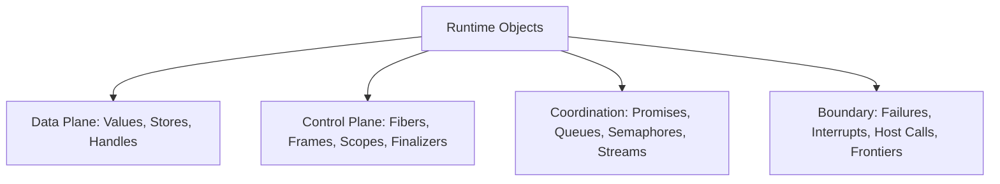
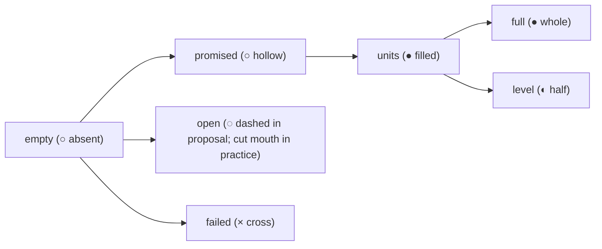
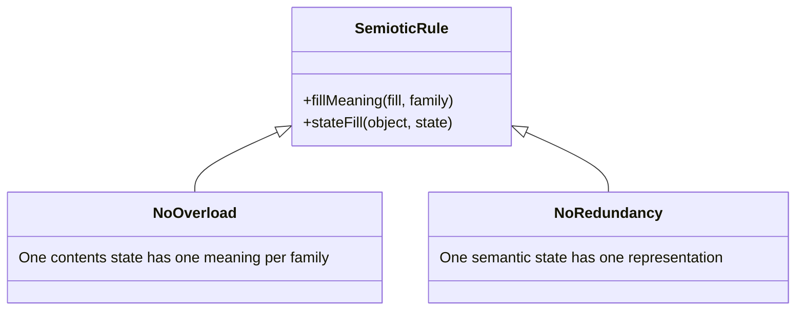
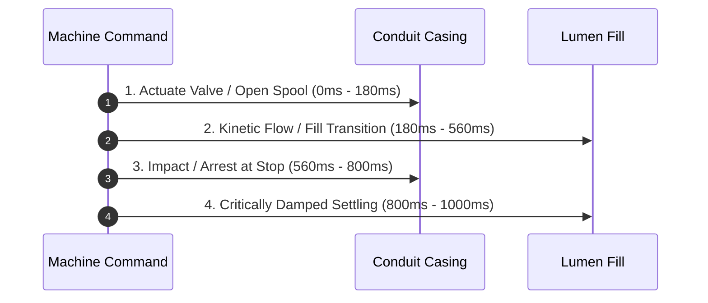
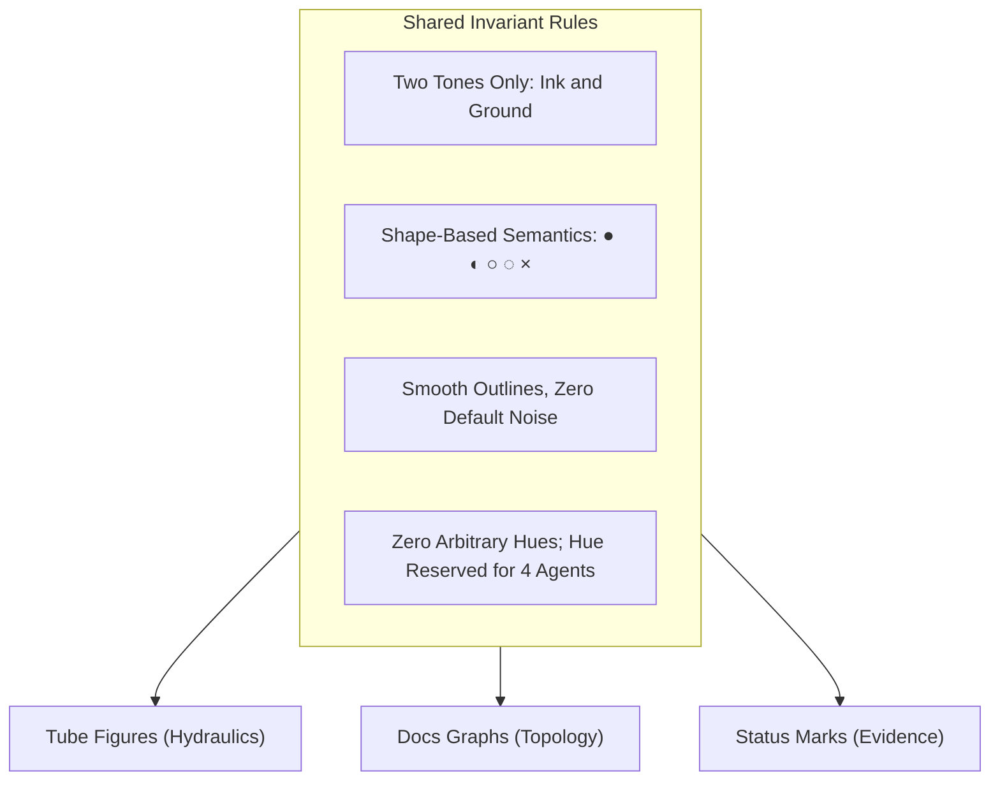

# Semiotics of Contents States: One Inside Vocabulary for Every Object

Status: research note. 2026-10-13.
The code is `tools/Tools/View/Tube/`.
The prototype is `tools/view/out/proto/fills.html`.
The motion plan is `docs/research/2026-10-13-motion-everywhere/README.md`.
This review assesses contents states across the tube language.
In the dictionary (`docs/core/controlled-english.md` §3), a fill places a program at an address.
A body's inside displays a contents state (`docs/research/2026-10-13-motion-everywhere/README.md` words table).
This note uses "contents state" for what the lumen shows.

---

## 1. The Objects

Every diagram in Effect4 renders objects from the semantics and the machine.
The visual grammar depicts fourteen distinct kinds of objects across their lifecycles.

### 1.1 Values
- **What it is:** First-order evaluated data, defined in `Store.Val` (`src/Effect4/Store/Carrier/Val.lean`). It includes scalars, compound records, and references.
- **States over a run:** Uncomputed, present in a slot, moving in flight, and dereferenced.
- **States to tell apart:** A reader distinguishes an unwritten empty slot from an evaluated scalar and a compound collection.

### 1.2 Promises and Deferreds
- **What it is:** A synchronization cell defined in `Deferred` (`src/Effect4/Machine/Stores.lean`, `docs/core/machine-state.md` §2). A cell holds an optional completion and a list of waiting fibers.
- **States over a run:** Unfulfilled with no waiters, owed with waiting takers, fulfilled with a value, and failed with a cause.
- **States to tell apart:** A reader distinguishes an unfulfilled obligation from a fulfilled result and a broken promise.

### 1.3 Fibers
- **What it is:** A concurrent execution path defined in `RunFiber` (`src/Effect4/Machine/Fibers.lean`, `docs/core/machine-state.md` §1). It holds a continuation stack, status flags, and an origin.
- **States over a run:** Running, child forked, queued as a task, parked on a token, resting on yield, interrupt held, finalizing, and exited.
- **States to tell apart:** A reader distinguishes an active running fiber from a suspended waiter, a yielding turn, a finalizing exit, and an exited fiber.

### 1.4 Frames
- **What it is:** A stack frame continuation defined in `Prim` and `FrameEvent` (`src/Effect4/Machine/Frames.lean`, `docs/core/machine-state.md` §1). It forms an execution hole that receives a child result.
- **States over a run:** Pushed as an empty hole, popped with a result value, and skipped during a failure walk.
- **States to tell apart:** A reader distinguishes an open hole awaiting a return value from a filled hole and a skipped frame.

### 1.5 Scopes and Finalizers
- **What it is:** A lifetime boundary defined in `Scope` (`src/Effect4/Machine/Scope.lean`, `docs/core/semantics.md` concept 3). It tracks registered cleanup actions.
- **States over a run:** Open with no actions, open with registered actions, closing while running actions in reverse order, and closed.
- **States to tell apart:** A reader distinguishes an open scope from a closed scope. A reader distinguishes a registered finalizer from an executed finalizer and a cancelled finalizer.

### 1.6 Resources and Handles
- **What it is:** An allocated capability handle defined in `HandleKind` (`src/Effect4/Machine/Stores.lean`, `docs/core/host-boundary.md` §4). Handles index fibers, refs, deferreds, and scopes.
- **States over a run:** Allocated and referenced, updated in place, released, and stale.
- **States to tell apart:** A reader distinguishes an active valid handle from a released handle and an invalid handle.

### 1.7 Stores and Cells
- **What it is:** A mutable storage cell defined in `RefHeap` (`src/Effect4/Machine/Stores.lean`, `src/Effect4/Laws/Machine/Arena.lean`, `docs/core/machine-state.md` §7). It belongs to a dense memory arena.
- **States over a run:** Allocated empty, holding a value, updating atomically, and deallocated.
- **States to tell apart:** A reader distinguishes an empty cell from an occupied cell and an updating cell.

### 1.8 Queues
- **What it is:** A FIFO buffer defined in `Queue` (`src/Effect4/Library/Queue/Defs.lean`, `tools/Tools/View/Tube/Queue.lean`). It implements backpressure, sliding, and dropping strategies.
- **States over a run:** Empty, holding items below capacity, full at capacity, backpressured with waiting offers, and starved with waiting takers.
- **States to tell apart:** A reader distinguishes available capacity from stored items, waiting takers, and blocked offers.

### 1.9 Semaphores and Pools
- **What it is:** A permit coordinator defined in `Semaphore` and `Pool` (`src/Effect4/Machine/Stores.lean`, decisions row 330). It regulates concurrent access to resources.
- **States over a run:** Permits or items available, permits acquired or items leased, queued waiters, and closing or drained.
- **States to tell apart:** A reader distinguishes available permit capacity from acquired permits and waiting consumers.

### 1.10 Streams and Channels
- **What it is:** A discrete sequence pipeline defined in `Stream` and `Channel` (`src/Effect4/Program/Stream.lean`, decisions rows 331, 335, 367). It models asynchronous consumption.
- **States over a run:** Idle, transmitting a chunk in flight, continuous flow progress, gathered into a collection, completed with leftover, and failed.
- **States to tell apart:** A reader distinguishes moving data chunks from backpressure halts, normal completion, and failure halts.

### 1.11 Failures and Causes
- **What it is:** An error condition defined in `Reason` (`src/Effect4/Machine/Cause.lean`), `CauseTerm` (`src/Effect4/Program/Eff.lean`), and `Cause` (`src/Effect4/Machine/Cause.lean`). It separates typed errors, untyped defects, and interrupts.
- **States over a run:** Raised as a typed error, raised as a defect, raised as an interrupt cause, and combined in an ordered cause list.
- **States to tell apart:** A reader distinguishes a typed failure from an untyped defect, an interrupt cause, and an ordered cause sequence.

### 1.12 Interrupts
- **What it is:** An external stop signal defined in `ActionTerm.interrupt` (`src/Effect4/Program/Eff.lean`) and `RunEvent.interruptRecorded` (`src/Effect4/Machine/Fibers.lean`, decisions rows 350, 368). It forces fiber termination.
- **States over a run:** In flight, deferred behind a mask, and delivered to stop execution.
- **States to tell apart:** A reader distinguishes an in-flight interrupt surge from a deferred interrupt and an arrested stop.

### 1.13 Host Calls and Replies
- **What it is:** An external protocol exchange defined in `HostSession` (`src/Effect4/Api/HostSession.lean`, `docs/core/host-boundary.md` §4). It crosses the machine boundary.
- **States over a run:** Request dispatched, pending host execution, reply received behind a valve, reply admitted and applied, and reply refused or stale retired.
- **States to tell apart:** A reader distinguishes an outgoing request from an awaiting host state, an admitted reply, and a refused reply.

### 1.14 Decisions and Frontiers
- **What it is:** A scheduler choice or execution boundary defined in `RunDecision` (`src/Effect4/Machine/Fibers.lean`), `FrontierReason`, and `Api.Outcome` (`src/Effect4/Api/Runner.lean`, `docs/core/machine-state.md` §3). It drives execution steps.
- **States over a run:** Active step decision on tape, live frontier suspension, and abnormal machine halt.
- **States to tell apart:** A reader distinguishes an active step from a waiting frontier and an abnormal halt.

### 1.15 Mapping of Objects to Contents States
This table maps each state of the fourteen runtime objects to its visual figure, contents state, and entering change.
It compares each mapping with section 4 of the motion plan (`docs/research/2026-10-13-motion-everywhere/README.md`).

| Object | State to Tell Apart | Figure (`Kind`, `Shape`) | Contents State | Entering Change | Motion Plan §4 Comparison | Proposal and Reason |
| --- | --- | --- | --- | --- | --- | --- |
| Values | Uncomputed slot | `vessel` (`hole`) | `empty` | frame pushed | Agrees with §4.3 | Keep: icon of empty evaluation receiver. |
| Values | Evaluated scalar literal | `body` (`atom`) | `full` | literal evaluated | Agrees with §2.4 | Keep: solid ink denotes immutable scalar. |
| Values | Compound collection | `container` (`cells`) | `units` | record evaluated | Agrees with §4.1 | Keep: discrete pills depict structured collection elements. |
| Promises | Unfulfilled, no waiters | `vessel` (`hollowDot`) | `promised` | `deferredMakeOf` | Agrees with §4.1 | Keep: hollow bubble denotes unfulfilled promise. |
| Promises | Owed with waiters | `vessel` (`hollowBox`) | `promised` | `deferredAwait` | Agrees with §4.1 | Keep: vessel fed by pipe denotes blocked waiter. |
| Promises | Fulfilled with value | `vessel` (`filledDot`) | `promised to units` | `deferredSucceed` | Agrees with §4.1 | Keep: hollow bubble contracts to solid unit in place. |
| Promises | Failed with cause | `vessel` (`hollowDot` + `cross`) | `failed` | `deferredFail` | Agrees with §4.1 | Keep: cross marks broken synchronization cell. |
| Fibers | Running turn | `cadence` (`enter`) | `units` | `started` | Agrees with §4.1 | Keep: unit on staff denotes active execution turn. |
| Fibers | Child forked | `bond` (`arrow`) | `units` | `forked` | Agrees with §4.1 | Keep: descending arrow spawns child staff. |
| Fibers | Queued task | `vessel` (`hollowBox`) | `promised` | `scheduledTask` | Agrees with §4.1 | Keep: task waits in dispatcher queue line. |
| Fibers | Parked on token | `vessel` (`hollowBox`) | `promised` | `parkedOn` | Agrees with §4.1 | Keep: hollow bubble holds fiber execution. |
| Fibers | Yielding turn | `wire` (`rest`) | `empty` | `yieldInjected` | Agrees with §4.1 | Keep: conduit parted across yield beat. |
| Fibers | Interrupt deferred | `container` (`rail`) | `level` | `interruptDeferred` | Agrees with §4.1 | Keep: wall swell held at start of uninterruptible span. |
| Fibers | Finalizing exit | `vessel` (`hollowDot`) | `promised to units` | `finalizerProgram` | Agrees with §4.1 | Keep: finalizer bubbles keep in reverse registration order. |
| Fibers | Exited with value | `cadence` (`exitBar`) | `units` | `exited` (success) | Agrees with §4.1 | Keep: exit bar ends staff with success value. |
| Fibers | Exited with cause | `cadence` (`exitBar` + `reasons`) | `failed` | `exited` (failure) | Agrees with §4.1 | Keep: exit bar followed by ordered reasons. |
| Frames | Pushed open hole | `vessel` (`hole`) | `empty` | `FrameEvent.pushed` | Agrees with §4.1 | Keep: empty vessel on frame chain awaits child return. |
| Frames | Popped with return | `vessel` (`hole`) | `empty to units` | `FrameEvent.popped` | Agrees with §4.1 | Keep: value enters hole before hole shrinks. |
| Frames | Skipped on failure walk | `vessel` (`hole`) | `failed` | `FrameEvent.ranContAll` | Agrees with §4.1 | Keep: failure cross passes through skipped continuation hole. |
| Scopes | Scope open awaiting close | `container` (`openBracket`) | `open` | `scopeMake` | Agrees with §4.1 | Keep: single opening hook awaits closing hook. |
| Scopes | Finalizer registered | `vessel` (`hollowDot`) | `promised` | finalizer registered | Agrees with §4.1 | Keep: sealed hollow bubble enclosed by bracket. |
| Scopes | Scope closed normally | `container` (`bracket`) | `promised to units` | `scopeClose` | Agrees with §4.1 | Keep: second hook completes enclosure and finalizers run. |
| Scopes | Scope closed by failure | `container` (`bracket` + `reasons`) | `failed` | failure exit in scope | Agrees with §4.1 | Keep: bracket encloses abnormal failure exit. |
| Resources | Active valid handle | `body` (`tag`) | `units` | handle allocated | Agrees with §4.1 | Keep: collar tag identifies valid capability. |
| Resources | Updating handle | `body` (`tag` collar) | `units` | resource write | Agrees with §4.1 | Keep: unit transits through collar during write. |
| Resources | Released handle | `body` (`tag` vacated) | `empty` | finalizer cleanup | Agrees with §4.4 | Keep: unit drains from handle tag. |
| Resources | Stale invalid handle | `body` (`hash`) | `failed` | access after release | Differs from §4.3 | Draw sheared break (`hash`): distinguish invalid handle access from clean retirement. |
| Stores | Allocated empty | `vessel` (`slot`) | `empty` | `refMake` unwritten | Agrees with §2.1 | Keep: empty shelf awaiting first written value. |
| Stores | Occupied cell | `body` (`tag` + value) | `units` | `refSet` | Agrees with §4.1 | Keep: discrete value pill resides in cell. |
| Stores | Updating atomically | `body` (`tag` collar) | `units` | `refModifyWith` | Agrees with §4.1 | Keep: old unit exits and new unit enters in one beat. |
| Queues | Empty buffer | `vessel` (`Layout.vessel`) | `empty` | queue initialized | Agrees with §4.2 | Keep: vessel lumen holds ground tone. |
| Queues | Holding items | `vessel` (`Layout.vessel`) | `units` | `offer` accepted | Agrees with §4.2 | Keep: discrete pills occupy vessel slots. |
| Queues | Saturated at capacity | `vessel` (`Layout.vessel`) | `units` (packed) | capacity reached | Differs from proposal table | Keep packed `units`: preserve discrete message identities and integer count. |
| Queues | Backpressured offers | `wire` (`Layout.inlet`) | `units` behind parting | `offer` blocked | Agrees with §4.2 | Keep: units form backwater behind closed valve. |
| Queues | Starved takers | `wire` (`Layout.outlet`) | `promised` (`hollowBox`) | `take` waits | Agrees with §4.2 | Keep: hollow bubble waits at outlet nozzle. |
| Semaphores | Permits or items free | `wire` (circuit loop) | `units` | initialization / release | Differs from proposal table | Keep `units` on circuit: permits and items are countable natural numbers. |
| Semaphores | Permits acquired / leased | `wire` (holder branch) | `units` | `take` / `use` lease | Agrees with §4.2 | Keep: unit translates from circuit to borrower staff. |
| Semaphores | Queued permit waiters | `wire` (inlet line) | `promised` (`hollowBox`) | `take` waits | Agrees with §4.2 | Keep: hollow bubble waits before circuit valve. |
| Semaphores | Closing / drained pool | `wire` (circuit valve) | `units` to `promised` | `close` pool | Agrees with §4.2 | Keep: circuit valve parts and finalizers discharge. |
| Streams | Idle opened pipeline | `wire` (`series`) | `empty` | stream created | Agrees with §4.2 | Keep: clear conduit with no units in transit. |
| Streams | Transmitting chunk | `wire` (`series`) | `units` | pull answers chunk | Agrees with §4.2 | Keep: discrete pills travel along pipeline. |
| Streams | Continuous progress | `wire` (`series`) | `level` | progress elapses | Differs from §4.2 | Keep `level` for continuous progress meters: distinguishes continuous rate from discrete chunks. |
| Streams | Gathered items | `container` (`cells`) | `units` (coalesced) | `collectGain` / fold | Agrees with §4.2 | Keep: units fuse under fold summation. |
| Streams | Completed with leftover | `cadence` (`exitBar` + units) | `units` | pull returns `End` | Agrees with §4.2 | Keep: exit bar seals conduit with remaining items. |
| Streams | Failed stream | `wire` (`hash` or `cross`) | `failed` | pull returns error | Agrees with §2.2 | Keep: conduit severed by failure mark. |
| Failures | Raised typed error | `body` (`cross`) | `failed` | `Cause.fail` | Agrees with §4.1 | Keep: diagonal cross marks typed error. |
| Failures | Raised untyped defect | `body` (`hash`) | `failed` | `Cause.die` | Agrees with §4.1 | Keep: sheared fracture marks unhandled defect. |
| Failures | Interrupt cause | `force` (`blockedArrow`) | `failed` | `Cause.interrupt` | Differs from Q3 options | Keep `blockedArrow` (⊣): marks cancellation without conflating typed error or defect. |
| Failures | Combined cause sequence | `body` (`reasons`) | `failed` | `Cause.both` | Agrees with §4.1 | Keep: ordered beads show cause composition. |
| Interrupts | In-flight recorded surge | `force` (`surgeOf`) | `level` (wall swell) | `interruptRecorded` | Agrees with §4.1 | Keep: wall swell conveys impulse pressure. |
| Interrupts | Deferred behind mask | `container` (`rail`) | `level` (swell stands) | `interruptDeferred` | Agrees with §4.1 | Keep: surge held at boundary of double rail. |
| Interrupts | Delivered stop | `cadence` (stop bar) | `full` (solid bar) | interrupt delivered | Agrees with §4.1 | Keep: solid bar terminates fiber staff. |
| Host Calls | Request dispatched | `bond` (`port` outbound) | `units` | call submitted | Agrees with §4.3 | Keep: unit exits canvas through outbound hairpin leg. |
| Host Calls | Pending host answer | `bond` (`port` inbound) | `promised` | awaiting host | Agrees with §4.3 | Keep: hollow receiver waits at port inlet. |
| Host Calls | Reply received at valve | `bond` (`port` mouth) | `units` | reply received | Agrees with §4.3 | Keep: unit stands behind parted valve before admission. |
| Host Calls | Reply admitted and applied | `bond` (`port` inbound) | `promised to units` | reply applied | Agrees with §4.3 | Keep: valve fuses and unit satisfies promise. |
| Host Calls | Reply refused / retired | `wire` (relief exhaust) | `units to empty` | reply retired | Agrees with §4.3 | Keep: unit drains through relief exhaust. |
| Decisions | Step decision on tape | `cadence` (`barLine`) | `none` | decision step | Agrees with §4.1 | Keep: thin solid strut carries no fluid. |
| Decisions | Live frontier suspension | `cadence` (`fermata`) | `promised` | frontier reached | Agrees with §4.1 | Keep: fermata marks pause awaiting fuel or choice. |
| Decisions | Abnormal machine halt | `cadence` (`caesura`) | `failed` | machine stuck | Agrees with §4.1 | Keep: caesura marks abnormal machine stoppage. |

---

## 2. The Contents States

The proposal in `tools/view/out/proto/fills.html` names seven states for body interiors.
In the dictionary (`docs/core/controlled-english.md` §3), a fill places a program at an address.
This document names what the lumen shows as its contents state.

### 2.1 The Seven Contents States
1. **empty (○ absent):** The lumen holds ground tone. It signifies unoccupied space, an idle conduit, or free capacity. Sign class: Icon.
2. **units (● filled):** The lumen holds solid ink circles or pills. Each pill represents one discrete value or message. Sign class: Icon and Index.
3. **promised (○ hollow):** The lumen holds an ink rim enclosing ground tone. It represents an active obligation or waiting taker. Sign class: Symbol and Index.
4. **level (◐ half):** The lumen holds ink filling from one boundary to a continuous mark. It shows a continuous share or fractional progress. Sign class: Index.
5. **full (● whole):** The lumen holds solid ink throughout. It indicates an immutable literal, a saturated capacity, or a shut barrier. Sign class: Icon and Symbol.
6. **open (◌ dashed in proposal; cut mouth in practice):** The conduit boundary remains unsealed. It represents an unclosed scope or external host boundary. Sign class: Icon.
7. **failed (× cross):** The lumen contains an ink cross or shear mark. It represents an execution failure, defect, or broken promise. Sign class: Symbol.

### 2.2 Audit of the Proposal Family Table
The table in `tools/view/out/proto/fills.html` maps the seven contents states across the seven families of `tools/Tools/View/Glyph.lean`.
Every cell is audited below against the fourteen runtime objects.

| Contents State | Family | Proposal Text | Verdict | Semiotic Analysis and Correction |
| --- | --- | --- | --- | --- |
| `empty` | `body` | a box: a place for a value | Kept | Icon of empty evaluation container (`box`, `Shape.box`). |
| `empty` | `vessel` | free capacity: a slot not held | Kept | Icon of available storage capacity in queue or accumulator. |
| `empty` | `container` | every container: a membrane, its contents the figure | Kept | Container tubes have fine bores (`FINE = 4 px`); lumen is neutral envelope. |
| `empty` | `wire` | an idle wire | Kept | Passable conduit with no fluid in transit. |
| `empty` | `bond` | a tap not yet filled | Kept | Unlinked connection or uncalled callback tap. |
| `empty` | `force` | — | Kept | A force does not exist before its impulse is triggered. |
| `empty` | `cadence` | — | Kept | Cadence struts have zero bore (`THIN = 0`); they carry no lumen. |
| `units` | `body` | a value | Kept | Discrete evaluated scalar or data unit in `value` (`Shape.value`). |
| `units` | `vessel` | held units, by count | Kept | Integer count of stored items inside queue vessel (`unitLen`). |
| `units` | `container` | — | Changed | Change to: held items in a data lane (`cells`, `Shape.cells`). |
| `units` | `wire` | values in flight | Kept | Kinetic transit of messages along process piping (`series`). |
| `units` | `bond` | a copy in each tap | Kept | Duplicated broadcast units in manifold takeoff taps (`spider`). |
| `units` | `force` | the surge's unit | Changed | Change to: —. A force is a shockwave, not a moving unit. |
| `units` | `cadence` | — | Kept | Cadences never transport fluid units. |
| `promised` | `body` | a value promised | Kept | Evaluated slot owed by a continuation. |
| `promised` | `vessel` | a waiting taker | Kept | Unresolved deferred or consumer demand bubble (`hollowBox`, `hollowDot`). |
| `promised` | `container` | — | Changed | Change to: unclosed scope with close owed (`openBracket`). |
| `promised` | `wire` | a demand travelling back | Kept | Upstream pull signal traveling against process direction. |
| `promised` | `bond` | a waiter on a completion | Kept | Awaiting subscriber registered on completion manifold. |
| `promised` | `force` | — | Kept | Interrupts are immediate impulses, not deferred promises. |
| `promised` | `cadence` | — | Changed | Change to: live frontier awaiting resolution (`fermata`). |
| `level` | `body` | — | Kept | A discrete body holds discrete scalar data, not partial fluid. |
| `level` | `vessel` | a measure: permits taken, a pool's share | Kept | High-capacity permit utilization where drawing individual pills is unreadable. |
| `level` | `container` | — | Kept | Container perimeters do not hold fill levels. |
| `level` | `wire` | a stream's progress | Kept | Fractional progress along an active transmission conduit. |
| `level` | `bond` | — | Kept | Relational bonds convey topological connections, not levels. |
| `level` | `force` | the surge's pressure | Dropped | Hydrostatic pressure is drawn by wall deflection (`SWELL`), not by lumen level. |
| `level` | `cadence` | — | Changed | Change to: timer countdown elapsed on staff line. |
| `full` | `body` | a literal, a constant | Kept | Immutable scalar value completely occupying lumen (`atom`). |
| `full` | `vessel` | full: at capacity, the valve shut | Kept | Maximum buffer capacity reached; float valve closes. |
| `full` | `container` | — | Kept | Jacketed casings do not fill solid. |
| `full` | `wire` | — | Changed | Change to: backwater lock behind closed valve. |
| `full` | `bond` | — | Kept | Cross-lane bridges do not hold stationary solid fills. |
| `full` | `force` | a stop (solid, an air gap short) | Changed | Change to: impact barrier. A stop is structural framing, not a full lumen. |
| `full` | `cadence` | a strut: thin and solid, it carries nothing | Changed | Clarify: Structural solid bar (`Fill.ink`), not a full fluid lumen. |
| `open` | `body` | a value from the host | Changed | Change to: host-provided parameter socket. |
| `open` | `vessel` | a deferred not yet made | Changed | Change to: unsealed receiver socket (`hole`). |
| `open` | `container` | a scope still open | Kept | Open bracket awaiting second closing hook (`openBracket`). |
| `open` | `wire` | a wire to the world | Kept | Conduit with square cut end crossing canvas boundary (`OFF`). |
| `open` | `bond` | a port | Kept | Bulkhead penetration looping into external environment (`port`). |
| `open` | `force` | — | Kept | An interrupt does not hold an open state. |
| `open` | `cadence` | — | Kept | Temporal punctuation markers remain closed and intact. |
| `failed` | `body` | a failure on its wire | Kept | Typed failure mark × (`cross`) or defect mark # (`hash`). |
| `failed` | `vessel` | a promise broken | Kept | Vessel holding a rejected completion cause. |
| `failed` | `container` | a scope closed by failure | Kept | Scope bracket bounding an abnormal exit. |
| `failed` | `wire` | a defect | Kept | Conduit fractured by sheared break (`hash`). |
| `failed` | `bond` | — | Changed | Change to: severed fork link or cancelled race entrant. |
| `failed` | `force` | an interrupt | Changed | Change to: unhandled interrupt cause deposited at boundary. |
| `failed` | `cadence` | — | Changed | Change to: abnormal machine halt on untyped state (`caesura`). |

---

## 3. Consistency

A semiotic notation prevents symbol overload and symbol redundancy.
One visual contents state must not signify conflicting concepts.
One runtime state must not require conflicting contents states.

### 3.1 Resolving Overloads (One Contents State with Multiple Meanings)
1. **Solid Ink: Literal versus Structural Strut**
   - *Conflict:* Solid ink currently represents both an immutable scalar literal (`atom`) and a cadence strut (`barLine`).
   - *Rule:* A literal fills a non-zero lumen (`PIPE = 10 px`). A cadence strut has zero bore (`THIN = 0`) and zero clearance. The pen draws it as a 10 px solid structural bar (`Fill.ink`), distinct from fluid-filled conduits.

2. **Full Lumen: Constant Value versus Queue Backpressure Lock**
   - *Conflict:* A solid lumen denotes an immutable constant in `body`, but saturated backwater in `wire`.
   - *Rule:* In process conduits, backwater is drawn as discrete packed pills touching menisci (`unitOf`). Only atomic literals without internal structure take solid full ink lumens.

3. **Open Mark: Broken Line versus Missing Cap**
   - *Conflict:* The proposal suggests dashed lines for open states, conflicting with cut conduit mouths.
   - *Rule:* The pen never draws openness with dashed line strokes. Openness is drawn as an unsealed conduit mouth with a cut square end (`round := false`) or an unclosed hook (`openBracket`).

4. **Failure: Blocked Plug versus Error Cross**
   - *Conflict:* Drawing an error as an obstructing plug confuses normal backpressure with fatal failure.
   - *Rule:* An air-gap plug indicates normal control stoppage (`plugOf`). A failure must feature an explicit cross (×) or sheared fracture (#).

### 3.2 Resolving Redundancies (One Meaning with Multiple Representations)
1. **Unfulfilled Obligations**
   - *Conflict:* A waiting promise is drawn as a hollow dot (`hollowDot`) or a hollow box (`hollowBox`).
   - *Rule:* Both marks use the exact same fill: an ink rim around a ground lumen (`hollowOf`, `RIM = 2 px`). Their external casing geometry conveys whether the promise is sealed (`Dot`) or fed by a pipe (`Box`).

2. **Defect versus Typed Failure**
   - *Conflict:* Both typed failure and defect represent error states.
   - *Rule:* Typed failure uses the diagonal 4-way cross fitting (`cross`, ×). Untyped defect uses the sheared fractured conduit (`hash`, #). Both keep ground lumens obstructed by ink marks.

---

## 4. Change as Motion

State transitions in the visual language must correspond to lawful physical movements.
All animations occur in response to discrete machine commands or host decisions (decisions row 354 point 5).
Transitions are staged in causal order, using the kit's spring (`settle`, omega = 7.4 in `tools/Tools/View/Tube/Motion.lean`).

### 4.1 The Nine Motion Primitives
The motion plan (`docs/research/2026-10-13-motion-everywhere/README.md` §4) defines nine motion primitives.
Each primitive maps to a current declaration in the tree or a planned kit slice:

| Motion | What Moves | Declaration Today | Planned in Kit |
| --- | --- | --- | --- |
| `grow` | A tube from its root to its length, in length and width at once. | `GlyphPage.hidden` (`tools/Tools/View/Tube/GlyphPage.lean`) | `Tube.root` (slice S23) |
| `shrink` | A tube back to its root. | `GlyphPage.hidden` reversed (`tools/Tools/View/Tube/GlyphPage.lean`) | `Tube.root` (slice S23) |
| `morph` | A kept tube's pieces by the intrinsic mix, through a pose where given. | `Stroke.bend` (`tools/Tools/View/Tube/Motion.lean`), proved by `bend_ok` (`tools/Tools/View/Tube/Glyphs.lean`) | `Change.bend` (slice S23) |
| `carry` | A unit along a line of tubes, governed by the unit law. | `Picture.carry` (`tools/Tools/View/Tube/Motion.lean`), `Law.carries` (`tools/Tools/View/Tube/Physics.lean`) | Stays in Effect4 |
| `swell` | A body's width round a carried unit, or round a pressure surge. | `swellOf` (`tools/Tools/View/Tube/Motion.lean`), `surgeOf` (`tools/Tools/View/Tube/Glyphs.lean`) | `Change.swell` (slice S23), `Join.bulb` (slice S24) |
| `parting` | An air gap that opens in a body, or closes and fuses its ends. | `plugOf` (`tools/Tools/View/Tube/Draw.lean`), `partCubics` (`tools/Tools/View/Tube/Outline.lean`) | `Tube.parting` (slice S23) |
| `blend` | A junction's notch, closed by a G2 corner or a rolling ball. | `crotch`, `fork` (`tools/Tools/View/Tube/Outline.lean`) | `Notch.blendIn`, `Join.fork`, `Join.wye` (slice S24) |
| `coalescence` | Two units that fuse into one of their joint area. | None today | `Coalesce.film`, neck grows as square root of time (slice S24) |
| `keep` | A promise kept: a hollow's inside leaves, and its rim stays as the unit. | `hollowAt` (`tools/Tools/View/Tube/Glyphs.lean`) | Stays in Effect4 |

### 4.2 State Transitions and Their Motions

#### 4.2.1 Promise Kept
- **Motion:** `keep`.
- **Implementation:** `hollowAt` (`tools/Tools/View/Tube/Glyphs.lean`).
- **Mechanism:** The inner ground circle (`hollowOf:in`) leaves the picture while the outer rim remains as the unit (`unitAt`).
- **Law:** Proved bistable fulfillment: the transition keeps the outer boundary intact while removing the hollow interior.

#### 4.2.2 Scope Closed
- **Motion:** `grow` then `keep`.
- **Implementation:** `GlyphPage.hidden` (`tools/Tools/View/Tube/GlyphPage.lean`) and `containerFigure.bracket` (`tools/Tools/View/Tube/Glyphs.lean`).
- **Mechanism:** The second hook (`bracket:b`) extrudes from its anchor to complete the bracket. Registered finalizer hollows then keep in reverse registration order.
- **Law:** Enclosure preservation: the scope remains closed while finalizers discharge.

#### 4.2.3 Failure Raised
- **Motion:** `morph` and `swell`.
- **Implementation:** `Stroke.bend` (`tools/Tools/View/Tube/Motion.lean`) and `surgeOf` (`tools/Tools/View/Tube/Glyphs.lean`).
- **Mechanism:** The conduit fractures into a sheared break (`SHEAR = 23066` in `bodyFigure.hash`, `tools/Tools/View/Tube/Glyphs.lean`) or deposits an ink cross (`bodyFigure.cross`). Arrest creates a reverse pressure surge via `surgeOf`.
- **Law:** Proved bend preservation: `bend_ok` (`tools/Tools/View/Tube/Glyphs.lean`) guarantees that every mixed pose satisfies the bend law.

#### 4.2.4 Resource Released
- **Motion:** `carry`.
- **Implementation:** `Law.carries` (`tools/Tools/View/Tube/Physics.lean`).
- **Mechanism:** The solid fluid pill translates downstream through the discharge port and leaves the canvas.
- **Law:** Area conservation: `Law.shape` (`tools/Tools/View/Tube/Physics.lean`) preserves pill area `c · len + π c² / 4` across all velocities.

#### 4.2.5 Unit Taken from Queue
- **Motion:** `carry`.
- **Implementation:** `Law.run` and `Law.stepAll` (`tools/Tools/View/Tube/Physics.lean`).
- **Mechanism:** Units move by the Intelligent Driver Model (`Physics.Law.accel`), not by a fixed uniform stagger. The head unit departs, and trailing units accelerate based on the headway to the unit ahead. Initial start delays use `STAGGER = 70` (`tools/Tools/View/Tube/Queue.lean`).
- **Law:** Kinematic wave propagation: each following unit accelerates only after the lead unit leaves sufficient headway (`Law.least = 2000`).

#### 4.2.6 Unit Offered to Full Queue
- **Motion:** `carry` followed by hard stop and span deflection.
- **Implementation:** `Queue.picture` and `Layout.inletAt` (`tools/Tools/View/Tube/Queue.lean`).
- **Mechanism:** An incoming unit arrives at a closed float valve, stopping hard at `IMPACT = 560` (`tools/Tools/View/Tube/Queue.lean`). The inlet span sags under backlog weight, overshooting its rest pose by `OVERSHOOT = 35` per cent (`tools/Tools/View/Tube/Queue.lean`).
- **Law:** Clamped span deflection: `Layout.inletAt` sags in three arcs with slope proportional to backlog (`slope n = min SAG_MAX (SAG0 + SAG_PER * n)`).

#### 4.2.7 Units Merged under Aggregation
- **Motion:** `coalescence`.
- **Implementation:** Planned in kit slice S24 (`Coalesce.film`).
- **Mechanism:** Two units meet and fuse into one unit whose area equals their sum (`Law.shape`). The neck between drops grows as the square root of time sampled at `keyTimes`.
- **Law:** Conservation of area: the merged pill keeps the exact sum of the input units' areas.

---

## 5. Unity of the Design Language

The visual system spans three media:
1. Tube figures in the view tool (`tools/Tools/View/Tube/`).
2. Tree and graph figures in the docs (`docs/core/`, generated site).
3. Status glyphs in text and tables (decisions row 354 point 2: ● ◐ ○ ◌ ×).

### 5.1 Where They Share Rules
- **Two Tones Alone:** All three media use ink (`--e4-color-ink`) and ground (`--e4-color-ground`). No greys or gradients appear.
- **Status Alignment:** Decisions row 354 point 2 rules status by shape in the promise-and-keeping family:
  - Proved: filled (●).
  - Modulo: half filled (◐).
  - A planned goal: hollow (○).
  - Open: a dashed outline (◌).
  - Refuted: the cross (×).
- **Geometric Rigor:** Straight runs align to whole pixels (`crisp`, `onPixel`). Bends follow fixed minimum radii (`BEND = 24 px`).
- **Hue Restriction:** Hue is strictly forbidden for status or meaning. Hue belongs exclusively to the four agents (machine, host, failure, resource).

### 5.2 Where They Differ on Purpose
- **Topological Continuity:** Tube figures enforce continuous fluid conduits with physical walls and clearances. Graph figures use thin abstract connection rules.
- **Text Placement:** Graph figures place text labels inside nodes. Tube figures never place text inside fluid conduits. Typography stands strictly outside casings or on collar tags (`tag`).
- **Proportions:** Tubes use the radio-button proportion 2 : 3 : 10 (`LINE`, `MARGIN`, `UNIT`). Graph figures use 1 px structural dividers.
- **Motion Physics:** Tube motion models fluid dynamics, mass balance, and beam deflection. Graph diagrams animate by simple node translation and edge reveal.

### 5.3 The Documentation Node as a Contents State
The motion plan (`docs/research/2026-10-13-motion-everywhere/README.md` §5.2, §8 question 7) proposes showing node status as a contents state in a small sealed vessel at the node's left.

1. **Unification into One Sign:**
   Placing a small sealed vessel (`vesselFigure.sealed` in `tools/Tools/View/Tube/Glyphs.lean`) beside a node unifies the docs' evidence status marks and the tube language's contents vocabulary into one sign:
   - Proved becomes a solid unit (●) in the vessel.
   - Modulo becomes a level fill (◐) in the vessel.
   - A planned goal becomes a hollow promise (○) in the vessel.
   - Open becomes an unsealed cut mouth or open hook (◌ / `openBracket`).
   - Refuted becomes a failure cross (×) in the vessel.

2. **Potential Symbol Overload:**
   This unification introduces three potential symbol overloads:
   - *Operational state versus proof status:* If a node depicts a runtime construct (such as an unfulfilled `Deferred` or an active `Fiber`), a reader might mistake proof status for runtime status. The motion plan prevents this by keeping the text word ("proved", "modulo", "goal", "open", "refuted") beside the vessel, and restricting proof vessels strictly to documentation graph nodes.
   - *Modulo versus continuous progress:* Level fill (◐) represents continuous stream progress in runtime conduits, but represents "proved modulo goals" in proof nodes. The text word "modulo" prevents conflation.
   - *Refuted versus runtime failure:* The cross (×) represents runtime error in operational piping, but counterexample refutation in proof nodes. The text word "refuted" prevents conflation.

---

## 6. Recommendations for the Design Questions

The proposal in `tools/view/out/proto/fills.html` asks four design questions.
Here are the recommendations grounded in semiotics, runtime semantics, and the decisions register.

### 6.1 Question 1: Full versus Strut
- **Proposal Question:** Today a thin strut is solid ink and carries nothing. A full lumen would mean a literal. Keep both, told apart by width, or give the strut a ground lumen?
- **Recommendation:** Keep both, told apart by width and structure.
- **Reason:** A strut represents structural punctuation (measure bars, final exit gates, barrier stops). It has zero bore (`THIN = 0`), giving a solid 10 px bar (`body THIN = 10 px`). Giving the strut a ground lumen would turn it into a passable hollow pipe. That would invite category confusion between time framing and process conduits. A full lumen occurs only in conduits with non-zero bore (`PIPE`, `VESSEL`), representing an evaluated literal or saturated vessel.

### 6.2 Question 2: Level versus Units
- **Proposal Question:** Is a level (continuous) worth having beside counted units? It suits a semaphore's permits, a pool's share and a stream's progress.
- **Recommendation:** Retain `level` strictly for continuous fractional progress and large populations. Retain `units` for all discrete runtime queues.
- **Reason:** Effect4 execution steps in discrete whole commands (README.md §5, decisions row 369). Semaphore permits, queue capacities, and memory cells are discrete natural numbers. Drawing a continuous fluid level for small counts destroys integer exactness (`AREA = 120 px²`). Level is justified only for continuous progress bars (streams, timer elapsed fractions) or high-capacity connection pools where discrete pills cannot fit.

### 6.3 Question 3: Open as a Dashed Line (Row 354 Conflict)
- **The Conflict:** Decisions row 354 point 2 explicitly rules status "open" as a dashed outline (◌). Conversely, section 6.3 of round two and decisions row 370 point 3 refuse dashed outlines on solid tube bodies.
- **The Two Answers:**
  1. *Tubes follow the docs' dashed mark:* Tubes adopt dashed outlines when depicting open boundaries or host sockets.
     *Cost:* Breaks the solid tube casing model (row 370 point 1). Creates rendering artifacts and broken seams at filleted elbows and crotches. Requires complex dash-array mathematics along offset cubic curves.
  2. *Docs keep ◌ and tubes draw open by a square cut end on purpose:* Documentation graph nodes use ◌ (dashed circle) for textual status, while hydraulic tube figures draw openness indexically by an unsealed cut mouth (`OFF`, `port`) or an unclosed hook (`openBracket`).
     *Cost:* Retains two distinct signs for openness across different media (symbolic dashed circle in topology versus indexical cut mouth in hydraulic tubes).
- **Recommendation:** Adopt Answer 2. Tubes keep solid casings and draw open by square cut ends and open hooks. Docs graphs keep ◌.
- **Ruling:** The owner makes the ruling.

### 6.4 Question 4: Failure
- **Proposal Question:** A cross in the lumen, or a plug across it with an air gap (as the force family's stop)?
- **Recommendation:** Retain the explicit cross (×) or sheared fracture (#) in the lumen. Never replace failure with an air gap plug.
- **Reason:** An air gap plug signifies normal flow stoppage, such as backpressure behind a closed float valve (`plugOf`). A failure is an abnormal or fatal error condition. Collapsing failure into an air gap conflates a paused queue with a crashed fiber. The cross directly aligns with the docs' status mark × (decisions row 354 point 2).

---

## 7. Open Questions for the Owner

1. Should a saturated queue under backpressure display a solid full lumen or tightly packed discrete unit pills?
2. Should a resource pool render discrete permit pills below a capacity threshold and switch to a continuous fill level above it?
3. Should a cancelled fiber's conduit show an inscribed failure cross or a severed air-gap parting?
4. Should an unclosed scope hook receive an explicit terminal flange mark to confirm that the open mouth is intentional?
5. Should tube figures adopt dashed outlines for open states to match row 354, or should documentation nodes keep a dashed outline while tubes draw openness by a square cut end?
6. Should proof status vessels appear only on documentation graph nodes so that proof metadata never conflicts with runtime vessel states?
7. Should continuous stream progress use a level fill while discrete chunked stream pulls use discrete unit pills?
