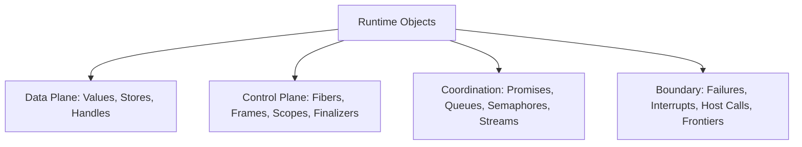
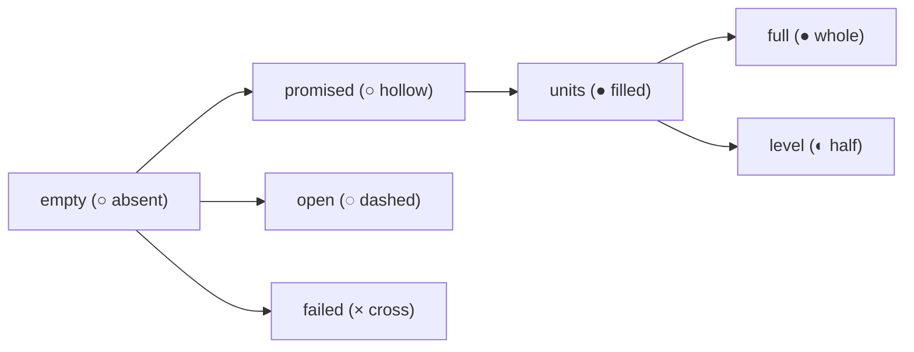
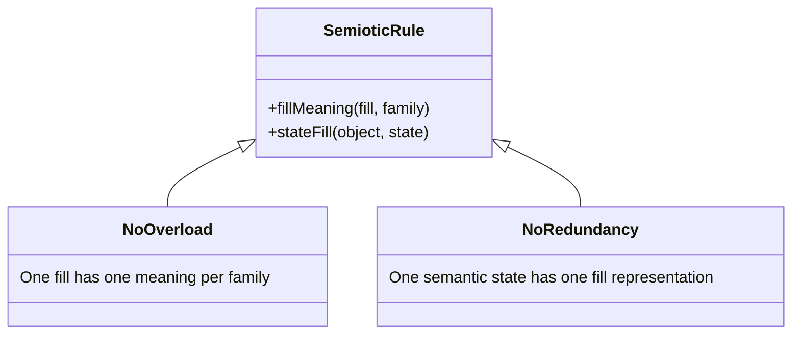
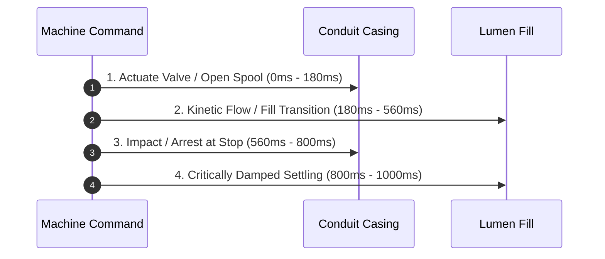
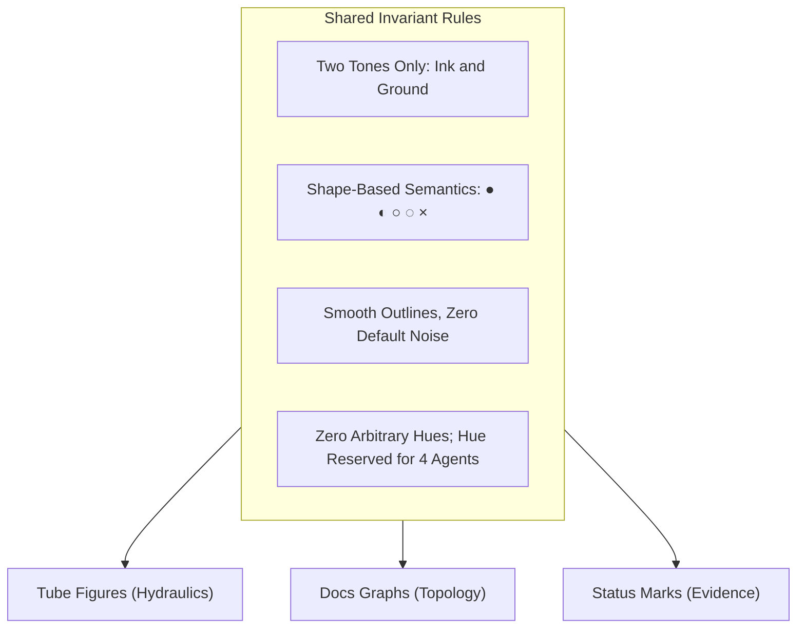

# Semiotics of Fills: One Inside Vocabulary for Every Object

Status: research note. 2026-10-13.
The code is `tools/Tools/View/Tube/`.
The prototype is `tools/view/out/proto/fills.html`.
This review assesses fills across the tube language.
It examines whether one vocabulary of fills serves all runtime objects.

---

## 1. The Objects

Every diagram in Effect4 renders objects from the semantics and the machine.
The visual grammar must depict fourteen distinct kinds of objects across their lifecycles.

### 1.1 Values
- **What it is:** First-order evaluated data, defined in `Store.Val` (`src/Effect4/Store/Carrier/Val.lean`). It includes scalars, compound records, and references.
- **States over a run:** Uncomputed, present in a slot, moving in flight, and dereferenced.
- **States to tell apart:** A reader must distinguish an unwritten empty slot from an evaluated value and a compound collection.

### 1.2 Promises and Deferreds
- **What it is:** A synchronization cell defined in `Deferred` (`src/Effect4/Machine/Stores.lean`, `docs/core/machine-state.md` §2). A cell holds an optional completion and a list of waiting fibers.
- **States over a run:** Unfulfilled, fulfilled with a value, and failed with a cause.
- **States to tell apart:** A reader must distinguish an unfulfilled waiting obligation from a fulfilled result and a broken promise.

### 1.3 Fibers
- **What it is:** A concurrent execution path defined in `RunFiber` (`src/Effect4/Machine/Fibers.lean`, `docs/core/machine-state.md` §1). It holds a continuation stack, status flags, and an origin.
- **States over a run:** Running, resting on yield, suspended on a token, interrupted, and exited.
- **States to tell apart:** A reader must distinguish an active running fiber from a suspended waiter, a yielding turn, and an exited fiber.

### 1.4 Frames
- **What it is:** A stack frame continuation defined in `Prim` and `FrameEvent` (`src/Effect4/Machine/Frames.lean`, `docs/core/machine-state.md` §1). It forms an execution hole that receives a child result.
- **States over a run:** Pushed as an empty hole, executing a child, popped with a result value, and skipped during a failure walk.
- **States to tell apart:** A reader must distinguish an open hole awaiting a return value from a filled hole and a skipped frame.

### 1.5 Scopes and Finalizers
- **What it is:** A lifetime boundary defined in `Scope` (`src/Effect4/Machine/Scope.lean`, `docs/core/semantics.md` concept 3). It tracks registered cleanup actions.
- **States over a run:** Open with no actions, open with registered actions, closing while running actions in reverse order, and closed.
- **States to tell apart:** A reader must distinguish an open scope from a closed scope. A reader must distinguish a registered finalizer from an executed finalizer and a cancelled finalizer.

### 1.6 Resources and Handles
- **What it is:** An allocated capability handle defined in `HandleKind` (`src/Effect4/Machine/Stores.lean`, `docs/core/host-boundary.md` §4). Handles index fibers, refs, deferreds, and scopes.
- **States over a run:** Allocated, referenced, updated, released, and stale.
- **States to tell apart:** A reader must distinguish an active valid handle from a released handle and an invalid handle.

### 1.7 Stores and Cells
- **What it is:** A mutable storage cell defined in `RefHeap` (`src/Effect4/Machine/Stores.lean`, `src/Effect4/Laws/Machine/Arena.lean`, `docs/core/machine-state.md` §7). It belongs to a dense memory arena.
- **States over a run:** Allocated empty, holding a value, updating atomically, and deallocated.
- **States to tell apart:** A reader must distinguish an empty cell from an occupied cell and an updating cell.

### 1.8 Queues
- **What it is:** A FIFO buffer defined in `Queue` (`src/Effect4/Library/Queue/Defs.lean`, `docs/research/2026-10-13-tube-language/README.md` §4). It implements backpressure, sliding, and dropping strategies.
- **States over a run:** Empty, holding items below capacity, full at capacity, backpressured with waiting offers, and starved with waiting takers.
- **States to tell apart:** A reader must distinguish available capacity from stored items, waiting takers, and blocked offers.

### 1.9 Semaphores and Pools
- **What it is:** A permit coordinator defined in `Semaphore` and `Pool` (`src/Effect4/Machine/Stores.lean`, decisions row 330). It regulates concurrent access to resources.
- **States over a run:** Full permits available, partial permits acquired, exhausted with zero permits, and oversubscribed with queued waiters.
- **States to tell apart:** A reader must distinguish available permit capacity from acquired permits and waiting consumers.

### 1.10 Streams and Channels
- **What it is:** A discrete sequence pipeline defined in `Stream` and `Channel` (`src/Effect4/Program/Stream.lean`, decisions rows 331, 335, 367). It models asynchronous consumption.
- **States over a run:** Idle, transmitting a chunk in flight, pulled by downstream demand, backpressured upstream, completed with leftover, and failed.
- **States to tell apart:** A reader must distinguish moving data chunks from backpressure shockwaves, normal completion, and failure halts.

### 1.11 Failures and Causes
- **What it is:** An error condition defined in `Reason` (`src/Effect4/Machine/Cause.lean`) and `CauseTerm` (`src/Effect4/Program/Eff.lean`, `docs/core/semantics.md` concept 1). It separates typed errors, untyped defects, and interrupts.
- **States over a run:** Raised as a typed error, raised as a defect, combined in an ordered cause list, caught by a handler, and unhandled.
- **States to tell apart:** A reader must distinguish a typed failure from an untyped defect, an interrupt cause, and an ordered cause sequence.

### 1.12 Interrupts
- **What it is:** An external stop signal defined in `ActionTerm.interrupt` (`src/Effect4/Program/Eff.lean`) and `RunEvent.interruptRecorded` (`src/Effect4/Machine/Fibers.lean`, decisions rows 350, 368). It forces fiber termination.
- **States over a run:** In flight, deferred behind a mask, recorded on a target fiber, delivered to stop execution, and cleared.
- **States to tell apart:** A reader must distinguish an in-flight interrupt surge from a deferred interrupt and an arrested stop.

### 1.13 Host Calls and Replies
- **What it is:** An external protocol exchange defined in `HostSession` (`src/Effect4/Api/HostSession.lean`, `docs/core/host-boundary.md` §4). It crosses the machine boundary.
- **States over a run:** Request dispatched, pending host execution, reply admitted, and reply refused.
- **States to tell apart:** A reader must distinguish an outgoing request from an awaiting host state, an admitted reply, and a refused reply.

### 1.14 Decisions and Frontiers
- **What it is:** A scheduler choice or execution boundary defined in `RunDecision` (`src/Effect4/Machine/Fibers.lean`), `FrontierReason`, and `Api.Outcome` (`src/Effect4/Api/Runner.lean`, `docs/core/machine-state.md` §3). It drives execution steps.
- **States over a run:** Active step decision, live frontier suspension, terminal exit, and stuck machine halt.
- **States to tell apart:** A reader must distinguish an active step from a waiting frontier, a clean exit, and a stuck halt.

---

## 2. The Fills

The proposal in `tools/view/out/proto/fills.html` names seven fill states.
Each state echoes a status mark from `docs/core/decisions.md` row 354.

### 2.1 The Seven Fill States
1. **empty (○ absent):** The lumen holds ground tone. It signifies unoccupied space, an idle conduit, or free capacity. Sign class: Icon.
2. **units (● filled):** The lumen holds solid ink circles or pills. Each pill represents one discrete value or message. Sign class: Icon and Index.
3. **promised (○ hollow):** The lumen holds an ink ring enclosing ground tone. It represents an active obligation or waiting taker. Sign class: Symbol and Index.
4. **level (◐ half):** The lumen holds ink filling from one boundary to a continuous mark. It shows a continuous share or fractional progress. Sign class: Index.
5. **full (● whole):** The lumen holds solid ink throughout. It indicates an immutable literal, a saturated capacity, or a shut barrier. Sign class: Icon and Symbol.
6. **open (◌ dashed in proposal; cut mouth in practice):** The conduit boundary remains unsealed. It represents an unclosed scope or external host boundary. Sign class: Icon.
7. **failed (× cross):** The lumen contains an ink cross or shear mark. It represents an execution failure, defect, or broken promise. Sign class: Symbol.

### 2.2 Audit of the Proposal Family Table
The table in `tools/view/out/proto/fills.html` maps the seven fills across the seven families of `tools/Tools/View/Glyph.lean`.
Every cell is audited below against the fourteen runtime objects.

| Fill State | Family | Proposal Text | Verdict | Semiotic Analysis and Correction |
| --- | --- | --- | --- | --- |
| `empty` | `body` | a box: a place for a value | Kept | Icon of empty evaluation container (`box`, `Shape.box`). |
| `empty` | `vessel` | free capacity: a slot not held | Kept | Icon of available storage capacity in queue or accumulator. |
| `empty` | `container` | every container: a membrane, its contents the figure | Kept | Container tubes have fine bores (`FINE = 4 px`); lumen is neutral envelope. |
| `empty` | `wire` | an idle wire | Kept | Passable conduit with no fluid in transit. |
| `empty` | `bond` | a tap not yet filled | Kept | Unlinked connection or uncalled callback tap. |
| `empty` | `force` | — | Kept | A force does not exist before its impulse is triggered. |
| `empty` | `cadence` | — | Kept | Cadence struts have zero bore (`THIN = 0`); they carry no lumen. |
| `units` | `body` | a value | Kept | Discrete evaluated scalar or data unit in `value` (`Shape.value`). |
| `units` | `vessel` | held units, by count | Kept | Integer count of stored items inside queue vessel (`unitLen`). |
| `units` | `container` | — | Changed | Change to: held items in a data lane (`cells`, `Shape.cells`). |
| `units` | `wire` | values in flight | Kept | Kinetic transit of messages along process piping (`series`). |
| `units` | `bond` | a copy in each tap | Kept | Duplicated broadcast units in manifold takeoff taps (`spider`). |
| `units` | `force` | the surge's unit | Changed | Change to: —. A force is a shockwave, not a moving unit. |
| `units` | `cadence` | — | Kept | Cadences never transport fluid units. |
| `promised` | `body` | a value promised | Kept | Evaluated slot owed by a continuation. |
| `promised` | `vessel` | a waiting taker | Kept | Unresolved deferred or consumer demand bubble (`hollowBox`, `hollowDot`). |
| `promised` | `container` | — | Changed | Change to: unclosed scope with close owed (`openBracket`). |
| `promised` | `wire` | a demand travelling back | Kept | Upstream pull signal traveling against process direction. |
| `promised` | `bond` | a waiter on a completion | Kept | Awaiting subscriber registered on completion manifold. |
| `promised` | `force` | — | Kept | Interrupts are immediate impulses, not deferred promises. |
| `promised` | `cadence` | — | Changed | Change to: live frontier awaiting resolution (`fermata`). |
| `level` | `body` | — | Kept | A discrete body holds discrete scalar data, not partial fluid. |
| `level` | `vessel` | a measure: permits taken, a pool's share | Kept | High-capacity permit utilization where drawing individual pills is unreadable. |
| `level` | `container` | — | Kept | Container perimeters do not hold fill levels. |
| `level` | `wire` | a stream's progress | Kept | Fractional progress along an active transmission conduit. |
| `level` | `bond` | — | Kept | Relational bonds convey topological connections, not levels. |
| `level` | `force` | the surge's pressure | Dropped | Hydrostatic pressure is drawn by wall deflection (`SWELL`), not by lumen level. |
| `level` | `cadence` | — | Changed | Change to: timer countdown elapsed on staff line. |
| `full` | `body` | a literal, a constant | Kept | Immutable scalar value completely occupying lumen (`atom`). |
| `full` | `vessel` | full: at capacity, the valve shut | Kept | Maximum buffer capacity reached; float valve closes. |
| `full` | `container` | — | Kept | Jacketed casings do not fill solid. |
| `full` | `wire` | — | Changed | Change to: backwater lock behind closed valve. |
| `full` | `bond` | — | Kept | Cross-lane bridges do not hold stationary solid fills. |
| `full` | `force` | a stop (solid, an air gap short) | Changed | Change to: impact barrier. A stop is structural framing, not a full lumen. |
| `full` | `cadence` | a strut: thin and solid, it carries nothing | Changed | Clarify: Structural solid bar (`Fill.ink`), not a full fluid lumen. |
| `open` | `body` | a value from the host | Changed | Change to: host-provided parameter socket. |
| `open` | `vessel` | a deferred not yet made | Changed | Change to: unsealed receiver socket (`hole`). |
| `open` | `container` | a scope still open | Kept | Open bracket awaiting second closing hook (`openBracket`). |
| `open` | `wire` | a wire to the world | Kept | Conduit with square cut end crossing canvas boundary (`OFF`). |
| `open` | `bond` | a port | Kept | Bulkhead penetration looping into external environment (`port`). |
| `open` | `force` | — | Kept | An interrupt does not hold an open state. |
| `open` | `cadence` | — | Kept | Temporal punctuation markers remain closed and intact. |
| `failed` | `body` | a failure on its wire | Kept | Typed failure mark $\times$ (`cross`) or defect mark $\#$ (`hash`). |
| `failed` | `vessel` | a promise broken | Kept | Vessel holding a rejected completion cause. |
| `failed` | `container` | a scope closed by failure | Kept | Scope bracket bounding an abnormal exit. |
| `failed` | `wire` | a defect | Kept | Conduit fractured by sheared break (`hash`). |
| `failed` | `bond` | — | Changed | Change to: severed fork link or cancelled race entrant. |
| `failed` | `force` | an interrupt | Changed | Change to: unhandled interrupt cause deposited at boundary. |
| `failed` | `cadence` | — | Changed | Change to: abnormal machine halt on untyped state (`caesura`). |

---

## 3. Consistency

A semiotic notation must prevent symbol overload and symbol redundancy.
One visual fill must not signify conflicting concepts.
One runtime state must not require conflicting fills.

### 3.1 Resolving Overloads (One Fill with Multiple Meanings)
1. **Solid Ink: Literal versus Structural Strut**
   - *Conflict:* Solid ink currently represents both an immutable scalar literal (`atom`) and a cadence strut (`barLine`).
   - *Rule:* A literal fills a non-zero lumen (`PIPE = 10 px`). A cadence strut has zero bore (`THIN = 0`) and zero clearance. The pen draws it as a 10 px solid structural bar (`Fill.ink`), distinct from fluid-filled conduits.

2. **Full Lumen: Constant Value versus Queue Backpressure Lock**
   - *Conflict:* A solid lumen denotes an immutable constant in `body`, but saturated backwater in `wire`.
   - *Rule:* In process conduits, backwater is drawn as discrete packed pills touching menisci (`unitOf`). Only atomic literals without internal structure take solid full ink lumens.

3. **Open Mark: Broken Line versus Missing Cap**
   - *Conflict:* The proposal suggests dashed lines for open states, conflicting with cut conduit mouths.
   - *Rule:* The pen never draws openness with dashed line strokes. Openness is strictly drawn as an unsealed conduit mouth with a cut square end (`round := false`) or an unclosed hook (`openBracket`).

4. **Failure: Blocked Plug versus Error Cross**
   - *Conflict:* Drawing an error as an obstructing plug confuses normal backpressure with fatal failure.
   - *Rule:* An air-gap plug indicates normal control stoppage (`plugOf`). A failure must feature an explicit cross ($\times$) or sheared fracture (`#`).

### 3.2 Resolving Redundancies (One Meaning with Multiple Fills)
1. **Unfulfilled Obligations**
   - *Conflict:* A waiting promise is drawn as a hollow dot (`hollowDot`) or a hollow box (`hollowBox`).
   - *Rule:* Both marks use the exact same fill: an ink rim around a ground lumen (`hollowOf`, `RIM = 2 px`). Their external casing geometry conveys whether the promise is sealed (`Dot`) or fed by a pipe (`Box`).

2. **Defect versus Typed Failure**
   - *Conflict:* Both typed failure and defect represent error states.
   - *Rule:* Typed failure uses the diagonal 4-way cross fitting (`cross`, $\times$). Untyped defect uses the sheared fractured conduit (`hash`, $\#$). Both keep ground lumens obstructed by ink marks.

---

## 4. Change as Motion

State transitions in the visual language must correspond to lawful physical movements.
All animations occur in response to discrete machine commands or host decisions (decisions row 354 point 5).
Transitions are staged in causal order, using the kit's spring (`settle`, $\omega = 7.4$).

### 4.1 Promise Kept
- **Motion:** A hollow bubble resting in a vessel fills in place.
- **Mechanism:** The inner ground circle (`hollowOf:in`) contracts to zero radius while the outer rim expands inward.
- **Law:** Bistable fulfillment: the transition changes exactly one mark (`distance = 1`, tested in `Glyphs.lean`).

### 4.2 Scope Closed
- **Motion:** An open scope hook grows its opposing closure hook.
- **Mechanism:** The second hook (`bracket:b`) extrudes from its anchor and completes the bracket.
- **Law:** Conservation of lifetime: the enclosure remains sealed until finalizers discharge.

### 4.3 Failure Raised
- **Motion:** A clear conduit develops an internal fracture or cross obstruction.
- **Mechanism:** The lumen stroke cracks inward, depositing an ink cross ($\times$) or displacing into a sheared break (`SHEAR = 23066`).
- **Law:** Momentum arrest: forward liquid flow stops instantly, propagating a reverse shockwave (`surge`).

### 4.4 Resource Released
- **Motion:** A finalizer token drains from its chamber.
- **Mechanism:** The solid fluid pill translates downstream through the discharge port and fades (`Kind.grammar.body.leave`).
- **Law:** Mass conservation: a released permit exits into its owning pool or dissolves.

### 4.5 Unit Taken from Queue
- **Motion:** The leading pill exits the vessel nozzle.
- **Mechanism:** The head unit flows out. Trailing units advance by one slot with a staggered kinematic wave (`STAGGER = 70 ms`).
- **Law:** Continuity equation ($S' = S + I - O$) and FIFO ordering govern the motion.

### 4.6 Unit Offered to Full Queue
- **Motion:** An incoming unit arrives at a closed float valve.
- **Mechanism:** The unit impacts the shut plug (`IMPACT = 560 ms`). The inlet conduit sags under backlog weight (`OVERSHOOT = 35%`), and a surge wave travels upstream (`Joukowsky`).
- **Law:** Euler-Bernoulli dynamic deflection ($wL^3/24EI$) governs the sag.

---

## 5. Unity of the Design Language

The visual system spans three media:
1. Tube figures in the view tool (`tools/Tools/View/Tube/`).
2. Tree and graph figures in the docs (`docs/core/`, generated site).
3. Status glyphs in text and tables (decisions row 354 point 2: ● ◐ ○ ◌ ×).

### 5.1 Where They Share Rules
- **Two Tones Alone:** All three media use ink (`--e4-color-ink`) and ground (`--e4-color-ground`). No greys or gradients appear.
- **Status Alignment:**
  - Proved / Evaluated / Saturated = Solid Ink (●).
  - Modulo / Partial / Measured = Level Fill (◐).
  - Goal / Promised / Waiting = Hollow Ring (○).
  - Open / Owed / Boundary = Cut / Open Mouth (◌).
  - Refuted / Failed / Broken = Cross / Fracture (×).
- **Geometric Rigor:** Straight runs align to whole pixels (`crisp`, `onPixel`). Bends follow fixed minimum radii.
- **Hue Restriction:** Hue is strictly forbidden for status or meaning. Hue belongs exclusively to the four agents (machine, host, failure, resource).

### 5.2 Where They Differ on Purpose
- **Topological Continuity:** Tube figures enforce continuous fluid conduits with physical walls and clearances. Graph figures use thin abstract connection rules.
- **Text Placement:** Graph figures place text labels inside nodes. Tube figures never place text inside fluid conduits. Typography stands strictly outside casings or on collar tags (`tag`).
- **Proportions:** Tubes use the radio-button proportion 2 : 3 : 10 (`LINE`, `MARGIN`, `UNIT`). Graph figures use 1 px structural dividers.
- **Motion Physics:** Tube motion models fluid dynamics, mass balance, and beam deflection. Graph diagrams animate by simple node translation and edge reveal.

---

## 6. Recommendations for the Four Questions

The proposal in `tools/view/out/proto/fills.html` asks four design questions.
Here are the recommendations grounded in semiotics and runtime semantics.

### 6.1 Question 1: Full versus Strut
- **Proposal Question:** Today a thin strut is solid ink and carries nothing. A full lumen would mean a literal. Keep both, told apart by width, or give the strut a ground lumen?
- **Recommendation:** Keep both, told apart by width and structure.
- **Reason:** A strut represents structural punctuation (measure bars, final exit gates, barrier stops). It has zero bore (`THIN = 0`), giving a solid 10 px bar (`body THIN = 10 px`). Giving the strut a ground lumen would turn it into a passable hollow pipe. That would invite category confusion between time framing and process conduits. A full lumen occurs only in conduits with non-zero bore (`PIPE`, `VESSEL`), representing an evaluated literal or saturated vessel.

### 6.2 Question 2: Level versus Units
- **Proposal Question:** Is a level (continuous) worth having beside counted units? It suits a semaphore's permits, a pool's share and a stream's progress.
- **Recommendation:** Retain `level` strictly for continuous fractional progress and large populations. Retain `units` for all discrete runtime queues.
- **Reason:** Effect4 execution steps in discrete whole commands (README.md §5, decisions row 369). Semaphore permits, queue capacities, and memory cells are discrete natural numbers. Drawing a continuous fluid level for small counts destroys integer exactness (`AREA = 120 px²`). Level is justified only for continuous progress bars (streams, timer elapsed fractions) or high-capacity connection pools where discrete pills cannot fit.

### 6.3 Question 3: Open as a Dashed Line
- **Proposal Question:** The tube's line is otherwise always whole. Is a broken line the right mark for open, host-made and not yet closed, or should open be an air gap at an end?
- **Recommendation:** Reject dashed lines for tube bodies. Represent openness through cut square ends or open hooks.
- **Reason:** Outlines in the tube language are solid, cased, and filleted (decisions row 370). Dashing the outline breaks the solid casing model, creating rendering artifacts at joints. In Peircean indexicality, openness is an unsealed boundary, not a porous sieve.

### 6.4 Question 4: Failure
- **Proposal Question:** A cross in the lumen, or a plug across it with an air gap (as the force family's stop)?
- **Recommendation:** Retain the explicit cross ($\times$) or sheared fracture ($\#$) in the lumen. Never replace failure with an air gap plug.
- **Reason:** An air gap plug signifies normal flow stoppage, such as backpressure behind a closed float valve (`plugOf`). A failure is an abnormal or fatal error condition. Collapsing failure into an air gap conflates a paused queue with a crashed fiber. The cross directly aligns with the docs' status mark $\times$ (decisions row 354 point 2).

---

## 7. Open Questions for the Owner

1. Should a saturated queue under backpressure display a solid full lumen or tightly packed discrete unit pills?
2. Should a resource pool render discrete permit pills below a capacity threshold and switch to a continuous fill level above it?
3. Should a cancelled fiber's conduit show an inscribed failure cross or a severed air-gap parting?
4. Should an unclosed scope hook receive an explicit terminal flange mark to confirm that the open mouth is intentional?
