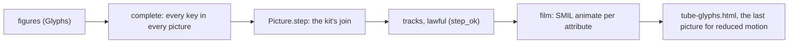
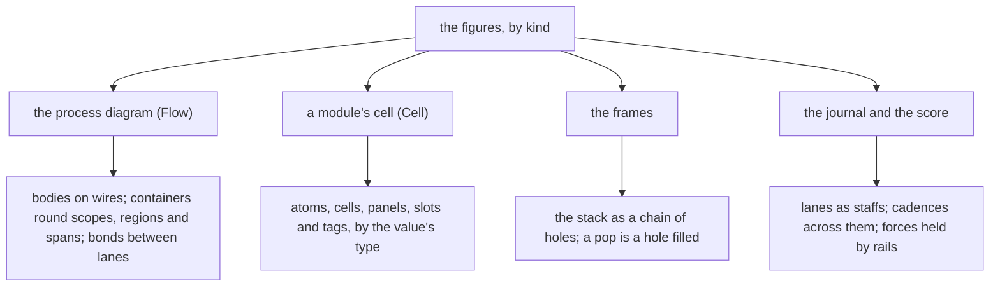

# 2026-10-13 The vocabulary of marks as tubes

Status: research note (history, not authority). Base: `25c798d50`. The code is
`tools/Tools/View/Tube/Glyphs.lean` and `tools/Tools/View/Tube/GlyphPage.lean`. The page is
`tube-glyphs.html`, shown by `tools/view/v -V tube-glyphs`. The receipt is
`docs/research/2026-10-13-seat-glyphs-receipt.md`.

**The one thing to know first.** Every one of the 37 marks of `Shape`
(`tools/Tools/View/Glyph.lean`) is now a figure of tubes, one family per kind. Every moment of the
step from any figure to any other keeps the bend law (`morph_ok`, proved).

## Question

The brief (`docs/research/2026-10-13-tube-language/seat-glyphs-brief.md`) asks four things:

- a family of tube figures for each kind, with what its parts mean in plumbing terms;
- a figure for each mark, keyed by role, so that any mark turns into any other;
- the laws: every tube of every figure keeps the bend law, and so does every moment of a morph;
- a page with the families, every sort's constructors, and the morphs a run makes.

## What was read or run (each with its evidence word)

- Read: the brief, the tube note (`docs/research/2026-10-13-tube-language/README.md`), and rows
  354, 367, 368 and 369.
- Read: `tools/Tools/View/Glyph.lean`, `tools/Tools/View/GlyphSheet.lean`, and the tube modules
  `Form`, `Draw`, `Motion`, `Queue` and `Sheet` under `tools/Tools/View/Tube/`.
- Read: Gemini's earlier review (`docs/research/2026-10-12-visual-semantics/gemini-review.md`) and
  its semiotics review (`docs/research/2026-10-13-tube-language/semiotics.md`).
- Read: the coordinator's four messages of 2026-10-13. They relayed the owner's rulings on the
  look: line art, then solid bodies whose joins carry meaning, then outlined bodies. They also gave
  the verdicts on the semiotics review and the pen's commits `027157447` and `fb74420d0`.
- Run: the narrow builds, the view-pages driver, and `#axiom_audit` over both modules.
- Run: headless Chrome over the page, and over scratch sheets of the figures and of the films.

## Findings (each with its evidence)

### 1. The families

Each kind is one plumbing element, and each builder draws its kind's marks as variations of it
(reading: the builders' docstrings in `tools/Tools/View/Tube/Glyphs.lean`).

| Kind | Builder | The element | What its contents mean |
| --- | --- | --- | --- |
| body | `bodyFigure` | a closed piece of line, a spool | its payload: a unit where it is a value; a collar is a name |
| vessel | `vesselFigure` | a short closed vessel of one unit | the unit hollow while promised, filled once kept |
| container | `containerFigure` | a fine tube that encloses | none: what it encloses is the figure |
| wire | `wireFigure` | a pipe of the carrying bore | the value it carries |
| bond | `bondFigure` | a relation between lanes | a copy in each tap of a broadcast |
| force | `forceFigure` | a surge that a stop holds | none: the surge is the impulse |
| cadence | `cadenceFigure` | a thin strut across the staff | nothing: a strut carries nothing |

Three conventions hold across the families (tested: the guards of `Glyphs.lean`).

- Joins carry meaning, as the owner ruled. A solid join shares fluid, a conserving tee or wye. An
  air gap of 4 px means that nothing passes.
- Every end inside a figure is round. A tube that meets the world runs past the cell's edge.
- A key names one role in every figure. The tubes are `main` and `b` to `f`. The units are `u`
  to `u4`. The inside of a hollow is `h`, the collars are `k` and `k2`, and a surge is `s`.

The families differ from the brief's starting point in three places, each for a reason.

- A body is a closed piece with its payload, not bare contents; only the literal is a unit
  alone. Ten bodies need more forms than a pill and a plug give.
- The force's stop and the cadence's struts meet their pipes across an air gap. The pens of
  `027157447` and later draw a plug as an air gap, so a plug no longer reads as a solid bar.
- A cadence includes the staff it stands across. The staff stops an air gap short of the strut,
  which shows that no unit passes.

### 2. The 37 marks

"One part" marks a morph that the guards hold to one changed part (tested). "Film" marks a morph
that a film on the page plays. The films were seen on headless Chrome captures: a host run judged
by eye, not a checker.

| Mark | Kind | Figure | Turns into |
| --- | --- | --- | --- |
| `box` | body | a closed piece of pipe, empty | `value`, one part |
| `value` | body | the piece, one unit at its leading end | `box`, one part |
| `atom` | body | one unit alone, no casing | — |
| `call` | body | the piece with a collar at each end, its names | `box`, two parts |
| `tag` | body | a short piece with one collar at its middle, a name | — |
| `probe` | body | the piece with a thin tap above it, an air gap away | `box`, one part |
| `enter` | body | one unit on a closed ring, the fiber in its loop | — |
| `cross` | body | a crossing: the under pipe stops an air gap short of the over pipe | — |
| `hash` | body | a pipe broken and sheared: two pieces 12 px apart across, an air gap between ends | — |
| `reasons` | body | three fine beads in a row, parted by air gaps | — |
| `hollowDot` | vessel | a sealed vessel of one unit, its unit hollow | `filledDot`, one part |
| `filledDot` | vessel | the sealed vessel, its unit kept | — |
| `hollowBox` | vessel | a vessel that a pipe enters, its unit hollow | `filledBox`, one part, film |
| `filledBox` | vessel | the vessel on its pipe, its unit kept | — |
| `hole` | vessel | the vessel on its pipe, empty | `filledBox`, one part, film |
| `slot` | vessel | a tray, a low bend, holding a unit | — |
| `openBracket` | container | a scope's first hook alone, the close owed | `bracket`, one part, film |
| `bracket` | container | two hooks round a span | — |
| `region` | container | two opposite corners, as its text glyph `⌜ ⌟` | — |
| `rail` | container | two fine pipes, a double rail | — (proposed: its second pipe leaves when unmasked) |
| `block` | container | three closed runs, read top to bottom | — |
| `library` | container | three runs; the first two have a collar, a name; then the body | — |
| `panel` | container | three rows, each a thin muted name and its field after an air gap | — |
| `cells` | container | a lane vessel with two units, read from its front | — |
| `series` | wire | a pipe that steps from one part down into the next, carrying a unit | — |
| `parallel` | wire | two half-width pipes joined solidly into one, a conserving wye | — |
| `alternative` | wire | a pipe divided by a solid wye into two arms of its width | — |
| `loop` | wire | a line with a fine ring hung from its middle, joined solidly | — |
| `rest` | wire | a pipe parted by an air gap, a valve closed for a turn | — |
| `arrow` | bond | a parent lane, and a child lane that starts an air gap below it | `spider`, film |
| `spider` | bond | a header carrying the exit, three taps hung an air gap below, each with a copy | — |
| `port` | bond | a hairpin to the world: the request leaving, the answer owed as a hollow | — |
| `blockedArrow` | force | a pipe with a surge, ending an air gap short of a stop across it | lands at a rail's end, film |
| `barLine` | cadence | a thin strut across the staff, the staff an air gap short on both sides | — |
| `exitBar` | cadence | the staff ending before a thin strut and a heavy one | — |
| `fermata` | cadence | an arch held over the staff, its feet an air gap above it, over a dot | — |
| `caesura` | cadence | two slanted struts at a sixth of a turn, the staff gone | — |

Any mark turns into any other by the morph. The film "any mark into any other" plays six of them.
The morph is lawful for every pair (proved: `morph_ok`).

### 3. The laws

The laws are placed here as the tube note's §3 places `Tube.mix_ok`. The theorems are proved; the
kernel accepted them, and `#axiom_audit` finds every declaration of
`tools/Tools/View/Tube/Glyphs.lean` within `[propext, Quot.sound]`.

| Theorem | Statement | Path |
| --- | --- | --- |
| `figure_ok` | every tube of every figure keeps the bend law, by `decide` for each shape | `tools/Tools/View/Tube/Glyphs.lean` |
| `morph_ok` | every track of the step between any two figures is lawful at every moment | same |
| `step_ok` | every track of a step is lawful when both pictures' marks and the poses passed through keep the law | same, to move into `Motion` |
| `tracksOf_ok` | a mark's tracks are lawful when its two poses and its pose passed through are | same, to move into `Motion` |
| `bend_ok`, `width_ok`, `window_ok` | a bend's poses are mixes of lawful tubes; a width or a window takes no path | same, to move into `Motion` |
| `gone_ok` | a mark shrunk to its root keeps the law, from `Piece.zero_ok` | same, to move into `Motion` |
| `viaTube_ok` | the pose a mark passes through keeps the law when its mark does | same, to move into `Motion` |
| `reverse_ok` | a tube drawn from its other end keeps the law | same, to move into `Form` |

`morph_ok` rests on `Tube.mix_ok`, `pad_ok` and `Piece.zero_ok`
(`tools/Tools/View/Tube/Form.lean`) through `step_ok`.

The guards of `Glyphs.lean` are finite checks (tested):

- no two marks have the same figure;
- the marks that one sort tells apart differ by one part at least;
- they differ by two parts at least, but for the five pairs of `near`, each with its reason;
- the run's morphs are short: a promise kept, a hole filled and a scope closed change one part;
- every figure stands in its cell, by the hull of its cubics, but the port, which meets the world;
- every straight run across or down lies on a whole pixel, within ten thousandths;
- every piece keeps the solid-tube pen's 24 px bend already;
- a key names one role in every figure;
- every join, reducer and strut names tubes of its figure, and nothing rides on a strut.

A guard of `GlyphPage.lean` holds every picture of every film on the page to the bend law
(tested). With `step_ok`, every moment of every film keeps it too.

### 4. What the laws do not establish

- `morph_ok` covers the stroke pen's tracks: a bend, a width and a window. The solid-tube pen's
  outlines, fillets and stretches (`tools/Tools/View/Tube/Outline.lean` at `fb74420d0`) are not
  covered.
- Two tubes an air gap apart at both ends of a morph can touch during it. Nothing keeps a gap or
  a solid join between the two pictures.
- The cell guard checks each picture, not the middle of a morph. A morph's middle poses can leave
  the cell.
- The theorems are about centrelines. No theorem bounds a cubic's distance from its arc.
- `distance` counts parts, not what a reader sees. The visual check is a host run judged by eye,
  on headless Chrome captures, not a measure.
- `figure_ok` is proved at the base's bend radius, 15 px. The guard holds every piece to 24 px
  too. At the merge, the build proves `figure_ok` again under the pen's `BEND`.
- The page's films are lawful by a finite guard over the page's own pictures, not by a theorem
  over every film.

### 5. What the tube language lacked, and what this seat added

Each addition lives in the seat's module under a heading that names where it moves.

| Added | What | Moves into |
| --- | --- | --- |
| `reverse_ok` | a tube drawn from its end keeps the law | `Form` |
| `AIRGAP`, `half`, `apart` | the air gap and the distance between two centrelines an air gap apart | `Draw` (the pen's `GAP` at `027157447`) |
| `surgeOf` | a surge standing on a pipe, still | `Draw` (the pen's `stretchOf`) |
| `unitAt`, `hollowAt` | a unit or a hollow centred on a point, the hollow's rim keyed as the unit | `Draw` |
| `Lawful`, `step_ok` and its steps | every moment of a step is lawful | `Motion` |
| `hidden`, `complete` | a film whose marks never appear from nothing | `Motion` (in `GlyphPage.lean`) |
| `Figure.joins`, `reducers`, `struts` | solid joins, pipes into vessels, and struts, as data | the pen's `Join`, `into` and `reducedOf`, and a strut's fill |

Two findings about the pen and the toolchain:

- `Motion.film` draws a mark that enters later as `Mark.gone`. For a tube, `Mark.gone` keeps the
  width, so the tube shows as a dot at its root before it grows. A tube that leaves ends as a dot.
  The page's films avoid it by `complete` (seen on headless Chrome captures, judged by eye).
- `String.endsWith` and `String.splitOn` reach `Classical.choice` in this toolchain (tested: the
  first `#axiom_audit` of the module). A figure that rekeys by a key's text carries it into its
  theorems, so the module tests widths and equality.

### 6. The films

The page plays six films, each the kit's join of one picture and the next.

- A promise kept: the answer flows down the pipe of `hollowBox`, and its hollow fills.
- A hole filled by a value: a value flows down the pipe into the empty vessel of `hole`.
- A scope opened and closed: the first hook grows, then the second.
- A fork joined: the child's lane grows beside the parent's, then the lanes fold into `spider`.
- An interrupt held by a rail: the surge is held at the rail's start and lands at its end.
- Any mark into any other: `box`, `loop`, `spider`, `fermata`, `hollowDot`, `region`.

### 7. The semiotics review: taken and not taken

The coordinator's verdicts on the review (`semiotics.md`) decided what to take.

| Verdict | Taken | How, or why not |
| --- | --- | --- |
| a broadcast must not look like a tee | taken | `spider`: taps hung an air gap from a header, each holding a copy |
| cadences carry nothing and are never passable pipe | taken | struts across the staff, capped, the staff an air gap short; named in `Figure.struts` |
| a cut end means the world | taken | every end round inside a cell; only the port runs off the edge |
| a hollow reads as an active demand | taken as is | the pen's hollow at the vessel's bore; its rim is the pen's |
| small sizes: never scale down, use a smaller bore | not taken | under a 24 px bend, a small figure needs its own form: a question for the owner |
| shared keys from the "turns into" column | taken | keys by role; the guards hold the run's morphs to one part |
| a loop tap for `probe` | not taken | a pictured device; a straight tap an air gap away reads as a read |
| a hanging tag for `tag` | not taken | a pictured device; a collar is the sign of a name |
| a venturi nozzle for `series` | not taken | a pictured device; a pipe that steps into the next part |
| a siphon trap for `rest` | not taken | a pictured device; a pipe parted by an air gap |
| a serpentine coil for `block` | not taken | three closed runs read as statements, and fit any cell |
| a chevron nozzle for `enter` | not taken | an arrowhead; a unit on a closed ring is the fiber in its loop |
| a grid manifold for `hash` | not taken | crossings of solid bodies have kinks no fillet rounds; a sheared break instead |

### 8. How the other pictures take these figures up

The decomposition pass carries the figures to the other pictures of row 367 (reading).

- The process diagram (`tools/Tools/View/Flow.lean`) draws operations as bodies on their wires.
  A scope, a region or an uninterruptible span is a container round its part of the diagram.
- A module's cell (`tools/Tools/View/Cell.lean`) draws a value by its type. A literal is an atom,
  a list is a lane of units, a record a panel, an option a tray, a handle a tag.
- The frames are holes in a chain, innermost first. A popped frame is a hole filled by a value.
- The score's lanes are staffs. A host's decision is a strut across every staff. A fork and a
  join are bonds between lanes, and an interrupt is a force that a rail holds.

## Proposals (not rulings)

- Move the "to move" blocks of `Glyphs.lean` into `Form`, `Draw` and `Motion`, as §5 lists.
- In `Motion.film`, draw a mark that enters later with no width until its first track, as
  `hidden` does. Then no film shows a dot at a tube's root.
- At the merge, map `Figure.joins` to `Join`, `Figure.reducers` to `into` or `reducedOf`, and
  `Figure.struts` to a fill with no inside.
- Replace `AIRGAP` by the pen's `GAP`, and `rest` and `cross` by `plugOf` and `cutOf` where the
  pen draws them alike.

## Questions for the owner

1. Representation: the bend law sets a radius of 24 px for every tube. A figure with a half turn
   then needs about 64 px. Should small figures keep the full-size form, take a straight-only
   form, or follow a bend law scaled to the picture?
2. Meaning: the defect `#` is a sheared break here, since a lattice needs crossings. Keep the
   break, or draw the lattice once the pen draws crossings?
3. Meaning: a fork shares no fluid with its child, so the child's lane starts an air gap away.
   Is a fork a relation without a fitting, or a fitting that the pen should join?

## What this does not establish

- No reader study: whether a reader tells the marks apart at a glance is not measured.
- The look after the merge is not seen. The page renders with the base's pen.
- No theorem covers the page's layout, the films' timing, or the cell guard during a morph.
- The figures serve rows 367 and 369. They serve no requirement R1 to R14 of
  `docs/core/system-map.md`.
