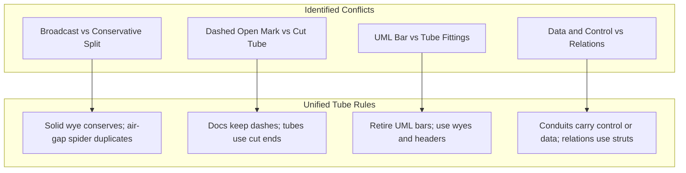
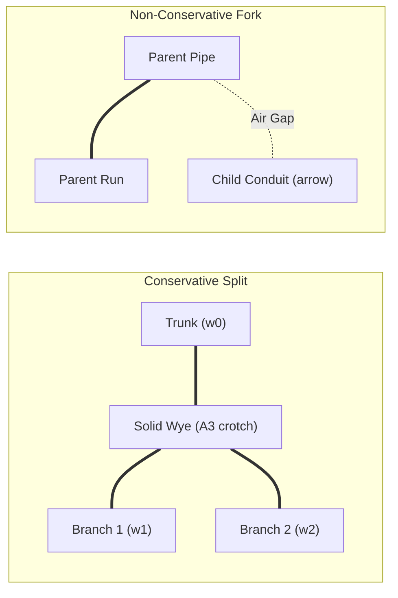

# Alignment of Graph Representations and the Tube Design Language

Status: research note. 2026-10-13.
The code is `tools/Tools/View/` and `tools/Tools/Document/`.
The tube language is `docs/research/2026-10-13-tube-language/`.
The motion plan is `docs/research/2026-10-13-motion-everywhere/README.md`.
This note aligns graph representations with the tube design language under decision row 371.

---

## 1. The Census of Graph Marks Today

Effect4 uses graph figures across documentation pages, program flows, and runtime traces.
This census catalogues every visual mark used in graph figures today.

| Mark | Meaning | Figures that use it | Ruling decision row |
| --- | --- | --- | --- |
| Node box | An operation, term, fiber, or theorem | `Figure.picture`, `Flow.ofProgram`, `fiberGraph` | Row 336, Row 365 (1) |
| Lit node band | A goal or state change | `Figure.picture`, `fiberGraph` | Row 336, Row 365 (1) |
| Control edge | Sequential fiber control flow | `Flow.ofProgram`, `Graph.layout` | Row 336, Row 337 (1) |
| Data edge | Value passing between operations | `Flow.ofProgram`, `Flow.Box.series` | Row 336, Row 337 (1) |
| Fork edge | Parent spawning child fiber | `fiberGraph`, `Flow.ofProgram` | Row 336, Row 337 (1) |
| Exit edge | Exit result delivery to waiter | `fiberGraph` | Row 336, Row 337 (1) |
| Back edge arc | A loop return, cycle, or await | `Graph.layout`, `Flow.lay`, `fiberGraph` | Row 336, Row 337 (1) |
| Relation edge | Proof or type dependency | `Figure.picture` | Row 336, Row 365 (1) |
| Self loop drop | Recursion to self | `Graph.layout` | Row 336, Row 337 (1) |
| Arrowhead | Direction on ambiguous arc | Back edges and self loops in `Graph.routeCalls` | Row 337 (1) |
| UML flow bar | Fork or join of parallel branches | `FlowMark.bar` in `Flow.lay` | Row 337 (9) |
| UML flow diamond | Choice or alternative merge | `FlowMark.diamond` in `Flow.lay` | Row 337 (9) |
| Region frame | Scope, layer, or mask span | `Region` in `Graph.regionCalls`, `Flow.Box` | Row 337 (2), Row 354 (10) |
| Organic trunk | Shared concurrent work | `Graph.organicCalls` via `Grow.split` | Row 337 (2), Row 354 (9) |
| Collar flare | Fitting where edge meets box | `Grow.collar` in `Graph.organicCalls` | Row 354 (9), Row 370 (3) |
| Status text | Textual state name | Line 2 of `GNode` in `Figure.picture`, `Run.stateText` | Row 354 (2), Row 365 (1) |
| Link anchor | Interactive document link | SVG `a` wrapper in `Figure.picture` | Row 365 (1) |

### 1.1 Node Boxes
A node is a rectangular box placed by Brandes and Köpf coordinates (`Tools.View.GNode`, `tools/Tools/View/Graph.lean`).
The box draws an ink frame and a ground fill (`Laid.boxCalls`, `tools/Tools/View/Graph.lean`).
Line 1 shows the label (`GNode.line1`).
Line 2 displays status text and details (`GNode.line2`).

### 1.2 Lit State
A lit node displays a band fill in the rule tone (`L.band`).
In documentation figures, a planned goal lights the node (`Tools.Document.Figure.graphOf`, `tools/Tools/Document/Figure.lean`).
In the run graph, any fiber whose state changed in the step lights the node (`Tools.View.Run.fiberGraph`, `tools/Tools/View/Run.lean`).

### 1.3 Edges and Routes
A forward edge descends from the bottom middle of the source to the top middle of the target (`Route.down`).
The edge bends only when stepping across ranks (`Laid.stepDown`).
A back edge leaves the source right side, passes through an outer lane, and enters the target right side (`Route.back`).
A loop drops off the right side of a single node (`Route.loop`).

### 1.4 Arrowheads
Forward edges carry no arrowheads (`Route.down`).
Downward layout position indicates forward execution direction (row 337 (1)).
Back edges and self loops take a two-stroke arrowhead along their dominant axis (`Laid.arrowhead`, `tools/Tools/View/Graph.lean`).

### 1.5 Flow Marks
The flow layout draws UML activity marks (`Tools.View.FlowMark`, `tools/Tools/View/Graph.lean`).
`FlowMark.bar` draws a solid ink bar across concurrent branches (`Tools.View.Laid.markCalls`).
`FlowMark.diamond` draws a diamond of four strokes around choices (`Tools.View.Laid.markCalls`).

### 1.6 Regions and Clusters
A region groups laid-out items within an enclosing frame (`Tools.View.Region`, `tools/Tools/View/Graph.lean`).
`Laid.regionCalls` draws an ink or rule frame around the bounding box.
The region label stands above the upper left corner.

### 1.7 Organic Strokes
When the look sets a positive trunk width, forward edges use organic strokes (`Laid.organicCalls`).
da Vinci's rule sets edge width from work share (`Tools.View.Grow.split`, `tools/Tools/View/Organic.lean`).
Quarter-circle collars flare where edges meet boxes (`Grow.collar`).

---

## 2. The Mapping of Graph Marks to Tube Forms

Under decision rows 369, 370, and 371, every mark belongs to one physical tube family.
Every visual mark maps to a tube form, a join type, a contents state, and a motion.

| Mark | Tube family | Join type | Contents state | Motion | Disposition |
| --- | --- | --- | --- | --- | --- |
| Node box | Vessel (`hollowBox`, `filledBox`) | Collar ports | Contents state by status | Grow, shrink, keep | Changed to vessel |
| Lit band | Vessel lumen state | Internal | Promised to units | Keep, swell | Changed to contents motion |
| Control edge | Tube conduit (`Tube.route`) | Solid collar | Fiber execution unit | Carry, reveal clip | Kept as control conduit |
| Data edge | Tube conduit (`Tube.route`) | Solid collar | Transferred value units | Carry, reveal clip | Kept as data conduit |
| Fork edge | Bond `arrow` | Air gap | Child fiber unit | Grow down lane | Changed to air-gap bond |
| Exit edge | Process conduit in lane | Tangent dock | Units (`Exit`) | Carry | Changed to process tube |
| Back edge arc | Tube conduit in lane | Tangent dock | Units or empty | Carry | Changed to arrival dock |
| Relation edge | Proof strut or fine conduit | Frame or collar | No lumen, or status fill | Reveal or fill | Evaluated in Section 4.2 |
| Self loop | Closed loop conduit | Solid join | Units | Carry | Changed to arrival dock |
| Arrowhead | Asymmetric collar / arrival dock | Solid dock | Lumen continuity | Reveal | Replaced by asymmetric arrival |
| UML flow bar | Wye fitting or air-gap manifold | Solid or air gap | Units or empty | Blend or parting | Changed by conservation |
| UML diamond | Selector valve | Air gap | Empty or units | Parting through pose | Changed to valve |
| Region frame | Jacketed container (`bracket`, `region`) | Air gap | Ground or empty | Grow corners | Changed to container kind |
| Organic trunk | S24 tube split (`Tube.split`) | Solid wye (A3) | Units | da Vinci split | Kept, S24 geometry |
| Collar flare | G2 collar corner (A6) | Solid | Body continuity | Fillet blend | Kept, exact cubics |
| Status text | Text outside plus lumen pill | Outside text, lumen slot | Hollow, filled, or failed | Keep | Kept text, changed status |
| Link anchor | SVG `a` wrapper | Surface | Preserved | Focusin | Kept |

### 2.1 The Node as a Vessel
The node box becomes a vessel from the vessel kind (`Kind.vessel`, `tools/Tools/View/Glyph.lean`).
The pen proportion sets a 2 px line (`LINE`, `tools/Tools/View/Tube/Draw.lean`) and a 3 px margin (`MARGIN`).
Body widths step across 10, 14, 20, and 28 px (`WIDTHS`, `tools/Tools/View/Tube/Draw.lean`).
Text labels stand strictly outside the vessel casing.
The lumen holds the contents state that indicates execution status.

### 2.2 Edges as Conduits
Edges become tubes routed with straight runs and bend-law arcs (`Tube.route`, S24).
Every turn keeps the long bend radius of 24 px (`BEND`, `tools/Tools/View/Tube/Form.lean`, row 370 (3)).
Solid joins connect edges where fluid or fiber control transfers directly.
Air gaps separate conduits where state does not transfer.

### 2.3 Replacement of UML Marks
UML activity marks leave the design language.
A parallel fork that conserves amount becomes a solid wye fitting (`Join.wye`, S24).
A parallel fork that spawns independent fibers becomes an air-gap branch (`arrow`, `tools/Tools/View/Glyph.lean`).
A join where multiple fibers synchronize becomes a spider header with air-gap taps (`spider`).
An alternative choice becomes a two-way selector valve with parted and fused ports.

---

## 3. One Sign for One Meaning

The semiotic audit identifies conflicts where forms and meanings fail to correspond bijectively.
This section resolves each conflict with a single normative rule.



### 3.1 The Broadcast Conflict
In pipeline hydraulics, a solid tee or wye conserves volume (Q_in = sum Q_out).
In `PubSub`, a broadcast duplicates messages to all subscribers (`src/Effect4/Library/PubSub/Defs.lean`).
Drawing broadcast as a solid wye asserts a conservation law that does not hold.
Rule: A solid wye represents conservative splits only.
A broadcast must draw an external manifold header with air-gap takeoff ports (`spider`).

### 3.2 Two Signs for Open Status
Decision row 371 (2) rules that documentation status marks keep dashed outlines (row 354 (2)).
The tube language draws open by a cut square end (`round := false`) or an open hook (`openBracket`).
The tube language never draws a dashed outline.
This distinction is retained on purpose.
A dashed outline on a tube destroys the physical casing and reads as a perforated pipe.
A cut square end signifies an unmanaged opening to the external world.
No other status concept may maintain two separate signs.

### 3.3 Fork and Join Overload
Graph figures use `FlowMark.bar` for both forking and joining.
A bar merges distinct operational concepts into one horizontal line.
Rule: Retire `FlowMark.bar`.
A conservative fork uses a solid wye (`Join.fork`).
An independent fiber fork uses an air-gap drop (`arrow`).
A synchronizing join uses a spider header (`spider`).

### 3.4 Data Flow, Control Flow, and Discarded Results
In sequential execution `a; b`, control passes from `a` to `b`.
The fiber's unit travels along the conduit, matching the run score (`tools/Tools/View/Tube/Score.lean`).
Both data edges and control edges are conduits.
A data edge carries the produced value units (`Store.Val`).
A control edge carries the fiber's execution unit.
When a step discards its value, the value ends at an unlinked port or dead-end cap.
The fiber's execution unit continues forward through the conduit to the next step.

---

## 4. Edges: Transport Conduits and Static Relations

Edges divide into two physical categories: conduits that transport fluid or control, and struts that state relations.

### 4.1 Fluid-Carrying Conduits
The following edge kinds become tubes with passable lumens:
1. **Control edges:** Conduits carrying the fiber's execution unit across steps (`Route.down`, `Score.lean`).
2. **Data flow edges:** Conduits carrying evaluated values (`Store.Val`) between operations.
3. **Exit edges:** Conduits carrying fiber results (`Exit`) from children to waiters (`Run.fiberGraph`).
4. **Stream pipelines:** Conduits carrying elements through stream combinators (`Channel`, `Stream`).
5. **Permit loops:** Closed circuits recirculating countable permits (`Semaphore`, `Pool`).

The bore ladder selects from 4, 6, 8, or 10 px (`LADDER`, `tools/Tools/View/Tube/Draw.lean`).
Body widths step across 10, 14, 20, and 28 px (`WIDTHS`, `tools/Tools/View/Tube/Draw.lean`).
A conduit displays traveling units (`unitOf`), swells (`swellOf`), or surges (`Queue.surge`).

### 4.2 Proof Graphs and Static Relations
What the plan computes propagates along dependency edges (`tools/ProofGraph/Plan.lean`, `#plan_status`).
A node is proved only when what it rests on is proved.
A goal makes its dependents modulo.
This behavior admits two designs:
- **Design A (Static Struts):** Dependency edges are zero-bore struts of body width 10 px (`WIDTHS`).
They carry no lumen and transport no fluid.
The proof graph remains a timeless directed acyclic graph of claims.
- **Design B (Fine Conduits):** Dependency edges are fine conduits of bore 4 px and body width 14 px.
Verification status travels along the fine conduits from dependencies to dependents.
When a planned goal is proved, an ink fill flows along the conduit, filling its dependents in a film.

Recommendation: Adopt Design B.
Verification status is dynamic evidence in documentation films.
Flowing ink fills along fine conduits visualizes truth propagation under operational semantics.
Static syntax trees and subtyping hierarchies remain zero-bore struts (width 10 px).

### 4.3 Direction and the Universal Arrival Rule
Decision row 337 (1) prohibits arrowheads on descending forward edges.
Decision row 371 adopts asymmetric joints: flared collar at the source, smaller dock at the target.
Back edges and self loops historically used two-stroke arrowheads (`Laid.arrowhead`).
S24 builds `Tube.arrival` with taper and share (`Whatwg/Svg/Geometry/Tube/Route.lean`).
Rule: Every edge indicates direction through asymmetric joints without arrowheads.
The conduit leaves its source with a flared collar (`Grow.collar`).
The conduit docks at its target with a tapered arrival (`Tube.arrival`).
This rule unifies forward edges, back edges, and self loops under one pen.

### 4.4 Fluid Sharing at Splits
A split in a tube graph must strictly declare its hydraulic mode:
- **Conserving split:** When work or permits divide, branches unite in a solid wye fitting (`Join.wye`).
The branch widths follow da Vinci's rule: w0^2 = w1^2 + w2^2 (`Grow.split`).
The branch angles split symmetrically near Murray's 75° angle (`algorithms.md` Section C5).
- **Non-conserving fork:** When independent execution begins (`Effect.fork`), conduits do not join solidly.
The child conduit begins an air gap below the parent, descending with mark `arrow`.
No fluid flows across the gap.



---

## 5. The Node: Vessels, Bodies, and Jacketed Containers

Decision row 371 rules that a node displays its status as a contents state.
A node must balance structural identity, label legibility, and state representation.

### 5.1 The Node as a Vessel
An operation node becomes a vessel body from the vessel kind (`Kind.vessel`).
The pen proportion sets a 2 px line (`LINE`) and a 3 px margin (`MARGIN`).
Body width is 20 or 28 px (`WIDTHS`).
Inlet and outlet ports connect directly to incoming and outgoing tube routes.

```
          [ Label Text Outside ]
                    │
              [ Inlet Port ]
                    │
             ┌──────┴──────┐
             │  ( units )  │   <- Contents state in lumen
             └──────┬──────┘
                    │
              [ Outlet Port ]
```

### 5.2 External Labels and Internal Contents States
Under `fills.md` Section 5.2 and decision row 370, text never stands inside a tube body.
One rule governs all nodes: text labels stand strictly outside the vessel body.
The label sits above or beside the casing in Source Serif 4 or JetBrains Mono (row 366 (1)).
The contents state is the only element inside the lumen.
Traveling units pass through the lumen without occluding any text.

### 5.3 Status as Contents State
Under decision rows 354 (2) and 371 (1), status displays as a physical contents state:

| Conceptual Status | Machine / Verification Meaning | Contents State Form |
| --- | --- | --- |
| Planned goal / Parked | Awaiting proof or external wake | Hollow pill in lumen (`hollowBox`, `hollowOf`) |
| Proved / Running | Verified theorem or active execution | Filled ink pill in lumen (`filledBox`, `unitOf`) |
| Modulo goal | Proved assuming open goals | Half-filled lumen with meniscus (row 354 (2), row 371 (1)) |
| Open / Live frontier | Unsealed boundary or active hole | Cut square end (`round := false`) or open hook |
| Failed / Refuted | Counterexample or machine failure | Failure reasons cross (`cross`), defect (`hash`), or interrupt (`blockedArrow`) |

### 5.4 Clusters as Jacketed Containers
A cluster represents a scope, layer context, or supervisor region (`Tools.View.Region`).
A cluster must not appear as a solid obstructing card.
It maps to the container kind (`Kind.container`, `tools/Tools/View/Glyph.lean`).
A container draws four corner brackets (`region`) or a perimeter jacket (`bracket`).
An air gap separates the container jacket from the enclosed nodes.
When a conduit passes through a container boundary, it enters through an explicit flanged collar.
The container title sits on an attached collar tag (`tag`) outside the jacket.

---

## 6. What This Alignment Does Not Establish

This note establishes visual design proposals and semiotic alignment rules, not verified Lean proofs.
It changes no runtime code, no parser, and no renderer directly.
The S24 tube geometry functions remain in the kit worktree and await official pinning.
Cross-browser SVG SMIL animation performance remains a subject of ongoing test probes.

---

## 7. Open Questions for the Owner

Each question below states one decision in one sentence with a concrete recommendation.

1. Should proof dependency edges be fine conduits that propagate status fills rather than static struts, as recommended to animate proof verification in films?
2. Should back edges and self loops adopt the same tapered arrival as forward edges, as recommended to retire arrowheads from the tube language?
3. Should two-way selector valves replace UML activity diamonds in program flow, as recommended to unify branching choices under physical fittings?
4. Should exit edges in the fiber graph be drawn as process conduits delivering exit units, as recommended to visualize result delivery to waiting fibers?
5. Should scope containers draw flanged bulkhead collars where conduits penetrate their boundary, as recommended to indicate managed resource lifetimes?
