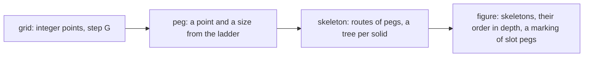

# Pegs and strings: the tube language on a grid

Status: research note (history, not authority). 2026-10-13. Decisions row 374 rules the direction;
this note gives the abstraction, its folds, its meaning, its motion and its cost, and the port's
slices.

**The one thing to know first.** A figure's data is discrete: grid points, peg sizes from the
width ladder, and routes between pegs. Every curve is derived from that data by folds. So the
outline has no kink by construction, and its casing is exact. Motion is a marking of pegs that a
grid algorithm computes.

## 1. Why the blended joins went

The pen drew each body on its own and blended each notch where two bodies meet (decisions rows
370, 371; the kit's slice S24). Each join was a case with its own construction, fallbacks and
padding. The owner saw kinks at joins in every round, and a fork that read as a plumbing wye.

Systems that draw solid branching tubes do not blend case by case. Two families exist:

- **Fields.** Metaballs, convolution surfaces and signed distance fields with a smooth minimum
  make one field of the whole solid. They draw its level line (Bloomenthal and Shoemake 1991;
  Bloomenthal, "Bulge elimination in convolution surfaces", 1997). They join smoothly, but
  their outline is traced from samples, so a film's paths change shape from moment to moment.
  The prototype `proto/field.html` showed the known faults: bulges where walls run side by side,
  and acute crotches. Gradient-based blending (Gourmel et al. 2013) cures the bulge.
- **Strings over pegs.** The owner's reference (generative art) draws a body as a taut string
  wrapped round circles on a grid. Its outline is circular arcs and common tangents only. This
  note takes that family.

## 2. The data

- **The grid.** Points are pairs of integers; the step `G` is one slot, a unit and its meniscus
  (12 px in the prototype). Scaling a figure changes `G` alone.
- **A peg.** A grid point and a size. The sizes are the width ladder's radii, 5, 7, 10 and 14 px.
  They step by √2, as the bodies do (`Tools/View/Tube/Glyphs.lean`: `THIN`, `FINE`, `PIPE`,
  `VESSEL`; `body`). A peg also has a role: a slot (it holds a unit), a cap, a bend, a crotch or
  a neck.
- **A skeleton.** A rooted tree whose vertices are pegs and whose edges are straight runs, each
  with a width from the ladder. A vertex with one child is a bend; with two or more, a split; with
  none, a cap. A solid body is one tree. An air gap is two trees.
- **A marking.** Which slot pegs hold a unit. It is the state the picture shows.

Nothing in this data is a curve, an angle or a float.

## 3. Three folds

### 3.1 The program to a skeleton

The picture is one algebra over `Eff`'s signature, folded by `cata_eff` (seat FORMAL's note,
`docs/research/2026-10-13-tube-algebra/README.md`, its §3 and its probe's `picAlg`). On the grid
its carrier is a **tile**. A tile has a width and a height in grid steps, ports on its left and
right edges, and its skeletons and slot pegs.

- Series is placing one tile after another, shifted by the first's width; the routes that meet at
  a port join into one route.
- The air-gap tensor is stacking, with one empty row between.
- A region is a string round a tile's border pegs.
- A generator of the signature (pipe, merge, copy, valve, box, fork) is a small fixed tile.

Translation by a grid vector is an action on tiles, so composition is integer arithmetic.

### 3.2 A skeleton to strings: the Euler tour

A body's string is the walk round its tree, the tree on its right. It is a fold over the tree, and
each vertex contributes pegs from its own data alone:

| vertex | pegs it contributes to the string |
| --- | --- |
| cap | one convex peg, the run's half width, at the vertex |
| bend | on the bend's outer side a convex peg of radius `R + w`, on its inner side a concave peg of radius `R − w`, both at the bend's centre |
| split | between two neighbouring children a concave crotch peg (the U's inside); behind them a convex peg (the U's back); at each side of the stem a small concave neck peg |
| straight through | none |

The tour passes each vertex twice, once on each side. So a bend gives its outer peg on one pass,
and its inner peg on the other. A split is a tuning fork (row 374 (2)); a merge is the same tree read
toward its root.

### 3.3 Strings to an outline

Between two consecutive pegs the string runs on their common tangent. Round a peg it follows the
peg's circle, convex or concave by the peg's sign. With signed radii `ρᵢ` and centres `cᵢ`, the
tangent's outward normal `n` satisfies `n · (cⱼ − cᵢ) = ρᵢ − ρⱼ`, one square root. Each segment
depends on two pegs alone, so the outline is a map over neighbouring pairs.

- **No kink.** The string leaves a peg on the peg's tangent, so every joint keeps its tangent
  (G1), by construction.
- **The casing is exact.** Take the same string round the same pegs, each radius less one line.
  It is the outline moved in by one line, since an arc's parallel is an arc.
- **The size is fixed.** Each peg gives one arc and one line, so a body's path has a fixed number
  of commands while its pegs keep their order.

## 4. Meaning

- **Pegs are places.** A slot peg is a place that holds one unit. A vessel is the string round its
  slot pegs: its shape is its capacity, and a slot added grows it. This is FORMAL's token
  semantics drawn directly: places are pegs, units are tokens, a module's step is a firing.
- **Strings are bodies.** A string round a route is a pipe; a taper is pegs of two sizes, so a
  change of width needs no fitting.
- **Concave pegs are structure.** A crotch is a split, a neck is where a stem meets a body, a
  notch is a port. A convex peg is extent.
- **The score is a grid already.** Columns are the trace's events and rows are fibers
  (`Tools/View/Tube/Score.lean`); its staffs become strings and its units slot pegs.

## 5. Motion computed as a light board, drawn as fluid

The owner's proposal: compute movement as a light board does, a marking of pegs per tick. The
owner's correction: it must not look like a light board. It looks natural, fluid and organic; the
board is the technique, for speed and for one meaning with the machine.

- **The computation is discrete.** Each tick's marking is the state; nothing between ticks is
  state.
- **The drawing is continuous.** Between two ticks a unit glides from its slot to its next one on
  an easing. Neighbouring units fuse into one slug with soft menisci, and part as they spread. At
  a split the slug divides into the tines. Only the drawing interpolates; the marking does not.

- **It is the machine's own grain.** The machine steps; a unit is in one place, then in the next.
  A unit that hops from slot peg to slot peg shows the step itself. A glide shows an
  interpolation that no state holds (row 371 (3): fills follow the machine).
- **Motion is a marking per tick.** A film is a list of markings over a skeleton that holds
  still; the outline is computed once per structure, not per moment.
- **The algorithms are grid algorithms.**
  - A lane's units step forward where the slot ahead is empty: the traffic cellular automaton,
    Wolfram's rule 184. It conserves the number of units, as our pipes do, and it shows
    backpressure as a queue that does not move.
  - A marking of a lane is a bit string. One tick of a whole lane is one shift and one bitwise
    and, as chess engines move pieces on bitboards. A figure's tick is a few word operations.
  - Only the pegs that change are written. A film is its markings' differences: a change action
    in FORMAL's sense, local to the pegs it touches.
- **It is cheap in SVG.** A lane's chaser is one dash pattern along its string, stepped by one slot
  per tick; or each peg's fill takes one discrete animation. Neither samples a path.
- **Structure still moves.** Where a branch appears or a vessel grows, its pegs move or grow from
  a peg of no size. Its string is recomputed per moment; only such bodies are sampled.

### 5.1 From the machine, in its loop

The owner's ruling: the picture comes from running the machine, and is built into its loop. The
machine already records what the board needs.

| the machine's record | what it draws |
| --- | --- |
| the trace's events (`RunEvent`: forked, started, parked, resumed, exited) | the score's grid: a row for each fiber, a column for each event (`Tools/View/Tube/Score.lean`) |
| the journal (`List Command`, which replays uniquely: `replay_unique`, `journal_replays`) | the ticks: one control a tick, so a film is reproducible from its journal alone |
| each fiber's continuation, its stack of frames | a column of pegs a fiber: a push lights the next peg, a pop darkens it, a frame's kind sets its ring |
| the store's cells and deferreds | slot pegs; the trace records no store change, so they need the state's difference or store events (FORMAL's §5, owner question Q4) |

- **The loop carries an observer.** Each control the loop runs yields its marking change from the
  event it records. The board is the fold of those changes, computed as the run goes.
- **The law is the loop's invariant.** The fold of a run's changes is the projection of its final
  state. That is FORMAL's Law 2, held by every step of the loop rather than checked afterwards.
- **The face exposes it.** The session's face (`Live`, decisions row 326; seat LIVE's DM3) has one
  `view`. The board's marking belongs in that view, so a live run and a recorded one draw alike.
- **The pen only places.** It lays the pegs and strings out once per structure; the machine lights
  them.

## 6. Styling as a value per grid point

The owner's proposal: every effect is a value computed at a grid point or in a cell, on rhythms
that align, in one pass.

- **A channel is a function of the grid.** Lit or unlit, a fade, a shadow, a gradient's tone: each
  is a value at a point and a tick. It is computed from the marking, the point's place in its
  lane, and the clock. This is the visual language's rule that every channel is a fold's image.
- **One clock, aligned rhythms.** The beat is the unit; each cadence divides it by a power of two.
  So every channel changes only on ticks of one clock, and one pass per tick computes them all.
- **One pass.** Walk the grid's occupied points once per tick and write each channel's value. A
  shadow is a value read from the neighbouring point toward the light; a gradient is a value
  of the point's place along its string.
- **Cheap in SVG and CSS.** A cadence is one keyframe set. Each peg takes the set with its phase
  as its delay, so a chaser is the same animation shifted along the lane. No path is sampled.

## 7. Speed

| work | cost |
| --- | --- |
| a tangent | a table read: the difference of two grid points, two sizes and two signs, in a bounded neighbourhood; else one square root |
| a body's outline | one pass over its pegs |
| a casing | the same pass with each radius less one line |
| a peg moved | its two segments and its arc |
| a tick of motion | shifts and bitwise ands over each lane's bit string |
| an air gap | grid cells: two bodies keep their gap where no occupied cells touch |
| a route | a path search on the grid (breadth first, or A\*) |

## 8. Laws to state

Each is a finite check first and a theorem where it pays (the pen's laws today: `figure_ok`,
`step_ok`, `morph_ok`):

1. The tour is closed, and its pegs are the tree's walk.
2. Every joint of an outline keeps its tangent.
3. The casing is the outline moved in by one line, where every convex radius exceeds a line.
4. A tile moved by a grid vector draws the drawing moved.
5. A tick of rule 184 keeps the count of units in a lane.
6. The marking of a picture is a function of the machine's state. A step's change of marking is
   the state's change (FORMAL's Law 2, with its store gap: its §5 and owner question Q4).
7. Every channel of a tick is computed in one pass, and changes only on its cadence's ticks.
8. The fold of a run's marking changes is the projection of its state, at every step of the loop.

## 9. What it replaces

- The kit's notch blends and the pen's `Tools.View.Tube.Kit`, the stretch shoulders and the
  outline code of `Tools/View/Tube/Outline.lean` leave the pen as each figure moves.
- Sampled path morphs leave every film whose structure holds still.
- The kit's slice S25 (shared paths, fewest moments) still serves the bodies that are sampled.

## 10. The port, in slices

1. **Belt.** Pegs, tangents, arcs as cubics, the casing, in integers at the pen's scale; the laws
   of §8 (1 to 3) as guards.
2. **Tour.** Skeletons and their Euler tour; the tuning fork, the bend and the cap; the vessel as
   the string round its slots.
3. **Light board.** The loop's observer: each control's marking change from its event, the
   board as their fold, exposed in the session's view. Lanes as bit strings and rule 184 ticks; markings to SVG, a dash chaser or
   per-peg steps. The channels of §6 take one pass per tick and one keyframe set per cadence.
4. **Glyphs on the grid.** The 37 figures as tiles; the old outline code retired.
5. **Films.** The Queue and the score as markings over still skeletons; structure changes sampled.
6. **Tiles.** The program's picture as the tile algebra over `Eff`, with FORMAL's signature.

## 11. Questions for the owner

1. Is the grid step one slot (a unit and its meniscus, 12 px)? Recommended: yes.
2. Do structure changes still glide while units hop? Recommended: yes; a growing branch reads
   better moving than appearing.
3. Does the light board keep a short fade between lit and unlit, as a real board's bulbs do?
   Recommended: a fade of a fifth of a tick, one CSS easing.
