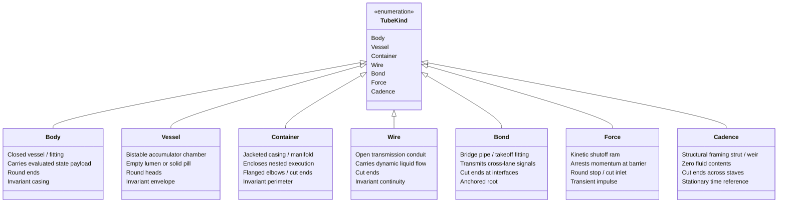
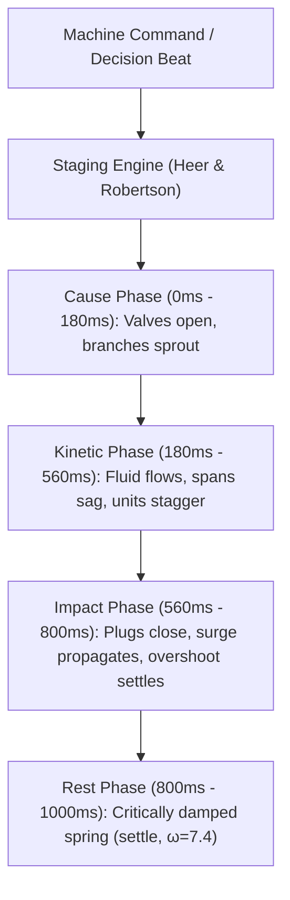
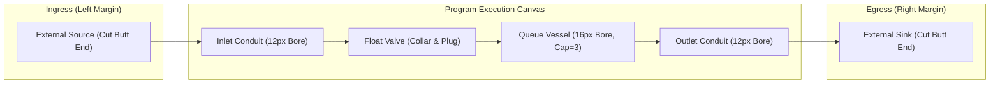

# Semiotics of the Tube Language: Sign Inventory, Imagined Physics, and Visual Grammar

This review assesses Effect4's tube language as implemented across `tools/Tools/View/Tube/` and documented in `docs/research/2026-10-13-tube-language/README.md`.
The analysis grounds every mark in code declarations and evaluates the visual grammar against the semiotic frameworks of Charles Sanders Peirce and Daniel Moody.
A second agent implements the tube forms.
This document establishes their semantic foundation, their perceptual boundaries, and their grammar of motion.

---

## 1. The Five Findings That Matter Most

1. **The Broadcast Lie (Conservation Fallacy in Branching Conduits)**
In pipeline hydraulics and P&ID conventions (ISO 10628), every tee or wye junction physically conserves volumetric flow: $Q_{\text{in}} = \sum Q_{\text{out}}$.
In Effect4, a PubSub broadcast duplicates messages, delivering an independent copy to every subscriber.
Drawing a broadcast as a conventional piping tee or wye asserts a conservation law that does not hold.
A reader interprets the fork as partitioning the message stream or racing for consumption.
Broadcast must be drawn as an explicit non-conservative manifold fitting, such as an external distributor block with isolated takeoff ports.

2. **The Open-End Ambiguity (World Boundary versus Viewport Clipping)**
A pipe with a square cut end (`round := false`, `stroke-linecap: butt`) signifies an open connection to the unmanaged external world.
However, in schematic drafting, a cut conduit ending inside the canvas margin is indistinguishable from a clipped path, an incomplete draw, or a rendering glitch.
A reader cannot tell whether the boundary represents an intentional host boundary or an unrendered program fragment.
The visual grammar must mandate that open-to-the-world tubes extend across the canvas viewport boundary or terminate at an explicit ISO-style battery limit flange.

3. **Scale Inversion and Clearance Fusion at 32 Pixels**
At 96 pixels, the 3 px wall and 2 px clearance around a 12 px bore produce distinct visual layering.
When scaled down to 32 pixels (one third of original size), the 2 px clearance scales to 0.67 pixels, falling below the device pixel grid.
The lumen tone (8% ink) and wall tone (32% ink) optically blend into a muddy grey halo.
This fusion destroys the distinction between an empty lumen and a thin pipe wall.
Small-scale rendering requires a discrete minimum clearance of one physical pixel or a dedicated thin-bore profile.

4. **Cadence Struts as Flow Channels (Category Confusion of Score Punctuation)**
Cadence marks (`barLine`, `exitBar`, `fermata`, `caesura`) represent structural time, host decisions, and score punctuation.
They hold no machine state and transport no fluid units.
Drawing cadence marks with the standard multi-layer tube pen (wall, lumen, and casing) communicates that they are passable pipes.
A reader expects messages to flow through measure bars or turn into final exits.
To preserve semantic transparency, cadence tubes must be strictly void of fluid, permanently transverse or capped, and use structural framing profiles distinct from process piping.

5. **The Taylor Bubble Inversion (Negative Space Misread as Inactive Void)**
A waiting taker is drawn as a hollow pill (a bubble with a 2 px fluid rim and lumen core).
In capillary fluid mechanics (Bretherton 1961), a bubble is the physical absence of liquid.
In concurrent runtime semantics, an unfulfilled promise is an active consumer obligation that exerts backpressure on producers.
When rendered statically, the hollow bubble reads as an empty slot (a passive void) rather than an active pending demand.
The rim contrast and arrival animation must emphasize mechanical displacement to show active obligation.

---

## 2. Part A: The Sign Inventory and Semiotic Audit

### Sign Inventory Table

The tube language contains twenty-six distinct signifiers defined across `Form.lean`, `Draw.lean`, `Motion.lean`, `Queue.lean`, and `Sheet.lean`.

| Signifier | Code Declaration | Signified (Meaning) | Peircean Mode | Engineering Precedent | Full Size Misreading | 1/3 Size Misreading | Monochrome Misreading |
| --- | --- | --- | --- | --- | --- | --- | --- |
| The tube | `Tube` (`Form.lean:154`) | Continuous process conduit / program invariant | Icon / Symbol | Process piping (ISO 10628), transit lines | Wire or box boundary | Single hair stroke | Plain rule |
| Straight piece | `Piece` with `turn = 0` (`Form.lean:42`) | Uninterrupted transmission / linear execution | Icon | ISO 128 straight pipe run | Visual divider line | Thin bar | Coordinate axis |
| Arc piece | `Piece` with `turn ≠ 0` (`Form.lean:42`) | Lawful directional redirection | Icon | ASME B16.9 pipe elbow, transit bend | Decorative curve | Corner artifact | Generic bend |
| Bend radius | `BEND = 15000` (`Form.lean:38`) | Minimum curvature invariant / anti-kink law | Symbol | ASME B16.9 long-radius elbow | Arbitrary aesthetic radius | Sharp miter joint | Unnoticed constraint |
| Bore ladder | `LADDER = [4, 6, 8, 12, 16]` (`Draw.lean:47`) | Conduit capacity tier / fiber share | Symbol / Icon | Nominal pipe size (NPS, ISO 6708) | Visual typographic weight | Uniform lines | Contrast emphasis |
| Vessel length | `vLen`, `Layout.vessel` (`Queue.lean:72,80`) | Discrete queue capacity invariant | Icon / Index | Level-pool reservoir sizing | Elapsed duration / delay line | Generic box | Length of run |
| Wall | `WALL = 3000`, `WALLS` (`Draw.lean:36,121`) | Physical invariant boundary / program rule | Icon / Symbol | Cartographic road casing (OSM) | Drop shadow / border | Blurred edge | Outline stroke |
| Lumen | `CLEAR = 2000`, `LUMENS` (`Draw.lean:38,122`) | Passable internal channel / state space | Icon | Anatomical lumen, road core | Gap / hollow channel | Disappears into wall | Faint inner grey |
| Three tones | `Tone`, `css` (`Draw.lean:89,231`) | Material layering (wall, lumen, state) | Symbol | Engineering wash / architectural hatching | Surface lighting / hover state | Uniform grey smear | Value gradations |
| Cut open end | `round := false`, `butt` (`Draw.lean:110,211`) | Ingress/egress to unmanaged external world | Symbol | ISO 128 cut line, atmospheric vent | Clipped / truncated drawing | Broken line end | Accidental crop |
| Round closed end | `round := true`, `round` (`Draw.lean:110,211`) | Sealed self-contained termination head | Icon | ASME Section VIII torispherical vessel head | Capsule button | Solid dot | Normal line cap |
| Junction (one lumen) | `Mark.layer`, `plateJunction` (`Draw.lean:10`, `Sheet.lean:69`) | Conservative confluence or branch | Icon | ASME B16.9 tee/wye fitting | Crossing without connection | Fused ink blob | Line crossing |
| Collar | `collarOf`, `COLLAR = 3000` (`Draw.lean:42,161`) | Mounting fitting / valve body / boundary clamp | Icon | Pipe sleeve clamp, flanged joint | Slider thumb / bead | Stroke bump | Line widening |
| Plug | `plugOf`, `PLUGS` (`Draw.lean:123,154`) | Closed valve / impermeable barrier | Icon | Blind flange, plug valve disk (ISA-5.1) | Wall segment / broken pipe | Missing line segment | Open gap |
| Pill | `unitOf`, `pillDash` (`Draw.lean:135,141`) | Discrete immutable message / state quantum | Icon / Index | Bretherton capillary liquid slug | Scrollbar thumb / badge | Solid dot | Solid dash |
| Hollow pill (bubble) | `hollowOf`, `RIM = 2000` (`Draw.lean:145,148`) | Promised unit / waiting taker obligation | Icon / Symbol | Bretherton Taylor bubble in tube | Empty slot / unread badge | Faint speck | Empty ring |
| Swell | `swellOf`, `SWELL = 2000` (`Motion.lean:44,110`) | Kinetic transit of unit through conduit | Index | Peristaltic pumping (Shapiro et al. 1969) | Aneurysm / conduit bulge | Invisible pulse | Transient thickening |
| Surge | `surge` (`Queue.lean:29,209`) | Upstream propagation of backpressure | Index | Joukowsky water hammer shockwave | Electrical reflection / ripple | Invisible flicker | Transient stroke |
| Sag and overshoot | `Queue.slope`, `OVERSHOOT` (`Queue.lean:54,57`) | Backlog weight and mechanical dynamic impact | Index | Beam deflection ($wL^3/24EI$), spring overshoot | Sagging wire / cosmetic bounce | Slight tilt | Curved line |
| Stagger | `STAGGER = 70` (`Queue.lean:64,168`) | FIFO queue discharge ordering | Index | Traffic kinematic wave (LWR theory) | Network jitter / frame lag | Blurry motion | Sequential shifts |
| Valve staging | `OPENING = 180` (`Queue.lean:65,168`) | Causal precedence (cause before effect) | Symbol / Index | Control valve actuator sequencing | Mechanical sluggishness | Unnoticed pause | Delayed transit |
| Overflow | `drain` before vessel (`Sheet.lean:105,121`) | Dropping queue strategy (new message lost) | Icon | Overflow weir, storm spillway | Accidental leak / branch | Stray vertical tick | Auxiliary drain |
| Relief | `drain` at vessel front (`Sheet.lean:105,121`) | Sliding queue strategy (oldest message ejected) | Icon | Pressure relief valve, bottom blowdown | Consumer outlet branch | Stray vertical tick | Bypass branch |
| Circuit | `filmCircuit` (`Sheet.lean:137`) | Conservation loop (semaphore permits) | Icon / Symbol | Closed hydraulic recirculation loop | Cyclical deadlock / spin loop | Track loop | Closed loop |
| Branch growing | `filmBranch` (`Sheet.lean:157`) | Dynamic fiber spawning / child allocation | Icon / Index | Hot tapping in piping, vascular budding | Progress bar extrusion | Appearing tick | Sprouting branch |
| World off-page | `OFF = 40000` (`Queue.lean:48,97`) | Unbounded external environment | Symbol | Battery limit line (ISO 10628) | Drawing clipping error | Cut-off graphic | Margin bleed |

---

### Audit Against Moody's Principles of Notation (2009)

1. **Semiotic Clarity**
The tube language achieves high 1:1 correspondence for core constructs.
Every message is one pill; every vessel length is capacity.
However, symbol overload occurs at branching junctions: both conservative merges and duplicative broadcasts use identical wye/tee geometry.
Symbol overload also occurs at square cut ends, which represent both external world boundaries and incomplete path segments.

2. **Perceptual Discriminability**
At 96 pixels, marks are readily distinguishable across wall, lumen, and fluid layers.
At 32 pixels, discriminability degrades.
The 2 px clearance merges into the wall casing, making empty lumens look like solid conduits.
In monochrome mode, the three tones depend purely on value gradations (32% vs 8% ink mix), which risk loss of contrast under low-gamma displays.

3. **Semantic Transparency**
Physical metaphors provide strong semantic transparency.
Pills convey incompressible volume; plugs convey flow stoppage; sagging spans convey load.
Semantic transparency is weak for hollow bubbles.
A reader unfamiliar with capillary fluid mechanics sees an empty slot rather than an active waiting taker.

4. **Complexity Management**
The notation manages local complexity through strict modular layers: walls first, lumens second, plugs third, contents fourth.
However, whole-system complexity lacks hierarchical abstraction.
A system of twenty concurrent queues drawn as full plumbing spools exhausts visual space without macro-level piping modules.

5. **Cognitive Integration**
The constant bend law (`BEND = 15 px`) and uniform pen layering establish strong perceptual coherence.
All diagrams share an identical visual texture.
A reader transitions between queue models, fiber scores, and program trees without shifting visual paradigms.

6. **Visual Expressiveness**
The language uses Bertin's visual variables strictly according to ruling 354:
- *Position*: total reading order (horizontal axis) and fiber allocation (vertical lanes).
- *Size/Width*: capacity share via the bore ladder (4, 6, 8, 12, 16 px).
- *Shape*: topological fitting kind (vessel, conduit, fitting, barrier).
- *Value*: state progression and hoop stress (darkness density).
- *Hue*: strictly restricted to the four agents (machine, host, failure, resource).
Free variables include surface texture (noise on walls versus fluid) and flow orientation.

7. **Dual Coding**
Graphic marks are paired with typographic labels, numeric tokens, and spoken verbs (`box` with "run", `series` with "bind").
Text is placed outside the fluid channel, preserving the purity of the physical tube body.

8. **Graphic Economy**
With thirty-seven marks across seven kinds, five ladder widths, three tones, and one bend radius, the notation maintains exceptional graphic economy.
The entire expressive range derives from sweeping a single pen along a centreline.

9. **Cognitive Fit**
The plumbing and hydrology metaphor fits concurrent systems programming.
Engineers reasoning about backpressure, thread pools, and race conditions already use hydraulic mental models (draining, overflowing, starving, pipeline stalls).

---

### Semiotic Conflicts

- **Overload (One form with two meanings):**
A wye fitting represents both conservative flow addition ($A + B = C$) and duplicative PubSub broadcast ($A \to B \times C$).
A square cut end represents both a connection to the external host world and an interrupted drawing boundary.

- **Redundancy (Two forms for one meaning):**
Both `cross` ($\times$) and `hash` ($\#$) signify failure, differing only in typed versus untyped categories.
Both `hollowBox` and `hollowDot` signify promised tokens, differing only in whether the token is a fiber park or a resource finalizer.

- **Opacity (Unrecoverable meaning):**
A hollow bubble resting at the outlet of a vessel represents an active waiting taker.
A reader unfamiliar with Bretherton's capillary bubbles interprets the mark as an empty storage location.

- **Falsified Physics (A form claiming a law that does not hold):**
Drawing a PubSub broadcast as a standard piping junction claims physical conservation of fluid.
In reality, the broadcast duplicates data without dividing volume, violating the continuity equation claimed by the rest of the tube language.

---

## 3. Part B: The Physical Kinds and Marks as Tubes

### The Seven Kinds' Tube Families

1. **Body Family**
- *Plumbing element:* A compact closed vessel, fitting, or discrete payload.
- *Contents meaning:* The evaluated state payload or discrete data value. An empty lumen is an operational envelope; a filled lumen carries the payload.
- *Ends construction:* Rounded closed heads (`stroke-linecap: round`), denoting spatial self-containment.
- *Morph invariance:* Central axis and outer casing envelope stay fixed; morphs adjust internal fluid fill or boundary scale smoothly.

2. **Vessel Family**
- *Plumbing element:* A bistable accumulator chamber governed by promise and fulfillment.
- *Contents meaning:* Empty lumen indicates an unfulfilled promise (park token, task, finalizer); filled fluid pill indicates promise fulfilled.
- *Ends construction:* Rounded closed heads (`stroke-linecap: round`), signifying pressure-retaining cylinders.
- *Morph invariance:* Chamber envelope and mounting collars stay fixed; fulfillment transitions fluid fill from zero to 100% in place.

3. **Container Family**
- *Plumbing element:* An outer jacket casing, manifold header, or dual-conduit enclosure bounding an internal operational volume.
- *Contents meaning:* Defines an enclosed scope, environment, or compound data structure; houses nested child conduits.
- *Ends construction:* Cut ends where spanning continuous spans; flanged elbows where enclosing modular perimeters.
- *Morph invariance:* Enclosure boundary maintains structural integrity while internal contents register, execute, and deallocate.

4. **Wire Family**
- *Plumbing element:* Continuous open process conduits routing fluid and establishing causal operational sequences.
- *Contents meaning:* Carries moving liquid units or transmits execution pressure between operational boxes.
- *Ends construction:* Cut square ends (`stroke-linecap: butt`) at connection interfaces, representing open flow continuity.
- *Morph invariance:* Flow connectivity is maintained; morphs redirect branch angles or insert diversion plugs.

5. **Bond Family**
- *Plumbing element:* Topological bridge pipes, takeoff elbows, and multi-port headers connecting distinct lifelines and staves.
- *Contents meaning:* Transmits child spawning, completion distribution, or host protocol signals across lane boundaries.
- *Ends construction:* Cut ends where penetrating boundary limits or interfacing with target fiber staves.
- *Morph invariance:* Source connection remains anchored while bridge conduit extends across spatial coordinates.

6. **Force Family**
- *Plumbing element:* A transient kinetic shutoff ram / impact fitting arresting forward momentum.
- *Contents meaning:* Represents an interrupt impulse traveling along a vector until arrested by a protective barrier.
- *Ends construction:* Closed rounded impact barrier; open inlet along direction of kinetic travel.
- *Morph invariance:* Impulse travels, impacts, deposits a static interrupt reason, and is spent.

7. **Cadence Family**
- *Plumbing element:* Structural framing tubes, transverse weirs, and score holding gates that carry NO process fluid.
- *Contents meaning:* Strictly empty of fluid. Defines temporal boundaries, host measures, frontiers, and halts.
- *Ends construction:* Cut ends where traversing staves; rounded caps where framing terminal expansion arches.
- *Morph invariance:* Completely stationary during machine beats; recedes in tone as the reading cursor advances.

---

### Table of the Thirty-Seven Marks as Tubes

| Mark | Kind | Tube Form in Words | Why and Precedent | Distinct From | Turns Into During Run |
| --- | --- | --- | --- | --- | --- |
| `box` | Body | Horizontal closed cylindrical vessel of unit length with collar stops at both ends | Execution chamber in process engineering; unit capacity models single step | `call` (double sleeve collars) and `filledBox` (fluid-filled loop) | Fills with a fluid pill upon completion (`value`) or discharges failure slug (`cross`) |
| `value` | Body | Horizontal conduit with cut inlet and rounded outlet holding a fluid pill at exit | Productive output on success wire; pill resting at discharge nozzle | `box` (both ends closed) and `filledDot` (isolated circular vessel without stem) | Docks into continuation socket (`hole`) or flows into downstream `series` |
| `call` | Body | Closed cylindrical vessel fitted with twin sleeve collars at each end | Double sleeve coupling in piping denotes detachable modular union (ISO 10628) | `box` (single/no collar) and `library` (multi-port distribution header) | Morphs into `box` upon inline elaboration, or resolves to `value` |
| `cross` | Body | 4-way diagonal cross fitting ($\times$) with rounded ends and fluid core obstruction | P&ID cross fitting (ISA-5.1) forming explicit flow obstruction; universal error | `hash` (2x2 grid lattice) and `blockedArrow` (orthogonal tee stop) | Absorbed into `catchCause` handler or concatenated into `reasons` |
| `hash` | Body | Dense 2x2 grid manifold ($\#$) of intersecting tubes with rounded closed ends | Structural lattice / grate fitting indicating catastrophic defect | `cross` (single diagonal intersection) and `panel` (vertical shelf rack) | Concatenated into `reasons` or terminates fiber directly at `exitBar` |
| `reasons` | Body | Horizontal segmented tube holding an ordered train of distinct slugs with menisci | Exhaust conduit holding ordered failure causes; enforces flat list invariant | `cells` (holds value units in compartments) and `series` (empty process conduit) | Appended in order to `exitBar` upon fiber termination |
| `enter` | Body | Forward-pointing chevron nozzle ($>$) with rounded apex and fluid charge along flow axis | Directional injector nozzle in hydraulics; positive forward loop entry | `arrow` (descends diagonally across lanes) and `loop` (recirculates backward) | Transitions into active running conduit (`series`) or yields turn at `rest` |
| `probe` | Body | Inline collar pipe fitted with an upward circular diagnostic takeoff loop tap | Instrument sampling pigtail siphon (P&ID) for reading state without flow disruption | `loop` (recirculates main process flow) and `port` (penetrates host boundary) | Yields an evaluated `value` reflecting the inspected runtime cell |
| `tag` | Body | Inline collar clamp anchoring a hanging identification tag stem with an eyelet ring | Instrument identification plate / valve tag in piping layouts (ISO 10628) | `probe` (hollow sensing tap) and `atom` (vertical standalone standpipe) | Dereferences to store payload or dissolves on store deallocation |
| `atom` | Body | Vertical standpipe / sight glass sealed with rounded top and bottom caps | Fixed-volume liquid calibration column; models immutable scalar literal | `barLine` (traverses staves with cut ends) and `tag` (hanging collar tether) | Bound into an operation `value` or passed to downstream consumer |
| `hollowBox` | Vessel | Closed rectangular loop vessel displaying empty lumen | Accumulator awaiting charge; icon of promised park token or queued task | `filledBox` (fluid-filled loop) and `hollowDot` (circular single-unit loop) | Fills solid with fluid upon resumption (`filledBox`) in place |
| `filledBox` | Vessel | Identical closed rectangular loop vessel filled solid with fluid throughout | Charged accumulator; icon of fulfilled promise or dispatched task | `hollowBox` (empty lumen) and `box` (horizontal process vessel with collars) | Dissolves as resumed fiber continues execution |
| `hollowDot` | Vessel | Circular loop vessel of radius 20 px with fluid rim around an empty lumen core | Taylor capillary bubble; single-unit promised finalizer or unresolved deferred | `filledDot` (solid fluid core) and `hole` (slotted U-receptacle) | Fills solid with fluid upon finalizer execution (`filledDot`) |
| `filledDot` | Vessel | Identical circular loop vessel of radius 20 px with lumen filled solid with fluid | Kept promise; executed finalizer or resolved deferred | `hollowDot` (hollow lumen core) and `value` (conduit with exit stem) | Fades out upon enclosing scope completion |
| `hole` | Vessel | Deep U-socket with open cut top awaiting return of evaluated result | Flared receiver socket awaiting return spool; models continuation frame | `slot` (shallow low shelf tray) and `hollowBox` (fully enclosed loop) | Fills with returning `value` when frame pops (`FrameEvent.popped`) |
| `slot` | Vessel | Shallow horizontal U-tray holding a resting unit or empty | Catch basin / drain pan holding optional liquid accumulation (`some`/`none`) | `hole` (deep vertical frame socket) and `bracket` (tall vertical enclosure) | Empty tray fills with unit upon writing `some` |
| `block` | Container | Serpentine 3-pass horizontal tube bank connected by 180° bends | Heat exchanger / tube coil bundle representing sequential statement evaluations | `panel` (grid shelf compartments) and `series` (single straight wire) | Straightens or dissolves as statement generation completes |
| `region` | Container | Four 90° elbow tube corners framing an enclosure perimeter | Casing jacket / boundary limit lines framing an execution environment | `bracket` (paired vertical channel hooks) and `rail` (parallel double tracks) | Contracts and dissolves when provided context is closed |
| `bracket` | Container | Pair of opposing C-channel tube hooks with rounded ends enclosing resources | Flanged pipe clamps forming a sealed, complete resource lifetime | `openBracket` (unclosed trailing conduit) and `rail` (parallel linear tracks) | Opens and releases finalizers upon scope exit |
| `openBracket` | Container | Leading C-channel hook on left with open horizontal trailing conduit ending in cut butt | Open pipe spool awaiting cap; index of unclosed scope with close owed | `bracket` (both hooks closed) and `series` (no vertical hook) | Morphs into sealed `bracket` when closing exit arrives |
| `rail` | Container | Two parallel straight armoured conduits running with uniform clearance | Jacketed pipe / armoured conduit (API 53 piping plan) protecting flow from disruption | `parallel` (divergent branching conduits) and `series` (single conduit) | Collapses to single conduit upon unmasking (`Eff.interruptible`) |
| `library` | Container | Distribution header tube branching into two parallel capped distribution legs | Distribution header manifold block in plumbing supplying named definitions | `box` (single process chamber) and `panel` (vertical shelf rack) | Spawns child invocation conduits on call |
| `panel` | Container | Vertical header conduit branching into multiple horizontal capped shelves | Multi-port terminal manifold rack representing structured record fields | `cells` (linear segmented tube) and `library` (header distribution block) | Updated in place as field cells are modified |
| `cells` | Container | Horizontal metering tube partitioned by internal collar rings into compartments | Multi-compartment metering tube or capsule train holding list/tuple elements | `reasons` (holds failure causes) and `panel` (vertical shelf rack) | Extends or shortens as list items are added or removed |
| `series` | Wire | Horizontal process conduit with central directional venturi nozzle fitting | In-line transmission pipe with directional venturi nozzle (ISO 5167) | `parallel` (split conduit) and `alternative` (branching wye) | Dissolves into produced `value` or branches at an `alternative` |
| `parallel` | Wire | Symmetric wye split branching into two parallel horizontal conduits | Dual parallel piping run for concurrent execution merge | `rail` (protective jacket without branching) and `series` (single line) | Converges via inverted wye into single joint conduit |
| `alternative` | Wire | 3-way diverter wye branching into two symmetric divergent arms with plug gate | Diverter valve / splitting wye (ISA-5.1) routing flow to one of two mutually exclusive arms | `parallel` (both conduits active) and `arrow` (cross-lane fork) | Active arm carries fluid; untaken arm withers and empties |
| `loop` | Wire | Circular recirculation bypass line looping back 270° into upstream collar inlet | Recirculation bypass line in hydraulics returning output back to input | `probe` (non-recirculating sensor tap) and `series` (straight flow) | Breaks out downstream upon loop termination (`Stmt.breakLoop`) |
| `rest` | Wire | Horizontal conduit with central siphon trap / expansion dip retarder empty of fluid | Siphon trap / expansion dip where flow pauses and fiber yields turn | `series` (straight unrestricted bore) and `plug` (complete solid obstruction) | Straightens to full-bore flow when turn is resumed |
| `arrow` | Bond | Smooth S-curve branch tube descending southeastward from parent to child lane | Downstream takeoff pipe transferring activation to newly spawned fiber | `spider` (multi-port collector hub) and `series` (horizontal single lane flow) | Withdrawn once child fiber loop entry occurs (`enter`) |
| `spider` | Bond | Central collector hub ring fanning out multiple radial distribution tubes | Hydraulic distribution manifold collecting one exit and waking all waiters | `arrow` (single fork bridge) and `wye` (two-way split) | Fulfills connected `hollowBox` waiter vessels, then fades out |
| `port` | Bond | Dual-channel bulkhead penetration fitting with upper request and lower reply nozzles | Mated flange connection linking internal machine hydraulics to host protocol | `probe` (internal sensing tap) and `call` (internal code invocation) | Discharges request pill and awaits incoming reply pill |
| `blockedArrow` | Force | Horizontal ram conduit abruptly blocked by solid transverse barrier collar stop | Hydraulic hammer stop / check stop ram (Talmy Antagonist) arresting execution | `barLine` (transverse score measure) and `cross` (symmetric X failure) | Deposited into `reasons` list or absorbed by interrupt handler |
| `barLine` | Cadence | Tall structural transverse weir tube spanning vertically across all staves | Transverse structural weir dividing machine measures (host decisions) | `exitBar` (double vertical tubes) and `atom` (short closed standpipe) | Stationary temporal reference; recedes in tone as cursor passes |
| `exitBar` | Cadence | Double vertical gate tube (narrow lead tube, heavy flanged trail tube) | Terminal double gate / weir in hydraulics denoting completed run | `barLine` (single vertical tube) and `rail` (horizontal double track) | Anchors appended final `reasons` on fiber completion |
| `fermata` | Cadence | Semicircular surge expansion loop arching upward over an empty resting dot vessel | Expansion loop / surge arch holding suspension; signifies live frontier | `loop` (horizontal process recirculation) and `caesura` (broken slashed pipes) | Resumes and dissolves when awaited host decision or timer arrives |
| `caesura` | Cadence | Two severed slashed conduit spools ($//$) cut at 60° with shear misalignment gap | Physically cut pipe / fractured spool denoting abnormal machine halt on untyped state | `exitBar` (vertical intact double gate) and `alternative` (converging wye) | Terminal stuck state; never resumes |

---

## 4. Part C: A Grammar of Motion

### The Ten Verbs of Motion

Motion in the tube language is governed by physical laws and restricted to discrete machine commands.

| Verb | Meaning | Precondition | Governed Law |
| --- | --- | --- | --- |
| `flow` | Linear translation of a fluid unit along a tube centreline | Conduit lumen is open and unobstructed | Continuity ($Q = v \cdot A$) and FIFO queue discharge order |
| `fill` | Injection and accumulation of fluid into an empty vessel or slot | Available capacity ($S < C$) and incoming arrival | Conservation of storage ($S' = S + I - O$) and integer quantum (`AREA = 384`) |
| `drain` | Evacuation and discharge of fluid from a vessel or relief tube | Downstream consumption or overflow condition | Mass balance ($S' = S - O$) and cause before effect |
| `swell` | Transient radial dilation of wall and lumen as a unit passes | Unit undergoing kinetic travel along conduit | Peristalsis (Shapiro et al. 1969) and elastic wall restoration |
| `sag` | Mechanical downward deflection of a span under waiting backlog | Backwater accumulating behind a closed valve | Euler-Bernoulli beam deflection ($wL^3/24EI$) and dynamic overshoot (35%) |
| `surge` | Upstream shockwave pulse propagating backwards from closed valve | Fast-moving offer arrested against closed plug | Joukowsky fluid hammer equation ($\Delta p = \rho a \Delta v$) |
| `valve actuation` | Radial/axial translation of a plug within a collar sleeve | Level threshold reached or command issued | Cause before effect (staging: valve opens before offer moves) |
| `branch growth` | Intrinsic morph from zero-length root into extended conduit | Fiber fork or dynamic allocation command | Intrinsic geometric continuity (`Tube.mix_ok`, bend law preserved) |
| `morph` | Intrinsic continuous blending of piece lengths and turning angles | Topological state transition | Convexity of lawful piece space; non-shrinkage of intermediate forms |
| `hollow fill` | In-place transition of empty lumen rim into solid fluid pill | Resolution of deferred or arrival of awaited token | Bistable commitment law (promise made $\to$ promise kept once) |

---

### Rules Preventing Motion from Becoming Decoration

1. **Pipework invariants never move autonomously:**
Conduit geometry, vessel capacities, and valve positions remain static unless the program syntax itself morphs or allocates.
Pipework does not drift, pulse, or sway.

2. **One beat per machine command:**
All motion is synchronized to machine commands or host decisions (decisions row 354 point 5).
No animation loops continuously.
A reader with `prefers-reduced-motion` enabled sees static final frames (`filmFigure`, `Motion.lean:201`).

3. **Causally uncoupled events never move simultaneously:**
Concurrent events lacking a direct causal arrow must not animate with synchronized timing.
Simultaneous motion implies false causal coordination.

4. **Staging precedes kinetic travel:**
A cause moves before its effect.
A valve opens (`OPENING = 180 ms`) before the waiting liquid moves through it.
A unit meets a closed valve and impacts (`IMPACT = 560 ms`) before the surge wave travels upstream.

5. **Critically damped settling:**
All physical movements, deflections, and dockings settle via the critically damped spring (`settle`, `Draw.lean:83`, $\omega = 7.4$).
Cosmetic bounce and harmonic oscillations are strictly forbidden, with the sole exception of the declared 35% mechanical beam overshoot.

---

## 5. Part D: What the Look May Mean (Styling Pass)

The styling pass implements depth, shading, noise, and stress using simple deterministic algorithms (decisions row 369 point 4).
These techniques must convey structural invariants and physical forces without violating ruling 354.

### 1. Depth
- **What it signifies:** Spatial layering at pipework crossings.
When two conduits intersect on the two-dimensional plane, one passes over the other.
- **Representation:** A haloed gap (a clear margin cut into the lower tube's wall and lumen) around the overpassing tube (decisions row 354 point 10).
Conduits in the foreground maintain full ink contrast; conduits in the background recede slightly into ground tone.
- **Forbidden meaning:** Depth must never signify fiber priority, execution speed, or importance.

### 2. Shading
- **What it signifies:** Cylindrical volume and structural solidity.
Shading distinguishes solid 3D piping bodies from flat schematic line drawings.
- **Representation:** Classic patent and engineering drawing shade-line convention.
The light source is fixed at the upper left ($45^\circ$).
Upper-left pipe edges carry a standard stroke; lower-right pipe edges carry a heavier shaded stroke.
- **Forbidden meaning:** Shading must never signify flow direction, activation state, or warning.

### 3. Noise
- **What it signifies:** Material distinction between invariant pipework (the metal) and mutable state (the fluid).
- **Representation:** Fine stochastic grain applied strictly to conduit walls and fittings.
Lumen channels and fluid pills remain perfectly smooth, with zero noise.
The default look sets noise to zero (decisions row 354 point 9); custom looks may enable wall grain.
- **Forbidden meaning:** Noise must never signify data corruption, non-determinism, or error probability.

### 4. Stress
- **What it signifies:** Accumulation of hydrostatic pressure behind a closed barrier (Barlow's hoop stress $\sigma = p r / t$).
- **Representation:** Rendered strictly through **value** (darkness and density of the wall casing stroke), never through hue.
As backwater builds behind a closed plug, the wall tone shifts from 32% ink mix toward higher ink density.
- **Forbidden meaning:** Stress must never introduce new hues (reds/ambers).
Hue belongs strictly to the four agents.

---

## 6. Part E: The Composed Drawing

A complete tube schematic is read as an engineering process flow diagram.
The layout adheres to established P&ID and transit map standards.

1. **Direction of Flow:**
Primary process flow runs strictly from left to right along the horizontal reading axis.
Fiber allocations and parent-to-child forks descend from top to bottom across horizontal lanes.
A conduit looping backward signifies an explicit algorithmic recirculation (`loop`).

2. **Ingress and Egress (The World Boundary):**
Pipes entering from the external environment originate off the left canvas edge with cut square ends (`OFF = 40000`).
Pipes discharging to the external environment terminate off the right canvas edge with cut square ends.
Closed self-contained subsystems terminate with rounded heads inside the canvas.

3. **Dual Coding and Typography:**
Text never appears inside a fluid conduit.
All identifiers, tokens, and numeric quantities are typeset in JetBrains Mono beside fittings, along outer centrelines, or on hanging collar tags (`tag`).
Process labels use Source Serif 4 outside the pipe casings.

4. **Complexity Management:**
Large systems are partitioned into modular assemblies:
- Subprograms and provided contexts are bounded within jacketed enclosures (`region`, `bracket`).
- Reusable services are encapsulated as manifold headers (`library`).
- Routing follows an orthogonal transit-map grid with standard $45^\circ$ and $90^\circ$ angles and a uniform bend radius (`BEND = 15 px`).

---

## 7. Proposed Changes to the Language

1. **Introduce a Distinct Broadcast Manifold Fitting (Proposed)**
*Rationale:* Drawing PubSub broadcast as a standard piping tee claims volumetric flow conservation, misleading the reader.
A broadcast must be rendered as an external distributor block with isolated takeoff chambers, distinguishing duplicative broadcast from conservative splitting.

2. **Standardize Battery Limit Flange Markers on Open Ends (Proposed)**
*Rationale:* A square cut pipe ending inside the canvas is indistinguishable from a rendering defect.
All open-to-the-world conduits must either touch the viewport margin or terminate at an explicit ISO-style battery limit flange symbol.

3. **Establish a Discrete Clearance Floor for Small-Scale Rendering (Proposed)**
*Rationale:* At 32 pixels, the 2 px lumen clearance collapses to 0.67 pixels, causing lumen and wall tones to blend.
The renderer should enforce a minimum clearance floor of one physical pixel on low-resolution displays.

4. **Define Structural Channel Casings for Cadence Marks (Proposed)**
*Rationale:* Drawing measure bars and exit gates as hollow fluid pipes invites category confusion.
Cadence marks must use solid structural channel sections void of internal lumens.

5. **Enhance Contrast for Promised Bubbles (Proposed)**
*Rationale:* A hollow bubble reads as a passive empty slot rather than an active waiting obligation.
The bubble rim should feature an outer accent line or entry pulse to signify active demand.

6. **Implement Value-Based Hoop Stress in `Draw.lean` (Proposed)**
*Rationale:* Backpressure behind a closed float valve is currently conveyed only by geometric inlet sag.
Rendering wall stroke value density proportional to waiting load ($\sigma \propto n$) directly visualizes hydrostatic stress without violating hue constraints.

7. **Implement Explicit Crossing Halos in `Draw.lean` (Proposed)**
*Rationale:* When two tubes cross, overlaying lumens merge into an unintended 4-way junction.
An overpassing tube must render an explicit background halo stroke that masks the underpassing tube's wall and lumen.

---

## 8. Questions for the Owner

1. **Meaning:** Should a zero-capacity rendezvous queue be drawn as two opposing valve plugs touching head-to-head, or as a single shared collar gate?
2. **Domain:** In a multi-fiber race (`raceAll`), should losing fibers be depicted as having their supply conduits physically severed, or clamped by an external shutoff valve?
3. **Representation:** For diagrams with deeply nested scopes, should jacketed casing walls nest concentrically (increasing outer diameter), or should outer boundaries use stepped offset margins?

---

## 9. Sources Used

### Repository Files
- `docs/research/2026-10-13-tube-language/README.md`
- `docs/core/decisions.md` (rows 354, 367, 369)
- `docs/design/design-language.md` (§2, §3, §4, §5.1)
- `docs/research/2026-10-12-visual-semantics/gemini-review.md`
- `docs/research/2026-10-12-visual-semantics/gemini-proposals.html`
- `tools/Tools/View/Glyph.lean`
- `tools/Tools/View/Tube/Form.lean`
- `tools/Tools/View/Tube/Draw.lean`
- `tools/Tools/View/Tube/Motion.lean`
- `tools/Tools/View/Tube/Queue.lean`
- `tools/Tools/View/Tube/Sheet.lean`
- `tools/Tools/View/Tube/Trig.lean`

### External Literature Cited
- Blum, H. (1967). *A Transformation for Extracting New Descriptors of Shape*. Models for the Perception of Speech and Visual Form.
- Bretherton, F. P. (1961). *The motion of long bubbles in tubes*. Journal of Fluid Mechanics, 10(2), 166–188.
- Chang, B.-W., & Ungar, D. (1993). *Animation: From cartoons to the user interface*. UIST '93, 45–55.
- Dubins, L. E. (1957). *On curves of minimal length with a constraint on average curvature, and with prescribed initial and terminal positions and tangents*. American Journal of Mathematics, 79(3), 497–516.
- Heer, J., & Robertson, G. (2007). *Animated transitions in statistical data graphics*. IEEE Transactions on Visualization and Computer Graphics, 13(6), 1240–1247.
- Moody, D. (2009). *The "Physics" of Notations: Toward a Scientific Basis for Constructing Visual Notations in Software Engineering*. IEEE Transactions on Software Engineering, 35(6), 756–779.
- Sederberg, T. W., Gao, P., Wang, G., & Mu, H. (1993). *2-D shape blending: An intrinsic solution to the vertex path problem*. SIGGRAPH '93, 15–18.
- Shapiro, A. H., Jaffrin, M. Y., & Weinberg, S. L. (1969). *Peristaltic pumping with long wavelengths at low Reynolds number*. Journal of Fluid Mechanics, 37(4), 799–825.
- Talmy, L. (1988). *Force Dynamics in Language and Cognition*. Cognitive Science, 12(1), 49–100.
- Bertin, J. (1967/1983). *Semiology of Graphics*. University of Wisconsin Press. (recalled)
- Lighthill, M. J., & Whitham, G. B. (1955). *On kinematic waves II. A theory of traffic flow on long crowded roads*. Proc. Roy. Soc. A, 229, 317–345. (recalled)
- Joukowsky, N. (1898). *Water Hammer*. Translated by O. Simin, Proc. AWWA, 1904. (recalled)

Review complete.
