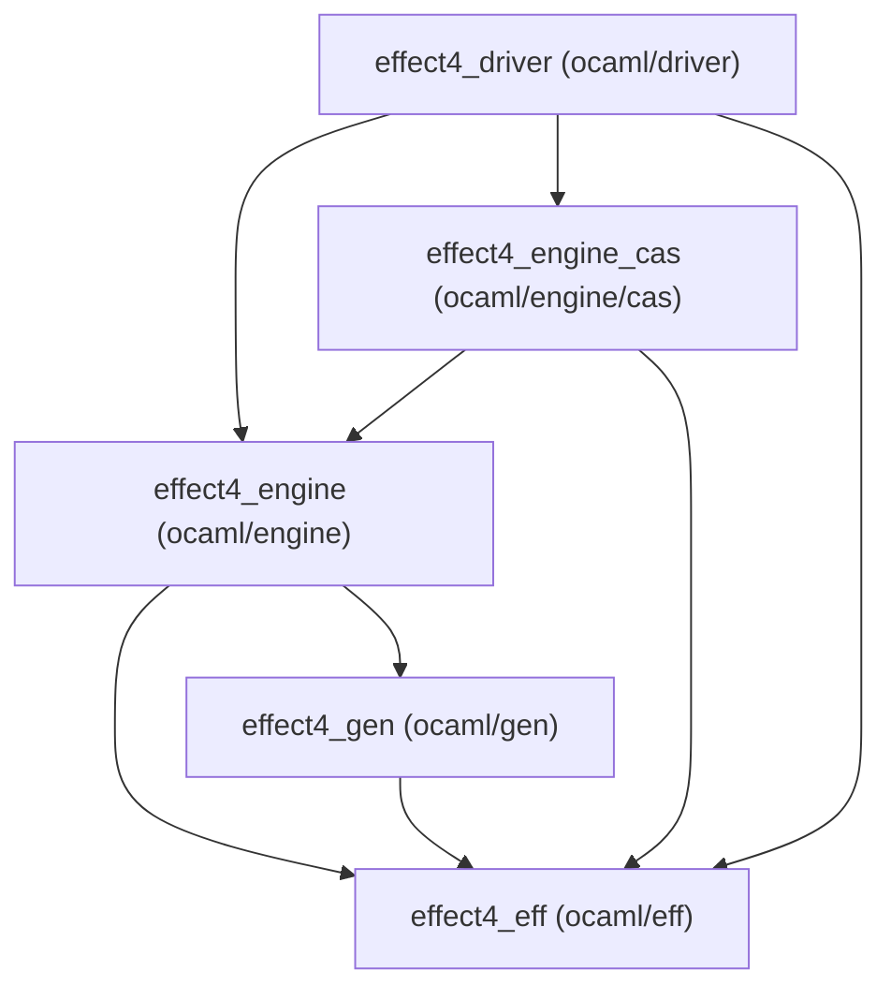
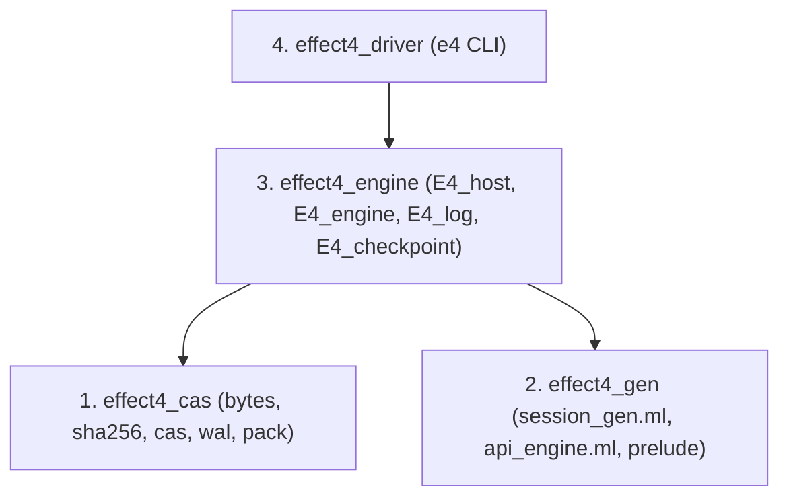
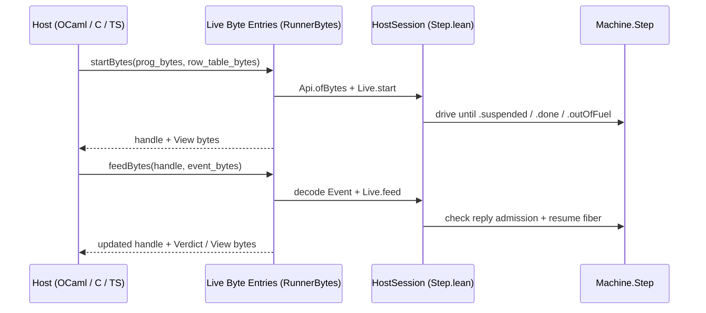
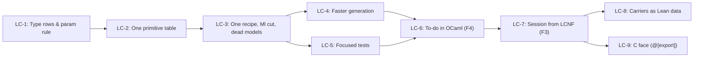

# Review of the Lowering Cleanup Plan (`LC-1` to `LC-9`)

- **Reviewer:** Gemini
- **Base commit:** `93d12486f`
- **Target plan:** `docs/research/2026-10-14-lowering-cleanup/prompt.md`
- **Collation authority:** `docs/research/2026-10-14-lowering-collation/README.md` (`fa62fe35a`)
- **Ruling:** decisions row 391 (`docs/core/decisions.md`)

## 1. The One Thing the Coordinator Must Know Before Starting `LC-1`

Two slice interfaces need sharper boundaries before `LC-6` and `LC-7` run:

1. **The Lean byte-entry placement and `Canonical` closure (`LC-7`).**
   `LC-7` asks for `Live.startBytes`, `Live.feedBytes`, and `Live.viewBytes` in `src/Effect4/Run/Live.lean` over `Effect4.Api.RunnerBytes` and `Effect4.Api.ofBytes`.
   `src/Effect4/Api/RunnerBytes.lean` imports `src/Effect4/Api/RunnerDerived.lean`, which imports `src/Effect4/Run.lean`, which imports `src/Effect4/Run/Live.lean` and `src/Effect4/Run/View.lean`.
   Placing those byte entries in `src/Effect4/Run/Live.lean` creates a module cycle.
   In addition, `tools/Effect4Gen/manifest.json` (`Runner` group) stops at `Effect4.Run.Observation` and omits `Effect4.Run.Sel`, `Effect4.Run.Event`, `Effect4.Run.Verdict`, and `Effect4.Live.View`.
   Put `Live.startBytes`, `Live.feedBytes`, and `Live.viewBytes` in `src/Effect4/Api/RunnerBytes.lean` (or a new `src/Effect4/Run/Bytes.lean`), and extend `tools/Effect4Gen/manifest.json` (`Runner` group) before `LC-7` lowers `ocaml/gen/session_gen.ml`.
2. **The `E4_engine` dependency inside `effect4_engine_cas` (`LC-6` to `LC-8`).**
   `ocaml/engine/cas/dune` links `effect4_engine` and `effect4_eff` because `ocaml/engine/cas/e4_checkpoint.ml` and `ocaml/engine/cas/e4_checkpoint.mli` reference `E4_engine.ENGINE` and `E4_engine.Fast.t`.
   `ocaml/engine/cas/` also uses `E4_be`, `E4_hex`, `E4_nat`, and `E4_sha256` from `ocaml/engine/`, plus `E4_log` in `ocaml/engine/cas/e4_wal.mli`.
   When `LC-7` and `LC-8` reshape `E4_engine` around `ocaml/gen/session_gen.ml` and the Lean carriers, `E4_checkpoint` must move too.
   Alternatively, parameterize `E4_checkpoint` over the state bytes and hash hook.

---

## 2. The Architecture of `ocaml/` (`LC-3`, `LC-6`, `LC-7`, `LC-8`)

### Current Dependency Graph and Seam Leaks

The workspace has five libraries across four directories (`ocaml/eff`, `ocaml/gen`, `ocaml/engine`, `ocaml/engine/cas`, `ocaml/driver`).
Four seam leaks raise cognitive load across those libraries:

1. **Four overlapping generated files across two libraries (`finding N5`).**
   `ocaml/gen/roots.json` emits `ocaml/gen/machine_gen.ml` (40 declarations, 632 lines), `ocaml/gen/fibers_gen.ml` (219 declarations, 4,768 lines), `ocaml/gen/api_gen.ml` (785 declarations, 16,468 lines), and `ocaml/engine/api_engine.ml` (784 declarations, 15,116 lines).
   All 40 declarations of `machine_gen.ml` and all 219 declarations of `fibers_gen.ml` reappear inside `api_gen.ml` and `api_engine.ml` (`docs/research/2026-10-14-lowering-collation/probes/census.out`).
   `api_gen.ml` and `api_engine.ml` share 730 declarations and differ only in whether carrier operations fold to `List` or dispatch to `Api_engine_prelude`.
   Furthermore, `ocaml/engine/api_engine.ml` sits inside `effect4_engine` rather than `effect4_gen`.
2. **Two runtime representations of the program IR.**
   `effect4_eff` defines `E4_eff.eff` with the wire reader and writer (`ocaml/eff/e4_wire.ml`), and `ocaml/engine/e4_program.ml` converts `E4_eff.eff` into the generated `Effect4_Eff.eff` using `ocaml/engine/e4_program_layout.ml`.
   That bridge duplicates 715 lines of tag-table checks and construct-by-construct copying (`ocaml/engine/e4_program.ml`, `ocaml/engine/e4_program_layout.ml`).
3. **Storage utilities live in `effect4_engine` instead of below `effect4_engine_cas`.**
   `ocaml/engine/cas/` implements a content-addressed store, a write-ahead log, and pack files, yet `ocaml/engine/cas/dune` depends on `effect4_engine` for `E4_be`, `E4_hex`, `E4_nat`, `E4_sha256`, `E4_log`, and `E4_engine.ENGINE`.
   The four byte and digest modules (`e4_be`, `e4_hex`, `e4_nat`, `e4_sha256`) have zero engine dependencies.
4. **Dead hand models and split prelude tables in `ocaml/engine/`.**
   Six hand models (`e4_due`, `e4_wake`, `e4_time`, `e4_timers`, `e4_store`, `e4_fibers`, totaling 835 lines in `.ml` and `.mli`) have no library callers outside their own tests (`finding N8`).
   Meanwhile, `ocaml/engine/api_engine_prelude.ml` (1,073 lines) mixes primitive arithmetic, byte codecs, string operations, and twelve stateful carrier modules.

### Target Four-Layer Architecture

Tighten the workspace toward four layers across `LC-3`, `LC-6`, `LC-7`, and `LC-8`:

1. **`effect4_cas` (storage and byte primitives):**
   Move `e4_be`, `e4_hex`, `e4_nat`, and `e4_sha256` next to `e4_cas`, `e4_wal`, `e4_pack`, `e4_index`, `e4_cache`, and `e4_control`.
   Keep `E4_checkpoint.Of_engine` in `effect4_engine` (where `E4_engine.ENGINE` lives) so `effect4_cas` depends only on `unix`.
2. **`effect4_gen` (generated code and its prelude):**
   In `LC-3`, delete `ocaml/gen/machine_gen.ml` and `ocaml/gen/fibers_gen.ml` by folding their roots into `coverage_roots` in `ocaml/gen/roots.json`.
   In `LC-7`, replace `ocaml/gen/api_gen.ml` with `ocaml/gen/session_gen.ml`, which holds `HostSession`, the byte entries (`Live.startBytes`, `Live.feedBytes`, `Live.viewBytes`), `Run.runWith`, and the reactors.
   When `LC-8` moves the carrier families to Lean data, `ocaml/engine/api_engine.ml` and `ocaml/gen/session_gen.ml` converge onto one generated module.
3. **`effect4_engine` (the thin OCaml face):**
   Exposes `E4_host`, `E4_engine`, `E4_log`, and `E4_checkpoint`.
   In `LC-7`, `E4_program` and `e4_program_layout.{ml,json}` retire because `session_gen.ml` decodes program and reply bytes through `Effect4.Api.ofBytes` and `Effect4.Api.RunnerBytes`.
4. **`effect4_driver` (the CLI):**
   `ocaml/driver/main.ml` parses command flags and calls `effect4_engine`.

### Narrow Interfaces for `E4_host` (`LC-6`) and `E4_engine` (`LC-7`)

In `LC-6`, `ocaml/engine/api_engine_inst.ml` and `ocaml/engine/api_engine_ref.ml` stop hardcoding `[]` for the row table in `drive_loop` and accept `row_table : Effect4_Program_RowEntry.row_entry list`.
`ocaml/engine/e4_host.mli` needs only four items:

- `type call_view` (the suspension's `call_id`, `fiber_id`, `op_tag`, and payload `bytes`);
- `type handler = call_view -> bytes option` (returning the canonical reply bytes or `None` to leave the call unanswered);
- `val step : row_table -> handler -> session -> step_result`;
- `val run_script : row_table -> (int * bytes) list -> session -> outcome`.

In `LC-7`, `E4_engine.ENGINE` (`ocaml/engine/e4_engine.mli`) keeps its existing module signature (`load`, `step`, `run`, `answer_external`, `cancel_external`, `state_hash`, `render_trace`, `to_bytes`, `of_bytes`).
`E4_engine.Fast` and `E4_engine.Ref` become thin wrappers around `ocaml/gen/session_gen.ml`.

---

## 3. Data Structures (`LC-8`, `docs/core/machine-state.md` §7, Probe B)

### Assessment of Probe B (`docs/research/2026-10-14-lowering-collation/probes/TrieArena.lean`)

Probe B (`LoweringCollation.Trie` and `LoweringCollation.Dense` in `docs/research/2026-10-14-lowering-collation/probes/TrieArena.lean`) is a binary positive-bit trie over `Nat` (`inductive Trie (α : Type) | leaf | node (here : Option α) (even odd : Trie α)`) paired with a `size : Nat` counter and a density invariant (`∀ i, (trie.get i).isSome = true ↔ i < size`).

- **Complexity and structural sharing:** Every `get`, `set`, and `alloc` traverses at most $\lfloor\log_2 n\rfloor + 1$ nodes and allocates one spine of three-field constructors (`node`). Every unmodified subtree is shared across snapshots, which makes `Step.runEffectTrans` (`src/Effect4/Machine/Step/Wait.lean`) $O(1)$ on rollback instead of copying arrays.
- **Fit across the six storage interfaces of `docs/core/machine-state.md` §7:**
  1. **Dense arena** (`RefStore`, `FiberStore`, `PoolStore`): `Dense α` fits directly.
  2. **Keyed table** (`DeferredStore`, `ScopeStore`, `MemoMap`): `Trie α` indexes sparse `Nat` identifiers (`DeferredId.id`, `ScopeId.id`, `LayerId.id`) in $O(\log k)$ time without scanning a list (`lookupDeferred`, `lookupScope`, `lookupMemo`).
  3. **Append sequence** (`Trace`, `Fiber.forks`, `ScopeEntry.finalizers`): `Dense α` provides $O(\log n)$ `push` (`alloc`) and $O(n)$ `toList` via an accumulator fold, replacing `st.trace ++ [ev]` in `Step.trace` (`src/Effect4/Machine/Step/Common.lean`).
  4. **Wait-queue map** (`Waiters`, `DeferredEntry.waiters`): `Trie (List Waiter)` maps each key to its FIFO list of waiters.
  5. **Priority schedule** (`TimerStore`, `RunQueue`): a pairing heap (`inductive Heap (α : Type) | empty | node (key : Nat) (val : α) (children : List (Heap α))`) gives $O(1)$ `peekMin` and `insert` and $O(\log n)$ `popMin` in pure first-order Lean data.
  6. **Worklist** (`Yielded`, `DueTimers`): a functional two-list banker's queue (`front : List α`, `back : List α`) gives amortized $O(1)$ `push` and `pop` in 20 lines of pure Lean.

### Migration Order in `LC-8`

Keep the list instance as the machine's definition in `src/Effect4/Machine/` so existing proofs under `src/Effect4/Laws/` remain untouched.
Introduce the fast instance (`Trie`, `Dense`, `Heap`, two-list queue) behind the six storage interfaces of `docs/core/machine-state.md` §7 in this order:

1. **`RefStore`** (`src/Effect4/Machine/State.lean`): smallest surface (`allocRef`, `getRef`, `setRef`), validated by `probes/TrieArena.lean`.
2. **`Trace` and `Yielded`** (`src/Effect4/Machine/Step/Common.lean`): eliminates quadratic `st.trace ++ [ev]` and `st.yielded ++ [id]` appends on every step.
3. **`FiberStore` and `RunQueue`** (`src/Effect4/Machine/Schedule.lean`): replaces `List.find?` and `List.map` over `st.fibers` (`lookupFiber`, `updateFiber`, `runnableFibers`).
4. **`DeferredStore`, `Waiters`, and `TimerStore`** (`src/Effect4/Machine/Step/Wait.lean`, `src/Effect4/Machine/Step/Async.lean`): replaces `E4_Waiters`, `E4_Timers`, and `E4_Deferreds` in `ocaml/engine/api_engine_prelude.ml`.
5. **`ScopeStore`, `MemoMap`, and `PoolStore`** (`src/Effect4/Machine/Step/Lifecycle.lean`, `src/Effect4/Machine/Step/Pool.lean`): retires the remaining stateful modules of `ocaml/engine/api_engine_prelude.ml` and every stateful row of `ocaml/engine/externs.txt`.

---

## 4. Generation and Build Speed (`LC-4`)

### Bottlenecks in `make gen-lcnf`, `make check-compiler`, `make check-native`, and `make check-ocaml`

In `scripts/generate.py`, `--only lcnf` finishes its four targets in 37 seconds on a quiet machine (`api_engine.ml` takes 18 seconds).
The 14m38s recorded in `Makefile` came from four-way compiler contention.
Within the 37-second quiet run and the three check targets, five concrete bottlenecks dominate wall-clock time:

1. **Four separate `lake env lean --run` processes in `scripts/generate.py` (`run_lcnf`).**
   `scripts/generate.py` invokes `lake env lean -M4096 --run src/OCaml5/Tools/LcnfGen.lean` once per target in `ocaml/gen/roots.json`.
   Each invocation pays `importModules` over `Effect4` and `OCaml5` (~2.5s) and runs the translator in the Lean interpreter without `--load-dynlib`.
2. **Duplicate full-closure translation on short-name collision in `src/OCaml5/Tools/LcnfGen.lean`.**
   In `LcnfGen.runOne` (`src/OCaml5/Tools/LcnfGen.lean`), the tool first calls `translateClosureInferring` and `Types.generate` with `qualifyTypes := false`.
   On both `api_engine.ml` (784 declarations) and `api_gen.ml` (785 declarations), `Outcome` collides across `Effect4.Outcome` and `Effect4.Api.HostSession.Outcome`.
   `Types.checkModule` then returns `.error`, so `LcnfGen.runOne` discards the first pass and runs `translateClosureInferring` and `Types.generate` again with `qualifyTypes := true`.
   That doubles the translation and type-generation time of the two largest targets.
3. **Whole-closure restarts in `translateClosureInferring` (`src/OCaml5/Lcnf/Translate.lean`) and 16-pass `act` loops.**
   `translateClosureInferring` loops up to `closure.size + 1` times.
   Whenever `inferMissingCargs` finds a new closure-argument signature (`wantedCargs`), `translateClosureInferring` discards the translated declarations.
   It then recomputes `ClockFlow.ofDecl` across all 784 declarations and re-translates the whole closure.
   Inside `translateDecl`, `act` (beta-reduction and let-floating) iterates `for _ in [:16]` even when the expression reaches a fixed point on pass 2.
4. **Unmemoized `MetaM` telescope traversals in `src/OCaml5/Lcnf/Types.lean`.**
   `Types.kernelTy` runs `getConstInfo` and `whnf` for every constructor field of every inductive in the closure without a `NameMap` cache.
   Similarly, `typeInfo?` and `trivialFieldIdx?` re-enter `forallBoundedTelescope` repeatedly for the same inductive name.
5. **Sequential `lake env lean` invocations in `Makefile` (`check-compiler`, `check-native`, `check-ocaml`).**
   - `make check-compiler` (`Makefile`) runs four sequential commands: `lake build OCaml5`, `lake env lean Test/OCaml5/Compiler.lean`, `lake env lean Test/OCaml5/Effects.lean`, and `python3 scripts/check-conform.py --lane ocaml5`.
   - `make check-native` runs `python3 scripts/check-conform.py --lane native`, which calls `lake build effect4_conform`, runs the binary, and then spawns `lake env lean --run src/OCaml5/Tools/Conform/SketchMain.lean`.
   - `make check-ocaml` runs `dune runtest` across all 53 test executables, including the 6 dead-model test suites and the 5 separate fixture runners.

### Concrete Speedup Actions for `LC-4`

1. **Batch `LcnfGen.lean` into one compiled executable (`effect4_lcnf_gen`).**
   Add `lean_exe effect4_lcnf_gen` in `lakefile.toml` with `root := "OCaml5.Tools.LcnfGen"`.
   Add a `--manifest ocaml/gen/roots.json` flag to `src/OCaml5/Tools/LcnfGen.lean` so one process loads the environment once and emits all targets.
2. **Pre-scan inductive short names before `translateClosureInferring` (`src/OCaml5/Tools/LcnfGen.lean`).**
   Check whether two inductives in the closure share `Name.getString!` before calling `translateClosureInferring`, and set `qualifyTypes` on the first pass.
   This cuts `api_engine.ml` and `session_gen.ml` translation time in half immediately.
3. **Stop `act` at fixed point and translate in reverse-topological SCC order (`src/OCaml5/Lcnf/Translate.lean`).**
   In `translateDecl`, stop the `for _ in [:16]` loop as soon as `e' == e`.
   In `translateClosureInferring`, process strongly connected components of the call graph bottom-up so `wantedCargs` converges per SCC instead of restarting all 784 declarations.
4. **Cache `typeInfo?` and `kernelTy` per inductive `Name` in `src/OCaml5/Lcnf/Types.lean`.**
5. **Combine `Test/OCaml5/Compiler.lean` and `Test/OCaml5/Effects.lean` in `check-compiler`, and compile `SketchMain` into `effect4_conform`.**
   Expose a `--sketch` flag on `effect4_conform` (`src/OCaml5/Tools/Conform/Main.lean`) so `scripts/check-conform.py --lane native` runs two native binaries and zero `lake env lean --run` interpreters.

---

## 5. The Test Estate (`LC-5`)

### Audit of the 53 OCaml Test Executables (`docs/research/2026-10-14-lowering-collation/probes/census.out`), `tools/Conform/`, and `Test/`

| Directory | Current files | Action in `LC-3` and `LC-5` | Target files |
| --- | --- | --- | --- |
| `ocaml/eff/test/` | 6 (`test_eff`, `prop_wire`, `test_frame`, `test_val_frames`, `test_lean_wire`, `test_metadata`) | Keep `prop_wire`, `test_lean_wire`, `test_metadata`; merge `test_eff`, `test_frame`, and `test_val_frames` into `test_eff.ml` | 4 |
| `ocaml/gen/test/` | 10 (`test_fibers_gen`, `test_api_gen`, `test_api_gen_mut`, `test_api_engine_parity`, `test_conform_r1`..`r6`) | Delete `test_fibers_gen` (covered by `test_api_engine_parity` and `r4`); merge `test_conform_r1`..`r6` into one table-driven `test_conform.ml`; move `test_api_gen`, `test_api_gen_mut`, and `test_api_engine_parity` onto `session_gen.ml` in `LC-7` | 4 |
| `ocaml/engine/test/` | 23 (`test_due`, `test_wake`, `test_whatwg`, `test_timers`, `prop_store`, `prop_fibers`, `test_nat`, `test_sha256`, `test_hex`, `test_be`, `test_log`, `test_trace`, `test_S0`, `test_program`, `test_program_layout`, `test_step`, `test_engine_parity`, `test_engine_Step`, `test_differential`, `test_mutations`, `test_preload`, `test_perf_gate`, `test_all_lanes`) | **Delete 6 dead-model tests in `LC-3`:** `test_due.ml`, `test_wake.ml`, `test_whatwg.ml` (tests `E4_wake`/`E4_due`), `test_timers.ml`, `prop_store.ml`, `prop_fibers.ml` (and `bench_timers.ml`). **Delete in `LC-7`:** `test_program.ml`, `test_program_layout.ml`. **Merge in `LC-5`:** merge `test_nat`, `test_sha256`, `test_hex`, `test_be` into `test_primitives.ml`; merge `test_log`, `test_trace`, `test_S0` into `test_log.ml`; merge `test_step`, `test_engine_parity`, `test_engine_Step`, `test_preload` into `test_engine.ml`. **Keep untouched:** `test_differential.ml`, `test_mutations.ml`, `test_perf_gate.ml`, `test_all_lanes.ml` | 7 |
| `ocaml/engine/test/{mask,pool,queue,semaphore,scenarios}/` | 5 (`test_mask`, `test_pool`, `test_queue`, `test_semaphore`, `test_scenarios`) | **Keep `scenarios/test_scenarios.ml` (lane S)** and the four fixture lanes, or run all five fixture files (`mask`, `pool`, `queue`, `semaphore`, `scenarios`) through one shared fixture driver so the 150-line parser boilerplate in each file lives in one place | 1 (or 5 thin callers) |
| `ocaml/engine/cas/test/` | 9 (`test_bytes`, `test_cache`, `test_cas`, `test_checkpoint`, `test_control`, `test_crash`, `test_index`, `test_pack`, `test_wal`) | Merge `test_bytes`, `test_index`, and `test_cache` into `test_cas.ml`; merge `test_control` and `test_crash` into `test_wal.ml`; keep `test_pack.ml` and `test_checkpoint.ml` | 4 |
| **Total OCaml tests** | **53 executables** | **Delete 8, merge 25, keep every golden, lane S, differential, and mutation check** | **20 executables** |

On the Lean side:

- **`src/OCaml5/Tools/Conform/` and `tools/Conform/`:** Keep `Main.lean` (rungs R1–R6) and `SketchMain.lean` (`sketch_check.json`). Fold `SketchMain.lean` into `Main.lean` behind `--sketch` so `effect4_conform` is the single native binary.
- **`Test/OCaml5/Compiler.lean` and `Test/OCaml5/Effects.lean`:** Keep the negative profile controls (`#guard_msgs` refusals) and the end-to-end compilation probes; remove duplicate constructor-by-constructor printer checks already exercised by `test_conform`.

---

## 6. The Host Boundary (`LC-6`, `LC-7`, `LC-9`, `docs/core/host-boundary.md`)

### Checking `LC-6`, `LC-7`, and `LC-9` Against `docs/core/host-boundary.md`

1. **`LC-6` (the to-do scenario in OCaml from LCNF):**
   - `Test/Dogfood/Scenario/Todo.lean` defines `repository` and `Test/Dogfood/Scenario/Todo/Claims.lean` defines the red control `forgetful`.
   - Lowering `repository` and `forgetful` through LCNF gives OCaml the exact `RowEntry` table and `Eff` program without hand-translating the scenario.
   - `ocaml/engine/api_engine_inst.ml` and `ocaml/engine/api_engine_ref.ml` currently pass `[]` as the `RowEntry` list in `drive_loop`.
   - Passing the lowered `row_table` makes `Step.externalCall` (`src/Effect4/Machine/Step/Common.lean`) check the payload against `entry.argType` before suspending.
   - It also makes `HostSession.answerExternal` (`src/Effect4/Api/HostSession/Step.lean`) check the host reply against `entry.retType` before resuming.
   - `apps/todo/Check.lean` (called by `scripts/check-host-protocol.py` in `make check-host-protocol`) currently verifies the TypeScript host records (`tsRecords`) against `Todo.contracts`.
   - An OCaml record runner in `apps/todo/Check.lean` checks the OCaml host against the ten contract checks (`C1`–`C10`).
   - It also checks the negative refusal cases (`badTag`, `wrongType`, `lateAnswer`, `doubleAnswer`, `unknownCall`).
2. **`LC-7` (the session from LCNF and the byte entries):**
   - **Module cycle warning:** As noted in §1, `src/Effect4/Run/Live.lean` is imported by `src/Effect4/Run.lean`, which is imported by `src/Effect4/Api/RunnerDerived.lean` and `src/Effect4/Api/RunnerBytes.lean`. Therefore `Live.startBytes`, `Live.feedBytes`, and `Live.viewBytes` cannot live inside `src/Effect4/Run/Live.lean` if they call `Effect4.Api.RunnerBytes` (`encodeCanonical` / `decodeCanonical`) or `Effect4.Live.view` (`src/Effect4/Run/View.lean`). Place them in `src/Effect4/Api/RunnerBytes.lean` (under `namespace Effect4.Live`) or in a new module `src/Effect4/Run/Bytes.lean` that imports `Effect4.Api.RunnerBytes`, `Effect4.Api.Bytes`, and `Effect4.Run.View`.
   - **`Canonical` closure warning:** `tools/Effect4Gen/manifest.json` (`Runner` group) currently ends at `Effect4.Run.Observation`. Before `LC-7` encodes `Run.Event`, `Run.Verdict`, or `Live.View` through `RunnerBytes`, add `Effect4.Run.Sel`, `Effect4.Run.Event`, `Effect4.Run.Verdict`, `Effect4.Program.CallInstance@Effect4.Program.NativeOp`, `Effect4.Live.HeldCall`, `Effect4.Live.CallView`, `Effect4.Live.WaitView`, and `Effect4.Live.View` to `tools/Effect4Gen/manifest.json` and run `python3 scripts/generate.py --only derived`.
   - **Translator rules F3 and F4 (`docs/research/2026-10-14-lowering-collation/README.md` §5):** Probe E lowered `HostSession.start`, `HostSession.step`, `Live.start`, `Live.feed`, and `Live.view` into 860 declarations with 4 `ocamlc` errors.
   - Rule F3 fixes 1 error where `typeInfo?` drops default field calls `Effect4.RowEntry.opt.4` and `Effect4.MachineConfig.opt.10` when `fieldIdx ≥ params.size`.
   - Rule F4 fixes 3 errors on rank-2 record fields `Reactor.step` and `Check.run` by emitting `'a. ...` and a value-restriction wrapper.
   - Landing F3 and F4 in `LC-6` and `LC-7` closes all 4 `ocamlc` errors cleanly.
3. **`LC-9` (the C face):**
   - Exporting `@[export effect4_start]`, `@[export effect4_feed]`, and `@[export effect4_view]` on the `LC-7` byte entries keeps the C ABI to three functions:
     - `effect4_start(prog_bytes : @& ByteArray, cfg_bytes : @& ByteArray) : Live × ByteArray` (or `Except ByteArray (Live × ByteArray)`);
     - `effect4_feed(live : Live, ev_bytes : @& ByteArray) : Live × ByteArray`;
     - `effect4_view(live : Live) : ByteArray`.
   - `Live` crosses the C boundary as an opaque `lean_object*` (`lean_inc_ref` / `lean_dec_ref`), and every command, event, view, and refusal crosses as a `ByteArray` (`lean_sarray_cptr`, `lean_sarray_size`).
   - Specify the error-frame convention in `LC-9` up front.
   - Prefix the returned `ByteArray` with a 1-byte status tag (`0x00` for refusal, `0x01` for payload) so C callers avoid Lean `Except`.

---

## 7. Slice-by-Slice Findings and Risks (`LC-1` to `LC-9`)

### `LC-1` — The Type Rows as Data, and One Parameter Rule (`LO-1`)
- **What `LC-1` does:** Turns `builtinTypes`, `unboxTypes`, `erasedTypeArgs`, `transparentWrappers`, `skipInductives`, and `builtinCtors` in `src/OCaml5/Lcnf/Builtins.lean` into one data table.
- It replaces the special cases in `typeParameterIndices` (`src/OCaml5/Lcnf/Types.lean`) with `.type => true | .inst | .value => false`.
- That deletes the `Effect4.Row` branch and fixes Probe E's `Effect4.Api.HostSession.Session: unsupported parameter program at 0`.
- `LC-1` also maps `Char` to an `int` code point and keys the three `_at_` rows in `ocaml/engine/externs.txt` by definition and host.
- **Hidden coupling (`Char` as `int`):** `src/OCaml5/Ml/Print.lean` prints `.charLit c` as an OCaml `'...'` literal, and `ocaml/engine/api_engine_prelude.ml` defines `String.toList : string -> char list` and `String.ofList : char list -> string`. When `LC-1` maps Lean `Char` to OCaml `int`, update `Print.lean` (or `Translate.lean`) and `String.toList`/`String.ofList` in `ocaml/engine/api_engine_prelude.ml` (and `src/OCaml5/Ml/Runtime.lean`) together so `String.toList` returns `int list` (`Char.code`).

### `LC-2` — One Primitive Table (`LO-2`, Table Half)
- **What `LC-2` does:** Replaces `PrimTable`, `primArity`, and `scanStop?` in `src/OCaml5/Lcnf/Builtins.lean` (finding N3) with one row per uninlined Lean constant.
- **Check:** Derive `scanStop?` directly from that table so `Closure.collect` (`src/OCaml5/Lcnf/Closure.lean`) never traverses into a primitive's kernel body.

### `LC-3` — One Recipe, Syntax Cut, Dead Models Out (`LO-3`)
- **What `LC-3` does:** Folds the roots of `fibers_gen.ml` and `machine_gen.ml` into `coverage_roots` in `ocaml/gen/roots.json` and deletes both files (finding N5).
- It cuts `src/OCaml5/Ml/Syntax.lean` from 55 `Expr` constructors to the 22 built by `Lcnf/` and `Ml/` (finding N6).
- It cuts `src/OCaml5/Ml/Profile.lean` to what `checkModule` reads and generates `MlFold` (like `TsFold` in `tools/Tools/Code/TsFold.lean`).
- It deletes the 6 dead models (`e4_due`, `e4_wake`, `e4_time`, `e4_timers`, `e4_store`, `e4_fibers`, finding N8) and their tests.
- Finally, it adds `$(GEN)/lcnf` as a dependency of `$(CHK)/ocaml` in `Makefile` (finding N10).
- **Hidden coupling:** Update `ocaml/gen/test/dune` and `scripts/check-conform.py` when deleting `fibers_gen.ml` and `machine_gen.ml` (`test_fibers_gen`).
- Also check `ocaml/driver/main.ml` so no CLI subcommand references the deleted dead models.

### `LC-4` — Faster Generation
- **What `LC-4` does:** Measures and speeds up `make gen-lcnf`, `make check-compiler`, `make check-native`, and `make check-ocaml`.
- **Recommendation:** Pre-scan inductive short names in `src/OCaml5/Tools/LcnfGen.lean` so `api_engine.ml` and `api_gen.ml` are not translated twice on `Outcome` collision.
- Then run `LcnfGen` once over `ocaml/gen/roots.json` as a compiled binary (`effect4_lcnf_gen`).

### `LC-5` — Focused Tests
- **What `LC-5` does:** Censuses the 53 OCaml test files, `tools/Conform/`, and `Test/`, deletes duplicate and dead-model tests, and merges single-behaviour tests.
- It keeps goldens, lane S (`ocaml/engine/test/scenarios/test_scenarios.ml`), the differential (`test_differential.ml`), and the emitted-code mutations (`test_mutations.ml`, `test_api_gen_mut.ml`).
- **Recommendation:** Follow the table in §5 to bring the 53 OCaml test executables down to 20 without losing a single behavioral assertion.

### `LC-6` — The To-Do in OCaml from LCNF (`LO-4`, with F4)
- **What `LC-6` does:** Passes the `RowEntry` table to `drive_loop` in `ocaml/engine/api_engine_inst.ml` and `ocaml/engine/api_engine_ref.ml` and adds `ocaml/engine/e4_host.ml` and `.mli`.
- It lowers `repository` (`Test/Dogfood/Scenario/Todo.lean`) and `forgetful` (`Test/Dogfood/Scenario/Todo/Claims.lean`) through LCNF with rule F4.
- It then checks the OCaml to-do records in `apps/todo/Check.lean` under `make check-host-protocol`.
- **Check:** Ensure rule F4 in `src/OCaml5/Lcnf/Types.lean` and `src/OCaml5/Lcnf/Translate.lean` emits `'a. ...` on polymorphic record fields.
- Ensure rule F4 also wraps top-level `let rec` value-restriction bindings where needed.

### `LC-7` — The Session from LCNF, and the OCaml Face on It (`LO-6`, `LO-7`)
- **What `LC-7` does:** Adds `Live.startBytes`, `Live.feedBytes`, and `Live.viewBytes` and generates `ocaml/gen/session_gen.ml` (replacing `ocaml/gen/api_gen.ml`).
- It lands rule F3 (retaining default field calls `_opt_` in `typeInfo?`), moves the OCaml face onto `session_gen.ml`, and deletes `E4_program` and `e4_program_layout.{ml,json}`.
- **Two blockers to resolve in `LC-7`:**
  1. Place `Live.startBytes`, `Live.feedBytes`, and `Live.viewBytes` in `src/Effect4/Api/RunnerBytes.lean` (or `src/Effect4/Run/Bytes.lean`), not `src/Effect4/Run/Live.lean`, to avoid the import cycle `Live -> RunnerBytes -> RunnerDerived -> Run -> Live`.
  2. Extend `tools/Effect4Gen/manifest.json` (`Runner` group) to cover `Run.Sel`, `Run.Event`, `Run.Verdict`, and `Live.View` (and their payload types), then regenerate `src/Effect4/Api/RunnerDerived.lean` before running `LcnfGen`.
  3. Update `ocaml/engine/cas/e4_checkpoint.ml` and `ocaml/engine/cas/test/test_checkpoint.ml` if `E4_engine.Fast.t`'s state representation changes when `E4_program` retires.

### `LC-8` — The Carriers as Lean Data (`LO-9`)
- **What `LC-8` does:** Writes a design note that types the twelve carrier families by `docs/core/machine-state.md` §7 and stops for the coordinator's ruling.
- It then replaces the OCaml hand carriers one family at a time from the `Ref` arena (`probes/TrieArena.lean`), retiring `ocaml/engine/externs.txt` rows and `ocaml/engine/api_engine_prelude.ml` carrier modules.
- **Check:** Keep the list-backed carrier instance as the default in `src/Effect4/Machine/State.lean` so `src/Effect4/Laws/` needs no edits.
- Specialize the fast instance (`Trie`, `Dense`, `Heap`, two-list queue) at the `session_gen` entry points.

### `LC-9` — The C Face (`LO-10`)
- **What `LC-9` does:** Attaches `@[export]` names (`effect4_start`, `effect4_feed`, `effect4_view`) to the `LC-7` byte entries.
- It builds a C driver under `apps/todo/` against `libeffect4_Effect4.dylib` and checks its records in `apps/todo/Check.lean`.
- **Check:** Initialize the Lean runtime and the `Effect4` module in the C driver (`apps/todo/`).
- Document `lean_inc_ref` and `lean_dec_ref` ownership of the opaque `Live` pointer across `effect4_feed` and `effect4_view`.

---

## 8. Order of Execution (`LC-1` to `LC-9`)

The order `LC-1` → `LC-2` → `LC-3` → `LC-4` → `LC-5` → `LC-6` → `LC-7` → `LC-8` → `LC-9` in `docs/research/2026-10-14-lowering-cleanup/prompt.md` is sound and needs no reordering:

- `LC-1` and `LC-2` shrink `src/OCaml5/Lcnf/Builtins.lean` and `src/OCaml5/Lcnf/Types.lean` before `LC-3` cuts `src/OCaml5/Ml/Syntax.lean` and deletes `fibers_gen.ml`, `machine_gen.ml`, and the 6 dead hand models.
- Putting `LC-4` and `LC-5` right after `LC-3` gives `LC-6` through `LC-9` a fast `gen-lcnf` and a 20-executable `dune runtest` suite.
- `LC-6` lands rule F4 and proves the host-protocol loop on `Todo` before `LC-7` lands rule F3, generates `ocaml/gen/session_gen.ml`, and retires `E4_program`.
- `LC-7` produces the byte entries (`Live.startBytes`, `Live.feedBytes`, `Live.viewBytes`), after which `LC-8` (Lean data carriers) and `LC-9` (the `@[export]` C face) are independent of each other.
