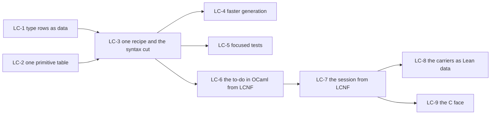

# The lowering cleanup: a clean, deep compiler and OCaml estate, then the interop faces

## The one thing to know first

The owner ruled (decisions row 391): the lowering carries no proof obligations for now. OCaml made
from the machine's Lean definitions through LCNF stands for the machine. The priority is a clean,
deep compiler and OCaml estate:

- consolidated code generation, faster to run;
- focused tests that each catch a real fault;
- clean data structures;
- then the interop faces: the to-do in OCaml, the session from LCNF, the C face.

[The collation](../2026-10-14-lowering-collation/README.md) (`fa62fe35a`) holds each slice's
evidence. It gives the findings N1 to N10 and the probes A to E. Write no new registry claim, planned goal or stage law. Keep the axiom gate
and every behaviour gate.

## Read first

- `AGENTS.md`, all of it.
- The collation, §1, §3, §4, §7 and §8. Its slices LO-1 to LO-11 are the source of these slices.
- Decisions rows 28, 70, 101, 108, 252, 262, 378 (14), 381, 387 and 391.
- `docs/core/lcnf-route.md` §8 and §9, `ocaml/README.md`, `ocaml/STANDARDS.md`.
- `review-notes.md` beside this brief: what Gemini's review found that holds. Read
  `gemini-review.md` only through it, since many of its paths do not exist.

## Where you work

Your own worktree and branch, from the coordinator's head named in the launch message. The rules
of PROC-6's brief hold (`docs/research/2026-10-14-proc6-prep/landing-prompt.md`, "The rules that
bind every slice"). Run every Lean command through `scratch/lean-slot.sh`. Build OCaml only
through `opam exec --switch=effect4`. The meanings chunk runs beside you; touch none of its files.

## The slices, in order

### LC-1: the type rows as data, and one parameter rule (the collation's LO-1)

- One table of type rows, as `builtins` is for values (findings N1, N2). Compute `builtinTy?`,
  `builtinTypeNames`, the reserved type names and `typeFidelityTable` from it.
- `typeParameterIndices` keeps each type parameter and drops each instance and value parameter.
  The `Effect4.Row` case goes.
- The `Char` row becomes an `int` code point. The `char` type and pattern of `Ml.Syntax` change
  with it. Key the three `_at_` rows of `ocaml/engine/externs.txt` by their definition and host.
- Done when a regeneration moves no generated byte beyond listed renames, and probe E passes the
  type translation.

### LC-2: one primitive table (the table half of LO-2)

- One row per Lean constant that the route does not translate from its body (finding N3). The
  columns are the OCaml form, each evaluator's primitive and the C symbol of Lean's runtime.
- The evaluators' `PrimTable`, `primArity` and `scanStop?` are computed from it.
- No byte of generated OCaml moves.
- The evaluators' trust ceiling (row 262) is paused by row 391. Leave their bodies as they are.

### LC-3: one recipe, the OCaml syntax cut, one fold, the dead models gone (LO-3)

- **One recipe:** the roots of `fibers_gen.ml` and `machine_gen.ml` become coverage roots of one
  artifact. The two files go (finding N5).
- **The syntax cut:** cut `Ml.Expr`, `Ml.Pat`, `Ml.Ty` and `Ml.Decl` to the constructors the route
  builds. Measure each removal by a build. Cut `Ml.Profile` to what `checkModule` reads (N6).
- **One fold:** the hand traversals that remain are algebras of one generated fold of the OCaml
  syntax, as `TsFold` is for TypeScript (`tools/Tools/Code/TsFold.lean`).
- **The dead models:** delete `e4_due`, `e4_wake`, `e4_time`, `e4_timers`, `e4_store` and
  `e4_fibers`, with their tests (N8). `e4_sched` and its modules stay as host code (row 391 (3)).
- **The byte library:** `e4_be`, `e4_hex`, `e4_nat` and `e4_sha256` name no other engine module.
  Move them to a library below the CAS. Then the CAS needs the engine only for `E4_checkpoint`.
- **The gate:** `$(CHK)/ocaml` depends on `$(GEN)/lcnf`, so `make check-ocaml` runs the current
  machine (N10).
- **The documents:** the stale rows of `docs/ARCHITECTURE.md`, `docs/GENERATED.md`,
  `ocaml/README.md` and `ocaml/STANDARDS.md` (the collation, §7.1).

### LC-4: faster generation

- Measure first. Time each LCNF artifact's generation and each gate of the route
  (`gen-lcnf`, `check-compiler`, `check-native`, `check-ocaml`).
- Split each artifact's time into the closure walk, translation, checks and rendering. Record the
  numbers in the receipt.
- Remove the largest costs. Candidates: a closure walked again per artifact, a quadratic scan of
  names, a check repeated per declaration, a rebuild that no input change requires.
- One more candidate: `scripts/generate.py` starts one `lean --run` of `LcnfGen` per artifact. One
  process for every artifact imports the environment once. Propose a compiled generator in the
  receipt, since `lakefile.toml` is the coordinator's.
- Done when each change shows its time before and after, and no generated byte moves.

### LC-5: focused tests

- Census the route's tests: the OCaml tests under `ocaml/` (53 files by probe D), the conformance
  batteries in `tools/Conform/`, and the route's controls in `Test/`.
- For each test, name the fault it catches that no other test catches.
- Delete a test that duplicates another or checks a deleted model. Merge tests that check one
  behaviour. Keep each test of the goldens, lane S, the differential and the emitted-code
  mutations.
- Done when every remaining test names its fault, and the gates take less time.

### LC-6: the to-do in OCaml from LCNF (LO-4, with the faces chunk's F4)

- The drive loop takes the row table. Today both instances pass `[]`
  (`ocaml/engine/api_engine_inst.ml`, `api_engine_ref.ml`).
- `ocaml/engine/e4_host.ml` and its `.mli`: evaluate; at a parked call, ask the reactor, apply the
  answer, flush; write the record.
- The reactor is `repository` (`Test/Dogfood/Scenario/Todo.lean`), made from LCNF. Write no hand
  repository first (row 391 (5)).
- `apps/todo/Check.lean` checks each OCaml record, unchanged. Add the OCaml face to
  `make check-host-protocol`.
- The red control is `forgetful` (`Test/Dogfood/Scenario/Todo/Claims.lean`), made the same way. It
  fails `agrees`.

### LC-7: the session from LCNF, and the OCaml face on it (LO-6, LO-7)

- The byte entries `Live.startBytes`, `Live.feedBytes` and `Live.viewBytes`, over `Api.RunnerBytes`
  and `Api.ofBytes`. They go in a new module above both, such as `src/Effect4/Run/Bytes.lean`.
  `src/Effect4/Run/Live.lean` cannot hold them: `Effect4.Api.RunnerDerived` imports `Effect4.Run`.
- Extend the codec group `Runner` (`tools/Effect4Gen/manifest.json`). It ends at
  `Effect4.Run.Observation`. Add the event, verdict and view types, then run
  `python3 scripts/generate.py --only derived`.
- `ocaml/gen/session_gen.ml` holds the session, its byte entries, `Run.runWith` and the reactors.
  It replaces `api_gen.ml` as the list oracle.
- No root takes a certificate (the collation's P8). The translator rules F3 and F4 of the session
  probe land here.
- The OCaml face of LC-6 moves onto the session. It reads programs by the lowered `Api.ofBytes`.
  `E4_program` and its layout mirror retire then (N4).
- `E4_checkpoint` (`ocaml/engine/cas/`) names `E4_engine`, so it follows the engine's new shape.
- Red controls: a forged program, a changed reply, a dropped journal row, the forgetful repository.

### LC-8: the carriers as Lean data (LO-9)

- Write the design note first: the machine's families typed by the six storage interfaces of
  `docs/core/machine-state.md` §7. The list instance stays the machine's definition.
- The note weighs Gemini's candidates (`review-notes.md` §2): a trie over `Nat`, a pairing heap, a
  two-list queue.
- Stop after the note, for the coordinator's ruling, since it changes the machine's state types.
- Then one family at a time, from the Ref arena. Probe B's trie arena is the first carrier; its
  interface laws come with it.
- Each family retires its extern rows, prelude bodies and hand carriers.

### LC-9: the C face (LO-10)

- `@[export]` names on LC-7's byte entries. A `Live` crosses as an opaque handle, and everything
  else crosses as bytes (the collation, §6.3 (b)).
- State the frame before code. A status byte precedes each payload, so a refusal needs no Lean
  `Except` in C. Name who holds each reference to the `Live` handle.
- A C driver for the to-do under `apps/todo/` links the core's shared library and plays events.
  `apps/todo/Check.lean` checks its records.
- The node face follows when row 108 gives the per-target bound, with the repair F7 of `toDigits`.

## The gates each slice owes

- Every slice: the narrow build of its Lean modules and `#axiom_audit` over them.
- LC-1 to LC-5: `make check-compiler`, `make check-native`, `make check-ocaml`, and a regeneration
  of the LCNF group with its diff in the receipt.
- LC-6, LC-7, LC-9: those, and `make check-host-protocol` with its red controls.
- LC-8's families: those, and lane S and the differential.

## Stop and report at once when

- a slice needs an edit to the machine, `Eff`, `Ty` or `Store.Val` (LC-8 after its note excepted);
- a regeneration moves generated bytes beyond what the slice predicts;
- a gate fails beyond its baseline.

A stop in one slice stops only the slices after it in the diagram.

## What you report

The receipt is `docs/research/2026-10-14-lowering-cleanup/receipt.md`. Open with the one thing the
coordinator must know before merging. Then, per slice:
- the base and head commits;
- the files;
- the commands and their results, with the times of LC-4;
- the axiom output;
- the lines removed and added.

Propose decisions rows in the receipt, never in the register.
