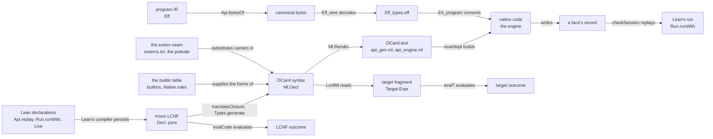
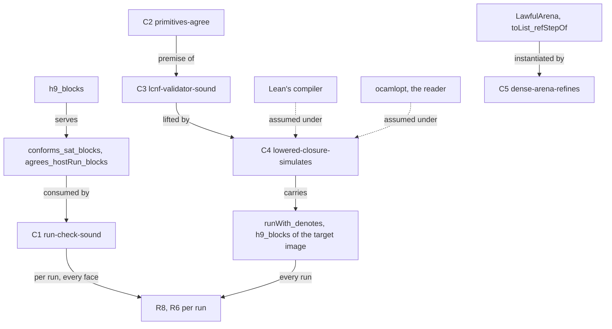
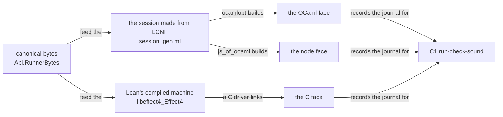
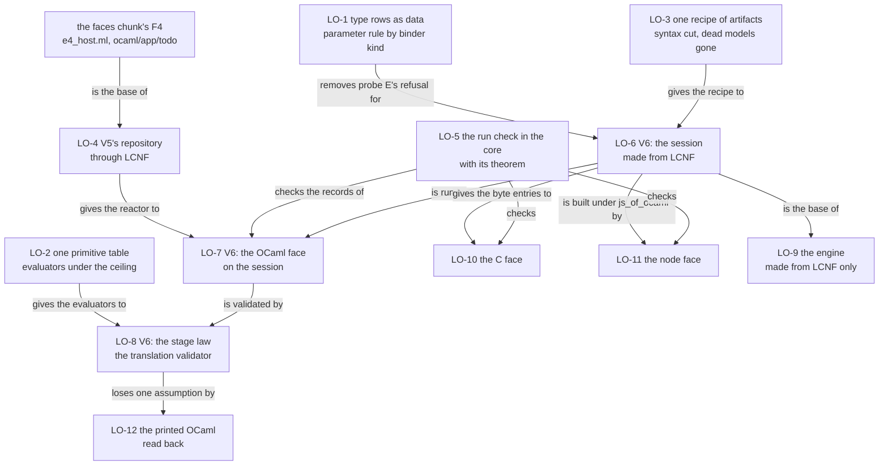

# 2026-10-14 The lowering, collated: one design for the LCNF route, its proof graph, C and the OCaml estate

Status: research note (history, not authority). Base: `babb69bcb` on `refactor/phase1-phase3`.
No tracked source file is edited. Every finding names its evidence word
(`docs/core/controlled-english.md` §3.8). The probes are in `probes/` beside this note, with their
logs.

In this note the lowering is the LCNF route: Lean declarations to OCaml through Lean's compiler IR
in its mono phase (LCNF, `translateClosure` in `src/OCaml5/Lcnf/Translate.lean`). The program IR
is `Eff`. A face is an outward presentation of `Eff`, as the dictionary defines it.

## 1. The one thing to know first

**The OCaml engine runs the Lean machine, and finite checks test it.** No theorem relates the
generated OCaml to the Lean definitions. Both evaluators that such a theorem would relate reach
`Classical.choice` (probe A; tested, finite).

So the plan works in three steps.

1. **Consolidate.** One table of type rows, one table of primitives, one recipe of artifacts. The
   duplicated lists and copies go, and so does a special case of the type translator.
2. **Lower.** The to-do's repository lowers today with no translator change (probe C). The
   session needs translator rules, and the first still refuses at HEAD (probe E). Then the OCaml
   face runs the session made from LCNF.
3. **Prove.** The run check that every face already uses moves into the core with its theorem.
   Then a translation validator, proved once, carries Lean's claims to the code OCaml runs.

The first slice to run is LO-1 (§8): the type rows as data and the type parameter rule by binder
kind. It is generator code only. Its gate is a regeneration that moves no generated byte, and it
removes the first refusal of probe E.

The probes:

| Probe | Question | Result | Evidence |
| --- | --- | --- | --- |
| A, `probes/EvaluatorAxioms.lean` | Do the two evaluators of the route sit under the trust ceiling? | No. 25 of 398 declarations of `Conform.Lcnf.Semantics` and 27 of 627 of `Conform.Lcnf.SemanticsTarget` reach `Classical.choice` | tested, finite: the gate's walk refuses both modules (`probes/evaluator-axioms.log`) |
| B, `probes/TrieArena.lean` | Is a persistent Lean carrier of the Ref heap lawful under the existing interface? | Yes. A trie arena satisfies the ten laws of `LawfulArena`, and `toList_refStepOf` applies to it with no new proof | proved: 101 declarations within `[propext, Quot.sound]` (`probes/audit-trie.log`) |
| C, the generator on B and the to-do | Do the trie arena and the to-do's `repository` lower with no translator change? | Yes: 34 declarations, no missing body, no refusal, `Ml.checkModule` and the name check pass | tested, finite (`probes/lowering.log`); the OCaml compiler did not run |
| D, `probes/census.py` | What does the route hold, by kind? | The counts of §4 and §7 | tested, finite: one run of the script (`probes/census.out`) |
| E, the generator on the session roots | Does the live session lower at HEAD? | No. The type translator refuses `Effect4.Api.HostSession.Session` at its value parameter `program` | tested, finite (`probes/session-lowering.log`; the command is in §5.4) |

What this note does not establish:

- No slice of §8 ran. A slice's gates are the commands it names, not this note's probes.
- The generated OCaml of probes C and E was not built: the brief allows `dune` inside `ocaml/` only.
- A count holds at the base commit, by the script or command named beside it.
- The owner's rulings that the plan needs are in §9.

## 2. What the past work decided, and its status at HEAD

### 2.1 What was read and run

| Source | How |
| --- | --- |
| `AGENTS.md`, `docs/STATE.md` (the order after PROC-6), `docs/core/lcnf-route.md`, `docs/core/system-map.md`, `docs/core/semantics.md` concept 10, `docs/core/machine-state.md` §§4, 7, `docs/core/host-boundary.md` §4.6, `docs/ARCHITECTURE.md`, `docs/GENERATED.md`, decisions rows 26–31, 70, 101, 108, 252, 254, 262, 263, 323, 327, 336, 361, 363, 373, 375, 378, 381, 387–390 and DI-13, DI-14, DI-19, DI-56, DI-88 | reading |
| `docs/research/2026-10-13-lowering-vertical-slice/README.md`, `docs/research/2026-10-14-faces/prompt.md` | reading |
| The research notes and packets on the route, listed by topic in §2.2 to §2.9 | reading, each finding checked in the tree |
| `src/OCaml5/**` (all 24 files), `tools/Conform/Lcnf/*`, `tools/Conform/Effect4/{Lcnf,LcnfMl,LcnfSemantics,CompilerControls}.lean`, `tools/Tools/RunChecks.lean`, `apps/todo/Check.lean` | reading |
| `ocaml/` (the four generated files' headers, `roots.json`, the closure manifests, `externs.txt`, every engine `.mli` header, `gen-check.sh`, lane S), `ocaml/README.md`, `ocaml/STANDARDS.md` | reading |
| The pinned toolchain's `Lean/Compiler/LCNF/{PhaseExt,Visibility,Basic}.lean` and `Lean/Environment.lean`, at 4.33.1, against 4.28.0, 4.32.0 and 4.34.0 | reading, and a line diff (tested, finite) |
| The `Makefile` rules `check-compiler`, `check-native`, `check-ocaml`, `gen-lcnf`, and the CI job `ocaml-gates` | reading |
| The core's shared library `.lake/build/lib/libeffect4_Effect4.dylib` and the C files under `.lake/build/ir/` | `nm` and `grep` (tested, finite) |
| Probes A to E | run, through `scratch/lean-slot.sh` |

The owner's past steers were read as history from the memory files the brief names. Each file,
function or flag that one names was checked in the tree before this note relies on it.

### 2.2 The route's input: Lean's compiler IR

| Source | Finding or ruling | Status at HEAD |
| --- | --- | --- |
| `ocaml/gen/NOTES.md` §1 (spike, 2026-09-04) | The route reads the persisted mono phase with `getMonoDecl?` and runs no compilation pass. Every constant of a non-module file carries its body | Superseded in part. Under the module system `getMonoDecl?` and the persisted entries disagree (`tools/Conform/Lcnf/Validity.lean`). The route reads `monoExt.getModuleEntries` through `persistedMonoIndex` (`tools/Conform/Lcnf/Index.lean`), from an environment that `importModules` builds at its default level `.private` (reading, toolchain `Lean/Environment.lean`) |
| `docs/research/type-tooling/seat-lcnf.md` DI-F (2026-09-09) | A move of the core to the module system would lose every body that is not template-like | Superseded: 193 core files are module files (a scan of the file heads; tested, finite), and the four artifacts still generate (regenerated in `479f2d7dd`). The private level carries every body (reading, `PhaseExt.lean`: `«private» := all`) |
| `seat-lcnf.md` §1.7 (2026-09-09) | The LCNF datatypes are stable from 4.32 to 4.33.1, the pass output is not, and the manifest's constant heads are the tripwire | Holds. A line diff (tested, finite): `LCNF/Basic.lean`, `PhaseExt.lean`, `ToMono.lean` and `Environment.lean` have 0 changed lines from 4.33.1 to 4.34.0. From 4.28.0 to 4.32.0, `Basic.lean` changed 874 lines and `PhaseExt.lean` 260 (the purity index) |
| `docs/research/type-tooling/ir-reuse.md` (2026-09-10) | Mono LCNF is the source. The impure phase carries reference counts and boxing. `EmitC` now lives in `Lean.Compiler.LCNF`; `getCtorLayout` gives Lean's own layout | Holds. `check-native` reflects the layout (`tools/Conform/Effect4/TargetLeanNative.lean`). The impure phase is not persisted (`impureExt` is a plain `EnvExtension`, `PhaseExt.lean`), so a C or LLVM tier reruns Lean's compiler |

### 2.3 The translator, the builtin table and names

| Source | Finding or ruling | Status at HEAD |
| --- | --- | --- |
| `docs/research/2026-09-10-lcnf-generator-hardening.md` | Ten defects of the generator, among them writes before checks, missing bodies that were not fatal, `carg` rows by position, extern rows keyed on `spec_N` names | Landed, except one: `normalizeFnName` strips `spec_N` (`src/OCaml5/Lcnf/Externs.lean`), and three rows of `ocaml/engine/externs.txt` still name `_at_` host chains (probe D) |
| `seat-lcnf.md` §3, R1–R12 (2026-09-09) | Twelve improvements, ranked | R1, R5, R6 (`Array.get!`), R9, R10 and R12 landed. R2 landed as one special case: `typeParameterIndices` (`src/OCaml5/Lcnf/Types.lean`) skips an instance argument only when the owner is `Effect4.Row`. R3 (`UInt64`, `USize`) is open. R4 holds: `Array.push` is `a @ [x]` in `api_gen.ml`. R7 is half landed |
| `docs/research/2026-10-05-claude-lead/lowering-table/lowering-table.md`, `lcnf-route.md` §9 | The builtin table as data: a row per Lean constant with its form and contract, no binder at a call site, the reserved names computed from the rows, a name check that stops the generator | Landed (`8b236fa7f`, `7724f1f76`). The type rows are not data: `builtinTy?`, `builtinTypeNames` and `typeFidelityTable` are three lists (finding N1, §4) |
| Codex's OCaml scout (`docs/research/2026-10-05-codex-foundation-packet/implementation-audit/ocaml-lowering-scout/recommendations.md`) | Five slices: introduced-name capture, shared framing, the law of `let x = e in x`, the inventory of reached primitives, and the read-back of printed OCaml with the OCaml compiler | Four landed: the capture repair and the inventory with the table as data (`8b236fa7f`), the framing and the law with seat LOWER (merged `c09826c0`). The read-back was never carried out: row 252 says it waits for a design of its own |
| `docs/research/2026-10-02-ocaml-idioms/receipt.md` | The translator removes `let x = e in x` | Landed; it removed 5,738 generated lines at its base |

### 2.4 The evidence, and what a claim of lowering may say

| Source | Finding or ruling | Status at HEAD |
| --- | --- | --- |
| `seat-lcnf.md` §2 (2026-09-09) | A ladder of rungs: validity (1), an evaluator of mono LCNF (2), an evaluator of the emitted fragment (3), translation validation (4: a checker `corresponds` with a soundness theorem), composition with the machine's theorems (5). It recommends the structural checker first, its theorem after | Rungs 1 to 3 exist as libraries. Their vector lane has no `make` target (`lcnf-route.md` §3); seat LOWER ran it once more through a scratch driver (20,387 of 20,387, tested, 2026-10-05). Rung 4 was never carried out |
| `docs/research/2026-09-05-compcert-feasibility.md` | Lean's own C does not fit CompCert (`lean.h` uses C11 atomics, `alloca` and a C++ runtime). A CompCert route is an LCNF-to-C emitter shaped like `Translate.lean`, gated by `ccomp` and the differential | Never carried out. It is option (b) of §6 |
| `docs/research/2026-09-19-state-refinement/lowering-review.md` | Four separate proof edges: meaning to machine, abstract state to concrete data, LCNF to target, target to execution. Its slice 4: a dense Ref arena, a lawful efficient Lean implementation, and the OCaml lowering that removes its hand body | The interface landed in the law graph (`Arena`, `LawfulArena`, `src/Effect4/Laws/Machine/Arena.lean`) with one list instance. The efficient implementation was never written; probe B writes it and probe C lowers it |
| Row 28 (open) | (a) a full simulation between the two evaluators, or (b) rule coverage and a simulation on the scalar fragment. The owner's word (2026-10-07): verified implementations of the machine's data structures, stores and protocol | Open |
| Rows 373 (4), 378 (10), 381 (1) (ruled) | For the first share: the theorems are the Lean definitions', the route carries rule coverage and gated differentials, the trust boundary is named. The target is a proved stage law at `Api.replay`. Agreement of the implementations is proved once, never per entry | Holds. No stage law exists. `semantics.md` concept 10 lists no required property of the LCNF stage |
| Seat LOWER (`docs/research/2026-10-05-seat-LOWER-receipt.md`), row 262 (ruled, not scheduled) | `let_return_outcome` (`tools/Conform/Lcnf/TargetLaws.lean`) is kernel-checked outside the ceiling, through two `String` rules of the target evaluator. Row 262 rewrites those two rules in byte forms | Not scheduled. Probe A shows that row 262 is not enough: the source evaluator reaches `Classical.choice` too, through `Name` printing in its refusals, `String.length` in `Prim.apply`, and the environment read in `Ctx.ofClosure` |
| `docs/research/2026-10-03-one-machine-many-hosts.md` | Trust tiers T0 to T3. T2, each run's journal replayed in Lean, is the lever for every runtime | Holds. The to-do's run check is a T2 instance (`checkSession`, `tools/Tools/RunChecks.lean`). It is tooling and states no theorem |
| Row 27 (open) | The per-module recipe of the route: roots, the closure, emission, the rung 2 and 3 differentials, the truth differential. Certificates do not cross the erasure. The root order: the codecs, the checker, the run transitions, the authoring lifts | Open. LO-6 follows its root order for the session. Its case-site policy was cleared by row 375 (6) |
| Row 30 (open for `compileEff`) | `compileEff` stays exempt from the fold until the root order of row 27 reaches it | The route lowers `Program.compile` as a root of `api_engine.ml` today, in either form, so the route no longer bounds that ruling |

### 2.5 The engine, its carriers and the copies

A carrier is the code's word (`src/OCaml5/Lcnf/Externs.lean`): an OCaml type that stands for a Lean
list field in the generated engine, behind a functor parameter.

| Source | Finding or ruling | Status at HEAD |
| --- | --- | --- |
| The engine brief and its A1 design (2026-09-08) | The carrier seam: an extern table, a functor over seven carriers, a hand prelude. The table is closed when the functor type-checks with no instance | Holds: `ocaml/engine/externs.txt` (53 rows by probe D), `ocaml/engine/tools/api_engine_prelude.ml`, the check C3b of `ocaml/engine/tools/gen-check.sh` |
| `docs/research/2026-09-08-ir-copies-management.md` R3 | One OCaml `eff`: map the program alphabet to `Eff_types` by `type` rows and delete the converter of `E4_program` | Never carried out. `ocaml/engine/e4_program.mli` still says that two generators write two OCaml types for one Lean declaration |
| The engine's base abstractions (the memory `ocaml-engine-base-abstractions-2026-09-17`; the note it names is not in the tree) | Items A to H. D and E landed; A (one program type), B (carrier-free types hoisted out of the functor), C (a generated codec of the machine), F, G and H were open | A and B are open: `e4_program.ml` stands, and the whole type group sits inside `Make` (`ocaml/engine/api_engine.ml`). For C, F, G and H no landing was found (reading) |
| DI-13 (ruled 2026-09-09) | One description of the cross-language types; it closes when three consumers read it, among them `E4_program`'s mirror | The mirror's layout is generated (`scripts/generate-engine-structure.py`); its converter stays hand-written |
| DI-19 (ruled 2026-09-09) | The acceptance of an engine regeneration is the conformance suite: the `ocaml/eff` goldens, the wire goldens, the truth programs | Holds inside `make check-ocaml` |
| Row 70 (ruled, landed) | The engine may not lag the source. The CI job regenerates the four LCNF files and refuses a difference | Holds in CI. Locally, `make check-ocaml` builds the committed files, and `check-gen` does not regenerate this group (`docs/GENERATED.md`) |
| The owner's rule of 2026-09-17 (`79752b3e6`) | On the OCaml side, only what is made from LCNF stays. Hand OCaml under `ocaml/engine` is replaced by LCNF-made code, then deleted | `src/OCaml5/Ml/Profile.lean` (948 lines) survived, with a law catalogue that cites removed modules and no consumer of `Check.profile` or `lawReport`. `docs/ARCHITECTURE.md` still lists `Runtime` and `Lib` under `src/OCaml5`. Nineteen hand engine modules are reached by no engine root (probe D) |
| DI-88 (ruled 2026-09-16) | The OCaml engine is a product face. The facade and the keyed session are generated into it, never mirrored by hand | Not landed: the session does not lower (probe E) |

### 2.6 Numbers

| Source | Finding or ruling | Status at HEAD |
| --- | --- | --- |
| `ocaml/gen/NOTES.md` §5, `seat-lcnf.md` §0 | The route's naturals are 63-bit. No generated literal comes near the bound | Holds: `Nat.add` and `Nat.succ` are raw `+` (`builtins`, `src/OCaml5/Lcnf/Builtins.lean`) |
| DI-56, row 108 (open), rows 321 and 322 (landed) | Inside its profile each face equals the exact reference, and outside it refuses. The growing atoms refuse past `natBound` on OCaml and TypeScript | Row 108 open; no lane reads a refusal (`lcnf-route.md` §8) |
| `docs/research/2026-10-03-jsoo-exploration.md`, `docs/research/2026-10-03-session-from-lean.md` F7 | Under js_of_ocaml an OCaml `int` has 32 bits. `Store.toDigits` writes wrong bytes for `2^31 − 1`; the repair is division by 256, repeated | Never carried out |

### 2.7 The host session, V5 and V6

| Source | Finding or ruling | Status at HEAD |
| --- | --- | --- |
| `2026-10-03-session-from-lean.md` | The host session lowers through LCNF with four translator changes. Native OCaml and js_of_ocaml under node give Lean's journals byte for byte on two fixtures (tested). Findings F1 to F9 | Never carried out. F6 landed (`LcnfGen` raises `maxHeartbeats`). F1 refuses at HEAD (probe E). The F4 rows are absent from `builtins`. F5 is open: `reservedNames` (`src/OCaml5/Ml/Identifier.lean`) holds the keywords and `exit` only |
| `docs/research/2026-10-04-host-lowering-foundation/plan.md` | Slices P0 to P7. P6a, P6b and P7 bind target claims F9 to F11 to the actual artifact | `run_eq_ref_table` landed (its F6). P6a, P6b and P7 were never carried out, and none of its claims F1 to F11 is a registry claim |
| `docs/research/2026-10-02-lowering-implementation-brief.md` | Contracts L0 to L5: replay transfer at completed commands, an ordered reply index, bounded allocation | Never carried out. Its references under `/private/tmp` are gone |
| `docs/research/2026-10-07-session-api-design.md`, DM7 | The OCaml session: roots `Live.start`, `Live.feedBytes`, `Live.viewBytes`, and translator rules F1, F3, F4, F5, F6 | Open; row 373 (2) places it after the first share. `Live.feedBytes` and `Live.viewBytes` do not exist |
| `docs/research/2026-10-09-host-calls-and-cleanup.md`, HC-7 | The checked scalar session generated for OCaml | Open |
| `2026-10-13-lowering-vertical-slice/README.md` §6 | V5: OCaml runs the to-do with a host loop. V6: `Run.runWith` through LCNF, the vector differential at a target, the LCNF stage proved on its closure | V1, V2 and V4 landed. V3 and V5 are the faces chunk's F3 and F4. V6 has not started |
| Row 378 (14) (ruled) | The reference repository is lowered through LCNF | Not landed. Probe C lowers it with no translator change |
| Row 254 (ruled, landed) | A scenario joins a Lean statement to the lowered code on one named observation | Landed as lane S: five scenarios on the generated `api_replay`. The session's clause stays in Lean, since the engine holds no session |
| Row 323 (ruled, landed in Lean) | A session admits a host reply at its call's checked instance | The open part `replay-at-call-instance` names the OCaml engine: its replay admits at the row's columns only. LO-7 closes it on the OCaml face, which runs `Live` |

### 2.8 The other targets and the archived routes

| Source | Finding or ruling | Status at HEAD |
| --- | --- | --- |
| `lcnf-route.md` §4; rows 29, 31 (open); DI-88 | A TypeScript target is an emitter and an extern table over the shared front half. DI-88 asks for an LCNF-to-TypeScript backend that generates the canonical reader | Not started |
| Row 26 (open) | Every TypeScript artifact is a fold of a committed table or free object; the tables own types and LCNF owns semantics | Open. Its prelude package is the faces chunk's F3 (V3) |
| `lcnf-route.md` §7, row 29 | The LLVM steer: targets as data, legalization with obligations, `Target.Expr` as the common currency; the low tier through Lean's own IR | No code. At 4.33.1 Lean's C emitter is `Lean.Compiler.LCNF.EmitC` over impure LCNF; `Lean.Compiler.IR.EmitLLVM` runs on the IR tail and fixes `size_t` at 64 bits |
| System map §3 item 6; row 381 (6) | WASM through the generated OCaml first; the runtime anywhere that runs `Eff` | No lane. js_of_ocaml runs `ocaml/gen` under node (tested, 2026-10-03); wasm_of_ocaml has no run |
| The 2026-09-03 lowering lanes L1 to L3; `docs/research/2026-09-03-ocaml5-deep-plan.md` and its spikes | The Flow route's TypeScript lowering; OCaml 5's handler machine and the js_of_ocaml effects model | Superseded by the archives: `606918e` (`archive/flow-route`) and `14e6835` (`archive/ocaml5-avatar`) |
| `docs/research/2026-09-04-ocaml-packages-plan.md`, `docs/research/2026-09-07-ocaml-proposals.md` | The Jane Street libraries in hand code, never inside `ocaml/gen` | Holds for `ocaml/gen`. The avatar's items are superseded |

### 2.9 The view's C host

| Source | Finding or ruling | Status at HEAD |
| --- | --- | --- |
| `docs/research/2026-10-07-native-view-schemas-and-lowering.md`; rows 336 (4), 363 (5) | Lean writes the device calls and C replays them. The C player is first-class. Lean lowers the view to C through its own compiler now; later the view becomes an Effect program lowered by Effect4's pipeline | `tools/view/draw.c` and `play.c` replay Lean's stream. No `Eff` program runs in C |

## 3. The route's stages and their evidence (the map)

The stages below are the named connections of `lcnf-route.md` §8, taken for the OCaml face; each
row names its connection there. The diagram shows which representation each stage takes and
gives. It claims no agreement; the table after it names each arrow's evidence.



| Stage | In, out | Arrow kind (system map §5) | Declarations | Evidence |
| --- | --- | --- | --- | --- |
| Meaning to machine (§8: admitted source to reference; reference to compiled runtime) | `Eff` to the frame machine and the session | K3 simulation | `run_eq_meaning` (`src/Effect4/Laws/Program/Agreement/Segment.lean`), `loopAgreement` (`src/Effect4/Laws/Program/Agreement/Loop.lean`), `h9_blocks` (`src/Effect4/Laws/Api/SessionMeaningBlocks.lean`), `run_eq_ref_table` (`src/Effect4/Laws/Program/Table/Agreement.lean`), `session_eq_ref` (`src/Effect4/Laws/Api/SessionRef.lean`) | proved, on named fragments |
| Program to bytes | `Eff` to canonical bytes | K2 exact embedding | `decode_encode`, `decode_exact` (`src/Effect4/Store/Domain/ProgramWire.lean`) | proved |
| A run as data | a journal acting on a run | K5 monoid action | `replay_unique` (`src/Effect4/Laws/Api/Runner.lean`), `journal_replays` (`src/Effect4/Laws/Run.lean`) | proved |
| Declarations to mono LCNF (§8: Lean declarations to compiler IR) | Lean definitions to `Decl .pure` | none: Lean's compiler | `monoExt`, `persistedMonoIndex` | assumed: the pinned compiler and its erasure. The vector lane of rung 2 tested it on the `Ty` closure once, with no standing target |
| Mono LCNF to OCaml syntax (§8: compiler IR to target semantics) | `Decl .pure` to `Ml.Decl` | the shape of K4: a construct with no rule is a fatal refusal by name. Its simulation (K3) is owed | `translateClosure`, `Types.generate`, `builtins`, `Native.rules`, `Clock.constructor?` | tested: `make check-compiler` (the normalization closure built and run, three emitted-code mutations), the builtin controls (`hostChecks`), ten name fixtures (`Conform.Effect4.LoweringNames`). Rung 3 tested it once on the `Ty` closure |
| The extern seam (§8: abstract storage to backing implementation) | a list field to a carrier, a Lean call to a hand body | none: a substitution | `Externs.parse`, `ocaml/engine/externs.txt`, `api_engine_prelude.ml` | tested: the property tests `prop_*.ml` against list twins, the three-engine differential `ocaml/engine/test/test_diff.ml`. The functor's type check (C3b) checks that the table is closed, not what it means |
| OCaml syntax to text (§8: target syntax to bytes) | `Ml.Decl` to bytes | a hand rendering, no reader of text | `Ml.render` (`src/OCaml5/Ml/Render.lean`) | checked at generation: `Ml.checkModule` and `hygieneProblems` refuse an unbound or captured name. The text against the syntax: assumed |
| OCaml syntax to the target fragment | `Ml.Expr` to `Target.Expr` | a widening: the reader refuses by constructor name, with no exactness law | `LcnfMl.ofExpr` (`tools/Conform/Effect4/LcnfMl.lean`) | tested with rung 3, once |
| Text to native code (§8: artifact to execution) | OCaml text to an executable | none | `ocamlopt` 5.1.1, the OCaml runtime, Zarith | assumed; tested by `make check-ocaml` |
| Bytes to the engine's program | canonical bytes to the engine's `eff` | two decoders and a hand converter | `Eff_wire` (template-made), `E4_program.of_eff` | reproduced: the goldens, byte for byte. Tested: the ordinal pin |
| The engine's run | a decision tape to machine views | none | `E4_engine`, the generated `api_replay` | tested: lane S (five scenarios, each tape position, two instances), `test_engine` (37 goldens). The corpus against Lean's runs is reported, not gated (`test_diff.ml`) |
| A face's run to Lean's run | a record to `Run.runWith` from the record | decided per run, by Boolean checks | `checkSession` (`tools/Tools/RunChecks.lean`); its consumers `conforms_sat_blocks`, `agrees_hostRun_blocks` (`src/Effect4/Laws/Program/ValidatedBlocks.lean`) | the consumers proved; the checker is tooling with no theorem |

Two facts from the map shape the rest of the note.

- **Every arrow from mono LCNF downward is tested or assumed.** No arrow below Lean's own
  definitions is proved. The two evaluators exist, and both sit outside the trust ceiling
  (probe A).
- **The program reaches the engine by a path the Lean decoder does not take.** Canonical bytes
  go through a second decoder and a hand converter. The machine itself is LCNF-made.

## 4. The findings: consolidation and abstraction, ranked by what they remove or unlock

Each finding names its kind, one of the four the brief asks for:
- a duplicate intermediate representation;
- a hand `match` or casework that a fold or a table as data would serve;
- a name encoded again per stage;
- a table that is not data.

The rank weighs what the change unlocks on V5 and V6 first, then what it removes.

| Rank | Finding | Kind | Evidence | The consolidation, with the existing machinery | Slice |
| --- | --- | --- | --- | --- | --- |
| N1 | The type rows are three lists. `builtinTy?` (`src/OCaml5/Lcnf/Types.lean`) is a hand `match`, `builtinTypeNames` lists the same constants again, and `typeFidelityTable` (`tools/Conform/Effect4/Lcnf.lean`) classifies them a third time. The OCaml type names the rows emit (`result`, `option`, `list`) are not reserved, so a Lean type `Result` shadows the `result` that `Except` maps to (F5 of the session probe) | a table that is not data | reading | One table of type rows, as `builtins` is for values: the Lean constant, the OCaml spelling over the converted arguments, the fidelity class, the domain and the note, with no defaults. `builtinTy?`, the names, the reserved type names and the inventory are computed from it. The `Char` row becomes visible as `.unsound` and is repaired to an `int` code point, as Lean's compiler treats `Char` (F4 of the session probe) | LO-1 |
| N2 | The type parameter rule is casework. `typeParameterIndices` refuses every parameter that is not a type, except an instance argument of `Effect4.Row`. Probe E stops there, at `Session program table` | casework | reading; probe E | One rule by binder kind: keep each type parameter, drop each instance and value parameter. A function keeps its value indices as ordinary arguments (F1 of the session probe). The `Effect4.Row` case goes | LO-1 |
| N3 | Three tables describe one boundary. `Prim` and `PrimTable` give the source evaluator's externs (`tools/Conform/Lcnf/Semantics.lean`), `applyPrim`, `primArity` and `scanStop?` give the target evaluator's spellings (`tools/Conform/Lcnf/SemanticsTarget.lean`), and `builtins` gives the OCaml forms. Both evaluators reach `Classical.choice` | a table that is not data; a duplicate | probe A | One primitive table: per Lean constant its source meaning, its OCaml form, its target meaning and its contract. A translation validator then takes one hypothesis per row, computed from the table. Both evaluators move under the ceiling: refusals as data, not `toString`; `String.length` and string order in byte forms; the context passed as data, with no environment read; `matchPat`, `asListV` and `TValue.beq` total | LO-2 |
| N4 | Two OCaml program alphabets for one Lean declaration. `ocaml/eff/eff_types.ml` (EffGen's templates) and the type group of `api_engine.ml` (`src/OCaml5/Lcnf/Types.lean`) both declare `Eff`, and a hand converter with an ordinal pin and a generated layout mirror joins them (`ocaml/engine/e4_program.ml`, `e4_program_layout.{ml,json}`). The codec has three implementations: Lean's `Program.Wire`, `ts/eff/wire.gen.ts` and `ocaml/eff/eff_wire.ml` | duplicate IR; names encoded again | reading; `Test/contracts/faces.contract.md` row 6 | The session artifact lowers Lean's own decoder (`Api.ofBytes`) and the run codecs of `src/Effect4/Api/RunnerBytes.lean`. The OCaml face then reads bytes by the Lean definition, whose exactness is proved. The converter, the pin, the mirror and the template codec retire when the engine moves onto the session artifact | LO-6, LO-9 |
| N5 | Four LCNF artifacts from overlapping closures. `machine_gen.ml` (40 declarations, 33 inside `api_gen.ml`) and `fibers_gen.ml` (219, 114 inside) only type-check: no program calls them. `api_gen.ml` and `api_engine.ml` share 730 declarations | duplicate | probe D | One recipe. The two spikes' roots join the session artifact's roots as coverage roots, so coverage stays and two files go. The session artifact takes `api_gen.ml`'s place as the list oracle. `api_engine.ml` stays until LO-9 | LO-3, LO-6 |
| N6 | The OCaml syntax is sized for the archived avatar. `Ml.Expr` has 55 constructors; the route builds 22. By the same scan, at most 12 of `Ml.Pat`'s 18, 5 of `Ml.Ty`'s 8 and 7 of `Ml.Decl`'s 17. `Ml.render`, `Ml.checkModule`, `Builtins.usesExpr` and the reader `LcnfMl` each traverse them by hand: 13 definitions with six or more arms. `src/OCaml5/Ml/Profile.lean` (948 lines) feeds `checkModule` one function, which answers `[]` on every emitted type | hand traversals; dead code | probe D; reading | Cut each sort to the constructors the route builds, and `Ml.Profile` to what `checkModule` reads. The traversals that remain become algebras of one generated fold, as `TsFold` is for TypeScript syntax (`tools/Tools/Code/TsFold.lean`; `render_eq_expr` in `tools/Tools/Code/TypeScript.lean`). The deeper form is row 29's: the translator emits `Target.Expr`, a printer renders it, and the reader goes. Row 29 is the owner's, with the TypeScript backend as its first customer (§9) | LO-3 |
| N7 | The extern seam holds semantics in hand OCaml. 28 `fn` rows name hand OCaml, mostly bodies of the prelude (438 lines), and 11 `field` and 10 `ops` rows substitute carriers. Three rows key on compiler-made names. The instance glue calls `step_decision_state_at_program_replay_checked_from_spec_1` by its compiler-made name, with the row table fixed to `[]` (`ocaml/engine/api_engine_inst.ml`) | a table that is not data; names encoded again | probe D; reading | The carriers become Lean definitions over the six storage interfaces of `docs/core/machine-state.md` §7, each lawful, lowered through LCNF. Probe B gives the dense arena, and `toList_refStepOf` gives its refinement of the reference's Ref step with no new proof. The seam, the prelude and the hand carriers retire family by family | LO-9 |
| N8 | Nineteen hand engine modules are reached by no engine root. Six are superseded models of the machine (`e4_due`, `e4_wake`, `e4_time`, `e4_timers`, `e4_store`, `e4_fibers`; 1,342 lines). The rest is the host runtime re-homed from the archived route 1 (`e4_sched` and its mailbox, inbox, ring, quiescence, reply, trigger, admission, shutdown and abandon), the query with its log index, and the diff | dead code | probe D | Delete the six models with their tests: the machine's `src/Effect4/Machine/Wake.lean` and `src/Effect4/Machine/Timer.lean`, lowered, already replace them. The host runtime is host code under the boundary. Its consumer is the native host that serves many sessions, and §9 asks the owner to confirm it | LO-3 |
| N9 | The run check is tooling with no theorem, and it reads the calls and the exit only | a missing connector | reading (`tools/Tools/RunChecks.lean`) | Move it into the core with a soundness theorem in the law graph. Where a face records them, bind the whole journal, the observation, the program's digest and the artifact's identity (F9 of the session probe) | LO-5 |
| N10 | The local OCaml gate builds the committed LCNF files. `$(CHK)/ocaml` runs again on a core change, through `$(GEN)/fixtures`, but it does not depend on `$(GEN)/lcnf`. So a machine change meets the old generated machine there, and only the CI job regenerates | a gate on stale code | reading (`Makefile`; `docs/GENERATED.md`) | `$(CHK)/ocaml` depends on `$(GEN)/lcnf`, so the gate runs on the current machine, as `AGENTS.md` asks of a behaviour gate | LO-3 |

**The census behind N5, N6 and N8** (probe D at the base; tested, finite):

| Kind | Lines | Files |
| --- | --- | --- |
| Made from LCNF (`ocaml/gen/*_gen.ml`, `ocaml/engine/api_engine.ml`) | 36,984 | 4 |
| Made by EffGen's templates (`ocaml/eff/eff_*.ml`) | 3,276 | 6 |
| The hand engine, with the prelude | 10,382 | 78 |
| The hand CAS (`ocaml/engine/cas/`) | 9,736 | 30 |
| The hand kernel of `ocaml/eff` and the clock | 486 | 5 |
| Tests | 22,141 | 53 |

**One observation about the order.** N1 and N2 lie on V6's path: they remove probe E's refusal.
N3 lies on the stage law's path. N4 and N5 fall out of V6 itself, once the session artifact holds
the decoder. N7 is the largest removal and needs a design note first, because it changes the
machine's state types.

## 5. The proof graph and the Lean APIs

### 5.1 What each stage has today

| Stage | Proved | Checked finitely | Assumed |
| --- | --- | --- | --- |
| Meaning to machine | `run_eq_meaning` (`Straight`), `loopAgreement` (`Looped`), `h9_blocks` (completed, host-driven `BlockRows` runs), `run_eq_ref_table`, `session_eq_ref`, M7 on `M7Fragment` | the batteries' finite evaluations | none |
| Declarations to mono LCNF | none | rung 2: 20,387 vectors on the `Ty` closure, last run 2026-10-05 through a scratch driver | the pinned compiler's erasure: mono code evaluates as its source definition |
| Mono LCNF to OCaml syntax | none. `let_return_outcome` is kernel-checked outside the ceiling | `make check-compiler`; rung 3 on the `Ty` closure, once; `Ml.checkModule` and `hygieneProblems` at every generation | each builtin row's class (`fidelity` is a reading, `lcnf-route.md` §9) |
| The extern seam | none | `prop_*.ml`, `test_diff.ml`, the functor's type check | each hand body equals the Lean definition it replaces |
| OCaml syntax to text and native code | none | `make check-ocaml` | `Ml.render` against OCaml's parser; `ocamlopt`; the OCaml runtime; Zarith |
| A face's run to Lean's run | the consumers `conforms_sat_blocks`, `agrees_hostRun_blocks` | `checkSession`, per run | that the checker's Booleans are the premises those theorems take: true by reading, stated by no theorem |

### 5.2 The minimal claims

Five registry claims make the lowering a placed proof graph. Each serves a slice of §8, and no
claim waits on a consumer. They go into `docs/core/semantics.md` concept 10 as required
properties, and into the semantics registry, in the slice that states them. The statements below
are shapes that Lean has not elaborated.

**C1 `run-check-sound`** (LO-5).

```lean
-- shape, unchecked: a record that the run check passes is Lean's own run of it
theorem check_sound (h : (check build id protocols model start r).passed = true) :
    ∃ s calls, runOf build id r = some (s, calls) ∧ Run.Reached s ∧ s.exit = some r.exit ∧
      funded s = true ∧ atRest s = true ∧ hostDriven s = true ∧
      conforms protocols s = true ∧ (agrees model s start).isSome
```

- Concept: `translation-simulation`; property: a face's recorded run is a reached Lean run whose
  decided premises hold (a new required property).
- Question: registry claim `run-check-sound` (role adequacy); pointer `Run.Check.check_sound`;
  consumers: `apps/todo/Check.lean` for every face, and the OCaml face of LO-7.
- Reach: every record, every build function, every protocol table and model; the observation is
  the calls in order, their completions and the root's exit. With the journal fields of LO-7 it
  is the whole journal and `Run.Observation`.
- Does not establish: anything of a run that no check read. It says nothing of the face's
  schedule, fibers and timing beyond the record, of the host past its completions, or of progress.
- Unlocks: R8's open part on typed lowering, per run, at tier T2. R6's open part on the public
  typed guarantee for programs using host services (row 99), per run.

**C2 `primitives-agree`** (stated in LO-2, proved in LO-8).

```lean
-- shape, unchecked: each exact row of the one primitive table means the same on both evaluators
def PrimitivesAgree (t : PrimitiveTable) : Prop :=
  ∀ row ∈ t.rows, row.fidelity = .exact → ∀ vs ws, Related.args vs ws →
    Outcome.Related (Prim.apply row.source vs) (Target.applyPrim pe row.target ws)
```

- Concept: `translation-simulation`; property: the route's primitive assumptions, stated as data.
- Question: registry claim `primitives-agree` (role compatibility); pointer: a planned goal in
  `Test/Lowering/Primitives.lean`; consumer: C3.
- Reach: every row of the table. A row of class `domain` holds under its domain predicate. The
  value relation carries it: naturals below `2^62` on OCaml (DI-56).
- Does not establish: the OCaml library functions a `.library` row names; any row of class
  `approximate` or `.unsound`, which stays a named assumption.
- Unlocks: C3's primitive hypotheses as one premise instead of a list.

**C3 `lcnf-validator-sound`** (LO-8).

```lean
-- shape, unchecked, after seat-lcnf.md §2 rung 4: a declaration the validator accepts is simulated
theorem corresponds_sound (hprim : PrimitivesAgree t) (hc : corresponds t ctx prog c e = true)
    (hrel : Related.env env tenv) :
    Outcome.Related (evalCode ctx fuel env c) (evalT prog (fuelOf fuel) tenv e)
```

- Concept: `translation-simulation`; property: the LCNF stage keeps the outcome on the validated
  fragment (a new required property; the stage law of row 373 (4)).
- Question: registry claim `lcnf-validator-sound` (role simulation); pointer: a planned goal in
  `Test/Lowering/Validator.lean`; consumer: C4.
- Reach: every mono declaration and target expression that `corresponds` accepts, every pair of
  related environments, every fuel. The observation is the outcome (value, refusal, exception,
  frontier) up to `Related`.
- Does not establish: Lean's compiler, from a definition to its mono code. Nor the reader's
  image against the printed text, `ocamlopt`, or termination: both evaluators are fuelled.
- Unlocks: R8's open part on typed lowering, for every artifact the validator accepts.

**C4 `lowered-closure-simulates`** (LO-8).

- Concept: `translation-simulation`; property: the lift of C3 from declarations to a closure's
  roots, through calls.
- Question: registry claim `lowered-closure-simulates` (role simulation); pointer: a planned goal
  beside C3. Its instance at the session artifact is decided at generation: the generator runs
  `corresponds` on every declaration and records the answer in the closure manifest.
- Reach: every closure whose declarations the validator accepts, every root, related arguments.
- Does not establish: what C3 does not; the acceptance itself is a finite check of one artifact.
- Unlocks: `runWith_denotes` (`src/Effect4/Laws/Api/HostDrive.lean`) and `h9_blocks`, stated of
  the target image of the code OCaml runs. The assumptions stay named: Lean's compiler, the
  reader, `ocamlopt`.

**C5 `dense-arena-refines`** (LO-9).

- Concept: `translation-simulation`; property: abstract storage to its backing implementation
  (`lcnf-route.md` §8; row 101), for the dense arena.
- Question: registry claim `dense-arena-refines` (role simulation); pointer: the carrier's
  `LawfulArena` instance, read through `toList_refStepOf` (probe B's `trie_ref_step_projects`).
- Reach: every value of the carrier, every cell and kernel.
- Does not establish: the cost; the other five interfaces; the machine-level observation, which
  needs the connector `docs/core/machine-state.md` §4 names, because `BookMeans.state` is equality.
- Unlocks: the connection of `lcnf-route.md` §8 from abstract storage to its backing
  implementation (row 101), and N7's first family.

The order of the claims, with the existing theorems they use. Solid edges are uses; dashed edges
are named assumptions. The diagram claims no proof.



What the five claims leave open, by name:
- the arrow from a Lean definition to its mono code: Lean's compiler, assumed. The vector lane
  is its finite check, and LO-2 gives it a target;
- the arrow from OCaml syntax to text: assumed until LO-12, which reads each artifact back with
  OCaml's own parser (Codex's slice 5, row 252);
- the extern seam until LO-9: assumed per row, tested by the differential;
- progress, liveness and the host's conformance, as for every claim of concept 10.

### 5.3 The Lean APIs

| API (toolchain 4.33.1) | Used for | Fragility, by a line diff or by reading | What the plan does |
| --- | --- | --- | --- |
| `Lean.Compiler.LCNF.{Decl, Code, LetValue, Arg, Alt, Cases, Param, LitValue}` at `.pure` | the input of the translator and of the source evaluator; C3 quantifies over it | changed in 4.28 to 4.32 (the purity index; 874 lines of `Basic.lean`); 2 lines to 4.33.1; 0 to 4.34.0 | keep Lean's type as the external sort (system map §4). The manifest's construct census is the tripwire, and the validator refuses an unknown construct |
| `monoExt.getModuleEntries`, `importModules` at the level `.private` | reading every persisted mono body, private ones of module files included | `getMonoDecl?` disagrees with it under the module system; the default level is a toolchain choice | one reader, `persistedMonoIndex`; LO-3 adds a census of bodies read as opaque, so a toolchain change that hides bodies fails generation |
| `hasTrivialStructure?`, `Irrelevant` field relevance | the type translator's erasure | unchanged 4.32 to 4.34.0 | keep |
| Compiler-made names (`_at_`, `spec_N`, `_redArg`, `_lam_N`) | three extern rows; the instance glue; the closure manifest | change with any edit of a call path or of the specializer | key every row by the Lean definition and its host (LO-1); generate the instance glue's names from the manifest (LO-9) |
| `Lean.Compiler.LCNF.main` (an in-process compile) | the availability fallback of `tools/Conform/Lcnf/Validity.lean` | its body agrees with the persisted one 3 times in 20 on the `Ty` closure (`ir-reuse.md`, after `seat-lcnf-idiom.md`) | a labelled fallback only; never a source of the route |
| `Decl.check`, `DeclHash`, `Code.alphaEqv` | rung 1 and the manifests | the type half of `Decl.check` cannot run on mono code | keep |
| `getCtorLayout`, the limits of `IR.Checker` | `check-native`'s layout reflection | `ToImpureType.lean` unchanged to 4.34.0 | keep; it is the C face's layout witness too (§6) |
| `fun_induction` and the functional induction principles | proofs over the trie (probe B) and over the evaluators (C3) | standard | the case list of every proof comes from the definition it is about |
| `@[export]`, Lake's `shared` facet, `lean.h` and its initialization calls | the C face (§6) | public mechanisms | LO-10 |

No metaprogramming beyond the existing closure walk is needed. The validator runs inside
`LcnfGen` (`src/OCaml5/Tools/LcnfGen.lean`), where both the mono declaration and its emitted syntax
are in hand.

### 5.4 Probes A and E

Probe A ran the gate's walk over both evaluator modules:

    scratch/lean-slot.sh lake env lean docs/research/2026-10-14-lowering-collation/probes/EvaluatorAxioms.lean

The causes that stand under no other, from `probes/evaluator-axioms.log`:

| Module | Declaration | Its path to `Classical.choice` |
| --- | --- | --- |
| `Conform.Lcnf.Semantics` | `Prim.apply` | `String.length` |
| `Conform.Lcnf.Semantics` | `argValue`, `Value.render`, `Prim.toString` | `Name` printing and a string search, in refusal messages |
| `Conform.Lcnf.Semantics` | `Ctx.ofClosure` | `getDeclCore?`, the environment read |
| `Conform.Lcnf.SemanticsTarget` | `cmp?` | `String.instLT` |
| `Conform.Lcnf.SemanticsTarget` | `judgeT` | `Json.mkObj`, a report |

So `evalCode`, `evalLetValue`, `evalConst` and `applyValue` reach `Classical.choice` through their
refusals and one primitive. Row 262 repairs the target side only.

Probe E ran the generator on the session's roots:

    scratch/lean-slot.sh lake env lean -M4096 --run src/OCaml5/Tools/LcnfGen.lean --out <scratch>/session_gen.ml \
      --import Effect4.Run.View --import Effect4.Api.RunnerBytes --cap 6000 Effect4.Live.start Effect4.Live.feed \
      Effect4.Live.view Effect4.Run.observe Effect4.Api.ofBytes Effect4.Api.Runner.commandBytes \
      Effect4.Api.Runner.commandOf Effect4.Api.Runner.verdictBytes Effect4.Api.Runner.observeBytes

It stopped in 36 seconds with `Effect4.Api.HostSession.Session: unsupported parameter program at 0`
(tested, finite). The later refusals have no run at HEAD; the session probe of 2026-10-03 lists them as
F3, F4 and F5.

### 5.5 Reproducing probes B and C

Probe B is a module, so the gate's walk can read it from a second file. Run the three commands
below from the repository's root, with `OUT` a scratch folder and `P` the probes folder.

1. Build the module.
2. Audit it with the gate's walk.
3. Lower it with the to-do's repository.

```sh
P=docs/research/2026-10-14-lowering-collation/probes
scratch/lean-slot.sh lake env lean -DwarningAsError=true --root=$P -o $OUT/TrieArena.olean $P/TrieArena.lean
scratch/lean-slot.sh bash -c "LEAN_PATH=$OUT:\$(lake env printenv LEAN_PATH) lean $P/AuditTrie.lean"
scratch/lean-slot.sh bash -c "LEAN_PATH=$OUT:\$(lake env printenv LEAN_PATH) lean -M4096 --run \
  src/OCaml5/Tools/LcnfGen.lean --out $OUT/probe_gen.ml --import TrieArena \
  --import Test.Dogfood.Scenario.Todo --cap 400 LoweringCollation.peekAt LoweringCollation.pokeAt \
  LoweringCollation.allocAt Test.Dogfood.Scenario.Todo.repository"
```

The audit prints `101 declarations within [propext, Quot.sound]`. The generator writes the OCaml
and its closure manifest (`probes/closure-probe_gen.tsv`) in 9 seconds.

## 6. C handling

### 6.1 What C means in this tree

C enters the tree at four places, and the decisions name a fifth as a direction.

| Meaning | Where | Current handling | Evidence |
| --- | --- | --- | --- |
| Lean's own C | Lean's compiler writes C for every core module (`.lake/build/ir/**/*.c`). Lake builds each into an object file. The executables of `lakefile.toml` link them, and so does the core's shared library, which the batteries load (row 327) | `libeffect4_Effect4.dylib` exports `lp_effect4_Effect4_Live_start`, `lp_effect4_Effect4_Live_feed` and `lp_effect4_Effect4_Run_runWith`, among 23,584 text symbols | tested, finite, by `nm`; the compiler and its runtime assumed |
| The extern boundary of Lean's runtime | a Lean constant that a C function of Lean's runtime implements (`@[extern]`) has no mono body. The LCNF route replaces each one it reaches by a row of `builtins`, which also holds the constants the route short-circuits (`lcnf-route.md` §9) | 108 rows by class: 60 exact, 37 domain, 8 approximate, 3 `.unsound` (`USize.sub`, `USize.add`, `Array.uget`) | counted by a parse of `src/OCaml5/Lcnf/Builtins.lean`; each class is a reading |
| The OCaml estate's C | Zarith's C functions under `E4_clock` (`ocaml/clock/`), the OCaml runtime, `unix` and `threads` | no row of any table names them; js_of_ocaml has no JavaScript fragment for `ml_z_format` (F8 of the session probe) | assumed |
| The view's C host | `tools/view/draw.c`, `play.c` and `paint.h`, on SDL3 | it replays the device calls Lean computes; no `Eff` program runs in it (rows 336 (4), 363 (5)) | tested by the view's own checks |
| The low tier, a direction | `lcnf-route.md` §7, row 29, and row 381 (1)'s "later C" | no code. CompCert needs its own emitter (`2026-09-05-compcert-feasibility.md`) | — |

### 6.2 The weak points

1. **The extern boundary has three descriptions and no shared contract.** `builtins`, the source
   evaluator's `PrimTable` and the target evaluator's spellings name overlapping constants. A
   constant can have an OCaml form and no evaluator rule, or the reverse (finding N3).
2. **C widths are a reading.** `UInt64` and `USize` map to the 63-bit `int`, with class
   `.unsound`. `Char` maps to a one-byte `char`, and Lean's compiler treats it as `UInt32` (F4 of
   the session probe).
3. **No face runs `Eff` from C code.** Lean's compiler already writes the core in C. Its symbols
   take `lean_object` structures, though, and a C caller must run Lean's module initializers first.
4. **The OCaml face's C is outside every table.** The exact clock and the profile's checked
   arithmetic rest on Zarith's C functions, which block js_of_ocaml and WASM until a JavaScript or
   WASM row exists.
5. **The low tier depends on rerunning Lean's compiler.** The impure phase is not persisted
   (`impureExt`, `PhaseExt.lean`), and `EmitLLVM` fixes `size_t` at 64 bits.

### 6.3 The better abstraction

**(a) One foreign-function table.** A foreign function is a name with a type signature (the
dictionary's foreign transformation). The one primitive table of LO-2 is that table. It has one
row per Lean constant that the route does not translate from its body, and one column per
realization. The columns are the source evaluator's meaning, the OCaml form, the target
evaluator's meaning, and the C symbol of Lean's runtime. A face that lowers adds a column; it
never adds a table. Zarith's functions become rows of the OCaml column, so a js_of_ocaml or WASM
profile sees what it must supply.

**(b) The C face is Lean's own compiled machine, with a byte ABI.** No new emitter is needed.
`lcnf-route.md` §7 prefers the pinned compiler's IR and C route over a new backend. Row 29
recommends no backend of ours at the low tier. The session's entries take and give canonical
bytes, through `Api.RunnerBytes`:

```lean
-- shape, unchecked: the session's C entries, one byte protocol for every native face
@[export effect4_start] def startBytes (program table header : ByteArray) : Except ByteArray Live
@[export effect4_feed] def feedBytes (live : Live) (event : ByteArray) : Live × ByteArray
@[export effect4_view] def viewBytes (live : Live) : ByteArray
```

A `Live` value crosses as an opaque handle, and every other argument and result is bytes. A C
driver links the core's shared library, initializes Lean's runtime and the core's modules once,
and plays events. Its record is the journal's bytes, so C1 checks it as it checks every
face. The view's player can then run `Eff` programs (row 363 (5)).

**(c) A CompCert route stays an option, not a second translator.** It takes the C compiler out of
the trusted base. Its route is an LCNF-to-C emitter over the shared front half: the closure walk,
the names and the primitive table. It needs bounded naturals (row 108) first.

**(d) The low tier keeps no emitter of ours.** WASM goes through the generated OCaml first
(system map §3 item 6), under js_of_ocaml or wasm_of_ocaml, with the per-target bound of row 108.
A direct C or LLVM tier reruns Lean's compiler and needs its own profile and probes
(`lcnf-route.md` §7).

The diagram shows three faces over one byte protocol. It claims no agreement; C1 checks each
face's record.



## 7. OCaml

### 7.1 The estate against `ocaml/STANDARDS.md`

| Rule | At HEAD | Evidence |
| --- | --- | --- |
| 1. Libraries first, drivers thin | holds: the dune libraries `effect4_engine`, `effect4_engine_cas`, `effect4_eff`, `effect4_gen`, `effect4_clock`, and thin executables such as `api_check` | reading |
| 2. One component per file, a property list at its head | holds for the engine's hand `.mli` headers read; each behaviour is marked by construction or tested | reading |
| 3. Generated is generated | holds for the four LCNF files, EffGen's files and `e4_program_layout.{ml,json}`. In spirit it does not hold for `api_engine_prelude.ml`: hand OCaml spliced verbatim into a generated file | reading |
| 4. Names and layout | snake case and the `E4_` prefix hold, and so does the ban on `Obj` and `Marshal` (a scan finds one mention, in a comment that refuses `Obj.magic`). Stale: "`Lib/` carriers reused before new ones are written" (removed at `79752b3e6`), and the refusal rows of `Ml.Profile`, which no consumer reads | tested, finite, by `grep`; reading |
| 5. Tests beside code | holds | reading |
| 6. Reports precise | its "file:line" contradicts the dictionary's rule W25: cite a declaration by name and path | reading |
| 7. Build hygiene | stale: "dune in WSL" (the Mac runs `opam exec --switch=effect4`), and "never commit" (`AGENTS.md`: an agent commits on its own branch) | reading |

`AGENTS.md` summarizes the standards as four rules; the file states seven. The repair is one edit
of `ocaml/STANDARDS.md` and `ocaml/README.md` in LO-3.

### 7.2 OCaml only from LCNF

The owner's rule of 2026-09-17 keeps on the OCaml side only what is made from LCNF. Hand OCaml
under `ocaml/engine` is the direction's object: replaced by LCNF-made code, then deleted, never by
breaking `make check-ocaml` on the way. Probe D sorts the hand engine by kind.

| Kind | Modules | Disposition |
| --- | --- | --- |
| The drive loop and the glue to the generated engine | `e4_engine`, `api_engine_inst`, `api_engine_ref`, `corpora`, `e4_program` with its layout, `e4_nat` | stays until LO-9; `E4_program` retires when the engine reads bytes by Lean's decoder (N4) |
| Carriers and their list twins | `e4_table`, `e4_trace`, `e4_log`, `e4_memo`, `e4_buckets`, `e4_ppath`, `e4_env`, `e4_fibers_view`, each with its `_list` twin | LO-9: Lean definitions over the six interfaces, lowered |
| Transcriptions of Lean definitions | `e4_be` (it forwards to `Eff_frame`), `e4_hex`, `e4_sha256` (the hash package's SHA-256 is Lean, with its own proofs), the CAS's node envelope and addresses | lowered from the Lean definitions once their closure lowers; the CAS's file input and output stay host code |
| Host runtime with no Lean counterpart | `e4_sched` with its mailbox, inbox, ring, quiescence, reply, trigger, admission, shutdown and abandon | host code under the boundary. No root reaches it today; its consumer is the native host that serves many sessions (P6, §9) |
| Superseded models of the machine | `e4_due`, `e4_wake`, `e4_time`, `e4_timers`, `e4_store`, `e4_fibers` | delete with their tests (LO-3); `Machine/Wake.lean` and `Machine/Timer.lean`, lowered, are the LCNF-made code that replaced them |
| Test support of the differential | `e4_diff`, `e4_query`, `e4_logindex` | keep; their consumers are `test_diff.ml` and `test_query.ml` |

On the Lean side, the rule's import closure keeps `Ml.Profile` and the 33 constructors of
`Ml.Expr` that the route never builds (finding N6). They go in LO-3.

### 7.3 Readiness for V5 (the faces chunk's F4)

| What V5 needs | At HEAD | The gap |
| --- | --- | --- |
| The built program's bytes, decoded | `Eff_wire` and `E4_program` decode the to-do's programs: lane S does it for `ocaml/engine/test/scenarios/todo.txt` | none |
| The row table | lane S reads it from its wire bytes and calls the generated `api_replay` with it | the drive loop cannot run a host row: both instances call the generated step with the table `[]` (`ocaml/engine/api_engine_inst.ml`, `api_engine_ref.ml`) |
| Evaluate, park, answer, flush | `E4_engine.step`; `answer_async_success` builds the answering decision | the OCaml side applies an answer as a raw decision, with no reply admission. Lean's run check sees an inadmissible reply as a failed replay step (reading, `checkSession`) |
| A repository | none | the faces chunk's F4 writes a native one; LO-4 replaces it by `repository` made from LCNF (probe C) |
| The record | the format `apps/todo/Check.lean` reads | the faces chunk's F4 writes it |
| Numbers | ids as OCaml `int`; `E4_nat` | the to-do's ids stay far below `2^62`; row 108 stays open |

So V5 is ready once the drive loop takes the row table. That is a change of the instance glue,
which the faces chunk's F4 makes, or LO-4 makes.

### 7.4 Readiness for V6

- **The roots do not lower at HEAD.** Probe E stops at the session probe's first refusal, F1. LO-1 removes it.
- **The rules after F1 are known by the 2026-10-03 probe.** Its F3: the checker's generated algebras
  take a type family as parameter (`TyAlgebra`, `EffAlgebra`, `src/Effect4/Program/Fold.lean`).
  Its F4: rows for bytes, characters, digits and a string decoded from UTF-8. Its F5: the reserved type
  names, which LO-1 computes.
- **The roots must refuse.** The admission certificate erases in LCNF, so an OCaml caller could
  forge a `Built` (the session probe's F2). The roots are `Live.start` and the byte entries; never `Run.open` or
  `Live.open`.
- **The size is known.** The 2026-10-03 probe lowered `Runner`, `Run` and the encoders as 21,468
  lines from 899 declarations (tested, at `82d34358`). The session's closure adds program admission.
- **The session artifact runs the list machine.** It has no seam, so it keeps the list costs:
  `completedExits` scans the fiber list, and `Array.push` is `a @ [x]`. The to-do's runs are
  small; LO-9 brings the carriers.

### 7.5 OCaml 5's effects and domains, against the machine

| OCaml 5 | What it maps to | Status |
| --- | --- | --- |
| Effects (`perform`, deep handlers) | Nothing in the machine. Its continuations are data: frames, park tokens and pending resumes, the defunctionalized code of the dictionary (Danvy and Nielsen 2001, audit C3). On the host side a row of the row table can be an effect, and a deep handler is a fold over the row signature (Plotkin and Pretnar 2013, *Handling Algebraic Effects*, by name) | Shape A, a callback loop with no effects, is the session's core. Shape B, a direct-style host over effects, is an optional layer (`2026-10-03-one-machine-many-hosts.md` §4). Neither is built |
| Domains | One machine has one owning domain. Many machines run across domains, and a machine moves between domains only as its bytes (the engine brief's rule W1) | `E4_sched` holds it, and no root reaches it (probe D) |
| Effect's fibers | Machine data: `RunFiber` in the fiber table, scheduled by the machine's own scheduler under the decision tape. Never an OCaml fiber, thread or domain | holds by construction |
| Eio and Picos | The native host's input and output: a promise settles into the driver's queue. Never inside `ocaml/gen` | not used |
| js_of_ocaml | The same session artifact under node, with a 32-bit `int`: row 108's per-target bound and F7 come first | tested once on `ocaml/gen` (2026-10-03) |

So parallelism in OCaml is across runs. Within one run, concurrency is the machine's own, and its
schedules are decisions on the tape (row 361).

## 8. The lined-up plan, slice by slice

The order follows the brief: the consolidation slices first, then V5's repository through LCNF,
then V6. Four slices after V6 finish the estate. Each slice lands as commits by explicit paths on
its own branch, from the coordinator's base. The diagram shows the dependencies between slices. It
claims no evidence.



Every slice owes what `AGENTS.md` asks of a landing. For proofs: the narrow build, then
`#axiom_audit` over the landing's modules. For behaviour: the gates the change reaches. A slice
stops alone; a stop in one stops none of the others that do not depend on it (row 388 (4)).

### LO-1 The type rows as data, and the type parameter rule by binder kind

Goal: one table of type rows computes the spellings, names, reserved names and inventory of types.
One rule by binder kind decides a type's OCaml parameters.

- **Placement.** Concept: `translation-simulation`, the type column of the LCNF stage. Question:
  none; the slice is generator code with finite checks, and no theorem. Reach: the type
  declarations and annotations of every artifact. Does not establish: that a row's class is right,
  since each class stays a reading. Unlocks: LO-6, and R8's typed-lowering open part.
- **Files.** `src/OCaml5/Lcnf/Builtins.lean` gains the type rows, with a contract that has no
  defaults and a check of the rows with its altered copies (`#guard`). `src/OCaml5/Lcnf/Types.lean`
  computes `builtinTy?` and `builtinTypeNames` from them, and rewrites `typeParameterIndices` by
  binder kind; the `Effect4.Row` case goes. `src/OCaml5/Lcnf/Naming.lean` reserves the rows'
  OCaml type names. `tools/Conform/Effect4/Lcnf.lean` computes `typeFidelityTable`. The `Char` row
  becomes an `int` code point. The three rows of `ocaml/engine/externs.txt` that name `_at_` chains
  are keyed by the definition and its host.
- **Gates.** Through `scratch/lean-slot.sh`, in this order:
  1. `lake build OCaml5 Conform`;
  2. `python3 scripts/generate.py --only lcnf`, then `git diff --exit-code -- ocaml/gen ocaml/engine/api_engine.ml`;
  3. `make check-compiler`, `make check-native`, `make check-ocaml`;
  4. probe E again.

  No generated byte may move, except a rename of a type that shadowed a standard name; the receipt
  lists each one. Probe E must pass the type translation or stop at a later rule.
- **Stop when** a regeneration moves bytes beyond a listed rename. Stop when a function of a
  closure reads a value parameter at the type level.

### LO-2 One primitive table, and both evaluators under the trust ceiling

Goal: one table of foreign functions feeds the OCaml forms and both evaluators. Both evaluators sit
under the ceiling, and the vector lane runs as a `make` target.

- **Placement.** Claim C2 `primitives-agree` is stated here as a planned goal; its five fields are
  in §5.2. The law of `let x = e in x` moves into the battery `Test/Audit/LetReturn.lean`, which
  pins it today, as a declaration with its placement, as row 262 rules.
- **Files.**
  - `tools/Conform/Lcnf/SemanticsTarget.lean`: the primitives as data, each with a name, an arity,
    a scan flag and a meaning. `primArity` and `scanStop?` are computed. `String.length` and string
    order take byte forms. `matchPat`, `asListV` and `TValue.beq` become total. A refusal is data,
    rendered outside the evaluator.
  - `tools/Conform/Lcnf/Semantics.lean`: the same for refusals and `String.length`. The context is
    taken as data, with no environment read inside the evaluator.
  - `src/OCaml5/Lcnf/Builtins.lean`: each row names its target primitive and, for an extern, its
    source primitive.
  - `tools/Conform/Effect4/{Lcnf,LcnfSemantics,LcnfMl}.lean`: `PrimTable` computed from `builtins`,
    and a `main` for each vector lane.
  - The `Makefile`: a marker rule `check-lcnf-vectors` for the vector lane beside
    `check-compiler`, named by `check-full`.
  - New `Test/Lowering/Primitives.lean` and `Test/Lowering/Evaluators.lean`, the second holding
    probe A as a standing control. Their imports go into `Test/All.lean` at the coordinator's
    anchor.
- **Gates.** `lake build Conform OCaml5 Test.Lowering.Evaluators` through the slot, then
  `#axiom_audit` over the two new batteries and `Test.Audit.LetReturn`: no declaration they reach
  may leave the ceiling. Then
  `make check-compiler` with its three mutations, `make check-native`, the vector lane on its
  20,387 cases, and the LCNF group regenerated with no byte moved.
- **Stop when** a byte form changes an observed answer: then state the row's domain. Stop when a
  total helper needs a measure that the nested value type cannot give: report the measure. Stop
  when the vector lane disagrees at the base: report that regression first.

### LO-3 One recipe, the syntax cut, the superseded models gone, the gate on current code

Goal: one recipe replaces four overlapping ones, and the OCaml syntax shrinks to what the route
builds. No superseded hand model stays, and the OCaml gate runs on the current machine.

- **Placement.** Concept: `translation-simulation`. Question: none; the slice deletes code and
  moves roots, with finite checks only. Reach: the generator's inputs and the estate's files. Does
  not establish: anything about meaning; coverage stays the generator's acceptance. Unlocks: LO-6,
  LO-9, and the owner's rule of 2026-09-17.
- **Files.**
  - `ocaml/gen/roots.json`: the roots of `fibers_gen.ml` and `machine_gen.ml` join `api_gen.ml`'s
    as coverage roots. The two files and their dune entries go.
  - `src/OCaml5/Ml/{Syntax,Render,Check,Profile}.lean`, `tools/Conform/Effect4/LcnfMl.lean` and
    `Builtins.usesExpr`: the constructors the route never builds go, with their arms, in each of
    `Ml.Expr`, `Ml.Pat`, `Ml.Ty` and `Ml.Decl`. Probe D's counts are upper bounds; the slice
    measures the exact list by removing a constructor and building. `Ml.Profile` keeps only what
    `checkModule` reads.
  - `ocaml/engine/`: `e4_due`, `e4_wake`, `e4_time`, `e4_timers`, `e4_store` and `e4_fibers` go,
    with their tests and benches.
  - The `Makefile`: `$(CHK)/ocaml` depends on `$(GEN)/lcnf`.
  - The documents: `docs/ARCHITECTURE.md`'s `src/OCaml5` row, `docs/GENERATED.md`'s lcnf row,
    `ocaml/README.md` and `ocaml/STANDARDS.md` (§7.1).
- **Gates.** `lake build OCaml5 Conform Tools` through the slot. The LCNF group regenerated: the
  diff shows the two files gone and `api_gen.ml` grown by the coverage roots. Then
  `make check-compiler`, `make check-native`, `make check-ocaml` and `make check-docs`.
- **Stop when** a constructor to be cut appears in a generated file. Stop when a module to be
  deleted has a consumer outside the tests. Stop when the merged roots do not close at their cap.

### LO-4 V5's repository through LCNF

Goal: the OCaml face's repository is `repository` (`Test/Dogfood/Scenario/Todo.lean`), made from
LCNF. Its red control is `forgetful` (`Test/Dogfood/Scenario/Todo/Claims.lean`), made the same way
(row 378 (14)). The slice starts after the faces chunk's F4 merges.

- **Placement.** Concept: `translation-simulation`. Question: none new; the slice's runs feed C1.
  Reach: every request that the OCaml face serves. Does not establish: anything of a run that no
  check reads. Unlocks: V5's face as the definition that the claims quantify over.
- **Files.** `ocaml/gen/roots.json`: both reactors as roots of `ocaml/engine/api_engine.ml`, with
  `--import Test.Dogfood.Scenario.Todo.Claims`, so the reactor shares the engine's types. The
  instance glue (`api_engine_inst.ml`, `api_engine_ref.ml`) takes the row table, if the faces chunk's F4 has not.
  `ocaml/app/todo/`: the generated reactor replaces the hand repository.
  `scripts/check-host-protocol.py`: it runs the red control.
- **Gates.** The LCNF group regenerated; probe C predicts about 30 new declarations in
  `api_engine.ml`. Then `make check-ocaml`, `make check-native` and `make check-compiler`. Then
  `make check-host-protocol`: the good repository passes every check, and the red control fails
  `agrees`.
- **Stop when** the reactors' closure meets a refusal; probe C found none at the base. Stop when
  the generated repository fails a check that the native one passed: report the disagreement.

### LO-5 The run check in the core, with its theorem

Goal: the run check of every face lives in the core, and the law graph proves C1. A record that
carries its journal is checked on the whole journal.

- **Placement.** Claim C1 `run-check-sound`; its five fields are in §5.2.
- **Files.**
  - New `src/Effect4/Run/Check.lean`: `Record`, `Call`, `runOf`, `Verdict`, `check` and
    `checkSession`, moved from `tools/Tools/RunChecks.lean`. The record gains optional fields: the
    journal's bytes, the observation's bytes, the program's digest and the artifact's identity.
  - New `src/Effect4/Laws/Run/Check.lean`: `check_sound`, placed
    `@[semantics "translation-simulation" (requirement := R8)]`.
  - `tools/Tools/RunChecks.lean` keeps the JSON wire only. `apps/todo/Check.lean` and
    `harness/truth/session/Keyed.lean` import the core.
  - New `Test/Run/CheckControls.lean`: a dropped call, a changed completion, a changed exit, a
    dropped journal row and a forged digest, each failing its named step.
  - The root imports, at the coordinator's anchors.
- **Gates.** The narrow build of `Effect4.Run.Check`, `Effect4.Laws.Run.Check` and
  `Test.Run.CheckControls`, then `#axiom_audit` over the first two. Then
  `make check-host-protocol`, with every recorded verdict unchanged.
- **Stop when** a verdict of a recorded session changes. Stop when a Boolean of the check is not
  the premise its consumer takes. Then, per row 390 (1), state the true check and keep the
  counterexample as its control.

### LO-6 V6, part one: the session made from LCNF

Goal: `ocaml/gen/session_gen.ml` holds the live session, its byte entries, `Run.runWith` and the
to-do's reactors, made from LCNF. No root takes a certificate. The file takes `api_gen.ml`'s place
as the list oracle.

- **Placement.** Concept: `translation-simulation`; the slice serves DI-88's ruling that the keyed
  session is generated into the engine. Question: none; finite checks. Reach: the session's
  closure. Does not establish: agreement with Lean, which LO-7's runs and LO-8's validator give.
  Unlocks: LO-7, LO-10 and LO-11.
- **Files.**
  - `src/OCaml5/Lcnf/Types.lean`: the session probe's family rule F3. A parameter `R : I → Type` over an
    enumerated `I` becomes one type parameter per constructor of `I`.
  - `src/OCaml5/Lcnf/Builtins.lean`: the session probe's F4 rows, each with its contract and a control in
    `CompilerControls.hostChecks`. They are `UInt64.ofNat`, `Char.ofNat`, `Char.ofNatAux`,
    `ByteArray.emptyWithCapacity`, `ByteArray.push` and `Nat.reprFast`, and the UTF-8 decoding
    that `Api.ofBytes` reaches.
  - `src/Effect4/Run/Live.lean`: the byte entries `Live.startBytes`, `Live.feedBytes` and
    `Live.viewBytes`, over `Api.RunnerBytes` and `Api.ofBytes` (DM7's names).
  - `ocaml/gen/roots.json`: the session artifact, with `api_gen.ml`'s roots and LO-3's coverage
    roots. `ocaml/gen/dune` and `api_check.ml`: the smoke reads the session artifact.
  - `docs/GENERATED.md`.
- **Gates.** The narrow build of `OCaml5`, `Conform` and `Effect4.Run.Live`, then
  `#axiom_audit Effect4.Run.Live`. The LCNF group regenerated. Then `make check-compiler`,
  `make check-native` and `make check-ocaml`. The smoke replays lane S's to-do fixtures through
  `Live.startBytes` and `Live.feedBytes`, and reaches Lean's views.
- **Stop when** a refusal is not a translator rule, but needs a change of the machine or of `Eff`.
  Stop when a root's closure needs an entry that takes a certificate. Stop when a row cannot be
  exact on any domain. Then state its class; the profile refuses outside the domain.

### LO-7 V6, part two: the OCaml face on the session

Goal: the OCaml face runs the to-do on `session_gen.ml` through a thin driver. Each record holds
the journal and the observation, and C1 checks it.

- **Placement.** It uses C1, proved in LO-5; no new theorem. Reach: each recorded run. Does not
  establish: a run that no check reads, or `ocamlopt` beyond the records. Unlocks: R8's typed
  lowering per run, at tier T2, and row 323's open part `replay-at-call-instance` on the OCaml
  face.
- **Files.** `ocaml/app/todo/`: the driver's two events, issue and settle
  (`2026-10-03-session-from-lean.md` §5), over the generated entries and reactor. The record gains
  the journal, observation, digest and artifact fields. `scripts/check-host-protocol.py`: the OCaml
  face's step runs the new driver. `apps/todo/Check.lean` checks the new fields through C1.
- **Gates.** `make check-ocaml`, `make check-host-protocol` and `make check-compiler`. The red
  controls are four:
  - a forged program, which the lowered `Live.startBytes` refuses with the session's reason;
  - a changed reply, which fails C1's replay step;
  - a dropped journal row, which fails C1's journal step;
  - the forgetful repository, which fails `agrees`.
- **Stop when** C1 refuses a record of the good repository. That is a disagreement between the
  lowered session and Lean: report it with the record. Stop when the lowered program admission
  refuses a program that Lean admits.

### LO-8 V6, part three: the stage law

Goal: a translation validator, proved once against the two evaluators, accepts every declaration
of the session artifact. Lean's theorems then hold of the target image of the code OCaml runs.

- **Placement.** Claims C2, C3 and C4; their five fields are in §5.2. Translation validation is a
  checker of one translator output against its input, proved once (Tristan and Leroy 2008,
  *Formal Verification of Translation Validators*, by name).
- **Files.**
  - New `tools/Conform/Lcnf/Validator.lean`: `corresponds`, for the constructs that the session's
    closure uses. In `api_gen.ml`'s closure the code forms are `let`, `jp`, `jmp`, `cases`,
    `return` and `unreach`. The values are `const`, `fvar` and literals (natural, string, `UInt8`,
    `USize`), and the arguments are `fvar` and erased. No `fun`, `proj` or erased value occurs
    (the census columns of `ocaml/gen/closure-api_gen.tsv`, summed).
  - `tools/Conform/Lcnf/SemanticsTarget.lean`: a join-point form, so that fuel steps in lock step
    (`seat-lcnf.md` §2, rung 4).
  - `src/OCaml5/Tools/LcnfGen.lean`: it runs `corresponds` on every declaration. The manifest gains
    a `validated` column, fatal for the session artifact.
  - New `Test/Lowering/Validator.lean` and `Test/Lowering/Closure.lean`: C3 and C4, and C2's proof
    over the exact rows.
  - The coordinator adds the claims to `docs/core/semantics.md` concept 10 and to the semantics
    registry.
- **Gates.** The narrow build of the three `Test/Lowering` batteries, then `#axiom_audit` over
  them. The LCNF group regenerated with the new column and no OCaml byte moved. Then
  `make check-compiler` and `make check-ocaml`.
- **Stop when** a construct of the session's closure needs a translator change to be related.
  Then the rule becomes a validator rule with its own case lemma. Stop when a primitive row's
  agreement is false as written. Then, per row 390 (1), restate its domain and prove that.

### LO-9 The engine made from LCNF only

Goal: the engine's carriers are Lean definitions over the six storage interfaces, lowered through
LCNF. The extern seam, the prelude, the hand carriers and `E4_program` retire. A design note comes
first, because the slice changes the machine's state types.

- **Placement.** Claim C5 `dense-arena-refines` for the first family; its five fields are in
  §5.2. Each further family brings its interface's claim. The order is the 2026-09-19 review's:
  the Ref heap first, then the ordered work, the trace and the views.
- **Files.** The design note, in `docs/research/`. Then, family by family:
  - `src/Effect4/Machine/*`: the family over its interface; the list instance is the current
    machine by definition;
  - the carriers, probe B's arena first, with their laws under `src/Effect4/Laws/Machine/`;
  - the connector over a named projection of `Stores` (`docs/core/machine-state.md` §4);
  - `ocaml/gen/roots.json`, and the deletions of extern rows, prelude bodies and hand carriers.
- **Gates.** The narrow builds and `#axiom_audit` of each family's modules. Then
  `make check-compiler`, `make check-native` and `make check-ocaml`, lane S, and the differential,
  now between two LCNF-made instances.
- **Stop when** a family's fast carrier refines only up to an observation. The memo map is one:
  it keeps the first duplicate. Then design the projection; do not skip it. Stop when a proof of
  M5 to M7 does not keep at the list instance by definition.

### LO-10 The C face

Goal: Lean's own compiled machine exports the session's byte entries to C. A C driver runs the
to-do, and C1 checks its records (§6.3 (b)).

- **Placement.** It uses C1; no new theorem. Reach: each recorded run. Does not establish: Lean's
  compiler or its runtime. Unlocks: row 381 (1)'s C implementation, and row 363 (5)'s player
  running `Eff`.
- **Files.** `src/Effect4/Run/Live.lean`: `@[export]` names on LO-6's byte entries. A C driver for
  the to-do under `apps/todo/`. `lakefile.toml`, only if the shared facet needs a change; that file
  is the coordinator's. `scripts/check-host-protocol.py`: the C face's step.
- **Gates.** The narrow build and `#axiom_audit` of the touched module; `make check-host-protocol`.
- **Stop when** an entry needs a Lean value that the byte protocol does not carry.

### LO-11 The node face

Goal: `session_gen.ml` runs under js_of_ocaml, and C1 checks its records (row 381 (6)).

- **Placement.** It uses C1. The face's own claim is the session probe's "face in its profile", at
  a 32-bit word. Reach: each recorded run inside the profile. Unlocks: the runtime anywhere.
- **Prerequisites.** Row 108's per-target bound, which the owner places. The session probe's F7 repair: `toDigits`
  (`src/Effect4/Store/Carrier/Digits.lean`) by repeated division, with a connector to its laws. A
  JavaScript fragment, or a row, for each Zarith function the closure reaches (the session probe's F8).
- **Gates.** `make check-ocaml` with a js_of_ocaml build, and `make check-host-protocol`.
- **Stop when** an intermediate natural passes the 32-bit bound without a refusal.

### LO-12 The printed OCaml, read back

Goal: the OCaml compiler's own parser reads each printed artifact back, and a check compares the
structure with the syntax the generator held. The arrow from OCaml syntax to text moves from
assumed to checked per artifact. Row 252 asks for a design first, so the slice opens with one.

- **Placement.** Concept: `exact-codecs`, the arrow from target syntax to bytes (`lcnf-route.md`
  §8). Question: none; a finite check per artifact. Reach: the printed bytes of each artifact, at
  the pinned compiler version and flags. Does not establish: OCaml's parser or backend. Unlocks:
  one fewer assumption under C4.
- **Files.** The design note. Then an OCaml tool under `ocaml/tools/` over compiler-libs that prints
  the parsed structure as data, and a reader of that data in `tools/Conform/Effect4/`. Codex's
  scout lists the controls to keep: wrong parentheses, escaping, a shadowed name, a constructor
  layout and a stale artifact (its §5).
- **Gates.** `make check-ocaml` and `make check-compiler`, with the read-back in the compiler
  checkpoint.
- **Stop when** the printed subset needs a construct that the parsed structure cannot name.

After LO-7, the native host that serves many sessions across domains reuses `e4_sched`, if the
owner confirms P6 (a). Its design starts from the session artifact and the byte protocol.

## 9. Proposed decisions rows

These are proposals for the coordinator to write into `docs/core/decisions.md`. Each names who
rules it. None is a ruling until the register holds it.

| # | Decision | Recommendation | Sources | Who |
| --- | --- | --- | --- | --- |
| P1 | **What row 28's claim is.** (a) a full simulation of the translator; (b) rule coverage and a scalar fragment; (c) a translation validator proved once against the two evaluators, its acceptance run on every declaration at generation, with C1 checking every face's run | **(c)**. It is row 373 (4)'s target with no frozen translator, and it uses the evaluators that exist. The translator stays free to change: only the validator is trusted, and it is proved. The law of `let x = e in x` becomes one of its case lemmas | §5.2; `seat-lcnf.md` §2 rung 4; Codex's scout §5; rows 28, 373 (4), 378 (10), 381 (1) | owner |
| P2 | **Both evaluators under the ceiling** (amends row 262). Row 262 repairs two rules of the target evaluator; probe A finds the source evaluator outside the ceiling too | Refusals as data and rendered outside; byte forms of `String.length` and string order; the context as data; the three helpers total. LO-2 | probe A; row 262 | coordinator |
| P3 | **The type rows as data, and the type parameter rule by binder kind** | One table of type rows as `lcnf-route.md` §9 has for values; one rule keeps type parameters and drops instance and value parameters. LO-1 | N1, N2; F1 and F5 of the session probe | coordinator |
| P4 | **One recipe of LCNF artifacts.** `fibers_gen.ml` and `machine_gen.ml` only type-check | Their roots become coverage roots of one artifact; LO-6's session artifact replaces `api_gen.ml` as the list oracle; `api_engine.ml` stays until LO-9 | N5; probe D | coordinator |
| P5 | **The OCaml syntax and profile, cut to what the route builds** | Cut now (LO-3). Row 29's deeper form, the translator emitting `Target.Expr` and the reader gone, is decided with the TypeScript backend, its first customer | N6; row 29 | coordinator for the cut; owner for row 29 |
| P6 | **The engine's hand modules no root reaches** | Delete the six superseded models now (LO-3): LCNF-made code replaced them. For the host runtime (`e4_sched` and its nine modules), choose: (a) keep it as host code, with its consumer named: the native host that serves many sessions across domains, after LO-7, for row 381 (6); (b) archive it beside route 1. Recommended (a): it is host code under the boundary, which the rule of 2026-09-17 does not reach, and its design (one machine, one domain) fits the machine | N8; probe D; the owner's rule of 2026-09-17; row 381 (6) | owner |
| P7 | **The run check in the core, with C1.** A face's record binds its journal, observation, program digest and artifact identity wherever the face can record them | Yes. LO-5 | N9; F9 of the session probe; `2026-10-03-one-machine-many-hosts.md` §5 | coordinator |
| P8 | **V6's roots refuse.** The generated surface enters through `Live.startBytes` and the other byte entries only, never an entry that takes a certificate | Yes. LO-6 | F2 of the session probe; DI-88 | coordinator |
| P9 | **How the engine's carriers become LCNF-made.** (a) Lean definitions behind the existing extern seam; (b) the machine's families typed by the six interfaces, the list instance the current machine by definition | **(b)**, one family at a time from the Ref heap, after a design note. (a) keeps an unproved rewrite in the seam; (b) proves each refinement by its interface's connector, as probe B shows for the arena | N7; probes B, C; `docs/core/machine-state.md` §§4, 7; row 101; the 2026-09-19 lowering review | owner |
| P10 | **The C face.** (a) Lean's own compiled machine with an exported byte ABI; (b) an LCNF-to-C emitter for CompCert | **(a)** now (LO-10): it needs no emitter, and `lcnf-route.md` §7 and row 29 prefer Lean's own route. (b) stays an option after row 108 | §6; `2026-09-05-compcert-feasibility.md` | owner |
| P11 | **The OCaml gate runs on current code** (amends row 70) | `$(CHK)/ocaml` depends on the LCNF group, so `make check-ocaml` regenerates before it builds | N10 | coordinator |
| P12 | **Dictionary words.** "certificate" means a typing certificate (`TypedProgram`), so a run's check needs its own word. The code also uses "carrier", "reactor" and "driver" | Add "run check", "carrier", "reactor" and "driver" to `docs/core/controlled-english.md` §3, with their anchors (`Run.Check`, `OCaml5.Lcnf.Externs`, `Run.Reactor`, `Run.driveFrom`) | this note; the session probe's §1 | coordinator |
| P13 | **The printed OCaml read back** (amends row 252, whose read-back waits for a design) | Schedule it as LO-12, after LO-8, with its design note first; the OCaml tool uses compiler-libs, which the pinned switch ships | Codex's scout §5; row 252 | coordinator |
