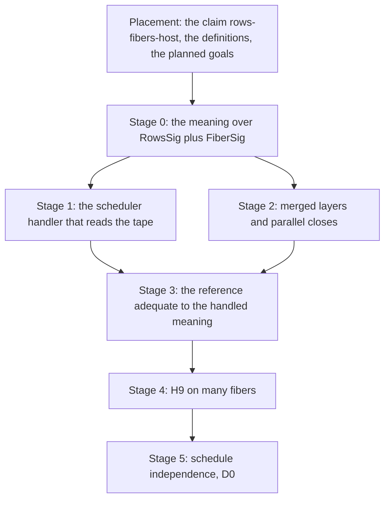

# CONC-1: many fibers (scout, version 1)

Status: a scout for review (history, not authority). It runs after SCOPE-1
(`docs/research/2026-10-14-one-fiber-scout.md`), which runs after PROC-6. Base of the reading:
`98589332f` on `refactor/phase1-phase3`.

## 1. The one thing to know

CONC-1 takes every construct that forks: the fork family, joins and awaits, races, interruption
between fibers, children and supervision, yields, merged layers and parallel scope closes. Its
claim is H9 for many fibers: a recorded run's exits and stores are the meaning's under the run's
own decisions. The owner's rulings of 2026-10-12 (decisions row 361) then let a determinism claim
rest on schedule independence, for exact `obs` on a checked fragment.

**Half of it is proved.** `run_eq_ref_table` (`src/Effect4/Laws/Program/Table/Agreement.lean`,
decisions row 314) proves that the frame machine's replay and the term reference's replay agree
on every program, every row table and every decision tape, on exact `obs`: every fiber's exit and
the whole stores. It has no premise. So CONC-1 never relates the frame machine to anything new.

**The other half reuses one alphabet.** The term scheduler already speaks `FiberSig`
(`src/Effect4/Laws/Program/Sched.lean`): one operation per fiber-level arm of the machine. The
meaning of many fibers is the block meaning over `RowsSig ⊕ FiberSig`, so a fork, a join or a
race is an operation of the tree, not a node unfolded by hand. A scheduler handler, driven by the
decision tape, runs a pool of such trees. No new representation enters: the trees are
`Effects.Program`, the alphabet is `FiberSig`, and the decisions are `Api.Decision`.

## 2. What exists

| Part | Where | What it gives CONC-1 |
| --- | --- | --- |
| The frame and reference agreement | `run_eq_ref`, `run_eq_ref_table` | the machine half, for every construct and every tape |
| The fiber alphabet | `FiberOp`, `FiberSig`, `RSig`, `RProgram` (`Sched.lean`) | `fork`, `forkIn`, `forkScoped`, `await`, `awaitAll`, `awaitAllFailFast`, `yieldNow`, `async`, the four interrupts, `mask`, the scope operations, `raceAll`, `raceAllFirst`, `getId`, children, `runIn` |
| The reference meaning | `denoteR` (`src/Effect4/Laws/Program/DenoteR.lean`) | a residual program over `RSig` for every construct; M5 types it |
| The decision alphabet | `RunDecision` as `Api.Decision`: `fire`, `flush`, `evaluate`, `yieldVerdict`, `answerAsync`, `interruptFrom`, `installMiddleware`, `advance` | the scheduler's and the host's choices, one tape |
| Schedule independence | `docs/research/2026-10-10-schedule-independence/README.md` and its probes: `RD.extends_all`, `RD.complete_unique` (random descent over a diamond) | the generic theorem of row 361's D0 |
| The rulings | decisions row 361: the route, exact `obs`, the checked fragment over `Api.Typed`, D0 now and D1 to D3 when the authoring line asks | the order and the observation |
| SCOPE-1's end | the one-fiber meaning with scopes, layers, services, masks, host interruption and the clock | every arm a fiber runs alone |

## 3. The rulings this plan takes

Decided by the coordinator under the owner's delegation of 2026-10-14; they lock after review.

| # | Ruling | Kind |
| --- | --- | --- |
| 1 | The meaning of many fibers is the block meaning over `RowsSig ⊕ FiberSig`, handled by a scheduler that reads the decision tape. `FiberSig` is reused as it stands | meaning |
| 2 | The agreement goes through the reference: session, frame replay, reference replay (`run_eq_ref_table`, proved), meaning. The one new theorem is the reference's adequacy against the handled meaning, at every tape | representation |
| 3 | Full meaning stays relational over decisions (DB-03). A determinism claim rests on a fixed compatible tape, on a fragment with no decision source, or on schedule independence (row 361 (1)) | meaning |
| 4 | Agreement is receipt-conditioned, as PROC-6's ruling 5 is: no progress and no fairness is claimed. Liveness under `FairTape` (R12) is its own line | domain |
| 5 | Order: §5's stages, after SCOPE-1 merges | domain |

## 4. The shortcut audit

| Shortcut a smaller plan would take | Replacement |
| --- | --- |
| A deterministic scheduler fixed in the meaning | the scheduler reads the tape; every interleaving is a meaning |
| A fork drawn as a call | a fork is a `FiberSig` operation; the child is its own tree in the pool |
| Merged layers built in sequence | the build forks per layer under a parallel parent scope, as rc.112 does |
| A parallel close run in order | the close forks its finalizers |
| Interruption only by the host | interruption by any fiber, with the interruptor recorded, and masks deferring it |
| A second machine for the proof | the term reference already relates to the frame machine; only its adequacy is new |
| Equality of traces | exact `obs`, the trace never part of it (row 361 (2)) |

## 5. The stages

### Stage 0: the meaning over `RowsSig ⊕ FiberSig`

- The block meaning's carrier keeps its shape, over the wider signature. Each forking construct
  is one `FiberSig` operation: `fork` with the child's tree as code by address (SCOPE-1's ruling
  3), `await` answering the target's exit, `raceAll` with its entrants, `interrupt` with its
  target.
- On SCOPE-1's fragment, the one-fiber handler of `FiberSig` gives SCOPE-1's meaning back. That
  conservativity law connects the two scopes.

### Stage 1: the scheduler handler

- A pool of trees, one per fiber, with each fiber's stack of scopes, mask and pending
  interruption. A decision picks the fiber that steps (`fire`, `evaluate`), the verdict of a yield
  (`yieldVerdict`), an answer (`answerAsync`), an interruption (`interruptFrom`) or a clock step
  (`advance`).
- The handler is a comodel of `FiberSig` whose state is the pool, as a host is a comodel of
  `RowSig` (`Effects.Comodel`, decisions row 338).
- Observers, children and supervision follow `Supervision.ForkOptions` and the machine's
  observer rows (`Observer.resumeAwait`, `countdown`, `raceCallback`).

### Stage 2: merged layers and parallel closes

- `merge` and `mergeAll` build each layer in a fiber forked into a sequential scope under a
  parallel parent, then merge the contexts (`mergeAllEffect`, `Layer.ts`; `mergeAllForkOne`,
  `Compile.lean`).
- A scope with the parallel strategy forks its finalizers and awaits them all.

### Stage 3: the reference adequate to the handled meaning

- At every tape, the reference replay (`replayR`) ends as the scheduler handler run of the
  program's tree against the tape's host. The proof is by a relation between the reference's
  fibers and the pool's trees, preserved by each decision.
- With `run_eq_ref_table` and SCOPE-1's bridge (its check C0), the frame machine joins.

### The congruence cases and the two connectors (amended 2026-10-14, decisions row 383)

- Each forking construct adds its case to the congruence of the refinement order
  (`meaning-refines`, the procedures close-out's slice L1): `fork` and its family, `await`,
  a Deferred's await, `raceAll`, interruption between fibers, merged layers and parallel closes.
  Over many fibers the order is inclusion of completed observations over decision tapes: every
  outcome of the left under some tape is an outcome of the right under some tape.
- With those cases, `inline-agrees` holds on the many-fiber fragment. Then the Queue's `take`,
  `offer` and `poll`, Semaphore's `take` and `release`, and the `withPermits` family with
  SynchronizedRef's `modify` reach their connectors:
  `queue-definitions-agree` and `semaphore-definitions-agree` are proved here, and compose with
  `queue-expansion-agrees` and `semaphore-expansion-agrees` by transitivity.
- **The wrapper law, proved once** (decisions row 384 (6), (7)). The shared wrapper
  (`src/Effect4/Library/Waiting.lean`) over steps that agree with a two-phase object refines that
  object, linearized at enrolment and at fulfilment. The waits and posts touch only the request's
  own Deferreds, so they commute with every other fiber's step, and reduction leaves the atomic
  steps. Each module's expansion claim is then its instance at its `StepsAgree`.
- **Progress** (row 384 (5)). The order that keeps termination, under `FairTape`: the
  implementation answers where the model answers. Each bank claim carries it beside refinement.

### Stage 4: H9 on many fibers

- `H9Fibers`: a reached, funded, at-rest run of a program in the fragment, under a host and a
  scheduler whose decisions are the run's, has the handled meaning's exits and stores.
- The validated premises restated over it. No progress, no fairness.

### Stage 5: schedule independence, D0

- Row 361 (4)'s D0: the generic theorem with all its premises, an enabled-fire relation in place
  of raw decisions, a finished machine told apart from an unarmed one, exact `obs` in the battery.
- Stated over the handled meaning, it gives determinism on independent fragments for every tape.
  D1 to D3, the checked fragment over `Api.Typed`, wait for the authoring line to ask (row 361
  (4)).

## 6. Landing cleanly

- **Base.** SCOPE-1's final head, merged. CONC-1 extends SCOPE-1's meaning modules and adds its
  own: the pool, the handler, the adequacy relation, `H9Fibers`.
- **No core edit is planned.** `FiberSig`, the decisions and the machine stay as they are. If the
  adequacy proof needs a machine change, that is a finding for the review, not a slice.
- **The fan-out is the meaning's**: the block meaning's dependents only, since nothing under
  `src/Effect4/Program` or `src/Effect4/Machine` changes. The prep stage measures it.
- **The behaviour gates** are reached only by stage 2 if the layer compile changes. It does not
  in this plan.
- **Reviews**: Gemini, then Codex, before the lock.

## 7. Placement of the planned goals

All goals: concept `translation-simulation`, except where named.

| Goal | Claim, role | Requirement | Consumer |
| --- | --- | --- | --- |
| stage 0: conservativity over SCOPE-1's fragment | step of `rows-fibers-host` | R6 | `H9Fibers` at a one-fiber program |
| stage 1: the handler's laws (a decision steps one fiber) | concept `reactive-scheduling` | R12 | stage 3 |
| stage 2: merged builds and parallel closes | step of `rows-fibers-host`; `scope-lifetime-finalization` | R11 | `H9Fibers` with layers |
| stage 3: the reference adequate to the handled meaning | step of `rows-fibers-host` | R6 | `H9Fibers` |
| stage 4: `h9_fibers : H9Fibers` | `rows-fibers-host` (new), simulation | R6, serving R10 to R12 | the validated premises |
| stage 5: the generic schedule-independence theorem | concept `reactive-scheduling` (row 361) | R12 | determinism claims on checked fragments |
| stage 3: the congruence cases of the forking constructs | step of `meaning-refines` (row 383 (1)) | R10 | `inline-agrees` on many fibers; linearizability claims (row 382 (1)) |
| stage 3: `queue-definitions-agree`, `semaphore-definitions-agree` | instances of `definitions-agree` (row 384 (7)) | R10 | every module built from the two modules' definitions |
| stage 3: the wrapper law | the generic object claim (row 384 (6), (7)) | R10, R12 | each module's expansion claim, as an instance |
| stage 4: refinement that keeps termination under fair tapes | step of each bank claim (row 384 (5)) | R12 | the progress half of every bank claim |

`H9Fibers` does not establish progress, fairness or that a host answers; those are R12's
liveness line and the host's assumption.

## 8. Open checks before the lock

- **K1.** Which state the handler's pool must hold so the reference relation is one-to-one:
  the reference's fiber table, its observers, its race records and its pending interrupts.
- **K2.** Names: the minted names of two interleavings differ; row 361 (2) fixes exact `obs`
  with names in program order, and a comparison up to renaming waits (DET-OW-05).
- **K3.** Whether `denoteR`'s operations are exactly the meaning's `FiberSig` operations, so M5's
  typing and the meaning speak one alphabet. If not, the difference is a finding.
- **K4.** The decision prefix the frame machine reads for a yield at every budget (PROC-6's
  ruling 5): on the reference it is a `yieldVerdict` decision, so it enters as data.

## 9. What this note does not establish

- No statement here is compiled.
- The adequacy route rests on `run_eq_ref_table` as stated, read in this pass, not rerun.
- Sizes wait for the prep stage.
