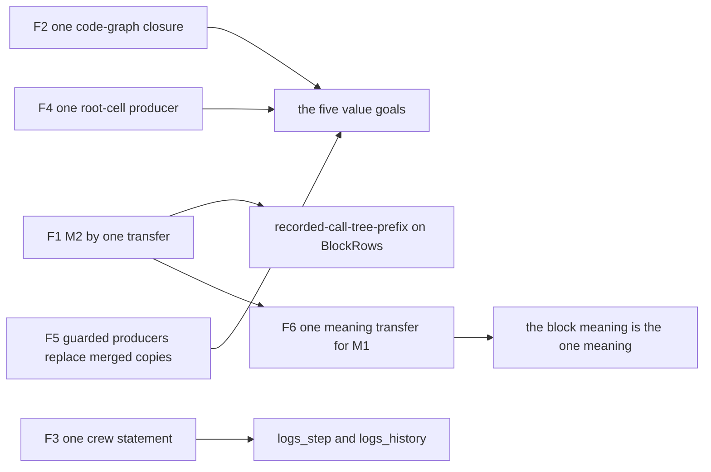
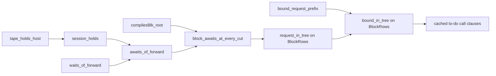

# Overwatch: Codex's meanings chunk, consolidation and closure

Status: an overwatch note (history, not authority). The brief is the coordinator's launch message
of 2026-10-14. The base is `5f07927c8`. The four Codex trees moved while this seat read them, from
19:50 to 20:34 on 2026-10-14. Each table names the head it read.

Evidence words follow `docs/core/controlled-english.md` §3.8. **Proved** means kernel-checked and
audited by `#axiom_audit` at `[propext, Quot.sound]`. **Reading** means established by reading the
named source.

## 1. The one thing to know first

Slice M2 needs no new prefix simulation, and its claim must take `funded`.

- The recorded-command invariant exists. It is `tape_holds_host`
  (`src/Effect4/Laws/Api/SessionMeaning.lean`), the session prefix of H8 and H9. It keeps the
  machine in a form of `Holds` along every answered host decision, for every program with plain
  hooks.
- One transfer lemma, parametric in the meaning family, turns it into the block claim. Take a
  reached, funded, host-driven `BlockRows` run and a host that gave its recorded answers. Every
  pending call that the host leaves unanswered is a wait of the block meaning past a budget bound
  (proved: `block_awaits_at_every_cut`, probe `overwatch-probes/M2Prefix.lean`).
- `hostDriven` reads `tapeOf`, and `tapeOf` stops at the first row that ends at a frontier. So
  without `funded`, an interruption after such a row escapes the premise. Its finalizer's call is
  then bound outside every reply-only tree (proved control: `host_driven_conclusion_refuted`, probe
  `overwatch-probes/M2FundedControl.lean`).
- The source widening of row 388 (3) is not needed on this route. `PlainHooks.of_blockRows` covers
  definitions, loops and cause handlers.

## 2. The inventory per tree

The route is on a path to its goal in every tree. The growth is in the code-graph walks: one
traversal, re-proved per predicate and per weight (§3, finding F2). Sizes are line counts measured
with `wc -l` at the heads named. A file marked "u" is uncommitted or untracked.

### 2.1 The meanings tree

`/Users/pooks/Dev/lean4-effect4-codex`, branch `codex/meanings`, head `994b3eabe` (16 commits).

| Files (lines) | What they prove | Serves | Standing |
| --- | --- | --- | --- |
| `Laws/Machine/LiftCoupledFact.lean` (158) | `DecisionLift.withCoupledFact`: a base lift times a relative fact with its own queue and snapshot assertions | the four value goals, R4 and R11 | on path; needed, since `withMachineFact` carries no queue fact |
| `Laws/Machine/StatePreservation.lean` (444, +84) | `command_on`, `withFiber_on`, `link_with`, `observer_with`: store facts read at the looked-up fiber | the crews' captured scopes | on path; old statements kept as corollaries |
| `Laws/Program/PlaceFunding/FlowGuarded.lean` (96) | `NativeFlow.history_of_lift`, `LocalOn.guarded_decision_lift`: seat FLOW's producers over any driver invariant | the four value goals | on path; the merged copies are instances (F5) |
| `PlaceFunding/FrameControl.lean` (41), `Guard/Lift.lean` (91), `Guard/SourceLift.lean` (66) | administration facts of any frame-weight ledger; the guard's state as a decision lift | the coupled producer's base | on path |
| `Laws/Program/NativeScopeFields.lean` (258) | captured scope fields through every command, under the looked-up operation's permission | both crews' captures | on path |
| `Laws/Machine/PrimWeights.lean` (u), `StoredWeights.lean` (35, u) | active and saved weights in one fold (`pairedAlgebra`, by `hom_eq_cata_prim`) | the writer and source ledgers | a consolidation |
| `Laws/Machine/AnswerFlow{Constructors,Protected,Recursive}.lean` (116, 61, 133) | saved-frame constructions, protected callbacks, recursive loop edges, generic in the model | the crews' answer flow | on path; generic |
| `AnswerSlots/{Points,Syntax,Stored,Compile,Callbacks,Interp,Actions}.lean` (81, 105, 63, 81, 111, 122, 102) | the leading-binding prefix through every code-graph layer | both crews | on path; the second copy of the walk (F2) |
| `AnswerSlots/{Initialization,Ordinary}.lean` (44, 69) | the root initializer certificate; ordinary source entry | both crews | on path; generic |
| `AnswerSlots/Typed*.lean`, 11 files (1278) | the crew certificate `Typed.Spec` and its kind-indexed code graph through every layer | both crews | on path; the third copy of the walk (F2) |
| `ReleaseWriter/*.lean`, 8 files (859, u) | the release-write reservation through compile, callbacks, frames, loops | both crews' writer ledgers | on path; a fourth walk, valued in `Nat` (F2) |
| `Test/Dogfood/Proofs/WorkersSlots.lean` (698) | the first crew's answer-class model: worlds, kinds, initializer, gate, stable and yield transitions | `Workers.Assertions.logs_step` | superseded by `Typed.Spec` with `Initialized.Spec` (F3) |
| `WorkersNativeSlots`, `WorkersCapturedSlots`, `WorkersConnections`, `WorkersExclusivity`, `WorkersWriters`, `WorkersWriterCensus` (231, 199, 295, 79, 138, 77) | the first crew's source equations and transitions, one lemma per member (`_one`, `_two`) | `logs_step` | casing; an instance of `Typed.Spec` and `ReleaseWriter` replaces them (F3) |
| `WorkersWriterSource`, `WorkersWriterStored`, `WorkersWriterWeights` (53 u, 44 u, 150 u), `QueueWorkersFlow` (64), `QueueWorkersWriter` (49, u) | each crew's writer instance; the queue crew's `Spec` instance | both log goals | on path; parametric in the member |
| `Test/Dogfood/Scenario/QueueWorkers/{Model,Assertions,RefReplyControl}.lean` (`1f3d8fce1`) | `TerminalReplies`; `Jobs` made an implication from it; the control `refutes` | `jobs_step`, `held_within_fed` | a narrowed public claim (§4.2) |
| `QueueWorkers/{Connections,InitialSlots,ReleaseWrites,WriterSource}.lean` (98, 92, 89, 106) | the queue crew's source census, one statement per identity | `logs_history` | on path |
| `Test/Dogfood/Scenario/Atomic/WriterPhase.lean` (u, −19 +9) | the Atomic writer projection on the shared weights | `Atomic.Cleanup.log_debits` | a consolidation |

### 2.2 The Timeout tree

`/private/tmp/effect4-timeout-m3`, branch `codex/timeout-m3`, read at `a8ad8ad2f` (7 commits by
`ee39d624e`).

| Files (lines) | What they prove | Serves | Standing |
| --- | --- | --- | --- |
| `HostTimeoutNumber{Counted,Flow,Interrupt}.lean` (373, 876, 55) | the numeric answer classes, the count entry before its write, interruption of a running frame | both Timeout goals, R10 and R11 | on path |
| `HostTimeoutNumber{Phase,PhaseFlow,Wait,Region,Result,Stable,Timer,Configuration,Loop}.lean` (169 u, 491 u, 147, 75, 147, 81, 137, 121, 77) | the phase separating cleanup from form publication; the cancellation wait; the root region; the timer's inertness; the configuration's roles | both Timeout goals | on path; the producer is not yet instantiated |
| `Test/Dogfood/Scenario/Timeout/CommandCut.lean` (45, u) | a finite control: a resumed pre-count queue after an outside interruption | the numeric command assertion | a control |
| `LiftCoupledFact.lean`, `AnswerFlowProtected.lean` | copies of the meanings tree's | — | to merge once |

### 2.3 The queue tree

`/private/tmp/meanings-queue`, branch `codex/meanings-queue`, read at `6f46890d0` (9 commits by
`07c1c69b1`). It carries the QueueWorkers files of §2.1 before their merge, and these.

| Files (lines) | What they prove | Serves | Standing |
| --- | --- | --- | --- |
| `AnswerSlots/Initialized{,Callbacks,Head,Phases}.lean` (136, 61, 91, 77, u) | `Initialized.Spec extends Typed.Spec`: one initialization protocol for both crews | both log goals | on path; the shared crew theorem's home (F3) |
| `Laws/Machine/AnswerFlowEmbedding.lean` (189, u) | an initialized phase model reuses a stable saved family through world and kind maps | both crews | on path; generic |
| `Check.lean`, `QueueAudit.lean` and six more at the tree's root (u) | scratch probes and audits | — | not for landing |

### 2.4 The atomic tree

`/private/tmp/meanings-atomic`, branch `codex/meanings-atomic`, head `25141f9f5` (11 commits).

| Files (lines) | What they prove | Serves | Standing |
| --- | --- | --- | --- |
| `Test/Dogfood/Scenario/Atomic/Store.lean` (+165) | `load_stages`, `decision_step`, `deposit_step`, `deposit_step_amounts`: the initial stages and one store transition each | `Atomic.Store.shop_stages` | on path; the stage witness through every command is open |
| `FinalizerPlacement.lean` (103), `FinalizerRun.lean` (+16) | `clear_loops` and `definition_resolve_zero` from `OncePlaced`; `once_placed_direct_pushes_once` | `FinalizerRun.once_placed_outside_census` | on path |
| `Finalizer{Source,Control,Race,Places,LayerBody,Generator,GeneratorPC,GeneratorRun}.lean` (297, 94, 30, 134, 267, 195, 316, 147) | the selected-source ledger beyond the census: custody transfer at registration and release, race launch, layer bodies, generators | the finalizer goal | on path; instances of `PlaceFunding` and `PrimWeights`; the evaluator debit across all constructs is open |
| `Laws/Machine/AnswerFlowGhostCommands.lean` (185, u) | one external proof world for Atomic's stages and Timeout's phases | `shop_stages`, both Timeout goals | on path; a consolidation |

## 3. The findings, ranked by what they close or remove



### The shared schema

The eight goals share one schema, and it exists. A goal's invariant is a `Lift.DecisionLift`
(`src/Effect4/Laws/Machine/Lift.lean`). `Run.history_keeps` and `stepDecisionState_lift` carry it
along every admitted history. Codex's `withCoupledFact` adds the missing composition: a relative
fact with its own queue and snapshot assertions.

```lean
theorem DecisionLift.withCoupledFact (base : DecisionLift o interp J I O A)
    (facts : CoupledDecision (p := p) (interp := interp) (J := J) (I := I) (O := O)
      (A := A) (P := P) (Q := Q) (R := R)) :
    DecisionLift (pairOrder o p) interp (fun w m => J w.1 m ∧ P w.2 m)
      (fun w m commands => I w.1 m commands ∧ Q w.2 m commands)
      (fun w m tasks => O w.1 m tasks ∧ R w.2 m tasks) (fun w m decision => A w.1 m decision)
```

Each goal supplies its `P`, `Q` and `R` and its facts per command. The schema lacks generic
instances, not a new form. F4's root-cell producer is a base for five goals, and F3's crew
statement is one fact for two. The schema establishes no progress, and a lift leaves its local
facts as premises.

M2's invariant is the same lifting idea at another world order. `tape_holds_host` threads a
position and a host state, ordered by `Leads`, which `Leads.refl` and `Leads.trans` make a preorder
(reading). It is one theorem for every program with plain hooks, not one per construct.

The existing infrastructure each finding stands on:

- F1 and F6: `RunsToDO` and `Leads`, `compilesBlk_root`, `tape_holds_host`. No budget monotonicity
  is needed. `cata_blockAlgB_approx` and `Comodel.run_approx` serve only the completed form's
  stability (`hostRunBlockB_stable`).
- F2: the generated `cata_prim` and `hom_eq_cata_prim`, and `PrimWeights.Model`. The contract's
  unfolding facts belong in a bank of `src/Effect4/Laws/Auto/RuleSets.lean`. Each walk today passes
  its own simp set to every `aesop` call.
- F3 and F4: `AnswerSlots.Typed.Spec`, `AnswerSlots.Initialization`, `withCoupledFact` and
  `PlaceFunding.LocalOn.history_funded`.
- M1's naturality (§5.1): the effects package's `Program.inl_bind`, `Program.inl_pure` and
  `interpret_leftInjectionHandler` (`.lake/packages/effects/Effects/Algebra/Sum.lean`).

### F1. M2 closes by one transfer lemma over the existing session prefix

**Evidence.** `h9_blocks` (`src/Effect4/Laws/Api/SessionMeaningBlocks.lean`) reaches its
completed-run form through `session_settled`, which applies `tape_holds_host` at the whole tape.
`tape_holds_host` holds at every prefix of a host-driven, answered tape. It is the recorded-command
invariant that row 388 (2) asks for. `rows_loop_frontier_host`
(`src/Effect4/Laws/Api/SessionMeaningLoop.lean`) already reads pending calls from it on loops, at
rest. `localWaitC_to_rowsB` (`src/Effect4/Laws/Program/Agreement/HostedLoop.lean`) and
`localRunC_to_blockB` (`src/Effect4/Laws/Program/Agreement/HostedBlocks.lean`) are one case analysis
on the forward agreement, written twice.

**The abstraction.** One wait transfer for every meaning family with a forward agreement:

```lean
theorem waits_of_forward (host : Effects.Comodel (RowSig table) σ) (root : NativeEff) (cf : Nat)
    (R st : σ) (o : Nat → RowsEnd (Option ExitV) σ)
    (forward : ∀ k, RunsToDO host root [] true k (fiberOf (compile root cf) []) Stores.empty R (o k))
    (hL : Leads host root (.live (fiberOf (compile root cf) []) Stores.empty) R (.live fr s ctx) st)
    (hc : IsCall fr.current = true) (hstop : hostAnswer host fr.current st = none)
    (hcall : callOf fr.current = some (row, request)) :
    ∃ lower, ∀ k, lower ≤ k → o k = .waiting row request s st
```

`session_holds` is `session_settled` without its rest premise. `awaits_of_forward` joins the two:
every pending call of a reached, funded, host-driven run of a program with plain hooks is a wait
of the family. The block instance sets the family to `denoteBlockB` and the forward theorem to
`compilesBlk_root`.

**Closes.** The pending-call form of `recorded-call-tree-prefix` on `BlockRows`, at every reached,
funded, host-driven run, under every host that gave the recorded answers. It reaches every
journal prefix of such a run once step 3 of §5.2 gives the prefix as a funded run. The loop
instance also drops the rest premise of `rows_loop_frontier_host`.

**Replaces.** The prefix simulation that rows 388 (2) and 390 (2) plan, and the source widening of
row 388 (3). It does not replace the straight claims, which hold at every budget.

**Probe.** Proved: `waits_of_forward`, `localWaitC_to_rowsB_instance`, `session_holds`,
`awaits_of_forward`, `loop_awaits_at_every_cut` and `block_awaits_at_every_cut`
(`overwatch-probes/M2Prefix.lean`). The control is proved too:
`host_driven_conclusion_refuted` (`overwatch-probes/M2FundedControl.lean`). It plays Codex's
program at command budget 5. The evaluation finishes, and the interruption's row ends at a
frontier after the finalizer parks. The bound finalizer call is in no block tree under any
submitted tape.

**Does not establish.** No interruption meaning (Codex's `prefix_conclusion_refuted` stays the red
control until SCOPE-1's stage 5). Nothing of an unfunded run. No progress. Three steps remain for
the brief's exact statements (§5.2).

### F2. The code-graph walk exists in four copies; one closure theorem replaces them

**Evidence.** Each copy defines a predicate or a weight on runtime code. Each then proves, construct
by construct, that compiling, callbacks, stored programs and the interpreter keep it:

- `SourceScope.CodeAt`, `compile_at` and their callback and interpreter laws
  (`src/Effect4/Laws/Program/NativeScope.lean` and its four companion modules, base);
- `AnswerSlots.CodeAt`, `compile_at`, `contA_at`, `interp_contA_at` (seven files, Codex);
- `AnswerSlots.Typed.CodeAt`, `compile_at`, `contA_at`, `interp_contA_at` (eleven files, Codex):
  the same case list, `case13` to `case46`, re-walked for a third predicate;
- the weights `ReleaseWriter.Source.compile_bound`, `Source.value_bound` (eight files, Codex),
  `FinalizerSource.current_le` (atomic tree) and `SourceScope.Opportunities` (base), valued in `Nat`.

Twenty-eight theorem names recur in all three predicate walks, among them `compile_at`,
`contA_at`, `suspend_at`, `loopResume_at`, `progOf_at`, `interp_contA_at` and `interp_fin_at`. The
count is an intersection of the theorem names of the three file groups at the meanings tree's head.
`Typed.OrdinaryName` is the conjunction of `SourceScope.NameAt`, `AnswerSlots.NameAt` and
`ProtectedName`. `Typed.compile_at` calls the two other `compile_at` theorems and re-walks
`compileEff` for the third conjunct.

**The abstraction.** Runtime code has a generated fold, `cata_prim`
(`src/Effect4/Machine/Fold.lean`), and `PrimWeights` already uses it for weights. A predicate is
the same fold at the carrier `Prop`:

```lean
def codeAlg (name : EffName → Prop) (thunk : EffThunk → Prop) :
    PrimAlgebra EffName EffThunk Val Err Defect FiberId Ann Prop
theorem answerSlots_is_fold : AnswerSlots.CodeAt bindings code =
    cata_prim (codeAlg (AnswerSlots.NameAt bindings) (AnswerSlots.ThunkAt bindings)) code
theorem fold_and : cata_prim (codeAlg (fun n => N₁ n ∧ N₂ n) (fun t => T₁ t ∧ T₂ t)) code ↔
    cata_prim (codeAlg N₁ T₁) code ∧ cata_prim (codeAlg N₂ T₂) code
```

The closure theorems then state once, over a leaf contract. The contract has one field per name,
thunk and child that a producer function mints at a point. The producer functions are
`compileEff`, `contAOf`, `contEOf`, `suspendBodyAt`, `progOf` and `finProgram`. A predicate's
instance owes its contract fields. Each field is one line where the leaf is a prefix
(`AnswerSlots`) or a level (`SourceScope.next_of_at`). The `Nat` copies have the same shape at
`(Nat, +, ≤)`, with `PrimWeights.Model` as the leaf model (reading). Codex has begun this for the
weights: `PrimWeights.pairedAlgebra` and `StoredWeights` share the active, saved and stored folds.

```lean
structure CompileContract (root : NativeEff) (name : EffName → Prop) (thunk : EffThunk → Prop)
    (point : Point → Prop) : Prop where
  cont : ∀ p first rest, point p → Node.at_ (.eff root) p.path = some (.eff (.bind first rest)) →
    name (.cont p)
  -- one field per minting arm of `compileEff`: caught, caughtError, onValue, onCause, fin,
  -- forkScopedIn, acquireCtx, the child points, the thunks pure, body, act and op
theorem compile_closure (contract : CompileContract root name thunk point) (e : NativeEff)
    (p : Point) (found : Node.at_ (.eff root) p.path = some (.eff e)) (held : point p) :
    cata_prim (codeAlg name thunk) (compileEff e p)
```

**Closes.** No goal by itself. It removes the per-predicate re-walk from every remaining value
goal: each new invariant costs its contract, not seven to eleven files.

**Replaces.** The walk files of `AnswerSlots` and `AnswerSlots.Typed` (about 1940 lines) become
instances, and so does the `ReleaseWriter` walk (859 lines). `SourceScope`'s walk becomes one more
instance when it next changes. Build the closure beside them, then move the callers (`AGENTS.md`,
Working).

**Probe.** Proved: `answerSlots_is_fold` and `fold_and` (`overwatch-probes/CodeFold.lean`).
`compile_closure` is a statement in this note, not checked.

### F3. The two log goals are one statement over Codex's crew certificate

**Evidence.** `Workers.Assertions.logs_step` is the step form of a history statement: its
conclusion follows from the history at the stepped machine, by the proved `history_step`.
`QueueWorkers.Assertions.logs_history` is that history statement at the queue crew. Codex's
`AnswerSlots.Typed.Spec` and `Initialized.Spec` (the queue tree) already abstract the crew. The
meanings tree still
holds a Workers-specific model (`WorkersSlots.lean`) and member-cased lemmas: `release_one` and
`release_two` (`WorkersWriters.lean`), `acquisition_one_level` and `acquisition_two_level`
(`WorkersConnections.lean`).

**The abstraction.**

```lean
def CrewLogs (identities : List Nat) (acquirePath : Nat → List Nat) (cell : Nat)
    (m : NativeMachine) : Prop :=
  (∀ value ∈ logAt cell m, ∃ i ∈ identities, value = .nat i) ∧
    ∀ i ∈ identities, (logAt cell m).count (.nat i) ≤
      m.trace.countP (ReleaseTrace.releaseAt (acquirePath i))
def CrewLogHistory (identities : List Nat) (acquirePath : Nat → List Nat) (cell : Nat)
    (b : Api.Built) : Prop :=
  ∀ compileFuel m, Run.HistoryOf b compileFuel m → CrewLogs identities acquirePath cell m
```

The generic proof states it once for an `Initialized.Spec`, with the log cell as one more field.

**Closes.** `logs_step` and `logs_history`, by one proof and two instances.

**Replaces.** `WorkersSlots`, `WorkersNativeSlots`, `WorkersCapturedSlots`, `WorkersConnections`,
`WorkersExclusivity`, `WorkersWriters` and `WorkersWriterCensus` (1717 lines). Their facts become
the `Spec` instance's fields.

**Probe.** Proved: `workers_logs_step` and `queue_logs_history` derive both goals, statements
unchanged, from `CrewLogHistory` (`overwatch-probes/CrewLogs.lean`). Proved: the first crew is an
instance of `Typed.Spec`, each field a kernel-checked source fact at every job total
(`CrewSpec.workers`, `overwatch-probes/CrewSpec.lean`). `CrewLogHistory` itself is the open step.

### F4. One root-cell producer serves five goals

**Evidence.** The four scenario programs open with reference allocations at their first binders,
before their concurrent part. The value goals read those cells through environment slots:

- the crews' release notes write the cell that slot 1 or 2 names;
- `Atomic.Store.decision_step` and `deposit_step` take an arbitrary `q`, which the stage witness
  must identify as the window or the account;
- `HostTimeoutNumberResult.answerPoint` fixes `ready (cell 0) (cell 1) (cell 2) …`, which the
  numeric configuration must produce.

`HostTimeoutNumberConfiguration` says its initial allocation phases need separate constructors.
`WorkersSlots.RootStage` and `AnswerSlots.Initialized` build the same phase for the crews.

**The abstraction.** One producer over `AnswerSlots.Initialization` holds along every admitted
history. Either the root still allocates, at stage `i` with `i` references and no other fiber.
Or every point of the configuration has the leading bindings. Each value goal couples its own
answer classes to it through `withCoupledFact`.

**Closes.** The initialization half of `logs_step`, `logs_history`, `shop_stages`, `cleanup_keeps`
and `retries_declared`, once.

**Replaces.** `WorkersSlots`' initializer and gate transitions, `WorkersExclusivity`, and the
initial phases that the Timeout and Atomic producers still owe.

**Probe.** Proved: the certificate fits the first crew, the Atomic shop and the Timeout fetch
(`RootCells.workers`, `RootCells.atomic`, `RootCells.timeout`, `overwatch-probes/RootCells.lean`).
Codex proved the queue crew's (`QueueWorkers.InitialSlots.certificate`). The probe copies the
certificate's fields, since its oleans are absent in the tree with the Atomic and Timeout oleans.
The producer is the open step.

### F5. The guarded producers replace the merged ones

**Evidence.** `LocalOn.guarded_decision_lift` repeats the body of `LocalOn.decision_lift`
(`src/Effect4/Laws/Program/PlaceFunding/Flow.lean`), the reply arm word for word.
`NativeFlow.history_of_lift` repeats the induction of `NativeFlow.history`.
`DecisionLift.withMachineFact` is `withCoupledFact` at a unit world with true queue and snapshot
facts (reading).

**The abstraction.** The merged theorems become one-line instances of the guarded ones.

**Closes.** No goal. It removes three proofs.

**Probe.** Proved: `decision_lift_is_instance`, with `same_statement` checking that the merged
statement is the instance's type (`overwatch-probes/LiftLayer.lean`). The other two are reading.

### F6. One meaning transfer carries M1's callers

**Evidence.** `waits_of_forward` (F1) generalizes `localWaitC_to_rowsB`. The exit half of
`localRunC_to_blockB` is the same case analysis at `.done (some ex)`. `hostRunB_exits` and
`hostRunBlockB_exits` differ only in the family.

**The abstraction.** The pair `waits_of_forward` and its exit twin, over any family with a forward
agreement. Each older meaning's observation lemmas become instances.

**Closes.** The caller moves of M1 without a case split (§5.1).

**Probe.** Proved for the wait half and its rows instance (`M2Prefix.lean`). The exit twin is
reading.

### The probes and their audit

Each probe compiles as a module with `-DwarningAsError=true`, through the shared slot, from the tree
whose oleans it imports. Then a second file imports it and runs `#axiom_audit` on it. The audit
files are `AuditMeanings.lean` and `AuditQueue.lean` beside the probes.

```sh
cd <tree> && /Users/pooks/Dev/lean4-effect4/scratch/lean-slot.sh lake env lean -DwarningAsError=true \
  --root=<probes> -o <out>/<Probe>.olean <probes>/<Probe>.lean
cd <tree> && /Users/pooks/Dev/lean4-effect4/scratch/lean-slot.sh bash -c \
  "LEAN_PATH=<out>:\$(lake env printenv LEAN_PATH) lean -DwarningAsError=true <probes>/AuditMeanings.lean"
```

| Probe | Tree of its oleans | `#axiom_audit` output |
| --- | --- | --- |
| `M2Prefix.lean` | meanings | 7 declarations within `[propext, Quot.sound]`, 0 modulo planned goals |
| `M2FundedControl.lean` | meanings | 417 declarations within `[propext, Quot.sound]`, 0 modulo planned goals |
| `LiftLayer.lean` | meanings | 2 declarations within `[propext, Quot.sound]`, 0 modulo planned goals |
| `RootCells.lean` | meanings | 49 declarations within `[propext, Quot.sound]`, 0 modulo planned goals |
| `CrewLogs.lean` | meanings | 8 declarations within `[propext, Quot.sound]`, 0 modulo planned goals |
| `CrewSpec.lean` | queue | 17 declarations within `[propext, Quot.sound]`, 0 modulo planned goals |
| `CodeFold.lean` | queue | 7 declarations within `[propext, Quot.sound]`, 0 modulo planned goals |

The main tree's oleans predate its head: `Pos.live` has no context field there. So the probes over
base modules ran with the meanings tree's oleans. An import walk found no module of their closure
among Codex's changed files. `CrewLogs.lean` read `QueueWorkers.Assertions` at its base olean,
built before Codex's edit of `1f3d8fce1`; `logs_history` is unchanged by that edit.

## 4. The route check per goal

### 4.1 The eight goals

| Goal | Statement | Route at the heads read | What it still needs | Abstraction that shortens it |
| --- | --- | --- | --- | --- |
| `Workers.Assertions.logs_step` | unchanged | answer-class model, prefix walk, captured scopes, writer ledger, coupled lift | the coupled producer's command facts; the writer debit; the reading to `LogDebits` | F3, F4, F2 |
| `QueueWorkers.Assertions.logs_history` | unchanged | `Typed.Spec`, `Initialized.Spec`, queue census | the same producer at three members | F3, F4, F2 |
| `Timeout.cleanup_keeps` | unchanged | numeric classes, phase, wait, region, timer, configuration | the coupled numeric producer and its initial phase | F4, F2 |
| `Timeout.retries_declared` | unchanged | the same numeric producer, with the result reader | the same producer | F4, F2 |
| `QueueWorkers.Assertions.jobs_step` | `Jobs` changed (§4.2) | the terminal-reply correction only | the queue-cell writer census, take replies, once-entered continuations | F4 (the queue cell is slot 0), F2 |
| `QueueWorkers.Assertions.rest_step` | its `Jobs` premise is weaker | not started | committed delivery custody, interrupted withdrawal, wake-to-wait correspondence | F4, F2 |
| `Atomic.Store.shop_stages` | unchanged | `load_stages`, `decision_step`, `deposit_step`, ghost world | the stage witness through every command; the cells of `q` | F4, F2 |
| `FinalizerRun.once_placed_outside_census` | unchanged | the selected-source ledger beyond the census | the evaluator debit across layers, generators, invocations, calls and parameters; the history assembly | F2 (the weight walks) |

No goal statement other than the queue clause changed (reading: `git diff 5f07927c8` of each tree's
scenario and claim modules).

### 4.2 The narrowed queue claim

Codex found `HeldWithinFed` false as written and corrected it (`1f3d8fce1`). The original is
refuted by a kernel-checked control: an admitted, funded run whose feeder's take is answered by a
delayed cell read (`RefReplyControl.refutes`). The job comes from the count cell, and `fedOf`
counts only applied success values.

The correction adds `TerminalReplies` to the public claim and makes `Jobs` an implication from it.
No counterexample to the corrected claim is known, and it rests on `jobs_step`. `host_terminal`
shows that every journal of host rows meets the new premise. Two points stand against it as the
final form:

- **Reach.** A delayed cell read is a canonical host completion. `docs/core/host-boundary.md` §2
  admits it, and its §4.7 lists delayed reads among the required positive controls. The correction
  drops those runs from a claim over every funded script.
- **Control.** `RefReplyControl` is reached from no module of `Test/All.lean` at `1f3d8fce1`. The
  module-closure gate refuses that, and the boundary control must be reachable to be kept.

A fuller correction keeps the reach. The frame machine's trace records each resumed answer
(`RunEvent.resumedWith`, `src/Effect4/Machine/Fibers.lean`). So `fed` can read the answer delivered
at each `Jobs.take` resumption, whatever the completion. The ruling belongs to the coordinator
(§7, row C).

### 4.3 Is any route accumulating helpers?

No route is off its path. Every file names its goal and a consumer. The risk is size, not
direction: the walks of F2 grow by one copy per invariant, and each copy is seven to eleven files.

## 5. The forward look

### 5.1 M1: the block meaning is the one meaning

The chains to `denoteBlockB` (`src/Effect4/Laws/Program/BlockMeaning.lean`):

| Meaning | Signature | Chain | Missing link |
| --- | --- | --- | --- |
| `denoteRowsB` | `RowsSig` | `denoteBlockB_loopedDataRows` | none |
| `denoteRows` | `RowsSig` | `denoteBlockB_straight` | none |
| `denote`, `denoteWith` | `StoreSig` | to `denoteRows` | the store-signature embedding |
| `denoteB`, `denoteBWith` | `StoreSig` | to `denoteRowsB` | the store-signature embedding |

`RowsSig table` is `Signature.sum StoreSig (RowSig table)` (`src/Effect4/Laws/Program/DenoteRows.lean`).
The four store meanings reach a row meaning only through the left injection `Program.inl`
(`.lake/packages/effects/Effects/Algebra/Sum.lean`). `DenoteCtl.lean` already proves all six
meanings instances of `denoteCtl`, parametric in the signature (`denote_eq_ctl`, `denoteB_eq_ctl`,
`denoteWith_eq_ctl`, `denoteBWith_eq_ctl`, `denoteRows_eq_ctl`, `denoteRowsB_eq_ctl`). So the four
missing links are one naturality theorem and one congruence:

```lean
theorem denoteCtl_inl (c : Ctl StoreSig) (e : NativeEff) (env : List Val) :
    Program.inl (denoteCtl c e env) = denoteCtl (c.inl table) e env
```

`c.inl` maps the leaf by `Program.inl` and keeps the other parameters. `Program.inl` is a monad
morphism (`Program.inl_bind`, `Program.inl_pure`), so the theorem is one induction. The congruence
says that `c.inl` and `rowsCtl₀ table` give one tree on a `Straight` program. Such a program holds
no `catchIf` and performs no host row (reading: `denoteB_straight`'s refused arms). Deleting
`DenoteCtl.lean` first would turn these two theorems into four connectors. Recommended: keep `Ctl`
and `denoteCtl` as the carrier of the chains, and delete the file's other parts when their last
use goes (§7, row B).

The callers move through F6: each observation lemma of an older meaning is an instance of the one
transfer at its family.

### 5.2 M2: the recorded call tree past straight lines



The proved part ends at `block_awaits_at_every_cut`. Three steps remain, each small:

1. **The admitted tape.** Instantiate the host at `admittedTapeHost` with the applied exits. This
   needs each applied answer admitted by its row's columns under `SourceScope.ConcreteReplies`, as
   the private `answer_decision` of `src/Effect4/Laws/Run/CallTree.lean` derives it.
2. **The request form.** State `awaits_of_forward` at a live `requestOf` instead of an `Await`.
   The proof is the same: `requestOf_Mcall` fixes the fiber and the token, and
   `requestOf_Mcall_call` fixes the row and the request.
3. **The binding form.** `bound_request_prefix` (`src/Effect4/Laws/Run/JournalPrefix.lean`) gives
   the earlier run. It must also give that run as a journal prefix, so that `funded` and
   `hostDriven` pass to it.

The widened claims then take `Run.Reached`, `funded`, `hostDriven` and `BlockRows`. They need no
`NoCauseHandler`, no `ExternalOnly` and no `ConcreteReplies` beyond step 1. Taking `funded` follows
the rule its docstring states: a statement over runs takes it as its budget premise
(`src/Effect4/Run/Tape.lean`). The cached to-do's call clauses take the same premises.

Under row 390 (1), `funded` is a correction of a goal false as written, with
`host_driven_conclusion_refuted` as its control. A reach over unfunded runs needs two more things.
It needs a history premise read from the whole journal. It also needs an invariant of unsettled
machines, as the straight `MachineInv` of `CallTree.lean` has.

The effects package's `IsSim` and `System.peel` (`.lake/packages/effects/Effects/Coalgebra/`)
give a general form: the session as a system simulated by the peeled block meaning. No closure
needs that restatement now.

## 6. The message to Codex

```text
Overwatch probes (proved): /Users/pooks/Dev/lean4-effect4/docs/research/2026-10-14-meanings/overwatch-probes/
1. M2 (if row A): no new prefix simulation. tape_holds_host is the invariant; M2Prefix.lean's
   waits_of_forward + awaits_of_forward give block_awaits_at_every_cut. Widened claims take
   `funded` (control: M2FundedControl.lean) and need no ExternalOnly widening.
2. Before a fifth code-graph walk: SourceScope, AnswerSlots, Typed and ReleaseWriter re-walk
   compileEff/contAOf/interp. Make CodeAt the cata_prim fold of a leaf algebra (CodeFold.lean),
   prove one closure theorem over a minting contract; Typed and ReleaseWriter become instances.
3. Crews: Workers is a Typed.Spec instance (CrewSpec.lean). Prove CrewLogHistory once over
   Initialized.Spec; CrewLogs.lean derives logs_step and logs_history from it. Then replace
   WorkersSlots and the _one/_two Workers files by the instance.
4. Use the Initialization producer for shop_stages and the Timeout fetch too (RootCells.lean).
5. Queue: reach RefReplyControl from Test/All.lean; the fuller fix reads fed from resumedWith.
```

## 7. Proposed decisions rows

These are proposals for the coordinator. No register was edited.

- **Row A (M2's route and premise).** Amends rows 388 (2), 388 (3) and 390 (2). The widened
  `recorded-call-tree-prefix` ranges over reached, funded, host-driven `BlockRows` runs. Its prefix
  connection is `tape_holds_host` with one transfer lemma (`block_awaits_at_every_cut`, proved in
  `overwatch-probes/M2Prefix.lean`). `host_driven_conclusion_refuted` is the control of `funded`.
  The source widening is withdrawn: the claim needs no `ExternalOnly`.
- **Row B (M1's carrier).** Amends row 389 (1). `Ctl` and `denoteCtl` stay as the carrier of the
  store meanings' chains, through one theorem `denoteCtl_inl`. The rest of `DenoteCtl.lean` goes
  when its last use goes.
- **Row C (the queue clause).** A ruling between Codex's `TerminalReplies` restriction and an
  observation that reads delivered answers. Recommended: the observation, since delayed cell reads
  are a canonical host completion. Either way, `RefReplyControl` is reached from `Test/All.lean`.
- **Row D (one code-graph closure).** Before a fifth walk lands, the code-graph predicates and
  weights are folds of one leaf algebra (`cata_prim`), with one closure theorem per producer
  function. Each invariant supplies its minting contract. `SourceScope` moves when it next changes.
