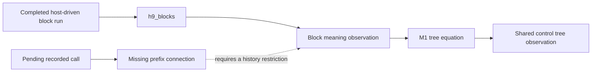

# Meanings receipt: M2 stops at the interruption boundary

The unrestricted M2 widening is false: an interrupted body starts a finalizer call that no submitted-reply tape explains.
The retained Lean counterexample checks an admitted `BlockRows` program and an accepted recorded binding.
The meanings packet requires an immediate stop on a false goal or a route beyond `h9_blocks` and M1.
The required initial reading exposes this boundary before any M1 source edit.
M1, M2 and M3 remain unlanded.

## Base, branch and retained files

- Worktree: `/Users/pooks/Dev/lean4-effect4-codex`.
- Branch: `codex/meanings`.
- Base and implementation head: `03e8f5d5679b3aa9020f694550ab5db19beeceba`.
- Branch command: `git switch -c codex/meanings 03e8f5d56`.
- Evidence commit: the commit containing this receipt. Its parent is the named base.
- Changed files: this receipt and the files under [evidence](evidence/manifest.json).

The source tree, existing theorem statements, registries and generated reports retain their base contents.
No caller moves and no copy is deleted.
No machine, `Eff`, `Ty` or `Store.Val` definition changes.
Nothing is pushed.

## M1: not started

Base and implementation head: `03e8f5d5679b3aa9020f694550ab5db19beeceba`.
The stop occurs during the required reading of `CallTree.lean` and the M2 route.
`Ctl` and `denoteCtl` remain in `src/Effect4/Laws/Program/DenoteCtl.lean`.
`blockAlgB` remains in `src/Effect4/Laws/Program/BlockMeaning.lean`.
The six existing connectors and the separate block meaning remain unchanged.
The requested consolidation still needs implementation, caller migration and deletion checks.

## M2: route and checked counterexample

Base and implementation head: `03e8f5d5679b3aa9020f694550ab5db19beeceba`.
The proposed widened goals are not planted because the route reaches the packet's stop condition first.

### The route needs an additional connection

`H9Blocks` in `src/Effect4/Laws/Api/SessionMeaningBlocks.lean` concerns a reached, funded, settled, host-driven run with an exit.
It also requires `HostAnswered` for the chosen host.
`h9_blocks` proves that completed observation agrees with the block meaning past a budget bound.

`request_leads` and `bound_in_tree` in `src/Effect4/Laws/Run/CallTree.lean` concern pending requests and bindings at arbitrary command prefixes.
They require neither an exit nor a host-driven history.
M1 would equate meaning trees; it supplies neither missing execution premise.
Thus `h9_blocks` and M1 do not provide the requested prefix connection.



There is a second restriction to address.
`SourceScope.ExternalOnly` in `src/Effect4/Laws/Program/HostSource.lean` also requires `SourceScope.directHead` from `ScopeFragment.lean`.
That predicate rejects definition blocks, calls and invocations.
Keeping it unchanged would exclude the programs M2 intends to admit.
The retained control checks that it accepts the example's body and rejects its root block.

### The counterexample

All declarations below live in [MeaningsPrefixProbe.lean](evidence/MeaningsPrefixProbe.lean), namespace `Test.MeaningsPrefixProbe`.
The program has an empty definition block around `onExit`.
Its body calls row 0; its finalizer calls row 1.
Both rows take and answer unit values, with no typed failure.

1. Open the admitted program with compile and command budgets of 100.
2. Evaluate until row 0 waits.
3. Interrupt the root fiber.
4. Bind the finalizer's request at row 1, token 1.

The run submits no reply.
The finalizer binding is accepted.
Every tape drawn from submitted replies is therefore empty.
At every meaning budget, the block tree under that empty tape still waits at row 0.
It cannot explain the accepted row 1 binding.

| Declaration | Evidence and reach |
| --- | --- |
| `admitted` | Program typing, formation, signature and row-column certificates |
| `fragment_admitted` | Kernel-checked `BlockRows table program = true` |
| `external_only_body` | The body contains only the admitted direct external operations |
| `old_source_restriction_refuses_block` | The old source restriction rejects the root block |
| `concrete_replies` | The reply columns are closed |
| `first_request` | The first machine request is row 0, token 0 |
| `finalizer_request` | The interrupted machine requests row 1, token 1 |
| `recorded_reached` | The recorded run follows the actual session commands |
| `finalizer_binding_accepted` | The recorded row 1 binding has phase `bound` |
| `waiting_has_no_exit` | The first pending run does not meet H9's exit premise |
| `interrupted_not_host_driven` | The interrupted run does not meet H9's host-driven premise |
| `tree_waits_first` | Every meaning budget waits at row 0 under the empty tape |
| `submitted_tape_empty` | Every tape satisfying the submitted-reply condition is empty |
| `prefix_conclusion_refuted` | No budget and submitted-reply tape explain the recorded row 1 binding |

Proof role: inversion boundary of `recorded-call-tree-prefix`, concept `translation-simulation`, requirement R6.
Consumer: the coordinator's M2 history restriction and route decision.
Evidence status: kernel-checked counterexample, with no planned-goal dependency.
Scope: one finite admitted program and command script; the tree exclusion quantifies over every meaning budget and eligible reply tape.
It establishes no universal simulation, progress or outside-host agreement.
The host boundary remains `docs/core/host-boundary.md`.

### Proposed decision

Retain the existing straight claim unchanged.
Choose the permitted recorded histories before widening the claim to blocks.
The narrow route excludes external interruptions and other decisions that the reply-only local meaning does not model.
It then needs a prefix simulation for those histories, including pending calls and arbitrary command cuts.
`compilesBlk_root` in `src/Effect4/Laws/Program/Agreement/Blocks.lean` supplies local block agreement for that proposed route.
It does not supply the recorded-command invariant.

The alternative records interruption decisions in the meaning itself.
That requires a separate design decision beyond the proposed tree consolidation.
Neither route is implemented here, and no decisions register changes.

## M3: unchanged goals

Base and implementation head: `03e8f5d5679b3aa9020f694550ab5db19beeceba`.
The retained [frontier output](evidence/frontier.log) measures each requested goal.
No M3 proof starts after the M2 stop condition.

| Goal | Measured status |
| --- | --- |
| `Workers.Assertions.logs_step` | goal |
| `QueueWorkers.Assertions.logs_history` | goal |
| `Timeout.cleanup_keeps` | goal |
| `Timeout.retries_declared` | goal |
| `QueueWorkers.Assertions.jobs_step` | goal |
| `QueueWorkers.Assertions.rest_step` | goal |
| `Atomic.Store.shop_stages` | goal |
| `FinalizerRun.once_placed_outside_census` | goal |

The first seven names belong to `Test.Dogfood.Scenario`; the last belongs to `Effect4.Program`.
The retained tool output contains their full names and statements.
Workers, QueueWorkers, Timeout and Atomic still depend on their respective application goals.
The existing `bound_in_tree` and `h9_blocks` both report proved under their existing premises.

## Commands and results

All Lean commands run through `/Users/pooks/Dev/lean4-effect4/scratch/lean-slot.sh`.
The slot serializes the commands and sets `LEAN_NUM_THREADS=2`.
The script [run-checks.sh](evidence/run-checks.sh) records the exact build, kernel-check, audit and status commands.

```sh
/Users/pooks/Dev/lean4-effect4/scratch/lean-slot.sh bash \
  docs/research/2026-10-14-meanings/evidence/run-checks.sh \
  /private/tmp/meanings-final-check
```

| Check | Result | Retained output |
| --- | --- | --- |
| Narrow build of the meanings, prefix claim, eight-goal consumers and proof tools | PASS, 1381 jobs | [build.log](evidence/build.log) |
| `lake env lean -DwarningAsError=true`, compiling the retained counterexample | PASS, no diagnostics | [probe.log](evidence/probe.log) |
| `#axiom_audit MeaningsPrefixProbe` | PASS | [audit.log](evidence/audit.log) |
| Counterexample `#plan_status` | All four queried declarations proved, zero next goals | [audit.log](evidence/audit.log) |
| Requested-goal `#plan_status` | Eight next goals | [frontier.log](evidence/frontier.log) |
| Existing meaning and prefix module audit | PASS | [frontier.log](evidence/frontier.log) |

Counterexample audit output:

```text
#axiom_audit: 420 declarations within [propext, Quot.sound], 0 of them modulo planned goals; 0 planned goals
```

Existing meaning and prefix module audit output:

```text
#axiom_audit: 756 declarations within [propext, Quot.sound], 0 of them modulo planned goals; 0 planned goals
```

`python3 scripts/check-language.py --strict docs/research/2026-10-14-meanings/receipt.md` passes with no finding in this receipt.

No behavior gate is reached because executable definitions remain unchanged.
`make gen-semantics` does not run because no registry, placement or planned goal changes.
The finish criteria remain unmet; this receipt records the packet's required stop.


## Revised M3: shared crew consolidation

The eight application goals remain open at this checkpoint.
The shared crew history now has checked source instances; the complete initialized driver remains its premise.

Base: `c42cb5f24`.
Implementation head: `82f809d6b`.
The commit changes 26 files, with 1571 insertions and 1867 deletions, as `git commit` reports.

`CrewLogs.history` in `src/Effect4/Laws/Program/CrewLogs.lean` serves both crew log goals under R4 and R11.
Its membership proof uses `command_refTransfer` through `RefInvariant.history` in `src/Effect4/Laws/Program/NativeRefInvariant.lean`.
Its count proof uses `ReleaseWriter.history_funded` in `src/Effect4/Laws/Program/ReleaseWriter/History.lean`.
Both proofs consume the same actual synchronous write observation.
The log reader uses the native list view, matching the append operation's reader.
The application observations still read their list-valued reference cells.

`WorkersFlow.initializedSpec` in `Test/Dogfood/Proofs/WorkersFlow.lean` replaces the separate Workers initialization model.
`WorkersLogContract.contract` and `QueueWorkersLogContract.contract` supply the concrete write contracts in their respective proof files.
Their source censuses cover every reference writer and every job total.
The contracts retain the initialized environment and protected acquired-identity premises.
They establish no history, progress, or host agreement by themselves.

The commit deletes `WorkersSlots`, `WorkersNativeSlots`, `WorkersCapturedSlots`, `WorkersConnections`, `WorkersExclusivity`, `WorkersWriters`, and `WorkersWriterCensus`.
Their former consumers use the shared model and uniform source instances.
`PlaceFunding.Flow` owns the guarded producers; the original producers become instances.
`FlowGuarded` retains only its import for earlier evidence.

The narrow build runs these exact targets through the shared Lean slot:

```sh
/Users/pooks/Dev/lean4-effect4/scratch/lean-slot.sh lake build \
  Test.Dogfood.Proofs.QueueWorkersLogContract \
  Test.Dogfood.Proofs.WorkersLogContract
```

Result: 1343 jobs, successful.
The retained build output is `evidence/crew-consolidation-build.log`.
The audit imports the landing's 17 modules, then runs `#axiom_audit` over those modules.
The retained command file is `evidence/CrewConsolidationAudit.lean`.

```sh
/Users/pooks/Dev/lean4-effect4/scratch/lean-slot.sh lake env lean \
  docs/research/2026-10-14-meanings/evidence/CrewConsolidationAudit.lean
```

```text
#axiom_audit: 465 declarations within [propext, Quot.sound], 0 of them modulo planned goals; 0 planned goals
```

The axiom output is retained in `evidence/crew-consolidation-audit.log`.
The landing changes proof definitions and proofs; it changes no executable machine or source-program behavior.
M1 and M2 remain pending after M3.


## Revised M3: actual initialized commands

The eight endpoint goals remain open at this checkpoint.
The initialized machine fact now advances through every actual command when the driver supplies its queued demands.

Base: `82f809d6b`.
Implementation head: `187844ddd`.
The changed paths are the exact output of `git diff --name-only 82f809d6b 187844ddd`.
The Timeout receipt continues in `timeout-checkpoint.md`.

`AnswerSlots.Initialized.Configuration` joins stored frames, captured scope fields and tracked-child readiness.
It lives in `src/Effect4/Laws/Program/AnswerSlots/InitializedDriver.lean`.
Its command theorem serves the two crew log goals under store-typing R4 and scope-lifetime-finalization R11.
`initial_configuration` proves its load case for every compilation budget.
`configuration_edits` covers the actual outside decisions and prepared replies.
The queue must still retain administrative heads, terminal stacks and track readiness.

`ParkedShape.Configuration` records the actual code held by a parked fiber.
Its command and decision proofs live in `src/Effect4/Laws/Program/ParkedShapeRun.lean`.
`Waits.of_frame` derives each parked reply class from that code and its saved path.
It consumes the existing source-owned reply queue, including delayed reference reads.
It adds no separate reply queue.

`AnswerFlow.Commands.exitChildren` now requires its actual execution branch.
The former helper demanded child-cleanup flow even before initialization and when no child cleanup runs.
The changed helper leaves the machine and endpoint statements unchanged.
`ChildrenReady.command` proves that tracked children imply completed initialization.
`InitializedCommands.command_facts` supplies the common answer-flow command producer.

`AnswerFlowNativeExit` replaces the copied initialized terminal-return proof.
The allocation adapter uses the same connector and retains exact source entry separately from allocation counts.
`NativeAdminOrigin` identifies actual administrative continuations through the existing primitive producer.
The continuation retains its originating action instruction.
The existing guard therefore transports its instruction; the frame proof reads its answer class at consumption.

Timeout now carries actual addressed messages and count writes through its numeric machine, queue and detached tasks.
Its pending finishes retain the actual drained-stack premise.
The actual race provenance and complete history remain open.
Atomic's allocation, source-entry, saved-frame and terminal-return connections remain prerequisites of its open history.
No local producer establishes an application endpoint by itself.

The focused commands are:

```sh
/Users/pooks/Dev/lean4-effect4/scratch/lean-slot.sh lake build Effect4.Laws.Program.PlaceFunding.Flow
/Users/pooks/Dev/lean4-effect4/scratch/lean-slot.sh lake env lean /private/tmp/ParkedReplyAudit.lean
/Users/pooks/Dev/lean4-effect4/scratch/lean-slot.sh lake build Effect4.Laws.Program.AnswerSlots.InitializedDriver
/Users/pooks/Dev/lean4-effect4/scratch/lean-slot.sh lake env lean /private/tmp/InitializedDriverAudit.lean
```

The builds report 573 and 707 jobs, both successful.
Their retained outputs are `evidence/parked-reply-build.log` and `evidence/initialized-driver-build.log`.
The retained audit command files and outputs share those names.

```text
#axiom_audit: 327 declarations within [propext, Quot.sound], 0 of them modulo planned goals; 0 planned goals
#axiom_audit: 144 declarations within [propext, Quot.sound], 0 of them modulo planned goals; 0 planned goals
```

These are proofs over actual transitions, not finite runtime comparisons.
The landing changes no machine, program syntax, type syntax or value representation.
The eight `proof_goal` declarations remain in place, as the source search confirms.
M1 and M2 remain after M3.


## Revised M3: both crew log goals are proved

Merge the shared initialized driver with both application instances.
The log proofs use actual command producers, queued demands, captures and reference writes together.
They require no supplied preservation premise.

Base: `69e18b618`.
Implementation head: `03c5d9544`.

`Initialized.decision_lift` in `src/Effect4/Laws/Program/AnswerSlots/InitializedHistory.lean` composes the existing driver with its initialized value assertion.
`CrewLogs.initialized_history` in `src/Effect4/Laws/Program/CrewLogs/InitializedHistory.lean` serves both log goals under R4 and R11.
`CrewLogHistory` in `Test/Dogfood/Proofs/CrewLogHistory.lean` supplies the two actual source instances.
The shared `awaitCode_closed` in `src/Effect4/Laws/Machine/AwaitCode.lean` replaces two separate wait-result case walks.
The observer producer retains its actual running flag alongside its existing frame and counter facts.

Proof role: preservation and observation of initialized crew log entries.
Evidence status: kernel-checked and audited.
Scope: every admitted history of each original crew, at every compilation and command budget.
The result establishes no progress, release order, fairness or outside-host agreement.

The narrow build command is:

```sh
/Users/pooks/Dev/lean4-effect4/scratch/lean-slot.sh lake build \
  Test.Dogfood.Scenario.Workers Test.Dogfood.Scenario.QueueWorkers
```

Result: 1428 jobs, passed.
The output is [crew-history-build.log](evidence/crew-history-build.log).

```sh
/Users/pooks/Dev/lean4-effect4/scratch/lean-slot.sh lake env lean \
  docs/research/2026-10-14-meanings/evidence/CrewHistoryAudit.lean
```

The command file retains the exact module audit and application status queries.
The output is [crew-history-audit.log](evidence/crew-history-audit.log).

```text
#axiom_audit: 476 declarations within [propext, Quot.sound], 3 of them modulo planned goals; 2 planned goals
Test.Dogfood.Scenario.Workers.Assertions.logs_step: proved; nearest []; 0 lemmas, 0 definitions
Test.Dogfood.Scenario.QueueWorkers.Assertions.logs_history: proved; nearest []; 0 lemmas, 0 definitions
Test.Dogfood.Scenario.Workers.workers: proved; nearest []; 0 lemmas, 0 definitions
Test.Dogfood.Scenario.QueueWorkers.releases_once: proved; nearest []; 0 lemmas, 0 definitions
next goals: 0
```

The audited queue assertions module still contains `jobs_step` and `rest_step`.
Neither log proof depends on them.
The other M3 goals remain open: both Timeout goals, both queue accounting goals, `Atomic.Store.shop_stages`, and `FinalizerRun.once_placed_outside_census`.
M1 and M2 remain pending after M3.
The change reaches no executable behavior gate.

Changed files:

- `Test/Dogfood/Proofs/CrewLogHistory.lean`.
- `Test/Dogfood/Scenario/Workers/Assertions.lean`.
- `Test/Dogfood/Scenario/QueueWorkers/Assertions.lean`.
- `src/Effect4/Laws.lean`.
- `src/Effect4/Laws/Machine/EditObserverWords.lean`.
- `src/Effect4/Laws/Machine/AwaitCode.lean`.
- `src/Effect4/Laws/Program/Guard/CommandControlEdits.lean`.
- `src/Effect4/Laws/Program/AnswerSlots/InitializedCommands.lean`.
- `src/Effect4/Laws/Program/AnswerSlots/InitializedQueueAdmin.lean`.
- `src/Effect4/Laws/Program/AnswerSlots/InitializedHistory.lean`.
- `src/Effect4/Laws/Program/AnswerSlots/TypedStored.lean`.
- `src/Effect4/Laws/Program/AnswerSlots/TypedActions.lean`.
- `src/Effect4/Laws/Program/CrewLogs/InitializedHistory.lean`.
- `src/Effect4/Laws/Program/SourceOpportunityCommands.lean`.

## Full source callback closure

The finalizer endpoint remains open. This slice removes the direct-fragment restriction from its source callback facts.

Base: `2099f556d`. The branch also integrates Atomic observation commit `7766f84b4`.

Placement: scope-lifetime-finalization, R11, serving `FinalizerRun.once_placed_outside_census`.
The shared generated code fold retains parameter frames, generator counters, and excluded layer construction regions.
`FinalizerGenerator.run_budget` carries annotations and weights through its existing statement walk.
The stored callbacks reuse `CodeClosure` through `code_mono`.
The canonical weight model from `cbff02d3d` remains the only finalizer source weight model.

Changed modules: `CodeClosure.Predicate`, `FinalizerSyntax`, `FinalizerLayers`, `FinalizerCallbacks`, `FinalizerSuspensions`, and `FinalizerGeneratorRun`.
`FinalizerRun` imports the closure.

Commands, run from `/Users/pooks/Dev/lean4-effect4-codex` through `scratch/lean-slot.sh`:

- `lake build Effect4.Laws.Program.FinalizerGeneratorRun Effect4.Laws.Program.FinalizerCallbacks`: passes, 584 jobs.
- `lake build Effect4.Laws.Program.FinalizerSuspensions`: passes, 584 jobs.
- `lake env lean /private/tmp/FinalizerClosureAudit.lean`: passes.

Audit: 344 declarations within `[propext, Quot.sound]`, zero modulo planned goals, zero planned goals.
Evidence: `evidence/finalizer-closure-audit.log` and `evidence/FinalizerClosureAudit.lean`.

Open: join recursive callbacks, native transitions, release custody, and command history to the endpoint.
These are local kernel-checked facts. They establish no progress or host behavior.

## Callback roles and full saved-frame accounting

The full finalizer callback and saved-frame bounds now compile and pass the axiom audit.
The whole-history producer remains open; this slice does not close the finalizer goal.
Base: `94f99e804`. Head: the commit containing this receipt section.

`CodeClosure.roleAlg` distinguishes unary success callbacks from ordinary callbacks.
`CodeClosure.compile_roles` owns the compiler walk; the old equal-role interface is its instance.
`CodeClosure.Family` owns saved-frame and current-head closure.
`CodeClosure.Qualified.prefixLaws` now uses that producer, removing its duplicate closure proof.
`CodeClosure.Funding.armA` and `armE` own callback reservation bounds.
`FinalizerSource` supplies the full source instance, including generators, layers, definitions and stored callbacks.
The strict annotation excludes `releaseUnder` from ordinary callback slots.
Its unary success push transfers the captured release reservation into its saved callback.

Placement: scope-lifetime-finalization, R11, steps of `once_placed_outside_census` in `src/Effect4/Laws/Program/FinalizerRun.lean`.
Consumers: full native evaluator accounting and the selected-source history invariant.
Reach: actual interpreter callbacks and selected saved frames under `OncePlaced` and the full source annotation.
These facts prove no progress, complete history bound, or host agreement.

Changed files: `CodeClosure/{Predicate,Compile,Family,Funding,Qualified/Stable}.lean` and
`Finalizer{Syntax,Layers,Callbacks,Suspensions,Iterations,Interp,Funding,Run}.lean` under `src/Effect4/Laws/Program/`.

Commands:
- `lean-slot.sh lake build Effect4.Laws.Program.FinalizerRun Effect4.Laws.Program.CodeClosure.Qualified.Stable`: passed, 640 jobs.
- `lean-slot.sh lake env lean /private/tmp/FinalizerRoleAudit.lean`: passed.
- The audit reports 689 declarations within `[propext, Quot.sound]`, zero modulo goals, and zero planned goals in the audited modules.

The evidence is [the audit](evidence/FinalizerRoleAudit.lean) and [its output](evidence/finalizer-role-audit.log).
The two log goals remain proved. The other six M3 goals, M1 and M2 remain open.


## One frame-accounting producer

The older source counter and release-writer counter now use the full finalizer's shared frame rule.
The finalizer history goal remains open.
Base: `cc7f8fd74`. Head: the commit containing this section.

`CodeClosure.Events` owns the registration-event reading through continuation pops.
`CodeClosure.Funding.step_bound` owns primitive frame accounting with explicit actual callback premises.
`FinalizerEvaluation`, `SourceOpportunityEvaluation`, and `ReleaseWriter.Evaluation` supply its instances.
The older source and writer frame walks are removed.
`InitializedIteration.step_frame` uses the shared native frame connector.
`TypedActions.store_action_at` unfolds the qualified stored-program predicate after the earlier alias migration.

Placement: scope-lifetime-finalization, R11, serving `FinalizerRun.once_placed_outside_census` and both crew log claims.
Consumers: native evaluator accounting and initialized crew iteration.
Reach: actual selected callbacks and source-owned frames, with each instance's original premises.
These local proofs establish no full finalizer history, progress, or host agreement.

Files: `CodeClosure/{Events,StepFunding}.lean`, `FinalizerEvaluation.lean`, `FinalizerRun.lean`,
`SourceOpportunityEvaluation.lean`, `ReleaseWriter/Evaluation.lean`, and
`AnswerSlots/{TypedActions,InitializedIteration}.lean` under `src/Effect4/Laws/Program/`.

Commands, through the shared `lean-slot.sh`:

- `lake build Effect4.Laws.Program.FinalizerRun Effect4.Laws.Program.ReleaseWriter.Evaluation`: passed, 658 jobs.
- `lake build Effect4.Laws.Program.AnswerSlots.InitializedIteration`: passed within the preceding direct-consumer build.
- `lake env lean /private/tmp/FrameFundingAudit.lean`: passed.

The audit reports 318 declarations within `[propext, Quot.sound]`, zero modulo goals, and zero planned goals.
Evidence: [the audit](evidence/FrameFundingAudit.lean) and [its output](evidence/frame-funding-audit.log).
The two log goals remain proved. The other six M3 goals, M1, and M2 remain open.


## Constructor correlations in the shared callback family

The full finalizer history remains open. The sequencing producer now takes the exact registration-body relation.
Base: `04609f0fe`. Head: the commit containing this section.

`CodeClosure.PredicateFamily` owns saved-family and head closure for a supplied predicate on actual code.
`CodeClosure.Family` supplies the existing leaf instance. Its duplicate walks are removed.
`CodeClosure.Correlated` retains each existing child beside its local relation through the generated fold.
`ReleaseCustody.NativeSequencing` consumes the exact scope-registration template. Existing source callers use it as an instance.

Placement: scope-lifetime-finalization, R11, serving `FinalizerRun.once_placed_outside_census`.
Consumer: full-source release custody.
Reach: actual native evaluator outputs with the registration template and the existing saved-stack sequencing premise.
These local facts establish no command history, progress, or host agreement.

Changed files: `CodeClosure/{Correlated,PredicateFamily,Family}.lean` and `ReleaseCustody/NativeSequencing.lean` under `src/Effect4/Laws/Program/`.

Commands through `lean-slot.sh`:

- `lake build Effect4.Laws.Program.CodeClosure.Family`: passed, 248 jobs.
- `lake build Effect4.Laws.Program.ReleaseCustody.LoopCommand Effect4.Laws.Program.ReleaseCustody.NativeIterationDebit`: passed, 644 jobs.
- `lake env lean /private/tmp/TemplateAudit.lean`: passed.

The audit reports 278 declarations within `[propext, Quot.sound]`, zero modulo goals, and zero planned goals.
Evidence: [the audit](evidence/TemplateAudit.lean) and [its output](evidence/template-audit.log).
The two log goals remain proved. The other six M3 goals, M1, and M2 remain open.

### Common value and cause arms

The remaining six application goals stay open. This slice consolidates an existing proof walk.
Base: `65ab72d13`. The commit containing this section records the slice head.

`CodeClosure.Arms.Rules` accepts a predicate on actual code and its actual selected callbacks.
`CodeClosure.Arms.value` and `cause` own the existing primitive-arm case analysis.
`CodeClosure.Family.source_armA` and `source_armE` become instances, with their statements unchanged.
The full finalizer annotation and the queue answer classes consume the common producer.
Placement: store-typing R4 and scope-lifetime-finalization R11; helpers of the remaining planned goals.
These local closures establish no history bound or progress.

Files: `src/Effect4/Laws/Program/CodeClosure/Arms.lean` and `src/Effect4/Laws/Program/CodeClosure/Family.lean`.
Command: `scratch/lean-slot.sh lake build Effect4.Laws.Program.CodeClosure.Family Effect4.Laws.Program.FinalizerInterp`.
The Family target passed. The separate finalizer caller failed while adapting its stronger annotation.
Command: `scratch/lean-slot.sh lake env lean -DwarningAsError=true /private/tmp/MeaningsArmsAudit.lean`.
Result: 178 declarations within `[propext, Quot.sound]`, zero modulo planned goals, zero planned goals.
The audit source and output accompany this section. Evidence is kernel-checked; no host claim is made.

### Common native action programs

The six remaining M3 goals stay open. This slice supplies their shared action producer.
Base: `a832f0f2e`. The commit containing this section records the slice head.

`SourceScope.ActionProgramsWith` separates actual program slots from race and parallel-close permissions.
`ChildClosure` transports a supplied source-point predicate through the actual zero-binder child.
`ActionClosure` supplies the native interpreter's leaves. `interp_action_closed` owns their common case analysis.
The older lexical predicate and both answer-slot consumers use this producer.
Placement: store-typing R4 and scope-lifetime-finalization R11, serving the queue and finalizer planned goals.
These local facts establish no complete command history or progress.

Files: `NativeActionScope.lean`, `AnswerSlots/Actions.lean`, and `AnswerSlots/TypedActions.lean` under `src/Effect4/Laws/Program/`.
Command: `scratch/lean-slot.sh bash -c 'lake build Effect4.Laws.Program.AnswerSlots.TypedActions ProofGraph.AxiomAudit && lake env lean /private/tmp/MeaningsActionsAudit.lean'`.
Result: the narrow build passed, 428 jobs. The audit passed, 745 declarations within `[propext, Quot.sound]`.
The audit reports zero declarations modulo goals and zero planned goals.
Evidence: [the audit](evidence/ActionsAudit.lean) and [its output](evidence/actions-audit.log).
No outside implementation runs are reached by this proof-only consolidation.


### Full source annotation and shared native frame accounting

The six remaining M3 goals stay open. This slice closes the full source annotation and native frame accounting prerequisites.
Base: `225fe1284`. The commit containing this section records the slice head.

`TemplateAt` combines source annotations with the actual registration-body relation.
The compiler, stored programs, callbacks, generator, layers, suspensions, scopes, and actions retain this annotation.
Each instance consumes the common code closure, action, or scope producer.
`PopTrace.current` reads the existing pop trace. Older source and frame-weight callers use it.
`CodeClosure.Funding.step_frame_bound` and `finalizer_bound` connect actual native frame results to the supplied weights.
Their consumers retain actual race programs, pending commands, and detached program places.
Placement: scope-lifetime-finalization R11, serving `FinalizerRun.once_placed_outside_census`.
Reach: the actual native frame result with the supplied annotation and source placement premises.
These local facts establish neither complete history funding nor progress.

Changed files:

- `Test/All.lean`
- `src/Effect4/Laws.lean`
- `src/Effect4/Laws/Machine/WriterWeights.lean`
- `src/Effect4/Laws/Program/CodeClosure/Correlated.lean`
- `src/Effect4/Laws/Program/CodeClosure/Events.lean`
- `src/Effect4/Laws/Program/FinalizerCallbacks.lean`
- `src/Effect4/Laws/Program/FinalizerGeneratorRun.lean`
- `src/Effect4/Laws/Program/FinalizerInterp.lean`
- `src/Effect4/Laws/Program/FinalizerIterations.lean`
- `src/Effect4/Laws/Program/FinalizerLayers.lean`
- `src/Effect4/Laws/Program/FinalizerRun.lean`
- `src/Effect4/Laws/Program/FinalizerSuspensions.lean`
- `src/Effect4/Laws/Program/FinalizerSyntax.lean`
- `src/Effect4/Laws/Program/NativeFrameScope.lean`
- `src/Effect4/Laws/Program/NativeScopeStore.lean`
- `src/Effect4/Laws/Program/PlaceFunding/Primitive.lean`
- `src/Effect4/Laws/Program/ReleaseWriter/Machine.lean`
- `src/Effect4/Laws/Program/SourceOpportunityActions.lean`
- `src/Effect4/Laws/Program/SourceOpportunityMachine.lean`
- `src/Effect4/Laws/Machine/PopCurrent.lean`
- `src/Effect4/Laws/Machine/ScopeCloseFields.lean`
- `src/Effect4/Laws/Program/CodeClosure/NativeFunding.lean`
- `src/Effect4/Laws/Program/CodeClosure/Registration.lean`
- `src/Effect4/Laws/Program/FinalizerActions.lean`
- `src/Effect4/Laws/Program/FinalizerNativeFrames.lean`
- `src/Effect4/Laws/Program/FinalizerScopes.lean`

Command through `scratch/lean-slot.sh`:
`lake build Effect4.Laws.Program.FinalizerRun Effect4.Laws.Program.ReleaseWriter.Machine Test.Dogfood.Proofs.HostTimeoutNumberMaskPermission ProofGraph.AxiomAudit`.
Result: passed, 1352 jobs.
Command: `lake env lean /private/tmp/MeaningsFullSourceAudit.lean`.
The two audits report 1840 and 114 declarations within `[propext, Quot.sound]`.
Both report zero declarations modulo goals and zero planned goals.
Evidence: [the audit](evidence/FullSourceAudit.lean) and [its output](evidence/full-source-audit.log).
The finalizer history endpoint remains a planned goal outside these audited helper modules.
No outside implementation run is reached by these proof-only changes.
