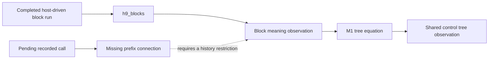

# Meanings receipt: M2 stops at the interruption boundary

The unrestricted M2 widening is false: an interrupted body starts a finalizer call that no submitted-reply tape explains.
The retained Lean counterexample checks an admitted `BlockRows` program and an accepted recorded binding.
The meanings packet requires an immediate stop on a false goal or a route beyond `h9_blocks` and M1.
The required initial reading exposes this boundary before any M1 source edit.
M1, M2 and M3 remain unlanded.

## Base, branch and retained files

- Worktree: `/Users/pooks/Dev/lean4-effect4-codex`.
- Branch: `codex/meanings`.
- Base and implementation head: `03e8f5d5679b3aa9020f694550ab5db19beeceba`.
- Branch command: `git switch -c codex/meanings 03e8f5d56`.
- Evidence commit: the commit containing this receipt. Its parent is the named base.
- Changed files: this receipt and the files under [evidence](evidence/manifest.json).

The source tree, existing theorem statements, registries and generated reports retain their base contents.
No caller moves and no copy is deleted.
No machine, `Eff`, `Ty` or `Store.Val` definition changes.
Nothing is pushed.

## M1: not started

Base and implementation head: `03e8f5d5679b3aa9020f694550ab5db19beeceba`.
The stop occurs during the required reading of `CallTree.lean` and the M2 route.
`Ctl` and `denoteCtl` remain in `src/Effect4/Laws/Program/DenoteCtl.lean`.
`blockAlgB` remains in `src/Effect4/Laws/Program/BlockMeaning.lean`.
The six existing connectors and the separate block meaning remain unchanged.
The requested consolidation still needs implementation, caller migration and deletion checks.

## M2: route and checked counterexample

Base and implementation head: `03e8f5d5679b3aa9020f694550ab5db19beeceba`.
The proposed widened goals are not planted because the route reaches the packet's stop condition first.

### The route needs an additional connection

`H9Blocks` in `src/Effect4/Laws/Api/SessionMeaningBlocks.lean` concerns a reached, funded, settled, host-driven run with an exit.
It also requires `HostAnswered` for the chosen host.
`h9_blocks` proves that completed observation agrees with the block meaning past a budget bound.

`request_leads` and `bound_in_tree` in `src/Effect4/Laws/Run/CallTree.lean` concern pending requests and bindings at arbitrary command prefixes.
They require neither an exit nor a host-driven history.
M1 would equate meaning trees; it supplies neither missing execution premise.
Thus `h9_blocks` and M1 do not provide the requested prefix connection.



There is a second restriction to address.
`SourceScope.ExternalOnly` in `src/Effect4/Laws/Program/HostSource.lean` also requires `SourceScope.directHead` from `ScopeFragment.lean`.
That predicate rejects definition blocks, calls and invocations.
Keeping it unchanged would exclude the programs M2 intends to admit.
The retained control checks that it accepts the example's body and rejects its root block.

### The counterexample

All declarations below live in [MeaningsPrefixProbe.lean](evidence/MeaningsPrefixProbe.lean), namespace `Test.MeaningsPrefixProbe`.
The program has an empty definition block around `onExit`.
Its body calls row 0; its finalizer calls row 1.
Both rows take and answer unit values, with no typed failure.

1. Open the admitted program with compile and command budgets of 100.
2. Evaluate until row 0 waits.
3. Interrupt the root fiber.
4. Bind the finalizer's request at row 1, token 1.

The run submits no reply.
The finalizer binding is accepted.
Every tape drawn from submitted replies is therefore empty.
At every meaning budget, the block tree under that empty tape still waits at row 0.
It cannot explain the accepted row 1 binding.

| Declaration | Evidence and reach |
| --- | --- |
| `admitted` | Program typing, formation, signature and row-column certificates |
| `fragment_admitted` | Kernel-checked `BlockRows table program = true` |
| `external_only_body` | The body contains only the admitted direct external operations |
| `old_source_restriction_refuses_block` | The old source restriction rejects the root block |
| `concrete_replies` | The reply columns are closed |
| `first_request` | The first machine request is row 0, token 0 |
| `finalizer_request` | The interrupted machine requests row 1, token 1 |
| `recorded_reached` | The recorded run follows the actual session commands |
| `finalizer_binding_accepted` | The recorded row 1 binding has phase `bound` |
| `waiting_has_no_exit` | The first pending run does not meet H9's exit premise |
| `interrupted_not_host_driven` | The interrupted run does not meet H9's host-driven premise |
| `tree_waits_first` | Every meaning budget waits at row 0 under the empty tape |
| `submitted_tape_empty` | Every tape satisfying the submitted-reply condition is empty |
| `prefix_conclusion_refuted` | No budget and submitted-reply tape explain the recorded row 1 binding |

Proof role: inversion boundary of `recorded-call-tree-prefix`, concept `translation-simulation`, requirement R6.
Consumer: the coordinator's M2 history restriction and route decision.
Evidence status: kernel-checked counterexample, with no planned-goal dependency.
Scope: one finite admitted program and command script; the tree exclusion quantifies over every meaning budget and eligible reply tape.
It establishes no universal simulation, progress or outside-host agreement.
The host boundary remains `docs/core/host-boundary.md`.

### Proposed decision

Retain the existing straight claim unchanged.
Choose the permitted recorded histories before widening the claim to blocks.
The narrow route excludes external interruptions and other decisions that the reply-only local meaning does not model.
It then needs a prefix simulation for those histories, including pending calls and arbitrary command cuts.
`compilesBlk_root` in `src/Effect4/Laws/Program/Agreement/Blocks.lean` supplies local block agreement for that proposed route.
It does not supply the recorded-command invariant.

The alternative records interruption decisions in the meaning itself.
That requires a separate design decision beyond the proposed tree consolidation.
Neither route is implemented here, and no decisions register changes.

## M3: unchanged goals

Base and implementation head: `03e8f5d5679b3aa9020f694550ab5db19beeceba`.
The retained [frontier output](evidence/frontier.log) measures each requested goal.
No M3 proof starts after the M2 stop condition.

| Goal | Measured status |
| --- | --- |
| `Workers.Assertions.logs_step` | goal |
| `QueueWorkers.Assertions.logs_history` | goal |
| `Timeout.cleanup_keeps` | goal |
| `Timeout.retries_declared` | goal |
| `QueueWorkers.Assertions.jobs_step` | goal |
| `QueueWorkers.Assertions.rest_step` | goal |
| `Atomic.Store.shop_stages` | goal |
| `FinalizerRun.once_placed_outside_census` | goal |

The first seven names belong to `Test.Dogfood.Scenario`; the last belongs to `Effect4.Program`.
The retained tool output contains their full names and statements.
Workers, QueueWorkers, Timeout and Atomic still depend on their respective application goals.
The existing `bound_in_tree` and `h9_blocks` both report proved under their existing premises.

## Commands and results

All Lean commands run through `/Users/pooks/Dev/lean4-effect4/scratch/lean-slot.sh`.
The slot serializes the commands and sets `LEAN_NUM_THREADS=2`.
The script [run-checks.sh](evidence/run-checks.sh) records the exact build, kernel-check, audit and status commands.

```sh
/Users/pooks/Dev/lean4-effect4/scratch/lean-slot.sh bash \
  docs/research/2026-10-14-meanings/evidence/run-checks.sh \
  /private/tmp/meanings-final-check
```

| Check | Result | Retained output |
| --- | --- | --- |
| Narrow build of the meanings, prefix claim, eight-goal consumers and proof tools | PASS, 1381 jobs | [build.log](evidence/build.log) |
| `lake env lean -DwarningAsError=true`, compiling the retained counterexample | PASS, no diagnostics | [probe.log](evidence/probe.log) |
| `#axiom_audit MeaningsPrefixProbe` | PASS | [audit.log](evidence/audit.log) |
| Counterexample `#plan_status` | All four queried declarations proved, zero next goals | [audit.log](evidence/audit.log) |
| Requested-goal `#plan_status` | Eight next goals | [frontier.log](evidence/frontier.log) |
| Existing meaning and prefix module audit | PASS | [frontier.log](evidence/frontier.log) |

Counterexample audit output:

```text
#axiom_audit: 420 declarations within [propext, Quot.sound], 0 of them modulo planned goals; 0 planned goals
```

Existing meaning and prefix module audit output:

```text
#axiom_audit: 756 declarations within [propext, Quot.sound], 0 of them modulo planned goals; 0 planned goals
```

`python3 scripts/check-language.py --strict docs/research/2026-10-14-meanings/receipt.md` passes with no finding in this receipt.

No behavior gate is reached because executable definitions remain unchanged.
`make gen-semantics` does not run because no registry, placement or planned goal changes.
The finish criteria remain unmet; this receipt records the packet's required stop.
