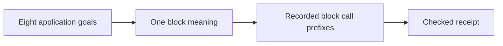
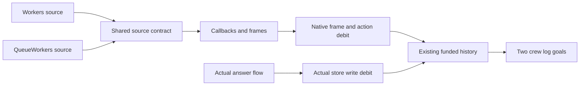

# Revised meanings landing plan

The base is `5f07927c8cfc4481ec660a56cfeed993b5027cd4` on `codex/meanings`.
Decisions rows 388 to 390 govern this continuation.
The earlier interruption control remains evidence for the history restriction.

## M3

The four answer-flow goals retain their present observations and application consumers.
The first step strengthens the producer's command premises without changing machine execution.
`Workers.CommandGuard` shows why source addresses alone cannot justify those premises.
The strengthened producer carries the existing command queue and its callback demands.
It serves `Workers.Assertions.logs_step`, `QueueWorkers.Assertions.logs_history`, and the two Timeout goals.
Its concepts are store-typing R4 and scope-lifetime-finalization R11.
The Timeout retry reader also serves translation-simulation R10.
The producer establishes no application property until its concrete instance is proved.

The Queue job and rest proofs follow those four goals.
Their consumers remain the existing Queue scenario claims and observations.
The Atomic stage proof retains the existing window, deposit, exit, and cleanup relations.
The finalizer goal retains a useful source-uniqueness statement and its application consumer.
Any false statement receives a proved correction and a retained control.

## M1

`denoteBlockB` owns the program meaning.
Each older meaning receives a named restriction chain.
Callers move through those chains where no constructor proof is needed.
`DenoteCtl` and unreferenced copies are deleted.
The receipt names every retained copy and its remaining consumers.

## M2

The claim serves recorded-call-tree-prefix under host-driven histories and BlockRows.
The proof connects recorded commands to the block meaning at unfinished command cuts.
The completed-call reading follows the prefix theorem and `h9_blocks`.
The cached Todo call clauses consume that theorem.
The claim establishes no interrupted-history meaning, fairness, or external host equivalence.
The detailed route is reported before a long prefix proof starts.

## Completion checks

Each coherent part receives a narrow build and a module axiom audit.
Every new helper names its existing goal consumer.
The eight goals and application claims must report proved through `#plan_status`.
The semantics projection is regenerated after placements change.
Only reached behavior gates run.
Commits name exact paths, and the final receipt records commands, outputs, limits, and remaining copies.

## Shared release writer

The graph review selects one writer model for both crews.
`ReleaseWriter.Target` selects existing source, operation, reference, and value fields.
`ReleaseWriter.Source` supplies source ownership and the direct release body.
Its consumers are the two crew log goals, under scope-lifetime-finalization R11.
The writer counts the actual release-start push and its pending direct write.
The acquired value and initialized reference remain separate answer-flow obligations.
`StoredWeights` extracts Atomic's existing delayed-program observations.
Atomic's writer proofs continue to compile through that shared observation.
The replaced Workers weight copy has no caller and is deleted.

The shared frame and action slice compiles.
Its audit checks 1,025 declarations within the permitted axioms, with no planned goals.
The eight application endpoints remain open at this slice.
The earlier writer audit remains historical evidence for the deleted prototype.
