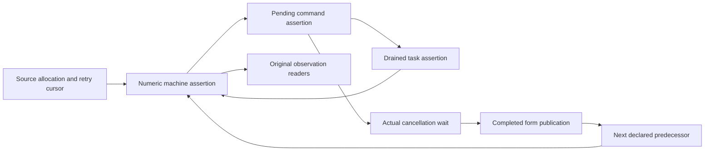
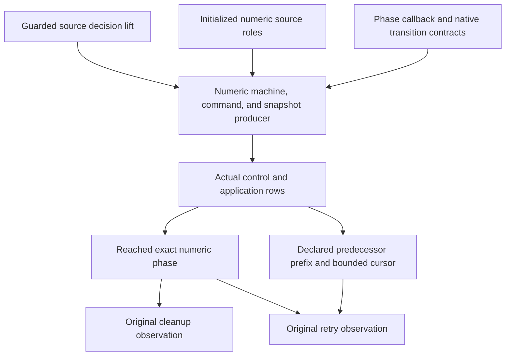

# Timeout numeric proof checkpoint

Neither Timeout goal is closed by this checkpoint.
The new local proofs do not produce their own history premises.

## Base and commits

The worktree is `/private/tmp/effect4-timeout-m3` on `codex/timeout-m3`.
The base is `5f07927c8`.
Commit `82d913ed6` adds the numeric phase.

## Placement

| Declaration group | Concept and requirement | Question and consumer | Reach | Limit |
| --- | --- | --- | --- | --- |
| `HostTimeoutNumberPhase.Phase` and its laws | scope-lifetime-finalization R11; translation-simulation R10 | Steps of the existing goals `Timeout.cleanup_keeps` and `Timeout.retries_declared` | The actual three-cell heap, source count/cleanup/form writes, and unchanged observation readers | No source permission or history producer |
| `HostTimeoutNumberWait.countdown_complete` | scope-lifetime-finalization R11 | The cancellation wait used by `Timeout.cleanup_keeps` | Every actual countdown walk and every held target | No source cleanup fact |
| `HostTimeoutNumberWait.AttemptExitAt`, `AwaitAt`, and their laws | scope-lifetime-finalization R11 | The cancellation queue assertion used before the form finalizer | The actual attempt lookup, stored numeric exit class, target list, and heap image | The configuration must produce the stored exit class and target coverage |

The declarations live in `Test/Dogfood/Proofs/HostTimeoutNumberPhase.lean` and `Test/Dogfood/Proofs/HostTimeoutNumberWait.lean`.
Their consumers remain the two existing planned goals in `Test/Dogfood/Scenario/Timeout.lean`.
They establish neither progress nor host agreement.

## What the local proofs establish

`Phase` separates cleanup order from completed-form publication.
Its observation readers discharge the original Boolean observations from an exact heap and a declared predecessor prefix.
Its source equations use the actual cleanup and completed-form writers.

`countdown_complete` reads the existing `Machine.countdownWalk`.
A finished walk has seen an exit for every target the machine holds.
`AwaitAt` retains either the cleaned heap or the actual owning attempt among those targets.
`await_cleaned` then produces the cleaned image that the saved form callback requires.
`countdown_waits` proves that the actual native countdown parks while that cleanup is absent.

## The remaining producer

The actual history producer must carry all three assertions together.
The machine assertion carries the numeric phase and the actual fiber roles.
The command assertion carries source permissions and cancellation target coverage.
The drained-task assertion carries live-token reply permissions.



The active attempt owns the count and cleanup writes.
The timer needs a heap-insensitive current-code assertion.
An old terminal attempt must not retain an exact old heap as a current-code requirement.
A resume requires its numeric reply class only when its token matches a live parked fiber.

`HostTimeoutState.CommandsAt` retains body, unit, and arbitrary token classes.
It retains outer heap shapes, not the exact numeric phase.
The new numeric assertions must add the missing relation.

The coordinator supplies `LiftCoupledFact` at `2034712b4`.
It joins machine, command, and drained-task assertions without assuming an independently retained numeric queue.
This checkpoint does not instantiate it.

## Commands and measured results

All Lean commands use `/Users/pooks/Dev/lean4-effect4/scratch/lean-slot.sh`.

| Command | Result |
| --- | --- |
| `lake build Test.Dogfood.Scenario.Timeout` | Passed, 1200 jobs |
| `lake build Test.Dogfood.Proofs.HostTimeoutNumberPhase` | Passed, 1180 jobs |
| `lake build Test.Dogfood.Proofs.HostTimeoutNumberWait` | Passed, 1188 jobs |
| `lake build ProofGraph.AxiomAudit` | Passed, 15 jobs |
| `lake env lean scratch/TimeoutCuts.lean` | Finite probe: start commits count 1; cancellation records cleanup 1 |
| `lake env lean scratch/TimeoutCutsSmall.lean` | Finite probe: no failing cleanup observation among 12 budgets and 20 prefix lengths |
| `lake env lean scratch/TimeoutRawCuts.lean` | Finite probe: no matching zero-cleanup result among 300 raw prefix cuts |

The finite probes establish no history theorem.
No probe refutes either original fixed-budget Timeout goal.
The suspected early-interruption argument has no checked witness and changes no statement.

The first uncached build fails while saving Lake artifacts outside the writable roots.
The same serialized build passes with the required cache permission.

## Goal status

| Goal | Status at this checkpoint |
| --- | --- |
| `Timeout.cleanup_keeps` | The existing planned goal remains unchanged |
| `Timeout.retries_declared` | The existing planned goal remains unchanged |

No core machine, program syntax, store carrier, root import, semantics registry, or decisions file changes here.
The coordinator must import each retained new leaf through the scenario before merging it.

## Axiom gate

`lake env lean scratch/TimeoutPhaseAudit.lean` imports both new proof modules.
It runs `#axiom_audit Test.Dogfood.Proofs.HostTimeoutNumberPhase Test.Dogfood.Proofs.HostTimeoutNumberWait`.
The output is:

```text
#axiom_audit: 89 declarations within [propext, Quot.sound], 0 of them modulo planned goals; 0 planned goals
```

## Per-command count entry

`CodeAt.count`, `CodeAt.countBind`, and `CodeAt.countEntry` name the post-count class before the count executes.
The current heap remains the actual pre-count heap.
`Image.enter` owns that post-count image.
`NumberCounted.nextImage` uses it.

`count_exit_push`, `count_bind_push`, and `count_native_write` verify the actual three commands separately.
Their saved callback obligations require the post-count heap only when the callback receives its result.
The producer no longer needs to assume a fabricated post-count heap before either push.

`HostTimeoutNumberInterrupt.running_frame` verifies the deferred-interruption branch.
It changes neither the numeric current code nor the saved stack.
`idle_frame` verifies immediate interruption from the actual accumulated cause class.
The command assertion must still supply that cause class and the permission to execute a count prefix.

The new interruption module is `Test/Dogfood/Proofs/HostTimeoutNumberInterrupt.lean`.
Its placement is scope-lifetime-finalization R11, with reactive-scheduling R9.
Its consumers remain both Timeout goals.
It establishes no history or execution permission by itself.

| Command | Result |
| --- | --- |
| `lake build Test.Dogfood.Proofs.HostTimeoutNumberCounted Test.Dogfood.Proofs.HostTimeoutNumberWait` | Passed, 1204 jobs |
| `lake build Test.Dogfood.Proofs.HostTimeoutNumberCounted` | Passed, 1202 jobs |
| `lake build Test.Dogfood.Proofs.HostTimeoutNumberInterrupt` | Passed, 1203 jobs |
| `lake env lean scratch/TimeoutCountAudit.lean` | The output below |

The last command audits `NumberFlow`, `NumberCounted`, `NumberInterrupt`, `NumberPhase`, and `NumberWait` in their full module namespaces.

```text
#axiom_audit: 301 declarations within [propext, Quot.sound], 0 of them modulo planned goals; 0 planned goals
```

## Root and timer roles

The original planned goals remain unchanged and open.
This slice supplies local roles and their actual callback equations.
It supplies no initialized command history.

`NumberResult` connects the published form exit to the actual success encoder and typed catch callback.
Its handler skip theorem requires the actual recorded interruption to contain no typed failure.
It does not assume that fact for arbitrary frames.
`NumberRegion` checks the actual root prefix above the source handler and loop suffix.
`NumberTimer` checks the timer source and its reference-preserving primitive effects.
`NumberStable` transports those numeric frames across reference-preserving scheduler edits.
`NumberLoop` checks the actual success stop and the failure continuation below four attempts.

`NumberConfiguration` defines the concrete active machine, command, and drained-snapshot assertions.
Its reply assertion checks the actual replacement frame only when a live park still matches the token.
Old-token replies need no fabricated numeric value class.
Its cancellation commands retain the owning attempt's actual countdown assertion.
Allocation and uncounted root forms still require additional phases.

Each module's header records its concept, requirement, consumer, reach, and limit.
The consumers remain both Timeout goals.
No host behaviour gate changes because this slice changes proof modules only.

| Command | Result |
| --- | --- |
| `lake build Test.Dogfood.Proofs.HostTimeoutNumberStable` | Passed, 1209 jobs |
| `lake build Test.Dogfood.Proofs.HostTimeoutNumberRegion` | Passed, 1207 jobs |
| `lake build Test.Dogfood.Proofs.HostTimeoutNumberLoop` | Passed, 1207 jobs |
| `lake build Test.Dogfood.Proofs.HostTimeoutNumberConfiguration` | Passed, 1215 jobs |
| `lake env lean scratch/TimeoutRolesAudit.lean` | The output below |

The serialized slot runs every command in this table.
The audit checks `NumberFlow`, `NumberResult`, `NumberRegion`, `NumberTimer`, `NumberStable`, `NumberLoop`, and `NumberConfiguration`.

```text
#axiom_audit: 402 declarations within [propext, Quot.sound], 0 of them modulo planned goals; 0 planned goals
```

## Proof graph review

FLOW section 5 and GOALS-2 section 4 identify the missing numeric producer.
WORKERS section 5 shows why source-only command admission does not supply it.
The current route uses the shared guarded source lift and the coupled ghost-state producer.



The shared guard supplies the first node.
The shared coupled lift supplies composition, but it does not supply the numeric producer.
`HostTimeoutHistory` supplies the actual row decomposition pattern.
The existing phase readers supply both final observation steps.
The initialized source-control family and numeric command producer remain open.

The general phase drops the stronger local comparison between completed forms and cleanups.
Its count transition requires cleanup length equal to the count, enough completed predecessors, and a bounded source cursor.
It does not require the cursor to equal the committed count.
`Phase.enter` remains the stronger local instance of `Phase.counted`.
`Phase.counted_declared` consumes the declared predecessor prefix without requiring equal log lengths.

`NumberPhaseFlow` consolidates count, cleanup, and form callbacks around that phase.
Both actual finalizer families use `AnswerFlow.saved_protected_finalizer`.
The three native writes use one `native_answer` theorem.
The count prefix retains its actual pre-count heap until the write commits.
These facts remain local until the numeric producer establishes their source permissions.

## The command-cut control

`Timeout.CommandCut` retains four finite kernel checks.
A raw cut after 27 commands holds a running attempt with an installed finalizer and count zero.
An outside interruption records its deferred cause.
Reusing the old internal queue then records cleanup zero at count zero.
Public evaluation instead refuses that running attempt and leaves both logs empty.

Queue reuse is not a scenario move.
This control refutes neither original fixed-budget goal.
It shows why the numeric command assertion must reject a deferred pre-count loop command.
A source-only command assertion does not express that restriction.

The shared ghost-command producer belongs to the Atomic seat.
The Timeout instance supplies the same new ghost state for frames, pending commands, and drained tasks.
Its interruption premise must also read the installed-prefix running condition.

| Command through the serialized Lean slot | Result |
| --- | --- |
| `lake build Test.Dogfood.Proofs.HostTimeoutNumberPhaseFlow Test.Dogfood.Scenario.Timeout.CommandCut` | Passed, 1191 jobs |
| `lake env lean scratch/TimeoutPhaseFlowAudit.lean` | The output below |

```text
#axiom_audit: 187 declarations within [propext, Quot.sound], 0 of them modulo planned goals; 0 planned goals
```

The audit checks `NumberPhase`, `NumberPhaseFlow`, and `Timeout.CommandCut` in their full module namespaces.
Both original Timeout goals remain unchanged and open.
The coordinator must import the retained proof leaves and control through the scenario before merging.
