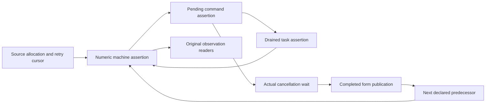
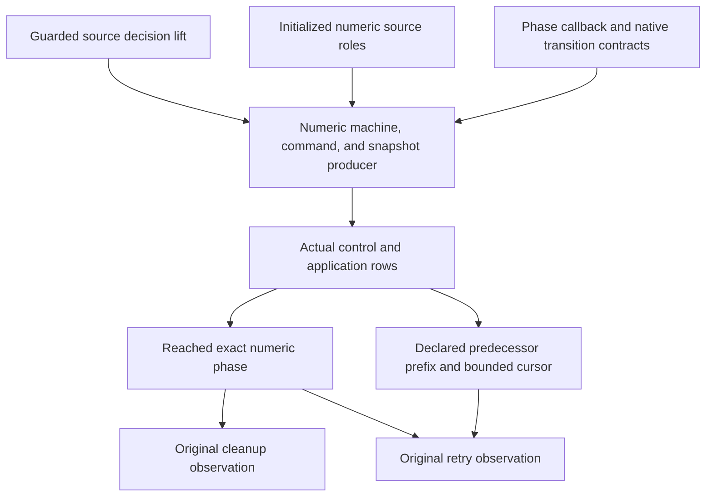

# Timeout numeric proof checkpoint

Neither Timeout goal is closed by this checkpoint.
The new local proofs do not produce their own history premises.

## Base and commits

The worktree is `/private/tmp/effect4-timeout-m3` on `codex/timeout-m3`.
The base is `5f07927c8`.
Commit `82d913ed6` adds the numeric phase.

## Placement

| Declaration group | Concept and requirement | Question and consumer | Reach | Limit |
| --- | --- | --- | --- | --- |
| `HostTimeoutNumberPhase.Phase` and its laws | scope-lifetime-finalization R11; translation-simulation R10 | Steps of the existing goals `Timeout.cleanup_keeps` and `Timeout.retries_declared` | The actual three-cell heap, source count/cleanup/form writes, and unchanged observation readers | No source permission or history producer |
| `HostTimeoutNumberWait.countdown_complete` | scope-lifetime-finalization R11 | The cancellation wait used by `Timeout.cleanup_keeps` | Every actual countdown walk and every held target | No source cleanup fact |
| `HostTimeoutNumberWait.AttemptExitAt`, `AwaitAt`, and their laws | scope-lifetime-finalization R11 | The cancellation queue assertion used before the form finalizer | The actual attempt lookup, stored numeric exit class, target list, and heap image | The configuration must produce the stored exit class and target coverage |

The declarations live in `Test/Dogfood/Proofs/HostTimeoutNumberPhase.lean` and `Test/Dogfood/Proofs/HostTimeoutNumberWait.lean`.
Their consumers remain the two existing planned goals in `Test/Dogfood/Scenario/Timeout.lean`.
They establish neither progress nor host agreement.

## What the local proofs establish

`Phase` separates cleanup order from completed-form publication.
Its observation readers discharge the original Boolean observations from an exact heap and a declared predecessor prefix.
Its source equations use the actual cleanup and completed-form writers.

`countdown_complete` reads the existing `Machine.countdownWalk`.
A finished walk has seen an exit for every target the machine holds.
`AwaitAt` retains either the cleaned heap or the actual owning attempt among those targets.
`await_cleaned` then produces the cleaned image that the saved form callback requires.
`countdown_waits` proves that the actual native countdown parks while that cleanup is absent.

## The remaining producer

The actual history producer must carry all three assertions together.
The machine assertion carries the numeric phase and the actual fiber roles.
The command assertion carries source permissions and cancellation target coverage.
The drained-task assertion carries live-token reply permissions.



The active attempt owns the count and cleanup writes.
The timer needs a heap-insensitive current-code assertion.
An old terminal attempt must not retain an exact old heap as a current-code requirement.
A resume requires its numeric reply class only when its token matches a live parked fiber.

`HostTimeoutState.CommandsAt` retains body, unit, and arbitrary token classes.
It retains outer heap shapes, not the exact numeric phase.
The new numeric assertions must add the missing relation.

The coordinator supplies `LiftCoupledFact` at `2034712b4`.
It joins machine, command, and drained-task assertions without assuming an independently retained numeric queue.
This checkpoint does not instantiate it.

## Commands and measured results

All Lean commands use `/Users/pooks/Dev/lean4-effect4/scratch/lean-slot.sh`.

| Command | Result |
| --- | --- |
| `lake build Test.Dogfood.Scenario.Timeout` | Passed, 1200 jobs |
| `lake build Test.Dogfood.Proofs.HostTimeoutNumberPhase` | Passed, 1180 jobs |
| `lake build Test.Dogfood.Proofs.HostTimeoutNumberWait` | Passed, 1188 jobs |
| `lake build ProofGraph.AxiomAudit` | Passed, 15 jobs |
| `lake env lean scratch/TimeoutCuts.lean` | Finite probe: start commits count 1; cancellation records cleanup 1 |
| `lake env lean scratch/TimeoutCutsSmall.lean` | Finite probe: no failing cleanup observation among 12 budgets and 20 prefix lengths |
| `lake env lean scratch/TimeoutRawCuts.lean` | Finite probe: no matching zero-cleanup result among 300 raw prefix cuts |

The finite probes establish no history theorem.
No probe refutes either original fixed-budget Timeout goal.
The suspected early-interruption argument has no checked witness and changes no statement.

The first uncached build fails while saving Lake artifacts outside the writable roots.
The same serialized build passes with the required cache permission.

## Goal status

| Goal | Status at this checkpoint |
| --- | --- |
| `Timeout.cleanup_keeps` | The existing planned goal remains unchanged |
| `Timeout.retries_declared` | The existing planned goal remains unchanged |

No core machine, program syntax, store carrier, root import, semantics registry, or decisions file changes here.
The coordinator must import each retained new leaf through the scenario before merging it.

## Axiom gate

`lake env lean scratch/TimeoutPhaseAudit.lean` imports both new proof modules.
It runs `#axiom_audit Test.Dogfood.Proofs.HostTimeoutNumberPhase Test.Dogfood.Proofs.HostTimeoutNumberWait`.
The output is:

```text
#axiom_audit: 89 declarations within [propext, Quot.sound], 0 of them modulo planned goals; 0 planned goals
```

## Per-command count entry

`CodeAt.count`, `CodeAt.countBind`, and `CodeAt.countEntry` name the post-count class before the count executes.
The current heap remains the actual pre-count heap.
`Image.enter` owns that post-count image.
`NumberCounted.nextImage` uses it.

`count_exit_push`, `count_bind_push`, and `count_native_write` verify the actual three commands separately.
Their saved callback obligations require the post-count heap only when the callback receives its result.
The producer no longer needs to assume a fabricated post-count heap before either push.

`HostTimeoutNumberInterrupt.running_frame` verifies the deferred-interruption branch.
It changes neither the numeric current code nor the saved stack.
`idle_frame` verifies immediate interruption from the actual accumulated cause class.
The command assertion must still supply that cause class and the permission to execute a count prefix.

The new interruption module is `Test/Dogfood/Proofs/HostTimeoutNumberInterrupt.lean`.
Its placement is scope-lifetime-finalization R11, with reactive-scheduling R9.
Its consumers remain both Timeout goals.
It establishes no history or execution permission by itself.

| Command | Result |
| --- | --- |
| `lake build Test.Dogfood.Proofs.HostTimeoutNumberCounted Test.Dogfood.Proofs.HostTimeoutNumberWait` | Passed, 1204 jobs |
| `lake build Test.Dogfood.Proofs.HostTimeoutNumberCounted` | Passed, 1202 jobs |
| `lake build Test.Dogfood.Proofs.HostTimeoutNumberInterrupt` | Passed, 1203 jobs |
| `lake env lean scratch/TimeoutCountAudit.lean` | The output below |

The last command audits `NumberFlow`, `NumberCounted`, `NumberInterrupt`, `NumberPhase`, and `NumberWait` in their full module namespaces.

```text
#axiom_audit: 301 declarations within [propext, Quot.sound], 0 of them modulo planned goals; 0 planned goals
```

## Root and timer roles

The original planned goals remain unchanged and open.
This slice supplies local roles and their actual callback equations.
It supplies no initialized command history.

`NumberResult` connects the published form exit to the actual success encoder and typed catch callback.
Its handler skip theorem requires the actual recorded interruption to contain no typed failure.
It does not assume that fact for arbitrary frames.
`NumberRegion` checks the actual root prefix above the source handler and loop suffix.
`NumberTimer` checks the timer source and its reference-preserving primitive effects.
`NumberStable` transports those numeric frames across reference-preserving scheduler edits.
`NumberLoop` checks the actual success stop and the failure continuation below four attempts.

`NumberConfiguration` defines the concrete active machine, command, and drained-snapshot assertions.
Its reply assertion checks the actual replacement frame only when a live park still matches the token.
Old-token replies need no fabricated numeric value class.
Its cancellation commands retain the owning attempt's actual countdown assertion.
Allocation and uncounted root forms still require additional phases.

Each module's header records its concept, requirement, consumer, reach, and limit.
The consumers remain both Timeout goals.
No host behaviour gate changes because this slice changes proof modules only.

| Command | Result |
| --- | --- |
| `lake build Test.Dogfood.Proofs.HostTimeoutNumberStable` | Passed, 1209 jobs |
| `lake build Test.Dogfood.Proofs.HostTimeoutNumberRegion` | Passed, 1207 jobs |
| `lake build Test.Dogfood.Proofs.HostTimeoutNumberLoop` | Passed, 1207 jobs |
| `lake build Test.Dogfood.Proofs.HostTimeoutNumberConfiguration` | Passed, 1215 jobs |
| `lake env lean scratch/TimeoutRolesAudit.lean` | The output below |

The serialized slot runs every command in this table.
The audit checks `NumberFlow`, `NumberResult`, `NumberRegion`, `NumberTimer`, `NumberStable`, `NumberLoop`, and `NumberConfiguration`.

```text
#axiom_audit: 402 declarations within [propext, Quot.sound], 0 of them modulo planned goals; 0 planned goals
```

## Proof graph review

FLOW section 5 and GOALS-2 section 4 identify the missing numeric producer.
WORKERS section 5 shows why source-only command admission does not supply it.
The current route uses the shared guarded source lift and the coupled ghost-state producer.



The shared guard supplies the first node.
The shared coupled lift supplies composition, but it does not supply the numeric producer.
`HostTimeoutHistory` supplies the actual row decomposition pattern.
The existing phase readers supply both final observation steps.
The initialized source-control family and numeric command producer remain open.

The general phase drops the stronger local comparison between completed forms and cleanups.
Its count transition requires cleanup length equal to the count, enough completed predecessors, and a bounded source cursor.
It does not require the cursor to equal the committed count.
`Phase.enter` remains the stronger local instance of `Phase.counted`.
`Phase.counted_declared` consumes the declared predecessor prefix without requiring equal log lengths.

`NumberPhaseFlow` consolidates count, cleanup, and form callbacks around that phase.
Both actual finalizer families use `AnswerFlow.saved_protected_finalizer`.
The three native writes use one `native_answer` theorem.
The count prefix retains its actual pre-count heap until the write commits.
These facts remain local until the numeric producer establishes their source permissions.

## The command-cut control

`Timeout.CommandCut` retains four finite kernel checks.
A raw cut after 27 commands holds a running attempt with an installed finalizer and count zero.
An outside interruption records its deferred cause.
Reusing the old internal queue then records cleanup zero at count zero.
Public evaluation instead refuses that running attempt and leaves both logs empty.

Queue reuse is not a scenario move.
This control refutes neither original fixed-budget goal.
It shows why the numeric command assertion must reject a deferred pre-count loop command.
A source-only command assertion does not express that restriction.

The shared ghost-command producer belongs to the Atomic seat.
The Timeout instance supplies the same new ghost state for frames, pending commands, and drained tasks.
Its interruption premise must also read the installed-prefix running condition.

| Command through the serialized Lean slot | Result |
| --- | --- |
| `lake build Test.Dogfood.Proofs.HostTimeoutNumberPhaseFlow Test.Dogfood.Scenario.Timeout.CommandCut` | Passed, 1191 jobs |
| `lake env lean scratch/TimeoutPhaseFlowAudit.lean` | The output below |

```text
#axiom_audit: 187 declarations within [propext, Quot.sound], 0 of them modulo planned goals; 0 planned goals
```

The audit checks `NumberPhase`, `NumberPhaseFlow`, and `Timeout.CommandCut` in their full module namespaces.
Both original Timeout goals remain unchanged and open.
The coordinator must import the retained proof leaves and control through the scenario before merging.

## Count permission and cleanup barrier

The numeric producer remains open.
This slice connects the local count permission and actual wait barrier to the configuration's assigned fiber roles.
Its concepts remain scope-lifetime-finalization R11 and translation-simulation R10.
Both original Timeout goals consume the planned coupled producer.

`NumberConfiguration.CountFrameAt` names the three actual pre-count control positions.
`CountReady` excludes deferred interruption and an injected yield after finalizer installation.
The queued loop assertion carries that permission jointly with the machine assertion.
An interruption allowed by the message assertion must avoid the reserved pending targets.
`NumberPhaseFlow` retains the uncounted interruption arm beside the counted cleanup arm.
Its saved contracts quantify the current completed-exit view.

`Configuration.lookup` reads the uniquely assigned role of the actual looked-up fiber.
`Configuration.await_attempt` derives the cleanup wait certificate from that role's published exit.
`Configuration.await_complete` consumes the existing actual countdown producer.
It establishes cleanup length equal to the current count through the exact heap cells.
The proof covers counted cleanup and interruption before counting.
It does not assume equal phase proof records.

| Command through the serialized Lean slot | Result |
| --- | --- |
| `lake build Test.Dogfood.Proofs.HostTimeoutNumberConfiguration` | Passed, 1217 jobs |
| `lake env lean scratch/TimeoutCountBarrierAudit.lean` | The output below |

```text
#axiom_audit: 327 declarations within [propext, Quot.sound], 0 of them modulo planned goals; 0 planned goals
```

The audit checks the full `NumberPhaseFlow` and `NumberConfiguration` module namespaces.
No execution behaviour changes, so this slice reaches no outside implementation gate.
The fixed-budget goals remain unchanged and open.
The source initializer, root race relation, declared failure correlation, and coupled command producer remain open.
The shared bare initialization producer belongs to the Queue seat.
The shared code closure supplies source contracts without another syntax traversal.

## Root control across numeric writers

The numeric producer remains open.
`NumberRootControl` names the root's actual readonly cancellation control and ordered saved prefix.
Its concepts are scope-lifetime-finalization R11 and translation-simulation R10.
Its consumer is the numeric command producer for both Timeout goals.
The source form finalizer remains below that prefix and above the untouched source suffix.
The contracts quantify the completed-exit view.
They cover restoring masks and injected yield wrappers.

`ReadCode.iteration_refs` consumes the existing actual iteration reference producer.
`RootControl.region` reconstructs the form region at the newly established numeric heap.
Neither theorem walks the program syntax or defines race semantics.

`NumberRootTransitions.count_root_regions` consumes the permitted actual count iteration.
`cleanup_root_regions` consumes the actual cleanup write.
Both read the actual root lookup at fiber zero.
Both return that lookup, the new heap, the child contract, and the root region at one successor phase.
The configuration includes the readonly root role and the frozen numeric computation role.
Its cancellation command assertions now carry the general cleanup barrier.

| Command through the serialized Lean slot | Result |
| --- | --- |
| `lake build Test.Dogfood.Proofs.HostTimeoutNumberRootTransitions` | Passed, 1219 jobs |
| `lake env lean scratch/TimeoutRootControlAudit.lean` | The output below |

```text
#axiom_audit: 258 declarations within [propext, Quot.sound], 0 of them modulo planned goals; 0 planned goals
```

The audit checks `NumberRootControl`, `NumberConfiguration`, and `NumberRootTransitions` in their full module namespaces.
The readonly pop must retain its control assertion until the actual source form callback starts.
The coupled native and command producer, initialized history, and both original endpoints remain open.
No execution behaviour changes, so this slice reaches no outside implementation gate.

## Selected typed-failure provenance

This internal invariant refinement changes neither original Timeout endpoint.
The source catch reader still establishes the exact selected singleton's declared retry.
Its concepts are scope-lifetime-finalization R11 and translation-simulation R10.
Its consumer is the declared-prefix component of the coupled numeric producer.

`NumberPhaseFlow.TypedFrom` requires every delivered typed reason to occur in the selected failure.
It replaces the exact-cause alternative in the published phase's cause assertion.
The actual restoring-mask union can combine a selected failure with a recorded interruption.
`cause_combine`, `cause_strip`, and `cause_sanitize` retain the provenance relation.
Combination and sanitization retain the actual recorded interruption premise.
`Timeout.OriginControl.unrelated_rejected` rejects an unrelated typed failure in that union.
This kernel-checked control refutes neither original endpoint.

`NumberRootModel` refines readonly current code with the existing concrete control assertion.
Its tagged local edges distinguish readonly callbacks from the actual source form finalizer.
The coordinator's unchanged `AnswerFlowEmbedding` at `1f997ca04` supplies the numeric composition.
That shared leaf is a dependency, not a Timeout edit.
The actual selected-pop readers consume the existing shared family proof and retain the ordered suffix.
The cause reader consumes the same popped frame's recorded interruption premise.

`NumberRootResult.singleton_error` identifies the selected singleton's exact represented error.
`caught_declared` applies the actual source predicate to that payload.
`selected_unique` reads the exact completed-form heap.
`published_caught_declared` joins that heap to the delivered cause provenance and proves the selected singleton's declared retry.
The actual initialized producer must still supply the selected singleton and its publication.

| Command through the serialized Lean slot | Result |
| --- | --- |
| `lake build Test.Dogfood.Proofs.HostTimeoutNumberRootModel` | Passed, 1193 jobs |
| `lake build Test.Dogfood.Proofs.HostTimeoutNumberRootResult` | Passed, 1212 jobs |
| `lake build Test.Dogfood.Proofs.HostTimeoutNumberRootTransitions Test.Dogfood.Scenario.Timeout.OriginControl` | Passed, 1220 jobs |
| `lake env lean scratch/TimeoutOriginAudit.lean` | The output below |

```text
#axiom_audit: 219 declarations within [propext, Quot.sound], 0 of them modulo planned goals; 0 planned goals
```

The audit checks `NumberPhaseFlow`, `NumberRootModel`, `NumberRootResult`, and `Timeout.OriginControl` in their full module namespaces.
The actual control advancement, contextual source catch suffix, initialized history, and both original endpoints remain open.
No execution behaviour changes, so this slice reaches no outside implementation gate.

## Contextual source suffix

This slice changes neither original Timeout endpoint.
Its concepts are scope-lifetime-finalization R11 and translation-simulation R10.
Its consumer is the actual root return component of the coupled numeric producer.
Its reach is the actual source encoder and catch, with the same popped frame's recorded interruption.
It establishes no initialized history or command closure.

`NumberRootSuffix.local_family` joins those source callbacks to the existing contextual saved-frame proof.
`catch_skipped` uses the actual ensured frame's recorded interruption premise.
`control_path` retains the actual source form, encoder, catch, and ordered suffix.
`cause_selected` consumes that path through the shared contextual pop producer.
`retry_declared` identifies the exact selected singleton recorded by the source form.
The returned retry assertion retains the actual predicate result and selected typed-failure provenance.

The unchanged shared dependencies are Atomic's `7d19775dd` and the coordinator's `d74d61c58`.
The latter supplies contextual embedding composition and the legacy unconditional instance.
These shared files are dependencies, not Timeout edits.

| Command through the serialized Lean slot | Result |
| --- | --- |
| `lake build Test.Dogfood.Proofs.HostTimeoutNumberRootSuffix` | Passed, 1215 jobs |
| `lake env lean scratch/TimeoutSuffixAudit.lean` | The output below |

```text
#axiom_audit: 81 declarations within [propext, Quot.sound], 0 of them modulo planned goals; 0 planned goals
```

The audit checks `NumberRootModel` and `NumberRootSuffix` in their full module namespaces.
The actual loop continuation, coupled native and command producer, initialized history, and both original endpoints remain open.
No execution behaviour changes, so this slice reaches no outside implementation gate.

## Actual loop and interruption permissions

This slice changes neither original Timeout endpoint.
Its concepts are translation-simulation R10, reactive-scheduling R9, and scope-lifetime-finalization R11.
Its consumers are the root loop outcome and actual addressed-message component of the coupled command producer.

`NumberRootLoop.failure_continue` consumes the actual returned retry and exact selected singleton publication.
It also consumes the real cleanup barrier and source loop callback premises.
It returns the exact loop continuation and next `CountContext` permissions together.
The completed predecessor log contains only declared retries at that boundary.
The proof uses the existing loop callback laws and adds no syntax traversal.

`NumberConfiguration.FiberAt.immediate` records the live idle fiber's clean-cause replacement permission.
Read and unit classes still reject cause delivery.
Their actual masked execution must discharge the new conditional permission.
`NumberConfigurationInterrupt.interrupt_fiber` proves the actual addressed interruption retains the whole numeric fiber assertion.
It uses the actual running flag, mask, ordered saved suffix, and recorded cause.
The incoming and previously recorded causes contain no typed failure.
This local producer does not assume unrestricted interruption closure of each answer class.

| Command through the serialized Lean slot | Result |
| --- | --- |
| `lake build Test.Dogfood.Proofs.HostTimeoutNumberRootLoop` | Passed, 1225 jobs |
| `lake build Test.Dogfood.Proofs.HostTimeoutNumberConfigurationInterrupt` | Passed, 1220 jobs |
| `lake env lean scratch/TimeoutLoopInterruptAudit.lean` | The output below |

```text
#axiom_audit: 204 declarations within [propext, Quot.sound], 0 of them modulo planned goals; 0 planned goals
```

The audit checks `NumberRootLoop`, `NumberConfiguration`, and `NumberConfigurationInterrupt` in their full module namespaces.
Whole-machine and queue transport, native role advancement, initialized history, and both original endpoints remain open.
No execution behaviour changes, so this slice reaches no outside implementation gate.

## Joined actual interruption producer

This slice changes neither original Timeout endpoint.
Its concepts are reactive-scheduling R9 and scope-lifetime-finalization R11.
Its consumer is the interrupt branch of the shared contextual addressed-message producer.

`NumberConfigurationTransport.interrupt_configuration` retains the complete numeric machine assertion and stored reply tasks.
`update_view` uses the actual lookup and the base driver's unique fiber identifiers.
It retains the ordered completed-exit view when the actual addressed replacement retains its exit.
`interrupt_reply` checks the actual surviving token guard and saved suffix.

`NumberQueueInterrupt.commands_interrupt` retains the entire pending command queue and actual generated evaluate command.
`loop_interrupt` excludes protected pending-prefix owners through the actual message permission.
`cleanup_await_update` retains cancellation's concrete cleanup barrier through actual target-exit lookups.
`protects_interrupt` retains the same protected-owner condition for the resulting queue.
`interrupt_joint` returns the machine, queue, detached tasks, and protected-owner condition together.

`NumberRootSuffix.value_selected` consumes the existing shared contextual value-pop reader.
It requires no fabricated unconditional handler-discard premise.

| Command through the serialized Lean slot | Result |
| --- | --- |
| `lake build Test.Dogfood.Proofs.HostTimeoutNumberConfigurationTransport` | Passed, 1227 jobs |
| `lake build Test.Dogfood.Proofs.HostTimeoutNumberQueueInterrupt` | Passed, 1228 jobs |
| `lake build Test.Dogfood.Proofs.HostTimeoutNumberRootLoop Test.Dogfood.Proofs.HostTimeoutNumberRootTransitions` | Passed in the affected-dependent run |
| `lake env lean scratch/TimeoutActualInterruptAudit.lean` | The output below |

```text
#axiom_audit: 45 declarations within [propext, Quot.sound], 0 of them modulo planned goals; 0 planned goals
```

The audit checks `NumberConfigurationTransport`, `NumberQueueInterrupt`, and `NumberRootSuffix` in their full module namespaces.
Observer and token edits, native role advancement, initialized history, and both original endpoints remain open.
No execution behaviour changes, so this slice reaches no outside implementation gate.

## Actual addressed message words

This slice changes neither original Timeout endpoint.
Its concepts are reactive-scheduling R9 and scope-lifetime-finalization R11.
Its consumer is the native settlement component of the coupled numeric command producer.

`NumberObserverMap` retains numeric assertions through one map of existing observer fields.
`observe_mapped` identifies actual registration at the uniquely addressed fiber.
`drop_mapped` identifies actual token removal without a uniqueness premise.
The map retains actual lookup identities, completed exits, execution fields, masks, and dispatcher snapshots.

`NumberQueueInterrupt.command_transport` supplies one assertion case split for interruption and observer maps.
Neither consumer adds a command execution induction.
`NumberMessages.admitted` closes all three actual addressed-message cases.
Its machine assertion contains numeric configuration, detached tasks, and unique fiber identifiers.
Its queue assertion contains numeric commands and protected prefix owners.
`apply_word` consumes the existing shared contextual word fold.
Every resulting assertion uses the same returned proof world.
The native caller must still supply its actual word permission and starting assertions.

| Command through the serialized Lean slot | Result |
| --- | --- |
| `lake build Test.Dogfood.Proofs.HostTimeoutNumberMessages` | Passed, 1231 jobs |
| `lake env lean scratch/TimeoutMessagesAudit.lean` | The output below |

```text
#axiom_audit: 36 declarations within [propext, Quot.sound], 0 of them modulo planned goals; 0 planned goals
```

The audit checks `NumberQueueInterrupt`, `NumberObserverMap`, and `NumberMessages` in their full module namespaces.
Actual native role advancement, initialized history, and both original endpoints remain open.
No execution behaviour changes, so this slice reaches no outside implementation gate.

## Actual finish authority

This slice changes neither original Timeout endpoint.
Its concepts are reactive-scheduling R9 and scope-lifetime-finalization R11.
Its consumer is the numeric writer's pending-queue transport.

`NumberConfiguration.TerminalStack` requires the actual addressed fiber's saved stack to be empty.
The numeric finish command now carries that authority beside its existing exit assertion.
This assertion does not identify current code, which the actual finish path retains.
`NumberQueueInterrupt.finish_excludes_saved` excludes a pending finish while the actual writer retains a saved frame.
The existing actual message producer retains this stronger finish authority.

`Timeout.FinishCut` reads the actual launched attempt from the retained pre-count cut.
Its kernel-checked `actual` theorem uses no fallback record.
`saved` checks the retained source finalizer, and `rejected` rejects finish authority for that unfinished prefix.
This control refutes neither original fixed-budget endpoint.
The shared actual iteration mask law supplies drained stacks for generated finishes.

| Command through the serialized Lean slot | Result |
| --- | --- |
| `lake build Test.Dogfood.Proofs.HostTimeoutNumberMessages Test.Dogfood.Proofs.HostTimeoutNumberRootTransitions Test.Dogfood.Proofs.HostTimeoutNumberRootLoop` | Passed, 1238 jobs |
| `lake build Test.Dogfood.Proofs.HostTimeoutNumberMessages Test.Dogfood.Scenario.Timeout.FinishCut` | Passed, 1233 jobs |
| `lake env lean scratch/TimeoutTerminalAudit.lean` | The output below |

```text
#axiom_audit: 236 declarations within [propext, Quot.sound], 0 of them modulo planned goals; 0 planned goals
```

The audit checks `NumberConfiguration`, `NumberQueueInterrupt`, `NumberObserverMap`, `NumberMessages`, and `Timeout.FinishCut` in their full module namespaces.
Actual native role advancement, initialized history, and both original endpoints remain open.
No execution behaviour changes, so this slice reaches no outside implementation gate.

## Joined actual count writer

This slice changes neither original Timeout endpoint.
Its concepts are scope-lifetime-finalization R11 and reactive-scheduling R9.
Its consumer is the count branch of the coupled native and command producer.

Numeric frame assertions now retain their saved contracts uniformly over every completed-exit view.
An actual publication can select its new view without assuming arbitrary saved contracts transport between views.
`CountReady` also retains the actual unparked count-loop permission.
The existing addressed-message producer retains both stronger assertions.

`NumberPassive` transports structural root control, timer siblings, and retired fibers across sibling reference writes.
`OnlyAttempt` identifies the one heap-dependent attempt role.
The same pending `CountContext` serves its pre-count, counted, and cleaned positions.
`NumberCountMachine.count_machine` advances the entire numeric configuration and stored dispatcher tasks through the actual count answer.

`NumberCountQueue.Targets` names the active attempt in actual pending root cancellation commands.
The race producer must establish this certificate; no arbitrary cancellation barrier survives a count increment.
`count_joint` consumes that certificate, the actual count current and saved stack, the live row, and its execution permission.
It returns the actual iteration equation, numeric configuration, old queue, detached snapshot, and protected-owner condition together.
The active row remains unparked, so stale active replies carry no fabricated value assertion.
The actual saved count stack excludes stale active finish commands.
All passive replies retain their actual saved suffixes through the new store.

The command-assertion adapter now consumes actual administrative command permissions.
It no longer asks a caller to transport arbitrary cleanup barriers across reference writes.

| Command through the serialized Lean slot | Result |
| --- | --- |
| `lake build Test.Dogfood.Proofs.HostTimeoutNumberMessages Test.Dogfood.Proofs.HostTimeoutNumberRootTransitions Test.Dogfood.Proofs.HostTimeoutNumberRootLoop Test.Dogfood.Scenario.Timeout.FinishCut` | Passed, 1240 jobs |
| `lake build Test.Dogfood.Proofs.HostTimeoutNumberPassive Test.Dogfood.Proofs.HostTimeoutNumberRootTransitions Test.Dogfood.Proofs.HostTimeoutNumberRootLoop Test.Dogfood.Scenario.Timeout.FinishCut` | Passed, 1241 jobs |
| `lake build Test.Dogfood.Proofs.HostTimeoutNumberCountMachine` | Passed, 1234 jobs |
| `lake build Test.Dogfood.Proofs.HostTimeoutNumberCountQueue` | Passed, 1235 jobs |
| `lake env lean scratch/TimeoutCountJointAudit.lean` | The output below |

```text
#axiom_audit: 285 declarations within [propext, Quot.sound], 0 of them modulo planned goals; 0 planned goals
```

The audit checks the numeric configuration, interruption, transport, queue, observer, passive, count-machine, and count-queue modules in their full namespaces.
Actual race provenance, cleanup and form writer integration, initialized history, and both original endpoints remain open.
No execution behaviour changes, so this slice reaches no outside implementation gate.

## Actual source capture bridge

The coordinator must retain actual source capture; the numeric saved contract alone forgets it.
This slice serves the same R11 and R10 claims as the numeric configuration.
The base is `6338b529d`; the commit owns only the configuration and this receipt.

`AttemptSource` retains the actual attempt path, four captured bindings, following unit, and remaining source fuel.
It permits the actual tape, completed exits, root, parameters, and call metadata.
`AttemptSource.of_prefix` consumes the existing lexical assertion and the four captured bindings.
`AttemptSource.reconstruct` rebuilds the numeric source point using the actual point's metadata.
`AttemptSource.saved` supplies the numeric finalizer contract through the existing protected-finalizer producer.
`count_frame_flow` consumes this bridge at both installed pre-count positions.
These facts supply no actual race or initialized history.
Both original endpoint goals remain open.

| Command through the serialized Lean slot | Result |
| --- | --- |
| `lake build Test.Dogfood.Proofs.HostTimeoutNumberConfiguration Test.Dogfood.Proofs.HostTimeoutNumberCountQueue` | Passed, 1235 jobs |
| `lake env lean scratch/TimeoutCountJointAudit.lean` | The output below |

```text
#axiom_audit: 299 declarations within [propext, Quot.sound], 0 of them modulo planned goals; 0 planned goals
```

The audit covers the same eight modules as the preceding joint count slice.
No execution behaviour changes, so this slice reaches no outside implementation gate.

## Shared callback point assertions

The coordinator must add `Test.Dogfood.Scenario.Timeout.SourceCut` to the battery root.
The shared callback factor keeps the existing Prefix theorem statements.
It does not close either Timeout endpoint.
The worktree base is `aa69faa6f`; its capture bridge is `c749915bd`.

The shared files are `CodeClosure/Slots`, `CodeClosure/Stored`, and `CodeClosure/Callbacks` under `src/Effect4/Laws/Program/`.
Their existing consumers are `AnswerSlots/Syntax`, `Stored`, `Compile`, `Callbacks`, and `Interp` in the same directory.
The new application files are `HostTimeoutNumberSourceSlots` under `Test/Dogfood/Proofs/` and `Timeout/SourceCut` under `Test/Dogfood/Scenario/`.

Concepts are store-typing R4, scope-lifetime-finalization R11, and translation-simulation R10.
Consumers are the existing Prefix callback graph and both Timeout numeric goals.
`Slots.Transport` retains supplied point assertions through children and captured releases.
Its environment field supplies stored update assertions.
`Slots.compile_contract` discharges the existing compiler's minting leaves.
`Slots.Contract` supplies the shared value, cause, loop, and suspended callback producers.
The runtime code assertion uses `CodeClosure.Code`, the generated fold.
The old Prefix stored and callback producers now apply these shared proofs.
The old runtime predicate keeps its existing fold connector.
No second compiler or callback walk remains in the Prefix wrappers.

The compiler theorem still accepts the existing unrestricted compiler leaf contract.
The callback theorems retain `SourceScope.Fragment`.
That fragment excludes generators, layers, definitions, invocation, and program parameters.
Actual interpreter callbacks also consume `ViewStable` for completed-exit refresh.
This slice establishes no callback closure outside that fragment.

Timeout's point assertion retains the first four bindings and the attempt subtree.
Only the original entry path retains its exact entry fuel.
Child callbacks cannot return to that path.
The existing `SourceScope.NameAt` retains the authored finalizer address.
The existing finalizer census contains only the outer form and inner attempt positions.
The subtree assertion excludes the outer form.
`finalizer_joint` returns numeric and source assertions for the same actual selected finalizer program.
The source reader applies the shared producer at the actual count continuation and actual completed-exit view.
The controls reject an outer form address and altered entry fuel.
These are universal kernel-checked controls, not execution samples.

| Command through the serialized Lean slot | Result |
| --- | --- |
| `lake build Effect4.Laws.Program.AnswerSlots.Actions Test.Dogfood.Scenario.Timeout.SourceCut` | Passed, 1233 jobs |
| `lake build ProofGraph.AxiomAudit` | Passed, 15 jobs |
| `lake env lean scratch/TimeoutPointFactorAudit.lean` | The output below |

```text
#axiom_audit: 352 declarations within [propext, Quot.sound], 0 of them modulo planned goals; 0 planned goals
```

The audit covers all eight shared modules and both new application modules.
The queued builds expose and repair alias normalization and the explicit source-fragment unfolding before the final run.
No core machine, program syntax, store value, root, semantics registry, or decision changes occur.
The slice changes proofs and assertions, so it reaches no outside implementation gate.

Next, the pending attempt must carry this checked source assertion in the coupled machine fact.
Actual race membership, all native numeric branches, initialized history, and both original endpoint proofs remain open.

## Pending source assertion in the coupled machine fact

The coordinator must retain the stronger pending frame assertion in later numeric producers.
The base is `11b8d8c8a`.
The source annotation is now a field of the actual pending role, not a separate proposed invariant.

The context and source-capture declarations move to `Test/Dogfood/Proofs/HostTimeoutNumberContext.lean` without name or statement changes.
The extraction removes the import cycle between the numeric configuration and its source annotation.
`SourceSlots.FrameAt` retains the source assertion for current code and every actual saved frame.
`count_frame` establishes it at all three actual pre-count positions.
`counted_frame` keeps the same captured-source suffix at the actual counter answer.
`Configuration.FrameAt` pairs this assertion with its numeric contracts at every interpreter view.
`CountMachine.counted_fiber` returns the stronger actual pending role.
The existing full count-machine and count-queue producers consume that result.
Addressed interruption and observer transport also keep the stronger pending role.
No second command, native evaluator, or pop induction occurs.

| Command through the serialized Lean slot | Result |
| --- | --- |
| `lake build Test.Dogfood.Proofs.HostTimeoutNumberCountQueue Test.Dogfood.Scenario.Timeout.SourceCut` | Passed, 1244 jobs |
| `lake build Test.Dogfood.Proofs.HostTimeoutNumberRootLoop Test.Dogfood.Scenario.Timeout.FinishCut` | Passed, 1235 jobs |
| `lake env lean scratch/TimeoutPendingSourceAudit.lean` | The output below |

```text
#axiom_audit: 348 declarations within [propext, Quot.sound], 0 of them modulo planned goals; 0 planned goals
```

The audit covers context, source annotation, configuration, interruption, transport, queue, observer, passive, count-machine, count-queue, and source controls.
The actual initialized history and both endpoint goals remain open.
The proposed stranded-child case remains an unverified concern about the internal invariant, not an endpoint counterexample.
No execution behaviour changes, so this slice reaches no outside implementation gate.

## Shared source family and actual native consumers

The coordinator must retain the distinction between source annotations and numeric writer permissions.
The base is `dbb0920fa`.
The two original endpoint goals remain open.

The existing iterator, loop, finalizer, saved-family, and current-head proofs now consume supplied point and environment assertions.
`CodeClosure.Interp` and `CodeClosure.Stable` own those proofs.
`AnswerSlots.Interp` and `AnswerSlots.PrefixStable` retain their old interfaces through the shared producers.
No second compiler, evaluator, command, or saved-pop induction occurs.
The direct source fragment remains an explicit premise.

`SourceSlots.FrameAt.result` and `FrameAt.of_result` connect the pending source assertion to the existing ordered saved path.
`SourceSlots.finalizer_frame` consumes actual native finalizer dispatch.
`SourceSlots.step_frame` consumes the existing current-head producer and actual finished-frame connector.
Both results retain the actual returned current code and saved suffix.
Their consumers serve the pending role in both Timeout numeric goals under R11, R10, and R4.

The additional `CommandCut.rootInterrupted` evaluation retains the initial heap while the attempt remains running without an exit.
This is a finite control for an internal cut, not a counterexample to either endpoint.

| Command through the serialized Lean slot | Result |
| --- | --- |
| `lake build Test.Dogfood.Proofs.HostTimeoutNumberCountQueue Test.Dogfood.Scenario.Timeout.CommandCut Effect4.Laws.Program.AnswerSlots.Actions` | Passed, 1255 jobs |
| `lake env lean scratch/TimeoutStableFactorAudit.lean` | The output below |

```text
#axiom_audit: 129 declarations within [propext, Quot.sound], 0 of them modulo planned goals; 0 planned goals
```

The audit covers both shared leaves, both compatibility consumers, Timeout source consumers, and the cut control.
The slice changes proof assertions only and reaches no outside implementation gate.
The initialized numeric history, actual race assignments, and cleanup and form transitions remain open.
The source assertion alone admits arbitrary updates with matching captured environments.
A numeric producer must retain exact writer provenance before deriving numeric facts from those updates.

## Exact operation provenance in the pending source graph

The coordinator must retain the exact selected operation, including its operation tag.
The base is `36ea3ecfd`.
Both original numeric goals remain open.

`CodeClosure.Qualified` now owns the existing slot, stored callback, interpreter, and stable-family proofs.
Its writer predicate reads every synchronous operation field.
The old `CodeClosure.Slots` interface specializes that predicate to its earlier captured-environment assertion.
The compiler contract accepts a supplied actual-operation permission.
All source compiler and callback walks retain one owner.
The old automatic environment-only compiler constructor becomes an instance of that contract.

`HostTimeoutNumberSourceWrites.Writes` retains the actual source point, source row, request evaluation, and selected synchronous operation.
Its callback contract and actual entry consume the generalized compiler and saved-family infrastructure.
`selected_update_shape` uses the existing eight-leaf reference census.
It proves that the pending attempt writes only cell zero with the count term or cell one with the cleanup term.
The paired controls show that the old environment-only annotation accepts a fabricated cell-nine update while exact provenance rejects it.

The pending configuration now retains this stronger current and saved-writer graph.
Actual count entry, count reply, addressed interruption, and the full count-queue producer consume it.
These helpers serve both original endpoints under R11, R10, and R4.
They supply no numeric cleanup or form transition, initialized history, progress, or outside implementation agreement.

| Command through the serialized Lean slot | Result |
| --- | --- |
| `lake build Test.Dogfood.Proofs.HostTimeoutNumberCountQueue Effect4.Laws.Program.AnswerSlots.Actions Effect4.Laws.Program.AnswerSlots.PrefixStable` | Passed, 1261 jobs |
| `lake env lean scratch/TimeoutWriterFactorAudit.lean` | The output below |

```text
#axiom_audit: 637 declarations within [propext, Quot.sound], 0 of them modulo planned goals; 0 planned goals
```

The audit covers all ten shared implementation and compatibility modules, exact writer controls, and the coupled pending consumers.
No root import changes are needed because existing consumers reach every new leaf.
This proof-only slice reaches no outside implementation gate.
The next actual native branch is the single external request after the count, followed by numeric cleanup and form dispatch.

## Actual native branches and uniform saved classes

The coordinator must retain the actual cleanup barrier before assigning a finished attempt its passive role.
The base is `f6961a752`.
Both original numeric goals remain open.

`MaskRuns.step_finished_current` exposes the existing terminal-head restriction.
`step_finished_stack` now consumes it instead of repeating that shape proof.
The ordinary numeric native producer excludes those heads and returns an actual running frame.
The external request producer retains the actual park, emitted event, and pending numeric fiber assertion.
The installed finalizer adapter consumes the shared contextual pop producer with the actual recorded interruption cause.

The terminal consumer reuses the existing timer role for a drained actor that performs no numeric writes.
It derives cleanup readiness from the actual attempt exit before any role reassignment.
No new terminal role or current-code representation is introduced.

`HostTimeoutNumberUniform.FrameAt` retains one input class and one saved path across interpreter views.
Its family uses `ViewSavedAt.refined_family`.
Its old-view reader uses `Contracts.Path.map`.
The actual numeric head and pending configuration still need migration to this stronger assertion.
These helpers serve both original endpoints under R11 and R10.
They establish no initialized numeric history, race provenance, or failure-origin producer.

| Command through the serialized Lean slot | Result |
| --- | --- |
| `lake build Test.Dogfood.Proofs.HostTimeoutNumberTerminal Test.Dogfood.Proofs.HostTimeoutNumberUniform Test.Dogfood.Proofs.HostTimeoutNumberAttemptNative` | Passed, 1246 jobs |
| `lake env lean scratch/TimeoutNativeAudit.lean` | The output below |

```text
#axiom_audit: 411 declarations within [propext, Quot.sound], 0 of them modulo planned goals; 0 planned goals
```

The audit covers the shared mask module and six numeric native and uniform-view modules.
The new leaves need root reach when their endpoint consumer is integrated.
This proof-only slice reaches no outside implementation gate.

## One uniform numeric path at the actual pending role

The coordinator must retain the common input class when integrating the pending role.
The base is `e1b410530`.
Both original endpoints remain open.

The pending configuration now consumes `HostTimeoutNumberUniform.FrameAt` instead of separate existential classes for each view.
The existing numeric head proof accepts four nonrecursive saved-edge constructors.
Its semantic and uniform readers specialize that one proof.
The ordinary-step and running producers also share one proof over the external edge.
The actual finalizer adapter accepts the same external contextual family and saved path.

Count-prefix entry and the actual committed count answer now construct the uniform saved path.
Addressed interruptions and the full count-command producer consume the stronger pending assertion.
The old view-specific readers remain wrappers.
These helpers serve both Timeout endpoints under R11 and R10.

| Command through the serialized Lean slot | Result |
| --- | --- |
| `lake build Test.Dogfood.Proofs.HostTimeoutNumberCountQueue Test.Dogfood.Proofs.HostTimeoutNumberTerminal Test.Dogfood.Proofs.HostTimeoutNumberAttemptNative` | Passed, 1262 jobs |
| `lake env lean scratch/TimeoutUniformAudit.lean` | The output below |

```text
#axiom_audit: 271 declarations within [propext, Quot.sound], 0 of them modulo planned goals; 0 planned goals
```

The audit covers eleven native, uniform-path, configuration, interruption, and count modules.
This proof-only slice reaches no outside implementation gate.
Actual restoring-mask replacement still needs the selected incoming class and recorded-cause provenance.
Initialized numeric history, race assignments, cleanup and form writes, and the declared failure-origin producer remain open.

## Exact restoring-mask replacement site

The coordinator must retain the actual hook-drain branch when consuming replacement provenance.
The base is `d47f06c22`.
Both original Timeout endpoints remain open.

`AnswerFlowResume.popFrom_replacement_origin` now owns the existing replacement fold.
It retains incoming data, the actual source edge, the actual returned stack, and the detached frame's recorded cause.
The old failure-only theorem becomes a reader of this producer.
The value reader transports its actual value class to the original or hook-generated replacing mask.
The actual mask reader identifies the returned failure with that mask's recorded cause.
The existing `Contextual.ensure_recorded` proof is exposed for reuse without another metadata traversal.

`asyncFinalizer_value_mask` retains a kernel-checked control.
An async finalizer lacks the value arm but still pushes a restoring mask.
The producer therefore retains that real hook-drain case.
These helpers serve both numeric endpoints under R11, R10, and R4.
They supply no numeric mask-class authority or initialized history.

| Command through the serialized Lean slot | Result |
| --- | --- |
| `lake build Effect4.Laws.Machine.AnswerFlowResume` | Passed, 197 jobs |
| `lake build Effect4.Laws.Machine.AnswerFlowNativeExit Effect4.Laws.Program.AnswerSlots.InitializedFrame` | NativeExit passed; InitializedFrame stops at the existing TypedStored alias-normalization proof |
| `lake env lean scratch/TimeoutReplacementAudit.lean` | The output below |

```text
#axiom_audit: 152 declarations within [propext, Quot.sound], 0 of them modulo planned goals; 0 planned goals
```

The audit covers the contextual saved-pop and actual replacement modules.
The coordinator already owns the TypedStored normalization repair in its newer tree.
No root import changes are needed.
This proof-only slice reaches no outside implementation gate.
The next shared refinement replaces unconditional mask generation with an actual-edge hook premise.

## Actual source-edge mask generation

The coordinator must keep the source-sensitive hook premise when refining numeric saved edges.
The base is `61c481ccc`.
Both original endpoints remain open.

`Contextual.HookMask` grants an inserted mask only from its actual saved edge and actual pushed-stack equation.
`Contextual.Hooked` now owns the existing value, cause, selected-callback, and finalizer pop proofs.
The earlier Contextual and External interfaces specialize that one proof through `unconditional_hook_mask`.
Their recorded-cause premises retain their defaults as explicit compatibility theorem parameters.
The hooked replacement reader retains the actual synthetic mask at the passed source edge's output class.

These helpers serve Timeout and Atomic native numeric consumers under R11, R10, and R4.
They introduce no new machine or program representation and no second pop induction.
The numeric application still must construct the source-sensitive saved-edge annotation.

| Command through the serialized Lean slot | Result |
| --- | --- |
| `lake build Effect4.Laws.Machine.AnswerFlowFamilyPop Effect4.Laws.Machine.AnswerFlowResume Effect4.Laws.Program.NativeFrameScope` | Passed, 388 jobs |
| `lake build Test.Dogfood.Proofs.HostTimeoutNumberCountQueue Test.Dogfood.Proofs.HostTimeoutNumberTerminal Effect4.Laws.Machine.AnswerFlowResume Effect4.Laws.Program.NativeFrameScope` | Passed, 1261 jobs |
| `lake env lean scratch/TimeoutReplacementAudit.lean` | The output below |

```text
#axiom_audit: 180 declarations within [propext, Quot.sound], 0 of them modulo planned goals; 0 planned goals
```

The audit covers the shared contextual pop and replacement modules.
Existing consumers reach both leaves, so no root import changes are needed.
This proof-only slice reaches no outside implementation gate.

## Numeric mask authority and actual whole-value return

The coordinator must retain both mask fields of the uniform numeric edge.
The base is `fdbfd03a6`.
Both original endpoints remain open.

The pending uniform edge now retains its actual restoring-mask class and its actual generated-mask class together.
`Restorable` excludes the existing read and unit classes.
It changes no numeric value or cause predicate.
The value reader derives a clean interruption permission from the actual value evidence in every other existing class.

The numeric head's finalizer constructor supplies this permission at its actual result class.
Count entry, count reply, addressed interruption, and the full count-command producer consume the stricter saved path.
`Replacement.value_frame` uses the shared exact replacement site and the actual recorded clean cause.
It returns the actual numeric frame at the saved suffix without an arbitrary all-class cause premise.

`AnswerFlowResume.resume_value_local` now owns the existing whole-value return proof.
It accepts the exact deferred and replacement results at their actual suffixes.
The earlier broad interface remains a wrapper.
`Replacement.resume_value` consumes that producer for actual clear-deferred numeric frames and actual pure callbacks.
These helpers serve both endpoints under R11, R10, and R4.
They establish no source race assignment, initialized history, or whole-fiber mask permission by themselves.

| Command through the serialized Lean slot | Result |
| --- | --- |
| `lake build Test.Dogfood.Proofs.HostTimeoutNumberReplacement Test.Dogfood.Proofs.HostTimeoutNumberCountQueue Effect4.Laws.Machine.AnswerFlowNativeExit` | Passed, 1262 jobs |
| `lake env lean scratch/TimeoutUniformAudit.lean` | The output below |

```text
#axiom_audit: 344 declarations within [propext, Quot.sound], 0 of them modulo planned goals; 0 planned goals
```

The audit covers fourteen shared, numeric native, configuration, count, and interruption modules.
`MaskClass` is reached by the pending configuration.
The new `Replacement` leaf needs root reach when its native endpoint consumer is integrated.
This proof-only slice reaches no outside implementation gate.
Actual whole-fiber masking still needs the retained source provenance and the actual protected finalizer flag.

## Protected finalizer installation

The actual selected callback now carries its returned interruption flag through the existing saved-frame proof.
The old selected-callback interfaces remain wrappers.
Timeout retains the authored finalizer flag in its uniform saved-frame relation.
The installed callback therefore supplies the actual masked state and every field of the pending-fiber assertion.
The exact source writer graph uses the existing qualified saved family.

Placement: scope-lifetime-finalization R11 and translation-simulation R10; both Timeout numeric goals consume this installation branch.
The result assumes the actual callback selection, entered heap, clean recorded cause, and live pending fiber.
Machine installation, queue transport, and initialized history remain open consumers.
Both original Timeout goals remain open.

Verification commands:

```text
/Users/pooks/Dev/lean4-effect4/scratch/lean-slot.sh lake build Test.Dogfood.Proofs.HostTimeoutNumberPendingFinalizer Test.Dogfood.Proofs.HostTimeoutNumberCountQueue Test.Dogfood.Proofs.HostTimeoutNumberReplacement
/Users/pooks/Dev/lean4-effect4/scratch/lean-slot.sh lake env lean scratch/TimeoutProtectedAudit.lean
```

The build passes with 1264 jobs.
The audit checks 445 declarations at the permitted axioms, with zero planned goals and zero declarations modulo planned goals.

## Joined protected callback installation

The actual callback installation now retains the numeric machine assertion, pending commands, and detached reply tasks at the same world.
The proof uses the existing command assertion transport and addressed row update.
It requires neither a new role nor the active-attempt census for this operation.
The actual selected callback supplies the live exit, unchanged store, masked frame, empty nested commands, and empty message word.
The scheduled source step still supplies actual lookup, unique ids, an unparked fiber, and the entered heap.

Placement: scope-lifetime-finalization R11 and reactive-scheduling R9; the coupled Timeout history producer consumes this branch.
The source and scheduled execution premises remain conditional.
The initialized history producer and both original numeric goals remain open.

Verification commands:

```text
/Users/pooks/Dev/lean4-effect4/scratch/lean-slot.sh lake build Test.Dogfood.Proofs.HostTimeoutNumberPendingInstall
/Users/pooks/Dev/lean4-effect4/scratch/lean-slot.sh lake env lean scratch/TimeoutPendingInstallAudit.lean
```

The build passes with 1265 jobs.
The audit checks nine declarations at the permitted axioms, with zero planned goals and zero declarations modulo planned goals.

## Joined actual cleanup write

The actual cleanup evaluator result now retains the numeric machine assertion, pending queue, and detached reply tasks at its committed phase.
The proof reuses the existing cleanup evaluator equation and the existing addressed writer transport.
It closes the cleanup barrier directly from the committed heap.
The actual source writer, masked frame, saved restore path, and active-attempt census remain explicit premises.

Placement: scope-lifetime-finalization R11 and translation-simulation R10; the numeric history producer consumes this cleanup branch.
The authored saved edges now retain their classes across the numeric store update.
The initialized history and both original Timeout numeric goals remain open.

Verification commands:

```text
/Users/pooks/Dev/lean4-effect4/scratch/lean-slot.sh lake build Test.Dogfood.Proofs.HostTimeoutNumberCleanupJoint
/Users/pooks/Dev/lean4-effect4/scratch/lean-slot.sh lake env lean scratch/TimeoutCleanupJointAudit.lean
```

The build passes with 1266 jobs.
The audit checks 31 declarations at the permitted axioms, with zero planned goals and zero declarations modulo planned goals.

## Actual protected finalizer retention and ordinary execution

The shared finalizer rule uses the existing stack selection family.
Selection retains the authored protected finalizer or returns a masked frame.
The controls retain the deferred branch and reject the same conclusion for an unprotected callback.
The numeric fiber assertion now retains this condition before cleanup.
Its interruption, observer, store, terminal, and cleanup consumers retain the condition.

The ordinary running native step retains the numeric fiber assertion.
The existing primitive classification supplies its saved suffix and interruption flag.
The legacy mask reader uses that same classification.
The ordinary step and protected callback installation share one machine, command, and detached-task transport proof.
Their assertions hold at the same world after the actual addressed update.

Placement: scope-lifetime-finalization R11 and reactive-scheduling R9; the coupled Timeout history producer consumes these execution branches.
The shared rule assumes actual finalizer membership and supplies no source occurrence or scheduling permission.
The numeric consumers retain actual running authority, entered heap, selected-writer graph, and unique machine ids.
The ordinary joined result also assumes a nonempty saved stack and an unparked live attempt.
The active source producer, initialized history, and both original Timeout numeric goals remain open.
This proof-only slice reaches no outside implementation gate.

Verification commands:

```text
/Users/pooks/Dev/lean4-effect4/scratch/lean-slot.sh bash scratch/timeout-custody-check.sh
```

The script runs the following commands while holding the shared slot:

```text
lake build Test.Dogfood.Proofs.HostTimeoutNumberOrdinary Test.Dogfood.Proofs.HostTimeoutNumberCleanupJoint Test.Dogfood.Proofs.HostTimeoutNumberAttemptNative Test.Dogfood.Proofs.HostTimeoutNumberTerminal
lake env lean scratch/TimeoutCustodyAudit.lean
```

The build passes with 1271 jobs.
The audit checks 638 declarations at the permitted axioms, with zero planned goals and zero declarations modulo planned goals.
The shared leaf needs the Laws root import.
The ordinary native leaf needs test reach when its active execution consumer lands.

## Protected numeric input permission

The post-count unit answer now has its own numeric class.
Its cause assertion accepts only an actual cause without typed failure reasons.
The protected cleanup and form unit classes still reject causes.
Saved numeric edges retain increasing answer grades and the authored finalizer's early input boundary.
The existing source callback constructors supply these conditions.
The actual saved path and finalizer custody now prove that a later numeric input remains masked.
The proof consumes the shared path member rule and adds no stack or program traversal.

Placement: scope-lifetime-finalization R11; the loop-top and interruption producers of both Timeout numeric goals consume this permission.
The result assumes the entered heap, actual pending-fiber custody, and the same uniformly ordered saved path.
The source producer, command history, and both original Timeout numeric goals remain open.
The deferred-interruption bit still needs its actual runtime authority at loop entry.
This internal assertion refinement changes neither endpoint claim.

Verification commands:

```text
/Users/pooks/Dev/lean4-effect4/scratch/lean-slot.sh lake build Test.Dogfood.Proofs.HostTimeoutNumberMaskPermission Test.Dogfood.Proofs.HostTimeoutNumberOrdinary Test.Dogfood.Proofs.HostTimeoutNumberCleanupJoint Test.Dogfood.Proofs.HostTimeoutNumberReplacement
/Users/pooks/Dev/lean4-effect4/scratch/lean-slot.sh lake env lean scratch/TimeoutCustodyAudit.lean
```

The build passes with 1271 jobs.
The audit checks 951 declarations at the permitted axioms, with zero planned goals and zero declarations modulo planned goals.
The shared path helper comes from checked commit `8544d49c9`, integrated here as `0346a15df`.
The new mask-permission leaf needs test reach when its active loop consumer lands.
This proof-only slice reaches no outside implementation gate.

## Actual protected loop entry

The pending fiber assertion now retains the actual deferred-interruption condition while masked.
Ordinary execution uses the unchanged bit from the same shared primitive classification.
Protected callback installation uses the actual selected continuation's cleared bit.
The existing machine, observer, interruption, count, cleanup, request, and terminal consumers retain this field.
The legacy shared shape and installed-metadata interfaces remain wrappers.

The protected input's saved path supplies its actual mask.
The pending fiber then supplies its cleared deferred-interruption bit.
Together they prove that the actual loop top returns the same fiber.

Placement: scope-lifetime-finalization R11 and reactive-scheduling R9; both numeric history endpoints consume this loop-entry result.
The source producer still supplies the entered heap, actual finalizer custody, and saved input class.
Scheduler yield injection and full active command history remain open.
Both original Timeout numeric goals remain open.
This proof-only slice reaches no outside implementation gate.

Verification command:

```text
/Users/pooks/Dev/lean4-effect4/scratch/lean-slot.sh bash scratch/timeout-custody-check.sh
```

The script builds the ordinary, cleanup, attempt, terminal, and mask-permission modules before the axiom gate.
The build passes with 1273 jobs.
The audit checks 960 declarations at the permitted axioms, with zero planned goals and zero declarations modulo planned goals.
The audit also reads the new loop-top theorem by name.


## Actual yield injection

The numeric answer assertion now records the unchanged heap while an automatic yield suspends the original program.
The resumed constant callback restores the original assertion from that same heap.
The shared callback family handles the saved frame.
The actual injection producer retains the joined machine, pending commands, and drained tasks.
It uses actual command membership and owner freshness when transporting queued finish and loop demands.
The existing ordinary and finalizer wrappers retain their interfaces.

Placement: reactive-scheduling R9 and scope-lifetime-finalization R11; the active native producer of both original Timeout goals consumes these facts.
The result assumes the actual resident lookup, role assignment, and owner freshness.
The full active command producer and both original endpoint proofs remain open.
This proof-only slice reaches no outside implementation gate.

Verification command:

```text
/Users/pooks/Dev/lean4-effect4/scratch/lean-slot.sh bash scratch/timeout-injection-check.sh
```

The build passes with 1281 jobs.
The audit checks 1135 declarations at the permitted axioms, with zero planned goals and zero declarations modulo planned goals.
The new pause and injection leaves need test reach when the active native consumer lands.


## Remaining command budget

The existing command-loop induction now accepts an assertion indexed by the remaining command budget.
Each actual command consumes one index.
An early stop uses the supplied assertion at index zero.
The previous command-loop theorem remains its constant-index instance, with the same statement.
The existing coupled lift and numeric injection consumer still compile.

Placement: reactive-scheduling R9; the fixed-budget command producer for both Timeout goals consumes this interface.
The native counter bound, fixed-budget scheduler attachment, and initialized numeric history remain open.
This interface proves no application assertion by itself.
This proof-only slice reaches no outside implementation gate.

Verification command:

```text
/Users/pooks/Dev/lean4-effect4/scratch/lean-slot.sh bash scratch/timeout-fuel-check.sh
```

The build passes with 1274 jobs.
The audit checks 196 declarations at the permitted axioms, with zero planned goals and zero declarations modulo planned goals.
It includes the existing coupled lift and the resident-fiber ordinary producer.


## Resident and charged native fibers

The ordinary native producer now separates the resident row from the locally charged input fiber.
It retains the actual local running permission through the existing frame-step producer.
The existing machine-update producer joins that returned fiber with the resident lookup, queue, and detached replies.
The former entered-heap interface remains a wrapper.

Placement: reactive-scheduling R9 and scope-lifetime-finalization R11; actual numeric iteration consumes this producer.
The result assumes the local frame assertion, resident identity, and actual pending-owner demands.
It does not claim that an uninstalled charged fiber already appears in the machine.
The active command producer and both original endpoint proofs remain open.

The preceding remaining-budget verification command checks this change too.
The build passes with 1274 jobs.
The audit checks 196 declarations at the permitted axioms, with zero planned goals and zero declarations modulo planned goals.
This proof-only slice reaches no outside implementation gate.
