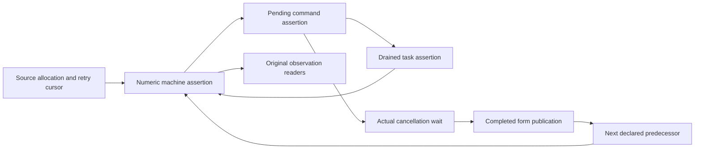
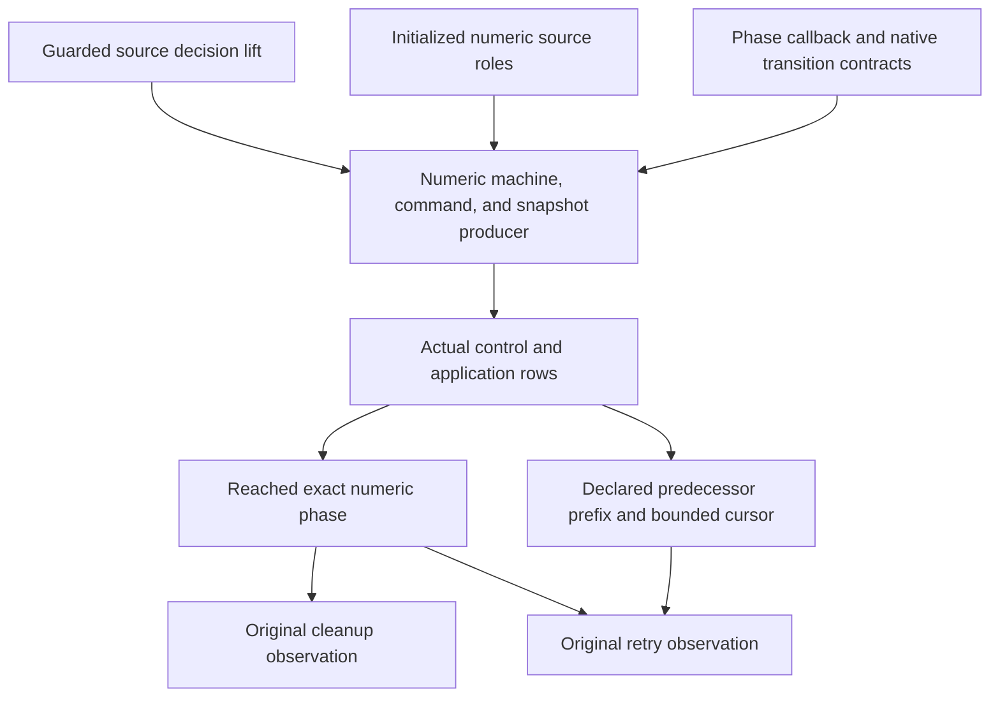

# Timeout numeric proof checkpoint

Neither Timeout goal is closed by this checkpoint.
The new local proofs do not produce their own history premises.

## Base and commits

The worktree is `/private/tmp/effect4-timeout-m3` on `codex/timeout-m3`.
The base is `5f07927c8`.
Commit `82d913ed6` adds the numeric phase.

## Placement

| Declaration group | Concept and requirement | Question and consumer | Reach | Limit |
| --- | --- | --- | --- | --- |
| `HostTimeoutNumberPhase.Phase` and its laws | scope-lifetime-finalization R11; translation-simulation R10 | Steps of the existing goals `Timeout.cleanup_keeps` and `Timeout.retries_declared` | The actual three-cell heap, source count/cleanup/form writes, and unchanged observation readers | No source permission or history producer |
| `HostTimeoutNumberWait.countdown_complete` | scope-lifetime-finalization R11 | The cancellation wait used by `Timeout.cleanup_keeps` | Every actual countdown walk and every held target | No source cleanup fact |
| `HostTimeoutNumberWait.AttemptExitAt`, `AwaitAt`, and their laws | scope-lifetime-finalization R11 | The cancellation queue assertion used before the form finalizer | The actual attempt lookup, stored numeric exit class, target list, and heap image | The configuration must produce the stored exit class and target coverage |

The declarations live in `Test/Dogfood/Proofs/HostTimeoutNumberPhase.lean` and `Test/Dogfood/Proofs/HostTimeoutNumberWait.lean`.
Their consumers remain the two existing planned goals in `Test/Dogfood/Scenario/Timeout.lean`.
They establish neither progress nor host agreement.

## What the local proofs establish

`Phase` separates cleanup order from completed-form publication.
Its observation readers discharge the original Boolean observations from an exact heap and a declared predecessor prefix.
Its source equations use the actual cleanup and completed-form writers.

`countdown_complete` reads the existing `Machine.countdownWalk`.
A finished walk has seen an exit for every target the machine holds.
`AwaitAt` retains either the cleaned heap or the actual owning attempt among those targets.
`await_cleaned` then produces the cleaned image that the saved form callback requires.
`countdown_waits` proves that the actual native countdown parks while that cleanup is absent.

## The remaining producer

The actual history producer must carry all three assertions together.
The machine assertion carries the numeric phase and the actual fiber roles.
The command assertion carries source permissions and cancellation target coverage.
The drained-task assertion carries live-token reply permissions.



The active attempt owns the count and cleanup writes.
The timer needs a heap-insensitive current-code assertion.
An old terminal attempt must not retain an exact old heap as a current-code requirement.
A resume requires its numeric reply class only when its token matches a live parked fiber.

`HostTimeoutState.CommandsAt` retains body, unit, and arbitrary token classes.
It retains outer heap shapes, not the exact numeric phase.
The new numeric assertions must add the missing relation.

The coordinator supplies `LiftCoupledFact` at `2034712b4`.
It joins machine, command, and drained-task assertions without assuming an independently retained numeric queue.
This checkpoint does not instantiate it.

## Commands and measured results

All Lean commands use `/Users/pooks/Dev/lean4-effect4/scratch/lean-slot.sh`.

| Command | Result |
| --- | --- |
| `lake build Test.Dogfood.Scenario.Timeout` | Passed, 1200 jobs |
| `lake build Test.Dogfood.Proofs.HostTimeoutNumberPhase` | Passed, 1180 jobs |
| `lake build Test.Dogfood.Proofs.HostTimeoutNumberWait` | Passed, 1188 jobs |
| `lake build ProofGraph.AxiomAudit` | Passed, 15 jobs |
| `lake env lean scratch/TimeoutCuts.lean` | Finite probe: start commits count 1; cancellation records cleanup 1 |
| `lake env lean scratch/TimeoutCutsSmall.lean` | Finite probe: no failing cleanup observation among 12 budgets and 20 prefix lengths |
| `lake env lean scratch/TimeoutRawCuts.lean` | Finite probe: no matching zero-cleanup result among 300 raw prefix cuts |

The finite probes establish no history theorem.
No probe refutes either original fixed-budget Timeout goal.
The suspected early-interruption argument has no checked witness and changes no statement.

The first uncached build fails while saving Lake artifacts outside the writable roots.
The same serialized build passes with the required cache permission.

## Goal status

| Goal | Status at this checkpoint |
| --- | --- |
| `Timeout.cleanup_keeps` | The existing planned goal remains unchanged |
| `Timeout.retries_declared` | The existing planned goal remains unchanged |

No core machine, program syntax, store carrier, root import, semantics registry, or decisions file changes here.
The coordinator must import each retained new leaf through the scenario before merging it.

## Axiom gate

`lake env lean scratch/TimeoutPhaseAudit.lean` imports both new proof modules.
It runs `#axiom_audit Test.Dogfood.Proofs.HostTimeoutNumberPhase Test.Dogfood.Proofs.HostTimeoutNumberWait`.
The output is:

```text
#axiom_audit: 89 declarations within [propext, Quot.sound], 0 of them modulo planned goals; 0 planned goals
```

## Per-command count entry

`CodeAt.count`, `CodeAt.countBind`, and `CodeAt.countEntry` name the post-count class before the count executes.
The current heap remains the actual pre-count heap.
`Image.enter` owns that post-count image.
`NumberCounted.nextImage` uses it.

`count_exit_push`, `count_bind_push`, and `count_native_write` verify the actual three commands separately.
Their saved callback obligations require the post-count heap only when the callback receives its result.
The producer no longer needs to assume a fabricated post-count heap before either push.

`HostTimeoutNumberInterrupt.running_frame` verifies the deferred-interruption branch.
It changes neither the numeric current code nor the saved stack.
`idle_frame` verifies immediate interruption from the actual accumulated cause class.
The command assertion must still supply that cause class and the permission to execute a count prefix.

The new interruption module is `Test/Dogfood/Proofs/HostTimeoutNumberInterrupt.lean`.
Its placement is scope-lifetime-finalization R11, with reactive-scheduling R9.
Its consumers remain both Timeout goals.
It establishes no history or execution permission by itself.

| Command | Result |
| --- | --- |
| `lake build Test.Dogfood.Proofs.HostTimeoutNumberCounted Test.Dogfood.Proofs.HostTimeoutNumberWait` | Passed, 1204 jobs |
| `lake build Test.Dogfood.Proofs.HostTimeoutNumberCounted` | Passed, 1202 jobs |
| `lake build Test.Dogfood.Proofs.HostTimeoutNumberInterrupt` | Passed, 1203 jobs |
| `lake env lean scratch/TimeoutCountAudit.lean` | The output below |

The last command audits `NumberFlow`, `NumberCounted`, `NumberInterrupt`, `NumberPhase`, and `NumberWait` in their full module namespaces.

```text
#axiom_audit: 301 declarations within [propext, Quot.sound], 0 of them modulo planned goals; 0 planned goals
```

## Root and timer roles

The original planned goals remain unchanged and open.
This slice supplies local roles and their actual callback equations.
It supplies no initialized command history.

`NumberResult` connects the published form exit to the actual success encoder and typed catch callback.
Its handler skip theorem requires the actual recorded interruption to contain no typed failure.
It does not assume that fact for arbitrary frames.
`NumberRegion` checks the actual root prefix above the source handler and loop suffix.
`NumberTimer` checks the timer source and its reference-preserving primitive effects.
`NumberStable` transports those numeric frames across reference-preserving scheduler edits.
`NumberLoop` checks the actual success stop and the failure continuation below four attempts.

`NumberConfiguration` defines the concrete active machine, command, and drained-snapshot assertions.
Its reply assertion checks the actual replacement frame only when a live park still matches the token.
Old-token replies need no fabricated numeric value class.
Its cancellation commands retain the owning attempt's actual countdown assertion.
Allocation and uncounted root forms still require additional phases.

Each module's header records its concept, requirement, consumer, reach, and limit.
The consumers remain both Timeout goals.
No host behaviour gate changes because this slice changes proof modules only.

| Command | Result |
| --- | --- |
| `lake build Test.Dogfood.Proofs.HostTimeoutNumberStable` | Passed, 1209 jobs |
| `lake build Test.Dogfood.Proofs.HostTimeoutNumberRegion` | Passed, 1207 jobs |
| `lake build Test.Dogfood.Proofs.HostTimeoutNumberLoop` | Passed, 1207 jobs |
| `lake build Test.Dogfood.Proofs.HostTimeoutNumberConfiguration` | Passed, 1215 jobs |
| `lake env lean scratch/TimeoutRolesAudit.lean` | The output below |

The serialized slot runs every command in this table.
The audit checks `NumberFlow`, `NumberResult`, `NumberRegion`, `NumberTimer`, `NumberStable`, `NumberLoop`, and `NumberConfiguration`.

```text
#axiom_audit: 402 declarations within [propext, Quot.sound], 0 of them modulo planned goals; 0 planned goals
```

## Proof graph review

FLOW section 5 and GOALS-2 section 4 identify the missing numeric producer.
WORKERS section 5 shows why source-only command admission does not supply it.
The current route uses the shared guarded source lift and the coupled ghost-state producer.



The shared guard supplies the first node.
The shared coupled lift supplies composition, but it does not supply the numeric producer.
`HostTimeoutHistory` supplies the actual row decomposition pattern.
The existing phase readers supply both final observation steps.
The initialized source-control family and numeric command producer remain open.

The general phase drops the stronger local comparison between completed forms and cleanups.
Its count transition requires cleanup length equal to the count, enough completed predecessors, and a bounded source cursor.
It does not require the cursor to equal the committed count.
`Phase.enter` remains the stronger local instance of `Phase.counted`.
`Phase.counted_declared` consumes the declared predecessor prefix without requiring equal log lengths.

`NumberPhaseFlow` consolidates count, cleanup, and form callbacks around that phase.
Both actual finalizer families use `AnswerFlow.saved_protected_finalizer`.
The three native writes use one `native_answer` theorem.
The count prefix retains its actual pre-count heap until the write commits.
These facts remain local until the numeric producer establishes their source permissions.

## The command-cut control

`Timeout.CommandCut` retains four finite kernel checks.
A raw cut after 27 commands holds a running attempt with an installed finalizer and count zero.
An outside interruption records its deferred cause.
Reusing the old internal queue then records cleanup zero at count zero.
Public evaluation instead refuses that running attempt and leaves both logs empty.

Queue reuse is not a scenario move.
This control refutes neither original fixed-budget goal.
It shows why the numeric command assertion must reject a deferred pre-count loop command.
A source-only command assertion does not express that restriction.

The shared ghost-command producer belongs to the Atomic seat.
The Timeout instance supplies the same new ghost state for frames, pending commands, and drained tasks.
Its interruption premise must also read the installed-prefix running condition.

| Command through the serialized Lean slot | Result |
| --- | --- |
| `lake build Test.Dogfood.Proofs.HostTimeoutNumberPhaseFlow Test.Dogfood.Scenario.Timeout.CommandCut` | Passed, 1191 jobs |
| `lake env lean scratch/TimeoutPhaseFlowAudit.lean` | The output below |

```text
#axiom_audit: 187 declarations within [propext, Quot.sound], 0 of them modulo planned goals; 0 planned goals
```

The audit checks `NumberPhase`, `NumberPhaseFlow`, and `Timeout.CommandCut` in their full module namespaces.
Both original Timeout goals remain unchanged and open.
The coordinator must import the retained proof leaves and control through the scenario before merging.

## Count permission and cleanup barrier

The numeric producer remains open.
This slice connects the local count permission and actual wait barrier to the configuration's assigned fiber roles.
Its concepts remain scope-lifetime-finalization R11 and translation-simulation R10.
Both original Timeout goals consume the planned coupled producer.

`NumberConfiguration.CountFrameAt` names the three actual pre-count control positions.
`CountReady` excludes deferred interruption and an injected yield after finalizer installation.
The queued loop assertion carries that permission jointly with the machine assertion.
An interruption allowed by the message assertion must avoid the reserved pending targets.
`NumberPhaseFlow` retains the uncounted interruption arm beside the counted cleanup arm.
Its saved contracts quantify the current completed-exit view.

`Configuration.lookup` reads the uniquely assigned role of the actual looked-up fiber.
`Configuration.await_attempt` derives the cleanup wait certificate from that role's published exit.
`Configuration.await_complete` consumes the existing actual countdown producer.
It establishes cleanup length equal to the current count through the exact heap cells.
The proof covers counted cleanup and interruption before counting.
It does not assume equal phase proof records.

| Command through the serialized Lean slot | Result |
| --- | --- |
| `lake build Test.Dogfood.Proofs.HostTimeoutNumberConfiguration` | Passed, 1217 jobs |
| `lake env lean scratch/TimeoutCountBarrierAudit.lean` | The output below |

```text
#axiom_audit: 327 declarations within [propext, Quot.sound], 0 of them modulo planned goals; 0 planned goals
```

The audit checks the full `NumberPhaseFlow` and `NumberConfiguration` module namespaces.
No execution behaviour changes, so this slice reaches no outside implementation gate.
The fixed-budget goals remain unchanged and open.
The source initializer, root race relation, declared failure correlation, and coupled command producer remain open.
The shared bare initialization producer belongs to the Queue seat.
The shared code closure supplies source contracts without another syntax traversal.

## Root control across numeric writers

The numeric producer remains open.
`NumberRootControl` names the root's actual readonly cancellation control and ordered saved prefix.
Its concepts are scope-lifetime-finalization R11 and translation-simulation R10.
Its consumer is the numeric command producer for both Timeout goals.
The source form finalizer remains below that prefix and above the untouched source suffix.
The contracts quantify the completed-exit view.
They cover restoring masks and injected yield wrappers.

`ReadCode.iteration_refs` consumes the existing actual iteration reference producer.
`RootControl.region` reconstructs the form region at the newly established numeric heap.
Neither theorem walks the program syntax or defines race semantics.

`NumberRootTransitions.count_root_regions` consumes the permitted actual count iteration.
`cleanup_root_regions` consumes the actual cleanup write.
Both read the actual root lookup at fiber zero.
Both return that lookup, the new heap, the child contract, and the root region at one successor phase.
The configuration includes the readonly root role and the frozen numeric computation role.
Its cancellation command assertions now carry the general cleanup barrier.

| Command through the serialized Lean slot | Result |
| --- | --- |
| `lake build Test.Dogfood.Proofs.HostTimeoutNumberRootTransitions` | Passed, 1219 jobs |
| `lake env lean scratch/TimeoutRootControlAudit.lean` | The output below |

```text
#axiom_audit: 258 declarations within [propext, Quot.sound], 0 of them modulo planned goals; 0 planned goals
```

The audit checks `NumberRootControl`, `NumberConfiguration`, and `NumberRootTransitions` in their full module namespaces.
The readonly pop must retain its control assertion until the actual source form callback starts.
The coupled native and command producer, initialized history, and both original endpoints remain open.
No execution behaviour changes, so this slice reaches no outside implementation gate.

## Selected typed-failure provenance

This internal invariant refinement changes neither original Timeout endpoint.
The source catch reader still establishes the exact selected singleton's declared retry.
Its concepts are scope-lifetime-finalization R11 and translation-simulation R10.
Its consumer is the declared-prefix component of the coupled numeric producer.

`NumberPhaseFlow.TypedFrom` requires every delivered typed reason to occur in the selected failure.
It replaces the exact-cause alternative in the published phase's cause assertion.
The actual restoring-mask union can combine a selected failure with a recorded interruption.
`cause_combine`, `cause_strip`, and `cause_sanitize` retain the provenance relation.
Combination and sanitization retain the actual recorded interruption premise.
`Timeout.OriginControl.unrelated_rejected` rejects an unrelated typed failure in that union.
This kernel-checked control refutes neither original endpoint.

`NumberRootModel` refines readonly current code with the existing concrete control assertion.
Its tagged local edges distinguish readonly callbacks from the actual source form finalizer.
The coordinator's unchanged `AnswerFlowEmbedding` at `1f997ca04` supplies the numeric composition.
That shared leaf is a dependency, not a Timeout edit.
The actual selected-pop readers consume the existing shared family proof and retain the ordered suffix.
The cause reader consumes the same popped frame's recorded interruption premise.

`NumberRootResult.singleton_error` identifies the selected singleton's exact represented error.
`caught_declared` applies the actual source predicate to that payload.
`selected_unique` reads the exact completed-form heap.
`published_caught_declared` joins that heap to the delivered cause provenance and proves the selected singleton's declared retry.
The actual initialized producer must still supply the selected singleton and its publication.

| Command through the serialized Lean slot | Result |
| --- | --- |
| `lake build Test.Dogfood.Proofs.HostTimeoutNumberRootModel` | Passed, 1193 jobs |
| `lake build Test.Dogfood.Proofs.HostTimeoutNumberRootResult` | Passed, 1212 jobs |
| `lake build Test.Dogfood.Proofs.HostTimeoutNumberRootTransitions Test.Dogfood.Scenario.Timeout.OriginControl` | Passed, 1220 jobs |
| `lake env lean scratch/TimeoutOriginAudit.lean` | The output below |

```text
#axiom_audit: 219 declarations within [propext, Quot.sound], 0 of them modulo planned goals; 0 planned goals
```

The audit checks `NumberPhaseFlow`, `NumberRootModel`, `NumberRootResult`, and `Timeout.OriginControl` in their full module namespaces.
The actual control advancement, contextual source catch suffix, initialized history, and both original endpoints remain open.
No execution behaviour changes, so this slice reaches no outside implementation gate.

## Contextual source suffix

This slice changes neither original Timeout endpoint.
Its concepts are scope-lifetime-finalization R11 and translation-simulation R10.
Its consumer is the actual root return component of the coupled numeric producer.
Its reach is the actual source encoder and catch, with the same popped frame's recorded interruption.
It establishes no initialized history or command closure.

`NumberRootSuffix.local_family` joins those source callbacks to the existing contextual saved-frame proof.
`catch_skipped` uses the actual ensured frame's recorded interruption premise.
`control_path` retains the actual source form, encoder, catch, and ordered suffix.
`cause_selected` consumes that path through the shared contextual pop producer.
`retry_declared` identifies the exact selected singleton recorded by the source form.
The returned retry assertion retains the actual predicate result and selected typed-failure provenance.

The unchanged shared dependencies are Atomic's `7d19775dd` and the coordinator's `d74d61c58`.
The latter supplies contextual embedding composition and the legacy unconditional instance.
These shared files are dependencies, not Timeout edits.

| Command through the serialized Lean slot | Result |
| --- | --- |
| `lake build Test.Dogfood.Proofs.HostTimeoutNumberRootSuffix` | Passed, 1215 jobs |
| `lake env lean scratch/TimeoutSuffixAudit.lean` | The output below |

```text
#axiom_audit: 81 declarations within [propext, Quot.sound], 0 of them modulo planned goals; 0 planned goals
```

The audit checks `NumberRootModel` and `NumberRootSuffix` in their full module namespaces.
The actual loop continuation, coupled native and command producer, initialized history, and both original endpoints remain open.
No execution behaviour changes, so this slice reaches no outside implementation gate.

## Actual loop and interruption permissions

This slice changes neither original Timeout endpoint.
Its concepts are translation-simulation R10, reactive-scheduling R9, and scope-lifetime-finalization R11.
Its consumers are the root loop outcome and actual addressed-message component of the coupled command producer.

`NumberRootLoop.failure_continue` consumes the actual returned retry and exact selected singleton publication.
It also consumes the real cleanup barrier and source loop callback premises.
It returns the exact loop continuation and next `CountContext` permissions together.
The completed predecessor log contains only declared retries at that boundary.
The proof uses the existing loop callback laws and adds no syntax traversal.

`NumberConfiguration.FiberAt.immediate` records the live idle fiber's clean-cause replacement permission.
Read and unit classes still reject cause delivery.
Their actual masked execution must discharge the new conditional permission.
`NumberConfigurationInterrupt.interrupt_fiber` proves the actual addressed interruption retains the whole numeric fiber assertion.
It uses the actual running flag, mask, ordered saved suffix, and recorded cause.
The incoming and previously recorded causes contain no typed failure.
This local producer does not assume unrestricted interruption closure of each answer class.

| Command through the serialized Lean slot | Result |
| --- | --- |
| `lake build Test.Dogfood.Proofs.HostTimeoutNumberRootLoop` | Passed, 1225 jobs |
| `lake build Test.Dogfood.Proofs.HostTimeoutNumberConfigurationInterrupt` | Passed, 1220 jobs |
| `lake env lean scratch/TimeoutLoopInterruptAudit.lean` | The output below |

```text
#axiom_audit: 204 declarations within [propext, Quot.sound], 0 of them modulo planned goals; 0 planned goals
```

The audit checks `NumberRootLoop`, `NumberConfiguration`, and `NumberConfigurationInterrupt` in their full module namespaces.
Whole-machine and queue transport, native role advancement, initialized history, and both original endpoints remain open.
No execution behaviour changes, so this slice reaches no outside implementation gate.

## Joined actual interruption producer

This slice changes neither original Timeout endpoint.
Its concepts are reactive-scheduling R9 and scope-lifetime-finalization R11.
Its consumer is the interrupt branch of the shared contextual addressed-message producer.

`NumberConfigurationTransport.interrupt_configuration` retains the complete numeric machine assertion and stored reply tasks.
`update_view` uses the actual lookup and the base driver's unique fiber identifiers.
It retains the ordered completed-exit view when the actual addressed replacement retains its exit.
`interrupt_reply` checks the actual surviving token guard and saved suffix.

`NumberQueueInterrupt.commands_interrupt` retains the entire pending command queue and actual generated evaluate command.
`loop_interrupt` excludes protected pending-prefix owners through the actual message permission.
`cleanup_await_update` retains cancellation's concrete cleanup barrier through actual target-exit lookups.
`protects_interrupt` retains the same protected-owner condition for the resulting queue.
`interrupt_joint` returns the machine, queue, detached tasks, and protected-owner condition together.

`NumberRootSuffix.value_selected` consumes the existing shared contextual value-pop reader.
It requires no fabricated unconditional handler-discard premise.

| Command through the serialized Lean slot | Result |
| --- | --- |
| `lake build Test.Dogfood.Proofs.HostTimeoutNumberConfigurationTransport` | Passed, 1227 jobs |
| `lake build Test.Dogfood.Proofs.HostTimeoutNumberQueueInterrupt` | Passed, 1228 jobs |
| `lake build Test.Dogfood.Proofs.HostTimeoutNumberRootLoop Test.Dogfood.Proofs.HostTimeoutNumberRootTransitions` | Passed in the affected-dependent run |
| `lake env lean scratch/TimeoutActualInterruptAudit.lean` | The output below |

```text
#axiom_audit: 45 declarations within [propext, Quot.sound], 0 of them modulo planned goals; 0 planned goals
```

The audit checks `NumberConfigurationTransport`, `NumberQueueInterrupt`, and `NumberRootSuffix` in their full module namespaces.
Observer and token edits, native role advancement, initialized history, and both original endpoints remain open.
No execution behaviour changes, so this slice reaches no outside implementation gate.
