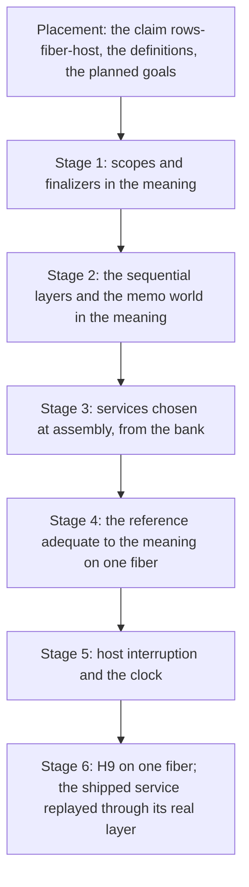

# SCOPE-1: layers, scopes and services on one fiber (scout, version 1)

Status: a scout for review (history, not authority). It runs after PROC-6 lands, on PROC-6's end
state. Base of the reading: `98589332f` on `refactor/phase1-phase3`; Codex's PROC-6 branch
`codex/proc6` at `9d404a1ec` with slice A uncommitted.

## 1. The one thing to know

The owner, 2026-10-14: "no shortcuts, so we want all of the layers and scopes, obviously. Insert
proper uses of services." The work runs after Codex lands PROC-6; this note scopes it so it lands
cleanly.

**The cut.** SCOPE-1 takes every construct that rc.112 runs on one fiber. CONC-1
(`docs/research/2026-10-14-many-fibers-scout.md`) takes every construct that forks. The line is
the runtime's, not a choice of convenience:

- `Layer.merge` and `Layer.mergeAll` build their layers concurrently, each in a scope forked
  from a parallel parent (`mergeAllEffect`, `vendor/effect-4.0.0-rc.112/src/Layer.ts`). The
  machine forks a fiber per build (`mergeAllForkOne`, `src/Effect4/Program/Compile.lean`).
- A scope with the parallel strategy closes its finalizers concurrently.
- So both go to CONC-1. Everything else here runs on the one fiber.

**The goal.** H9 today holds for one fiber with no layer, scope, mask, interruption or clock
(`H9LoopedRows`; `H9Blocks` after PROC-6). SCOPE-1 states and proves H9 for the whole one-fiber
language: scopes, finalizers, `acquireRelease`, every sequential layer form with its memo map,
services built by layers with first-class method records, masks, the host's interruption of the
fiber, and the clock.

**The gap is the meaning, not the machine.** The machine runs all of it, and M7 types all of it.
The call-tree meaning stops at sequential code: `denoteRows`
(`src/Effect4/Laws/Program/DenoteRows.lean`) answers `outsideExit` for `scoped`,
`acquireRelease`, `provideLayer`, the masks and `withFiber`. The reference meaning `denoteR`
(`src/Effect4/Laws/Program/DenoteR.lean`) hands them to the reference machine as signature
operations, so it is a residual program, not a denotation. No equal-observation theorem under a
host reaches them.

**The route reuses the proved half.** `run_eq_ref_table` (`src/Effect4/Laws/Program/Table/Agreement.lean`,
decisions row 314) proves that the frame machine's replay and the term reference's replay agree
on every program, every row table and every decision tape, on exact `obs`. So SCOPE-1 does not
widen the frame machine's hosted spine. It proves one new step: the reference's replay of a
one-fiber program under a host-driven tape is the block meaning under the tape's host. The
chain is session, then frame replay, then reference replay, then meaning.

## 2. What exists, and what each part reads

| Part | Where | What it gives SCOPE-1 |
| --- | --- | --- |
| The scope state machine | `Scope`, `ScopeState`, `close`, `closeExitsM`, `runScoped`, `acquireRelease` (`src/Effect4/Machine/Scope.lean`) | rc.112's `Scope.ts` with a nominal finalizer `φ` and its run passed as an argument. `closeExitsM` closes at any monad, so the meaning can close a scope at the call tree's monad. No second scope representation is needed |
| The memo world | `MemoEntry`, `MemoMap`, `MemoWorld`, `lookup`, `get` (`src/Effect4/Machine/Stores.lean`) | rc.112's `MemoMapImpl`: entries keyed by the layer's path, a parent chain, an observer count, the layer's own scope, an in-flight Deferred |
| The context's reserved keys | `scopeKey`, `maxOpsKey`, `preventYieldKey`, `currentMemoMapKey`; `ambientScope`, `budgetOf` (`src/Effect4/Machine/ContextMap.lean`) | the ambient scope and the current memo map are context entries, so SCOPE-1 rides on PROC-6's context reader |
| The layer build | `compileLayer`, `resolveLayer`, the names `fromBuildThen`, `freshThen`, `orDie` (`src/Effect4/Program/Compile.lean`); `denoteLayerBody` (`DenoteR.lean`) | each layer form's build, cited to `Layer.ts` line by line |
| Finalization proofs | `src/Effect4/Laws/Machine/Finalizer*.lean`, `ScopeMachine.lean`, `ScopeRestoration.lean`; the claim `once-placed-finalizer` (R11) | exactly-once finalizer accounting on the machine |
| Masks | the claim `saved-mask-restoration` and its region bracket (R11, `generated/semantics.md`) | a region ends at its entry's stack and flag |
| Typing | `provideLayerArm`, `denotesTyped` (M5); M6, M7 | every one-fiber construct is typed at every source |
| The block meaning | `denoteBlockB` and its context reader (PROC-6, decisions row 379) | the fold this note extends: one budget for loop rounds and calls, the context as a reader |
| The frame and reference agreement | `run_eq_ref`, `run_eq_ref_table` (`src/Effect4/Laws/Program/RuntimeR.lean`, `Table/Agreement.lean`) | the machine half of SCOPE-1, already proved for every construct and fiber |
| The term scheduler's signature | `FiberSig`, `RSig`, `RProgram` (`src/Effect4/Laws/Program/Sched.lean`) | one operation per fiber-level arm of the machine, scopes and masks among them; the reference's alphabet |
| Services today | `<App>Context` and `<App>_<entry>` (`docs/research/2026-10-13-emitted-services/README.md`) | a service's state is the context its layer read; a method is a definition taking the state |

## 3. The rulings this plan takes

The coordinator decides these under the owner's delegation of 2026-10-14 (decisions row 380's
preamble). They lock after the reviews, as row 379 did.

| # | Ruling | Kind |
| --- | --- | --- |
| 1 | The cut of §1: SCOPE-1 is every construct rc.112 runs on one fiber; merges, parallel closes and forks are CONC-1's | domain |
| 2 | One meaning: `denoteBlockB` gains every one-fiber arm. No second meaning is written; `denoteR` stays the residual program of M5 | meaning |
| 2b | **The agreement goes through the reference.** H9 on one fiber is the chain session, frame replay, reference replay (`run_eq_ref_table`, proved), meaning. The one new theorem is the reference's adequacy against the block meaning on one fiber. PROC-6's frame-level chain stays as landed | representation |
| 3 | **Code by address.** A finalizer, a layer's build and a service method are first-order data: a program address and a captured environment. The meaning denotes such data on demand at the next budget, as PROC-6's `call` denotes a body. Scopes, memo maps and their finalizers live in `Stores`, exactly as the machine keeps them | representation |
| 4 | **Link-time choice** (decisions row 381 (3), the owner's): a program names a service by its key, and assembly picks a bank entry per key by digest. Dispatch is static. Row 340 (2) stands. Closures become values only with content addressing | representation |
| 5 | The host may interrupt the fiber and advance the clock. `hostDecision` widens to `interruptFrom` at the root and `advance`; masks defer an interruption as rc.112 does | domain |
| 6 | Order: §5's stages, after PROC-6 merges; CONC-1 after SCOPE-1 | domain |

**Ruling 4, as the owner ruled it.** A layer still chooses the implementation, as Effect's
services do, but the choice is made when the program is assembled, not while it runs. A program
names each service by its key; the assembly picks a bank entry (`Effect4.Bank.Entry`) for each key
by its digest. A method call is then a static invocation into the chosen block, so a proof about
the program composes with the entry's claim, as a functor's application does. The printer still
writes the Effect face, `yield* TodoApp` and `todo.add(x)`, from the static wiring. Closures as
values wait for content addressing, where a closure is a code digest and captured values.

## 4. The shortcut audit

| Shortcut a smaller plan would take | Replacement |
| --- | --- |
| Layers without memo maps (build every time) | the memo world, parent chain, `fresh` and observers, as the machine keeps them |
| A layer as a context-producing definition (PROC-6's twin) | `provideLayer` with the service's `LayerTerm` |
| Methods as fixed definitions | the implementation chosen per service key at assembly, from the bank by digest (ruling 4) |
| Finalizers that cannot call host rows | a finalizer is code by address; it may call rows and fail |
| Masks as no-ops because nothing interrupts | the host interrupts the fiber (ruling 5) |
| `acquireRelease` without its uninterruptible acquire | the masked acquire, with the release registered only after success |
| Sleep out of the fragment | the clock as a host decision, a sleep as a wait on it |
| Widening the frame machine's hosted spine construct by construct | the proved frame-to-reference agreement, and one adequacy theorem on the reference |
| Per-request replay only | one built service across a session's requests (stage 6) |

## 5. The stages

### Stage 1: scopes and finalizers in the meaning

- `scoped body`: the meaning allocates a scope through the store operation the machine uses. It
  runs the body under the context with `scopeKey` bound to the scope, then closes the scope with
  the body's exit.
- The close is `Scope.closeExitsM` at the call tree's monad. Its `run` denotes each finalizer by
  its address at the next budget (ruling 3). A finalizer may call host rows and may fail.
- `acquireRelease acquire release`: the acquire runs masked. On success the release is
  registered in the ambient scope as code by address with the acquired value
  (`Scope.acquireRelease`). On failure nothing is registered.
- The explicit close (`closeScope`) closes a scope value with an exit.
- `onExit` keeps its meaning; the restore after a finalizer is `Exit.restoreAfterFinalizer`, as
  `denoteRowsB` has it.
- **Laws** (§7): conservativity over PROC-6's fragment; monotonicity; the one-step laws; that
  the meaning's scope state equals the machine's (`closeOrder`).

### Stage 2: the sequential layers and the memo world in the meaning

- `provideLayer layer isLocal body`: the meaning makes the layer's scope, builds the layer off
  the context's memo map (`currentMemoMapKey`), or off a private map when `isLocal`. It runs the
  body under `provideContext` of the built context, then closes the scope with the body's exit.
- The build, by the layer term: `succeed`, `effect`, `effectDiscard`, `provide`,
  `provideMerge`, `fresh`, `orDie` and `ref`, each as `compileLayer` and `denoteLayerBody` cite
  `Layer.ts`. `merge` and `mergeAll` are CONC-1's.
- The memo world is the stores': a lookup walks the parent chain (`MemoWorld.get`). A hit adds an
  observer and registers the entry's finalizer in the caller's scope; a miss builds and inserts.
  The in-flight Deferred is never awaited on one fiber.
- A layer's identity is its path and the call that runs it (row 341, step 3).

### Stage 3: services chosen at assembly, from the bank

- A program names each service it needs by key. The assembly binds each key to a bank entry by
  digest: the entry's block provides the service's methods, and its layer builds the service's
  state in its scope (stage 2).
- A method call is a static invocation into the chosen block, with the service's state read from
  the context. Swapping the entry for another with the same claim keeps every proof of the program.
- The printer writes the Effect face from the wiring: the layer as `<App>Layer`, the service as a
  record of arrows, the consumer as `yield* TodoApp` and then `todo.add(x)`.
- The to-do's claims carry over by one equation: a method called means its entry under the
  state, the region's meaning (the emitted-services note, "The laws it owes").

### Stage 4: the reference adequate to the meaning on one fiber

- The fragment `FiberRows` widens PROC-6's `BlockRows` by every one-fiber construct.
- **The bridge (check C0).** A reached run's machine is the frame replay of its tape
  (`tapeOf s`). Then `run_eq_ref_table` moves the run to the reference replay on that tape.
- **The adequacy theorem.** On `FiberRows`, at a tape whose decisions are host-driven, the
  reference replay (`replayR`) finishes with the exit and stores of the block meaning run
  against the tape's host (`tapeHost`). It goes by a relation between the reference's state and
  a position of the meaning, preserved by each decision, in the shape of `ReplayRel` and
  `BMeans` (`src/Effect4/Laws/Program/RuntimeR.lean`).
- The reference's scope and mask operations (`FiberOp.scoped`, `scopeExit`, `closeScope`,
  `foreignRelease`, `mask`, `getContext`, `setContext`) each answer one arm of the meaning.
- The reference reads decisions, not budgets, so the frame machine's yield wrappers and segment
  bounds (PROC-6's stage 4) do not enter this proof.
- PROC-6's `H9Blocks` becomes a corollary on `BlockRows`, or stays as its own route. Both are
  proved; the receipt says which consumers move.

### Stage 5: host interruption and the clock

- `hostDecision` admits `interruptFrom` aimed at the root fiber and `advance`.
- The meaning asks the host at each point where the machine can deliver an interruption. Under a
  mask the interruption is recorded and delivered at the mask's end
  (`FrameFiber.deferredInterrupt`). An interruption runs the open scopes' finalizers with an
  interrupt cause.
- A sleep waits on the clock: the meaning's tree waits until the host's `advance` passes the
  deadline (`Timer`, `src/Effect4/Machine/Timer.lean`).
- Open check C1 (§8): the exact delivery points on one fiber.

### Stage 6: H9 on one fiber, and the shipped service

- `H9Fiber`, beside `H9Blocks`: a reached, funded, at-rest run of a `FiberRows` program under a
  host whose answers, interruptions and clock steps are the run's, past a budget bound, has the
  meaning's exit and stores.
- The validated premises (`conforms_sat`, `agrees_hostRun`) restated over it.
- The replay runs the face's real layer: `Effect.provide(TodoAppLayer)` with the repository's
  host layer (PROC-6's horizon (a)).
- A server-lifetime service: one machine per server session, its requests applied in the
  serialized order, the layer built once (horizon (b)). It needs a session-composition goal and
  its consumer, placed in this stage.

## 6. Landing cleanly after PROC-6

- **Base.** PROC-6's final head, merged into `refactor/phase1-phase3`. SCOPE-1 extends two of PROC-6's
  modules, `BlockMeaning.lean` and `FragmentBlock.lean`, and it leaves PROC-6's hosted spine
  (`Agreement/Machine.lean`, `Segment.lean`, `Hosted.lean`) alone, since the agreement goes
  through the reference. It starts after PROC-6 merges.
- **No core edit is planned** since ruling 4 is link-time: `Store.Val`, `Ty` and `Eff` stay as
  they are (their 786, 690 and 682 dependents are not rebuilt). The assembly's binding of keys to
  entries is new data beside the program.
- **New material in new leaf modules**, appended to the root imports, as PROC-6's brief did:
  the scope arms, the layer arms, the service arms, the agreement arms, `H9Fiber`.
- **A prep stage first**, as PROC-6 had: measure each edited module's fan-out at the base, and
  take each behaviour gate's baseline there.
- **Reviews** before the lock: Gemini, then Codex, as for PROC-6.

## 7. Placement of the planned goals

All goals: concept `translation-simulation` (`docs/core/semantics.md`), except where named.

| Goal | Claim, role | Requirement | Consumer |
| --- | --- | --- | --- |
| stage 3: an assembly's binding is well typed: each entry's interface meets its key's signature | `context-requirements` | R5 | stage 6 |
| stage 1: conservativity over `BlockRows` | step of `rows-fiber-host` | R6 | `H9Fiber` at a block program |
| stage 1: the meaning's close equals `closeOrder`'s | step of `rows-fiber-host`; concept `scope-lifetime-finalization` | R11 | stage 4's close arm |
| stage 2: a memo hit's observer and finalizer | step of `rows-fiber-host` | R11 | stage 6's shared service |
| stage 3: a method applied means its entry under the state | the to-do's claims | R10 | the cached claim on the real layer |
| stage 4: the bridge, a run's machine is the frame replay of its tape | step of `rows-fiber-host` | R6 | the chain to the reference |
| stage 4: the reference adequate to the block meaning on `FiberRows` | step of `rows-fiber-host` | R6 | `H9Fiber` |
| stage 5: delivery under a mask | step of `rows-fiber-host`; `saved-mask-restoration` | R11 | `H9Fiber` with interruption |
| stage 6: `h9_fiber : H9Fiber` | `rows-fiber-host` (new), simulation | R6, serving R10 and R11 | the validated premises |
| stage 6: session composition | step of `rows-fiber-host` | R12 | the server-lifetime replay |

`H9Fiber` does not establish forks, merged layers, parallel closes, races or progress. Those are
CONC-1's, and progress stays the host's assumption (`host-progress`).

## 8. Open checks before the lock

- **C0.** The bridge from a recorded run to the frame replay of its tape. No theorem by that
  statement was found in this pass; `journal_replays` (`src/Effect4/Laws/Run.lean`) and the
  session laws of H8 are where it starts.
- **C1.** Where the machine delivers a host interruption to a lone fiber: at a parked host call,
  a sleep, a yield, a mask's end. The meaning asks the host at exactly those points.
- **C2.** Whether the reference runs a finalizer as a hop by address (`FiberOp.foreignRelease`,
  `Capture`), so the outer induction on the budget covers it as PROC-6's covers a call.
- **C3.** The assembly's binding: where it lives (beside the program, or in the application
  record of row 336 (9)) and how a run names the entries it used, so a receipt can cite their
  digests.
- **C5.** `budgetOf` across a layer's scope: PROC-6's ruling 5 proves the machine at every
  scheduler budget, so a layer that provides the budget's keys is covered. Confirm at stage 4.

## 9. What this note does not establish

- No statement here is compiled.
- The cut of §1 rests on `mergeAllEffect` and `mergeAllForkOne` as read; parallel close is read
  from `FinalizerStrategy.parallel`'s use in the compile.
- Sizes are not estimated until the prep stage measures the base.
