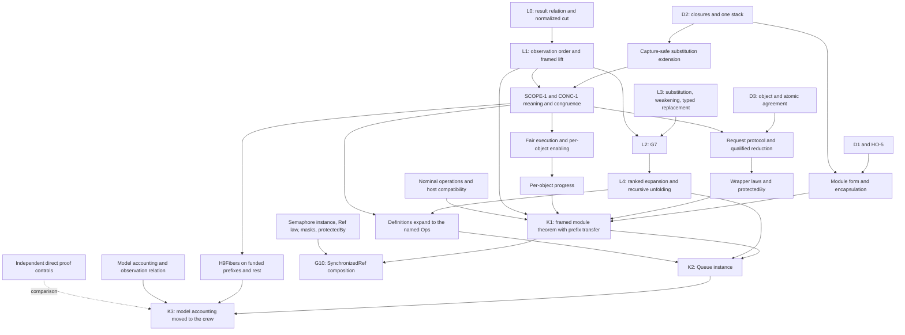

# PROC close: independent review before the lock

## 1. What the coordinator must know

**Amend the plan before locking it.** Keep every requested item, but repair the order, substitution contract, wrapper premises, and closure dependencies.
The current statements do not yet support K1, K2, K3, and G10 as drawn.

Two central implications are false.
A relation on finished results alone does not make a peeled budget cut smaller than a visible call.
Completed-observation inclusion is also weaker than the proposed uniform limit of `Effects.Program.Approx`.

The waiting argument has a separate fault.
A request and its signalling helper share the same Deferred.
Their registration and completion steps do not commute as exact states.
The proof needs a request protocol and qualified commuting steps.

The review keeps the proposed route: one semantic order, one package simulation, generic sequential agreement, and reusable wrapper proofs.
It adds the premises and connecting theorems those claims need.

Reviewed source: `bff5c1ccb34742381b21011893877cbfe9fd4a24`.
Branch: `codex/proc-close-review`.
Worktree: `/Users/pooks/Dev/lean4-effect4-codex`.
Effects pin: `bf5ab8fd26ee009abbf465821a3664ea20948a49`.
Package paths below refer to `.lake/packages/effects` at that pin.
The kit package holds `3e5e79335e778c04493245e14e31bb2d48d0d54f`.

This review changes only this document and its named probes.
It changes no source, authority, generated file, or file in `/Users/pooks/Dev/lean4-effects`.
Three Sol 6.1 reviewers independently inspect relations, inlining, and concurrent objects.
The lead reviewer checks their artifacts and adds the closure and host controls.

Evidence labels below separate checked propositions, finite evaluations, source readings, and proposed obligations.
A proposition defined as `Prop` checks its signature, not its truth.

## 2. Verdicts on the ten questions

### Q1. L0: amend the result relation; the stated cut repair is wrong

**Verdict: wrong as written, with a checked counterexample.**

`Step.Lift` in `Effects/Coalgebra/Step.lean` matches finished steps with finished steps and calls with the same call.
`IsSim` and `IsBisim` in `Effects/Coalgebra/Bisim.lean` use that lifting.
`System.peel` represents a program's `none` result as a finished step carrying `(none, stores)`.

The exact proposed result extension is `Candidate.Lift`, `Candidate.IsSim`, and `Candidate.IsBisim` in `probes/CodexRelations.lean`.
Their essential finished constructor is:

```lean
| done {a : A} {b : B} (h : Out a b) :
    Lift Out R (.done a) (.done b)
```

The call constructor still requires the same operation and related continuations for every answer.
The two result types may differ.
`Candidate.CutResult` ignores the stores of a cut and relates completed exits with their resulting states.

That extension still cannot relate `.done (none, s)` to `.call op next`.
`result_relation_does_not_make_cut_bottom` proves this for **every** result relation, including the always-true relation.
Gemini's `PeelStepRel` has an extra cross-constructor case, which the proposed package change omits.

**Amendment.** Keep the result relation, and normalize semantic cuts before the existing system simulation reads them.
`normalizeCut` and `completedPeel` give the exact candidate definitions:

```lean
| .done (none, _)   => none
| .done (some a, s) => some (.done (a, s))
| .call op next    => some (.call op next)
```

`normalized_bottom_is_system_cut` and `system_cut_simulates_any` check that this repairs the missing case.
A package-level bottom-aware lifting is another possible design.
The actual package change must retain its universe parameters; this review specializes the interface to Effect4's universes.
The probe checks that alternative too, but recommends normalization to avoid another semantic relation.
Neither candidate is an edit to the package.

Keep existing names as equality instances of generalized `LiftR`, `IsSimR`, and `IsBisimR`.
The probe proves `lift_eq_iff`, `isSim_eq_iff`, and `isBisim_eq_iff` against the current package.
This is propositional compatibility, not definitional identity between the old and new inductive types.
Package proofs that construct or eliminate `Lift.done` need adjustment.
An abbreviation alone does not preserve their constructor proofs unchanged.

The heterogeneous run theorem returns an existential related result.
It cannot retain an equality conclusion for arbitrary `Out`.
`RunSoundContract`, `RunBisimContract`, and `SimCompositionContract` state the required shapes in the probe.
`Lift.comp` proves that composition must compose both result relations and state relations.
The generalized unfolding theorem likewise needs a result-relational program lifting.
Keep `unfold_approx_of_sim` and `run_eq_of_bisim` as equality-specialized corollaries.

**Existing Effect4 callers.** The source scan finds none in `src`, `Test`, `tools`, `apps`, or `harness`.
The scan covers `Step.Lift`, `IsSim`, `IsBisim`, and their named simulation, unfolding, and run theorems.
Consequently no current Effect4 source proof needs a caller repair for those APIs.
Package-internal users still need the package's own check after implementation.
Research probes do not establish package compatibility by themselves.

### Q2. The order and handler lift: separate the observation order from its proof certificate

**Verdict: wrong identity assertion; amend the lift contract.**

`ObsRefines` in `probes/CodexRelations.lean` states completed-observation inclusion.
It quantifies over related initial states and admitted host pairs.
Each completed left run must have a right budget, related exit, and related final states.
The matching budget occurs **after** the host and its completed run are fixed.
`exactHosts` supplies the same-host, equal-host-state instance.

`RefinesB` is the checked pullback through the existing `denoteBlockB`.
It exposes both body tables, related contexts and environments, and a relation on parameter frames.
For G7, use equal stores, equal exits, equal contexts and environments, and compatible parameter frames.
Define `EquivB` by both directions of this one order.
For module claims, use the abstraction relation and admitted nominal host relation.

The structural certificate has a stronger quantifier order:

```lean
∀ k, ∃ j, Effects.Program.Approx (left k) (right j)
```

That `j` must work for every answer branch of the tree.
Completed-observation inclusion does not require such a uniform budget.
The probe proves two separating controls.
`limit_sound_for_completed_observations` proves the sufficient direction through `Comodel.run_approx`.
`boundedReplies_mono` also checks that the productive counterexample grows monotonically with its budget.

The controls are:

- `asksThenCuts` and `cuts` have no completed result under any host, but the former has no structural limit below the latter.
- `allReplies` answers every natural reply immediately; `boundedReplies k` answers only replies below `k`.
  Each completed run matches at some budget, but no budget matches every possible reply.

`each_completed_observation_matches` and `no_uniform_structural_limit` check the second separation without vacuous completion.
These are generic budget-family counterexamples.
They refute the proposed equality of orders on budget-indexed trees.
They do not assert that every such family is a `denoteBlockB` image.
A narrower equality on that image would need its own theorem and premises.

**Amendment.** Keep completed-observation inclusion as the primary order.
Treat the structural limit as a sufficient certificate for G7, not as the definitionally identical identity instance.
No second simulation framework is needed.

`cata_blockAlgB_approx` in `src/Effect4/Laws/Program/BlockMeaning.lean` relates folds under pointwise `Approx` premises.
Its call premise `hc` and parameter premise concern the same operation tree signature and equal input values.
It does not supply module ownership, nominal transport, or host compatibility.
It does not establish the module's non-identity abstraction at successful or failed exits.
It also does not perform the limit's quantifier interchange automatically.

The probe's `CallHandlersRefine` uses the actual call-handler type:

```lean
Nat → Val → List (ParamTreeB table) → Ctx →
  Effects.Program (RowsSig table) (Option ExitV)
```

`HandlerLiftContract` states the wanted lift through `cata_eff (blockAlgB ...)`.
Its client-frame and client-compatibility predicates are explicit obligations, not proved assumptions hidden inside `hc`.
Before landing, define those predicates by the admitted constructors and prove their preservation.
The relation must cover terms, branches, dynamic contexts, returned values, and captured program parameters.
A successful operation and a failed operation must both restore the abstraction.
An unanswered host call remains a frontier.

`FrameCondition` checks primitive answers as well as resulting states.
`identity_frame` proves its equality instance.
`NominalFrameCondition` additionally relates operations with renamed handle arguments and extends the name relation on allocation.
Disjoint writes alone cannot establish that condition.

The ownership predicate must exclude reads and indirect accesses to private cells, not just writes.
It must follow nested values, captures, and calls through the declared interface.
Fresh client allocations require fresh-name extension, because the implementation may allocate private names first.
`HostRespects` in `probes/CodexClosure.lean` names the corresponding request, reply, and host-state obligation.
The checked host counterexample appears in section 3.

`Candidate.Lift.call` still requires identical row operations, including request values.
`HostRespects` and `NominalFrameCondition` do not themselves transport those operations.
Add checked operation and answer transport before freezing the nominal lift.
World-indexed canonicalization before simulation is one candidate; a generalized package operation lifting is another.
Prove its compatibility with world extension and composition within the same simulation framework.

**G7.** `sandwich_implies_limit_equivalence` proves the generic implication from both sandwich bounds and budget monotonicity.
Thus the proposed sandwich would supply both observation inclusions.
This checks the use of the sandwich, not the universal invocation sandwich itself.
The latter remains a proposed obligation with the finite controls described under Q3.

### Q3. Substitution and weakening: retain the fold, strengthen its contract

**Verdict: amend.**

`substAlg`, `substParams`, and `inlineInvoke` in `probes/CodexInline.lean` give an executable candidate fold.
It reads generated `Node.childLevel` binder information and uses the existing `Eff.weaken`.
The carrier retains each original family node and its depth-indexed transformation.
This retains statement binder information without another program representation.
Inserted arguments are not substituted again under the callee's parameter frame.
They retain their caller's parameter frame.

The key signatures are:

```lean
substParams : Nat → List NativeEff → Nat → NativeEff → NativeEff
inlineInvoke : Nat → NativeEff → Term → List NativeEff → NativeEff
```

The first natural number is the captured caller environment length.
The second is the insertion depth, not another program budget.
`CheckSubstParamsObligation` states the checker obligation over `BodyRows`.
It includes declaration formation, argument count, body checking, declaration admission, argument checking, and requirement containment.
Answer and error subtyping alone omit the requirement column.

`DenoteWeakenObligation` gives the exact meaning equation:

```lean
denoteBlockB table bodies k params (Eff.weaken pre.length e)
  ctx (pre ++ v :: post) =
denoteBlockB table bodies k params e ctx (pre ++ post)
```

| Existing declaration | Path | Contribution and limit |
| --- | --- | --- |
| `Eff.weaken` | `src/Effect4/Program/Fold.lean` | Existing signature-generated relocation; no new shift |
| `weaken_eq_cata_eff` | `src/Effect4/Program/Fold.lean` | Connects relocation to the generated `cata_frontier_eff` |
| `check_weaken` | `src/Effect4/Program/Typing.lean` | Requires `sig.WeakenNatural`; equates `.toOption` results under one inserted slot, without equating refusal details |
| `evalTerm_weaken` | `src/Effect4/Laws/Program/Typed/ListFold.lean` | Term evaluation under that inserted slot |
| `check_replace` | `src/Effect4/Laws/Program/Typing/Replace.lean` | Replacement only at the same inferred `EffTy` |
| `table_splice` | `src/Effect4/Laws/Program/Typing/Splice.lean` | Table replacement only at the same focus type |

The finite `wideDecl` control checks a call at error type `string` and its inline body at error type `never`.
Both checks succeed, but their inferred `EffTy` values differ.
Therefore the proposed subtyping result cannot directly feed either replacement theorem.

**Amendment.** Add a replacement theorem for narrower inferred answer/error columns and contained requirements.
State what happens to the enclosing inferred type and the typing table.
Alternatively, preserve an explicit checked declared interface at the replacement site.
Do not silently assert exact checker-type equality from subtyping.

A second control covers captured parameters inside a layer body.
`captureBody` checks with a program parameter in its signature.
`captureArgument` checks with a captured caller value.
Direct syntactic insertion into the closed layer body fails its check.
`Eff.weaken` deliberately respects that closed boundary.

**Amendment.** Give immediate `BodyRows` substitution its exact domain.
Add capture conversion or explicit closure application before extending the same claim across closed layer bodies.
This is an edge from D2 to the SCOPE-1 substitution and inlining extension, not permission to omit that extension.

`UniversalInvokeSandwich` states the candidate universal bounds as a proposition.
Finite controls cover nested forwarding, caller parameter frames, and captured term values across nested binders.
They also retain Gemini's unequal-budget example.
They do not prove the universal sandwich or weakening theorem.

### Q4. The definitions connector: acyclic expansion is useful, but not the whole authoring domain

**Verdict: amend.**

`eff_module` does **not** build only acyclic blocks.
`src/Effect4/Program/Authoring/Module.lean` supports forward and recursive calls through `using self`.
The `Recursive` control in `probes/CodexInline.lean` builds successfully and satisfies `BlockRows []`.
Its only body calls itself.

`Acyclic` in the probe uses a decreasing rank on definition dependencies.
`callsIn` is a fold and includes calls inside program arguments.
Ignoring argument subtrees would miss dependencies used by higher-order definitions.

Acyclicity is appropriate for an expansion that removes every definition invocation into finite syntax.
It is not the premise of one-step inlining.
A recursive block still needs the local G7 law and finite-unfolding connectors.

**Amendment.** Keep two uses of the same connector theory:

- A finite expansion theorem for ranked blocks, including total expansion on its admitted domain.
- Finite unfolding and limit agreement for recursive blocks, without claiming a finite call-free expansion exists.

`DefinitionsAgreeObligation` states the acyclic connector against completed observations.
The contract must also produce an expansion and establish the absence of definition calls.
A preservation implication conditioned on `expand root = some expanded` would accept an expansion that always refuses.
Use a located refusal outside the admitted domain.
Keep fragment admission and successful expansion inside the theorem's premises or conclusion explicitly.

The Queue and Semaphore connectors need another edge: expanded definitions must equal their existing `Ops` expansions.
Generic inlining alone does not identify two independently authored implementations.
Check the definition builders, requests, captures, and wrappers at those instances.
Their waiting operations remain outside current `BlockRows`; CONC-1 supplies the corresponding meaning and congruence cases.

### Q5. The object and Queue adapter: the three phases hold; the agreement must be relational

**Verdict: amend.**

`ObjectSpec` in `probes/CodexObjects.lean` has phase-indexed inputs and outputs:

```lean
inductive TransitionKind | attempt | signal | withdrawal

structure ObjectSpec where
  State : Type
  Input : TransitionKind → Type
  Output : TransitionKind → Type
  pre : (k : TransitionKind) → State → Input k → Prop
  step : (k : TransitionKind) → State → Input k → State → Output k → Prop
```

A relation accommodates replies, ordered notifications, commitments, and implementation tables without forcing one scalar answer encoder.
`StepsAgree` states state simulation for concrete transitions.
`AtomicStepsAgree` states the existing sequential evaluation obligation, separately from delivery.
These are different proof obligations, not competing object representations.
For landing, make them named fields or projections of one generic agreement package.

`queue_atomic_steps_agree` constructs the generic atomic agreement for the hard take arm.
It applies `Queue.Model.queue_steps_agree.take` from `src/Effect4/Laws/Library/Queue/Steps.lean`.
It retains `FirstProfile`, `Requested`, table injectivity, captured identity and hint, scope length, and the cell reading.
Its existential output retains `Notified` and `Table.afterTake`.
No signal-delivery premise proves the desired result by assumption.

This is a take-arm projection, not a full Queue protocol instance.
The other phases remain explicit model-relation parameters in this review control.
The other sequential theorem projections retain their original types in the probe output.
Offer agreement also needs its pending-offer freshness premise.

`Notified` in `src/Effect4/Laws/Library/Queue/Relation.lean` relates abstract signals to concrete entered and woken lists.
It cannot be replaced by equality with one encoded reply value.
Table renewal and exact notification order belong in the generic relation.

**Amendment.** Separate sequential term agreement, model invariant preservation, and the delivery protocol.
The existing theorem proves the first, including its notification relation.
It proves no helper scheduling, cancellation race, or progress fact.

Ref and Latch need distinct specializations of the shared object interface.
Ref's direct operations need no waiting protocol.
Latch's batched callback protocol needs its registration theorem as well as its step theorem.
Neither is an instance of the two Deferred wrappers merely because its step relation has three possible labels.
Section 3 records the exact sources.

### Q6. The wrapper law: retain the linearization points; replace universal commutation

**Verdict: wrong universal commutation claim; amend the proof route.**

`WaitRetryLaw` and `WaitAnswerLaw` in `probes/CodexObjects.lean` state the proposed wrapper contracts as checked propositions.
They use `waitRetry` and `waitAnswer` from `src/Effect4/Library/Waiting.lean`.
Their meaning, protocol, and refinement parameters await the CONC-1 definitions.
They are not proved wrapper theorems.

| Wrapper | Linearization point | Required protocol fact |
| --- | --- | --- |
| `waitRetry` | Successful atomic attempt | A wake reserves no answer; each retry uses the current hint |
| `waitAnswer` | Atomic step committing the answer, possibly in another request | Every delivered answer matches the commitment; Deferred completion occurs at most once |

The finite shared-hint control uses actual `DeferredStore.register` and `DeferredStore.complete`.
Registration followed by completion owes a resume.
Completion followed by registration returns the value immediately and owes no resume.
The final stores and the step answers differ.
Eventual delivery and caller return require progress and cancellation premises.
An interruption can prevent the caller from returning a committed answer.
Thus the statement that waits and posts commute with **every** other fiber step is false.

**Amendment.** Use reduction only with proved conditions on disjoint state and an explicit request protocol.
Relate the two shared-hint schedules through that protocol instead of equating their intermediate states.
Track pending requests, committed answers, stale hints, posted helpers, and withdrawals.
Prove the cancellation-versus-commit cases and idempotent completion behavior.

CONC-1 must provide Deferred registration, completion, resumption, and cleanup semantics.
It must provide deferred-start detached helpers and interruption between fibers.
SCOPE-1 must provide masks, restore sites, and interruption cleanup.
The reference connection must cover these transitions and their retained continuations.
The nominal frame and host conditions remain premises.

Reduction remains a reasonable proof route with those lemmas.
Sequential `StepsAgree` alone cannot establish them.
For `protectedBy`, the acquisition commit and cleanup-hook installation also need their shared masked-region law.
That law is necessary for G10 and Pool's use operation.

### Q7. Progress: state the object guarantee and strengthen the fairness connection

**Verdict: amend.**

`FairTape` in `src/Effect4/Laws/Machine/Scheduling.lean` quantifies finite prefixes of one finite tape.
It requires later service for each armed owner within the remaining suffix.
`fairTape_unarmed` concludes that no armed owner remains at a funded, unstuck endpoint.
It explicitly does not prove termination, infinite fairness, or host progress.

The probe constructs a nonfinished machine parked on a Deferred.
Its armed list is empty, and `parked_empty_tape_fair` proves `FairTape` for its empty continuation tape.
Therefore bare `FairTape` does not imply request completion.

`RequestProgress` and `SystemProgress` state two proposed progress conclusions:

```lean
-- A specified pending request eventually completes.
∀ t, fair t → environment t →
  ∀ r n, pending t r n → ∃ m, n ≤ m ∧ completed t r m

-- Some pending work eventually completes.
∀ t, fair t → environment t →
  ∀ n, (∃ r, pending t r n) → ∃ r m, n ≤ m ∧ completed t r m
```

These are signature checks, not liveness proofs.
The trace domain and fairness condition need an explicit finite-extension or infinite-execution definition.
Add its connection to current `FairTape` and to the scheduler meaning.
Also state host answers, sufficient funding, environment enabling steps, and cancellation assumptions.

| Object | Supported model behavior | Necessary progress premises |
| --- | --- | --- |
| Queue | Earlier waiting takers prevent later takers from barging; a wake reserves no item | Uncancelled request, sufficient eventual supply, finite predecessors, and service of helpers and retries |
| Semaphore | `takeIfAvailable` can acquire a permit after another waiter wakes | Enabling releases and service give system progress; they do not exclude starvation of a particular waiter |

The Queue controls retain the earlier waiter after wake and refuse a later taker.
The Semaphore control wakes an older waiter, admits a barger, then makes the older waiter's retry fail.
These finite controls identify the distinction; they prove no infinite starvation theorem.
Queue shutdown and cancellation need their stated terminal outcomes, not a promise that every take returns a value.

The bank theorem must quantify over all admitted fair implementation executions for its stated guarantee.
An existential matching completed model run proves only possibility of completion.
It cannot exclude a different fair implementation execution that never answers.

### Q8. Proof closure: add the missing premises and the prefix transfer

**Verdict: amend.**

The worker crew is a useful example because it exercises pending offers, take retries, cancellation, and finalization.
Keep it and the independent direct proofs.
Its claims expose a missing observation in the proposed closure.

`HeldWithinFed` covers every funded script, including unfinished runs.
`FedAccounted` and `QueueSettled` cover funded runs at rest.
Their definitions are in `Test/Dogfood/Scenario/QueueWorkers/Model.lean`.
They do not require a completed root exit.

Completed-observation inclusion alone does not transport these predicates.
`waiting_projection_loses_state` in `probes/CodexClosure.lean` proves that equal coarse observations can hide different waiting stores.
The existing `RowsEnd`, `runRowsO`, and `observeRows` already retain this information.
Reuse their role when widening the many-fiber meaning.
Do not invent a second observer just for the crew.

**Amendment.** Add a generic transfer for funded prefixes and at-rest observations.
It must relate the client's observable stores, pending obligations, and the model's accounting state.
Retain that relation in K1 or provide its projection as a companion theorem.
Connect it to a prefix-capable `H9Fibers`, rather than only a completed-run corollary.

The direct proof dependencies measured by `#plan_status` are `jobs_step`, `rest_step`, and `logs_history`.
The probe's `#plan_status` output records the exact dependencies of each crew claim.
`queue_settled` must join K3's acceptance conditions, as row 385 requires.
A generic model route must not depend on completing the direct machine proof first.
Those direct proofs remain an independent control.

Other missing edges are:

- D1 and HO-5, plus D2, to the module form and its encapsulation theorem.
- Captures and closure resolution to widened substitution and inlining.
- The request protocol and commuting-step lemmas to the wrapper theorem.
- Object-specific enabling and fairness premises to progress and K1.
- Nominal operation and host compatibility to K1 and its composition law.
- Definition-expansion identity to the Queue and Semaphore connector instances.
- The Semaphore instance, Ref operation law, masks, and `protectedBy` to G10.
- The prefix transfer, model accounting proof, and `H9Fibers` to K3.



This diagram adds dependencies, not another representation or a request to drop work.
K1 cannot promise termination for every `ObjectSpec` from sequential agreement alone.
Its guarantee must take the object's progress contract and the generic protocol hypotheses.
K2 instantiates those premises; K3 consumes the resulting observation theorem.

### Q9. Minimality: preserve the single representations and name the distinct obligations

**Verdict: amend the boundaries; the reuse principle holds.**

| Proposed addition | Existing owner to reuse | Required distinction |
| --- | --- | --- |
| Result-relational simulation | `Effects.Step`, `Effects.System`, package simulation | Normalize cuts; do not land `PeelSim` as a second Effect4 framework |
| Program relocation | `Eff.weaken` and generated binder information | No second shift traversal |
| Parameter substitution | `EffAlgebra` and `cata_eff` | A transformation of `Eff`, not another stored program sort |
| Call-handler lift | `blockAlgB` and `Effects.Handler` | Model handlers may hold different abstract state |
| Detailed observation | `RowsEnd`, `runRowsO`, `observeRows` | Keep prefix information needed by K3 |
| Fiber behavior | `FiberSig`, `Body`, `Point`, existing decisions | Check closure/address compatibility before claiming unchanged reuse |
| Closure captures | Existing `ArgSite`, `Capture`, and `Point` capture fields | Migrate to one design with its connector; do not retain duplicate stored environments |
| Generic object | Current model states and their step relations | Relational notifications, encoding tables, and delivery obligations |
| Claim record | `ClaimRecord` and `Bank.Entry` | Bind metadata to checked declarations; no second registry |

The temporary probe definitions explore interfaces only.
Do not land both `BottomLift` and `completedPeel` as alternative simulation engines.
Do not call structural approximation and completed observations the same relation.
Do not duplicate `ObjectSpec` for sequential proofs and scheduler proofs.
Give one object separate atomic, protocol, frame, and progress obligations.

Ref uses the attempt-only specialization.
Latch uses a batching specialization, not fabricated Deferred retry states.
Existing per-module `StepsAgree` theorems can remain compatibility readers while the generic projections become their consumers.

### Q10. Author interface: four values are not the whole proof interface

**Verdict: amend.**

The model, terms, encoding, and sequential proof remain the entry's central supplied data.
The generic theorem also needs checked formation, protocol, frame, and progress premises.
Some come from generic builders; others remain entry-specific proofs.
The interface must show that distinction.

`AuthorProofs` in `probes/CodexObjects.lean` is a checked signature over an existing entry:

```lean
structure AuthorProofs (entry : Effect4.Bank.Entry)
    (typing invariant encoding freshness notifications protocol steps progress :
      Effect4.Bank.Entry → Prop) : Prop where
  typed : typing entry
  invariant_closed : invariant entry
  encoded : encoding entry
  fresh : freshness entry
  notified : notifications entry
  protocol_closed : protocol entry
  sequential : steps entry
  live : progress entry
```

Instantiate these predicates at the actual model, encoding, wrapper strategy, and block.
Do not allow an author to replace them with arbitrary propositions when constructing a verified bank entry.
The generic theorem should determine the predicates from that data.
The reviewed interface is a signature, not a finished admission tool.

An author supplies the operation family, phase transitions, state invariant, cell relation, and ordered signal relation.
The author supplies typed terms and atomic agreement at the declared scopes.
The author discharges the selected wrapper strategy's protocol obligations.
The author chooses and proves the object's progress contract under named environmental assumptions.
The generic theory supplies lifting, definition connection, renaming composition, and machine transfer after their premises hold.

| Likely agent error | Check that must reject it |
| --- | --- |
| Incorrect binder relocation or captured parameter frame | Checker substitution law, meaning weakening law, nested-frame controls |
| Treating a narrower inline type as the same inferred type | Subtype-aware replacement and typing-table theorem |
| Dropping `Notified`, freshness, or table injectivity | Generic atomic agreement fields and Queue adapter |
| Claiming wake means commit for `waitRetry` | Protocol transition and linearization theorem |
| Calling finite callback fairness starvation freedom | Explicit per-object progress proposition and scheduler connection |
| Accessing a private cell through an alias or host request | Located ownership admission and host-compatibility premise |
| Using a raw runtime test as a theorem | Claim premise grades and the exact compiled theorem |
| Supplying a digest or theorem name unrelated to the block | Bank admission that resolves the name, checks its type, and recomputes the digest |

`ClaimRecord` and `Bank.Entry` in `src/Effect4/Program/Authoring/Claims.lean` currently hold metadata.
The finite `uncheckedEntry` control accepts an invented digest, model name, and theorem name.
The types do not certify those names or derive `assumes` from a proof.

**Amendment.** Add a checked constructor or elaborator that binds the existing record to its actual block and theorem.
The generated metadata must identify the proposition and its declared premises.
Keep `#plan_status` as the source of proof status.
A theorem with all work hidden in its premises can be goal-free, so inspect those premises too.

## 3. Additional findings

### Nominal clients also need nominal hosts

`allocation_changes_host_answer` in `probes/CodexClosure.lean` checks a client that allocates a Ref and sends it to a host.
The row requests `refOf unit` and answers `nat`.
Both programs satisfy `BodyRows` and the checker returns `EffTy.pure nat`.
`dataRow` accepts the row because its answer is data.

The host returns the request handle's allocation index.
The ordinary client answers `0`.
Adding one private allocation makes its corresponding client answer `1`.
A renaming of handles cannot equate these natural-number answers.

This control does not use a numeric handle atom or forge a handle.
It exposes a missing host premise in row 385's native-atom argument.
The theorem must restrict admitted hosts by `HostRespects` or compare appropriately related host implementations.
This does not establish host conformance or claim that an existing application uses this host.

### Latch requires another protocol specialization

`latch_steps_agree` in `src/Effect4/Laws/Library/Latch/Steps.lean` covers the cell's step terms.
`latch_registration_agrees` in `src/Effect4/Laws/Library/Latch/Registration.lean` covers initial state, awaiting, and withdrawal.
`src/Effect4/Library/Latch/Model.lean` holds waiters, an attached pending batch, and a scheduled flag.
`flush` returns a detached batch and clears the pending state.
The protocol must track that detached batch after it leaves the cell.
Withdrawal does not retract a detached batch.
The two Deferred wrappers do not prove that batching protocol automatically.

`ref_steps_agree` in `src/Effect4/Laws/Library/Ref/Operations.lean` covers direct store operations, including allocation and callbacks.
It needs no waiting instance.
Preserve all five requested module adapters, but dispatch their protocol proof through the appropriate shared strategy.

### The closure needs observable prefixes

The crew's unfinished-run claims are not a progress claim in disguise.
They are safety and accounting claims over intermediate observations.
A completed-run order and a separate termination theorem do not by themselves establish those observations.
The generic proof should expose its maintained relation at the prefixes its clients inspect.

### Small brief corrections

The proof closure is `modelling-check.md` section 7, not section 8.
`H9Blocks` and `agrees_hostRun_blocks` have explicit completed-root-exit premises.
The latter is in `src/Effect4/Laws/Program/ValidatedBlocks.lean`.
They do not themselves consume a checker typing premise.
CX3 remains necessary for admitting the transformed program, but its role should not invent an H9 premise.

## 4. Probes, commands, and retained output

All commands run in `/Users/pooks/Dev/lean4-effect4-codex`.
Every Lean check uses the requested slot script and warnings as errors.
Each file contains placement and evidence limits.
No broad build or external behavior gate is part of this review.

The checked source head is the base recorded above.
Lean reports version `4.33.1`, commit `819816b2e0a3bf405af45ae5c7af2491d8f5bee6`, on `arm64-apple-darwin24.6.0`.
The runner checks every installed package head against `lake-manifest.json` before checking the probes.
[`CodexCheck.json`](probes/CodexCheck.json) records those pins, probe hashes, commands, exit codes, and output paths.

Reproduce the checks with:

```sh
python3 docs/research/2026-10-14-proc-close/probes/check-codex-review.py
```

Exact runner output, exit `0`:

```text
CodexRelations: exit 0
CodexInline: exit 0
CodexObjects: exit 0
CodexClosure: exit 0
CodexAudit: exit 0
```

The runner checks one module at a time.
It writes compiled probe modules to a temporary directory and removes that directory after the audit.
The commands below retain the temporary path from this run.
The runner creates a fresh path when repeated.


### CodexRelations.lean

[CodexRelations.lean](probes/CodexRelations.lean) — exit `0`.

Exact command:

```sh
/Users/pooks/Dev/lean4-effect4/scratch/lean-slot.sh lake env lean -DwarningAsError=true --root=docs/research/2026-10-14-proc-close/probes -o /private/tmp/proc-close-review-tjziuq0k/CodexRelations.olean docs/research/2026-10-14-proc-close/probes/CodexRelations.lean
```

Exact output: [CodexRelations.log](probes/CodexRelations.log).

The output is empty.


### CodexInline.lean

[CodexInline.lean](probes/CodexInline.lean) — exit `0`.

Exact command:

```sh
/Users/pooks/Dev/lean4-effect4/scratch/lean-slot.sh lake env lean -DwarningAsError=true --root=docs/research/2026-10-14-proc-close/probes -o /private/tmp/proc-close-review-tjziuq0k/CodexInline.olean docs/research/2026-10-14-proc-close/probes/CodexInline.lean
```

Exact output: [CodexInline.log](probes/CodexInline.log).

```text
Effect4.Program.Eff.weaken {Op : Type} [ScopedOp Op] (cut : Nat) : Eff Op → Eff Op
Effect4.Program.weaken_eq_cata_eff {Op : Type} [ScopedOp Op] (cut : Nat) (node : Eff Op) :
  Eff.weaken cut node = cata_frontier_eff (weakenAlg cut) node
Effect4.Program.check_weaken {Op : Type} [ScopedOp Op] (sig : Signature Op) (hw : sig.WeakenNatural) (pre post : TyEnv)
  (inserted : Ty) (p : List Nat) (program : Eff Op) :
  (Checker.check sig (pre ++ inserted :: post) p (Eff.weaken (List.length pre) program)).toOption =
    (Checker.check sig (pre ++ post) p program).toOption
Effect4.Program.check_replace {Op : Type} {s : Signature Op} {env0 : TyEnv} {p0 : List Nat} {p q : Eff Op} {T : EffTy}
  {path : List Nat} (hp : Checker.check s env0 p0 p = Except.ok T) (hat : (Node.eff p).at_ path = some (Node.eff q)) :
  ∃ env t,
    (∀ (pq : List Nat), Checker.check s env pq q = Except.ok t) ∧
      ∀ {s' : Signature Op} {q' : Eff Op} {pq : List Nat},
        SigExtends s s' →
          Checker.check s' env pq q' = Except.ok t →
            ∃ p',
              (Node.eff p).replaceAt path (Node.eff q') = some (Node.eff p') ∧
                ∀ (p1 : List Nat), Checker.check s' env0 p1 p' = Except.ok T
Effect4.Program.table_splice {Op : Type} {s : Signature Op} {env0 : TyEnv} {p p' q' : Eff Op} {T : EffTy}
  {path : List Nat} {f : Focus Op} (hp : Conform.Effect4.Typing.HasTy s env0 p T) (hf : focusAt s env0 p path = some f)
  (hq' : Conform.Effect4.Typing.HasTy s f.env q' f.ty)
  (hrep : (Node.eff p).replaceAt path (Node.eff q') = some (Node.eff p')) :
  table s env0 p' = Table.splice (table s env0 p) path (tableAt s (some (NodeEnv.env f.env)) (Node.eff q') path)
Effect4.Program.evalTerm_weaken (pre post : List Val) (inserted : Val) (term : Term) :
  evalTerm (pre ++ inserted :: post) (Term.weaken pre.length term) = evalTerm (pre ++ post) term
```


### CodexObjects.lean

[CodexObjects.lean](probes/CodexObjects.lean) — exit `0`.

Exact command:

```sh
/Users/pooks/Dev/lean4-effect4/scratch/lean-slot.sh lake env lean -DwarningAsError=true --root=docs/research/2026-10-14-proc-close/probes -o /private/tmp/proc-close-review-tjziuq0k/CodexObjects.olean docs/research/2026-10-14-proc-close/probes/CodexObjects.lean
```

Exact output: [CodexObjects.log](probes/CodexObjects.log).

```text
Queue.Model.queue_steps_agree.offer : ∀ (A : Ty) (tb : Table) (msg : Nat → Val) (s : Queue.Model.State) (id a : Nat)
  (hint : DeferredKey),
  Queue.Model.FirstProfile s →
    Queue.Model.Requested s (Queue.Model.Op.offer id a) →
      (∀ (o : Queue.Model.Offer), o ∈ s.offers → o.id ≠ id) →
        ∀ {idSrc hintSrc messageSrc cellSrc : TermSrc} {env : Env} {path : List Nat} {vals : List Val},
          Reads idSrc env path vals (Val.promise (tb.handle id)) →
            Reads hintSrc env path vals (Val.promise hint) →
              Reads messageSrc env path vals (msg a) →
                Reads cellSrc env path vals (Queue.Model.cellVal tb msg s) →
                  ∃ woken,
                    Queue.Model.Notified s (Queue.Model.offer s id a).fst (Queue.Model.offer s id a).snd.snd [] woken ∧
                      Reads (Queue.offerStep A idSrc hintSrc messageSrc cellSrc) env path vals
                        (Val.tuple
                          [Val.tuple
                              [Queue.Model.offerReplyVal (Queue.Model.offer s id a).snd.fst,
                                Val.list
                                  (List.map
                                    (Queue.Model.takerVal
                                      (Table.afterOffer tb id hint (Queue.Model.offer s id a).snd.fst))
                                    woken)],
                            Queue.Model.cellVal (Table.afterOffer tb id hint (Queue.Model.offer s id a).snd.fst) msg
                              (Queue.Model.offer s id a).fst])
Queue.Model.queue_steps_agree.poll : ∀ (A : Ty) (tb : Table) (msg : Nat → Val) (s : Queue.Model.State),
  Queue.Model.FirstProfile s →
    ∀ {cellSrc : TermSrc} {env : Env} {path : List Nat} {vals : List Val},
      vals.length = List.length env.names →
        Reads cellSrc env path vals (Queue.Model.cellVal tb msg s) →
          ∃ entered,
            Queue.Model.Notified s (Queue.Model.poll s).fst (Queue.Model.poll s).snd.snd entered [] ∧
              Reads (Queue.pollStep A cellSrc) env path vals
                (Val.tuple
                  [Val.tuple
                      [Queue.Model.pollReplyVal msg (Queue.Model.poll s).snd.fst,
                        Val.list (List.map (Queue.Model.offerVal tb msg) entered)],
                    Queue.Model.cellVal tb msg (Queue.Model.poll s).fst])
Queue.Model.queue_steps_agree.size : ∀ (A : Ty) (tb : Table) (msg : Nat → Val) (s : Queue.Model.State),
  Queue.Model.FirstProfile s →
    ∀ {cellSrc : TermSrc} {env : Env} {path : List Nat} {vals : List Val},
      Reads cellSrc env path vals (Queue.Model.cellVal tb msg s) →
        Reads (Queue.sizeStep A cellSrc) env path vals (Val.nat (Queue.Model.size s))
Queue.Model.queue_steps_agree.withdrawTake : ∀ (A : Ty) (tb : Table) (msg : Nat → Val) (s : Queue.Model.State)
  (id : Nat),
  Queue.Model.FirstProfile s →
    tb.Injective →
      ∀ {idSrc cellSrc : TermSrc} {env : Env} {path : List Nat} {vals : List Val},
        vals.length = List.length env.names →
          Captured idSrc env path vals (Val.promise (tb.handle id)) →
            Reads cellSrc env path vals (Queue.Model.cellVal tb msg s) →
              ∃ woken,
                Queue.Model.Notified s (Queue.Model.withdrawTake s id).fst (Queue.Model.withdrawTake s id).snd []
                    woken ∧
                  Reads (Queue.withdrawTake A idSrc cellSrc) env path vals
                    (Val.tuple
                      [Val.list (List.map (Queue.Model.takerVal tb) woken),
                        Queue.Model.cellVal tb msg (Queue.Model.withdrawTake s id).fst])
Queue.Model.queue_steps_agree.withdrawOffer : ∀ (A : Ty) (tb : Table) (msg : Nat → Val) (s : Queue.Model.State)
  (id : Nat),
  Queue.Model.FirstProfile s →
    tb.Injective →
      ∀ {idSrc cellSrc : TermSrc} {env : Env} {path : List Nat} {vals : List Val},
        vals.length = List.length env.names →
          Captured idSrc env path vals (Val.promise (tb.handle id)) →
            Reads cellSrc env path vals (Queue.Model.cellVal tb msg s) →
              ∃ woken,
                Queue.Model.Notified s (Queue.Model.withdrawOffer s id).fst (Queue.Model.withdrawOffer s id).snd []
                    woken ∧
                  Reads (Queue.withdrawOffer A idSrc cellSrc) env path vals
                    (Val.tuple
                      [Val.list (List.map (Queue.Model.takerVal tb) woken),
                        Queue.Model.cellVal tb msg (Queue.Model.withdrawOffer s id).fst])
Effect4.Machine.Scheduling.FairTape.{u, v} {ν σ : Type u} {β : Type v} {ε δ ι α χ : Type u} {St : Type (max u v)}
  [DecidableEq ε] [DecidableEq δ] [DecidableEq ι] [DecidableEq α] (interp : RunInterp ν σ β ε δ ι α χ St) (fuel : Nat)
  (m : RunMachine ν σ β ε δ ι α χ St) (tape : List (RunDecision ν σ β ε δ ι α)) : Prop
Effect4.Machine.Scheduling.fairTape_unarmed.{u, v} {ν σ : Type u} {β : Type v} {ε δ ι α χ : Type u}
  {St : Type (max u v)} [DecidableEq ε] [DecidableEq δ] [DecidableEq ι] [DecidableEq α]
  (interp : RunInterp ν σ β ε δ ι α χ St) (fuel : Nat) (m : RunMachine ν σ β ε δ ι α χ St)
  (tape : List (RunDecision ν σ β ε δ ι α)) (fair : Scheduling.FairTape interp fuel m tape)
  (enough : Suffices interp fuel tape m = true)
  (live :
    (replayEval interp fuel tape m).machine.stuck (Prim ν σ β ε δ ι α) (FrameFiber ν σ β ε δ ι α)
        (FrameEvent ν σ β ε δ ι α) =
      none) :
  (replayEval interp fuel tape m).machine.armed (Prim ν σ β ε δ ι α) (FrameFiber ν σ β ε δ ι α)
      (FrameEvent ν σ β ε δ ι α) =
    []
```


### CodexClosure.lean

[CodexClosure.lean](probes/CodexClosure.lean) — exit `0`.

Exact command:

```sh
/Users/pooks/Dev/lean4-effect4/scratch/lean-slot.sh lake env lean -DwarningAsError=true --root=docs/research/2026-10-14-proc-close/probes -o /private/tmp/proc-close-review-tjziuq0k/CodexClosure.olean docs/research/2026-10-14-proc-close/probes/CodexClosure.lean
```

Exact output: [CodexClosure.log](probes/CodexClosure.log).

```text
Test.Dogfood.Scenario.QueueWorkers.held_within_fed: modulo [Test.Dogfood.Scenario.QueueWorkers.Assertions.jobs_step]; nearest []; 0 lemmas, 0 definitions
next goals: 1
  goal Test.Dogfood.Scenario.QueueWorkers.Assertions.jobs_step : ∀ (total : Nat) (b : Api.Built) (s : Run) (c : Api.Runner.Command),
  Api.Author.build (Test.Dogfood.Scenario.QueueWorkers.crew total) = Except.ok b →
    Test.Dogfood.Scenario.QueueWorkers.Assertions.Basis b s →
      Test.Dogfood.Scenario.QueueWorkers.Assertions.Jobs s →
        s.rowReads c = true → Test.Dogfood.Scenario.QueueWorkers.Assertions.Jobs (s.step c)
Test.Dogfood.Scenario.QueueWorkers.fed_accounted: modulo [Test.Dogfood.Scenario.QueueWorkers.Assertions.jobs_step, Test.Dogfood.Scenario.QueueWorkers.Assertions.rest_step]; nearest []; 0 lemmas, 0 definitions
next goals: 2
  goal Test.Dogfood.Scenario.QueueWorkers.Assertions.jobs_step : ∀ (total : Nat) (b : Api.Built) (s : Run) (c : Api.Runner.Command),
  Api.Author.build (Test.Dogfood.Scenario.QueueWorkers.crew total) = Except.ok b →
    Test.Dogfood.Scenario.QueueWorkers.Assertions.Basis b s →
      Test.Dogfood.Scenario.QueueWorkers.Assertions.Jobs s →
        s.rowReads c = true → Test.Dogfood.Scenario.QueueWorkers.Assertions.Jobs (s.step c)
  goal Test.Dogfood.Scenario.QueueWorkers.Assertions.rest_step : ∀ (total : Nat) (b : Api.Built) (s : Run) (c : Api.Runner.Command),
  Api.Author.build (Test.Dogfood.Scenario.QueueWorkers.crew total) = Except.ok b →
    Test.Dogfood.Scenario.QueueWorkers.Assertions.Basis b s →
      Test.Dogfood.Scenario.QueueWorkers.Assertions.Jobs s →
        Test.Dogfood.Scenario.QueueWorkers.Assertions.Rest s →
          s.rowReads c = true → Test.Dogfood.Scenario.QueueWorkers.Assertions.Rest (s.step c)
Test.Dogfood.Scenario.QueueWorkers.queue_settled: modulo [Test.Dogfood.Scenario.QueueWorkers.Assertions.jobs_step, Test.Dogfood.Scenario.QueueWorkers.Assertions.rest_step]; nearest []; 0 lemmas, 0 definitions
next goals: 2
  goal Test.Dogfood.Scenario.QueueWorkers.Assertions.jobs_step : ∀ (total : Nat) (b : Api.Built) (s : Run) (c : Api.Runner.Command),
  Api.Author.build (Test.Dogfood.Scenario.QueueWorkers.crew total) = Except.ok b →
    Test.Dogfood.Scenario.QueueWorkers.Assertions.Basis b s →
      Test.Dogfood.Scenario.QueueWorkers.Assertions.Jobs s →
        s.rowReads c = true → Test.Dogfood.Scenario.QueueWorkers.Assertions.Jobs (s.step c)
  goal Test.Dogfood.Scenario.QueueWorkers.Assertions.rest_step : ∀ (total : Nat) (b : Api.Built) (s : Run) (c : Api.Runner.Command),
  Api.Author.build (Test.Dogfood.Scenario.QueueWorkers.crew total) = Except.ok b →
    Test.Dogfood.Scenario.QueueWorkers.Assertions.Basis b s →
      Test.Dogfood.Scenario.QueueWorkers.Assertions.Jobs s →
        Test.Dogfood.Scenario.QueueWorkers.Assertions.Rest s →
          s.rowReads c = true → Test.Dogfood.Scenario.QueueWorkers.Assertions.Rest (s.step c)
Test.Dogfood.Scenario.QueueWorkers.releases_once: modulo [Test.Dogfood.Scenario.QueueWorkers.Assertions.logs_history]; nearest []; 0 lemmas, 0 definitions
next goals: 1
  goal Test.Dogfood.Scenario.QueueWorkers.Assertions.logs_history : ∀ (total compileFuel : Nat) (b : Api.Built) (machine : NativeMachine),
  Api.Author.build (Test.Dogfood.Scenario.QueueWorkers.crew total) = Except.ok b →
    Run.HistoryOf b compileFuel machine →
      (∀ (value : Val),
          value ∈ Test.Dogfood.Scenario.QueueWorkers.Assertions.log machine → ∃ i, i ∈ [1, 2, 3] ∧ value = Val.nat i) ∧
        ∀ (i : Nat),
          i ∈ [1, 2, 3] →
            List.count (Val.nat i) (Test.Dogfood.Scenario.QueueWorkers.Assertions.log machine) ≤
              List.countP (ReleaseTrace.releaseAt (Test.Dogfood.Scenario.QueueWorkers.Assertions.acquirePath i))
                (machine.trace (Prim EffName EffThunk Val Err Defect FiberId Ann)
                  (FrameFiber EffName EffThunk Val Err Defect FiberId Ann)
                  (FrameEvent EffName EffThunk Val Err Defect FiberId Ann))
```


### CodexAudit.lean

[CodexAudit.lean](probes/CodexAudit.lean) — exit `0`.

Exact command:

```sh
LEAN_PATH=/private/tmp/proc-close-review-tjziuq0k /Users/pooks/Dev/lean4-effect4/scratch/lean-slot.sh lake env lean -DwarningAsError=true docs/research/2026-10-14-proc-close/probes/CodexAudit.lean
```

Exact output: [CodexAudit.log](probes/CodexAudit.log).

```text
#axiom_audit: 356 declarations within [propext, Quot.sound], 0 of them modulo planned goals; 0 planned goals
```


### Source and caller checks

This command finds no changed source or build input between the compiled worktree head and the reviewed base:

```sh
git diff --name-only 6b98721ceea58b9cc272ccd13b5706264c618fd1 bff5c1ccb34742381b21011893877cbfe9fd4a24 -- src Test tools lake-manifest.json lakefile.toml lean-toolchain
```

Exit `0`; output is empty.
The focused checks therefore reuse the existing imported artifacts for those unchanged inputs.

The caller scan is:

```sh
rg -n 'Step\.Lift|IsSim|IsBisim|unfold_approx_of_sim|unfold_eq_of_bisim|run_of_sim|run_eq_of_bisim' src Test tools apps harness
```

Exit `1`; output is empty because the scan finds no matches.
This finding covers the named APIs and source roots only.

The axiom audit covers every declaration in the four new probe modules.
It reports `356` declarations within `[propext, Quot.sound]`, no declarations modulo planned goals, and no planned goals.
The printed `#plan_status` results report existing crew obligations; the new probe declarations do not rest on them.
The audit does not establish the truth of propositions merely defined as candidate obligations.

## 5. What this review does not establish

This review does not implement L0, release Effects, or change its pin.
The equality compatibility controls do not replace the package's own implementation checks.
No source or authority changes land here.

The proposed handler lift, universal substitution laws, universal G7 sandwich, and definitions connector remain obligations.
Checked signatures are not proofs of those obligations.
Finite counterexamples refute their exact tested claims, not every possible repaired formulation.

The Queue adapter covers its hard atomic take arm.
It is not a proof of the whole wrapper, signal protocol, module refinement, or progress.
The finite Queue and Semaphore controls are not infinite-execution theorems.

This review proves no host implementation, runtime, printer, or OCaml agreement.
It does not inspect or change the outside host implementations.
The plan's literature references remain unverified here.
The proposed reduction route rests on the stated local proof obligations, not those unread citations.
