# Mathematical Review: Verified Line, Decisions 383–384, and Proof Closure

Date: `2026-10-14`
Base commit: `b2a1e3c15`
Reviewed artifacts: `docs/research/2026-10-14-proc-close/modelling-check.md`, `docs/research/2026-10-14-proc-close/prompt.md`, `docs/research/2026-10-14-proc-close/review-notes.md`, `docs/core/decisions.md` (rows 361, 378, 379, 381, 382, 383, 384)

---

## 1. The One Thing the Owner Must Know

Two concrete mismatches separate `docs/research/2026-10-14-proc-close/modelling-check.md` from the Lean tree.

First, raw `Effects.IsSim` in `.lake/packages/effects/Effects/Coalgebra/Bisim.lean` cannot serve directly as `RefinesB` on `denoteBlockB`. `denoteBlockB` produces a tree over `RowsSig table`, which equals `StoreSig ⊕ₛ RowSig table` in `src/Effect4/Laws/Program/DenoteRows.lean`. Raw `Effects.IsSim` requires lockstep equality on `StoreSig` operations and strict equality `=` at `.done` in `.lake/packages/effects/Effects/Coalgebra/Step.lean`. A module implementation executes `Ref` steps on its cell, whereas its abstract model updates abstract state `M`. `RefinesB` must first peel `StoreSig` via `Effects.Program.peel` in `.lake/packages/effects/Effects/Coalgebra/Run.lean`. Even on `Effects.System.peel`, `denoteBlockB`'s budget cut `.pure none` becomes `some (.done (none, s₁))`, which `Step.Lift` treats as a final value rather than a cut. Therefore, `PeelSim` must relate completed exits `.done (some ex, s)` by `R_out` and treat `.done (none, s₁)` as bottom.

Second, `blockAlgB` in `src/Effect4/Laws/Program/BlockMeaning.lean` maps `eff_uninterruptible`, `eff_interruptible`, `eff_restore`, and `action_getInterruptible` to `outsideExit`. `Semaphore.withPermits` in `src/Effect4/Library/Semaphore/Ops.lean`, `SynchronizedRef.modify` (G10), and `Queue.poll` all use `uninterruptible` or `uninterruptibleMask`. Thus `SynchronizedRef.modify` and `Queue.poll` evaluate to `outsideExit` under `denoteBlockB` even on a single fiber. Widening `blockAlgB` and `bodyRowsAlg` to interpret single-fiber mask constructors is mandatory before G8, G9, or G10 can close. Furthermore, multi-fiber waiting (`Queue.take`, `Semaphore.take`, `Pool.lease`) uses a three-transition protocol (`Attempt`, `Signal`, `Withdraw`), not two-phase commit-on-resolve.

All eleven corrections in §3 of `docs/research/2026-10-14-proc-close/review-notes.md` hold against the tree.

---

## 2. Verdicts on Q1–Q10

### Check of `review-notes.md` (§3)

Every correction in §3 of `docs/research/2026-10-14-proc-close/review-notes.md` holds against the repository:

1. `Eff.weaken` in `src/Effect4/Program/Fold.lean` and `check_weaken` in `src/Effect4/Program/Typing.lean` exist; only `denoteBlockB_weaken` is new.
2. G10 is `SynchronizedRef` built from `Semaphore.withPermits` in `src/Effect4/Library/Semaphore/Ops.lean`, not `Ref.Cache`.
3. Decisions row 382 (1) names contextual refinement, while `RefinesB` is the denotational relation that implies it.
4. `ModuleDecl` is a new structure that G6 introduces in `src/Effect4/Program/Definitions.lean`.
5. Closures (G1–G5) must land before `ModuleDecl` (G6) because `SynchronizedRef.modify` takes a higher-order callback.
6. `RefinesB` is the pullback of the tree simulation order along `denoteBlockB`.
7. `Point.call : CallId` is already a constructor of `Point` in `src/Effect4/Program/Compile.lean`.
8. `SynchronizedRef.modify` wraps an effectful callback in `Semaphore.withPermits`, unlike pure `Ref.modify`.
9. `Effects.Program.Approx` is already defined in `.lake/packages/effects/Effects/Coalgebra/System.lean`.
10. `hop_typed` in `src/Effect4/Laws/Program/Typed/Denotation.lean`, `PointTyped` in `src/Effect4/Laws/Program/Typed/Admission.lean`, and `admittedErrTy` in `src/Effect4/Program/Eff.lean` are exact names.
11. `CX3` (`BlockRows` as a fold) belongs to `initial-algebras-folds`.

### Q1. The One Order (`Effects.IsSim` and `RefinesB`)

**Verdict: Amend.**

**1a. Why raw `Effects.IsSim` fails on `RowsSig table`.**
`denoteBlockB k table procs b ctx env` has type `Effects.Program (RowsSig table) (Option ExitV)` in `src/Effect4/Laws/Program/BlockMeaning.lean`. In `.lake/packages/effects/Effects/Coalgebra/Step.lean`, `Effects.Step.Lift` requires identical signatures, identical `.call` requests, and strict equality `v₁ = v₂` at `.done`. A concrete module implementation emits `.inl (.refGet q)` and `.inl (.refSet q v)` in `StoreSig`. An inlined call adds procedure fuel steps, and an abstract specification transforms abstract state `M` without concrete `Ref` steps. Moreover, `Effects.System.peel` wraps `Program.peel` in `some`, turning `.pure none` into `some (.done (none, s₁))`. `Step.Lift` equates `.done (none, s₁)` only with `.done (none, s₂)`, which fails when an inlined body consumes extra budget `k`.

**1b. The amended definition that composes across G7–G10.**
Peel `StoreSig` via `Effects.Program.peel` in `.lake/packages/effects/Effects/Coalgebra/Run.lean`. Define `PeelStepRel` and `PeelSim` over `RowSig table`, parameterized by store handlers `step₁`, `step₂` and terminal relation `R_out`:

```lean
def PeelStepRel {table : RowTable} {S₁ S₂ : Type} {X₁ X₂ : Type}
    (R_out : (ExitV × S₁) → (ExitV × S₂) → Prop)
    (R : X₁ → X₂ → Prop) :
    Effects.Step (RowSig table) (Option ExitV × S₁) X₁ →
    Effects.Step (RowSig table) (Option ExitV × S₂) X₂ → Prop
  | .done (none, _), _ => True
  | .done (some ex₁, s₁), .done (some ex₂, s₂) => R_out (ex₁, s₁) (ex₂, s₂)
  | .call op₁ k₁, .call op₂ k₂ =>
      ∃ h : op₁ = op₂, ∀ r, R (k₁ r) (k₂ (h ▸ r))
  | _, _ => False
```

Define `RefinesB` by quantifying over procedure fuel `k` and related input stores `R_in s₁ s₂`:

```lean
def RefinesB {table : RowTable} {S₁ S₂ : Type}
    (step₁ : (o : StoreSig.Op) → S₁ → StoreSig.Answer o × S₁)
    (step₂ : (o : StoreSig.Op) → S₂ → StoreSig.Answer o × S₂)
    (R_in : S₁ → S₂ → Prop)
    (R_out : (ExitV × S₁) → (ExitV × S₂) → Prop)
    (c₁ c₂ : Nat → Effects.Program (RowsSig table) (Option ExitV)) : Prop :=
  ∀ k s₁ s₂, R_in s₁ s₂ → ∃ k', PeelSim step₁ step₂ R_out (c₁ k, s₁) (c₂ k', s₂)
```

In `docs/research/2026-10-14-proc-close/probes/MathProbes.lean`, `PeelSim.comp` proves that `PeelSim` composes transitively along `RelComp R₁₂ R₂₃`.

**1c. Relation between `IsSim` and row 383 (1)'s budget-limit order.**
Raw `Effects.IsSim` does not subsume the `∀ k, ∃ k'` budget quantifier of decisions row 383 (1). In `denoteBlockB`, budget exhaustion returns `.pure none`, which `Effects.Program.peel` maps to `.done (none, s₁)`. Conversely, row 383 (1) quantifies over all deterministic host comodels `host : Effects.Comodel (RowSig table) σ`. In `docs/research/2026-10-14-proc-close/probes/MathProbes.lean`, `PeelSim.sound_host` proves that `PeelSim` implies row 383 (1)'s `hostRunBlockB` refinement for every `host`.

### Q2. The Handler Lift (`refines_under`)

**Verdict: Amend.**

**2a. Generality of congruence over `cata_eff (blockAlgB ...)`.**
Once `RefinesB` is indexed by `(ctx : Ctx)` and `(env : List Val)`, congruence over `cata_eff (blockAlgB table procs k)` has the right generality. It lifts operation-level `PeelSim` at `.call` nodes to any single-fiber `BlockRows` client `C`.

**2b. Control-flow coverage and the single-fiber mask gap.**
`bind`, `catchIf`, `onExit`, and `iterate` are constructors in `blockAlgB` in `src/Effect4/Laws/Program/BlockMeaning.lean`. `catchAll`, `ensuring`, and `onInterrupt` are authoring functions in `src/Effect4/Program/Authoring/Claims.lean` that elaborate to `catchCause`, `select`, and `onExit`. However, `blockAlgB` maps `eff_uninterruptible`, `eff_interruptible`, `eff_restore`, and `action_getInterruptible` to `outsideExit`. `bodyRowsAlg` in `src/Effect4/Laws/Program/BlockMeaning.lean` also maps those four constructors to `false`. Because `Semaphore.withPermits`, `SynchronizedRef.modify`, and `Queue.poll` use `uninterruptible` and `uninterruptibleMask`, they evaluate to `outsideExit` today. `blockAlgB` and `bodyRowsAlg` must add single-fiber mask state (`Bool` in `Ctx` or identity on 1 fiber) so G8–G10 can run.

**2c. Exact frame conditions on `R` for `refines_under`.**
1. **Host calls (`RowSig table`)**: `rowsHost` in `src/Effect4/Laws/Program/HostRuns.lean` steps `.inr op` on `st : σ` and leaves `s : Stores` unchanged. Thus `R` automatically frames across `.call op` whenever client request terms evaluate to equal values.
2. **Client `Ref` steps**: `R s_impl (s_spec, m)` must factor into an owned projection `L : List RefKey` and a client projection:

```lean
R s_impl (s_spec, m) ↔
  Inv (projectOwned L s_impl) m ∧
  projectClient L s_impl = projectClient L s_spec
```

   Every client `Ref` step requires the non-interference premise `q_client ∉ L`.
3. **Finalization and error boundaries (`onExit`, `catchCause`, `catchIf`, `matchCause`)**: By DB-07 in `docs/DESIGN-BASIS.md`, state produced before failure remains available to `onExit` finalizers. Therefore, every module operation must establish `R s_impl' (s_spec', m')` on both `.success v` and `.failure c` exits, with equal causes. On a budget cut `.done (none, s_impl')`, `thenOpt` in `src/Effect4/Laws/Program/DenoteRowsB.lean` skips `onExit` finalizers; `PeelStepRel` handles this because `.done (none, _)` is bottom.

### Q3. Waiting and the Two-Phase Object

**Verdict: Amend.**

**3a. Does two-phase `Enrol` / `Resolve` cover all four waiting modules?**
No. Two-phase `Enrol` / `Resolve` (where `Resolve` commits the operation's effect) accurately models `Waiting.waitAnswer` in `src/Effect4/Library/Waiting.lean`. `Queue.offer` (when blocking on capacity) and `Latch.await` use `Waiting.waitAnswer`, where the waker commits the offer or latch release. However, `Queue.take`, `Semaphore.take`, `Pool.lease`, and `Pool.drain` use `Waiting.waitRetry` in `src/Effect4/Library/Waiting.lean`. Furthermore, both `waitAnswer` and `waitRetry` install an `onInterrupt` finalizer that runs a third transition, `w.withdraw`.

**3b. Concrete counterexamples to two-phase commit-on-resolve.**
By decisions row 259, wake signals in `Queue.Model` and `Semaphore.Model` reserve nothing and transfer no item. They mirror `releaseTakers` in `vendor/effect-4.0.0-rc.112/src/Queue.ts`. Probe 3 in `docs/research/2026-10-14-proc-close/probes/MathProbes.lean` verifies both models:

- In `Queue.Model`: waiter `1` calls `take` on an empty queue and enrols (`TakeReply.wait`). Next, producer `2` calls `offer` with `42`, returning `.accepted true` and signal `[⟨1, .again⟩]`. In the post-offer state, `messages` is still `[42]` and `takers` is still `[⟨1, 1, 1⟩]`: `offer` transfers nothing to waiter `1`.
- In `Semaphore.Model`: fiber `1` holds the single permit, and waiter `2` calls `take` and enrols at stamp `0`. Next, fiber `1` calls `release` (`taken = 0`) and the wake helper calls `visit` at cursor `0`. `visit` pops and wakes waiter `2` while leaving `taken = 0`. An intervening fiber then calls `takeIfAvailable 1` and takes the permit (`taken = 1`). When woken waiter `2` retries `take`, `free = 0`, so waiter `2` returns `false` and re-enrols at stamp `1`.

In addition, if a waiting fiber is interrupted before its `Deferred` resolves, `Waiting.waitAt` executes `w.withdraw` (`withdrawTake`, `withdrawOffer`, `withdrawStep`). In `src/Effect4/Library/Semaphore/Model.lean` and `src/Effect4/Library/Pool/Model.lean`, `withdrawStep` can itself emit wake notes for behind-in-line waiters.

**3c. The amended abstraction for `src/Effect4/Laws/Step/Waiting.lean`.**
Replace the two-phase split by a **three-action step protocol (`Attempt`, `Signal`, `Withdraw`)** coupled to the two shared wrappers in `src/Effect4/Library/Waiting.lean`:
- `Attempt`: atomic `Ref.modify` running `w.attempt` (`Decision.done notes reply` or `Decision.wait [id, hint]`).
- `Signal`: `Waiting.visit` posting `Deferred.succeed hint note` via `forkDaemon` for each `(note, hint)` in `notes`.
- `Withdraw`: atomic `Ref.modify` running `w.withdraw` on interrupt when `Deferred.await hint` does not complete normally, followed by `Waiting.visit`.

All four modules (`Queue`, `Semaphore`, `Pool`, `Latch`) remain instances of one `ObjectSpec` at the step level, plus two wrapper theorems (`waitAnswer_agrees`, `waitRetry_agrees`).

### Q4. Name Generation and Representation Independence

**Verdict: Amend.**

**4a. Can a client inspect a handle's `Nat` index?**
No. In `src/Effect4/Machine/Value.lean`, `Val.cell` and `Val.promise` are pattern synonyms for `Store.Val.handle k n`. In `src/Effect4/Machine/Term.lean`, `NativeAtom.eval` returns `none` on handles for arithmetic, string operations, and `NativeAtom.eq`. The only atom that inspects handles is `NativeAtom.sameHandle`, which compares `index == index'` when `kind == kind'`.

**4b. Can the single-cell representation leak?**
It can leak in only two ways:
1. If a client passes the module's returned handle directly to raw `Ref.get`, `Ref.set`, or `Ref.modify`. G6 prevents this statically if `ModuleDecl` gives the module an opaque handle sort, or dynamically via `q_client ∉ L`.
2. By shifting the `Nat` index `⟨s.refs.length⟩` of subsequent client `Ref.make` allocations in `src/Effect4/Machine/Stores.lean`. Probe 4 (`sameHandle_renaming_invariant` in `docs/research/2026-10-14-proc-close/probes/MathProbes.lean`) proves that `NativeAtom.eval .sameHandle` is invariant under any handle-kind-preserving bijection `π`. Therefore, relating `Stores` up to a partial bijection `π` on `RefKey` and `Table.Injective` on `DeferredKey` absorbs all index shifts.

**4c. Sufficiency of `handle_identity_laws` and `Table.Injective`.**
Pitts and Stark (1993) is **unread in this repository** (`docs/research/2026-10-01-semantics/sources/README.md`). We do not need Pitts and Stark's higher-order $\nu$-calculus logical relation because `Eff` and `Val` store no closures (DB-02). Ahmed (2004) (read in this repository) and Ahmed, Dreyer, and Rossberg (2009) (read in this repository) cover first-order location bijections. Together with `handle_identity_laws` in `src/Effect4/Laws/Program/Typed/ListFold.lean` and `Table.Injective` in `src/Effect4/Laws/Step/Table.lean`, a partial bijection `π` on `RefKey` suffices.

### Q5. Safety vs Liveness in `QueueWorkers`

**Verdict: Amend.**

**5a. Safety vs liveness classification of the four `QueueWorkers` clauses.**
All four clauses in `Test/Dogfood/Scenario/QueueWorkers.lean` (`held_within_fed`, `fed_accounted`, `queue_settled`, `releases_once`) are **safety properties** over finite funded runs. `held_within_fed` and `releases_once` are invariants of every reachable state, while `fed_accounted` and `queue_settled` are quiescent safety invariants guarded by `Run.atRest s = true`.

**5b. Why `queue_settled` needs no fairness assumption.**
In `Test/Dogfood/Scenario/QueueWorkers/Assertions.lean`, `Rest s` takes `Run.atRest s = true` as an explicit premise. By `Run.atRest` in `src/Effect4/Run/Tape.lean`, `atRest s = true` holds only when no fiber is runnable and no owner is armed. While a posted wake helper (`Waiting.visit` via `forkDaemon`) is still runnable, `Run.atRest s` is `false`, so `Rest s` holds vacuously. Once the scenario script executes `Move.flush`, all runnable helpers finish, `Run.atRest s` becomes `true`, and `queue_settled` holds non-vacuously.

**5c. Fairness vs retry under contention.**
Two corrections apply to §3.5 of `docs/research/2026-10-14-proc-close/modelling-check.md`:
1. The claim `fair-tape-drains-armed` (`fairTape_unarmed` in `src/Effect4/Laws/Machine/Scheduling.lean`) is already **proved** in `generated/semantics.md`. It is a finite-tape theorem showing that a `FairTape` drains `m.armed = []`, not an infinite-trace temporal liveness theorem (`fair-scheduling`).
2. Even when every wake helper runs, an individual `waitRetry` waiter (`Queue.take`, `Semaphore.take`) is not guaranteed to acquire an item under concurrent arrivals. As shown in Q3b, a concurrent `takeIfAvailable` or new taker can claim the permit before the woken fiber retries `Attempt`. Draining wake helpers guarantees quiescent settlement (`queue_settled`), not individual starvation freedom.

### Q6. One-Cell vs Multi-Cell Composition

**Verdict: Amend.**

**6a. Invariant of `SynchronizedRef` (`Ref` + `Semaphore(1)`).**
`SynchronizedRef` does not have an unconditional product invariant `R_ref × R_sem` at every intermediate step. Its invariant is a **lock-coupled invariant** indexed by `m_sem.taken`:
- When `m_sem.taken = 0` (at rest / between calls), `refPeek s.refs q_ref = some (I.toVal a)` matches the abstract state `a`.
- While `m_sem.taken = 1` inside `SynchronizedRef.modify(sref, f)`, `q_ref` holds `I.toVal a_pre` during the effectful callback `f a_pre` until `Ref.set` updates `q_ref` immediately before `Semaphore.release`. Because `m_sem.taken = 1`, any concurrent `SynchronizedRef` call blocks on `Semaphore.take` and cannot observe `q_ref` mid-flight. On a single fiber under `denoteBlockB`, `m_sem.taken = 0` holds at the start and at every `.done (some ex, s')` exit (since `onExit` runs `Semaphore.release` on both `.success` and `.failure`).

**6b. `Todo.Cached` (`Ref.Cache` + host storage).**
`Todo.Cached` in `Test/Dogfood/Scenario/Todo/Cached.lean` requires no multi-cell `Ref` machinery. Its cache occupies one `RefKey` in `Stores`, while the repository `st : Repo` lives in the host comodel `RowSig table`, which `rowsHost` already separates from `Stores`.

**6c. Coupling `s.refs[q]` with `s.deferreds` in `Waiting`.**
At the wrapper level (`Waiting.waitAt`), `Queue`, `Semaphore`, `Pool`, and `Latch` allocate one `RefKey` in `s.refs` and per-wait `DeferredKey`s (`id`, `hint`) in `s.deferreds`. Because `s.refs` and `s.deferreds` are disjoint fields of `Stores` in `src/Effect4/Machine/Stores.lean`, coupling `s.refs[q]` with `s.deferreds` through `Table` (`tb`) requires no multi-cell `Ref` machinery.

### Q7. One `ObjectSpec` and One `StepsAgree`

**Verdict: Amend.**

**7a & 7b. Exact Lean structure unifying all five modules.**
In the tree today, `Queue`, `Semaphore`, `Pool`, and `Latch` state `StepsAgree` over step terms (`Reads (<op>Step ...) ...`), and their `Ops.lean` files lift those via `step_updates` to `syncOpStep (.refModify q ...) stores`. Meanwhile, `Ref.StepsAgree` in `src/Effect4/Laws/Library/Ref/Operations.lean` states `syncOpStep` directly on `Stores`. Probe 5 in `docs/research/2026-10-14-proc-close/probes/MathProbes.lean` compiles a single `ObjectSpec` and `ObjectSpec.StepsAgree` at the `Stores` level that accommodates all five modules:

```lean
structure ObjectSpec (Op : Type) where
  State : Type
  Reply : Op → Type
  Profile : State → Prop
  cellVal : Table → State → Val
  step : (op : Op) → Table → State → Table × State × Reply op
  replyRel : (op : Op) → Table → Reply op → Val → Prop
  opStore : (op : Op) → RefKey → Stores → Option (Stores × Val)

def ObjectSpec.StepsAgree {Op : Type} (M : ObjectSpec Op) : Prop :=
  ∀ (op : Op) (tb : Table) (s : M.State)
    (stores : Stores) (q : RefKey),
    M.Profile s →
    refPeek stores.refs q = some (M.cellVal tb s) →
    let (tb', s', r) := M.step op tb s
    ∃ (w : Option Val) (v : Val),
      M.opStore op q stores =
        some ({ stores with refs := refWriteBack stores.refs q w }, v) ∧
      w.getD (M.cellVal tb s) = M.cellVal tb' s' ∧
      M.Profile s' ∧
      M.replyRel op tb' r v
```

Using a relation `replyRel` rather than a function `replyVal` is necessary because `Queue.StepsAgree` in `src/Effect4/Laws/Library/Queue/Steps.lean` relates `Decision` to `Val` via the relational predicate `Notified tb' notes notesV`.

**7c. Compatibility with the five proved `*_steps_agree` theorems.**
Do not rewrite the five proved theorems (`queue_steps_agree`, `semaphore_steps_agree`, `pool_steps_agree`, `latch_steps_agree`, `ref_steps_agree`) that `tools/ProofGraph/Registry.lean` cites. Follow `AGENTS.md` and keep the existing `StepsAgree` theorems unchanged. Provide five thin adapter theorems `*: ObjectSpec.StepsAgree M` from `ref_steps_agree` (shown in Probe 5) and from the proved `*_attempt` laws in `Ops.lean`.

### Q8. The Proof Closure Graph

**Verdict: Amend.**

Four links are missing from the closure graph in §4 of `docs/research/2026-10-14-proc-close/modelling-check.md`:

1. **Single-fiber `denoteBlockB` vs multi-fiber `RunMachine` split**: `denoteBlockB` does not interpret `Deferred.await` or `forkDaemon`. Thus `RefinesB` and `refines_under` on `denoteBlockB` (once `blockAlgB` interprets single-fiber masks) close `Ref.Cache`, `Todo.Cached`, `SynchronizedRef` (G10), and non-blocking single-fiber `Queue` / `Semaphore` calls. Multi-fiber `QueueWorkers` (`jobs_step`, `rest_step`) closes directly on `RunMachine` via `Queue/Ops.lean` and the machine-level `Waiting` protocol.
2. **Exact M5 consumers**: As Probe 6 and `generated/semantics.md` confirm, `h9_blocks`, `conforms_sat_blocks`, and `agrees_hostRun_blocks` are already `proved` (resting on 0 goals). The three open typing goals (`call_arm`, `invoke_arm`, `param_arm` in `src/Effect4/Laws/Program/Typed/BlockArms.lean`) instead feed `denotesTyped` → `loadsTyped` → `m7_blocks`.
3. **Weakening prerequisite**: `denoteBlockB_weaken` (under `ProcTyped` / bound-variable hygiene) must appear as an explicit node feeding G7 (`inlines_agrees`).
4. **Third open goal in `QueueWorkers`**: `Test/Dogfood/Scenario/QueueWorkers/Assertions.lean` contains three open `proof_goal` declarations: `jobs_step`, `rest_step`, and `logs_history` (which feeds `releases_once` for R11). The closure graph must include `logs_history` so all four `QueueWorkers` theorems rest on zero goals.

### Q9. The Dogfood Applications as Instances

**Verdict: Amend.**

**9a. `Todo.Cached.cached_list_after_add`.**
Probe 6 (`#plan_status Test.Dogfood.Scenario.Todo.Cached.cached_list_after_add`) shows that `cached_list_after_add` in `Test/Dogfood/Scenario/Todo/Cached.lean` is **already proved** and rests on zero goals! Today its proof uses `denoteBlockB_call_add` and `denoteBlockB_call_list` (proved by `kernel_rfl` unfolding on the concrete procedures) together with `Ref.Cache.invalidate_get`. After G7 and `refines_under` land, `denoteBlockB_call_add` and `denoteBlockB_call_list` become instances of G7 + `cache_agrees` without concrete unfolding, and `h8_blocks` / `h9_blocks` lift `cached_list_after_add` to `RunMachine`.

**9b. `QueueWorkers` (`held_within_fed`, `fed_accounted`, `queue_settled`, `releases_once`).**
Probe 6 shows that `held_within_fed`, `fed_accounted`, `queue_settled`, and `releases_once` in `Test/Dogfood/Scenario/QueueWorkers.lean` are already proved **modulo** `jobs_step`, `rest_step`, and `logs_history` in `Test/Dogfood/Scenario/QueueWorkers/Assertions.lean`. Discharging `jobs_step` and `rest_step` from `Queue/Ops.lean` (`take_attempt`, `offer_attempt`, `poll_attempt`, `withdrawTake_agrees`, `withdrawOffer_agrees`) and `Waiting` requires one program-specific invariant of `crew`:
- **Cell exclusivity and unmasked waiting sites**: in `crew`, only `Queue` procedures touch the queue cell `q`, and only worker bodies update `assigned`. Every `Queue.take` or `Queue.offer` call site in `crew` occurs outside any user `uninterruptible` mask.

### Q10. Additional Findings Beyond Q1–Q9

See Section 3 below for three additional mathematical findings.

---

## 3. Additional Findings Beyond the Ten Questions

1. **Budget exhaustion `.done none` skips `onExit` finalizers in `denoteBlockB`.**
   In `src/Effect4/Laws/Program/BlockMeaning.lean` (`eff_onExit`), finalizers run via `thenOpt` in `src/Effect4/Laws/Program/DenoteRowsB.lean`. When the body of `onExit` returns `.done none` (procedure/loop budget exhaustion), `thenOpt` returns `.done none` immediately without running the cleanup finalizer. Consequently, if a budget cut occurs inside `SynchronizedRef.modify(sref, f)` while `f` is executing, `Semaphore.release` does not run on that truncated prefix and `m_sem.taken = 1` remains in `Stores`. Our `PeelStepRel` definition in Q1b handles this soundly because `.done (none, s₁)` is bottom `⊥`. It asserts `R_out` only at completed exits `.done (some ex, s₁)`, where `onExit` has run `Semaphore.release` and restored `m_sem.taken = 0`.
2. **Dynamic service context (`Ctx`) propagation across `ParamTreeB` callbacks and `restore`.**
   In `src/Effect4/Laws/Program/BlockMeaning.lean`, `reifyParamB` binds a closure parameter as `fun a ctx' w => a ctx' (env ++ [w])`, passing the **callee's dynamic `Ctx`** `ctx'` (not the caller's lexical `ctx`) to the callback `a`. In `Test/Dogfood/Scenario/Todo/Cached.lean`, `listCacheGet` passes `list` (which uses `provideContext`) as a callback to `cacheGet`. In `SynchronizedRef.modify(sref, f)`, `Semaphore.withPermits` runs the callback `f` inside `restore`. When `blockAlgB` is widened to interpret `uninterruptible` and `restore`, `restore` must preserve the service `Ctx` unchanged so `f` receives the caller's `Ctx`.
3. **Decisions row 384 (2) should name the three-transition `Waiting` protocol.**
   Row 384 (2) in `docs/core/decisions.md` currently describes `src/Effect4/Laws/Step/Waiting.lean` as a two-phase object (`enrol` in the cell and `resolve` through a `Deferred`). Amend row 384 (2) to name the three transitions (`Attempt`, `Signal`, `Withdraw`) and the two wrappers (`waitAnswer` and `waitRetry`). This matches row 259, where `Queue` and `Semaphore` wake signals trigger a retry of `Attempt` rather than committing the transfer.

---

## 4. Amended Relations Table and Closure Graph

### Amended Relations Table

| Relation | Carrier | Signature / Parameters | Where it lives |
| --- | --- | --- | --- |
| `PeelSim step₁ step₂ R_out` | `Effects.Program (RowsSig table) (Option ExitV) × S` | Peeled via `Effects.Program.peel`; `.done (none, _)` is `⊥`; `.done (some ex, s)` satisfies `R_out` | `src/Effect4/Laws/Program/Refines.lean` (new) |
| `RefinesB step₁ step₂ R_in R_out` | `Nat → Ctx → List Val → Effects.Program (RowsSig table) (Option ExitV)` | `∀ k s₁ s₂, R_in s₁ s₂ → ∃ k', PeelSim step₁ step₂ R_out (c₁ k, s₁) (c₂ k', s₂)` | `src/Effect4/Laws/Program/Refines.lean` (new) |
| `ObjectSpec.StepsAgree M` | `Stores` (`syncOpStep` / `opStore`) | Unified `ObjectSpec` with `Table`, `Profile`, and relational `replyRel` | `src/Effect4/Laws/Step/ObjectSpec.lean` (new) |
| `WaitingProtocol W` | `RunMachine` / `Stores` (`refs` + `deferreds`) | Three transitions (`Attempt`, `Signal`, `Withdraw`) + `waitAnswer` / `waitRetry` | `src/Effect4/Laws/Step/Waiting.lean` (new) |

### Amended Closure Graph

```mermaid
flowchart TD
  subgraph Typing["M5 Typing Spine (BlockArms.lean)"]
    CA["call_arm"] --> DT["denotesTyped"]
    IA["invoke_arm"] --> DT
    PA["param_arm"] --> DT
    DT --> LT["loadsTyped"]
    LT --> M7["m7_blocks"]
  end

  subgraph SingleFiber["Single-Fiber Denotational Spine (denoteBlockB)"]
    MASK["Widen blockAlgB & bodyRowsAlg for uninterruptible / restore"] --> REFB["PeelSim & RefinesB (Refines.lean)"]
    WEAK["denoteBlockB_weaken"] --> G7["G7: inlines_agrees"]
    REFB --> G7
    REFB --> LIFT["refines_under (Handler.lean)"]
    OS["ObjectSpec.StepsAgree adapters"] --> LIFT
    G15["G1-G5: Closures"] --> G6["G6: ModuleDecl"]
    G6 --> G8["G8: Queue module"]
    G6 --> G9["G9: Semaphore module"]
    G9 --> G10["G10: SynchronizedRef module"]
    G7 --> G8
    G7 --> G9
    G7 --> G10
    LIFT --> CACHE["cache_agrees & Todo.Cached"]
    LIFT --> G10
  end

  subgraph MultiFiber["Multi-Fiber Machine Spine (RunMachine)"]
    QOPS["Queue/Ops.lean (*_attempt, withdraw*_agrees)"] --> WAIT["Waiting.lean (Attempt / Signal / Withdraw)"]
    WAIT --> JS["jobs_step (QueueWorkers)"]
    WAIT --> RS["rest_step (QueueWorkers)"]
    LH["logs_history (QueueWorkers)"] --> RO["releases_once (R11)"]
    JS --> QW["held_within_fed & fed_accounted & queue_settled (R11)"]
    RS --> QW
  end
```



---

## 5. Probes Executed

File: `docs/research/2026-10-14-proc-close/probes/MathProbes.lean`
Command and output (exit code `0`, zero warnings):

```text
$ /Users/pooks/Dev/lean4-effect4/scratch/lean-slot.sh lake env lean docs/research/2026-10-14-proc-close/probes/MathProbes.lean
Test.Dogfood.Scenario.Todo.Cached.cached_list_after_add: proved; nearest []; 0 lemmas, 0 definitions
next goals: 0
Test.Dogfood.Scenario.QueueWorkers.held_within_fed: modulo [Test.Dogfood.Scenario.QueueWorkers.Assertions.jobs_step]; nearest []; 0 lemmas, 0 definitions
next goals: 1
Test.Dogfood.Scenario.QueueWorkers.fed_accounted: modulo [Test.Dogfood.Scenario.QueueWorkers.Assertions.jobs_step, Test.Dogfood.Scenario.QueueWorkers.Assertions.rest_step]; nearest []; 0 lemmas, 0 definitions
next goals: 2
Test.Dogfood.Scenario.QueueWorkers.queue_settled: modulo [Test.Dogfood.Scenario.QueueWorkers.Assertions.jobs_step, Test.Dogfood.Scenario.QueueWorkers.Assertions.rest_step]; nearest []; 0 lemmas, 0 definitions
next goals: 2
Test.Dogfood.Scenario.QueueWorkers.releases_once: modulo [Test.Dogfood.Scenario.QueueWorkers.Assertions.logs_history]; nearest []; 0 lemmas, 0 definitions
next goals: 1
```

What `MathProbes.lean` verifies:
- **Probe 1 (Q1)**: Defines `PeelStepRel`, `PeelSimAt`, and `PeelSim`; proves `PeelSimAt.refl`, `PeelSimAt.comp`, `PeelSim.comp`, and `PeelSim.sound_host` (soundness for `hostRunBlockB` over any `Effects.Comodel`).
- **Probe 2 (Q2)**: Proves `denoteBlockB_uninterruptible_is_outsideExit` and checks via `#guard` that `bodyRowsAlg` maps `eff_uninterruptible`, `eff_restore`, and `action_getInterruptible` to `false`.
- **Probe 3 (Q3)**: Runs the `Queue.Model` and `Semaphore.Model` counterexamples via `#guard`, showing that `offer` and `visit` wake signals reserve nothing and `take` retries.
- **Probe 4 (Q4)**: Proves `sameHandle_renaming_invariant` for `NativeAtom.eval .sameHandle` under any handle-kind-preserving injective renaming `π`.
- **Probe 5 (Q7)**: Defines the unified `ObjectSpec` and `ObjectSpec.StepsAgree`, instantiates `refObjectSpec`, and proves `refObjectSpec_stepsAgree` from `Effect4.Ref.ref_steps_agree`.
- **Probe 6 (Q8 & Q9)**: Runs `#plan_status` on `Test.Dogfood.Scenario.Todo.Cached.cached_list_after_add` (`proved`, 0 goals) and on `Test.Dogfood.Scenario.QueueWorkers.{held_within_fed,fed_accounted,queue_settled,releases_once}` (`modulo` `jobs_step`, `rest_step`, and `logs_history`).

---

## 6. What This Review Does Not Establish

- This review edits no file under `src/`, `Test/`, `tools/`, `docs/core/`, or `generated/`.
- `docs/research/2026-10-14-proc-close/probes/MathProbes.lean` proves `PeelSim` composition, `sameHandle` renaming invariance, and `ObjectSpec.StepsAgree` for `Ref`. It does not discharge the open `proof_goal` declarations in `BlockArms.lean` or `QueueWorkers/Assertions.lean`.
- Single-fiber `RefinesB` applies to the `BlockRows` fragment (widened with single-fiber masks) and does not replace multi-fiber `RunMachine` invariants for `forkDaemon` or `Deferred.await`.
- The host boundary remains where `docs/core/host-boundary.md` places it.
