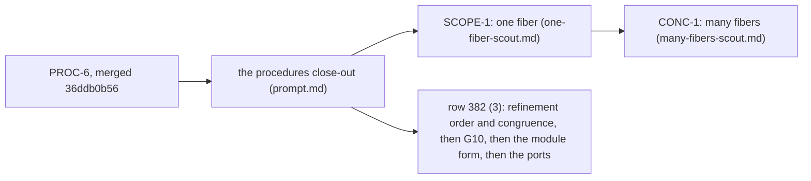

# Gemini: review the procedures close-out plan and its proof graph

## The one thing to know first

Codex has not started. The owner wants to know whether the plan is scoped for clean
implementation before any proof is attempted. The plan is `docs/research/2026-10-14-proc-close/prompt.md`.
Review it as the owner's examiner would: every planned theorem needs a statement, a placement, a
consumer in reach and a fragment it holds on. A plan that lands proofs to nowhere fails, however
well it reads.

The owner's rule for every choice: decide on semantics, never on rebuild cost, and take the
complete option. A shortcut is a finding.

## What you review

The plan is one link of a longer chain. Review the chain, with the close-out in the most detail.

Read, in this order:

1. `AGENTS.md`, all of it; the placement rule under "Trust" is the standard you review against.
2. `docs/research/2026-10-14-proc-close/prompt.md`, the plan under review.
3. `docs/research/2026-10-08-seat-PROC-design.md`: §4.4, §8 and §9.
4. `docs/research/2026-10-10-cx-lexical-scope.md`: §3.4, §6, §8 and §9.
5. `docs/research/2026-10-14-proc6-prep/landing-receipt.md`, what PROC-6 proved.
6. `docs/research/2026-10-14-one-fiber-scout.md` and `docs/research/2026-10-14-many-fibers-scout.md`.
7. `docs/core/decisions.md` rows 82, 328, 331, 340, 379, 381 and 382.
8. `tools/ProofGraph/Registry.lean` (the claims and their open parts) and `generated/semantics.md`.

## Part 1: your own review, written before you read Part 2

Answer each question from the tree, with paths and declaration names.

1. **Each of the six items** (G7, the two expansion claims, CX3 and CX4, PROC-7, PROC-8, one
   activation stack). Is its statement written down, or left to the implementer? Give its five
   placements from `AGENTS.md`: concept, claim, reach, what it does not establish, what it
   unlocks. Name its consumer, and say whether that consumer is in reach on the fragment the
   statement holds on. Give a verdict: ready, re-scope, merge with another item, or retire.
2. **The chain.** Draw the whole chain as one Mermaid DAG of slices and planned goals, from the
   close-out through CONC-1 and row 382's order. Find duplicate owners of one representation,
   missing edges, items with no consumer and edges in the wrong direction.
3. **The proof graph today.** Run `#plan_status` on the tops the plan touches (the pointers of
   `denote-typed` and of the H9 claims) and read `generated/semantics.md`. Say what is proved,
   proved modulo goals, or a goal. Say whether any new claim the plan names duplicates an
   existing one.
4. **Landing cleanly.** For each slice, the files it edits, the modules it rebuilds, and its
   conflicts with the other track and with SCOPE-1 and CONC-1.
5. **The standard route.** Name the standard results for contextual equivalence and contextual
   refinement of programs with algebraic effects (logical relations, step indexing, a CIU
   theorem). Say whether the block meaning with budgets (`denoteBlockB`) fits one of them. Mark
   every source you have not read in this repository as unread.

## Part 2: the coordinator's pre-read, to confirm or refute

The coordinator's reading of the tree found six faults. Confirm or refute each with
evidence: a path, a declaration, a probe's output. Do not take any of them on trust.

- **F1. L3 targets a different claim.** The registry's open part `queue-expansion-agrees`
  (`tools/ProofGraph/Registry.lean`) relates the Queue's expansion to its application-signature
  clients on the Queue's profile: the expansion against the model. The inlining law relates the
  definition form (`src/Effect4/Library/Queue/Defs.lean`) to the expansion form
  (`src/Effect4/Library/Queue/Ops.lean`). The definition-to-expansion connector has no claim.
- **F2. The two modules' bodies lie outside the block fragment.** `bodyRowsAlg`
  (`src/Effect4/Laws/Program/FragmentBlock.lean`) refuses `uninterruptible`, `awaitFiber`,
  `fork` and the scope forms. The shared wrapper (`src/Effect4/Library/Waiting.lean`) uses
  `uninterruptibleMaskWith`, a `Deferred`'s await, `onInterrupt` and `fork`. So G7 at the block
  meaning reaches neither module's waiting operations until SCOPE-1 and CONC-1 widen the
  meaning. Settle it with a probe: evaluate `BlockRows` on the program that
  `Definitions.make` builds.
- **F3. G7's congruence and row 382's first step are one object.** The PROC design §4.4 item 5
  needs the convergence relation to be a congruence for every `Eff` constructor. Row 382 (3)
  starts with a refinement order on the meaning and its congruence. Contextual equivalence is
  refinement both ways. The proposal: build the refinement order once, with its congruence,
  and state G7 as one instance of it. Each later widening of the meaning (SCOPE-1, CONC-1) then
  owes the congruence cases of its constructors. Check whether `denoteBlockB` is monotone in its
  budget, since any convergence relation needs that to be a congruence for `bind`.
- **F4. CX3 contradicts the CX ruling.** The CX note §3.4 rejects substitution as the typed
  route: a point addresses the root program by path, and a substituted body is no subterm. The
  plan's L2 names an inlining pass as CX3's consumer, and no plan builds one. CX4 may already be
  `invoke_arm` with `hop_typed` (CX2). If neither has a consumer, they are retired, not owed.
- **F5. PROC-8 and SCOPE-1's stage 0 design one representation.** Both put closures held as data
  into `Store.Val`, `Ty` and `Eff`. One of them must own it. D3, the one activation stack, edits
  `Point`, which SCOPE-1's stage 0 also edits. Order the two.
- **F6. PROC-7 sits on row 382's path.** `Defs.lean` says a definition is monomorphic: one
  message type, one instance. The module form of row 382 (2) needs generic modules, so PROC-7
  comes before the module form. Confirm, and place it.

Then answer the question the faults raise. **Does G7 have any consumer in reach today?** Form (b)
of the PROC design §4.4 is R10's "laws proved once per definition". Say whether form (b) is
proved, and whether it, not form (c), is the near-term item.

## What you deliver

One file, `docs/research/2026-10-14-proc-close/gemini-review.md`, in this order:

1. The one thing the owner must know.
2. A verdict table: one row per item, with its verdict, consumer and evidence.
3. F1 to F6: confirmed, refuted or amended, each with its evidence.
4. Your own findings from Part 1 that Part 2 does not hold.
5. The re-scoped plan: the tracks, each planned goal with its five placements, and one Mermaid
   DAG from the close-out through row 382's order.
6. The probes you ran: each file, the exact command and its output.
7. What this review does not establish.

Write it in the controlled English of `docs/core/controlled-english.md`.

## Where you work, and the rules

- Your worktree is `/Users/pooks/Dev/lean4-effect4-gemini`, branch `gemini/consolidation`. The
  coordinator fast-forwards it to the plan's commit and builds `Effect4` and `Effect4.Laws`
  there before you start.
- Edit nothing under `src/`, `Test/`, `tools/`, `docs/core/` or `generated/`. This round is a
  review.
- A probe is a file under `docs/research/2026-10-14-proc-close/probes/`. Run it with
  `/Users/pooks/Dev/lean4-effect4/scratch/lean-slot.sh lake env lean <file>`, from your
  worktree. Run no `lake build` and no `make` target.
- Commit the review and the probes by named paths, with `git add -f`. Never push.
- Never write `2>/dev/null`. Download nothing.
- Stop when the file is written and committed, and say so.
