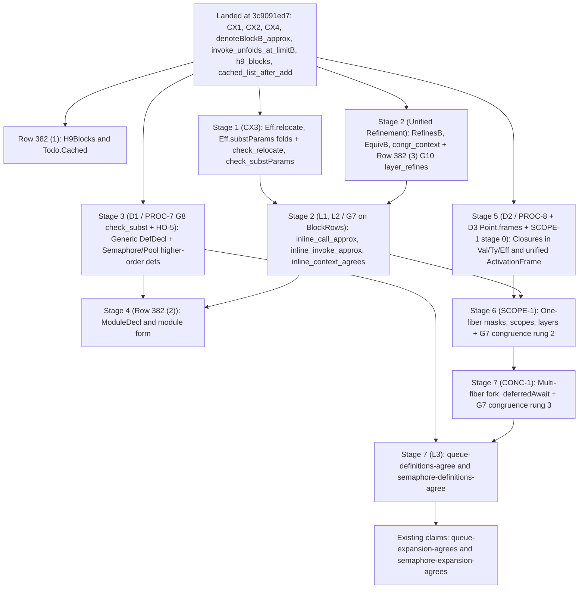

# Review of the procedures close-out plan (`2026-10-14-proc-close`)

Base and head commit: `3c9091ed7`.

## 1. The one thing the coordinator must know before acting on `prompt.md`

`prompt.md` states the inlining law (`G7`) only on `BlockRows` (`src/Effect4/Laws/Program/FragmentBlock.lean`).
It also equates `L3` with `queue-expansion-agrees` and `semaphore-expansion-agrees` (`tools/ProofGraph/Registry.lean`).
However, `Queue.Definitions` (`src/Effect4/Library/Queue/Defs.lean`) and `Semaphore.Definitions` (`src/Effect4/Library/Semaphore/Defs.lean`) evaluate `BlockRows` to `false`.
Reaching them requires separate definition-to-expansion claims (`queue-definitions-agree`, `semaphore-definitions-agree`) and higher-order definitions in `Semaphore.Definitions` and `Pool.Definitions` (`HO-5`).
It also requires congruence extensions in `SCOPE-1` and `CONC-1` over one shared refinement order (`Effects.Program.Approx`) that serves decisions row 382 (3).

## 2. Part 1 — The proof graph, theorem by theorem

Every item in `prompt.md` is required and has known consumers in the library and application stack.
The table below gives the placement, statement, reach, non-reach, consumer and additions required for each item.

| Item | Concept and requirement | Registry claim and role | Pointer and module | Exact Lean statement | Reach and non-reach | Consumers and required additions |
| --- | --- | --- | --- | --- | --- | --- |
| `CX1` | `operational-semantics`, R3 | `point-typed` (invariant), `denote-typed` (preservation) | `PointTyped` (`src/Effect4/Laws/Program/Typed/Residual.lean`) | `structure PointTyped` with `paramsTyped : ParamsTyped root p.params d.params` | Reach: every live point in `denotesTyped` (`src/Effect4/Laws/Program/Typed/Denotation.lean`). Non-reach: machine liveness; host conformance (`docs/core/host-boundary.md`). | Landed and proved at `3c9091ed7` (`invoke_arm`, `param_arm`, `call_arm`). Needs no further edit before `D3`. |
| `CX2` | `operational-semantics`, R3 | `point-typed` (invariant) | `hop_typed` (`src/Effect4/Laws/Program/Typed/StackCertificates.lean`) | `theorem hop_typed : ModuleHasTy app.signature root.program rootTy → PointTyped root q ⟨req, ans, err, reqs⟩ → ... → PointTyped root ⟨bodyPath, [v], fuel, frames⟩ ...` | Reach: `.call k` (`frames = []`) and `.invoke k` (`frames = argSites :: p.params`). Non-reach: generic definitions before `PROC-7`; closure values before `PROC-8`. | Landed and proved at `3c9091ed7`, consumed by `call_arm` and `invoke_arm` (`src/Effect4/Laws/Program/Typed/Denotation.lean`). |
| `CX3` | `type-system`, R2 and R14 | `inline-types` (preservation; new claim) | `check_relocate`, `check_substParams` (`src/Effect4/Laws/Program/Typing/Inline.lean`) | `theorem check_substParams : Checker.check (sig.withParams d.params) [d.request.normalize] p body = .ok tb → d.admits tb = true → Checker.checkEffs sig env q d.params args = .ok ts → ∃ t, Checker.check sig (env ++ [d.request.normalize]) r (Eff.substParams env.length d.params args (Eff.shift env.length body)) = .ok t ∧ Ty.sub t.answer d.answer.normalize = true ∧ Ty.sub t.error d.error.normalize = true` | Reach: all `Eff` constructors under `Checker.check` (`src/Effect4/Program/Checker.lean`) and `HasTy` (`src/Effect4/Program/Typing/Rules.lean`). Non-reach: `PointTyped` on a substituted root, because `Point` addresses `root.program` by path (`docs/research/2026-10-10-cx-lexical-scope.md`). | Consumed by `L1` (`G7` typing preservation) and `check_replace` (`src/Effect4/Laws/Program/Typing/Replace.lean`). Replace `PointTyped` substitution with `Checker.check` preservation on `Eff.relocate` and `Eff.substParams`. |
| `CX4` | `operational-semantics`, R3 | `denote-typed` (preservation) | `call_arm`, `invoke_arm` (`src/Effect4/Laws/Program/Typed/Denotation.lean`) | `theorem invoke_arm : DenotesTyped (compileEff (.invoke k req args) p) ...` | Reach: one invocation step in `denotesTyped` at positive fuel. Non-reach: fuel zero (live frontier); multi-step run equivalence (`L1`, `L2`). | Already proved at `3c9091ed7` via `hop_typed`. For `L1`, pair `invoke_arm` with `check_substParams` (`CX3`) and `check_replace`. |
| `L1` (`G7` step) | `translation-simulation`, R10 | `inline-step-agrees` (simulation; new claim) | `inline_call_approx`, `inline_invoke_approx` (`src/Effect4/Laws/Program/Inline.lean`) | `theorem inline_invoke_approx : Effects.Program.Approx (denoteBlockB table bodies k params (inlineInvoke d r args env body) ctx env) (denoteBlockB table bodies (k + 1) params (.invoke j r args) ctx env) ∧ Effects.Program.Approx (denoteBlockB table bodies (k + 1) params (.invoke j r args) ctx env) (denoteBlockB table bodies (k + 1) params (inlineInvoke d r args env body) ctx env)` | Reach: one `.call` or `.invoke` site under `denoteBlockB` (`src/Effect4/Laws/Program/BlockMeaning.lean`) on `BodyRows`, widened by `SCOPE-1` and `CONC-1`. Non-reach: single-budget equality for `.invoke`, which fails on nested calls (`Probes.lean`). | Consumed by `L2` (`inline_context_agrees`). Must add the two-sided `Effects.Program.Approx` sandwich and `Checker.check` preservation (`CX3`). |
| `L2` (`G7` context) | `translation-simulation`, R10 | `inline-agrees` (simulation; new claim) | `inline_context_agrees`, `inline_session_agrees` (`src/Effect4/Laws/Program/Inline.lean`) | `theorem inline_context_agrees : BlockRows table (C.fill (.invoke j r args)) = true → (∃ k, hostRunBlockB host bodies k [] (C.fill (.invoke j r args)) emptyCtx [] s st = some (some ex, out)) ↔ (∃ k, hostRunBlockB host bodies k [] (C.fill (inlineInvoke d r args env body)) emptyCtx [] s st = some (some ex, out))` | Reach: every context `C` on `BlockRows` now, and on the one-fiber and multi-fiber fragments as `SCOPE-1` and `CONC-1` add constructor congruence cases. Non-reach: fuel-exact step counts (`Test/Program/QueueDefs.lean`); host progress (`docs/core/host-boundary.md`). | Consumed by `L3`, `Ref.Cache` (`src/Effect4/Laws/Library/Ref/Cache.lean`) and `Todo.Cached` (`Test/Dogfood/Scenario/Todo/Cached.lean`). Must factor through the shared refinement order of row 382 (3). |
| `L3` | `translation-simulation`, R10 (and R4, R6) | `queue-definitions-agree`, `semaphore-definitions-agree` (simulation; new claims) | `Queue.definitions_agree`, `Semaphore.definitions_agree` (`src/Effect4/Laws/Library/Queue/Defs.lean`, `src/Effect4/Laws/Library/Semaphore/Defs.lean`) | `theorem Queue.definitions_agree : ...` relating a client over `Queue.Definitions` (`src/Effect4/Library/Queue/Defs.lean`) to the same client over `Queue.take`, `Queue.offer`, `Queue.poll` and `Queue.size` (`src/Effect4/Library/Queue/Ops.lean`) | Reach: every well-typed client module over `Queue.Definitions`, `Semaphore.Definitions`, `Pool.Definitions` and `SynchronizedRef`. Non-reach: the expansion-to-model claims `queue-expansion-agrees` and `semaphore-expansion-agrees`, which remain separate claims in `tools/ProofGraph/Registry.lean`. | Consumed by application modules that import `Queue.Definitions` or `Semaphore.Definitions`. Must add `HO-5` (`withPermits`, `withPermitsIfAvailable`, `Pool.use`) and the `SCOPE-1` and `CONC-1` congruence cases. |
| `D1` (`PROC-7`, `G8`) | `type-system`, R1, R2 and R10 | `generic-def-check` (preservation and compatibility; new claim) | `check_subst`, `invoke_generic_hasTy` (`src/Effect4/Laws/Program/Typing/Subst.lean`) | `theorem check_subst (σ : Ty.Subst) : SubstAdmitted σ → Checker.check sig env p e = .ok t → Checker.check (sig.subst σ) (env.map (·.subst σ)) p (e.substTy σ) = .ok (t.subst σ)` | Reach: type-parameterized `DefDecl` and `ModuleDecl` across all `Eff` constructors when `σ` maps error variables to `admittedErrTy` (`src/Effect4/Program/Definitions.lean`). Non-reach: row-polymorphic effect variables outside `Ty.Subst`. | Consumed by `Queue.Definitions` (`DefDecl` parameterized by `A`), `Ref.Cache.block`, and row 382 (2) (`ModuleDecl`). Must precede row 382 (2). |
| `D2` (`PROC-8`) | `operational-semantics` and `type-system`, R1, R2, R3 and R10 | `closure-value-agrees` (preservation and simulation; new claim) | `Val.closure`, `Ty.fn`, `Eff.fn`, `Eff.apply` (`src/Effect4/Machine/Store.lean`, `src/Effect4/Program/Eff.lean`) | Typed step in `denotesTyped` (`src/Effect4/Laws/Program/Typed/Denotation.lean`), `Checker.check` rule (`src/Effect4/Program/Checker.lean`), and `denoteBlockB` / one-fiber meaning equation | Reach: first-class program closures stored in `Store.Val`, passed through `Term`, and applied by `Eff.apply`. Non-reach: host JavaScript closures (`docs/core/host-boundary.md`). | Consumed by `SCOPE-1` (`Scope.Finalizer` closures in `Store.Val`) and higher-order service methods. Merge syntax and `Store.Val` changes with `SCOPE-1` stage 0. |
| `D3` | `operational-semantics`, R3 and R6 | `point-activation-frames` (compatibility) | `ActivationFrame`, `Point.frames` (`src/Effect4/Program/Compile.lean`) | `structure ActivationFrame` unifying `Point.params : List (List ArgSite)` and `Point.call : Option CallReturn`, with `CompilesBlk` (`src/Effect4/Laws/Program/Agreement/Blocks.lean`) and `PointTyped` (`src/Effect4/Laws/Program/Typed/Residual.lean`) | Reach: every compiled `Point` in `Compile.lean`, `Typed/Denotation.lean` and `Agreement/Blocks.lean`. Non-reach: multi-fiber stacks (`CONC-1`). | Consumed by `D2` (`PROC-8`) and `SCOPE-1` stage 0. Land in the same `Point` edit as `SCOPE-1` stage 0 so `Typed/Denotation.lean` and `Agreement/Blocks.lean` rebuild once. |

## 3. Part 2 — Faults and repairs

### F1 (Confirmed): `L3` conflates definition-to-expansion agreement with expansion-to-model agreement

* **Evidence in the tree:** In `tools/ProofGraph/Registry.lean`, `queue-expansion-agrees` (R4, R6, R10) and `semaphore-expansion-agrees` (R4, R6) relate the expanded operations (`src/Effect4/Library/Queue/Ops.lean`, `src/Effect4/Library/Semaphore/Ops.lean`) to their models (`src/Effect4/Laws/Library/Queue/Steps.lean`, `src/Effect4/Laws/Library/Semaphore/Steps.lean`). Their single-step laws (`take_steps`, `offer_steps`, `poll_steps`, `size_steps` in `src/Effect4/Laws/Library/Queue/Ops.lean`; `take_steps`, `release_steps`, `takeIfAvailable_steps` in `src/Effect4/Laws/Library/Semaphore/Ops.lean`) already hold on the expanded `Src` trees.
* **The gap:** `Queue.Definitions` (`src/Effect4/Library/Queue/Defs.lean`) and `Semaphore.Definitions` (`src/Effect4/Library/Semaphore/Defs.lean`) wrap those expanded operations in `eff_module` definition blocks (`src/Effect4/Program/Authoring/Module.lean`). Inlining `Queue.Definitions` produces `Queue.take`, `Queue.offer`, `Queue.poll` and `Queue.size`, not the state model directly.
* **What the plan must add:**
  1. Register `queue-definitions-agree` and `semaphore-definitions-agree` in `tools/ProofGraph/Registry.lean` under `translation-simulation` (R10).
  2. Each claim relates a module invoking the definition block to the module with each invocation replaced by its expanded operation from `Ops.lean`.
  3. Compose `queue-definitions-agree` with `queue-expansion-agrees` (and `semaphore-definitions-agree` with `semaphore-expansion-agrees`) by transitivity of the refinement relation.
  4. Add slice `HO-5` (`Semaphore.Definitions.withPermits`, `Semaphore.Definitions.withPermitsIfAvailable` in `src/Effect4/Library/Semaphore/Defs.lean`, and `Pool.Definitions` in `src/Effect4/Library/Pool/Ops.lean`).
  5. `G7`'s higher-order `.invoke` case then reaches `Semaphore.withPermits`, `SynchronizedRef.withLock` (`src/Effect4/Library/SynchronizedRef/Ops.lean`), and `Pool.use`.

### F2 (Confirmed): `Queue.Definitions` and `Semaphore.Definitions` lie outside `BlockRows`

* **Evidence from `Probes.lean`:** Running `lake env lean docs/research/2026-10-14-proc-close/probes/Probes.lean` verifies:
  * `builtQueue?.map (BlockRows []) = some false` and `builtSemaphore?.map (BlockRows []) = some false`.
  * Across the four bodies of `Queue.Definitions` (`take`, `offer`, `poll`, `size`), `(bodiesOf p).map (BodyRows [])` evaluates to `[false, false, false, true]`.
  * Across the three bodies of `Semaphore.Definitions` (`take`, `release`, `takeIfAvailable`), `(bodiesOf p).map (BodyRows [])` evaluates to `[false, false, true]`.
  * `BodyRows [] (Effect4.Semaphore.withPermits (.var 0) (.lit (.int 1)) (.succeed (.lit .unit)))` evaluates to `false`.
* **Why:** `Queue.take`, `Queue.offer` and `Semaphore.take` expand `waitRetry` and `waitAnswer` (`src/Effect4/Library/Waiting.lean`), which use `uninterruptibleMaskWith` (`withFiber .getInterruptible`, `uninterruptible`, `restore`), `perform .deferredAwait`, and `postAll` (`withFiber (.fork ...)`). `Queue.poll` and `Semaphore.release` use `uninterruptible` and `withFiber (.fork ...)`. `Semaphore.withPermits` uses `protectedBy` (`withFiber .getInterruptible`, `uninterruptible`, `restore`). `bodyRowsAlg` (`src/Effect4/Laws/Program/FragmentBlock.lean`) returns `false` on masks, fiber actions other than `.context`, scopes, layers, and asynchronous built-in operations.
* **What the plan must add:**
  1. Prove `G7` (`L1`, `L2`) on `BlockRows` now, reaching `Ref.Cache` (`src/Effect4/Laws/Library/Ref/Cache.lean`), `Todo.Cached` (`Test/Dogfood/Scenario/Todo/Cached.lean`), `Queue.Definitions.size`, and `Semaphore.Definitions.takeIfAvailable`.
  2. Factor the congruence lemma of `L2` through `cata_blockAlgB_approx` (`src/Effect4/Laws/Program/BlockMeaning.lean`).
  3. In `SCOPE-1`, add the congruence arms for `uninterruptible`, `interruptible`, `restore`, `withFiber .getInterruptible`, `withFiber .getId`, `scoped`, `acquireRelease`, and `provideLayer`.
  4. Those arms extend `G7` to `Semaphore.withPermits` and `SynchronizedRef.withLock` when their body is one-fiber.
  5. In `CONC-1`, add the congruence arms for `fork`, `awaitFiber`, and `deferredAwait`.
  6. Those arms extend `G7` to `Queue.take`, `Queue.offer`, `Queue.poll`, `Semaphore.take`, and `Semaphore.release`.

### F3 (Confirmed, with budget-sandwich refinement): `G7` congruence and row 382 (3) share one refinement order, and `.invoke` inlining obeys an `Approx` sandwich rather than single-budget equality

* **Evidence in the tree and `Probes.lean`:**
  1. At `3c9091ed7`, `cata_blockAlgB_approx`, `denoteBlockB_approx`, `call_unfolds_at_limitB`, and `invoke_unfolds_at_limitB` (`src/Effect4/Laws/Program/BlockMeaning.lean`), `hostRunBlockB_stable` (`src/Effect4/Laws/Program/Agreement/HostedBlocks.lean`), `h9_blocks` (`src/Effect4/Laws/Api/SessionMeaningBlocks.lean`), and `conforms_sat_blocks` and `agrees_hostRun_blocks` (`src/Effect4/Laws/Program/ValidatedBlocks.lean`) are all proved (`#plan_status` in `Probes.lean`).
  2. However, `invoke_unfolds_at_limitB` in `src/Effect4/Laws/Program/BlockMeaning.lean` unfolds `.invoke j r args` to `body` under the semantic parameter frame `args.toList.map (fun arg ctx' w => denoteBlockB table bodies (k + 1) params arg ctx' (env ++ [w]))`, not to the syntactic inline `Eff.substParams`.
  3. In `Probes.lean`, Controls A and B prove that syntactic inlining of `.invoke j r args` (`inlineInvoke`) equals `denoteBlockB` at **neither** budget `k` **nor** budget `k + 1`:
     * **Control A (`k = 1`):** `body3` passes parameter `0` to `invoke 2`, and the outer argument makes two `.call` hops (`uninlinedInvoke`). At budget `k + 1 = 2`, `hostRunBlockB` on `uninlinedInvoke` returns `some (some (.success (.nat 42)), ...)`. At budget `k = 1`, `hostRunBlockB` on `inlinedBody3` returns `some (none, ...)` (budget cut) because inlining moves the argument inside `body3` at budget `1`.
     * **Control B (`k = 0`):** `body4` makes a `.call 0` before running parameter `0` (`uninlinedInvoke4`). At budget `k + 1 = 1`, `hostRunBlockB` on `uninlinedInvoke4` returns `some (none, ...)`. At the same budget `k + 1 = 1`, `hostRunBlockB` on `inlinedBody4` returns `some (some (.success (.nat 99)), ...)` because inlining runs `body4` at budget `1` instead of `0`.
* **What the plan must add:**
  1. State `L1` (`inline_invoke_approx`) as the two-sided `Effects.Program.Approx` sandwich at every budget `k`.
     ```lean
     Effects.Program.Approx
       (denoteBlockB table bodies k params (inlineInvoke d r args env body) ctx env)
       (denoteBlockB table bodies (k + 1) params (.invoke j r args) ctx env) ∧
     Effects.Program.Approx
       (denoteBlockB table bodies (k + 1) params (.invoke j r args) ctx env)
       (denoteBlockB table bodies (k + 1) params (inlineInvoke d r args env body) ctx env)
     ```
  2. Define one parameterized refinement relation `RefinesB` and its symmetric closure `EquivB` over `denoteBlockB` (`src/Effect4/Laws/Program/Refinement.lean`).
  3. Prove constructor congruence once via `cata_blockAlgB_approx`, serving both `L2` (`G7`) and decisions row 382 (3) (`G10`, `layer_refines`).

### F4 (Confirmed): `CX3` as `PointTyped` substitution contradicts the lexical-scope design, while `CX4` is already proved

* **Evidence in the tree:**
  1. `Point` (`src/Effect4/Program/Compile.lean`) addresses `root.program` by `path : List Nat`, and `PointTyped` (`src/Effect4/Laws/Program/Typed/Residual.lean`) requires `Node.at_ (.eff root.program) p.path = some (.eff e)`. A syntactically substituted body `Eff.substParams ... body` is not a subnode of `root.program` at any path (`docs/research/2026-10-10-cx-lexical-scope.md`).
  2. `CX4` is already proved at `3c9091ed7`: `call_arm`, `invoke_arm`, and `param_arm` in `src/Effect4/Laws/Program/Typed/Denotation.lean` discharge the `.call`, `.invoke`, and `.param` cases of `denotesTyped` using `hop_typed` (`src/Effect4/Laws/Program/Typed/StackCertificates.lean`).
* **What the plan must add:**
  1. Restate `CX3` as checker-level typing preservation (`Checker.check` in `src/Effect4/Program/Checker.lean` and `HasTy` in `src/Effect4/Program/Typing/Rules.lean`) for term-environment relocation (`Eff.relocate` / `Eff.shift`) and parameter substitution (`Eff.substParams`), extending `hasTy_weaken` (`src/Effect4/Laws/Program/Typing/Sound.lean`).
  2. Combine `check_relocate` and `check_substParams` with `check_replace` (`src/Effect4/Laws/Program/Typing/Replace.lean`) and `table_splice` (`src/Effect4/Laws/Program/Typing/Splice.lean`).
  3. Replacing `.perform (.call j) r` or `.invoke j r args` by its inlined body at any address `a` then keeps the module typed.

### F5 (Confirmed): `PROC-8` (`D2`), `D3`, and `SCOPE-1` stage 0 edit the same free-object signatures and `Point`

* **Evidence in the tree:** `PROC-8` (`D2`) adds program values in `Store.Val`, closure types in `Ty`, and closure constructors in `Eff`. `SCOPE-1` stage 0 (`docs/research/2026-10-14-one-fiber-scout.md`) edits `Store.Val`, `Ty`, `Eff`, `Point`, `src/Effect4/Laws/Program/Typed/Denotation.lean`, and `src/Effect4/Laws/Program/Agreement/Blocks.lean`. Likewise `D3` replaces `Point.params` and `Point.call` by `Point.frames : List ActivationFrame`.
* **What the plan must add:** Merge `D2` (`PROC-8` signature additions), `D3` (`Point.frames : List ActivationFrame`), and `SCOPE-1` stage 0 into one stage. Update the generated algebras (`python3 scripts/generate.py`), `Typed/Denotation.lean`, and `Agreement/Blocks.lean` in one pass.

### F6 (Confirmed): `PROC-7` (`D1`, `G8`) and `HO-5` must precede row 382 (2)'s module form

* **Evidence in the tree:** `DefDecl.formed` (`src/Effect4/Program/Definitions.lean`) requires closed `request`, `answer`, and `error` types. Consequently `Queue.Definitions` (`src/Effect4/Library/Queue/Defs.lean`) and `Ref.Cache.block` (`src/Effect4/Library/Ref/Cache.lean`) emit separate monomorphic definitions per type instance. Decisions row 382 (2) introduces `ModuleDecl` for reusable library modules (`Queue`, `Semaphore`, `Pool`, `SynchronizedRef`, `Ref.Cache`).
* **What the plan must add:** Place `PROC-7` (`D1`: type parameters on `DefDecl` and `G8` `check_subst`) and `HO-5` (`Semaphore.Definitions` and `Pool.Definitions`) before row 382 (2) (`ModuleDecl`). `ModuleDecl` then builds directly over generic and higher-order definitions.

### F7 (Additional fault): `Eff.relocate` and `Eff.substParams` must be folds over `EffAlgebra` to pass `#traversal_census`

* **Evidence in the tree:** Every traversal of `Eff` must be a fold (`cata_eff`, `cataFam`) over `EffAlgebra` or be listed in `docs/core/traversal-census.md`. A recursive `match` for variable shifting or parameter substitution violates the traversal rule.
* **What the plan must add:** Define `Eff.relocate` and `Eff.substParams` in `src/Effect4/Program/Inline.lean` as algebra folds (`cataFam`) with carrier `(Nat → Eff Op)` indexed by binder depth `cutoff : Nat`. Each binder constructor increments `cutoff` according to `binders.json`. Then `cata_blockAlgB_approx` and the fold fusion law prove `inline_call_approx` and `inline_invoke_approx` without a hand match.

## 4. The unified refinement and congruence layer

Both `G7` (`L1`, `L2`) and decisions row 382 (3) (`G10`, `layer_refines`) require a compositional preorder on programs that implies observational refinement under any conforming host.
Define that layer once in `src/Effect4/Laws/Program/Refinement.lean`:

1. **Tree approximation at a budget (`ApproxAt`):** Reuse `Effects.Program.Approx` (`src/Effect4/Laws/Machine/Program.lean`). It orders `Effects.Program (RowsSig table) (Option ExitV)` by allowing `pure none` (budget cut) on the left to be refined by any subtree on the right.
2. **Limit refinement on block trees (`RefinesB`):** Order `e₁ e₂ : NativeEff` at `table : RowTable`, `bodies : List NativeEff`, and predicate `P : Ctx → List Val → Prop`.
   ```lean
   def RefinesB (table : RowTable) (bodies : List NativeEff) (P : Ctx → List Val → Prop)
       (e₁ e₂ : NativeEff) : Prop :=
     ∀ k params ctx env, P ctx env →
       ∃ k', Effects.Program.Approx
         (denoteBlockB table bodies k params e₁ ctx env)
         (denoteBlockB table bodies k' params e₂ ctx env)
   ```
3. **Symmetric contextual equivalence (`EquivB`):** Define `EquivB` as mutual refinement.
   ```lean
   def EquivB (table : RowTable) (bodies : List NativeEff) (P : Ctx → List Val → Prop)
       (e₁ e₂ : NativeEff) : Prop :=
     RefinesB table bodies P e₁ e₂ ∧ RefinesB table bodies P e₂ e₁
   ```
4. **Host observation transfer (`EquivB.hostRunBlockB_iff`):** Use `Effects.Comodel.run_approx` and `denoteBlockB_approx` (`src/Effect4/Laws/Program/BlockMeaning.lean`). Whenever `EquivB table bodies P e₁ e₂` holds at `(ctx, env)`, both programs yield the same completed host observations.
   ```lean
   (∃ k, hostRunBlockB host bodies k [] e₁ ctx env s st = some (some ex, out)) ↔
     (∃ k, hostRunBlockB host bodies k [] e₂ ctx env s st = some (some ex, out))
   ```
5. **Congruence across the three meaning rungs:**
   * **Rung 1 (`BlockRows`, now):** `cata_blockAlgB_approx` (`src/Effect4/Laws/Program/BlockMeaning.lean`) already proves monotonicity of every `BlockRows` constructor in its subtrees and parameter frames. Lifting `cata_blockAlgB_approx` to `RefinesB` gives context congruence `RefinesB.congr_context` on `BlockRows` for both `L2` (`inline_context_agrees`) and row 382 (3) (`layer_refines`).
   * **Rung 2 (`SCOPE-1`, one fiber):** `SCOPE-1` gives meaning to `uninterruptible`, `interruptible`, `restore`, `withFiber .getInterruptible`, `withFiber .getId`, `scoped`, `acquireRelease`, and `provideLayer` in `blockAlgB`. Proving each new clause's `cata_blockAlgB_approx` arm extends `RefinesB.congr_context` and `G7` to `Semaphore.withPermits` and `SynchronizedRef.withLock` on one-fiber bodies.
   * **Rung 3 (`CONC-1`, many fibers):** `CONC-1` extends the meaning to scheduler traces over `fork`, `awaitFiber`, `deferredAwait`, and `raceAll`. Its trace-level `Approx` relation extends `RefinesB.congr_context` and `G7` to `Queue.Definitions` (`take`, `offer`, `poll`) and `Semaphore.Definitions` (`take`, `release`).

## 5. The dependency DAG

The diagram below shows the true dependencies across the procedures close-out items, row 382 (1)–(3), `SCOPE-1`, and `CONC-1`.



## 6. The revised slice order

Every item of `prompt.md` stays in the plan, ordered so that each proof lands once and reaches all of its library and application users:

1. **Stage 0 (Already landed at `3c9091ed7`):**
   * `CX1` (`PointTyped` parameter frame invariant), `CX2` (`hop_typed`), and `CX4` (`call_arm`, `invoke_arm`, `param_arm` in `src/Effect4/Laws/Program/Typed/Denotation.lean`) are proved.
   * `denoteBlockB_approx`, `call_unfolds_at_limitB`, and `invoke_unfolds_at_limitB` (`src/Effect4/Laws/Program/BlockMeaning.lean`) are proved.
   * `h9_blocks` (`src/Effect4/Laws/Api/SessionMeaningBlocks.lean`), `conforms_sat_blocks`, `agrees_hostRun_blocks` (`src/Effect4/Laws/Program/ValidatedBlocks.lean`), and row 382 (1) (`Test/Dogfood/Scenario/Todo/Cached.lean`) are proved.
2. **Stage 1 (`CX3` — Fold-based inlining syntax and typing preservation):**
   * Define `Eff.relocate`, `Eff.shift`, and `Eff.substParams` as `cataFam` folds in `src/Effect4/Program/Inline.lean`.
   * Prove `check_relocate` and `check_substParams` in `src/Effect4/Laws/Program/Typing/Inline.lean`, registering claim `inline-types` (R2, R14), and compose with `check_replace` (`src/Effect4/Laws/Program/Typing/Replace.lean`).
3. **Stage 2 (`L1`, `L2` / `G7` on `BlockRows` + Row 382 (3) `G10` — Unified refinement and congruence):**
   * Define `RefinesB` and `EquivB` in `src/Effect4/Laws/Program/Refinement.lean` and lift `cata_blockAlgB_approx` to `RefinesB.congr_context`.
   * Prove `inline_call_approx`, the two-sided `Approx` sandwich `inline_invoke_approx` (`L1`, claim `inline-step-agrees`), and `inline_context_agrees` (`L2`, claim `inline-agrees`, R10) on `BlockRows`, reaching `Ref.Cache` and `Todo.Cached`.
   * Prove `G10` (`layer_refines`, decisions row 382 (3)) on the same `RefinesB` order.
4. **Stage 3 (`D1` / `PROC-7` `G8` + `HO-5` — Generic definitions and higher-order library definitions):**
   * Add type parameters to `DefDecl` (`src/Effect4/Program/Eff.lean`, `src/Effect4/Program/Definitions.lean`) and prove `G8` (`check_subst` and `invoke_generic_hasTy` in `src/Effect4/Laws/Program/Typing/Subst.lean`, claim `generic-def-check`, R1, R2, R10).
   * In `HO-5`, add `withPermits` and `withPermitsIfAvailable` to `Semaphore.Definitions` (`src/Effect4/Library/Semaphore/Defs.lean`) and `use` to `Pool.Definitions` (`src/Effect4/Library/Pool/Ops.lean`).
   * Parameterize `Queue.Definitions` (`src/Effect4/Library/Queue/Defs.lean`) and `Ref.Cache.block` (`src/Effect4/Library/Ref/Cache.lean`) using `PROC-7`.
5. **Stage 4 (Row 382 (2) — Module form `ModuleDecl`):**
   * Land `ModuleDecl` over the generic and higher-order `DefDecl` of Stage 3 for `Queue`, `Semaphore`, `Pool`, `SynchronizedRef`, and `Ref.Cache`.
6. **Stage 5 (`D2` / `PROC-8` + `D3` + `SCOPE-1` stage 0 — Unified `Point.frames` and closure values):**
   * Unify `Point.params` and `Point.call` into `Point.frames : List ActivationFrame` (`D3`) in `src/Effect4/Program/Compile.lean`.
   * Add closure values and types (`D2` / `PROC-8`, `SCOPE-1` stage 0) across `Store.Val`, `Ty`, `Eff`, and `Point`.
   * Prove the `denotesTyped` and `CompilesBlk` arms once for the unified `Point`.
7. **Stage 6 (`SCOPE-1` + `G7` Congruence Rung 2 — One-fiber masks, scopes, and layers):**
   * Extend `blockAlgB` and `cata_blockAlgB_approx` to masks (`uninterruptible`, `interruptible`, `restore`, `getInterruptible`), scopes (`scoped`, `acquireRelease`), and layers (`provideLayer`).
   * This immediately extends `RefinesB.congr_context` and `inline_context_agrees` (`G7`) to `Semaphore.Definitions.withPermits`, `Semaphore.Definitions.withPermitsIfAvailable`, `Pool.Definitions.use`, and `SynchronizedRef.withLock` on one-fiber bodies.
8. **Stage 7 (`CONC-1` + `G7` Congruence Rung 3 + `L3` — Multi-fiber meaning and Queue/Semaphore definition agreement):**
   * Extend the meaning and `RefinesB.congr_context` to `fork`, `awaitFiber`, and `deferredAwait` (`CONC-1`).
   * Prove `Queue.definitions_agree` (claim `queue-definitions-agree`, R10) and `Semaphore.definitions_agree` (claim `semaphore-definitions-agree`, R10) via `G7`.
   * Compose them with `queue-expansion-agrees` and `semaphore-expansion-agrees` (`tools/ProofGraph/Registry.lean`).

## 7. Receipts

* **Probe file:** `docs/research/2026-10-14-proc-close/probes/Probes.lean`
* **Command run:**
  `/Users/pooks/Dev/lean4-effect4/scratch/lean-slot.sh lake env lean docs/research/2026-10-14-proc-close/probes/Probes.lean`
* **Result:** Exit code `0`.
  * All 14 `#plan_status` queries (`denotesTyped`, `loadsTyped`, `call_arm`, `invoke_arm`, `param_arm`, `h9_blocks`, `conforms_sat_blocks`, `agrees_hostRun_blocks`, `call_unfolds_at_limitB`, `invoke_unfolds_at_limitB`, `denoteBlockB_approx`, `hostRunBlockB_stable`, `cache_agrees`, `cached_list_after_add`) report `proved; nearest []; 0 lemmas, 0 definitions; next goals: 0`.
  * All `#guard` checks on `BlockRows` and `BodyRows` for `Queue.Definitions` and `Semaphore.Definitions` pass.
  * Both budget controls (Control A at `k = 1` and Control B at `k = 0`) for the two-sided `Effects.Program.Approx` sandwich of syntactic `.invoke` inlining pass.
