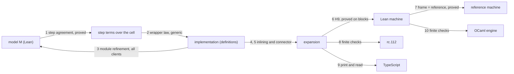
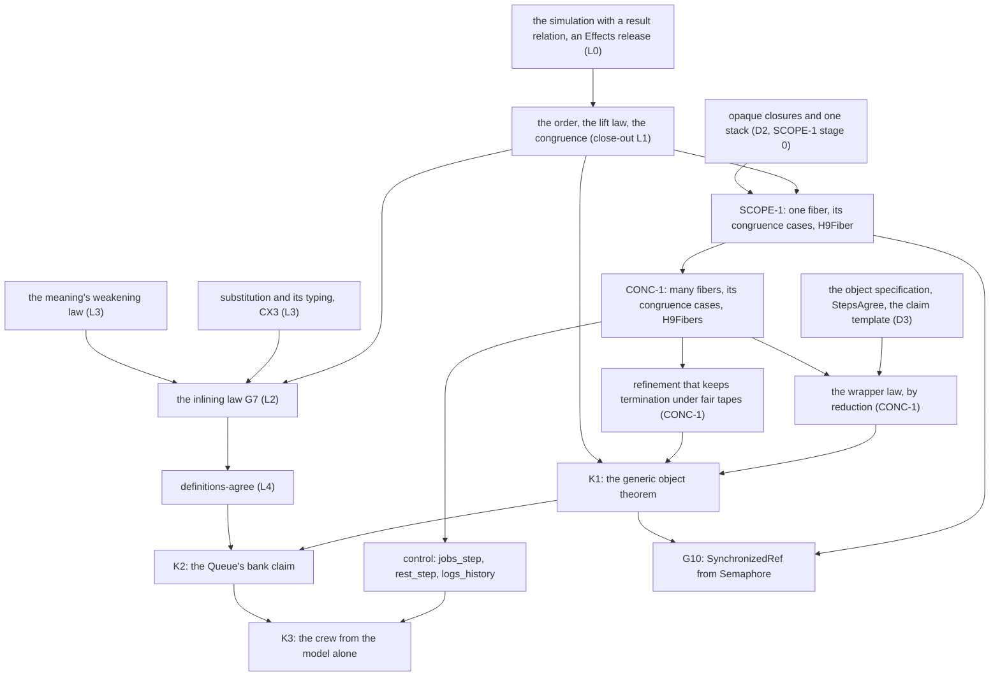
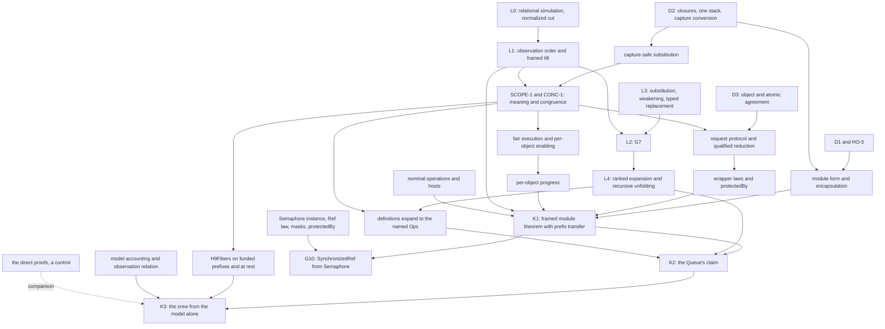

# The modelling check: every relation of the verified line, written out

**Paused, 2026-10-14 evening (decisions row 387).** The owner paused this brief before any of it ran. Its findings stay as the reference for when the general theory resumes: §8 of `modelling-check.md` and `codex-review.md`, with their probes. The next work is the vertical slice (`docs/research/2026-10-14-faces/prompt.md`).

Status: research note (history, not authority). From the coordinator, 2026-10-14, at `c41c91d3a`.
Decisions row 384 records the rulings it leads to.

## 1. The one thing to know

The plan's shape holds: semantics once, logic per entry, implementations once (row 381). Written
out as relations, four things need fixing, and four generic theorems replace per-module work:

- **The order needs a relation on states.** As row 383 (1) defines it, the order compares trees
  operation by operation. A module and its model issue different operations, so it cannot state
  a module claim.
- **A client can reach the Queue's cell.** The handle is the cell's `Ref`, so no model claim can
  hold for every client.
- **Names.** An implementation mints names its model does not mint.
- **Progress.** The order is partial correctness: a module that never answers refines every model.
- **The generic theorems.** One definitions connector, one wrapper law, one step-agreement shape
  and one lift from handlers to clients. A module author then proves only sequential step
  agreement.

## 2. The objects

| Object | What it is | Where |
| --- | --- | --- |
| a program `e` | first-order syntax, `NativeEff` | `src/Effect4/Program/Eff.lean` |
| a definition block | `.defs decls bodies main`: the interface, the handler, the client | `Eff.defs` |
| the block meaning `⟦e⟧ₕᵏ` | a tree over `RowsSig` at budget `k`, with call handler `h` | `denoteBlockB`, `blockAlgB` (`src/Effect4/Laws/Program/BlockMeaning.lean`) |
| a host `H` | a comodel of the row signature: an answer and a next state, or none | `Effects.Comodel` (`effects` package) |
| a run | a tree run against a host from stores `s` | `hostRunBlockB`, `runRowsH` |
| a module model `M` | a Lean state machine: a state, each operation's step to a state, a reply and the signals to post | `src/Effect4/Library/Queue/Model.lean`, and Semaphore's, Pool's, Latch's, Ref's |
| a step term | one atomic step of the module's cell, as a term | `Queue.takeStep` and its siblings (`Steps.lean`) |
| the encoding | the model state as the cell's value, through an injective table | `cellVal tb msg s` |
| the wrapper | the shared loop that waits: an attempt, a wait on the request's own Deferred, a withdrawal | `Waiter`, `waitRetry`, `waitAnswer`, `protectedBy` (`src/Effect4/Library/Waiting.lean`) |
| a bank entry | name, block, digest, rows, types, model, claim | `Effect4.Bank.Entry` (`src/Effect4/Program/Authoring/Claims.lean`) |

## 3. The relations

`Obs(e)` names the completed observations of a program under a host. They are the triples
(exit, stores, host state) that some budget reaches.

| # | Relation | Statement | Status |
| --- | --- | --- | --- |
| 1 | step agreement | a step term evaluated at `enc s` is `enc` of the model's step from `s` | proved for five modules (`queue_steps_agree`, `semaphore_steps_agree`, `pool_steps_agree`, `latch_steps_agree`, `ref_steps_agree`) |
| 2 | the wrapper law | a module whose operations are the wrapper over agreeing steps refines its model, on many fibers | not stated: each module's open parts list "the wrapper's run" |
| 3 | module refinement | for every client `C`, each observation of `C` over the implementation has a related observation of `C` over the model | planned (row 382 (1)) |
| 4 | the inlining law G7 | `Obs(C[call]) = Obs(C[inline])` for every context `C` | planned, the close-out's L2 |
| 5 | the definitions connector | a client over a block's definitions and the same client with each invocation inlined give equal observations | planned, the close-out's L4 |
| 6 | H9 | a recorded machine run has the meaning's exit and stores under its own host answers | proved on blocks (`h9_blocks`) |
| 7 | frame and reference | the two machines agree on every program, row table and tape, on exact `obs` | proved (`run_eq_ref_table`) |
| 8 | meaning and rc.112 | the meaning behaves as Effect's runtime | finite checks: the runtime census and the truth lane |
| 9 | print and read | the printed TypeScript reads back to the program | the printer contract, checked by `check-ts-reader` |
| 10 | the OCaml engine | the generated engine runs as the machine | finite checks: `check-ocaml`, `check-native` |

**Composition (row 382 (1)).** Let module B be built on module A. B's proof uses A's model in
place of A's implementation. Relation 3 for A, with B's code as the client, moves B's claim to A's
implementation, by transitivity. That needs relation 3 to hold for every client, B's code
included.

## 4. What the check finds

### 4.1 The order needs a relation on states

`Effects.Program.Approx` relates two trees that issue the same operations at every node. The
inlining law fits that: both sides issue the same rows. A module does not. Its implementation
reads and writes its cell and mints its request's names; its model touches neither. So no order
built from `Approx` alone states relation 3. Row 383 (1)'s definition is that order's identity
instance.

**Amended by row 385 (1).** The `effects` package's simulation relates finished steps at one
equal value. Its peeled system turns a budget cut into a finished value (Gemini's second
review). So the simulation first gains a relation on results, in the `effects` package, with
today's forms as its equality instances.

**The repair.** The order is inclusion of completed observations, proved by a simulation up to a
relation on states. The `effects` package has the tool: `IsSim` and `unfold_approx_of_sim`
(`Effects/Coalgebra/Bisim.lean`), which compose (`IsSim.comp`). Two instances use it:
- G7, at the identity relation;
- a module, at its abstraction relation: the cell holds `enc σ`, the rest of the stores is
  equal, and a bijection relates the minted names.

### 4.2 The plug point exists: the call handler

The block meaning takes its call handler as an argument (`blockAlgB`'s `call`).
`cata_blockAlgB_approx` already proves the meaning monotone in that handler, at the identity
relation. So:
- the closed meaning is the client with the block's bodies as its handler;
- the model's meaning is the same client with the model's handler in their place.

Relation 3 then needs one law, proved once: handlers related by a simulation up to the
abstraction give related observations for every client. The client's own operations must keep
the relation: that is the frame condition, and §4.3 says what it needs. No module's proof then
quantifies over clients. A module proves a relation between two handlers, operation by
operation.

Every right side is then one kind of object, a comodel. The host answers the row signature, and
the scheduler answers `FiberSig` (CONC-1, stage 1). A module's model answers the module's
interface. A module's implementation is a handler (`Comodel.through`, `run_through`).

### 4.3 Encapsulation is missing today

`Queue.bounded` answers "the cell's `Ref`, the queue's handle" (`src/Effect4/Library/Queue/Ops.lean`).
A client that holds the handle can write the cell directly. Such a client breaks the frame
condition, and the model claim fails for it. Relation 3 holds only for clients that use the
module through its operations.

**The repair:**
- The module form (rows 331 (6), 382 (2)) hides the cell by construction. The instance is a
  record of closures over the cell, and a closure is opaque. No field of the record exposes the
  cell. No operation reads a closure's captured values. A closure has no equality, the codec
  refuses it, and the printer writes its type only.
  This is the close-out's D2 requirement: representation independence rests on it.
- Until the ports to the module form, each module claim states one premise. The client uses the
  handle only as an argument of the module's operations. A located refusal checks that premise
  on a client's syntax, so the premise is decided, not assumed.

### 4.4 Names compare up to renaming

An implementation mints a request's identity, its hints and its posted fibers. The model mints
none, so every later name of the client shifts. Exact `obs` with names in program order
(row 361 (2)) stays right for G7 and for determinism. A module claim compares up to a bijection of
names, and it holds for clients that compare names only by equality. The comparison up to
renaming (DET-OW-05) becomes a requirement of the bank. One open check: that the language gives a
client no way to read a name as a number.

### 4.5 Progress is a second claim

A cut is below every tree, so the order is partial correctness: an implementation that never
answers refines every model. G7 states refinement both ways on equal observations, so it keeps convergence. A module
claim is one way. A bank claim therefore has two parts:
- refinement: safety;
- refinement that keeps termination, under fair tapes: the implementation answers where the
  model answers (R12, `FairTape`). Amended by row 385 (4): each model states its guarantee.
  Freedom from deadlock is the default; freedom from starvation holds where the model serves
  in order. Semaphore admits barging, so its `take` has the first only. Liang, Feng and Fu characterise lock-freedom and
  deadlock-freedom as contextual refinement that keeps termination (CONCUR 2013; unread in this
  repository).

### 4.6 The model is a two-phase object

Effect serves waiting requests in arrival order. A guarded atomic specification ("a take is
enabled when the buffer is not empty") would leave which waiter wins to the scheduler. It would
lose that order, so it is weaker than Effect. The tree's models already keep the waiters in
arrival order (`takers` and `offers` in the Queue's `State`), and each step names the signals to
post. They are specifications with reservations: a request's step enrols it, and a later step
fulfils it. Scherer and Scott call such objects dual data structures (DISC 2004; unread in this
repository). So the many-fiber claim is linearizability with two points per waiting request: its
enrolment and its fulfilment.

**Amended by row 385 (3).** The object has three transitions: an attempt, a signal and a
withdrawal. A `waitRetry` wake reserves nothing, so such an operation is linearized at its
successful attempt. A `waitAnswer` operation is linearized at the step that commits its answer,
which another request performs. An enrolment and a withdrawal are transitions that other
requests read.

### 4.7 Four generic theorems replace per-module work

| Today | Generic form |
| --- | --- |
| five `StepsAgree` structures of one shape (Queue, Semaphore, Pool, Latch, Ref) | one object specification (state, operations, two-phase steps, encoding) and one `StepsAgree` over it; the five become instances |
| the wrapper's run "not stated", once per module | one wrapper law, proved once in CONC-1. The waits and posts touch only the request's own Deferreds, so they commute with every other fiber's step. Reduction then leaves one atomic step at each linearization point (Lipton's movers; unread in this repository) |
| `queue-definitions-agree` and `semaphore-definitions-agree` (row 383 (3)) | one `definitions-agree` over acyclic definition blocks: G7 at every invocation, then the laws of `bind` and `succeed`. The two are its instances |
| relation 3 proved per module, for every client | §4.2's lift law, proved once |

### 4.8 The trust chain belongs in the claim record

`ClaimRecord.assumes` lists premises with grades. Each bank claim lists:
- the meaning against rc.112 (relation 8, finite);
- H9's receipt conditions (relation 6);
- the read-back (relation 9);
- the OCaml lanes (relation 10, finite);
- the host's progress.

A user then reads exactly what is proved and what is checked.

## 5. The interface of a verified module

What an author writes:

1. the model: a Lean state, the operations, each a two-phase step;
2. the step terms: one atomic step of the cell per operation;
3. the encoding of the model's state into the cell;
4. the proof of sequential step agreement: local, one operation at a time, with no fibers in it.

Everything else is generic and proved once:
- the wrapper law;
- the lift to every client;
- the definitions connector and inlining;
- the encapsulation, by the module form;
- the machine, the reference, the printer and the OCaml route.

An application author writes Effect code against the module's Effect API and proves nothing.
Each claim holds for that author's program because the program uses the module through its
interface.

## 6. Changes to the plan

- **The close-out's L1.** Build the order as inclusion of observations. Prove it by simulation up
  to a relation on states (`IsSim`); the `Approx` limit is its identity instance. Prove the
  lift law in the call handler, with the frame condition as its premise, beside the congruence.
- **The close-out's L4.** Register one `definitions-agree` claim over acyclic blocks, with the
  Queue and Semaphore connectors as its instances.
- **The close-out's D2.** Closures are opaque: no projection of captures, no equality, no codec,
  and the printer writes the type only.
- **The close-out's D3.** Design the generic object specification, the generic `StepsAgree`, the
  wrapper law's statement and the claim template (refinement, refinement that keeps termination,
  the trust-chain premises).
- **CONC-1.** Prove the wrapper law once, by reduction. The module claims become its instances.
  Add the order that keeps termination under fair tapes.

## 7. The proof closure: where the line is done

The line is done when three statements are proved and rest on no planned goal. `#plan_status`
then reports each as proved. Their premises are listed in `ClaimRecord.assumes`, each with its
grade.

| # | Statement | What it shows |
| --- | --- | --- |
| K1 | **the generic object theorem**: for every object specification `O`, the wrapper over steps that agree with `O` refines `O` for every client that keeps the frame condition. It keeps termination under fair tapes and compares names up to renaming | the theory: §4.1 to §4.7, proved once |
| K2 | **the Queue's bank claim**: K1 at `queue_steps_agree`, with `definitions-agree` at the Queue's block | one module, with nothing proved about clients or fibers in it |
| K3 | **the working example**: the queue-workers crew (`Test/Dogfood/Scenario/QueueWorkers.lean`). Its claims `held_within_fed` and `fed_accounted` are proved again from the Queue's model alone, then moved to the implementation by K2 and to the machine by `H9Fibers` | a client's proof that never reads the Queue's code |

One composition instance completes the closure. **G10**: SynchronizedRef's claim from
Semaphore's claim alone (row 382 (3)). It shows a module built on a module, by transitivity.

The crew's direct proofs stay, as the control: two routes to one statement. The crew also runs
on the OCaml engine and on rc.112 through the existing lanes, the finite half of the trust chain.

**The minimal representation.** The closure uses one of each:
- one order, with a relation on states as its parameter;
- one plug point, the call handler;
- one object specification;
- one wrapper;
- one claim template;
- one way to build an instance, the module form.

A new bank entry adds no theory. It adds a model, its step terms, its encoding and a sequential
step agreement. An agent or a person writes those four, and `#plan_status` on the entry's claim
shows what is left.

## 8. Amended after Codex's review: the locked form

Codex's review (`codex-review.md`, decisions row 386) disproved several statements of this note
as written, each with a checked control. The coordinator re-ran its four probes and their audit.
Where this section and §1 to §7 differ, this section holds.

| § | As written | Locked form | Control |
| --- | --- | --- | --- |
| 3, 4.1 | the order is the limit of `Approx` | inclusion of completed observations is the order; the uniform limit is a sufficient certificate | `no_uniform_structural_limit`, `limit_sound_for_completed_observations` |
| 4.1 | a result relation makes a budget cut the bottom | normalize a peeled cut to a system cut; the lifting also relates operations under the related states | `result_relation_does_not_make_cut_bottom`, `completed_peel_reclassifies_cut` |
| 4.2 | the frame condition is a premise | the frame and compatibility predicates follow the admitted constructors, with proved preservation; ownership excludes reads and indirect access | `HandlerLiftContract`, `NominalFrameCondition` |
| 4.4 | names are nominal because the language refuses arithmetic on handles | a host can still read a handle's index, so module claims need hosts that respect names | `allocation_changes_host_answer`, `HostRespects` |
| 4.5 | progress holds under `FairTape` | a parked machine satisfies `FairTape`; progress needs a fair-execution definition and named environment premises | `parked_empty_tape_fair` |
| 4.6 | waits and posts commute with every other fiber's step | registration and completion on one Deferred do not commute; a request protocol and reduction on proved disjointness | the shared-hint control in `CodexObjects.lean` |
| 4.7 | `definitions-agree` over acyclic blocks | ranked expansion, and recursive unfolding for `eff_module`'s `using self` | the `Recursive` module control |
| 4.7 | five `StepsAgree` instances of one structure | one phase-indexed object with separate obligations; three strategies (attempt only, the Deferred wrappers, batching) | `queue_atomic_steps_agree` |
| 5 | an author writes four things | the four, plus the protocol and progress obligations of the chosen strategy; a checked bank constructor binds the record to its block and theorem | `uncheckedEntry`, `AuthorProofs` |
| 7 | K3 moves completed-run claims | the crew's claims hold over funded prefixes and at rest; K1 carries the relation at prefixes, and `H9Fibers` is stated on prefixes | `waiting_projection_loses_state` |

The CX3 law also changes. An inlined body can have a narrower type than its call (the `wideDecl`
control). So a subtype-aware replacement theorem carries it, since `check_replace` needs one
equal type.

### 8.1 The closure, as locked

## 9. What this note does not establish

- No statement here is compiled.
- The three literature results are cited from memory and are not read in this repository.
- Whether the language lets a client read a name as a number is an open check (§4.4).
