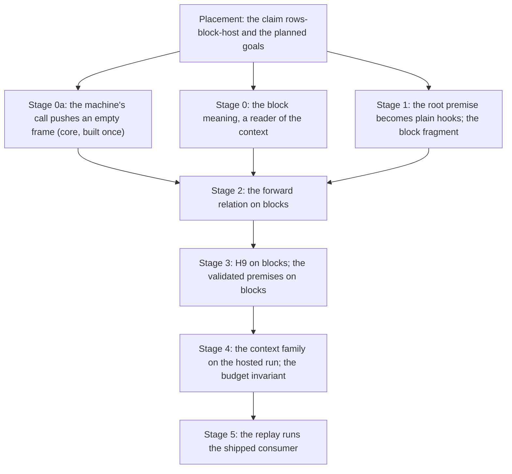

# PROC-6: the machine runs a definition block as its block meaning (the ratified plan, no-shortcut path)

Status: plan (history, not authority). Fourth version, 2026-10-14, from the coordinator, for
Codex's review and then the owner's last review cycle. The first version was the scout. The second
answered the owner's question on `provideContext`. Gemini reviewed the second and the third; both
reviews are folded in, after the coordinator checked each claim against the source (§11). A fold
of Gemini's second review is marked **[G2]**.

The owner ratified the recommendations on 2026-10-14, with this steer: "i dont want short cuts i
want the solutions that lead to the most powerful never been done before reification". The
coordinator then audited the plan for shortcuts (§4) and amended it where one was found. Each
amendment is marked **[A]**, each fold of Gemini's review **[G]**. After Gemini's second review, one
more review cycle with the owner closes the plan. Decisions row 379 is written then, once.

The probe is read-only, on `~/Dev/lean4-effect4-gemini`, branch `gemini/consolidation`, at
`7c9bb7617`. No build was run, and no Lean below is compiled: every block marked "proposed" is a
sketch to be checked. Every other name was read in the source at that commit.

## 1. The one thing to know

Route 1 holds. Prove the machine against the block meaning directly, and inline nothing. The
existing forward relation already re-enters a body at a new point for loops. A call is that
pattern with a budget.

The no-shortcut path changes four things from the scout:

1. **Parameters are lexical on both sides [A].** The machine's `call` pushes an empty frame, so a
   definition's body runs only the programs its own invocation passed. The theorem then needs no
   formation premise, and the meaning copies no machine quirk.
2. **The meaning reads the fiber's context from stage 0 [G].** `provideContext`, `provideService`,
   `service` and `Effect.context` get their exact tree before any machine proof.
3. **The budget is a proved invariant [A, G2].** No premise on the yield is assumed. The run is
   proved never to change the budget, since the language cannot name the budget's keys.
4. **The replay runs the shipped program [A].** It runs the service's consumer as the face runs it,
   not the bare entry.

## 2. What exists, and what each part reads

### 2.1 The forward relation (meaning to local run)

- `CompilesBO host root k e` (`src/Effect4/Laws/Program/Agreement/LoopCalls.lean`): the program `e`,
  compiled at any point of `root` that holds it, runs where its budgeted tree goes. The tree is
  `denoteRowsB table k e p.env`, and its detailed run is `runRowsO`.
- `RunsToDO` (same file) is where the local run with calls (`localRunC`,
  `src/Effect4/Laws/Program/Agreement/Segment.lean`) goes for each outcome:
  - a finished outcome: the exit's fiber, over its stores and host state;
  - a cut at budget `k`: the run is still going after at least `k` steps;
  - a wait: a host call with the outcome's row and request, which the host does not answer;
  - for every outcome, a divergence at the compile's frontier (`Diverges`, `AtFrontier`,
    `src/Effect4/Laws/Program/Agreement/Calls.lean`).
- The divergence escape means no depth premise enters. A point whose compile fuel is spent compiles
  to `frontier p` (`src/Effect4/Program/Compile.lean`), and `RunsToDO.of_zero` closes it.
- `compilesBO` is one structural induction over `LoopedDataRows table`
  (`src/Effect4/Laws/Program/DenoteRowsB.lean`). Its loop arm `compilesBO_iterate` re-runs the body
  at a new point through `loop_reachesCO`. The prefix laws are `RunsToDO.pre`, `RunsToDO.pre_add`
  and `RunsToDO.mono`.
- One arm reads the fragment beyond its children [G]. `compilesBO_exit`'s fold branch calls
  `runRowsO_of_asExit`, which calls `straightRows_of_asExit`: a program whose compile is already an
  exit is `StraightRows`.

### 2.2 The machine half (commands to local steps)

- `drive_seg` (`Agreement/Segment.lean`) chains commands into segments. `seg_settles`,
  `holds_evaluate`, `holds_flush` and `holds_answer` (`src/Effect4/Laws/Program/Agreement/Hosted.lean`)
  keep the machine in a settled form. `session_settled` (`src/Effect4/Laws/Api/SessionMeaning.lean`)
  runs the whole tape. `Holds` starts at `Api.load root cf` over `Stores.empty`.
- These theorems read the root only through `LoopedRows root = true`, and only to show that every
  hook answers plain code:
  - `plain_at`, `plainCode_resolve` and `plainCode_suspendBodyAt`
    (`src/Effect4/Laws/Program/Agreement/Machine.lean`);
  - the continuation and loop hooks (`plainCode_contAOf`, `plainCode_contEOf`, `plainCode_contAAt`,
    `plainCode_contEAt`, `plainCode_loopNextAt`, `plainCode_loopResumeAt`), each through
    `plainCode_resolve`;
  - closure of plainness under one local step (`localStep_plain`);
  - the root's own compile (`plainCode_compileEff root _ hroot`, in `Hosted.lean` and
    `Segment.lean`).
- **Measured** by a regex over the 470 theorem statements of `Agreement.lean`,
  `Agreement/*.lean`, `Api/SessionMeaning.lean` and `Api/SessionMeaningLoop.lean`:

  | What the statement mentions | Statements |
  | --- | --- |
  | the premise `LoopedRows root` | 23 |
  | the machine forms (`fiberAt`, `M`, `Myield`, `Mcall`, `Mexit`, …) | 31 |
  | the local run (`localStep`, `localRunC`, `ReachesC`, `RunsToDO`, `fiberOf`, `Leads`, …) | 126 |

- The yield is fixed. `defaultBudget` appears 27 times in the agreement and session laws. The
  machine yields when `currentOpCount >= maxOpsBeforeYield`, unless `preventYield` holds or an
  override decides (`yieldVerdict`, `src/Effect4/Machine/Fibers.lean`).

### 2.3 The closing steps

- `hostRunB_exits` (`src/Effect4/Laws/Program/Agreement/HostedLoop.lean`) closes the loop session. A
  local run that exits fixes a budget where the tree finishes (`localRunC_to_rowsB`). A finished
  tree stays finished at every larger budget (`hostRunB_stable`,
  `src/Effect4/Laws/Program/DenoteRowsB.lean`). Stability rests on `denoteRowsB_approx` and
  `Effects.Comodel.run_approx` (`.lake/packages/effects/Effects/Coalgebra/Comodel.lean`).
- `H9LoopedRows` and `denoteRowsB_eq_session_host` (`src/Effect4/Laws/Api/SessionMeaningLoop.lean`)
  are the statement shape a block version copies.
- `conforms_sat` and `agrees_hostRun` (`src/Effect4/Laws/Program/Validated.lean`) consume
  `denoteRows_eq_session_host` on `StraightRows`. They make a validated premise reach a recorded
  run.

### 2.4 The compile of a block

| Node | Compile (`compileEff`, `src/Effect4/Program/Compile.lean`) | Suspension body (`suspendBodyAt`, same file) |
| --- | --- | --- |
| `.defs _ _ main _` | `compileEff main (p.child 1)`: no step, one compile fuel | none |
| `.perform (.call k) r` | `Prim.suspend (EffThunk.body p)` | `resolve root` at the body's path (`defBodyPath`), env `[v]`, the parameter stack **unchanged**, `call := p.path :: p.call` |
| `.invoke k r args` | `Prim.suspend (EffThunk.body p)` | as `call`, with `argSitesAt (p.path ++ [0]) p.env args :: p.params` |
| `.perform (.param i) r` | `Prim.suspend (EffThunk.body p)` | the site `top[i]?` of the stack's top, env `site.env ++ [v]`, stack `rest`, `call := p.call.tail` |

- The hop equations are proved: `suspendBodyAt_call`, `suspendBodyAt_invoke` and
  `suspendBodyAt_param` (`src/Effect4/Laws/Program/Agreement.lean`).
- A redirect spends one compile fuel (`Point.redirect`).
- The `call` field is read only by `Point.layerCall`, through `Point.layerKey`.
- A missing definition or a missing site is `badShape`, which is `Prim.ofExit badShapeExit`
  (`badShape_eq`).
- **The two stacks fall out of step at a `call`.** `call` pushes onto the chain of calls and not
  onto the parameter stack, while `param` pops both. §5, stage 0a, aligns them.

### 2.5 The context on the machine

- `provideContext c body` and `provideService key value body` compile to `updateContextAt`, with
  `Env.ContextUpdate.provide` and `Env.ContextUpdate.provideService`. `provideContext` alone folds:
  when its body already compiles to an exit, it is that exit (`internal/effect.ts:2196`) [G].
  `provideService` has no fold [G].
- `service key` compiles to `Prim.withFiber EffThunk.getCtx`, continued by
  `EffName.serviceLookup key`. Its outcomes are `serviceLookupK_found` (the value) and
  `serviceLookupK_missing` (`Cause.die Defect.missingService`, `Context.getUnsafe`'s throw)
  (`Agreement.lean`).
- `Effect.context<R>()` compiles to `WithFiberAction.getContext`, which answers
  `interp.contextValue f.context` and checks no key (`Fibers.lean`).
- `updateContextAt`'s steps, when the body is no exit:
  1. `Prim.onSuccess (Prim.withFiber EffThunk.captureMask) (EffName.provideMask update body)`;
  2. `captureMask` is `WithFiberAction.getInterruptible`, which answers the saved mask;
  3. `contAOf`'s `provideMask` arm answers `Prim.withFiber (EffThunk.provideMasked update body flag)`;
  4. `provideMasked` masks, then runs `Prim.withFiber EffThunk.getCtx`, continued by `updateThen`;
  5. `getCtx` is `WithFiberAction.getContext`;
  6. `updateThenK` keeps the identity (`updateKeepsIdentity`) and runs `restoreRegion`, or runs
     `setCtx` with `Ctx.withServices (update.apply prev.services)`, continued by `bodyThen`;
  7. `setCtx` is `WithFiberAction.setContext`. It stores the context and re-reads both budget
     fields (`budgetOf`, `src/Effect4/Machine/ContextMap.lean`). It also emits `RunEvent.contextSet`,
     which the agreements never pin, since they quantify the trace away;
  8. `bodyThen` is `Prim.onExit (Prim.withFiber (EffThunk.restoreRegion body flag))
     (EffName.restoreCtx previous) false`;
  9. `restoreRegion` sets the saved mask over `regionCode root body`, which is
     `resolve root (p.child 0)` (`regionCode_program`);
  10. at the exit, `exitFrom` runs `finalizerProgram`'s `restoreCtx` arm,
      `Prim.withFiber (EffThunk.setCtx previous)`, through `finalizerCode`
      (`src/Effect4/Machine/Fibers.lean`) under the finalizer mask, as for `onExit` [G].
- The equations exist: `contAOf_updateThen`, `contAOf_bodyThen`, `updateThenK_context`,
  `regionCode_program` (`Agreement.lean`). P3's relation lemmas `getContext_rel` and
  `setContext_rel` (`src/Effect4/Laws/Program/Simulation/Actions.lean`) show the pattern for the
  commands.
- `Ctx` (`src/Effect4/Machine/Stores.lean`) is the service map and the two budget fields that
  `setContext` caches.
- A host call reads no context: an external registration answers nothing (`registerAsync`,
  `interpOf`).

### 2.6 What the face runs

- `serve` (`apps/todo/server.ts`) builds the repository's layer once (`Layer.buildWithScope`). It
  then runs each request through one promise queue (`serial`): "The server serves one request at
  a time, so the session's order is the order of its runs".
- Each request runs `programOf(entry, args)`, which is `withTodo(todo => todo.<entry>(…))`.
- `withTodo` (`apps/todo/consumer.ts`) is `yield* TodoApp` then the method, under
  `Effect.provide(TodoAppLayer)`. So **each request builds the service anew**, and with it the
  cache's cell.
- `TodoAppLayer` is `Layer.effect(TodoApp, Effect.map(TodoAppContext(), …))`
  (`apps/todo/.work/todo.gen.ts`): the initial program `contextDef`, then the methods closed over
  its state.
- The Lean checker replays the bare entry instead: `moduleOf` (`src/Effect4/Program/Authoring/Application.lean`),
  `builtAt` (`Test/Dogfood/Scenario/Todo.lean`), `runOf` and `checkSession` (`tools/Tools/RunChecks.lean`).
  Each record is its own run from empty stores; only the model's state is threaded.

### 2.7 A precedent on the reference route

The frame/term relation of P3 already proves the three hops on the frame machine: `intro_call`,
`intro_invoke` and `intro_param` (`src/Effect4/Laws/Program/Intro/Sequential.lean`), by induction on
`Point.weight`. The weight reads no stack and no call (`weight_redirect_params_lt`,
`src/Effect4/Laws/Program/Intro/Weight.lean`). The reference meaning (`denoteR`, `denoteAt`,
`src/Effect4/Laws/Program/DenoteR.lean`) reads parameters as sites, so it needs no relation on
parameters. The call tree reads them as closures, so stage 2 needs one.

## 3. The rulings, and their status

| # | Ruling | Kind | Source | Status |
| --- | --- | --- | --- | --- |
| 1 | Route 1: the machine against the block meaning; nothing inlined | domain | scout | ratified |
| 2 | One block meaning `denoteBlockB`: `Option ExitV`, the frontier `none` at the cut, one budget for loop rounds and nested calls; it replaces `denoteBody` and `denoteDefs` | meaning | scout | ratified |
| 3 | The meaning reads the fiber's context; a passed program runs at its site's environment and the current context; a host row reads none | meaning | owner's question, Gemini | ratified; moved to stage 0 [G] |
| 4 | Lexical parameters in the meaning **and the machine**: a `call` pushes an empty frame | meaning | coordinator [A] | amendment, for review. It replaces the ratified "mirror the machine" |
| 5 | The replay runs the shipped program (§5, stage 5) | domain | coordinator [A], Gemini | ratified in part; how the session runs waits for the owner (§13) |
| 6 | No premise on the yield: the budget is a proved invariant of the run, from the fragment and the replies (§5, stage 4) | meaning | coordinator [A], Gemini [G2] | amendment, for review. It replaces "the segments read the fiber's budget" |
| 7 | The general inlining law leaves PROC-6; its consumer is a lowering that inlines blocks | domain | scout | ratified |
| 8 | Stage 1 changes only the premise; the context enters the local run in stage 4 | domain | Gemini [G] | accepted |

## 4. The shortcut audit

Each line is a shortcut found in an earlier version, and what replaces it.

| Shortcut | Replacement | Why |
| --- | --- | --- |
| The meaning mirrors the machine's `call`, which keeps the caller's stack | stage 0a: the machine's `call` pushes an empty frame; the meaning stays lexical | the meaning would copy a quirk visible only on refused programs. The printed TypeScript is lexical. The two stacks of §2.4 then move together |
| A formation premise, discharged by a typing-inversion lemma | none needed after stage 0a | lexical on both sides agrees on every program |
| Replay the bare entry: the method's body without its `provideContext` | replay the consumer the face runs (stage 5) | Lean would check a program that is not the printed one, and no theorem relates the two runs |
| A premise that the provided context leaves `budgetOf` unchanged | a proved invariant: every context the run holds leaves the budget at its default (stage 4) [G2] | the language cannot name the budget's keys (`SigApp.lean`: "the machine's reserved names type nothing"). So proving the segments at any budget would prove them for programs no one can write. Budget control as a language feature brings that generalization with it (§6) |
| Three trivial arms added to `straightRows_of_asExit` | one law, `denoteBlockB_of_asExit`, at every context (stage 0) | stage 4's `provideContext` fold needs it anyway [G] |
| Two local runs kept side by side | one local run that carries the context at the end; the old one deleted once its callers move | a connector between two runs forever is a second representation |
| The meaning rebuilds the context at the identity branch | the meaning copies `updateKeepsIdentity`, as `updateThenK` does | otherwise a lemma that the cached budget fields match is owed |
| The session assumed sequential | discharged: the front serializes requests (§2.6); concurrent requests are the horizon (§6) | the bound is the front's construction, not an assumption |

## 5. The stages



Stages 0a, 0 and 1 are independent. Stage 0a is a core edit, so build it once, early.

### Placement first

Before any proof work, AGENTS.md requires each obligation to be placed (Trust, "Every proof
obligation is placed in the theory before it is worked"). Add the registry claim `rows-block-host`
(`tools/ProofGraph/Registry.lean`), role simulation, beside `rows-loop-host`. State each goal of
§7 as `@[semantics "translation-simulation" (requirement := R6)] proof_goal …`, with the claim it
serves. The proofs then replace the goals in place.

### Stage 0a: lexical parameters on the machine [A]

- **The edit**: `suspendBodyAt`'s `call` arm sets `params := [] :: p.params`. A `call` then pushes
  one frame, as an `invoke` does, and every `param` pops the frame of its own invocation.
- **The sites**, six in all:
  - the compile, `suspendBodyAt` (`src/Effect4/Program/Compile.lean`);
  - the reference meaning's two `call` arms, in `denoteEffBody` and `denoteR_perform`
    (`src/Effect4/Laws/Program/DenoteR.lean`);
  - the hop law `suspendBodyAt_call` (`Agreement.lean`), whose one consumer is `intro_call`;
  - `intro_call` (`Intro/Sequential.lean`), which moves to `weight_redirect_params_lt`. Then
    `weight_redirect_call_lt` has no consumer and goes [G2];
  - the typed tree's `call` arm (`src/Effect4/Laws/Program/Typed/Denotation.lean`), which already
    closes the stack by `stackTyped_nil` and `ambientStackTyped_nil` [G2].
- **The typed tree.** `StackTyped` (`src/Effect4/Laws/Program/Typed/Admission.lean`) constrains a
  stack only for the parameters in scope. A body reached by `call` has none, since
  `Signature.withDefs` admits `call k` only at a definition with no parameter. So `stackTyped_nil`
  covers the new frame. The note behind `StackTyped` is the lexical-scope note
  (`docs/research/2026-10-10-cx-lexical-scope.md`), and the edit brings the machine in line with it.
- **Docstrings**: `Point.params`'s "the innermost invocation" becomes "the innermost call".
- **The OCaml route** [G2]. `suspendBodyAt` is cut from LCNF into `ocaml/engine/api_engine.ml` and
  `ocaml/gen/api_gen.ml`. The lcnf group is not hermetic, so `check-gen` does not see a stale cut
  (`docs/GENERATED.md`). Run `make gen-lcnf`, then `opam exec --switch=effect4 -- dune build`, before
  the gates.
- **Behaviour gates** (`make check-full`'s): `check-compiler`, `check-native`, `check-ocaml`,
  `check-truth`. The coordinator runs them.

### Stage 0: the block meaning

Write `denoteBlockB` as Gemini wrote `blockStepAlg`: field by field, extending the generated
budgeted algebra `denoteRowsB.alg` (`fold_of`, `src/Effect4/Laws/Program/Folds/DenoteRowsB.lean`).
`{ denoteRowsB.alg table k with … }` cannot change the carrier, since `fold_of` gives every family
the function does not traverse the carrier `Unit` (`src/Effect4/Program/FoldOf.lean`) [G].

The carrier is a reader of the context. The helper that Gemini's Q2 asks for is that reader lift:
each control field of `denoteRowsB.alg` applied at the one context its children share.

```lean
-- proposed, not compiled
abbrev TreeB (table : RowTable) : Type :=
  Ctx → List Val → Effects.Program (RowsSig table) (Option ExitV)

/-- A passed program's tree: read at the context the parameter's run sees, and its request. -/
abbrev ParamTreeB (table : RowTable) : Type :=
  Ctx → Val → Effects.Program (RowsSig table) (Option ExitV)

abbrev BlockCarrierB (table : RowTable) : EffFam → Type
  | .eff => TreeB table
  | .effs => List (TreeB table)
  | .action => Option (TreeB table)
  | _ => Unit

/-- `updateContext` on a context, as `updateThenK` reads it: the identity, or the update. -/
def provided (u : Env.ContextUpdate) (ctx : Ctx) : Ctx :=
  if updateKeepsIdentity u ctx.services then ctx else Ctx.withServices (u.apply ctx.services)

-- the fields that differ from the reader lift of `denoteRowsB.alg table k`
def blockAlgB (table : RowTable) (k : Nat) (params : List (ParamTreeB table))
    (call : Nat → Val → List (ParamTreeB table) → Ctx →
      Effects.Program (RowsSig table) (Option ExitV)) :
    EffAlgebra NativeOp (BlockCarrierB table) where
  -- lexical: a call passes no program; after stage 0a the machine pushes an empty frame
  eff_perform op r := fun ctx env => match op with
    | .call j => match evalTerm env r with
      | some v => call j v [] ctx
      | none => pure (some badShapeExit)
    | .param j => match evalTerm env r, params[j]? with
      | some w, some f => f ctx w
      | _, _ => pure (some badShapeExit)
    | _ => (denoteRowsB.alg table k).eff_perform op r env
  eff_invoke j r args := fun ctx env => match evalTerm env r with
    | some v => call j v (args.map fun a ctx' w => a ctx' (env ++ [w])) ctx
    | none => pure (some badShapeExit)
  eff_defs _ _ main _ := main
  eff_provideContext c body := fun ctx env =>
    match (evalTerm env c).bind Val.context? with
    | some built => body (provided (.provide built.services) ctx) env
    | none => pure (some badShapeExit)
  eff_provideService key value body := fun ctx env =>
    match evalTerm env value with
    | some v => body (provided (.provideService key v) ctx) env
    | none => pure (some badShapeExit)
  eff_service key := fun ctx _ =>
    match ctx.services.getV key with
    | some v => pure (some (.success v))
    | none => pure (some (.failure (Cause.die Defect.missingService)))
  eff_withFiber a := fun ctx env => match a with
    | some t => t ctx env
    | none => pure (some outsideExit)
  action_context _ := some fun ctx _ => pure (some (.success (Val.context ctx)))
  effs_nil := []
  effs_cons head tail := head :: tail
  -- … every other field: the reader lift of `denoteRowsB.alg table k`, or `()`

def denoteBlockB (table : RowTable) (bodies : List NativeEff) :
    Nat → List (ParamTreeB table) → NativeEff → TreeB table
  | 0, params, e => cata_eff (blockAlgB table 0 params fun _ _ _ _ => pure none) e
  | k + 1, params, e =>
    cata_eff (blockAlgB table (k + 1) params fun j v args ctx =>
      match bodies[j]? with
      | some body => denoteBlockB table bodies k args body ctx [v]
      | none => pure (some badShapeExit)) e
```

- **The context in the tree.** A body and a passed program run at the context current at their
  run. Restoring after a region is the reader itself: the rest of a `bind` reads the outer context.
- **One budget.** A cut at `k` is `k` rounds of one loop or `k` nested calls. Both cost at least `k`
  local steps, which stage 3 needs.
- **The value `Effect.context` answers** is the machine's `contextValue`, which is `Val.context` in
  the native interpretation (`interpOf`, `Compile.lean`).
- **Laws**, each placed (§7):
  - conservativity: on `LoopedDataRows table e`, `denoteBlockB table bodies k params e ctx env` is
    `denoteRowsB table k e env` at every context. Prove it by structural induction on `e`, as
    `cata_blockStepAlg_straightRows` (`ParamRows.lean`) is proved: each composite arm rewrites by its
    children's hypotheses into `denoteRowsB.alg`'s own field. The fold congruence
    `EffAlgebra.AgreeOn` (`src/Effect4/Laws/Program/Signature.lean`) does not serve. Its
    `eff_provideContext` and `eff_withFiber` fields demand equality with no guard, and the two
    algebras differ there [G2];
  - monotonicity (`block-handler-monotone`, re-pointed): `Effects.Program.Approx` from budget `k` to
    `k + 1`, when the parameters are related pointwise at every context and request. Use the
    package's `Approx` (`.lake/packages/effects/Effects/Coalgebra/System.lean`), which `run_approx`
    reads;
  - unfolding (`block-handler-unfolds`, re-pointed): the convergence form of
    `invoke_unfolds_at_limit`, for `call` and for `invoke` with any number of arguments;
  - the exit law `denoteBlockB_of_asExit` [G]: a program of the block fragment whose compile is
    already an exit has that exit as its tree, at every context and budget. The arms are those
    whose compile can be an exit:
    - `succeed`, `fail` and `failCause`, and a `perform` whose request does not evaluate (`badShape`);
    - `exit`'s fold;
    - `defs`, through `main`;
    - in stage 4, `provideContext`'s fold, and `provideContext` or `provideService` whose term does
      not evaluate (`badShape`);
  - the one-step laws: `denoteBody_call`, `denoteBody_invoke_one` and `denoteBody_param` restated,
    and one per context construct.
- **Consumers to move**:
  - the cache's block law `denoteBody_getBody` and its user (`src/Effect4/Laws/Library/Ref/Cache.lean`);
  - `CachedListAfterAdd` and `cached_list_after_add` (`Test/Dogfood/Scenario/Todo/Cached.lean`). The
    statement gains one `some`, and holds at every outer context;
  - the battery `Test/Program/BlockMeaning.lean`;
  - the pointers of `block-handler-monotone` and `block-handler-unfolds`
    (`tools/ProofGraph/Registry.lean`), with their `@[semantics …]` placements moved to the
    survivors.
- **What moves, then what goes** [G, corrected]:
  - `mapOps` and `blockOf?` leave `Block.lean` first. `paramsAsRows` (`ParamRows.lean`) is
    `mapOps (paramAsRow n)`. The cache's laws, `Test/Dogfood/Bank.lean` and `Cached.lean` use it, and
    `Bank.lean` opens `blockOf?`;
  - then `denoteDefs`, `meaningDefs`, `ConvDefs`, `blockTree`, `blockBody`, `splitRows` and
    `callsAsRows` go. With them goes `Effect4.Laws.Effects.Mrec` (`src/Effect4/Laws/Effects/Mrec.lean`),
    whose `Approx` restates the package's;
  - three references follow: the `Mrec` import in `src/Effect4/Laws.lean` (a root import, edited at
    its anchor), the docstring of `src/Effect4/Laws/Author.lean`, and the two registry pointers;
  - `denoteBody`, `blockStepAlg`, `hostRunBody` and `hostRunDefs` go once their consumers move.

### Stage 1: the root premise becomes plain hooks [G]

```lean
-- proposed, not compiled
/-- What the machine half reads of the root: every hook answers plain code. -/
structure PlainHooks (root : NativeEff) : Prop where
  resolve : ∀ q, PlainCode (resolve root q) = true
  suspend : ∀ q, PlainCode (suspendBodyAt root (EffThunk.body q)) = true
```

- Change only the premise, in the 23 statements: `(hroot : LoopedRows root = true)` becomes
  `(hroot : PlainHooks root)`. `PlainHooks.of_loopedRows` is the current proof. The hook lemmas read
  its fields. The root's compile is `compile root cf = compileEff root (rootPoint cf tape)`, whose
  plainness is the `resolve` field at the root point.
- **The block fragment mirrors formation.** A block stands at the root only (`Eff.defs`'s
  docstring, `src/Effect4/Program/Eff.lean`). So `BlockRows table root` holds when the root is
  `.defs decls bodies main .nil`, and its bodies and its main program are in a body fragment.
  The body fragment is `LoopedDataRows` with `call`, `param` and `invoke`, and with no `defs`.
- Write the body fragment as a fold with a `Bool` carrier on `effs`, field by field: `StraightRows.alg`'s
  `effs` carrier is `Unit` [G].
- **Lemmas owed**:
  - `PlainHooks.of_blockRows`;
  - `plainCode_compileEff`'s three arms: `defs`, `invoke`, and `perform` of `call` or `param`;
  - `LoopedRows.suspendDecided_iff` widened to the block's decided heads;
  - `plain_at`'s closure through `Node.effs` spines and the root block;
  - two address lemmas. The body at `defBodyPath root k` is `(bodiesOf root)[k]?`, and argument
    `j`'s site from `argSitesAt` holds `args[j]`. `spineIndex_append`
    (`src/Effect4/Laws/Program/AddressMove.lean`) and `argSitesAt_keys`
    (`src/Effect4/Laws/Program/Handles/Alphabet.lean`) are near;
  - `bodiesOf_blockRows`: every body of a fragment root is in the body fragment [G].
- The machine forms, `localStep` and `localRunC` do not change in this stage [G].

### Stage 2: the forward relation on blocks

In stages 1 to 3 the fiber's context is `emptyCtx` (`fiberAt`, `RunFiber.make`), and no node of
the fragment changes it. So the relation reads the meaning at `emptyCtx`. Stage 4 generalizes it.

```lean
-- proposed, not compiled
def ParamsAgree {σ : Type} (host : Effects.Comodel (RowSig table) σ) (root : NativeEff) (k : Nat) :
    List (ParamTreeB table) → List (List ArgSite) → Prop
  | params, [] => params = []
  | params, top :: rest => params.length = top.length ∧
      ∀ j f site, params[j]? = some f → top[j]? = some site →
        ∀ (w : Val) (q : Point) (K : List NCode) (i : Bool) (s : Stores) (r : σ),
          q.path = site.path → q.env = site.env ++ [w] → q.params = rest →
          RunsToDO host root K i k (fiberOf (resolve root q) K i) s r
            (runRowsO host (f emptyCtx w) s r)

def CompilesBlk {σ : Type} (host : Effects.Comodel (RowSig table) σ) (root : NativeEff) (k : Nat)
    (e : NativeEff) : Prop :=
  ∀ (p : Point) (K : List NCode) (i : Bool) (s : Stores) (r : σ) (params : List (ParamTreeB table)),
    Node.at_ (Node.eff root) p.path = some (Node.eff e) → ParamsAgree host root k params p.params →
      RunsToDO host root K i k (fiberOf (compileEff e p) K i) s r
        (runRowsO host (denoteBlockB table (bodiesOf root) k params e emptyCtx p.env) s r)

theorem compilesBlk {σ : Type} (host : Effects.Comodel (RowSig table) σ) (root : NativeEff)
    (hroot : BlockRows table root = true) :
    ∀ k e, BodyRows table e = true → CompilesBlk host root k e
```

The proof is an outer induction on `k`, and inside it the structural induction of `compilesBO`. The
premise `hroot` gives the outer hypothesis its bodies (`bodiesOf_blockRows`) [G]. Four arms are new.
Every other arm is `compilesBO`'s, with `ParamsAgree` carried unchanged. The `exit` arm reads
`denoteBlockB_of_asExit`.

- **`defs`**: no step. The meaning is `main`'s tree, and the code is `main` at `p.child 1`
  (`compileEff_defs`, `at_child`).
- **`call j r`** at `k + 1`: one step (`step_suspend`, `suspendBodyAt_call`), then `resolve_of_at` at
  the body. After stage 0a the stack is `[] :: p.params` and the meaning's parameters are `[]`, so
  `ParamsAgree host root k [] ([] :: p.params)` holds at once. Use the outer hypothesis at the
  body, then `RunsToDO.pre_add`, which raises the cut bound to `k + 1`.
- **`call j r`** at `0`: the meaning is the cut `pure none`. `RunsToDO`'s cut case at bound `0`
  holds at `ReachesC.refl`.
- **`invoke j r args`** at `k + 1`: one step (`suspendBodyAt_invoke`), then the body under
  `argSitesAt (p.path ++ [0]) p.env args :: p.params`. The new frame's `ParamsAgree` comes from the
  structural hypothesis on each argument, a child of the node, at the caller's `ParamsAgree` and
  budget. It weakens from `k + 1` to `k` by `RunsToDO.mono`. The helper over the `Effs` spine is one
  recursion on the spine.
- **`param j r`**: one step (`suspendBodyAt_param`). `ParamsAgree` gives the stack `top :: rest`,
  the site and the closure, and its conclusion is the arm's, after `RunsToDO.pre`. A missing
  parameter is `badShape` on both sides, since the lengths agree.

Gemini traced a passed program that itself runs `param` (its review, Q3). `ParamsAgree` holds the
specialized `RunsToDO` witness at `q.params = rest`, so nested forwarding needs no change.

### Stage 3: H9 on blocks

- **Exit fixes a budget**: a block analogue of `localRunC_to_rowsB`. An exited local run within `c`
  steps rules out, at every `k > c`:
  - a cut, which needs `k` steps;
  - a wait, which `waits_not_diverges` separates;
  - a divergence, since a frontier never exits.
- **Stability**: `Effects.Comodel.run_approx` on stage 0's monotonicity, as `hostRunB_stable`.
- **The statement**, beside `H9LoopedRows`:

  ```lean
  -- proposed, not compiled
  def H9Blocks : Prop :=
    ∀ (s : Run), Run.Reached s → funded s = true → atRest s = true → hostDriven s = true →
      BlockRows s.built.table s.built.program = true →
      ∀ {σ : Type} (host : Effects.Comodel (RowSig s.built.table) σ) (st st' : σ),
        HostAnswered s.built.table host s.built.program s.budget.fuel (tapeOf s)
          (Api.load s.built.program s.budget.compileFuel) st st' →
        ∀ ex, s.exit = some ex → ∃ lower, ∀ k, lower ≤ k →
          runRowsH host (denoteBlockB s.built.table (bodiesOf s.built.program) k []
            s.built.program emptyCtx []) Stores.empty st = some (some ex, (s.machine.state, st'))
  ```

- **The validated premises on blocks**: `conforms_sat` and `agrees_hostRun` restated over
  `H9Blocks`. `conforms_sat`'s `Sat` reads the budgeted tree, so its predicate holds of every
  finished leaf. A cut leaf satisfies it vacuously.

### Stage 4: the context family on the local run

- **The context lives in the hosted spine** [G2, corrected]. `localStep` and `localRun`
  (`Agreement.lean`, `Agreement/Loop.lean`, `Agreement/LoopSteps.lean`) serve the context-free
  theorems `run_eq_meaning` and `loopAgreement`, and they stay as they are. The local run with calls
  carries the fiber's context in its state. `localStepC` steps the context thunks itself and falls
  back to `localStep` for every other step, which reads no context. One local step, one hosted run
  with the context: no second representation.
- **What changes, measured** by the same regex as §2.2: 100 statements mention the hosted spine
  (`localRunC`, `ReachesC`, `RunsToDO`, `Leads`, `Settled`, `Holds`, `CompilesBO`, …) or the machine
  forms, and they are restated for every context. 63 mention only the context-free run, and they stay.
  Gemini's "almost all signatures unchanged" does not hold. A host call inside a `provideContext`
  body parks with the provided context, so `RunEnd.waits`, `Pos`, `Settled` and `Mcall` must hold it.
  A default argument `ctx := emptyCtx` keeps call sites elaborating but proves nothing at another
  context. Most proofs pass the context through unread.
- **The machine forms** take the context: `fiberAt` builds `RunFiber.make … (budgetOf ctx) ctx`, and
  so do `M`, `Myield`, `Mcall`, `parkedAt` and `callParkedAt`. `exitedAt` already resets the
  context to `emptyContext`.
- **The steps**: the five context thunks and the `restoreCtx` finalizer, through `finalizerCode`.
  One bracket lemma, after `compilesBO_onExit`'s, serves `updateContextAt` for both
  `provideContext` and `provideService` [G]. Then `service` (`getCtx`, then `serviceLookupK`) and
  `Effect.context` (`getContext`).
- **`PlainCode` and `PlainFrame` widen**: `Prim.withFiber` of the five thunks, and an `onExit` whose
  body is `Prim.withFiber (EffThunk.restoreRegion …)` and whose finalizer is `restoreCtx`. Also
  `Prim.setInterruptible false` [G2]. On a masked fiber, `restoreRegion`'s `interruptibleRegion`
  calls `setFiberInterruptible`, which pushes `Prim.setInterruptible false`
  (`src/Effect4/Machine/Frames.lean`). While the body runs, the stack above `K` is therefore
  `setInterruptible false :: onExit … (restoreCtx prev) false :: setInterruptible true :: K`.
  `PlainFrame` admits `setInterruptible true` alone today, so it widens to both flags, and
  `step_ofExit_pass_setInterruptible` (`Agreement.lean`) takes the flag as an argument.
- **The budget is a proved invariant** [A, G2]. Two proofs read `defaultBudget`'s value, not only its
  order: `flushAll_Myield` and `replay_Mexit_of_localRun` (`Agreement/Segment.lean`, `defaultBudget =
  2048 := rfl`). A budget of one or zero breaks their progress argument. So prove an invariant of the
  run, `DefaultBudgetCtx ctx`: `ctx.maxOpsBeforeYield = defaultBudget` and `ctx.preventYield =
  false`. A context gets these fields from `budgetOf`, which reads the reserved keys `Env.maxOpsKey`
  and `Env.preventYieldKey` (`src/Effect4/Machine/ContextMap.lean`). Their defaults are the default
  budget (`maxOpsRef`, `preventYieldRef`). The invariant needs all three sources of a context value:
  - **the program**: `provideService` and `service` at a reserved key. The fragment refuses them, as
    the checker does (`src/Effect4/Program/SigApp.lean`: "the machine's reserved names type nothing");
  - **the fiber**: `getContext` answers the current context, which the invariant already covers. No
    term builds a context (`src/Effect4/Machine/Term.lean`);
  - **the host**: `dataRow` admits any answer type that is not a handle, so a reply may carry a
    context. The fragment refuses a row whose answer type can hold a context. Otherwise reply
    admission must refuse a context that names a reserved key.

  This is more than Gemini's "3-line preservation lemma": `provideContext` merges a whole context
  value, so its sources matter.
- **The relation over every context**: `ParamsAgree` and `CompilesBlk` quantify the context that the
  local run holds. `H9Blocks` keeps its start at `emptyCtx`.
- **The fragment** widens by the four constructs.

### Stage 5: the replay runs the shipped consumer [A]

- **The face as it ships** builds the service per request (§2.6). Its Lean twin is one program per
  record: the service module's block, whose `main` invokes `<service>Context`, then the method at
  the state it made and the record's arguments. `listAddList` (`Cached.lean`) is the template. It
  runs from empty stores, as the face's fresh layer does, so `checkSession`'s unit stays the request.
- **What remains between the face and its twin**: the layer's own steps (`Layer.effect`'s scope and
  memo map). They make no host call. Closing that gap is horizon (a) of §6.
- **The checker**: `builtAt` builds the twin instead of the bare entry. The five checks are
  unchanged, and `make check-host-protocol` runs the cached service.

## 6. The horizon, past this plan

- **(a) The service's layer in the program.** The module carries `TodoAppLayer` as a `LayerTerm`,
  and the consumer is `provideLayer`. The replay then runs the layer build the face runs. That
  needs scopes and memo maps on the tree and on the local run: `provideLayer`, `scoped` and
  `acquireRelease`.
- **(b) A service built once per server**, as the repository is. Then the cache holds across
  requests, and the twin is one machine per session: `<service>Context` once, then each record's
  method in the record's order, each exit reified, as Gemini proposed (its review, correction 5).
  The session theorems already start at `Api.load` over empty stores, so this reuses them. §13 asks
  the owner. It also closes most of (a) [G2]. rc.112's `Effect.provide` dispatches on its argument
  (`vendor/effect-4.0.0-rc.112/src/internal/layer.ts`, `provide`):
  - a context goes straight to `provideContext`;
  - a layer goes to `provideLayer`, a scope and a build per call.

  So a server that builds the service once and provides its context runs no layer build per request.
  What remains between a request and its twin is the service lookup: the face reads `TodoApp`, a
  record of closures, and the twin invokes the method's definition at the state. Closures are not
  program data, so the twin agrees on the call tree, not step for step.
- **(c) Concurrent requests**, from a front that does not serialize: each request a forked fiber.
  The claims then go through schedule independence (decisions row 361, D1 to D3) or the relational
  meaning over decisions.
- **(d) One activation stack.** After stage 0a, `Point.params` and `Point.call` are pushed and popped
  together. Merge them into one stack of frames, each a call's path and its argument sites. This
  is a representation change, so §13 asks the owner.
- **(e) The general inlining law**, when a lowering inlines blocks.
- **(f) Budget control as a language feature.** When a program may set `MaxOpsBeforeYield` or
  `PreventSchedulerYield`, the segments must be proved at every budget the context sets. That
  includes small budgets, where a yield round's progress needs a new argument.

## 7. Placement of the planned goals

| Goal | Concept | Claim, role | Requirement | Consumer |
| --- | --- | --- | --- | --- |
| stage 0a: the hop laws restated | `translation-simulation` | `run-eq-meaning`'s steps; the P3 relation | R6 | stage 2's `call` arm |
| stage 0: conservativity | `translation-simulation` | step of `rows-block-host` | R6 | H9 on blocks at a program with no block |
| stage 0: monotonicity | `translation-simulation` | `block-handler-monotone`, monotonicity (re-pointed) | R10 | stage 3's stability |
| stage 0: unfolding | `translation-simulation` | `block-handler-unfolds`, compatibility (re-pointed) | R10 | the cached claim; authoring laws |
| stage 0: `denoteBlockB_of_asExit` | `translation-simulation` | step of `rows-block-host` | R6 | stage 2's `exit` arm; stage 4's `provideContext` fold |
| stage 1: `PlainHooks.of_blockRows` | `translation-simulation` | step of `rows-block-host` | R6 | `session_settled` on blocks |
| stage 2: `compilesBlk` | `translation-simulation` | step of `rows-block-host` | R6 | stage 3 |
| stage 3: `H9Blocks` | `translation-simulation` | `rows-block-host` (new), simulation | R6, serving R10 | `conforms_sat` and `agrees_hostRun` on blocks |
| stage 4: the context family's arms | `translation-simulation` | step of `rows-block-host` | R6 | the service method's replay |

For `H9Blocks`:

1. **Concept**: `translation-simulation` (`docs/core/semantics.md`). The property is the session
   meaning on blocks.
2. **Question**: the new claim `rows-block-host`, pointed at `proof_goal h9_blocks : H9Blocks`.
3. **Reach**: `BlockRows`, one fiber, and a run that is reached, funded, at rest and driven by a
   host. The host is any one whose answers are the run's, and the claim holds past a budget bound.
   After stage 4, the context family is in it.
4. **Does not establish**:
   - layers, scopes, a fork or an interruption (horizon (a), (c));
   - anything of the printed service's run on rc.112, which `make check-host-protocol` checks;
   - a run that stopped at a call;
   - that a run is funded.
5. **Unlocks**:
   - R6 on block programs;
   - R10: a banked block's claims, such as the Ref cache's, reach Lean's recorded runs;
   - decisions row 378 (11): tree and protocol claims decided on application code;
   - with stage 5, the shipped consumer is the verified program.

## 8. Risks and open checks

1. **The `Effs` induction** (stage 2). `compilesBO` is a match on `Eff`. Prove an `Effs` helper by
   recursion on the spine, or derive the relation by `cata_eff` with a `Prop` carrier.
2. **Monotonicity across contexts** (stage 0). Check that the fold keeps the pointwise `Approx` on
   parameters at every context and request, arm by arm.
3. **The reader lift.** Each control field is `denoteRowsB.alg`'s field applied to the children at
   one context [G2]. Check that the lift is written once, not once per field.
4. **The compile fuel.** Each hop spends one. `Diverges` absorbs the exhaustion, and `funded`
   excludes it at the session (`denoteRows_eq_session`'s docstring, `SessionMeaning.lean`).
5. **The completed-exit view.** `step_suspend` resolves at `interpAt root []`. `ParamsAgree`
   quantifies every point at a site's path, environment and stack, so the view is free. Check this
   against `localRun_compile`'s `suspend` arm.
6. **Stage 0a's reach.** Check every consumer of `suspendBodyAt_call` and of the reference's `call`
   arm, in P3's simulation (`src/Effect4/Laws/Program/Simulation/`) and the typed tree.
7. **The registry.** `hostRunBody_*` and `denoteBody_*` carry `@[semantics "translation-simulation"
   (requirement := R10)]`. A deletion moves its placement onto the survivor (Gemini's round 2
   lesson, `docs/research/2026-10-13-gemini-consolidation/round3-prompt.md`).

## 9. Sizes (judgment, not measured)

| Stage | Size | Why |
| --- | --- | --- |
| 0a | small to medium, core | six sites; one core rebuild; four behaviour gates |
| 0 | medium | one algebra with a reader carrier; four laws; consumers moved; deletions |
| 1 | medium, mechanical | 23 premises; three arms in the plainness lemmas; three address lemmas |
| 2 | medium | four new arms and one relation; the rest is `compilesBO`'s |
| 3 | small | copies the loop closing steps and the two validated premises |
| 4 | large | 100 statements restated for every context, 63 untouched; the context steps; the mask frames; the budget invariant and its three sources |
| 5 | small to medium | the twin builder; the checker's builder; the gate on the cached service |

## 10. What this gives, when it lands

An agent writes a service as first-order data: definitions, programs passed as parameters,
recursion at a budget, and context provision. The printed TypeScript is the program the Lean machine
replays. A claim proved on the program's call tree then holds of every recorded request that
passes the five checks, under every host that gave its answers. The host boundary stays where
`docs/core/host-boundary.md` puts it: the repository's rows.

## 11. Gemini's first review, folded

| Point | Verdict | Where |
| --- | --- | --- |
| Q1: `compilesBO_exit` reads the fragment through `straightRows_of_asExit` | holds | §2.1; stage 0's exit law |
| Q1: its list of folding arms | incomplete: the `badShape` folds of a term that does not evaluate are exits too | stage 0's exit law |
| Q2: `{ alg with … }` cannot change the carrier | holds (`FoldOf.lean`) | stage 0 |
| Q3: `ParamsAgree` forwards nested parameters | holds | stage 2 |
| Q3: the outer hypothesis needs `BlockRows` of the root | holds | stage 2's `hroot`; stage 1's `bodiesOf_blockRows` |
| Q4: delete `Block.lean`'s handler form | holds in part: `mapOps` and `blockOf?` have consumers and move first | stage 0 |
| 1: the context in the meaning from stage 0; a passed program runs at the current context | holds | stage 0 |
| 2: stage 1 changes only the premise | holds; "over 180 theorems" overcounts (§2.2) | stage 1 |
| 3: `restoreCtx` runs through `finalizerCode` | holds | §2.5, step 10 |
| 4: `provideContext`'s fold; `provideService` has none | holds | §2.5; stage 0's exit law |
| 5: one machine per session | right for a service built once per server; the face as it ships builds it per request (§2.6) | stage 5; horizon (b) |

### Gemini's second review [G2], checked

| Point | Verdict | Where |
| --- | --- | --- |
| Q1: nothing relies on a `call` keeping the caller's stack | holds. `suspendBodyAt_call`'s one consumer is `intro_call`; the typed `call` arm closes by `stackTyped_nil` | stage 0a |
| Q1: `weight_redirect_call_lt` goes | holds: `intro_call` is its one consumer | stage 0a |
| Q1: the OCaml cut of `suspendBodyAt` | holds; the target is `make gen-lcnf`, not `make gen-ocaml` | stage 0a |
| Q2: the reader lift is one pointwise lift | holds | stage 0 |
| Q2: `AgreeOn` cannot prove conservativity | holds: `eff_provideContext` and `eff_withFiber` are unguarded | stage 0 |
| Q3: `localStep` and `localRun` stay | holds, when `localStepC` steps the context thunks | stage 4 |
| Q3: almost all signatures unchanged | does not hold: 100 statements are restated for every context (§5, stage 4) | stage 4 |
| Q3: `PlainFrame` needs `setInterruptible false` | holds (`interruptibleRegion`, `setFiberInterruptible`) | stage 4 |
| Q4: two proofs read the budget's value | holds, at `Segment.lean`'s `defaultBudget = 2048 := rfl` | stage 4 |
| Q4: the invariant `DefaultBudgetCtx` instead of a general budget | adopted, and enlarged: it covers every source of a context value, host replies included. The key is `Env.maxOpsKey` | stage 4 |
| Q5: `Effect.provide` of a context is `provideContext` | holds (`internal/layer.ts`, `provide`) | horizon (b) |
| Q5: the server-scoped twin matches "on the nose" | overstated: the service lookup of a record of closures remains | horizon (b) |
| Q6: `Effect.context` is typed at a value the fiber's context fits | holds: `checked_context_arm`, `native_context_answer` (`Typed/Context.lean`), `inv_action_context` (`Typing/CheckInversion.lean`), `fits_context_inv` (`Typed/Membership.lean`) | stage 0 |
| its §3: four decisions | it answers decisions the plan does not hold. `provideService` is already an `Eff` constructor, and it is `updateContext`, not `Effect.context` then `provideContext` (`Eff.lean`'s docstring, `internal/effect.ts:2202-2232`). `TodoAppLayer` is `Layer.effect`, not `Layer.effectContext`. It does not answer §13's items 1, 2 and 4 | §13 |

## 12. For Codex's review

Gemini answered §12's six questions below; its answers are checked in §11. Four points stay open:

1. **The host clause of the budget invariant** (stage 4). Which is right: a fragment rule that no row
   answers a type that can hold a context, or reply admission that refuses a context naming a
   reserved key? Check `docs/core/host-boundary.md` and the reply admission judgment.
2. **The hosted spine's context** (stage 4). Is there a way to carry the context that restates
   fewer than the 100 statements, without a second representation?
3. **Stage 0a's reach into P3** (`run_eq_ref_table`): is `intro_call` the only proof of the frame/term
   relation that the empty frame touches?
4. **The order.** Is stage 0a, a core edit, right to land before the meaning, given that only stage 2
   needs it?

### Gemini's questions, answered in §11

1. **Stage 0a.** Does any proof or consumer rely on a `call` keeping the caller's stack? Check the
   P3 simulation's `call` arm, the typed tree's, and every use of `suspendBodyAt_call`.
2. **The reader lift.** Is the lift of `denoteRowsB.alg` to `BlockCarrierB` one definition, and does
   conservativity follow from `EffAlgebra.AgreeOn` after it?
3. **The local run with the context.** Is a second module with a connector, then the move of 157
   statements, the least rework? Or can the existing local run take the context in a way that
   leaves those statements unchanged?
4. **The yield.** Does any proof read `defaultBudget`'s value beyond the order `≤`?
5. **The twin.** Is `withTodo`'s `Effect.provide(TodoAppLayer)` a fresh layer build per request in
   rc.112 (`vendor/effect-4.0.0-rc.112/src/internal/layer.ts`)? If it is, the per-request twin is
   faithful up to the layer's own steps.
6. **The type of `Effect.context`.** The native `contextValue` is `Val.context`. Does the checker type
   `withFiber (.context keys)` at a type that value fits, for every context the fiber can hold?

## 13. For the owner, after Codex's review

1. **Amendment 4, lexical parameters on the machine** (stage 0a). It replaces the ratified "mirror the
   machine". It removes a premise, and it aligns the machine with the printed TypeScript and with
   the lexical-scope note. On every checked program the two readings agree. Recommended.
2. **Amendment 6, the budget as a proved invariant** (stage 4). It replaces "the segments read the
   fiber's budget", after Gemini's second review. The language cannot set the budget, so the
   invariant is exact for it. Budget control as a feature is horizon (f). Recommended.
3. **A service built once per server** (horizon (b)). A cache rebuilt per request does nothing, so a
   real application builds the service once, as the front already builds the repository. Then the
   twin is one machine per session, and rc.112 runs no layer build per request. Recommended.
4. **One activation stack** (horizon (d)), a representation change after stage 0a. Recommended.
