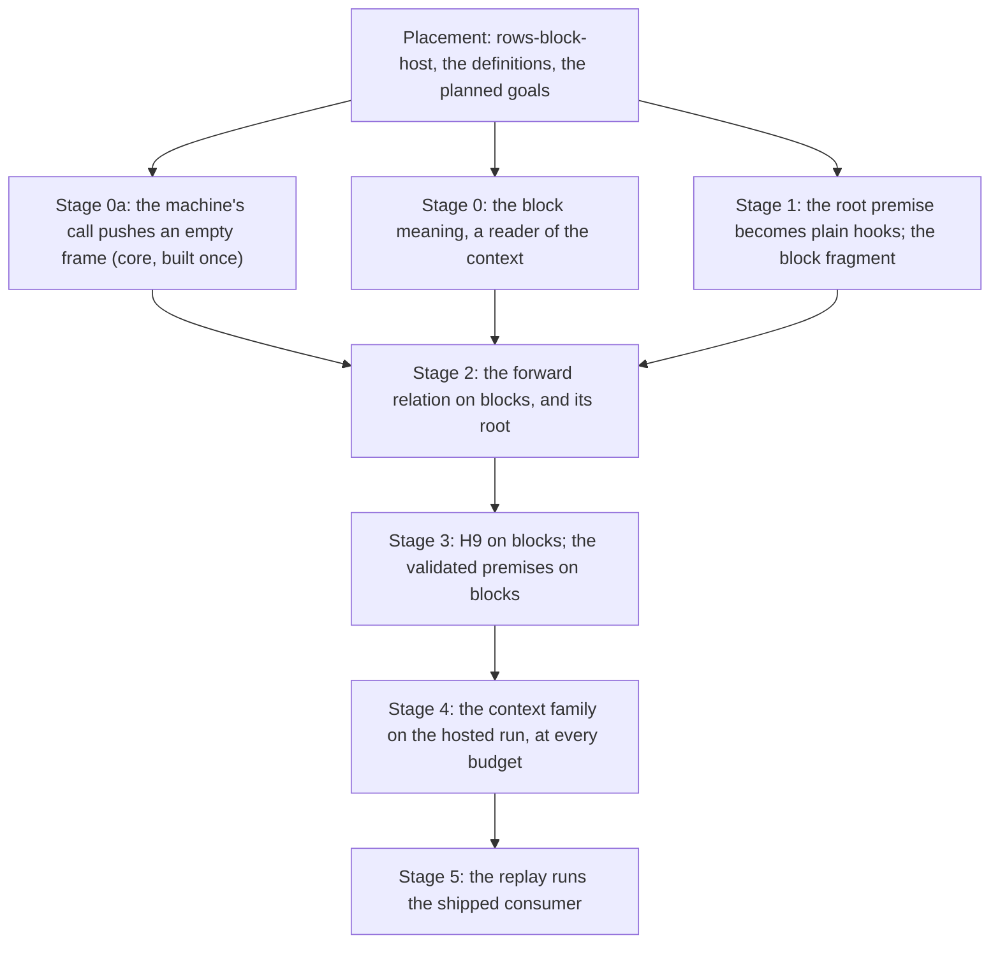

# PROC-6: the machine runs a definition block as its block meaning (the locked plan)

Status: plan (history, not authority), fifth and locked version, 2026-10-14, from the coordinator.
Decisions row 379 records its rulings. The owner ratified the recommendations on 2026-10-14, with
the steer "i dont want short cuts i want the solutions that lead to the most powerful never been
done before reification". Five reviews shaped it:

- Gemini's two reviews of versions 2 and 3;
- Codex's review of version 4, findings F1 to F4 (`docs/research/2026-10-14-proc6-codex-review/README.md`);
- a proposed version-5 amendment, supplied by the owner (`docs/research/2026-10-14-proc6-v5-review/inputs/proposed-v5.txt`);
- Codex's review of that amendment, findings N1 and N2 (`docs/research/2026-10-14-proc6-v5-review/README.md`).

§11 gives each finding's disposition. The coordinator checked every claim against the source before
folding it in. Source pin: `7c9bb7617` (main checkout and `gemini/consolidation`). No Lean below is
compiled: every block marked "proposed" is a statement to be checked.

## 1. The one thing to know

Route 1 holds. Prove the machine against the block meaning directly, and inline nothing. The
existing forward relation already re-enters a body at a new point for loops. A call is that
pattern with a budget.

Four decisions make it the no-shortcut path:

1. **Parameters are lexical on both sides.** The machine's `call` pushes an empty frame (stage 0a).
   So the theorem needs no formation premise, and the meaning copies no machine quirk.
2. **The meaning reads the fiber's context from stage 0.** `provideContext`, `provideService`,
   `service` and `Effect.context` get their exact tree before any machine proof.
3. **The machine is proved at every scheduler budget** (stage 4). A context can set the budget,
   and a checked program can receive such a context from a host (F1's witness). So the agreement
   follows the fiber's own budget, whatever it is. No budget invariant, no column filter and no
   reserved-key rule restrict the fragment. Agreement is conditioned on a finished run; progress is
   claimed only where it holds.
4. **The replay runs the shipped consumer** (stage 5), per request, as the face builds the service.

## 2. What exists, and what each part reads

### 2.1 The forward relation (meaning to local run)

- `CompilesBO host root k e` (`src/Effect4/Laws/Program/Agreement/LoopCalls.lean`): the program `e`,
  compiled at any point of `root` that holds it, runs where its budgeted tree goes. The tree is
  `denoteRowsB table k e p.env`, and its detailed run is `runRowsO`.
- `RunsToDO` (same file) is where the local run with calls (`localRunC`,
  `src/Effect4/Laws/Program/Agreement/Segment.lean`) goes for each outcome:
  - a finished outcome: the exit's fiber, over its stores and host state;
  - a cut at budget `k`: the run is still going after at least `k` steps;
  - a wait: a host call with the outcome's row and request, which the host does not answer;
  - for every outcome, a divergence at the compile's frontier (`Diverges`, `AtFrontier`,
    `src/Effect4/Laws/Program/Agreement/Calls.lean`).
- The divergence escape means no depth premise enters. A point whose compile fuel is spent compiles
  to `frontier p` (`src/Effect4/Program/Compile.lean`), and `RunsToDO.of_zero` closes it.
- `compilesBO` is one structural induction over `LoopedDataRows table`
  (`src/Effect4/Laws/Program/DenoteRowsB.lean`). Its loop arm `compilesBO_iterate` re-runs the body at
  a new point through `loop_reachesCO`. The prefix laws are `RunsToDO.pre`, `RunsToDO.pre_add` and
  `RunsToDO.mono`.
- `compilesBO_exit`'s fold branch reads the fragment beyond its children, through
  `runRowsO_of_asExit` and `straightRows_of_asExit`.

### 2.2 The machine half (commands to local steps)

- `drive_seg` (`Agreement/Segment.lean`) chains commands into segments. `seg_settles`,
  `holds_evaluate`, `holds_flush` and `holds_answer` (`src/Effect4/Laws/Program/Agreement/Hosted.lean`)
  keep the machine in a settled form. `session_settled` (`src/Effect4/Laws/Api/SessionMeaning.lean`)
  runs the whole tape. `Holds` starts at `Api.load root cf` over `Stores.empty`.
- These theorems read the root only through `LoopedRows root = true`, and only to show that every
  hook answers plain code: `plain_at`, `plainCode_resolve`, `plainCode_suspendBodyAt`, the
  continuation and loop hooks, `localStep_plain`, and the root's compile
  (`src/Effect4/Laws/Program/Agreement/Machine.lean`).
- **Measured** by a regex over the theorem statements of `Agreement.lean`, `Agreement/*.lean`,
  `Api/SessionMeaning.lean` and `Api/SessionMeaningLoop.lean` (an approximation, not a compiled count):

  | What the statement mentions | Statements |
  | --- | --- |
  | the premise `LoopedRows root` | 23 |
  | the hosted spine or the machine forms (`localRunC`, `ReachesC`, `RunsToDO`, `Leads`, `Settled`, `Holds`, `CompilesBO`, `fiberAt`, `M`, `Myield`, `Mcall`, …) | 100 |
  | only the context-free local run (`localStep`, `localRun`, `Reaches`) | 63 |

- **The scheduler.** `iteration` counts the operation, then calls `injectYield`
  (`src/Effect4/Machine/Fibers.lean`). `yieldVerdict` is `currentOpCount >= maxOpsBeforeYield` unless the
  tape's override answers. `injectYield` does nothing under `preventYield`. Otherwise it wraps the
  current code in `core.yieldBefore`, which the next iteration parks.
- **The default budget is read as a value**, not only as an order: `flushAll_Myield` and
  `replay_Mexit_of_localRun` (`Agreement/Segment.lean`, `defaultBudget = 2048 := rfl`). `fire_Myield`
  (`Agreement/Machine.lean`) delivers the resumed answer without a new yield only when `1 < budget`.
  Positive original-program progress after a resume needs `2 < budget` (Codex's F2).

### 2.3 The closing steps

- `hostRunB_exits` (`src/Effect4/Laws/Program/Agreement/HostedLoop.lean`) closes the loop session. A
  local run that exits fixes a budget where the tree finishes (`localRunC_to_rowsB`). A finished
  tree stays finished at every larger budget (`hostRunB_stable`, `DenoteRowsB.lean`), through
  `denoteRowsB_approx` and `Effects.Comodel.run_approx`
  (`.lake/packages/effects/Effects/Coalgebra/Comodel.lean`).
- `H9LoopedRows` and `denoteRowsB_eq_session_host` (`src/Effect4/Laws/Api/SessionMeaningLoop.lean`)
  are the statement shape a block version copies.
- `flush_Myield` (`Agreement/Hosted.lean`) inducts on the flush rounds through the successful-flush
  receipt. It assumes no positive progress per round, so H9's route survives every budget.
- `conforms_sat` and `agrees_hostRun` (`src/Effect4/Laws/Program/Validated.lean`) consume
  `denoteRows_eq_session_host` on `StraightRows`.

### 2.4 The compile of a block

| Node | Compile (`compileEff`, `src/Effect4/Program/Compile.lean`) | Suspension body (`suspendBodyAt`, same file) |
| --- | --- | --- |
| `.defs _ _ main _` | `compileEff main (p.child 1)`: no step, one compile fuel | none |
| `.perform (.call k) r` | `Prim.suspend (EffThunk.body p)` | `resolve root` at the body's path (`defBodyPath`), env `[v]`, the parameter stack **unchanged**, `call := p.path :: p.call` |
| `.invoke k r args` | `Prim.suspend (EffThunk.body p)` | as `call`, with `argSitesAt (p.path ++ [0]) p.env args :: p.params` |
| `.perform (.param i) r` | `Prim.suspend (EffThunk.body p)` | the site `top[i]?` of the stack's top, env `site.env ++ [v]`, stack `rest`, `call := p.call.tail` |

- The hop equations are proved: `suspendBodyAt_call`, `suspendBodyAt_invoke`, `suspendBodyAt_param`
  (`src/Effect4/Laws/Program/Agreement.lean`).
- A redirect spends one compile fuel. The `call` field is read only by `Point.layerKey`.
- A missing definition or site is `badShape`, which is `Prim.ofExit badShapeExit` (`badShape_eq`).
- **The two stacks fall out of step at a `call`**: it pushes onto the chain of calls and not onto the
  parameter stack, while `param` pops both.

### 2.5 The context on the machine

- `provideContext c body` and `provideService key value body` compile to `updateContextAt`.
  `provideContext` alone folds: when its body already compiles to an exit, it is that exit.
- `service key` is `getCtx`, then `serviceLookup key` (`serviceLookupK_found`, and
  `serviceLookupK_missing`: `Cause.die Defect.missingService`).
- `Effect.context<R>()` is `WithFiberAction.getContext`, which answers `Val.context` of the fiber's
  context (`interpOf`'s `contextValue`) and checks no key.
- `updateContextAt`'s steps, when the body is no exit:
  1. `captureMask`;
  2. the `provideMask` continuation;
  3. `provideMasked`, which masks;
  4. `getCtx`;
  5. `updateThenK`, which keeps the identity (`updateKeepsIdentity`) or sets the merged context;
  6. `bodyThen`, which pushes `onExit (withFiber (restoreRegion body flag)) (restoreCtx previous) false`;
  7. `restoreRegion`;
  8. at the exit, `exitFrom` runs the `restoreCtx` finalizer through `finalizerCode`, under the
     finalizer mask.
- On a masked fiber, `restoreRegion`'s `interruptibleRegion` pushes `Prim.setInterruptible false`
  (`src/Effect4/Machine/Frames.lean`). While the body runs, the stack above `K` is
  `setInterruptible false :: onExit … (restoreCtx prev) false :: setInterruptible true :: K`.
- `setContext` stores the context and re-reads both budget fields (`budgetOf`,
  `src/Effect4/Machine/ContextMap.lean`). So a fiber's cached budget always equals `budgetOf` of its
  context.
- A host call reads no context: an external registration answers nothing (`registerAsync`).
- **A checked program can receive a scheduler-changing context** (Codex's F1). A generic row whose
  request and answer are one variable, called at `Effect.context`, is admitted. A session reply
  holding a context with `Env.maxOpsKey ↦ 1` is accepted, and the fiber then runs at budget 1.

### 2.6 What the face runs

- `serve` (`apps/todo/server.ts`) builds the repository once and serializes requests (`serial`).
- Each request runs `withTodo(todo => todo.<entry>(…))` (`apps/todo/consumer.ts`), which provides
  `TodoAppLayer` anew. So each request builds the service and its cache cell.
- Inside one service, `list` then `list` is a cache hit. `add` invalidates, so the next `list` calls
  the repository.
- The repository methods close over each request's recorder. A service built once would capture
  the first request's recorder (Codex's F3).
- rc.112's `Effect.provide` sends a context to `provideContext`, and a layer to `provideLayer`, a
  scope and a build per call (`vendor/effect-4.0.0-rc.112/src/internal/layer.ts`, `provide`).
- The Lean checker replays the bare entry (`Todo.builtAt`, `Test/Dogfood/Scenario/Todo.lean`;
  `runOf`, `checkSession`, `tools/Tools/RunChecks.lean`), each record from empty stores.

### 2.7 A precedent on the reference route

P3's frame/term relation already proves the three hops on the frame machine: `intro_call`,
`intro_invoke` and `intro_param` (`src/Effect4/Laws/Program/Intro/Sequential.lean`). It goes by
induction on `Point.weight`, which reads no stack and no call (`src/Effect4/Laws/Program/Intro/Weight.lean`).

## 3. The locked rulings

| # | Ruling | Kind |
| --- | --- | --- |
| 1 | Route 1: the machine against the block meaning; nothing inlined. The general inlining law leaves PROC-6, for a lowering that inlines | domain |
| 2 | One block meaning `denoteBlockB`: `Option ExitV`, the frontier `none` at the cut, one budget for loop rounds and nested calls, a reader of the fiber's context. It replaces `denoteBody` and `denoteDefs` | meaning |
| 3 | Lexical parameters in the meaning and the machine: the machine's `call` pushes an empty frame | meaning |
| 4 | The context family has its exact tree: a body and a passed program run at the context current at their run; a host row reads none | meaning |
| 5 | The machine is proved at every scheduler budget its fibers' contexts set; agreement is conditioned on a finished run; progress only where it holds | meaning |
| 6 | The local relations quantify every context and every host; the reachable machine forms keep each fiber's cached budget equal to `budgetOf` of its context | representation |
| 7 | The replay runs the shipped consumer per request (stage 5); a server-lifetime service is horizon work with two named requirements | domain |
| 8 | Order: placement; stages 0a, 0 and 1, independent; then 2, 3, 4 and 5 | domain |

## 4. The shortcut audit

| Shortcut, in an earlier version | Replacement |
| --- | --- |
| The meaning mirrors the machine's `call` | stage 0a makes the machine lexical |
| A formation premise and its typing-inversion lemma | none, after stage 0a |
| Replay the bare entry | replay the consumer the face runs (stage 5) |
| A premise that the provided context leaves the budget alone (version 3) | the machine at every budget (stage 4) |
| "The language cannot name the budget's keys" (version 4) | false: F1's admitted witness. Retracted |
| A default-budget invariant over budget-safe values (version 5 amendment) | false as stated: a defect payload hides a context (N1). Replaced by ruling 5, which needs no value invariant |
| Three trivial arms added to `straightRows_of_asExit` | one law, `denoteBlockB_of_asExit` |
| Two local runs side by side | one local step; the context only in the hosted run |
| The meaning rebuilds the context at the identity branch | the meaning copies `updateKeepsIdentity` |
| The session assumed sequential | the front serializes; concurrent requests are horizon work |

## 5. The stages



### Placement

Add the registry claim `rows-block-host` (`tools/ProofGraph/Registry.lean`), role simulation, beside
`rows-loop-host`. State every goal of §7 as a `proof_goal` with its `@[semantics
"translation-simulation" (requirement := …)]` placement. The proofs replace the goals in place.

### Stage 0a: lexical parameters on the machine

- `suspendBodyAt`'s `call` arm sets `params := [] :: p.params`. Every `param` then pops the frame of
  its own invocation, and the two stacks of §2.4 move together.
- The sites:
  - the compile, `suspendBodyAt` (`src/Effect4/Program/Compile.lean`);
  - the reference meaning, `denoteEffBody` and `denoteR_perform` (`src/Effect4/Laws/Program/DenoteR.lean`);
  - `suspendBodyAt_call` (`Agreement.lean`), whose one consumer is `intro_call`;
  - `intro_call` (`Intro/Sequential.lean`), which moves to `weight_redirect_params_lt`. Then
    `weight_redirect_call_lt` has no consumer and goes;
  - the typed `call` arm (`src/Effect4/Laws/Program/Typed/Denotation.lean`). It already closes the
    stack by `stackTyped_nil` and `ambientStackTyped_nil`, which hold at every stack when no
    parameter is in scope.
- `Point.params`'s docstring: "the innermost invocation" becomes "the innermost call".
- The OCaml route: `suspendBodyAt` is cut into `ocaml/engine/api_engine.ml` and `ocaml/gen/api_gen.ml`.
  Run `make gen-lcnf`, then `opam exec --switch=effect4 -- dune build` from `ocaml/`.
- The behaviour gates: `check-compiler`, `check-native`, `check-ocaml`, `check-truth`.
- On every checked program the old and new calls agree, since a body reached by `call` runs no
  parameter. The gates are the evidence of that observation.

### Stage 0: the block meaning

Write `blockAlgB` field by field, as `blockStepAlg` (`src/Effect4/Laws/Program/ParamRows.lean`) is
written. `{ denoteRowsB.alg table k with … }` cannot change the carrier, since `fold_of` gives the
untraversed families the carrier `Unit` (`src/Effect4/Program/FoldOf.lean`). Each control field is
the pointwise reader lift of `denoteRowsB.alg table k`'s field: the children applied at one context.

```lean
-- proposed, not compiled
abbrev TreeB (table : RowTable) : Type :=
  Ctx → List Val → Effects.Program (RowsSig table) (Option ExitV)

/-- A passed program's tree: read at the context its run sees, and its request. -/
abbrev ParamTreeB (table : RowTable) : Type :=
  Ctx → Val → Effects.Program (RowsSig table) (Option ExitV)

abbrev BlockCarrierB (table : RowTable) : EffFam → Type
  | .eff => TreeB table
  | .effs => List (TreeB table)
  | .action => Option (TreeB table)
  | _ => Unit

/-- `updateContext` on a context, as `updateThenK` reads it: the identity, or the update. -/
def provided (u : Env.ContextUpdate) (ctx : Ctx) : Ctx :=
  if updateKeepsIdentity u ctx.services then ctx else Ctx.withServices (u.apply ctx.services)

def blockAlgB (table : RowTable) (k : Nat) (params : List (ParamTreeB table))
    (call : Nat → Val → List (ParamTreeB table) → Ctx →
      Effects.Program (RowsSig table) (Option ExitV)) :
    EffAlgebra NativeOp (BlockCarrierB table) where
  eff_perform op r := fun ctx env => match op with
    | .call j => match evalTerm env r with
      | some v => call j v [] ctx
      | none => pure (some badShapeExit)
    | .param j => match evalTerm env r, params[j]? with
      | some w, some f => f ctx w
      | _, _ => pure (some badShapeExit)
    | _ => (denoteRowsB.alg table k).eff_perform op r env
  eff_invoke j r args := fun ctx env => match evalTerm env r with
    | some v => call j v (args.map fun a ctx' w => a ctx' (env ++ [w])) ctx
    | none => pure (some badShapeExit)
  eff_defs _ _ main _ := main
  eff_provideContext c body := fun ctx env =>
    match (evalTerm env c).bind Val.context? with
    | some built => body (provided (.provide built.services) ctx) env
    | none => pure (some badShapeExit)
  eff_provideService key value body := fun ctx env =>
    match evalTerm env value with
    | some v => body (provided (.provideService key v) ctx) env
    | none => pure (some badShapeExit)
  eff_service key := fun ctx _ =>
    match ctx.services.getV key with
    | some v => pure (some (.success v))
    | none => pure (some (.failure (Cause.die Defect.missingService)))
  eff_withFiber a := fun ctx env => match a with
    | some t => t ctx env
    | none => pure (some outsideExit)
  action_context _ := some fun ctx _ => pure (some (.success (Val.context ctx)))
  effs_nil := []
  effs_cons head tail := head :: tail
  -- … every control field: the reader lift of `denoteRowsB.alg table k`; every other field `()`

def denoteBlockB (table : RowTable) (bodies : List NativeEff) :
    Nat → List (ParamTreeB table) → NativeEff → TreeB table
  | 0, params, e => cata_eff (blockAlgB table 0 params fun _ _ _ _ => pure none) e
  | k + 1, params, e =>
    cata_eff (blockAlgB table (k + 1) params fun j v args ctx =>
      match bodies[j]? with
      | some body => denoteBlockB table bodies k args body ctx [v]
      | none => pure (some badShapeExit)) e
```

- Restoring the context after a region is the reader itself: the rest of a `bind` reads the outer
  context.
- Captured argument trees keep the caller's budget; `RunsToDO.mono` lowers the required step count.
- **Laws**, each placed (§7):
  - conservativity: on `LoopedDataRows table e`, the block meaning is `denoteRowsB table k e env` at
    every context. Prove it by structural induction, as `cata_blockStepAlg_straightRows` is proved.
    `EffAlgebra.AgreeOn` (`src/Effect4/Laws/Program/Signature.lean`) does not serve: its
    `eff_provideContext` and `eff_withFiber` fields demand equality with no guard;
  - monotonicity (`block-handler-monotone`, re-pointed): `Effects.Program.Approx` from `k` to `k + 1`,
    the parameters related pointwise at every context and request. Use the package's `Approx`
    (`.lake/packages/effects/Effects/Coalgebra/System.lean`);
  - unfolding (`block-handler-unfolds`, re-pointed): the convergence form of
    `invoke_unfolds_at_limit`, for `call` and for `invoke` at any number of arguments;
  - the exit law `denoteBlockB_of_asExit`: a program of the block fragment whose compile is already
    an exit has that exit as its tree, at every context and budget. Its arms:
    - `succeed`, `fail` and `failCause`;
    - a `perform` whose request does not evaluate;
    - `exit`'s fold;
    - in stage 4, `provideContext`'s fold, and the `badShape` of a context or service term that does
      not evaluate;
  - the one-step laws, restated: `call`, `invoke`, `param`, and one per context construct.
- **Consumers to move**:
  - `denoteBody_getBody` and its user (`src/Effect4/Laws/Library/Ref/Cache.lean`);
  - `CachedListAfterAdd` and `cached_list_after_add` (`Test/Dogfood/Scenario/Todo/Cached.lean`), whose
    statement gains one `some` and holds at every outer context;
  - `Test/Program/BlockMeaning.lean`;
  - the pointers of `block-handler-monotone` and `block-handler-unfolds`, with their
    `@[semantics …]` placements moved to the survivors.
- **What moves, then what goes**:
  - `mapOps` and `blockOf?` leave `Block.lean` first. `paramsAsRows`, the cache's laws,
    `Test/Dogfood/Bank.lean` and `Cached.lean` use them;
  - then `denoteDefs`, `meaningDefs`, `ConvDefs`, `blockTree`, `blockBody`, `splitRows`, `callsAsRows`
    and `Effect4.Laws.Effects.Mrec` go. So do the `Mrec` import in `src/Effect4/Laws.lean` (at its
    anchor) and the docstring of `src/Effect4/Laws/Author.lean`;
  - `denoteBody`, `blockStepAlg`, `hostRunBody` and `hostRunDefs` go once their consumers move.

### Stage 1: the root premise becomes plain hooks

```lean
-- proposed, not compiled
structure PlainHooks (root : NativeEff) : Prop where
  resolve : ∀ q, PlainCode (resolve root q) = true
  suspend : ∀ q, PlainCode (suspendBodyAt root (EffThunk.body q)) = true
```

- Only the premise changes, in the 23 statements: `(hroot : LoopedRows root = true)` becomes
  `(hroot : PlainHooks root)`. `PlainHooks.of_loopedRows` is the current proof.
- **The block fragment mirrors formation.** A block stands at the root only. `BlockRows table root`
  holds when the root is `.defs decls bodies main .nil`, and its bodies and main program are in
  `BodyRows table`. `BodyRows` is `LoopedDataRows` with `call`, `param` and `invoke`, and no `defs`.
  Write it as a fold with a `Bool` carrier on `effs`, field by field.
- **Lemmas owed**:
  - `PlainHooks.of_blockRows`;
  - `plainCode_compileEff`'s arms for `defs`, `invoke`, and `perform` of `call` or `param`;
  - `LoopedRows.suspendDecided_iff`, widened;
  - `plain_at` through `Effs` spines and the root block;
  - the two address lemmas: `defBodyPath` with `bodiesOf`, and `argSitesAt` with the arguments. They
    sit near `spineIndex_append` (`src/Effect4/Laws/Program/AddressMove.lean`) and `argSitesAt_keys`
    (`src/Effect4/Laws/Program/Handles/Alphabet.lean`);
  - `bodiesOf_blockRows`.
- The machine forms, `localStep` and `localRunC` do not change.

### Stage 2: the forward relation on blocks, and its root

In stages 1 to 3 the fiber's context is the empty context, and no node of the fragment changes it.
So stage 2 states the relation at `emptyCtx`, and stage 4 generalizes it with the other local
relations.

```lean
-- proposed, not compiled
def ParamsAgree {σ : Type} (host : Effects.Comodel (RowSig table) σ) (root : NativeEff) (k : Nat) :
    List (ParamTreeB table) → List (List ArgSite) → Prop
  | params, [] => params = []
  | params, top :: rest => params.length = top.length ∧
      ∀ j f site, params[j]? = some f → top[j]? = some site →
        ∀ (w : Val) (q : Point) (K : List NCode) (i : Bool) (s : Stores) (r : σ),
          q.path = site.path → q.env = site.env ++ [w] → q.params = rest →
          RunsToDO host root K i k (fiberOf (resolve root q) K i) s r
            (runRowsO host (f emptyCtx w) s r)

def CompilesBlk {σ : Type} (host : Effects.Comodel (RowSig table) σ) (root : NativeEff) (k : Nat)
    (e : NativeEff) : Prop :=
  ∀ (p : Point) (K : List NCode) (i : Bool) (s : Stores) (r : σ) (params : List (ParamTreeB table)),
    Node.at_ (Node.eff root) p.path = some (Node.eff e) → ParamsAgree host root k params p.params →
      RunsToDO host root K i k (fiberOf (compileEff e p) K i) s r
        (runRowsO host (denoteBlockB table (bodiesOf root) k params e emptyCtx p.env) s r)

theorem compilesBlk {σ : Type} (host : Effects.Comodel (RowSig table) σ) (root : NativeEff)
    (hroot : BlockRows table root = true) :
    ∀ k e, BodyRows table e = true → CompilesBlk host root k e

theorem compilesBlk_root {σ : Type} (host : Effects.Comodel (RowSig table) σ) (root : NativeEff)
    (hroot : BlockRows table root = true) (k : Nat) (p : Point) (K : List NCode) (i : Bool)
    (s : Stores) (r : σ) (hp : p.path = []) (hpar : p.params = []) :
    RunsToDO host root K i k (fiberOf (compileEff root p) K i) s r
      (runRowsO host (denoteBlockB table (bodiesOf root) k [] root emptyCtx p.env) s r)
```

The proof of `compilesBlk` is an outer induction on `k`, and inside it the structural induction of
`compilesBO`. `hroot` gives the outer hypothesis its bodies (`bodiesOf_blockRows`). Three arms are
new, and the `exit` arm reads `denoteBlockB_of_asExit`.

- **`call j r`** at `k + 1`: one step (`step_suspend`, `suspendBodyAt_call`), then `resolve_of_at` at
  the body. After stage 0a the stack is `[] :: p.params` and the parameters are `[]`, so `ParamsAgree`
  holds at once. Then the outer hypothesis at the body, and `RunsToDO.pre_add`.
- **`call j r`** at `0`: the cut `pure none`, at `ReachesC.refl`.
- **`invoke j r args`** at `k + 1`: one step (`suspendBodyAt_invoke`). The new frame's `ParamsAgree`
  comes from the structural hypothesis on each argument at the caller's `ParamsAgree`, weakened by
  `RunsToDO.mono`. The `Effs` helper is one recursion on the spine.
- **`param j r`**: one step (`suspendBodyAt_param`), then `ParamsAgree`'s witness and `RunsToDO.pre`.
  A missing parameter is `badShape` on both sides, since the lengths agree.

`compilesBlk_root`: at fuel 0 the compile is the frontier (`compileEff_at_zero`, `RunsToDO.of_zero`).
At positive fuel `compileEff_defs` gives `main` at `p.child 1`, which keeps the environment and the
parameter stack, so `compilesBlk` applies at `main`.

### Stage 3: H9 on blocks

- **Exit fixes a budget**: a block analogue of `localRunC_to_rowsB`. An exited local run within `c`
  steps rules out, at every `k > c`, a cut, a wait (`waits_not_diverges`) and a divergence.
- **Stability**: `Effects.Comodel.run_approx` on stage 0's monotonicity.
- **The statement**, beside `H9LoopedRows`:

  ```lean
  -- proposed, not compiled
  def H9Blocks : Prop :=
    ∀ (s : Run), Run.Reached s → funded s = true → atRest s = true → hostDriven s = true →
      BlockRows s.built.table s.built.program = true →
      ∀ {σ : Type} (host : Effects.Comodel (RowSig s.built.table) σ) (st st' : σ),
        HostAnswered s.built.table host s.built.program s.budget.fuel (tapeOf s)
          (Api.load s.built.program s.budget.compileFuel) st st' →
        ∀ ex, s.exit = some ex → ∃ lower, ∀ k, lower ≤ k →
          runRowsH host (denoteBlockB s.built.table (bodiesOf s.built.program) k []
            s.built.program emptyCtx []) Stores.empty st = some (some ex, (s.machine.state, st'))
  ```

- **The validated premises on blocks**: `conforms_sat` and `agrees_hostRun` restated over
  `H9Blocks`. `conforms_sat`'s predicate holds of every finished leaf of the budgeted tree.
- **Coverage is prospective.** The checker still builds the bare entry (`Todo.builtAt`). No recorded
  run reaches `H9Blocks` until stage 5 connects the consumer builder.

### Stage 4: the context family on the hosted run, at every budget

- **The context lives in the hosted spine.**
  - `localStep` and `localRun` stay as they are.
  - The local run with calls carries the fiber's context in its state and outcomes (`RunEnd.waits`,
    `Pos`, `Settled`, `Mcall`). A host call inside a `provideContext` body parks with the provided
    context, so these must hold it.
  - `localStepC` steps the context thunks itself and falls back to `localStep`.
  - The 100 statements of §2.2 are restated for every context and every host; the 63 stay.
  - A default argument keeps call sites elaborating but proves nothing at another context.
- **The machine forms** take the context: `fiberAt` builds `RunFiber.make … (budgetOf ctx) ctx`, and
  so do `M`, `Myield`, `Mcall`, `parkedAt` and `callParkedAt`. The reachable forms keep the cached
  budget equal to `budgetOf` of the context, which `setContext` maintains. `exitedAt` already resets
  the context.
- **The steps**: the five context thunks, and the `restoreCtx` finalizer through `finalizerCode`. One
  bracket lemma serves `updateContextAt` for `provideContext` and `provideService`. Then `service` and
  `Effect.context`.
- **`PlainCode` and `PlainFrame` widen**:
  - `Prim.withFiber` of the five thunks, and the continuation names `provideMask`, `updateThen`,
    `bodyThen` and `serviceLookup`;
  - an `onExit` whose body is `Prim.withFiber (EffThunk.restoreRegion …)` and whose finalizer is
    `restoreCtx`. `plainFrame_onExit` and `plainCode_onExit` conclude `n = fin p`, so they split into
    the two finalizer kinds;
  - `Prim.setInterruptible false`, beside `true`. `step_ofExit_pass_setInterruptible` and its success
    and failure helpers (`Agreement.lean`) take the flag as an argument;
  - the yield wrapper frames that `core.yieldBefore` leaves (next item).
- **The scheduler at every budget.** The segments read the fiber's own budget, `budgetOf` of its
  context, with `preventYield`:
  - at `1 < budget`, a resume delivers its answer, as `fire_Myield` shows at the default budget;
  - at budget 0 or 1, a resume yields again before delivery, and the wrapper frames accumulate.
    Codex's F2 probe: twenty rounds leave twenty-one frames. Each wrapper is transparent to the
    local run, since its success continues the saved code;
  - so a settled position relates to the local run up to its wrappers. The machine's saved fiber
    reaches the local-run position by popping them, and the local run is deterministic, so the
    relation is joinability. `Leads`, `Settled` and `Holds` are restated over it;
  - a segment's command bound is read from the fiber's budget. Under `preventYield` it is read from
    the local steps to the next exit or host call;
  - `H9Blocks` stays receipt-conditioned, through `flush_Myield`'s induction on rounds. No progress is
    claimed;
  - the default-budget results (`flushAll_Myield`, `replay_Mexit_of_localRun`) keep their scope, the
    context-free lane of `run_eq_meaning` and H8.
- **The relation over every context**: `ParamsAgree` reads a closure at the invocation's current
  context, and `CompilesBlk` quantifies the context the hosted run holds. `H9Blocks` keeps its start
  at `emptyCtx`.
- **The fragment** widens by the four constructs. It restricts no row column and no service key.

### Stage 5: the replay runs the shipped consumer

- **The twin, per request.** One program per record: the service module's block, whose `main`
  invokes `<service>Context`, then the method at the state it made and the record's arguments. It
  runs from empty stores, as the face's fresh layer does. The checker's builder moves from
  `Todo.builtAt` to the consumer builder. Only then does `H9Blocks` cover the checker's runs.
- **The cache sequence in the behaviour check.** The keyed lane gains the composite `list`, `list`,
  `add`, `list`, whose repository calls are `all`, `insert`, `all`.
  - The TypeScript side is `cachedListAfterAdd` (`apps/todo/consumer.ts`), selected by the host
    runner (`harness/truth/service/run-todo.ts`).
  - The Lean side is a matching consumer beside `listAddList` (`Test/Dogfood/Scenario/Todo/Cached.lean`),
    which omits the repeated read.
- **What remains between a request and its twin**: the layer's own steps (`Layer.effect`'s scope and
  memo map), and the service lookup. The face reads a record of closures, where the twin invokes the
  definition. So the twin agrees on the call tree, not step for step.
- `make check-host-protocol` runs the cached service.

## 6. The horizon, past this plan

- **(a) The service's layer in the program**: `provideLayer` with the service's `LayerTerm`, so the
  replay runs the face's layer build. It needs scopes and memo maps on the tree and the hosted run.
- **(b) A service built once per server.** Two requirements:
  - a server-lifetime row proxy in `apps/todo/server.ts` that sends each call to the active request's
    recorder, under the serialized order;
  - a persistent replay: one machine per session, or stores passed between requests, with a placed
    session-composition goal and its consumer.
- **(c) Concurrent requests**, through schedule independence (decisions row 361, D1 to D3) or the
  relational meaning over decisions.
- **(d) One activation stack**: after stage 0a, merge `Point.params` and `Point.call` into one stack of
  frames. This is a representation change for the owner.
- **(e) The general inlining law**, when a lowering inlines blocks.
- **(f) Budget control as a language surface.** Stage 4 proves the machine at every budget, so only
  the surface remains: typing the budget's keys, and printing them.

## 7. Placement of the planned goals

All goals: concept `translation-simulation` (`docs/core/semantics.md`).

| Goal | Claim, role | Requirement | Consumer |
| --- | --- | --- | --- |
| stage 0a: the hop laws restated | `run-eq-meaning`'s steps; the P3 relation | R6 | stage 2's `call` arm |
| stage 0: conservativity | step of `rows-block-host` | R6 | H9 on blocks at a program with no block |
| stage 0: monotonicity | `block-handler-monotone`, monotonicity | R10 | stage 3's stability |
| stage 0: unfolding | `block-handler-unfolds`, compatibility | R10 | the cached claim |
| stage 0: `denoteBlockB_of_asExit` | step of `rows-block-host` | R6 | stage 2's `exit` arm; stage 4's fold |
| stage 1: `PlainHooks.of_blockRows` | step of `rows-block-host` | R6 | `session_settled` on blocks |
| stage 2: `compilesBlk` | step of `rows-block-host` | R6 | `compilesBlk_root` |
| stage 2: `compilesBlk_root` | step of `rows-block-host` | R6 | stage 3's exit step |
| stage 3: `h9_blocks : H9Blocks` | `rows-block-host` (new), simulation | R6, serving R10 | `conforms_sat` and `agrees_hostRun` on blocks |
| stage 4: the scheduler at every budget | step of `rows-block-host` | R6 | `H9Blocks` with the context family |
| stage 4: the context family's arms | step of `rows-block-host` | R6 | the service method's replay |

For `H9Blocks`, the reach is `BlockRows`, one fiber, and a run that is reached, funded, at rest and
driven by a host. It holds under any host whose answers are the run's, past a budget bound. After
stage 4 it holds for the context family at every scheduler budget. It does not establish:

- layers, scopes, forks or interruption;
- anything of the printed service's run on rc.112, which the host-protocol gate checks;
- a run that stopped at a call;
- that a run is funded;
- progress.

## 8. Risks and open checks

1. **The `Effs` induction** (stage 2): an `Effs` helper by recursion on the spine.
2. **Monotonicity across contexts** (stage 0): the pointwise `Approx` on parameters, arm by arm.
3. **The reader lift** (stage 0): written once, not once per field.
4. **The compile fuel**: `Diverges` absorbs it; `funded` excludes it at the session.
5. **The completed-exit view**: `ParamsAgree` quantifies every point at a site, so the view is free.
6. **Joinability** (stage 4): check that `meaning_settled` and `tape_holds_host` read `Leads` only
   through a final outcome, so the relation up to wrappers suffices.
7. **The registry**: a deleted law moves its `@[semantics …]` placement onto the survivor.

## 9. Sizes (judgment, not measured)

| Stage | Size | Why |
| --- | --- | --- |
| 0a | small to medium, core | six sites; one core rebuild; the OCaml regeneration; four gates |
| 0 | medium | one algebra with a reader carrier; five laws; consumers moved; deletions |
| 1 | medium, mechanical | 23 premises; the plainness arms; three address lemmas |
| 2 | medium | three new arms, one relation and the root wrapper |
| 3 | small | the loop closing steps and two validated premises, copied |
| 4 | large | 100 statements restated; the context steps; the mask and wrapper frames; the scheduler at every budget |
| 5 | small to medium | the consumer builder; the keyed composite and its twin |

## 10. What this gives, when it lands

An agent writes a service as first-order data: definitions, programs passed as parameters,
recursion at a budget, and context provision. The printed TypeScript is the program the Lean machine
replays. A claim proved on its call tree holds of every recorded request that passes the five
checks, under every host that gave its answers. It holds whatever contexts and scheduler budgets the
run meets. The host boundary stays where `docs/core/host-boundary.md` puts it: the repository's rows.

## 11. The reviews' findings, and their dispositions

| Finding | Disposition |
| --- | --- |
| Gemini 1: `compilesBO_exit` reads the fragment; `{ alg with … }` cannot change the carrier; nested parameters; the root's bodies; `Block.lean`'s deletion | folded. The folding arms include the `badShape` folds, and `mapOps` and `blockOf?` move first |
| Gemini 1: the context in the meaning from stage 0 | folded (ruling 2) |
| Gemini 2: stage 0a's sites and the OCaml cut | folded; the target is `make gen-lcnf` |
| Gemini 2: `AgreeOn` cannot prove conservativity | folded |
| Gemini 2: "almost all signatures unchanged" | not so: 100 statements are restated |
| Gemini 2: the `setInterruptible false` frame | folded |
| Gemini 2: one machine per session | horizon (b), with Codex's two requirements |
| Codex F1: the budget invariant lacks a domain; an admitted program receives a scheduler-changing context | the invariant is dropped. Ruling 5 proves the machine at every budget, and ruling 6 keeps the local relations general |
| Codex F2: budget 2 also stalls after a yield; `1 < budget` and `2 < budget` | folded into §2.2 and stage 4. Agreement stays receipt-conditioned |
| Codex F3: a shared service captures the request recorder; a write invalidates the cache | stage 5 stays per request, and horizon (b) names both requirements. The cache wording is corrected |
| Codex F4: the body theorem does not reach the block root | `compilesBlk_root` (stage 2) |
| The version-5 amendment: `DefaultBudgetCtx`, `BudgetSafeVal`, `ContextFreeTy`, the reserved-key rule | superseded by ruling 5 |
| Codex N1: a defect payload hides a context, so the value-safety implication is false | moot under ruling 5, which needs no value invariant. Codex's alternatives were an accessibility invariant or a restricted reply contract. Both restrict the fragment, and both owe closure proofs over every value path |
| Codex N2: call instances hold normalized columns; `ContextFreeTy` must cover every child | moot with `ContextFreeTy`. The equation stands for any later connector: `checkRow_rowBindings` (`src/Effect4/Laws/Program/Typing/Call.lean`) |
| Codex on version 5: `compileEff_at_zero`; stage 2 at the empty context; `ParamsAgree` at the invocation's context | folded |
| Codex on version 5: `H9Blocks` coverage is prospective; the cache sequence in the behaviour check | folded into stages 3 and 5 |

## 12. The prep stage and the landing brief

The coordinator's preparation is recorded in `docs/research/2026-10-14-proc6-prep/README.md`. The
brief for the landing seat is `docs/research/2026-10-14-proc6-prep/landing-prompt.md`.
