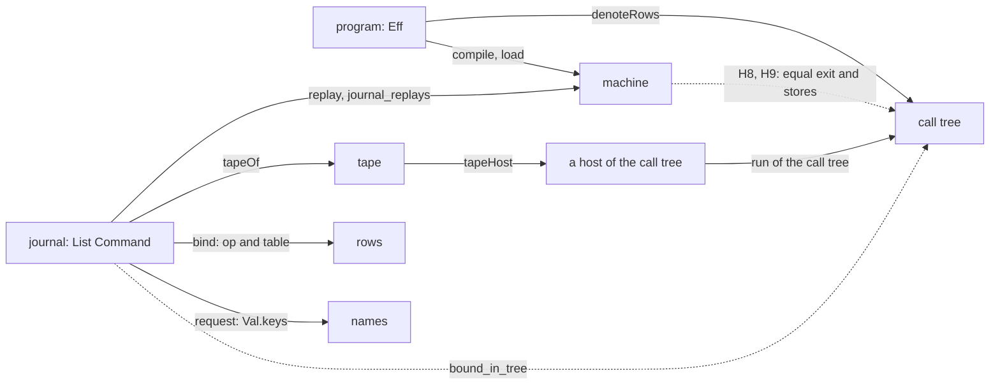
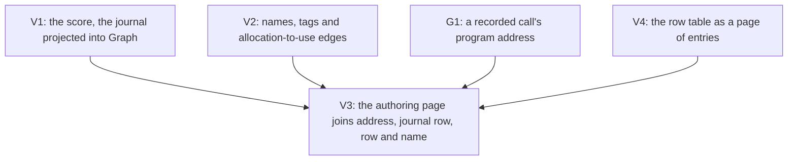

# The view draws the language's own objects (scout, 2026-10-14)

Status: a scout note for the owner (history, not authority). It changes no source and draws no
picture. Base: `aec641425` on `refactor/phase1-phase3`.

## 1. The one thing to know

The owner, 2026-10-14, by voice (read by sound):

- the view uses the semantics the language already has, to guide the visualization;
- that means the call tree, the tape, the journal, the names and the rows;
- the authoring view renders them when needed;
- one semantics then carries across cases and removes complexity.

Then, mid-turn: "we're reusing the existing graph machinery... don't recreate representations
we've already had... and engage deeply with the existing resources on semiotics."

The tree already holds this premise. The design language of 2026-09-08 opens with it:
"a run is a function of a program and a tape", so every mark is a function of the program, the
tape, or the trace they produce (`docs/design/design-language.md` §0). The tube language of
2026-10-13 drew a metaphor with a physics of its own, and its own review found that physics
false in places (§5). Its removal returns the view to the premise.

**No new representation is needed.** Each object below has one representation in the tree. Each
reaches the existing graph machinery (`Graph`, `AGraph`, `GraphContent.Entry`) by a fold or a
projection, and the objects join on keys the tree already uses. One gap blocks the join: a
journal's `bind` names no program address (§6, G1).

## 2. The core abstractions, each with its one representation

The system map names six sorts with one representation each (`docs/core/system-map.md` §4). The
owner's five objects sit among them or are read off them.

| Object | Representation | Where | Stored data? | How it composes |
| --- | --- | --- | --- | --- |
| program | `Eff` | `src/Effect4/Program/Eff.lean` | yes, a first-order tree keyed by paths | a fold, `cata_eff` |
| rows | `RowTable := List Row` | `Row` in `src/Effect4/Program/Eff.lean`; `RowTable` in `src/Effect4/Program/Native.lean` | yes, the application's half of the signature | appends under named obligations (system map §1.1) |
| call tree | `Effects.Program (RowsSig table) α`, the meaning `denoteRows` | `.lake/packages/effects/Effects/Algebra/Program.lean`; `src/Effect4/Laws/Program/DenoteRows.lean` | **no**: `vis op next` holds a Lean function of the answer | the free monad's bind; observed only through a host |
| journal | `List Command`: `bind`, `submit`, `apply`, `control` | `src/Effect4/Api/Runner.lean`; kept by `Run` in `src/Effect4/Run/Basic.lean` | yes | the free monoid acting on the run: `replay_unique`, `journal_replays` |
| tape | `List Api.Decision`, read by `tapeOf` | `src/Effect4/Run/Tape.lean` | yes, a projection of the journal | follows the journal |
| names | `Val.handle kind key`, `FiberId`, a call's `callId` and token | `src/Effect4/Store/Carrier/Val.lean`; `Call` in `src/Effect4/Api/HostSession.lean` | yes | partial bijections, `Corr` (`src/Effect4/Laws/Store/Names.lean`) |

The owner also asked what the other core abstractions are. They are these:

- **The other sorts:** `Ty`, `Term`, `Store.Val` and the schema carrier `Representation`.
- **The machine's objects:** fibers, frames (`Prim`), scopes, causes and exits, and the context
  `Ctx`, which PROC-6 brings into the block meaning.
- **The five arrow kinds** (system map §5):
  - K1, a fold;
  - K2, an exact embedding;
  - K3, a simulation;
  - K4, a located refusal;
  - K5, a monoid action.

The arrows matter to the view as much as the sorts. A picture is a K1 fold. A refusal is a K4
arrow located at an address, which the authoring page already shows. The score extends as the
journal does, by K5. And a K3 simulation relates two pictures, the run's and the meaning's. That
relation is what lets one semantics carry across cases.

## 3. How the objects relate, through theorems the tree has

- The tape host runs the call tree: `tapeHost`, `tapeHandler_eq_replies` and
  `hostRun_eq_meaningUnder` (`src/Effect4/Laws/Program/HostRuns.lean`).
- Each recorded `bind` names a wait in the admitted call tree: `Run.CallTree.bound_in_tree`
  (`src/Effect4/Laws/Run/CallTree.lean`, claim `recorded-call-tree-prefix`). Its reach is
  `StraightRows`, no cause handlers and a reached run.
- A finished run's exit and stores are the call tree's under the host: H8 and H9 on the loop
  fragment (`src/Effect4/Laws/Api/SessionMeaningLoop.lean`). PROC-6 extends H9 to definition
  blocks (`H9Blocks`, decisions row 379).

**The consequence for the view.** The call tree is not data, so the view never unfolds it. On a
fragment a theorem covers, the journal's binds and applies are the call tree's observed branch.
So the journal draws the call tree's branch. Each link carries the name of the theorem that makes
it true, and outside its fragment the link is labelled unproved. The tree's untaken branches are
the program's static alternatives, which `Flow` already draws. That gives two pictures, not three.

## 4. Each object in the existing machinery

| Object | Target | Producer | Key | State |
| --- | --- | --- | --- | --- |
| program | `Flow` (`tools/Tools/View/Flow.lean`), its order an `AGraph` (`AlgGraph.lean`), laid as a `Graph` | folds, landed (rows 337, 365) | the path, `Program.bracket` | exists |
| program content | `GraphContent.Node` and `Entry` (`tools/Tools/View/GraphContent.lean`) | a fold of the generated layer | the path | exists: the 10-13 study's role record |
| rows | `GraphContent.Operation.row` puts each operation's row on its node | the session's signature at the address | `rowKey` | exists on nodes; no page of the table |
| a row's types | `Cell.typed`, a `TyAlgebra` (`tools/Tools/View/Cell.lean`) | a fold | the type's path | exists |
| journal | the score: a `Graph` of journal rows in order, fibers as lanes | a projection of `Run.journal` with `Run.phases` | the journal index | producer missing |
| tape | the score's bar lines: the journal's `control` rows, in `decisionText`'s words (`tools/Tools/View/Decision.lean`) | a filter of the same projection | the journal index | the words exist |
| names | a numeral on a tag, `kind·index`, with edges from an allocation to each use | the request and answer values' `Val.keys` | the handle | producer missing |
| fibers | `Run.fiberGraph` (`tools/Tools/View/Run.lean`) | a projection of the machine | `FiberId` | exists, one frame per control |

Every target is an existing type. The two missing producers are projections into `Graph`, not
new representations. The motion between frames stays `GraphMotion` and `Retained`, keyed as
before.

## 5. What the semiotics research rules, applied here

**The design language, 2026-09-08** (`docs/design/design-language.md`):

- It holds the inventory this note needs. §1.2 covers the row protocol, §1.6 the tape, decisions
  and outcomes, §1.7 identity, and §1.8 time.
- §2 assigns each primitive one of Bertin's variables:
  - position is the reading order;
  - a numeral is an identity;
  - value orders state;
  - hue names one of four agents, never an identity.
- The run is the **score**: one column per index, a lane per fiber, a bar line per decision, the
  fermata at a frontier and `‖` with the reasons at an exit.
- §4.2 draws a causal edge only for a recorded pair (Lamport's clause (ii)). Two events with no
  path between them get no relation on the page.
- §9 relates the two pictures. A run is the program's diagram with one tape plugged into the
  runtime wire. The score is that wire laid straight, and the bar lines are its cuts.
- §8 rejected Petri nets as the drawing, since they "would invent a second semantics". The
  owner's rule against new representations is the same rule.

**The visual semantics, 2026-10-12** (`docs/research/2026-10-12-visual-semantics/README.md`):

- It sets one picture algebra per sort, and the words as a second algebra on the same keys.
- Its slice VS-6, the score as the journal's fold, is this note's journal row.
- VS-2, the value picture, landed as `Cell.lean`.

**The graph semiotics study, 2026-10-13** (`docs/research/2026-10-13-graph-semiotics-research.md`):

- It corrects the 10-12 note. Moody permits a symbol deficit, and text carries detail. A total
  glyph table checks coverage and shows no clarity.
- It separates static content (syntax, a checked judgment) from runtime content (an identified
  state or a recorded event). Each role carries its provenance.
- It rules: "Show no success or failure badge when the view lacks a runtime observation."
- So the view's job is roles and provenance, drawn with the vocabulary it has, not more glyphs.

**The tube review, 2026-10-13** (`docs/research/2026-10-13-tube-language/semiotics.md`, history):

- It found "falsified physics": a broadcast drawn as a conserving pipe junction, and an open end
  that a reader cannot tell from clipping.
- A metaphor brings laws the semantics lacks. Drawing the semantic objects directly brings none.
- One of its findings still stands in the kept machinery. `FlowMark.bar` (`tools/Tools/View/Graph.lean`)
  draws both a fork and a join (`graph-alignment.md` §3.3). That is an overload by Moody's
  definition.

## 6. The gaps

- **G1, provenance.** A journal `bind` carries the fiber, the operation, the request and the call
  id (`Call`, `src/Effect4/Api/HostSession.lean`). It carries no program address. The machine
  knows it: the parked fiber resolves its code at a `Point` with a path. The design language owed
  this row in 2026-09 ("the Point at any event", §3 and §8). `Run.lean` notes the same gap for a
  running fiber. Without it, the authoring view cannot light the address of a recorded call.
- **G2, the recorded pairs.** The score's causal edges need the pairs in the trace (`NTrace`).
  The design language found scope open and close absent from the trace (§1.4). Check which pairs
  are recorded today before drawing an edge.
- **G3, reach.** The journal-to-call-tree link is proved on `StraightRows` (`bound_in_tree`) and
  on the loop fragment (H8, H9). PROC-6 adds definition blocks. Everywhere else the link is a
  finite observation and is labelled so.
- **G4, the overload.** `FlowMark.bar` serves fork and join.

## 7. Slices, each over the existing machinery

- **V1, the score.** Project `Run.journal` and `Run.phases` into a `Graph`. The nodes are the
  journal rows in index order, the lanes are fibers, the bar lines are `control` rows, and the
  edges are the recorded pairs. Check that `Graph.ranks` gives equal columns in index order, as
  design language §4.1 requires.
- **V2, the names.** Read `Val.keys` from each `bind`'s request and each reply's answer. Write
  a numeral for each identity, with an edge from its allocation to each use.
- **V3, the join.** The authoring page (`Program.lean`'s edit-session page) gains the score and
  the names on demand, keyed by address. Each link names its theorem. It needs G1.
- **V4, the rows.** A page of the row table: each row's spelling, kind, request and answer types
  drawn by `Cell.typed`, its requirements and its citation.

Placement: a view proof needs a named consumer under R14's view-navigation observation (graph
semiotics study, §"Evidence to request"). These slices state no theorem. Their checks are finite:
coverage, provenance and identity retention.

## 8. Questions for the owner

Meaning, domain and representation only.

1. **Representation (G1).** Where does a recorded call's program address live? It could go in
   the wire's `Call` record, or the view could derive it from the session's machine at bind
   time. Recommendation: derive it, which changes no protocol.
2. **Meaning, the score's axis.** One column per journal row (commands), or per trace event
   (machine steps)? The design language chose the trace index with decisions as bar lines.
   Recommendation: journal rows as measures and trace events inside them, by its grain rule §4.8.
3. **Domain, the untaken branches.** Draw only the program's static alternatives, or unfold the
   call tree under an invented host? Recommendation: static only. An invented host draws a run
   nobody observed, against the graph semiotics study's rule on observations.

## 9. What this note does not establish

- No picture is drawn and no module is built.
- The literature is read through the tree's own notes, which state their limits. This pass read
  no source paper.
- No count of recorded causal pairs is taken (G2).
- A link labelled with a theorem is exact only on that theorem's fragment and hypotheses.
