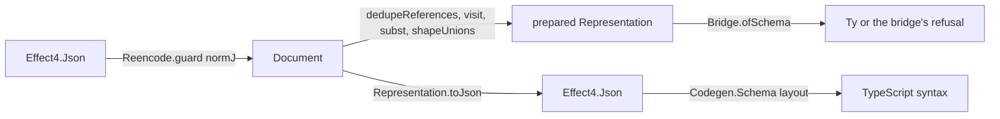

# Slice A1 receipt: rc.112's persisted documents, read exactly, after a reuse pass

## The one thing to know first

A1 adds one reader and moves three existing pieces to their single owners. The draft remade four
things the tree already had; the landing removes each copy. The re-encode guard, the spelling
table, the refusal and the table policy now each have one definition. The store, the emitter and
the new reader share them. The emitter's output keeps its bytes.

## Base and head

- Base: `refactor/phase1-phase3` at `1609e65e0` (the PC's gate consolidation), with the draft
  `wip/a1-document-json` (`fd3369827`) merged into branch `a1/document-json`.
- Head: the commits of branch `a1/document-json` named in the merge.

## The reuse pass

The owner: "do another reuse pass ... lets be clean and deliberate." Inputs: the PC's audit
(`docs/research/2026-10-15-gate-consolidation/a1-reuse-audit.md`) and three read-only searches of
the tree: the exact codecs, the references and unions, and rc.112's format and its harnesses.

| Draft piece | Existing owner | Landing |
| --- | --- | --- |
| `admit`, `admit_exact`, `admit_congr` | `Store.guarded`, `guarded_exact`, `guarded_toVal` (`src/Effect4/Store/Domain/Canonical.lean`), used by 20 generated `Canonical` instances | one generic guard, `Reencode.guard` (`src/Effect4/Data/Reencode.lean`), with `guard_exact`, `guard_congr`, `guard_image`. `guarded` and its two laws keep their names as the guard's use, so the generator and its 20 instances are unchanged |
| `writeAlg`'s spelling, hand-spelled tags | `printAlgebra` (`src/Effect4/Codegen/Schema.lean`), the same spelling; `RepresentationTag.tagName`, `CheckTag.tagName` | the writer owns the spelling, its tags from the tables. The emitter lays the writer's JSON out (`layout`); `printAlgebra` and its eleven helpers are removed |
| the reader's string match on `_tag` | `RepresentationTag.ofTagName`, `CheckTag.ofTagName` | the reader dispatches through the tables and branches over the tag type, with no catch-all |
| `DocumentReason`, `DocumentRefusal` | the emitter's `ReferenceRefusal` | one located refusal in `src/Effect4/Schema/Document.lean`; `ReferenceRefusal` is removed |
| `firstDuplicate`, refusing every repeat | `dedupeReferences` and its laws (decisions row 8 (C)) | the policy and its laws move to `Document.lean`; the emitter and the preparation both apply it |
| `refsAlg`, a 24-arm algebra | the generated `foldMap_representation` | `Representation.refs`, as `Eff.refSites` reads a program's references |
| `reachable`, `place`, `siteOf` | none in the core (searched: `src/`, the importable packages) | one depth-first walk, `visit`, which names a key on the cycle |
| `nest` | `Ty.ofMembers` under `schema` | kept; its docstring names the shape it mirrors, and a union of no member is `never`, as `ofMembers []` is |

Two findings changed behaviour. The draft refused every repeated reference key. The store's own
documents repeat keys with equal bodies (row 8), so the preparation now applies row 8 (C). The
draft's `place` refused a key that only reaches a cycle; `visit` refuses the key that is on it.

Not taken: a generated `RepresentationAlgebra.onRef` (the fold generator emits `onRef` for `Eff`
only). `substAlg` stays the one-line identity algebra with its reference arm replaced, as
`Schema.Template.fillAlg` is.

## What landed

- `src/Effect4/Data/Reencode.lean` (new): the re-encode guard and its three laws.
- `src/Effect4/Store/Domain/Canonical.lean`: `guarded` as the guard's use.
- `src/Effect4/Schema/Document.lean`: `DocumentReason`, `DocumentRefusal` with `Read`, `refuse`,
  `under`; `Representation.refs`; `dedupeFrom`, `dedupeReferences`, `KeysDistinct` and their laws.
- `src/Effect4/Data/JsonNorm.lean` (from the draft): `normJ` moved out of `Schema/Codec.lean`.
- `src/Effect4/Schema/DocumentJson.lean`: the writer and the reader.
- `src/Effect4/Schema/Prepare.lean`: the preparation.
- `src/Effect4/Schema/Bridge.lean`: `~identifier` erased (row 396 (2)).
- `src/Effect4/Codegen/Schema.lean`: the layout; `printAlgebra`, the moved policy and
  `ReferenceRefusal` removed. `src/Effect4/Api/Codegen.lean`: `schemaDocument`'s refusal type.
- `src/Effect4/Laws/Schema/DocumentJson.lean`: the goal `ofJson_image` and `ofJson_complete`.
- `tools/ProofGraph/Registry.lean`: the claims `document-json-exact` and `document-json-complete`.
- `Test/Schema/DocumentJson.lean`: the battery. `Test/Codegen/SchemaGenerationContract.lean`: the
  moved policy's names and refusal.
- `harness/schema-generation/export-rpc.ts` (moved from `harness/schema-host/`),
  `scripts/check-schema-typescript-generation.sh`, the `Makefile`'s `schema-ts` inputs.
- The roots, by `scripts/wire-roots.py`: `Effect4.Schema.Prepare`,
  `Effect4.Laws.Schema.DocumentJson`, `Test.Schema.DocumentJson`.
- `docs/core/decisions.md` row 398; `docs/GENERATED.md`'s `schema-ts` row; the amendment of
  `Test/contracts/schema-typescript-generation.contract.md`.

## Placement of the landed theorems

- `Reencode.guard_exact`, `guard_congr`, `guard_image`: concept `exact-codecs`, the exact-embedding
  property. Consumers: `Representation.ofJson_exact` and its two siblings, `guarded_exact`,
  `guarded_toVal`, `ofJson_complete`.
- `Representation.ofJson_exact`: the claim `document-json-exact`. It establishes exactness modulo
  `normJ` only, not rc.112's field admission, which admits fewer documents.
- `ofJson_complete`: the claim `document-json-complete`, proved modulo the planned goal
  `ofJson_image`. Its five-point placement is the module note of
  `src/Effect4/Laws/Schema/DocumentJson.lean`.
- The moved `dedupeReferences` laws keep their statements and proofs.

## Commands and results

On the Mac: Lean 4.33.1, node 22.23.2, bun 1.4.2, effect 4.0.0-rc.112 at the pinned install.

| Command | Result |
| --- | --- |
| `lake build` of each touched module in turn, with the four generated store instances (91 jobs) and the emitter's contract battery (352 jobs) | pass |
| the three `harness/schema-generation/Emit*.lean`, compared with `cmp` against the committed `.generated.ts` | the same bytes, all three |
| `lake env lean Test/Schema/DocumentJson.lean` | every `#guard` passes |
| `make check` | 1360 jobs pass |
| `#axiom_audit` over the 17 touched modules (`Reencode`, `JsonNorm`, `Canonical`, the four `Derived` instances, `Document`, `DocumentJson`, `Prepare`, `Bridge`, `Codec`, `Codegen.Schema`, `Api.Codegen`, the laws module and both batteries) | 4,921 declarations. 4 reach `Classical.choice`: `jsonSource`, `representationSource`, `documentSource`, `multiDocumentSource`, which the axiom gate exempts by name. The rest stay within `[propext, Quot.sound]` |
| `make gen-semantics` | 234 claims: 227 proved, 2 modulo, 1 refuted, 3 absent, 1 assumed; 7 planned goals |
| `make check-full` | 14 gates pass in 7 min 56 s |
| `python3 scripts/check-language.py --show` on this receipt | no finding |

The first audit found two of the draft's helpers reaching `Classical.choice`: `readLiteral` through
`String.toInt?`, and `readSymbol` through `String.toList`. Both now reuse choice-free readers:
`NatDecimal.decodeBytes` for a bigint's digits, `Store.decodeString` for a symbol's key.

The `schema-ts` gate needs `harness/schema-host/node_modules`. A worktree links the main checkout's
install, as the gate script's comment says.

Not run: the whole battery build (`lake build Test`), the whole-tree axiom gate and `make
check-sweep`, which run when the owner asks.

## Open obligations

- The planned goal `ofJson_image`: the reader inverts the writer at some bound.
- The reader admits five shapes that rc.112's codec refuses: a `Suspend` with checks, an empty
  `$ref`, an empty `FilterGroup`, a non-finite literal, a rootless multi-document.
- Numbers: `Tools.JsonBridge.ofLeanJson` reads naturals only. The RPC fixture and the vectors hold
  no other number. The number bridge is R-T6's.
- The bridge refuses `Schema.Null` and `Schema.NullOr`, so the fixture's `all.payload`,
  `setDone.success` and `setDone.exit` read as refusals. Comparing the rows with these documents
  is A2's.

## Evidence that is bounded or host-only

The battery's fixture lines are finite evaluations at rc.112's own documents and vectors. The gate's
producer run is a host run of rc.112 under node 22.23.2 at the pinned install.
