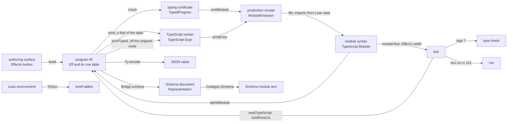
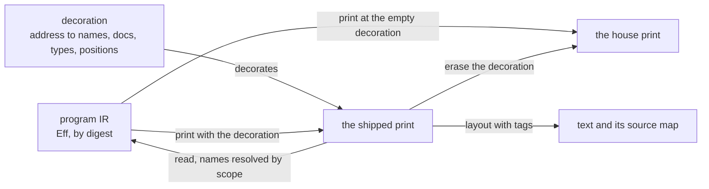
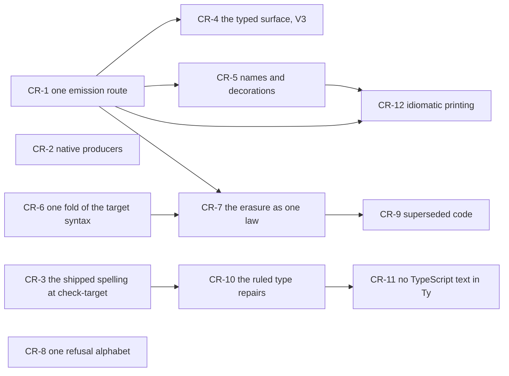

# 2026-10-15 The codegen review: the past work, the proof graph and the code

Status: research note (history, not authority). Base: `3a8eac840` on `refactor/phase1-phase3`.
The review seat wrote it under the coordinator's brief of 2026-10-15. It edits no source.

## 1. The one thing to know first

The codegen's core is consolidated and its laws are proved; the route to a shipped file is not. One
table drives the program printer, the Lean reader and the TypeScript reader. Every codegen claim
of the semantics registry is proved, and the 6,819 declarations of the codegen's law modules stay
within `[propext, Quot.sound]` (`#axiom_audit`). A fresh run reproduces the TypeScript tables, the
corpus index and the semantics report.

The route around that core has three faults:

- the application does not print through the typed print: its consumer, the shipped module,
  has not moved onto 9,500 lines of printer and laws;
- four writers assemble a printed module from two import tables;
- the truth, corpus and diagnostics gates run bytes that nobody ships.

Row 373 (11) ruled one emission route on 2026-10-13, and only its imports landed. That route is
the first slice (CR-1, §7).

The next two slices are small, and they touch other files:

- CR-2 loads the native core into the truth lane's Lean producer: 63 s becomes 12 s, with
  byte-identical output;
- CR-3 makes `check-target` ask tsgo about the type spelling that modules ship. Today the asked
  and the shipped spellings differ at unions under a product, the family where `E4-PRINT-CE-001`
  refutes the printed type's order.

The proof graph is in good order. The statement census finds 37 duplicate groups among 18,042
theorems, no claim pointer is stale, and every planned goal is placed. Its codegen part is costly:
`Effect4.Laws.Codegen.PrintTyped` is the build's slowest module, 8,174 lines of per-case erasure
laws (CR-7).

## 2. What the past work decided, and its status at HEAD

Each row is a finding or a ruling of a past note, checked against the tree at `3a8eac840`. The
status words are: holds, partly, not carried out, superseded. The evidence word is reading unless a
row names a run.

The notes read, each under `docs/research/`; the three marked untracked are local to this Mac:

- the codegen scout `2026-09-07-scout-codegen.md` and the review `2026-09-08-codegen-review.md`,
  both untracked;
- the typed-surface analysis `2026-09-16-typed-surface-integration-analysis.md` (untracked);
- the proof-graph audit `2026-10-04-proof-graph-audit/audit.md` and the load paths
  `2026-10-08-load-paths.md`;
- the view algebra audit `2026-10-09-view-algebra-audit.md` and the JavaScript audit
  `2026-10-09-js-semantics-audit.md`;
- the type interface `2026-10-11-type-interface/README.md`;
- the emitted services `2026-10-13-emitted-services/README.md`, the vertical slice
  `2026-10-13-lowering-vertical-slice/README.md` and the ergonomics probe
  `2026-10-13-agent-ergonomics-probe/README.md`;
- the briefs of 2026-10-14: `2026-10-14-faces/prompt.md` and `2026-10-14-lowering-cleanup/prompt.md`.

### 2.1 The TypeScript printer and the readers

| Finding or ruling | Source | Status at HEAD | Evidence |
| --- | --- | --- | --- |
| One table of printed clauses drives the program printer and the Lean reader | the 2026-09-08 review, R6 and R7 | superseded by the template table of 2026-09-17, which gives what both asked: `printT` is `cata_eff (printAlg sig)`, and `readT` is one generic step | reading; `read_exact` is generic over the table (`src/Effect4/Laws/Codegen/Read.lean`) |
| The TypeScript reader runs one matcher over the generated table | the same review, R7 | holds: `ts/eff/read.ts` imports `templates` from `ts/eff/templates.gen.ts` | reproduced: the fresh `TsGen` output equals the nine committed `*.gen.ts` files |
| One head table below the printer, and no scrape of the printer's source | the same review, R3 | partly: `Head` and `Head.spelling` stand in `src/Effect4/Codegen/PrintLeaf.lean`, but the skeletons of `src/Effect4/Codegen/Templates.lean` spell the heads as strings | reading: `identLiterals` in `tools/Drivers/TsGen.lean` still scans `PrintLeaf.lean`'s text for `.ident` literals |
| Collapse the target package's six object formers, and delete its dead statement forms | the same review, R5 | not carried out: `object`, `objectML`, `objectQuoted`, `objectQuotedML`, `objectFromEntries` and `objectWith` stand | reading: nothing builds `scopedGen` or `scopedGenMasked`; `labelled`, `switch`, `letDefinite` and `continueTo` serve the package's `TypeScript.Structure`, which no module imports yet |
| Split `TsGen` and retire the second syntax tree of `Styles` | the same review, R8 | not carried out: `Styles.Expr` and `Styles.Stmt` stand in `src/Effect4/Codegen/Styles.lean`; `tools/Drivers/TsGen.lean` is 1,336 lines of text building | reading |
| The Surface emitter route, its HTTP API, MCP and deployment rules | the same review, F1, R2, R4, R9 | superseded: DI-27 retired the route on 2026-09-10; it stands at `archive/surface` | reading (`docs/ARCHITECTURE.md`, "What is not here") |
| The readers cut to normalizers, with one refusal alphabet and a generated canonical reader | DI-88, ruled by the owner on 2026-09-16 | not carried out: `ts/eff/read.ts` (2,982 lines) is a hand port of `Codegen/Read.lean`, and `ck.ts` and `oxc.ts` each walk the tree | reading: the port's `Refusal` has no `annotation` case, which Lean's `ReadRefusal` has since `5013db299` |
| An optional cursor type on `iterate`, read back only when absent | DI-91, ruled 2026-09-17 | holds | reading (`src/Effect4/Codegen/Templates.lean`, the two `iterate` rows) |

### 2.2 Types at the boundary

| Finding or ruling | Source | Status at HEAD | Evidence |
| --- | --- | --- | --- |
| Types are target syntax, projected by `ofTy`, with no inverse; refusing printers | the typed-surface redirect of 2026-09-16 | holds: `Codegen.Types.ofTy` (`src/Effect4/Codegen/Types.lean`), `PrintRefusal.typeSpelling` | reading |
| `parseLegacy` is a transient bridge for type text stored in `Ty.handle` and `Row.typeArgs` | the same redirect, B18 | not carried out: `Ty.handle (target : String)` and `Row.typeArgs : List String` still hold TypeScript text, parsed at print time | reading: `rowTypeArgs` (`src/Effect4/Codegen/PrintLeaf.lean`); `.handle "Ref.Ref<number>"` in `tools/Conform/Effect4/LcnfMl.lean` spells a type that `Ty.refOf` owns |
| One certificate at each module boundary: production and reading | the same redirect, and the reading-certificate packet | holds: `ModuleEmission` (`src/Effect4/Codegen/Checked.lean`) and `admitModule` (`src/Effect4/Codegen/Admit.lean`) | proved: `ModuleEmission.admit` (`src/Effect4/Laws/Codegen/Admit.lean`) |
| R-T1: refuse an unsafe natural literal at the face | the type interface note of 2026-10-11 | holds: `EmissionRefusal.outsideProfile`, row 357 | reading; `E4-PRINT-CE-002` REPAIRED |
| R-T2: route `mul` through the profile | the same note | holds: `mulIn_eq_some_iff` (`src/Effect4/Laws/Machine/IntegerProfile.lean`), row 380 (7) | proved (the claim `profile-mul-exact`) |
| R-T3: a model of tsgo's order, and repair A in `Ty.normalize` | the same note; row 346 | partly: the model landed (`src/Effect4/Laws/Codegen/TargetOrder.lean`); repair A did not | tested: 742 recorded pairs; `E4-PRINT-CE-001` is still SEEDED |
| R-T4: print `int` and `number` as the aliases `Int` and `Num` | the same note; decided by row 380 (6) | not carried out | reading: `ofNormalized` prints both as `number` |
| R-T5: decode exported inputs with the printed Schema, and brand only `Ref` arguments | the same note; ruled by row 373 (11) | not carried out | reading: `E4-PRINT-CE-003` is RESERVED |
| R-T6: `Shape` becomes a fold of `Ty` | the same note; decided by row 380 (6) | not carried out | reading |
| R-T7: generate the TypeScript type algebra from Lean | the same note | not carried out: `ts/eff/target-types.ts` grew from 381 to 472 lines | reading |

### 2.3 The typed print and the emitted module

| Finding or ruling | Source | Status at HEAD | Evidence |
| --- | --- | --- | --- |
| The typed print: a call at a join carries its type arguments (P1, P2a, P2b, P3) | rows 324 and 325 | holds as a printer with laws; it is not the application's printer | reading: `emitModule` calls `printEntry`, which calls `print`, not `printTyped` (`src/Effect4/Codegen/Checked.lean`, `src/Effect4/Codegen/Print.lean`) |
| One emission route for agents: types at joins, imports from Lean data, inputs decoded by the printed Schema, `Ref` arguments branded | row 373 (11), ruled by the owner on 2026-10-13 | partly: only the imports landed (`ModuleEmission.file`) | reading: four writers assemble a printed module (§4.2) |
| An application emitted as one Effect service (E1 to E4) | the emitted-services note of 2026-10-13; row 378 (19), (20), (22) | holds: the to-do prints as `TodoApp`, `TodoAppLayer` and its row services | tested: `make check-host-protocol` runs the to-do's scripts on rc.112 |
| The emitted module's dummy main | the same note, question 1 | open: the to-do's file still ends with `export const main = Effect.succeed(undefined)` | reading (`ts/eff/test/fixtures/todo-file.txt`) |
| V3: the rows' bindings interface, the Schemas of inputs and answers, and the prelude package | the vertical-slice note of 2026-10-13; the faces brief F3 | not started: no `ts/prelude/`, and the bindings type is built in the harness (`bindingsType`, `harness/truth/session/Keyed.lean`) | reading |
| Every TypeScript artifact is a fold of a committed table; no artifact from the Lean environment or from a hand transcription | decisions row 26, adopted by the owner | open, as the row itself says: `TsGen` reads the environment and `harness/truth/prelude.ts` is hand-written | reading |

### 2.4 Printing conformance and the layout

| Finding or ruling | Source | Status at HEAD | Evidence |
| --- | --- | --- | --- |
| The TypeScript syntax has a generated fold; the pinned printer and the readable layout are two of its algebras | the view algebra audit of 2026-10-09, slice F | holds, in the tool root only: `TsFold` is `tools/Tools/Code/TsFold.lean` | proved: `render_eq_expr`, `flat_fold_expr` (`tools/Tools/Code/TypeScript.lean`) |
| J1 to J7: precedence, a statement's first token, names, keys, numbers, strings, empty type arguments | the JavaScript audit of 2026-10-09 | not carried out: the pinned renderer has no precedence | reading (`.lake/packages/typescript/TypeScript/Render.lean`, at `f5878bf`) |
| J8 source maps and J9 a Lean reader of the printed text | the same audit | not carried out; ECMA-262 is vendored (`vendor/ecma262-es2026/`) | reading |
| F2: the gates must run the bytes that a person ships | the same audit; the vertical-slice note §4 | partly: the to-do's lane runs the laid-out file; the truth, corpus and diagnostics lanes run the flat print under a hand-written import header | reading (§4.2) |

### 2.5 The gates and the one compiler

| Finding or ruling | Source | Status at HEAD | Evidence |
| --- | --- | --- | --- |
| Type-check every printed module | the 2026-09-08 review, R1; DI-49 | superseded by tsgo 7 as the one compiler (rows 57 and 168): every printed lane runs it | reading (`Makefile`, `check-target`, `check-truth`, `check-corpus`, `check-tsdiag`) |
| Testing is a pile of files judged by output; drop the gates that test gates | the owner's steer of 2026-09-19 | holds: `make check` is the build, and `make check-full` holds the behaviour gates | reading (`Makefile`) |
| One generator: one description of the families, one JSON convention | the codegen scout of 2026-09-07, S1 and S3 | not carried out: `TsGen` and `EffGen` read the closed world of `OCaml5.Eff.World`, and two JSON forms stand | reading: `ts/eff/json.gen.ts` writes the positional form, and the session tool reads the tagged form |

### 2.6 What an agent meets

| Finding or ruling | Source | Status at HEAD | Evidence |
| --- | --- | --- | --- |
| Say which JSON the session reads; no hex unless asked; a `run` operation; refuse a fill at a missing address | the agent ergonomics probe of 2026-10-13, ranks 1, 5, 7 and 9 | holds | reading (`ts/eff/README.md`; `hex : Bool := false` and `run` in `tools/Tools/Session.lean`) |
| Fill the catalogue's gaps | the same probe, rank 2 | partly: operations with their rows landed; the binder table, the fragment's grammar and a nearest spelling did not | reading (`tools/Tools/Catalogue.lean`) |
| Binder names by scope in the TypeScript reader | the same probe, rank 3; row 378 (17) | not carried out: both readers accept only `a0`, `a1`, … by depth | reading: `Var.read` (`src/Effect4/Codegen/Read.lean`), `varRead` (`ts/eff/read.ts`) |
| Generated declarations of an application's rows, holes and services | the same probe, rank 4 | not carried out (V3) | reading |
| Read the shorter spellings that tsgo accepts (`Effect.map`, `Effect.andThen`, `forkChild` without options) | the same probe, rank 10 | not carried out | reading: `Effect.map` heads only the `iterate` image |

### 2.7 The proof graph

| Finding or ruling | Source | Status at HEAD | Evidence |
| --- | --- | --- | --- |
| Planned goals as nodes, edges read from proof terms, statuses derived | the proof-graph audit of 2026-10-04; rows 203 and 207 | holds: `proof_goal`, `ProofGraph.buildPlan`, the plan section of `generated/semantics.md` | reproduced: a fresh `semantics-report` run equals `generated/semantics.md` byte for byte |
| Which theorems carry load, and how much a landing reuses | the load-paths note of 2026-10-08 | holds: `#load_report`, `#load_map` (`tools/Tools/LoadPaths.lean`) | tested (§3) |
| Duplicate statements found and gathered | the statement census of 2026-10-13 and Gemini's consolidation rounds | holds: `#statement_census` (`tools/ProofGraph/StatementCensus.lean`) | tested (§3.5) |
| Build first: the general theory of composition pauses | row 387 | holds | reading |
| The LCNF lowering carries no proof obligations | row 391 | holds; it covers the lowering only | reading |

## 3. The proof graph's structure, measured, and the codegen's part of it

### 3.1 What ran

One build served every probe, through the shared slot. It rebuilt 111 modules in 174 s. The
other 1,598 of its 1,709 jobs were up to date or restored from Lake's artifact cache. The runs and
their outputs:

| Run | What it measures | Output |
| --- | --- | --- |
| `lake exe semantics-report OUT`, then `probes/semantics_tables.py` | the claims, the requirements, the plan and the placements | the fresh Markdown equals `generated/semantics.md`: reproduced |
| `probes/ProofGraphProbe.lean`, one elaboration of 446 s | per-module counts, pointers, name families, `#load_map`, `#load_report`, `#bank_census`, `#traversal_census`, `#axiom_audit` | `probes/proof-graph-probe.log` |
| `probes/StatementProbe.lean` | `#statement_census` over every loaded module, and its reducible mode over the codegen's modules | `probes/statement-probe.log` |
| `probes/module_tables.py` | the per-module tables of the probe log | `probes/module-tables.txt` |
| `probes/battery_lines.py` | a finite scan of the batteries' text for the battery-line rule | `probes/battery-lines.txt` |
| `lake env lean` on each codegen module, timed | elaboration time per module | `probes/session-times.txt` |

The loaded environment is the semantics registry's roots: `Effect4.Laws`, its scenario and
acceptance batteries, and `Tools.View.FlowReach`. A battery outside those roots is not in the
statement census. The probe's own census command stopped at a parse error: `norm` is a token once
aesop is loaded. The log keeps the error, and `StatementProbe.lean` ran the census after the
repair.

### 3.2 The claims

The semantics registry holds 232 claims: 226 proved, 1 modulo planned goals, 1 refuted, 3 absent
and 1 assumed (`generated/semantics.md`).

| Concept | Claims | Proved | Modulo | Refuted | Absent | Assumed |
| --- | ---: | ---: | ---: | ---: | ---: | ---: |
| `store-typing` | 22 | 21 | 0 | 0 | 1 | 0 |
| `residual-program-typing` | 20 | 19 | 0 | 1 | 0 | 0 |
| `scope-lifetime-finalization` | 16 | 15 | 1 | 0 | 0 | 0 |
| `reactive-scheduling` | 25 | 23 | 0 | 0 | 2 | 0 |
| `exact-codecs` | 20 | 20 | 0 | 0 | 0 | 0 |
| `subtyping-algebra` | 13 | 13 | 0 | 0 | 0 | 0 |
| `initial-algebras-folds` | 37 | 37 | 0 | 0 | 0 | 0 |
| `context-requirements` | 8 | 8 | 0 | 0 | 0 | 0 |
| `host-session-protocol` | 15 | 14 | 0 | 0 | 0 | 1 |
| `translation-simulation` | 56 | 56 | 0 | 0 | 0 | 0 |

By proof role: `compatibility` 85, `preservation` 48, `simulation` 33, `inversion` 20 and
`fundamentalProperty` 13. Nine smaller roles hold the other 33 claims.
Every one of the 328 claim pointers and requirement top nodes names a theorem of the loaded
environment (`#probe_pointers`): no pointer is stale.

### 3.3 The requirements and the planned goals

All fourteen requirements are open. Each has an open part that no planned goal states, 87 parts
in all. Of them, 36 are untriaged and 27 proposed. Thirteen wait on a ruling, six need a
definition and five wait on other work.

| Requirement | Top nodes | Placed nodes | Open parts | Placed modulo | Placed goals |
| --- | ---: | ---: | ---: | ---: | ---: |
| R1 | 7 | 3 | 4 | 0 | 0 |
| R2 | 4 | 8 | 5 | 0 | 0 |
| R3 | 10 | 7 | 6 | 0 | 0 |
| R4 | 9 | 172 | 6 | 3 | 1 |
| R5 | 1 | 4 | 2 | 0 | 0 |
| R6 | 13 | 148 | 7 | 2 | 0 |
| R7 | 0 | 0 | 4 | 0 | 0 |
| R8 | 7 | 15 | 6 | 0 | 0 |
| R9 | 2 | 1 | 1 | 0 | 0 |
| R10 | 20 | 194 | 17 | 2 | 2 |
| R11 | 7 | 260 | 8 | 4 | 4 |
| R12 | 4 | 21 | 9 | 2 | 1 |
| R13 | 1 | 10 | 4 | 0 | 0 |
| R14 | 15 | 592 | 8 | 0 | 0 |

The plan has 1,575 nodes: 1,554 proved, 13 modulo and 8 planned goals. Seven of the eight goals
stand in the dogfood scenarios, and one in the law graph. No goal is unplaced.

| Planned goal | Nodes that rest on it |
| --- | ---: |
| `Effect4.Program.FinalizerRun.once_placed_outside_census` | 2 |
| `Test.Dogfood.Scenario.Atomic.Store.shop_stages` | 4 |
| `Test.Dogfood.Scenario.QueueWorkers.Assertions.jobs_step` | 5 |
| `Test.Dogfood.Scenario.QueueWorkers.Assertions.logs_history` | 4 |
| `Test.Dogfood.Scenario.QueueWorkers.Assertions.rest_step` | 4 |
| `Test.Dogfood.Scenario.Timeout.cleanup_keeps` | 2 |
| `Test.Dogfood.Scenario.Timeout.retries_declared` | 2 |
| `Test.Dogfood.Scenario.Workers.Assertions.logs_step` | 3 |

The count includes the goal itself. No codegen node rests on a goal: every codegen claim is
proved.

### 3.4 Theorems per module, and the modules that no claim reaches

A theorem is load-bearing when a semantics registry root reaches it along proof-term edges. It is
unconsumed when no theorem names it and it is no root (`tools/Tools/LoadPaths.lean`). The tree
holds 18,050 authored theorems, and 10,207 of them are load-bearing.

| Area | Modules | Theorems | Goals | Definitions | Load-bearing | Unconsumed |
| --- | ---: | ---: | ---: | ---: | ---: | ---: |
| law graph, `Effect4.Laws.*` | 619 | 13,901 | 1 | 2,685 | 8,454 | 2,703 |
| core, `Effect4.*` less the law graph | 256 | 2,872 | 0 | 7,103 | 821 | 1,394 |
| the loaded batteries, `Test.*` | 91 | 847 | 7 | 1,091 | 42 | 105 |
| tools, `Tools.*` and `ProofGraph.*` | 42 | 422 | 0 | 1,268 | 21 | 164 |

Of the 580 law-graph modules that hold a theorem, 172 hold no load-bearing theorem: 1,998
theorems in all. The largest of them are `Effect4.Laws.Machine.Witnesses` (69 theorems),
`Effect4.Laws.Codegen.Definitions` (65), `Effect4.Laws.Program.Typed.Frames` (63),
`Effect4.Laws.Library.Queue.Typing` (59) and `Effect4.Laws.Api.Supervision` (57). Forty-two of the
172 are `Effect4.Laws.Program.ReleaseCustody.*`. The owner's steer of 2026-10-04 holds that an
unconsumed theorem is no defect. So these counts map the spine and the library; they are no
deletion list.

One of them is a gap in the codegen's claims, not library. The claim `module-defs-round-trip`
says in its title that the program interface's round trip holds (`Api.printModule_roundTrip`,
`src/Effect4/Laws/Api/ModuleReadable.lean`). Its pointer is the conditional
`readModule_printModule_defs`, which takes the lawful spelling as a premise. The theorems that
discharge that premise for the native signature reach no root: `Effect4.Laws.Codegen.Definitions`
(65 theorems) and `Effect4.Laws.Api.ModuleReadable` (13) are among the 172. Pointing the claim at
the face theorem makes them load-bearing.

The largest law modules by theorem count are `Effect4.Laws.Machine.Handles` (393 theorems, 11
load-bearing), `Effect4.Laws.Codegen.PrintTyped` (344, 296 load-bearing),
`Effect4.Laws.Program.Guard.Core` (323) and `Effect4.Laws.Program.Typed.Commands.Bookkeeping`
(247).

### 3.5 Near-duplicate statements

The statement census reads 18,042 authored theorems in 994 loaded modules. It finds 37 groups of
equal statements, 77 theorems in all (`probes/statement-probe.log`). Its reducible mode over the
34 codegen modules finds no group among their 1,179 theorems. The consolidation rounds of
2026-10-13 left little to gather.

The codegen's three groups are copies of shared lemmas. `Effect4.Program.bind_eq_ok` and
`map_eq_ok` (`src/Effect4/Laws/Codegen/ReadLeaf.lean`) restate `Effect4.Laws.Auto.bind_eq_ok` and
`map_eq_ok` (`src/Effect4/Laws/Auto/Inversion.lean`), and the copy carries 61 uses. The third is
`Effect4.Program.utf8_digitChar`, a copy of `Effect4.Data.NatDecimal.utf8_digitChar`. The other
34 groups lie elsewhere. Seven touch the machine's agreement laws and four the guard laws. Three
pair `Effect4.Laws.Auto` with `Effect4.Data.Constructive`, and the rest stand one or two per area.

### 3.6 Per-case families

The codegen's laws hold 1,059 theorems in 22 modules. Their names group into per-case families,
counted by the prefix of the last name component (`#probe_codegen_families`):

| Module | Family | Theorems | What it is per |
| --- | --- | ---: | --- |
| `Effect4.Laws.Codegen.PrintTyped` | `eraseTerm_*` | 33 | one per printed term shape |
| `Effect4.Laws.Codegen.PrintTyped` | `eraseNode_*` | 21 | one per eliminator site |
| `Effect4.Laws.Codegen.PrintTyped` | `decorate_*`, `find*` | 32 | one per decorated head |
| `Effect4.Laws.Codegen.PrintTyped` | `eraseExprRow_*`, `eraseT_*` | 22 | one per row output and family |
| `Effect4.Laws.Codegen.PrintTyped` | `mapCalls_*` | 11 | one per constructor of the target syntax |
| `Effect4.Laws.Codegen.ReadPrint` | `readRow_*` | 12 | one per row output |
| `Effect4.Laws.Codegen.Classes` | `covers_*` | 12 | one per term constructor |

`mapCalls_*` restates, one constructor at a time, the equations of a fold of the target syntax.
The fold is hand-written in the core (`Effect4.Codegen.TargetFold`), while a generated fold of the
same syntax stands in the tool root (`TypeScript.ExprAlgebra`, `tools/Tools/Code/TsFold.lean`).
`atAddress` (`src/Effect4/Codegen/PrintTyped.lean`) has 16 arms, of which 15 are the identity,
and its laws follow it arm by arm.

The landing report of `Effect4.Laws.Codegen` (`#load_report`) counts 1,778 local edges against
643 edges to the rest of the tree: a reuse ratio of 26%. Its most cited joints are
`Effect4.Laws.Auto.none_ne_some` (53 times), `error_ne_ok` (35) and `bind_eq_ok` (28). So the
codegen's proofs mostly unfold `Except` and `Option` chains step by step. They name no aesop rule
bank: the codegen's laws hold 275 `aesop` calls, each with its own hints, and no `rule_sets`
clause.

### 3.7 The batteries against the battery-line rule

The scan reads 477 battery files (`probes/battery_lines.py`). It finds 9 `#print axioms` lines,
in `Test/Audit/LetReturn.lean`, `Test/Audit/ProofGraph.lean`, `Test/Audit/ProofGraphSearch.lean`
and `Test/Counterexamples/Machine/Runtime/HostReservedDefect.lean`. AGENTS.md forbids such a line.
Of the 165 declarations whose proof is one name, nearly all pin a definition's type signature
or project a hypothesis. Two restate a theorem at its own generality: `Std.lt_irrefl` and
`Std.lt_trans` in `Test/Data/RowContract.lean`. No codegen battery restates a theorem. The rule
holds, outside these eleven lines.

### 3.8 Build time and the rule banks

The 2026-10-09 build profile (`.lake/gen/build-profile.md`) put `Effect4.Laws.Codegen.PrintTyped`
first among 482 rebuilt modules, at 184 s, and on the critical path. Re-elaborated alone through
the slot today, it took 78 seconds. The twelve codegen law modules timed took 177 s in all, and
`PrintTyped` is 44% of that.

| Module | Lines | Theorems | Elaboration |
| --- | ---: | ---: | ---: |
| `Effect4.Laws.Codegen.PrintTyped` | 8,174 | 344 | 78 s |
| `Effect4.Laws.Codegen.ReadPrint` | 2,460 | 121 | 28 s |
| `Effect4.Laws.Codegen.PrintReadable` | 784 | 40 | 14 s |
| `Effect4.Laws.Codegen.Read` | 1,017 | 50 | 13 s |
| `Effect4.Laws.Codegen.Template` | 663 | 30 | 12 s |
| `Effect4.Laws.Codegen.ReadLeaf` | 2,634 | 138 | 11 s |
| `Effect4.Laws.Codegen.Module` | 1,200 | 26 | 10 s |

Across the tree, the same profile of 2026-10-09 ranks next `Effect4.Laws.Library.Queue.Typing`
(116 s), `Effect4.Laws.Library.Pool.Typing` (94 s) and `Effect4.Laws.Library.Queue.Data` (70 s).
Today's build rebuilt 111 modules, and its slowest were the same two typing modules, at 37 s and
30 s (`probes/build-rebuilt.txt`).

The rule banks (`#bank_census`): eight banks, `Effect4.Atoms`, `Checker`, `Coind`, `Fibers`,
`StepInv`, `StoreKernel`, `Stores` and `TypedState`. None serves the codegen. The closure audit
covers the codegen (`#closure_audit Effect4 Tools ProofGraph`, `Test/Audit/ClosureAudit.lean`;
reading, not run here).

### 3.9 The codegen's part: proved, tested, assumed

`#axiom_audit` walked the 6,819 declarations of the 22 codegen law modules: every one stays within
`[propext, Quot.sound]`, and none rests on a planned goal.

| Stage | Proved | Tested | Assumed or open |
| --- | --- | --- | --- |
| print and read, Lean | `read_print`, `read_exact` on the readable domain; the module round trip `readModule_printModule_defs` | 385 of the 408 corpus programs read back (`generated/corpus-index.tsv`, reproduced) | J1 to J9: no law of the printed text |
| the typed print | `printTyped_eq_print`, `eraseJoinArgs_printTyped`, `readTyped_printTyped` | the truth lane's joined fixtures | no shipped module uses it |
| module emission and the reading boundary | `ModuleEmission.admit`, `admitModule_classDecls` | — | inputs are not decoded (row 373 (11)) |
| the TypeScript reader `ts/eff/read.ts` | nothing: a hand port | 416 corpus and truth files read back to Lean's answers, 0 mismatched, in 291 ms | its refusals differ from Lean's |
| the target type `ofTy` | no order law (the type interface note, §2.3) | 742 recorded pairs against tsgo (`generated/assignability.tsv`) | `E4-PRINT-CE-001` SEEDED |
| the JSON codec | `decode_iff`, `decode_encode` | 49 cases against rc.112's `Schema.toCodecJson` | the rc.112 Schemas are written by hand in `harness/truth/schema-codec/check.ts` |
| the Schema generator `Codegen.Schema` | `ofSchema_exact`, `ofSchema_schema` (the bridge) | three generated documents run on rc.112 (`make check-schema-ts`) | no gate compares a generated Schema with the codec |
| the emitted services | the module round trip, at the block's signature | the to-do's 13 scripts on rc.112 (`make check-host-protocol`) | a service row's host is an assumption of each run |
| the runs on rc.112 | `run_eq_meaning` covers 75 of the 400 corpus programs, on `Straight` | 81 truth programs agree, 12 signed divergences; 122 corpus programs agree, 6 differ, all registered | the printed text is not parsed by Lean (J9) |

## 4. The codegen's stages and their evidence

### 4.1 The stages as named connections

The diagram shows the TypeScript route's stages and the declaration that owns each. It claims no
law; the table below names each stage's evidence.

| Stage | From and to | Declaration | Evidence |
| --- | --- | --- | --- |
| build | authoring surface to `Eff` | `Api.Author.build` (`src/Effect4/Api/Author.lean`) | proved: `build_table_lawful` |
| check | `Eff` to a certificate, or a located refusal | `checkTypedProgram` (`src/Effect4/Program/CheckedTyping.lean`) | proved: `check_sound`, `check_complete` against `HasTy` |
| print | `Eff` to `TypeScript.Expr` | `printT` (`src/Effect4/Codegen/Templates.lean`) | proved: `read_print`, `read_exact` on the readable domain |
| typed print | `Eff` and an annotation to `TypeScript.Expr` | `printTyped` (`src/Effect4/Codegen/PrintTyped.lean`) | proved: the erasure laws; no shipped module uses it |
| module print | `Eff` to constants | `printEntry`, `printModule` (`src/Effect4/Codegen/Print.lean`) | proved: `readModule_printModule_defs` |
| emission | the program, its table and a name to a receipt | `emitModule` (`src/Effect4/Codegen/Checked.lean`) | proved: `ModuleEmission.admit` |
| file | a receipt to a module with imports | `ModuleEmission.file` (`src/Effect4/Codegen/Checked.lean`) | reading: imports computed from the module's free names |
| layout and render | module syntax to text | `moduleText` (`tools/Tools/Code/Module.lean`); `TypeScript.Render` | proved: `render_eq_expr`, `flat_fold_expr`, `undo_layout` |
| type check | text to tsgo's verdict | `make check-target`, `check-truth`, `check-corpus`, `check-tsdiag` | tested |
| run | text to rc.112's exit | `make check-truth`, `check-corpus`, `check-host-protocol` | tested |
| module reading | module syntax to `Eff`, checked | `admitModule` (`src/Effect4/Codegen/Admit.lean`) | proved: `admitModule_classDecls`, the envelope reflection |
| TypeScript reading | text to the `Eff` Schema node | `readTypeScript` (`ts/eff/read.ts`) | tested against Lean's reader (`make check-ts-reader`) |
| JSON codec | values to JSON at a `Ty` | `Ty.encode`, `Ty.decode` (`src/Effect4/Schema/Codec.lean`) | proved: `decode_iff`; tested against rc.112 |
| Schema | `Ty` to a Schema document, to module text | `Bridge.schema` (`src/Effect4/Schema/Bridge.lean`); `Codegen.Schema.moduleSyntax` (`src/Effect4/Codegen/Schema.lean`) | proved: `ofSchema_exact`; tested: `make check-schema-ts` |
| tables | the Lean environment to `ts/eff/*.gen.ts` | `tools/Drivers/TsGen.lean` | reproduced |
| target types | `Ty` to `TypeRef` | `Codegen.Types.ofTy` (`src/Effect4/Codegen/Types.lean`) | tested: 742 pairs; no law |

### 4.2 Four writers of one printed module

A printed module file is assembled in four places, from two import tables and two renderings
(reading, at `3a8eac840`):

| Writer | Producer of the declarations | Imports | Rendering | Lanes |
| --- | --- | --- | --- | --- |
| `ModuleEmission.file` with `moduleText` | `Api.emitModule` | Lean data: the module's free names (`moduleImports`) | the layout at width 120 | `tools/Drivers/Emit.lean`, `apps/todo/EmitTodo.lean`, the session tool's code lines |
| `harness/truth/Truth.lean` with `run-truth.ts` | `Api.print` and `Api.printModule`; a fixture adapter over `printTyped` for joined programs | every name of `harness/truth/module-imports.ts`, used or not | the flat house print | `make check-truth`, `check-corpus` |
| `harness/truth/session/Keyed.lean` | `Api.printModule`, with `bindingsType` for the rows | a header the lane writes | the flat house print | `make check-host-protocol`'s scenarios |
| `harness/tsdiag/run-tsdiag.mjs` | the corpus's expression print, as `export const main = …` with no declared type | `module-imports.ts` again | the flat house print | `make check-tsdiag` |

So the truth, corpus and diagnostics lanes run bytes that no agent ships. All three import every
name and skip the layout, and the diagnostics lane declares no type. The import table exists twice: in
Lean (`preludeNames`, `effectNamespaces`, `src/Effect4/Codegen/Checked.lean` and
`src/Effect4/Codegen/PrintLeaf.lean`) and by hand in TypeScript (`effectNames`,
`preludeHelpers`, `preludeTypes`, `harness/truth/module-imports.ts`).

### 4.3 Facts encoded again at each stage

| Fact | Its encodings | Held together by |
| --- | --- | --- |
| a printed head's spelling | `Head.spelling` (63 heads, `src/Effect4/Codegen/PrintLeaf.lean`); the strings of the skeletons (`src/Effect4/Codegen/Templates.lean`); `profile.gen.ts`'s `heads` | a scan of `PrintLeaf.lean`'s text for `.ident` lines (`identLiterals`, `tools/Drivers/TsGen.lean`) |
| the prelude's names | `preludeNames` (Lean); `preludeHelpers` (hand TypeScript); the exports of `harness/truth/prelude.ts` (hand) | the prelude's inventory test and the truth lane |
| a type's TypeScript spelling | `ofTy` (shipped); `Ty.renderRaw` (asked of tsgo by `check-target`); `targetType` (`ts/eff/target-types.ts`, a hand port); `parseLegacy` and `legacyType` for stored text | `render_toRaw` relates `Ty.render` to `renderRaw` only; nothing relates `renderRaw` to `ofTy` |
| a refusal of the reader | `ReadRefusal` (8 cases, Lean); `Refusal` (7 of them plus 3, `ts/eff/read.ts`) | nothing: the port lacks `annotation` |
| a value's rc.112 Schema | `Bridge.schema` and `Codegen.Schema` (generated); hand Schemas in `harness/truth/schema-codec/check.ts` | nothing: the codec gate never reads the generated Schema |
| a program's JSON | the tagged form the session reads; the positional form of `ts/eff/json.gen.ts` and the OCaml goldens | the README's warning |

### 4.4 Hand traversals in the codegen

The traversal census, scoped to the codegen's 28 core modules (`#traversal_census … under
Effect4.Codegen`, `probes/proof-graph-probe.log`):

| Family | Takers | Structural or `wf` | With a fold beside | The rows |
| --- | ---: | ---: | ---: | --- |
| `Eff` | 52 | 1 | 0 | `printDefs` |
| `Ty` | 14 | 2 | 0 | `ofNormalized` (the type printer), `methodArgTys` |
| `Term` | 34 | 3 | 3 | `printTerm`, `printTerms`, `Terms.rowArgs?` |
| `TypeScript.Expr` | 88 | 14 | 0 | `TargetFold.expr`, `stmt`, `entry`; `SourceBindings.exprUses`, `stmtUses`; `readTerm`, `readCause`, `isArgTuple`; `Metadata.readValue`; `Schema.reifyJson?`; the four template matchers |

The program printer itself is a fold, and so are the term printers. The open distance is the target
syntax: fourteen hand recursions over `TypeScript.Expr` and no fold in the core. The generated fold
of that syntax exists, in the tool root only (`tools/Tools/Code/TsFold.lean`).

### 4.5 Code that a newer form replaced

| Code | Replaced by | Evidence |
| --- | --- | --- |
| `Codegen.Target`'s `Artefact` and `Artefact.render`, the "one crossing to bytes" | `moduleText` and `TypeScript.Render` in `tools/Tools/Code/Module.lean`, which every file writer uses | reading: one battery line (`Test/Api/ApiContract.lean`) is the only caller of `Artefact.render` |
| the row-only typed print `typedAlg`, kept "for its existing connector" | `typedSitesAlg` (`src/Effect4/Codegen/PrintTyped.lean`) | reading: `printTyped` chooses between the two |
| `Effect4.Codegen.TargetFold`, a hand fold of the target syntax | the generated `TypeScript.ExprAlgebra` (`tools/Tools/Code/TsFold.lean`) | reading |
| the copies `Effect4.Program.bind_eq_ok`, `map_eq_ok` and `utf8_digitChar` | `Effect4.Laws.Auto.bind_eq_ok`, `map_eq_ok`; `Effect4.Data.NatDecimal.utf8_digitChar` | tested: the statement census (§3.5) |

`Codegen.Styles` (`src/Effect4/Codegen/Styles.lean`) is no dead code: the ingest's foreign corpus
reads it. It is a second syntax tree in the core root, read by one tool.

### 4.6 Generation and gate times

Measured through the slot at `3a8eac840`, each command once, on a machine that ran other seats
(`probes/session-times.txt`). A Lean producer that the Makefile runs with `lake env lean --run`
interprets the core. Loaded with the core's native library, as the fixtures lane loads it
(`native_libraries`, `scripts/generate.py`), the same command wrote byte-identical output.

| Command | Interpreted | Native | Read by |
| --- | ---: | ---: | --- |
| `harness/truth/Truth.lean`, the truth manifest | 63 s | 12 s | `make gen-truth`, `check-truth` |
| `Truth.lean --corpus`, the 400-program manifest | 59 s | not run | `make check-corpus` |
| `tools/Drivers/Corpus.lean`, the printed corpus | 5 s | 2 s | `make corpus` |
| `tools/Drivers/TsGen.lean`, the TypeScript tables | 7 s | 6 s | `make gen-ts` |
| `tools/Drivers/Emit.lean`, the code generator's folder | 1 s | not run | by hand |

| Gate, or its part | Time | What dominates |
| --- | ---: | --- |
| `scripts/check-truth.py` | 67 s | the interpreted Lean manifest |
| `scripts/check-corpus.py` | 112 s | the interpreted Lean manifest, then 128 runs on rc.112 |
| `check-target`'s host steps | 13 s | `bun test tools/target`, 9 s |
| `check-ts-reader`'s host steps | 4.3 s | `bun test` in `ts/eff`, 3.4 s for 781 tests |
| `check-tsdiag`'s host step | 1.9 s | one tsgo run over 408 modules |
| `check-schema-codec`'s host steps | 0.7 s | — |
| `check-ingest-smoke` | 0.4 s | 408 comparisons on each parser |
| `check-schema-ts` | not timed | it copies the 260 MB schema host install at each run (`cp -RL`, `scripts/check-schema-typescript-generation.sh`; reading) |
| the codegen's law modules, elaborated | 177 s | `Effect4.Laws.Codegen.PrintTyped`, 78 s |

The generation groups run as one chain: each group's marker depends on the previous group's
(`GEN_GROUPS`, `Makefile`). Their data dependencies form a graph with fewer edges. So when the truth
group is stale, `make gen-schema-ts` re-cuts it first, a host run, though it reads nothing of it. One edge
runs backwards: the truth lane's prelude imports `harness/truth/session/protocol.gen.ts` (through
`keyed-protocol.ts`), which the later group `host-protocol` writes.

The Lean side of generation is cheap except where a driver runs the machine. The truth manifests
take about 90% of `check-truth` and half of `check-corpus`. Loading the native core cuts them
fivefold.

## 5. The findings, ranked by what they remove or unlock

Each finding names its evidence and the slice of §7 that repairs it. The first column's rank is by
what the repair removes and unlocks, the cheap and wide first.

| Rank | Finding | Evidence | What the repair removes or unlocks | Slice |
| --- | --- | --- | --- | --- |
| CG-1 | The shipped module is not the typed print, and four writers assemble printed modules | reading: §4.2; `emitModule` reaches `print`, not `printTyped` | removes three writers and the hand import lists; the gates run the shipped bytes; row 373 (11) lands | CR-1 |
| CG-2 | The truth lane's Lean phase runs interpreted | tested: 63 s interpreted, 12 s native, byte-identical (§4.6) | about 50 s off each run of `check-truth`, `check-corpus` and `make gen-truth` | CR-2 |
| CG-3 | `check-target` asks tsgo about `Ty.renderRaw`'s spelling, not the shipped one | tested: the two differ at 2 of 76 vector types, both unions under a product (`probes/type-spellings.log`) | the gate sees the class of `E4-PRINT-CE-001`; `renderRaw` leaves the target lanes | CR-3 |
| CG-4 | The codec gate compares Lean with hand-written rc.112 Schemas, and the Schema generator writes an untyped document | reading: `harness/truth/schema-codec/check.ts`; `harness/schema-generation/Person.generated.ts` | one gate over generated, typed Schemas; the base of decoded inputs (row 373 (11)) | CR-4 |
| CG-5 | The printed module depends on a hand prelude that lives in the harness | reading: `harness/truth/prelude.ts` loads sqlite, the key-value store and the tape recorder beside the atoms | a generated prelude package (V3; decisions row 26) | CR-4 |
| CG-6 | The target syntax has no fold in the core | tested: 14 hand recursions over `TypeScript.Expr`, none with a fold beside it (§4.4) | one generated fold; `TargetFold` and the `mapCalls_*` family go | CR-6 |
| CG-7 | Printed binders are positional, and both readers accept only `a0`, `a1`, … | reading: `Var.read`, `varRead`; the ergonomics probe's E10 and E11 | readable modules; an agent's own TypeScript reads (row 378 (17)) | CR-5 |
| CG-8 | The typed print's laws are one module of 8,174 lines, the build's slowest | tested: 344 theorems, 78 s alone, 184 s and on the critical path in the profile of 2026-10-09; reuse ratio 26% | one fusion law for the decoration; build time | CR-7 |
| CG-9 | The TypeScript reader is a hand port with its own refusal alphabet | reading: `ts/eff/read.ts`, 2,982 lines; its `Refusal` lacks `annotation`; DI-88 ruled the consolidation | one refusal alphabet, generated; the port's drift stops | CR-8 |
| CG-10 | Refusals of the printer and of the reading boundary often name no site | reading: `PrintRefusal.internalAction "service"`, `"defs"`, `"service:names"`; `SurfaceRefusal.unbound` holds no name | an agent's fix from one answer | CR-8 |
| CG-11 | Four ruled type repairs have not landed | reading: R-T4 and R-T6 (row 380 (6)), R-T5 (row 373 (11)), repair A (row 346; `E4-PRINT-CE-001` SEEDED) | wrong printed annotations and unchecked inputs go | CR-10 |
| CG-12 | `Ty.handle` and `Row.typeArgs` hold TypeScript text, parsed at print time | reading: `parseLegacy`, `rowTypeArgs`; `.handle "Ref.Ref<number>"` beside `Ty.refOf` | one type language; `parseLegacy` and `legacyType` go | CR-11 |
| CG-13 | Superseded code stands beside its replacement | reading: §4.5 | `Artefact`, `TargetFold`, the row-only typed print, three lemma copies | CR-9 |
| CG-14 | A codegen claim's pointer is weaker than its title | reading: `module-defs-round-trip` names `Api.printModule_roundTrip` and points at the conditional `readModule_printModule_defs` (§3.4) | the face theorem and 78 discharging theorems become load-bearing | CR-9 |

### 5.1 CG-1: one emission route

Row 373 (11) ruled one emission route for agents. It prints types at joins, writes imports from
Lean data, decodes inputs by the printed Schema and brands `Ref` arguments. Only the imports
landed. Three effects follow.

- **The typed print's consumer has not moved onto it.** `printTyped` and its laws are about
  9,500 lines
  (`src/Effect4/Codegen/PrintTyped.lean`, `PrintEliminators.lean`, `EraseTypes.lean`,
  `EraseTermTypes.lean`, `TargetFold.lean` and the law module). The truth lane reaches them through
  a fixture adapter, `joinedOutput` (`harness/truth/Truth.lean`), which refuses classes and
  hoisted layers.
- **The gates run other bytes than the shipped ones.** The truth, corpus and diagnostics lanes
  render the flat house print under an import header that imports every name. The diagnostics lane
  declares no type. Only the to-do's lane runs the laid-out file that `moduleText` writes.
- **Two import tables drift apart.** `harness/truth/module-imports.ts` says that a new printed head
  joins its list by hand. The Lean table is computed from the module's free names.

`printTyped` is also quadratic in the program. Its annotation `typeArgsAt` calls
`PrintedJoin.at_` and `callAt` at each node, and each focuses the program afresh. `printTyped`
builds the address table once (`annotate`) and reads it for the eliminator sites, but not for the
type arguments (`src/Effect4/Codegen/PrintTyped.lean`). A shipped typed print should read it there
too.

### 5.2 CG-2 and CG-3: the gates' own costs and blind spots

The truth manifest runs the machine on 93 programs, interpreted. With the core's native library
loaded it takes 12 s instead of 63 s, and its output is byte-identical (`cmp`, the session log).
The fixtures lane already loads the library this way, so the pattern is the tree's own.

`check-target` builds its questions with `Ty.renderRaw` (`tools/Tools/TyVectors.lean`,
`tools/Tools/RowTypes.lean`). The shipped printer normalizes first, so it distributes a product
over a union of literals. At `prod (union "a" "b") bool` the gate asks tsgo about
`readonly ["a" | "b", boolean]`. The module prints `readonly ["a", boolean] | readonly ["b",
boolean]`. That is the family where `E4-PRINT-CE-001` refutes monotonicity, and the gate does not
ask about it.

### 5.3 CG-4 and CG-5: the data plane and the prelude

`check-schema-codec` makes 49 comparisons. It builds every rc.112 Schema they use by hand, in 77
constructor calls (`Schema.Int.check(…)`, `Schema.Struct(…)`, `harness/truth/schema-codec/check.ts`). The Schema
that the generator writes from `Ty` never meets the codec. The generator's module is a
`SchemaRepresentation` document that `SchemaRepresentation.fromJson` decodes at run time. So its
static type is `SchemaRepresentation.Document`, not `Schema.Schema<Person>`. rc.112 ships
`SchemaRepresentation.toCodeDocument` for typed code (`vendor/effect-4.0.0-rc.112/src/SchemaRepresentation.ts`).
api-surface's D-E recommended it, and nothing uses it.

The printed module imports its atoms and helpers from `../prelude/prelude.ts`. `tools/Drivers/Emit.lean`
copies four files out of `harness/truth` to make that folder. The atoms are generated
(`harness/truth/prelude-atoms.gen.ts`, 333 lines). The control, record and tuple helpers are 108
hand lines. `prelude.ts` itself is 426 lines, mostly the harness's machinery. It holds the self-test
table, the tape recorder, the sqlite and key-value adapters, and a re-export of the session
protocol.

### 5.4 CG-6 and CG-8: the target syntax and the typed print's laws

The core codegen recurses over `TypeScript.Expr` by hand fourteen times (§4.4). One of them is
itself a hand fold, `Effect4.Codegen.TargetFold`, written beside the generated
`TypeScript.ExprAlgebra` of the tool root. The pinned package also carries two forms that nothing builds,
`scopedGen` and `scopedGenMasked`. Four more (`labelled`, `switch`, `letDefinite`, `continueTo`)
serve its block-graph structurer `TypeScript.Structure`. That module waits for DI-88's
LCNF-to-TypeScript backend, and no module imports it yet. The package has six object formers,
and two of them encode a layout choice.

The typed print's law module states its erasure one case at a time. It holds 33 `eraseTerm_*`,
21 `eraseNode_*`, 32 `decorate_*` and `find*`, 22 `eraseExprRow_*` and `eraseT_*`, and 11
`mapCalls_*` theorems. The typed print is a decoration of one table fold (`typedAlg`, `typedSitesAlg`). So
its erasure is a fusion question, answerable once over template instantiation (`inst`), with the
decorated rows as the only cases. The module's most cited joints are inversion lemmas of
`Except` and `Option`, and no aesop bank serves it.

### 5.5 CG-7, CG-9 and CG-10: what an agent and a person meet

A printed module names every binder by its depth: `(a0) => …`, `(a1: string) => …` in a
service's methods. The source program had names. The TypeScript reader then refuses an agent's
`const todos = yield* …` with `unsupportedStmt`, the ergonomics probe's largest friction.

The reader's port and the Lean reader disagree on refusals by design today. DI-88 ruled one
refusal alphabet and a generated reader. A smaller first step is the alphabet alone, generated by
`TsGen` from `ReadRefusal`.

`PrintRefusal.internalAction` takes a string at 29 sites of the codegen, for about fifteen
reasons. Six sites pass the bare word `"service"`, which names no service and no method
(`methodType`, `methodClosure`, `src/Effect4/Codegen/Print.lean`). `SurfaceRefusal.unbound` does not say which name
is unbound, though the binding analysis has it (`SourceBindings.moduleUses`).

### 5.6 CG-11 to CG-13: ruled repairs and superseded code

The type interface note's R-T4, R-T5 and R-T6 are ruled, and repair A is ruled by row 346. None
landed. R-T5 is the one a user meets first. An exported function accepts `number` where the model needs
a natural, and a record parameter is an open object type (`E4-PRINT-CE-003`, RESERVED).

`Ty.handle (target : String)` stores TypeScript text in the type language, and `Row.typeArgs`
stores more. The print parses it back with `parseLegacy` (`src/Effect4/Codegen/Types.lean`). The
conformance tools spell `Ref` as `.handle "Ref.Ref<number>"`, a type that `Ty.refOf .nat` owns.

## 6. Productionization and the magic

### 6.1 What a reader of the printed to-do meets

The to-do's printed file passes tsgo 7 and runs its 13 scripts on rc.112. Its fixture is
`ts/eff/test/fixtures/todo-file.txt`, and the cached to-do that `apps/todo/EmitTodo.lean` writes
today has 152 lines and 16 exports. Eleven of its lines are over 200 characters, and the longest
has 696 (reading, of the session's output). Read as a module that a person imports, it shows these
things. Each row gives the idiom that rc.112 documents for the same thing.

| What the file shows | rc.112's idiom | Owner of the change |
| --- | --- | --- |
| every binder is `a0`, `a1`, …: `add: (a1: string) => …` | named parameters, `add: (title: string) => …` | the printer and both readers (CG-7) |
| the to-do's record type spelled in full at each of its 23 uses | one named type, or a `Schema.Class` that is both type and codec (`vendor/effect-4.0.0-rc.112/src/Schema.ts`) | a type table of the module, as payload classes have (row 120) |
| errors as tagged tuples, `readonly ["SqlError", string]`, beside a `Data.TaggedError` class | tagged error classes throughout | the dogfood rows' declared errors, then the printer |
| internal definitions exported: `TodoApp_add`, `TodoApp_list`, … | a module exports its service, its layer and its keys | `ModuleEmission.file`'s export set |
| `export const main = Effect.succeed(undefined)` in a library module | no main | the emitted-services note's open question 1 |
| a service key as `Context.Service<"TodoRepo", {…}>("TodoRepo")`, its shape on one line | `class TodoRepo extends Context.Service<TodoRepo, {…}>()("TodoRepo") {}` (`vendor/effect-4.0.0-rc.112/src/Context.ts`, `Service`) | `serviceKeyDecl`; a layout of types (types render flat in `docAlg`) |
| `Effect.flatMap(Effect.succeed(snd(a0)), (a1) => ifCase(() => eq(a1, ""), …))` | `Effect.gen` with `const` bindings, a conditional, `Option.match` | the template table and the reader (§6.4) |
| a record's construction carries its type as a tree of numbers, `recordValue<…>([10, [20], [[4, …]]], { v: none() })` | the type argument alone | the type metadata (`Metadata.writeTy`) moves to the decoration of §6.3; `type_metadata_exact` keeps its statement |
| imports from `./prelude.ts`, a file copied out of the harness | an npm package | V3's prelude package (CG-5) |
| no comment on an export | a JSDoc line from the Lean definition's docstring | a decoration (§6.3) |
| no map from a line back to the program | a source map, revision 3 (the JavaScript audit's J8) | a decoration (§6.3) |

The header is already good. It gives the program's digest, its type, the reading boundary's
verdict and the theorem that covers the program (`tools/Tools/Code/Module.lean`). A library
module's header can also carry its bank claim and that claim's status, as row 381 (4) asks.

### 6.2 One command from a Lean program to a typed Effect package

Today a module leaves the tree through a hand-written Lean driver per application
(`apps/todo/EmitTodo.lean`), or through `tools/Drivers/Emit.lean` for the wire corpus only. The
proposal is one compiled command with four verbs, each a thin driver over a library function:

| Verb | Input | Output | Library function |
| --- | --- | --- | --- |
| `emit` | an application's declaration name, or a program's Schema-node JSON and its row table | the module, its row declarations, its Schemas, its JSON Schemas and a manifest | `Api.emitModule` and `ModuleEmission.file`, after CG-1 |
| `check` | an emitted folder | tsgo 7's verdict and the reading boundary's verdict | `admitModule`; the pinned tsgo |
| `run` | an emitted folder and a script of answers | the exit, on rc.112 and on the Lean machine, and Lean's per-run checks | `Live.feedAll`; `Tools.RunChecks` |
| `session` | JSON lines | the session tool's answers | `tools/Tools/Session.lean` |

The JSON input makes the command a codegen for any language that can write the Schema node: the
session tool already reads it (`Canonical.ofJsonAnyOrder`). The command needs a `lean_exe`, and
`lakefile.toml` is the coordinator's, so §8 proposes it as a row.

### 6.3 Decorations: one address-keyed layer over the one fold

The typed print already takes data keyed by program address (`ann : List Nat → Option (List Ty)`,
`printTypedAt`). Names, docstrings, type aliases and source positions are the same kind of thing:
data about a node that leaves the program's digest unchanged. The store already has the place for
it: a trait is an annotation node that never enters identity (`docs/ARCHITECTURE.md`, the Store
row).

The diagram shows the proposed layer, not a landed one. Its laws are of two existing kinds:

- **The decoration is conservative.** At the empty decoration the shipped print is the house print,
  as `printTypedAt_none` states for type arguments today.
- **Reading is exact modulo a named normaliser.** The normaliser renames binders to their
  positions and drops the decoration's comments and type arguments. Row 378 (17) names the
  first instance: binder names in the TypeScript reader.

So the typed print, names (CG-7), docstrings, a type table and J8's source map become one
mechanism. Each later decoration needs a field of the decoration, a hole of the printer and a case
of the normaliser, and no new law.

### 6.4 Idiomatic Effect, in steps that keep the round trip

The template table maps each constructor to one Effect combinator. That is why the print reads
back, and it is also why the print reads as a chain of `flatMap` calls. Three changes make it read
as an Effect programmer writes, each a new spelling with its normaliser, read both ways:

1. **Generator style.** A `bind` chain prints as `Effect.gen` statements, `const x = yield* p`. The
   statement family exists in the table already (`stmtRows`). The reader reads both spellings, so
   exactness holds modulo `bind`-to-generator.
2. **Native syntax where the semantics agree.** An atom column in the table gives a native
   spelling where TypeScript's operator means the atom on its domain. Examples are `!x` for `not`,
   `[a, b] as const` for `pair`, `x[0]` for `fst`, `===` for `eq` at a scalar type. `succ`, `add`
   and `pred` keep their calls, because the helper refuses outside the profile (DI-56) or
   truncates at zero.
3. **The decision forms.** `optionCase` prints as `Option.match` and `ifCase` as a conditional
   inside `Effect.suspend`, which keeps the deferred condition of row 218.

Each step changes every printed byte of the truth and corpus lanes. So it lands after CG-1, when the
lanes print through one route, and with one truth re-cut per step.

### 6.5 Packaging

Row 381 (4) names the first release: a TypeScript package of verified Effect modules with
Effect's own APIs. Each is printed from Lean and checked against rc.112, with its bank claim. The
tree has its parts and no package:

- the modules' services print and run (`pQueueService`, `pSemaphoreService`, `harness/truth/result.md`);
- the prelude's runtime half is five files (`prelude-atoms.gen.ts`, `control.ts`, `records.ts`,
  `tuples.ts`, and a re-export);
- the claims live in `Effect4.Bank.Entry` (`src/Effect4/Program/Authoring/Claims.lean`), which
  accepts an invented digest until the faces brief's F1 lands.

A package then needs one more producer: the folder that `emit` writes for each bank entry, a
`package.json`, and the prelude as a dependency. Its gate is the existing pair: tsgo over a
consumer, and rc.112 runs of the consumer.

### 6.6 Interop

- **JSON Schema for every other language.** rc.112 compiles a Schema document to JSON Schema
  draft 2020-12 (`toJsonSchemaDocument`, `vendor/effect-4.0.0-rc.112/src/SchemaRepresentation.ts`).
  Each entry's inputs and answers then validate in any language's JSON Schema library.
- **The Schema node's JSON as the program wire.** An agent or a tool in any language writes it,
  and Lean checks it (`json-read-exact`, `Canonical.ofJsonAnyOrder_exact`).
- **The OCaml engine and WASM** run `Eff` itself (row 381 (6)). That route is the lowering seat's.

### 6.7 The edit, generate, check loop

| Step | Today | Measured |
| --- | --- | --- |
| elaborate a Lean file with two builds, two prints and a run | `lake env lean` | 1.4 to 1.7 s (the ergonomics probe) |
| emit one program's module | `tools/Drivers/Emit.lean`, interpreted | under 1 s for 8 programs |
| check it with tsgo 7 | `tsgo --noEmit` | 0.1 to 0.5 s |
| read TypeScript text into `Eff` | `ts/eff/read.ts` | 0.07 s, or 291 ms for 501 files |
| the session tool, the ergonomics probe's six requests | `lake env lean --run tools/Drivers/Session.lean` | 2 s interpreted, 1 s native |
| emit the cached to-do | `apps/todo/EmitTodo.lean` | 2 s, interpreted or native |

The loop for one program is about three seconds, and the start of each Lean process dominates it. The
gates are slower: `check-truth` 67 s and `check-corpus` 112 s, most of it the interpreted
manifest (CG-2).

## 7. The actionable plan, slice by slice

The slices are ranked by what they remove and unlock. CR-1, CR-2 and CR-3 touch disjoint files,
so three seats can run them at once. Every slice owes the narrow build of its modules and
`#axiom_audit` over them, and the behaviour gates it reaches (AGENTS.md, Working). None proposes
a new proof obligation: a law below replaces casework or keeps an existing statement.

The diagram shows the order the slices need; it claims nothing about their cost.

The laws the slices touch, placed as AGENTS.md asks (Trust, the five points). Each keeps or
replaces a statement; none adds a requirement.

| Slice | The law | Concept and claim | Reach | What it does not establish | What it serves |
| --- | --- | --- | --- | --- | --- |
| CR-1 | a typed module erases, declaration by declaration, to the plain module | `exact-codecs`; a step of `module-defs-round-trip`, consumed by `ModuleEmission.admit` | readable programs, lawful spelling, as the expression law | that tsgo accepts the module, or how rc.112 runs it | R8 |
| CR-5 | `read_print` and `read_exact` at a decorated print, modulo the renaming normaliser | `exact-codecs`; the existing claims at the empty decoration | the readable domain, any decoration | any meaning of a name; the TypeScript reader stays tested, not proved | R8, R14 (a fill written as TypeScript text) |
| CR-7 | the erasure as fusion: erasing a decorated layer gives the plain layer of the erased arguments | `exact-codecs`; `typed-print-erasure` and `typed-print-read`, same statements | the table's rows; the decorated rows proved apart | anything new: it replaces proofs | R8; build time |
| CR-10 | the DI-15 class laws under partial distribution | `subtyping-algebra`; the existing laws of `normTuple` and `productMembers` | the order on `Ty` | tsgo's order, which stays a finite check (`TargetOrder`) | R3, R8 |
| CR-12 | each new spelling read back modulo its normaliser | `exact-codecs`; the existing round trip | the readable domain | a run on rc.112 | R8 |

### CR-1: one emission route, so the gates run the shipped bytes

- **Goal.** One Lean writer makes every printed module, for every lane and every consumer. The
  application's printer becomes the typed print. Row 373 (11)'s types at joins and its one route
  land.
- **Steps.**
  1. Make `printEntry` print through `printTyped` at the module's checked environment.
  2. Make `typeArgsAt` read the `annotate` table that `printTyped` already builds, once per program.
  3. Give unchecked programs the same writer, `fileOf` and `moduleText`, with no certificate.
     The diagnostics lanes print ill-typed programs on purpose.
  4. Write each truth module's text in Lean, into the manifest; `run-truth.ts` writes it verbatim.
  5. Write the corpus's module texts in `tools/Drivers/Corpus.lean`; `run-tsdiag.mjs` reads them.
  6. Move `bindingsType` from `harness/truth/session/Keyed.lean` into `src/Effect4/Codegen/`.
  7. Teach `ts/eff/read.ts` to read a type argument at a join, as Lean's `readTyped` does.
  8. Lift the erasure to modules: a typed module's declarations erase one by one to the plain
     module (`eraseJoinArgs_printTyped`, mapped). `admitModule` erases before it reads, so
     `readModule_printModule_defs` and `ModuleEmission.admit` keep their statements.
- **Files.** `src/Effect4/Codegen/Print.lean`, `PrintTyped.lean`, `Checked.lean`;
  `tools/Tools/Code/Module.lean`; `tools/Drivers/Corpus.lean`; `harness/truth/Truth.lean`,
  `run-truth.ts`, `module-imports.ts`; `harness/truth/session/Keyed.lean`;
  `harness/tsdiag/run-tsdiag.mjs`; `ts/eff/read.ts`.
- **Deletes.**
  - `harness/truth/module-imports.ts`, and `importHeader` with the module assembly of `run-truth.ts`;
  - `joinedOutput` and `fixtureOutput` of `Truth.lean`;
  - the module writers of the keyed and diagnostics lanes, and the lanes' house-print rendering.
- **Gates.** `check-truth` after `make gen-truth`, `check-corpus`, `check-tsdiag`, `check-target`,
  `check-ts-reader` and `check-host-protocol`.
- **Stop when.** A program's verdict moves in any lane: only bytes may move. Stop too when tsgo
  refuses a laid-out module whose flat print it accepted. That would be a live J1 or J2 hazard,
  and J1 becomes the next slice.
- **Effect.** Three module writers and the hand import table go. About 9,500 lines of typed print
  and laws gain their consumer. The gates run what an agent ships.

### CR-2: the Lean producers of the TypeScript lanes run native

- **Goal.** Every `lake env lean --run` that a TypeScript gate or group runs loads the core's
  native libraries, as the fixtures lane loads them. The generation groups wait only on the groups
  whose outputs they read.
- **Steps.**
  1. Pass the core's native libraries to each Lean producer of the truth, corpus, host-protocol,
     schema and target recipes.
  2. Give each group's marker the markers of the groups it reads, in place of the chain's
     predecessor (§4.6).
- **Files.** `Makefile` (the truth, host-protocol, schema-codec and target recipes);
  `scripts/check-truth.py`, `scripts/check-corpus.py`, `scripts/lib/truth_host.py`; one shared
  helper beside `native_libraries` (`scripts/generate.py`).
- **Coordination.** The lowering seat's LC-4 proposes a compiled generator for the same reason.
  The helper is shared, and whichever slice lands first owns it.
- **Deletes.** Nothing: it replaces interpretation.
- **Gates.** `check-truth`, `check-corpus`, `check-host-protocol`, `check-schema-codec`,
  `check-target`.
- **Stop when.** A byte of a manifest moves. This review found none for the truth manifest.
- **Effect.** The truth manifest drops from 63 s to 12 s (tested). `check-truth` drops from 67 s
  to about 16 s, and `check-corpus` from 112 s to about 65 s (projected from that ratio).

### CR-3: `check-target` asks tsgo about the shipped spelling

- **Goal.** The target lanes render each type as a printed module does: `ofTy`, then
  `TypeScript.Render.type`. `Ty.renderRaw` leaves them.
- **Files.** `tools/Tools/TyVectors.lean`, `tools/Tools/RowTypes.lean`; the promoted
  `generated/assignability.tsv` and `generated/row-types.tsv`.
- **Deletes.** The target lanes' use of `renderRaw`; the gap between the asked and the shipped
  spelling.
- **Gates.** `check-target`, with `make gen-assignability` and the row table re-promoted.
- **Stop when.** A verdict flips outside the two union rows this review found. Register it as a
  counterexample first.
- **Effect.** The gate asks about the family of `E4-PRINT-CE-001`, so repair A (CR-10) has a
  gate.

### CR-4: the typed surface from Lean data (V3, widened)

- **Goal.** An emitted module ships with what a consumer and an agent type against. That is the
  rows' bindings, typed Schemas of its inputs and answers, decoding at entry, `Ref` brands, the
  prelude package and JSON Schemas.
- **Steps.**
  1. Print typed Schema code: a second algebra of `Codegen.Schema`'s fold, writing `Schema.Struct`,
     `Schema.Union` and their kin.
  2. Make `check-schema-codec` read the generated Schemas. Delete its 77 hand-built Schema calls.
  3. Wrap each exported entry in `Schema.decodeUnknownEffect` of its input's Schema (row 373
     (11)), and brand `Ref` arguments. A failed decode dies, so the entry's declared type stays
     the model's: the face refuses outside its profile (DI-56).
  4. Split `harness/truth/prelude.ts`: the runtime half moves to `ts/prelude/`, the harness half
     stays.
  5. Write each entry's JSON Schema with rc.112's `toJsonSchemaDocument` at generation.
- **Files.** `src/Effect4/Codegen/Schema.lean`, `RowServices.lean`, `Checked.lean`;
  `harness/truth/schema-codec/check.ts`; `harness/truth/prelude.ts`; `ts/prelude/` (new);
  `tools/Tools/Code/Module.lean`; `apps/todo/`.
- **Coordination.** It is the faces brief's F3 (`docs/research/2026-10-14-faces/prompt.md`) with
  CG-4 and CG-5 added. One seat runs it.
- **Deletes.** The hand Schemas of the codec gate; the harness's bindings type; hand row
  declarations such as the ergonomics probe's `tsgo/approws.ts`.
- **Gates.** `check-schema-codec`, `check-schema-ts`, `check-target`, `check-ts-reader`,
  `check-host-protocol`, `check-truth`.
- **Stop when.** Decoding at entry changes a run's observation on rc.112 for a member input.
- **Effect.** The to-do's consumer imports generated types and Schemas. R-T5 lands, and
  `E4-PRINT-CE-003` gets its witness as a red control.

### CR-5: names and decorations

- **Goal.** An address-keyed decoration beside the program, outside its digest, read by the
  printer (§6.3). Binder names come first (row 378 (17)). Docstrings, a type table, the type
  metadata and J8's source positions follow.
- **Steps.**
  1. Carry binder names from the authoring surface to the built program, as a decoration.
  2. Print a binder by its name, and resolve names by scope in both readers, nearest first.
  3. Move `Metadata.writeTy`'s numeric tree out of the printed text into the decoration.
- **Files.** `src/Effect4/Codegen/Templates.lean`, `Print.lean`, `PrintTyped.lean`, `Read.lean`,
  a new decoration module; `ts/eff/read.ts` (`varRead`); the authoring elaborators.
- **Placement.** The concept is `exact-codecs`. Its claim is `read_print` and `read_exact`
  modulo the renaming normaliser; at the empty decoration both keep their statements.
- **Gates.** `check-ts-reader`, `check-truth` after a re-cut, `check-corpus`, `check-tsdiag`,
  `check-target`.
- **Stop when.** Names cannot reach the built program without a change to `Eff`'s program syntax.
  Write the design note then, as AGENTS.md asks.
- **Effect.** Readable modules, and an agent's own TypeScript reads. That was the ergonomics
  probe's largest friction.

### CR-6: one fold of the target syntax, in the core

- **Goal.** The generated fold of `TypeScript.Expr` moves to the core, and the hand traversals
  become its algebras.
- **Steps.**
  1. Generate `TsFold` into `src/Effect4/Codegen/` in the derived group; the tool root imports it.
  2. Delete `Effect4.Codegen.TargetFold`; `mapCalls` is the fold with one field changed.
  3. Convert `SourceBindings.exprUses`, `stmtUses`, `Metadata.readValue` and `reifyJson?` with
     `fold_of`.
  4. Propose lean4-typescript v0.8.0: `scopedGen` and `scopedGenMasked` go, and one object former
     takes a key form.
- **Files.** `tools/Effect4Gen/manifest.json`; `src/Effect4/Codegen/TargetFold.lean`,
  `EraseTermTypes.lean`, `SourceBindings.lean`, `Metadata.lean`, `Schema.lean`;
  `tools/Tools/Code/TypeScript.lean`, `TsFold.lean`.
- **Coordination.** The lowering seat's LC-3 generates a fold of the OCaml syntax with the same
  generator (`tools/Effect4Gen/Fold.lean`) and edits the same manifest. The two slices land one
  after the other.
- **Deletes.** `TargetFold` (205 lines), the 11 `mapCalls_*` lemmas, which become the fold's
  equations, and the two dead forms' arms in every traversal.
- **Gates.** `check-gen`, the narrow builds, `check-ts-reader`, `check-truth`.
- **Stop when.** A byte of a printed module moves.
- **Effect.** The census's distance on the target syntax drops from 14 rows to 7. The four
  template matchers zip two trees, and the three term readers stay for a later pass.

### CR-7: the typed print's erasure as one law

- **Goal.** The erasure law becomes fold fusion over the table: a decorated layer, erased, is the
  plain layer of the erased arguments.
- **Steps.**
  1. Write the new law module beside `Effect4.Laws.Codegen.PrintTyped`, over `inst` once.
  2. Prove the decorated rows apart: the row call and the eliminator sites.
  3. Keep the theorem names of `typed-print-connector`, `typed-print-erasure` and
     `typed-print-read`, so no pointer of the semantics registry moves.
  4. Delete the old module, and the row-only `typedAlg` once its connector moved.
  5. Register an `Effect4.Codegen` rule bank for the `Except` and `Option` inversion steps.
- **Files.** `src/Effect4/Laws/Codegen/PrintTyped.lean` and its successor;
  `src/Effect4/Laws/Auto/RuleSets.lean`; `src/Effect4/Codegen/PrintTyped.lean` (`atAddress` as one
  map).
- **Gates.** The narrow build and `#axiom_audit`; the semantics report shows the three claims
  proved.
- **Stop when.** A claim's statement would have to change. Keep the old module and report.
- **Effect.** The target is under 2,000 lines and under 20 s, from 8,174 lines and 78 s. The
  build's slowest module leaves the critical path.

### CR-8: one refusal alphabet, and refusals that name their site

- **Goal.** A refusal says where and what, in both languages.
- **Steps.**
  1. Emit the TypeScript reader's `Refusal` type from `ReadRefusal` in `TsGen` (DI-88's first step).
  2. Split `PrintRefusal.internalAction` into named cases that carry the definition, the method or
     the service.
  3. Give `SurfaceRefusal.unbound` the unbound name and its scope.
- **Files.** `src/Effect4/Codegen/PrintLeaf.lean`, `Print.lean`, `Admit.lean`, `Read.lean`;
  `tools/Drivers/TsGen.lean`; `ts/eff/read.ts`; `tools/Tools/Session.lean`.
- **Gates.** `check-gen`, `check-ts-reader`, `check-host-protocol`.
- **Effect.** An agent repairs from one answer, and the port cannot drift on the alphabet.

### CR-9: superseded code

- **Steps.**
  1. Delete `Codegen.Target`'s `Artefact`, or make `moduleText` its body, with the axiom gate's
     exemptions edited at their anchor.
  2. Move `Codegen.Styles` to the tool root beside its one reader.
  3. Delete the three lemma copies in `src/Effect4/Laws/Codegen/ReadLeaf.lean`.
  4. Remove the nine `#print axioms` lines and the two restatements of §3.7.
  5. Point the claim `module-defs-round-trip` at `Api.printModule_roundTrip` (CG-14).
- **Gates.** The narrow builds; `check-ingest-smoke` for the move of `Styles`; `make
  gen-semantics` for the claim's pointer.
- **Effect.** Small: five leftovers of earlier rounds go, and 78 theorems join the claim's path.

### CR-10: the ruled type repairs

- **Steps.** R-T4, the aliases `Int` and `Num` (row 380 (6)). Repair A with tsgo's bound of 25
  (row 346), which repairs `E4-PRINT-CE-001`. R-T6, `Shape` as a fold of `Ty` (row 380 (6)).
  R-T7, the TypeScript type algebra generated from the Lean tables, which retires
  `ts/eff/target-types.ts`.
- **Files.** `src/Effect4/Program/Ty.lean` (`normTuple`, `productMembers`),
  `src/Effect4/Codegen/Types.lean`, `src/Effect4/Store/Domain/Shape.lean`, `ts/eff/target-types.ts`.
- **Gates.** `check-target` after CR-3, `check-corpus`, `check-truth`, `check-schema-codec`,
  `check-ts-reader`.
- **Stop when.** A law of DI-15 fails under partial distribution. Then state the true law that
  serves the same users and keep the counterexample, as row 390 rules.

### CR-11: no TypeScript text in the type language

- **Goal.** `Ty.handle` and `Row.typeArgs` hold structured names, and `parseLegacy` and
  `legacyType` go.
- **First.** A design note, since `Ty` is the type sort and the change is no append (DI-47).
- **Effect.** One type language; the conformance tools stop spelling `Ref` as text.

### CR-12: idiomatic printing

- **Goal.** §6.4's three steps: generator style, native syntax where the semantics agree, and the
  decision forms. Each step is a spelling with its normaliser, read both ways.
- **After.** CR-1 and CR-5, so each step re-cuts one route once.
- **Gates.** Every TypeScript gate, with the truth lane re-cut per step.

## 8. Proposed decisions rows

Proposals only. The coordinator owns the register, and a ruling is made only when written there.

| # | Proposal | Kind | Options, and the recommendation |
| --- | --- | --- | --- |
| P1 | Carry out row 373 (11): the application's printer is the typed print, and every lane prints through `ModuleEmission.file` and `moduleText` (CR-1) | representation | (a) one writer for checked and unchecked modules; (b) one writer for checked modules only, the lanes keep theirs. Recommend (a): the diagnostics lanes need ill-typed programs printed, by the same writer |
| P2 | Every Lean producer of a behaviour gate runs compiled or with the native core (CR-2), beside the lowering's LC-4 | domain | (a) `--load-dynlib` through one shared helper now; (b) `lean_exe` targets. Recommend (a) now and (b) with LC-4's compiled generator |
| P3 | The target lanes ask tsgo about the shipped spelling, `ofTy` rendered, and never about `Ty.renderRaw` (CR-3) | domain | one option; it closes the gate's blind spot at `E4-PRINT-CE-001` |
| P4 | The Schema generator writes typed Schema code, and the codec gate reads the generated Schemas (CR-4) | representation | (a) a second algebra of `Codegen.Schema`'s fold, with rc.112's `toCodeDocument` as a finite oracle; (b) `toCodeDocument` as the producer. Recommend (a): decisions row 26 makes every artifact a fold of a committed table, and (b) makes rc.112 a producer |
| P5 | Decorations: an address-keyed layer beside the program and outside its digest. It holds names, docstrings, type aliases, type metadata and source positions, and the readers are exact modulo the renaming normaliser (CR-5) | representation | extends row 378 (17) from binder names to every decoration of one kind |
| P6 | One codegen command as a `lean_exe`, with the verbs `emit`, `check`, `run` and `session`, taking a declaration name or a program's Schema-node JSON (§6.2) | domain | the lakefile is the coordinator's; the drivers stay thin over library functions (ocaml/STANDARDS.md's first rule, read for this estate too) |
| P7 | The printed house style: generator style, native syntax where the semantics agree, `Option.match`; each a spelling with its normaliser, read both ways (CR-12) | representation | (a) the three steps of §6.4 in order; (b) keep one spelling per constructor. Recommend (a), after P1 and P5 |
| P8 | `Ty.handle` and `Row.typeArgs` hold no TypeScript text (CR-11) | representation | a design note first; DI-47's conservativity applies |
| P9 | One refusal alphabet for the readers, generated from `ReadRefusal`, and `PrintRefusal.internalAction` split into named cases (CR-8) | representation | DI-88's first step; the generated reader of DI-88 stays later |
| P10 | The prelude package `ts/prelude/`: the runtime half of `harness/truth/prelude.ts`, generated where it transcribes Lean, and no harness code in it (CR-4) | domain | the step that decisions row 26 left open for the prelude |
| P11 | The claim `module-defs-round-trip` points at the face theorem `Api.printModule_roundTrip`, the statement its title makes (CR-9) | representation | (a) move the pointer; (b) a second claim at the face. Recommend (a): one claim, one statement |

### What this note does not establish

- Every time is one run on a machine that other seats used at the same moment. The native gain is
  large only where a driver runs the machine. The truth manifest went from 63 to 12 seconds,
  and `TsGen` from 7 to 6 seconds. The gates' projected times are arithmetic on the first.
- The statement census reads the semantics registry's roots. A battery outside them, the codegen's batteries
  among them, is not in it, and the scan of §3.7 reads their text only.
- The type-spelling probe reads the 76 types of the assignability vectors, not every printed type.
- The proposed laws of CR-5, CR-7 and CR-12 are designs. None is stated in Lean, and none is
  placed in the semantics registry yet. A slice that takes one places it first.
- The readability findings of §6.1 read two files: the to-do's fixture and its cached successor.
- Nothing here says that a printed module type-checks or runs beyond the lanes that ran.
