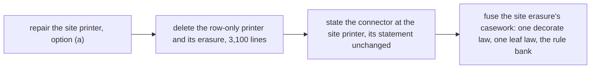

# CR-7, the erasure of the typed TypeScript print as one law: what blocks it, and its order

Status: design note (history, not authority), 2026-10-15, the codegen seat. It records why CR-7
stopped before its law module, and what the owner or the coordinator decides first.

## 1. What CR-7 asked

CR-7 (`README.md`, §7) turns the typed print's erasure into fold fusion over the template table.
A decorated layer, erased, is the plain layer of the erased arguments. Its five steps are these:

1. a new law module beside `Effect4.Laws.Codegen.PrintTyped`, over `inst` once;
2. the decorated rows proved apart: the row call and the eliminator sites;
3. the theorem names of `typed-print-connector`, `typed-print-erasure` and `typed-print-read` kept;
4. the old module deleted, and the row-only `typedAlg` with it, once its connector moved;
5. an `Effect4.Codegen` rule bank for the `Except` and `Option` inversion steps.

The target was under 2,000 lines and under 20 s, from 8,174 lines and 78 s.

## 2. What the module holds

Measured at the CR-1 head (`bdf074d15`), by line ranges of
`src/Effect4/Laws/Codegen/PrintTyped.lean` (8,236 lines, 347 theorems):

| Part | Lines | Theorems | What it proves |
| --- | ---: | ---: | --- |
| the connector and the read consumers | 1 to 164 | 5 | `printTypedAt_none`, `focusAtTable_annotate`, `printTyped_eq_print` |
| term and row-call leaves | 165 to 700 | 40 | `eraseTerm` at each printed term form; the annotated row call erases (`eraseRowJoin_printPerformAt`) |
| the row-only erasure | 700 to 3,810 | 119 | `eraseJoinArgs_printTypedAt`, by induction on the target's size |
| the typed term fold's erasure | 3,810 to 4,384 | 28 | the term certificates, as homomorphisms |
| the eliminator-site erasure | 4,384 to 8,236 | 155 | `eraseJoinArgs_printTypedSitesAt`, by the same induction, with checked contexts |

The two erasures share their shape. Each has a main step of about 340 lines (`eraseT_print`,
`eraseT_site_print`), a rigid-template step, a spine step, a statement step and a row-call step.
The site erasure adds three things that the row-only one lacks:

- the decorated node heads (`decorate`, fifteen `decorate_*_erases`);
- the typed term leaves (`TermErases`, the term certificates);
- the checked contexts at each address (`SiteFocused`, `childEnv_template_depth`).

A fusion law over one interface would share the common shape. Its obligations at the site
printer would stay about as large as the three parts above. The estimate is about 4,800 lines,
40% less, not 2,000. The large cut is step 4: the row-only erasure is 3,100 lines.

## 3. Why step 4 cannot land now

The typed print chooses between two printers (`printTyped`, `src/Effect4/Codegen/PrintTyped.lean`).
It uses the site printer where a site needs types (`needsSitesAt`), and the row-only printer
elsewhere. Step 4 deletes the row-only printer, so the site printer would print every program.

The site printer refuses a well-typed program that the row-only printer prints. CR-1 found one:
the keyed lane's `timeout/eager` client (P-CR1-3 of the receipt). The probes are the seat's
`cr1/probe/Eager4.lean` and its neighbours.

- The refusing node is the `iterate` at the address `[1, 1, 1, 0]` of the hoisted main program.
- Its body is printed under the cursor's binder. The template declares `let a<n>` before the
  body's hole (`iterateTpl`, `src/Effect4/Codegen/Templates.lean`), so the body's depth is
  `n + 1`.
- The checker types the body without the cursor (`Node.childEnv`), so the body's checked
  environment has length `n`.
- The site printer prints a term slot only where the two agree (`PrintEliminators.printArg`).
  Every term slot in the body refuses: `typed:term slot depth`.

So deleting the row-only printer moves two things:

- every program with a term slot in an `iterate`'s body, and a site or a join anywhere, loses
  its typed print. The module that ships prints it by the fold (`shippedPieces`), and the join's
  type arguments go;
- the connector's statement. `printTyped_eq_print` holds of every program with `NoJoin`. Under
  the site printer alone it would need the checked contexts at every address too, which an
  ill-typed program lacks. That is CR-7's stop rule: a claim's statement would have to change.

## 4. The repair, and its options

| Option | What changes | Cost | Risk |
| --- | --- | --- | --- |
| (a) the site printer pads a slot's environment with the binders that the template adds and the checker does not | `PrintEliminators.printArg` and `slotEnv`; the site erasure's `SiteFocused` reads "at most" | the context invariants of the site erasure, about 800 lines | low: the padded levels are never read, since the checker types the body without them |
| (b) the template prints the body outside the cursor's binder | `iterateTpl`, the reader, both TypeScript readers | the printed bytes of every loop, and the reader's laws | high |
| (c) keep the row-only printer | nothing | the 3,100 lines stay | none |

Recommend (a). It makes the site printer total on the readable domain, so the row-only printer,
`typedAlg`, `printTypedAt` and their erasure can go.

## 5. The order that lands CR-7

- After the repair, `printTyped` is the site printer alone. The connector's proof reads the site
  printer under `NoJoin`, where `decorate` and the typed leaves add nothing.
- The fusion then has one printer to cover, not two. The fifteen `decorate_*_erases` are one law
  over `withHeadTypes`, and the term leaves are one homomorphism.
- The rule bank (step 5) lands with the first proofs that close by it, as AGENTS.md asks.

## 6. What this note does not establish

- No line count above is a measured result of a new module: the 4,800 lines and the 40% are an
  estimate from the module's parts.
- It proves nothing new and changes no statement. The three claims keep their names and their
  pointers.

## 7. Correction, after the coordinator's ruling of option (a)

§3 placed the refusal at the `iterate`'s body. That was wrong, and the probe that placed it was
wrong. It paired a node's children with its argument positions: an `iterate`'s child `0` is its
body, its argument `5`. Paired by the argument that each child is, every node's checked
environment has the length of its print depth (`cr7/EagerDepths.lean`, the seat's probe).

The refusing slot is a `catchIf`'s test, at the address `[1, 1, 1, 0, 0, 1]`, inside the loop's
body:

- the row that prints it is `Effect.catch`. Its classifier fixes the test to the literal `true`,
  and its skeleton has no hole for the test (`Templates.table`);
- the skeleton's level at a hole it does not have is `0` (`Template.levelAt`), so the template
  depth of the test is the node's own;
- the checker types the test under the handler's binder (`slotEnv`), one binder deeper;
- the site printer refused where the two lengths differ (`typed:term slot depth`).

Option (a) repairs it as ruled, in the general form. The site printer fits a slot's checked
environment to the template's depth (`PrintEliminators.atDepth`). It cuts the environment where
the checker's is longer, and pads it with `unknown` where it is shorter. At every slot that a
lane's program prints, the two agree, so nothing changes there. At a classifier the template prints
nothing. So the typed print refuses no slot for its depth, and the erasure reads each term at its
print depth (`atDepth_length`).

§2's measure of the deletion changes too. A reach probe starts from three theorems: the site
erasure, the typed reader's exactness and the focus law (`cr7/Reach.lean`). It finds 68 of the
module's authored declarations unreached, about 2,050 lines. The site erasure reuses most of the module, so the
row-only erasure's own part is about 2,050 lines, not 3,100.
