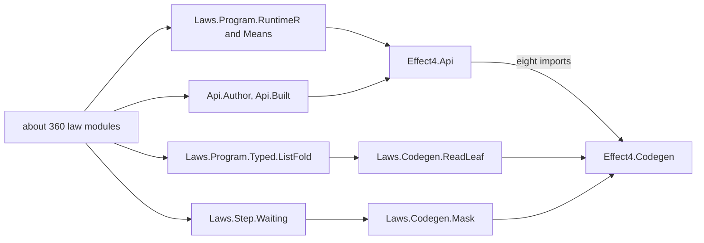
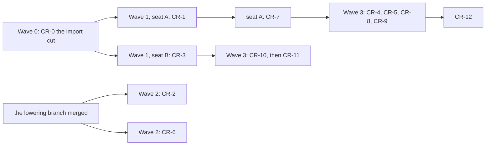

# The codegen refactor: the nature of the work, the machines, and a fast landing

Status: the coordinator's landing plan for the review's slices CR-1 to CR-12 (`README.md` beside
this note, `c68a0c3c4`). Measured on 2026-10-15 at `c68a0c3c4`. The import counts come from a
scan of every `import` line under `src/`, `tools/` and `Test/` (1,138 modules). The script is
`probes/fanout.py`.

## 1. The one thing to know first

Lean rebuilds dominate this work, and the gates do not. An edit of a core codegen module rebuilds
415 to 458 modules, about 360 of them law modules. The cause is one hub. The program interface
`Effect4.Api` imports eight codegen modules, and most law modules reach `Effect4.Api`.

A first slice, CR-0, cuts three import edges. In the simulation, an edit of `Effect4.Codegen.Print`
then rebuilds 87 modules instead of 444. Every later slice runs about five times lighter, on
either machine.

The PC can run the chunk as a second build machine, with its own build slot. It needs about an
hour of setup first (§3).

## 2. The nature of the work, measured

### 2.1 What an edit rebuilds

| Module the slices edit | Slices | Modules rebuilt today | Law modules among them | After CR-0 (simulated) |
| --- | --- | ---: | ---: | ---: |
| `Effect4.Codegen.Print` | CR-1, CR-5, CR-8 | 444 | 363 | 87 |
| `Effect4.Codegen.Checked` | CR-1, CR-4 | 417 | 351 | 45 |
| `Effect4.Codegen.Types` | CR-10 | 458 | 368 | 101 |
| `Effect4.Codegen.Read` | CR-5, CR-8 | 439 | 362 | 82 |
| `Effect4.Codegen.Schema` | CR-4, CR-6 | 415 | 350 | 16 |
| `Effect4.Codegen.Metadata`, `Templates`, `SourceBindings`, `RowServices`, `PrintLeaf` | CR-5, CR-6, CR-8 | 442 to 457 | 363 to 368 | 85 to 100 |
| `Effect4.Codegen.PrintTyped` | CR-1, CR-7 | 16 | 2 | 16 |
| `Effect4.Codegen.TargetFold` | CR-6 | 19 | 2 | 19 |
| `Effect4.Laws.Codegen.PrintTyped` | CR-7 | 2 | 1 | 2 |
| `Tools.TyVectors`, `Tools.RowTypes`, `Drivers.Corpus`, `Drivers.TsGen` | CR-1, CR-3, CR-8 | 0 | 0 | 0 |
| `Effect4.Program.Ty` | CR-10, CR-11 | 766 | 514 | 766 |

The gates are cheap by comparison (the review, §4.6):
- `check-truth` takes 67 s, and about 16 s after CR-2;
- `check-corpus` takes 112 s;
- `check-target` takes 13 s, `check-ts-reader` 4.3 s, and `check-tsdiag` 1.9 s.

The Mac's one build slot serves Codex's four trees and the LCNF lowering seat as well. So each rebuild
also waits its turn.

### 2.2 The three edges CR-0 cuts

1. **`Effect4.Api` imports `Effect4.Codegen`** for its codegen face: `read`, `printDecl`,
   `emitModule`, `printModule` and their kin. Move that face to a new
   `src/Effect4/Api/Codegen.lean`, with the namespace `Effect4.Api` unchanged. The root
   `Effect4` imports it, so no application caller changes. This cut alone takes `Print` from 444
   to 124 modules.
2. **`Effect4.Laws.Program.Typed.ListFold` imports `Effect4.Laws.Codegen.ReadLeaf`** for general
   list lemmas. Move them to a general law module. The review's three lemma copies in `ReadLeaf`
   (CR-9, step 3) go in the same step. With cut 1, this takes `Print` to 87.
3. **`Effect4.Laws.Step.Waiting` imports `Effect4.Laws.Codegen.Mask`.** Move what it uses to the
   module that owns it.

Neither running branch touches `src/Effect4/Api.lean`, `ListFold`, `Waiting` or any codegen
module. The lowering branch touches the `Makefile`, `scripts/generate.py` and
`tools/Effect4Gen/manifest.json`, so CR-2 and CR-6 wait for its merge.

### 2.3 The slices by kind

| Kind | Slices | What a step costs |
| --- | --- | --- |
| Core codegen | CR-1, CR-4, CR-5, CR-6, CR-8, CR-9 | one rebuild of about 90 modules after CR-0 |
| The type sort | CR-10, CR-11 | one rebuild of 766 modules each; CR-11 starts with a design note |
| Laws only | CR-7 | two modules; it is proof work, with no host gate |
| Tools only | CR-3 | no Lean rebuild; `check-target` |
| The build itself | CR-2 | the `Makefile` and the scripts, shared with the lowering seat |

## 3. The machines

| | The Mac | The PC (`ssh pc`) |
| --- | --- | --- |
| Processor | Apple M3, 8 cores | Ryzen 7 8700F, 8 cores, 16 threads |
| Memory | 16 GB | 16 GB, 7.8 GB free at the probe |
| Free disk | 20 GB | 59 GB |
| Load now | Codex's four trees and the lowering seat on one slot of two threads | idle; two Codex and six node processes, at 0% load |
| Lean | 4.33.1 | 4.33.1 |
| `make`, `opam` | present | absent; WSL's Ubuntu is installed and stopped |
| `bun`, `node`, `python` | present | present |
| The Effect4 checkout | at the head | 252 commits behind, an ancestor of the head |
| Pinned packages | current | `effects`, `hash` and `whatwg` stale; `whatwg`'s pin `3e5e793` exists only on the Mac, unpushed |
| `node_modules` | all | `ts/eff` and `harness/truth`; no `harness/schema-host`; `core.symlinks` is false, so `apps/todo/node_modules` is no link |

To ready the PC, in order:
1. Carry Effect4 by `git bundle` and `scp`. The PC cannot reach the Mac. Fetch the bundle into a
   new ref, and add a new worktree from it.
2. Carry the whatwg kit's `html/svg` at `3e5e793` the same way, or the owner pushes it. Lake then
   fetches `effects` and `hash` at their pins from GitHub.
3. Build once: `lake build Effect4 Effect4.Laws Tools Test`, with `LEAN_NUM_THREADS=6` for 16 GB.
4. Make `apps/todo/node_modules` a junction to `ts/eff/node_modules`.
5. Run the gates without `make`. Each recipe is a few `lake`, `python`, `bun` and `node` commands
   that PowerShell runs as they are. The brief lists them per gate.
6. Return each landing by bundle: the Mac fetches the PC's branch from a bundle over `scp`.

`check-schema-codec` and `check-schema-ts` need `harness/schema-host`, which the PC lacks. So
CR-4 runs on the Mac.

## 4. The landing order

- **Wave 0: CR-0.** Cut the three edges of §2.2. Its gate is one full build of `Effect4`,
  `Effect4.Laws`, `Tools` and `Test`, and `#axiom_audit` with an unchanged count. No executable
  changes. It is done when the scan shows each core codegen module under 100 rebuilt modules.
- **Wave 1: two seats on disjoint files.**
  - Seat A runs CR-1, then CR-7. The PC suits it, since it rebuilds most. CR-7 follows CR-1
    because CR-1 changes `typeArgsAt` in `Effect4.Codegen.PrintTyped`.
  - Seat B runs CR-3, on the Mac: tools only, with no Lean rebuild.
- **Wave 2, after the lowering branch merges.** CR-2 (the native producers and the generation
  order) and CR-6 (one fold of the target syntax). Both share files with the lowering seat's
  LC-3 and LC-4.
- **Wave 3.**
  - CR-4 runs on the Mac, with the faces brief's F3.
  - CR-5, CR-8 and CR-9 follow it.
  - CR-10 runs after CR-3, then CR-11 after its design note.
  - CR-12 runs last.

## 5. The rules that keep it fast

1. **Edit the core first, build once.** In a slice, finish every core edit, then build. Then
   edit the tools and the TypeScript, then run the gates once. A narrow build is the edited
   modules and what Lake rebuilds of their importers.
2. **One slice owns each rebuild of `Effect4.Program.Ty`.** No codegen slice edits `Ty` beside its
   own work. CR-10 and CR-11 each own one rebuild.
3. **Check for moved bytes before the host runs.** Diff the truth manifest and the corpus index
   first. A slice that may move no byte of printed TypeScript stops there, before the rc.112 runs.
4. **Regenerate each group once per slice,** after its last input changes.
5. **One Lean seat per machine.** The Mac's slot stays shared. The PC runs its own seat at six
   threads.
6. **Commit per slice; merge in order.** The coordinator merges CR-0 first. Then the wave's
   slices merge in the order they finish, since their files are disjoint.

## 6. What the owner decides

- Push `refactor/phase1-phase3` and the kit's `html/svg` to origin? Then the PC syncs by a plain
  fetch, not by bundles. Pushes are the owner's.
- Who runs the PC's seat: Codex on the PC, or a Claude session there. The coordinator syncs the
  files and reviews each landing.
