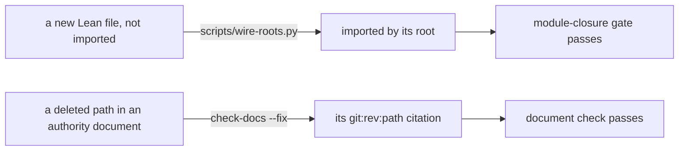

# Gate consolidation: seven targets in place of about thirty

Status: plan, then landing. The coordinator owns it: the cleanup seat's S4 paused with the seat.

## The one thing to know first

The owner: "keep cleaning up gates that are just everything's breaking every five seconds"; "all
these ... check native, check all this stuff. That really needs to be consolidated." So the public
surface becomes seven targets. Each step keeps its marker under `.lake/check/`, so a lane still
skips a step whose inputs are unchanged. Two gates that fail on routine work stop failing that
way: they repair what they check.

## The targets

| Target | What it runs | When |
| --- | --- | --- |
| `make check` | the build of the core and the law graph | after every change |
| `make check-ts` | every comparison with rc.112 under tsgo 7: the tsgo guard, schema-codec, schema-ts, truth, target, ts-reader, corpus, tsdiag, host-protocol, ingest-smoke | a landing that reaches TypeScript |
| `make check-ocaml` | every comparison on the OCaml route: native, compiler, the dune lane | a landing that reaches OCaml |
| `make check-full` | `check`, `check-ts` and `check-ocaml` | a merge |
| `make check-gen` | regenerate the stale groups, refuse a changed committed file | unchanged |
| `make check-sweep` | the batteries and the axiom gate, drift, the documents, the language, the semantics controls, the runtime census, the schema pin census, the trust-boundary self-tests, the full ingest, the slow batteries, the release lane when its install is named | at a sweep |
| `make check-kernel` | the kernel replay | rarely: it is the slowest |

The step names (`check-truth`, `check-native`, …) leave the documented surface. The documents name
the lane instead.

## The two repairs

1. **Roots.** `scripts/wire-roots.py` imports each module that no root reaches, at the end of the
   root its path names (`src/Effect4/Laws/` to `Effect4.Laws`, the rest of `src/Effect4/` to
   `Effect4`, `Test/` to `Test.All`). `make build` runs it first. The module-closure gate then
   refuses nothing that this repair can fix.
2. **Citations.** `scripts/check-docs.py --fix` rewrites a deleted path to its last revision's
   `git:<rev>:<path>` citation. The sweep runs the repair, then the check.

## Caching: a gate keyed on content, and shared

The owner: "half of these are just caching issues ... we need to be modeling this so that we can
cache and share, so that builds are as incremental and checks are quick." Two causes, measured on
the merge run of 2026-10-15:

- **Markers keyed on time, not content.** Make compares file times. A checkout or a merge rewrites
  files with the same bytes, and every gate runs again. A worktree reruns what another already
  passed.
- **Inputs wider than the gate reads.** `$(LEAN_INPUTS)` is every Lean source, so a gate that reads
  ten modules runs again at any edit. The OCaml lane's fixture writers build three batteries
  (`Test.Program.MaskContract`, `Test.Program.PoolPublic`, `Test.Dogfood.Scenario.Tape`), which
  import the law graph: moving four definitions in `Schema/Codec.lean` rebuilt 261 law modules
  inside that gate.

The repair is three pieces of data:

1. **A gate's key is the hash of what it reads.** For a Lean entry, Lake already computes it: each
   module's trace holds `depHash`, the hash of its whole import closure (as `CORPUS_TRACE` uses
   already). For any other input, the key takes the bytes' SHA-256, never the file time. The key
   also takes the gate's commands.
2. **Make's stamp idiom carries the key.** A rule writes `.lake/check/<gate>.key` and replaces it
   only when its bytes change (`cmp -s` or `mv`, as `$(CHK)/inventory` does now). The marker
   depends on the key file, so make reruns a gate only when its content changed.
3. **One result store, shared by the worktrees.** A pass is recorded at
   `<store>/<gate>/<key>`. The store lives beside the main checkout's `.git` common directory, so
   every worktree reads it, like Lake's artifact cache. A key already passed is a pass, with no
   run.

And one cut in depth: **a fixture writer imports the program data, not a battery.** The data a
battery and a writer share moves to a module both import, under `src/` or `Test/Fixtures/`, which
imports no law module.

## What does not change

The axiom gate, the library-root separation (`Effect4` never imports the Laws graph) and every
outside-oracle comparison stay. No comparison is cut. The markers keep each step incremental.
