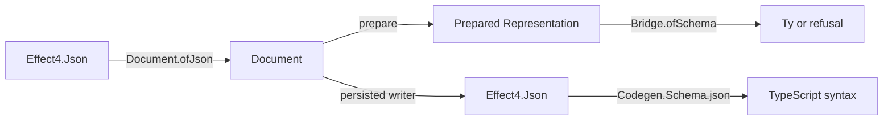

# A1 reuse audit for the Mac handoff

## The one thing to know

Keep A1's document boundary, but remove duplicated traversal and encoding rules before extending it.
The generated `foldMap_representation` can replace `Prepare.refsAlg`.
The persisted writer should own the encoding that the TypeScript emitter also uses.
Keep parsing, document preparation, and the exact bridge as separate judgments.

Evidence: source review, not a build or proof of A1.
Reviewed branch: `wip/a1-document-json` at `fd33698271a39bb50c543b3723fdb0dfa9968a95`.
Its implementation starts at `f459e261c`.
The owner stops PC implementation before A1 and requests this audit for the Mac.
No A1 source changes or builds occur in this audit.

## Reuse in priority order

| Priority | A1 code | Existing owner | Recommendation |
| --- | --- | --- | --- |
| First | `Prepare.refsAlg`, `refsOf` | `foldMap_representation`, `src/Effect4/Schema/Fold.lean` | Collect reference leaves with the generated traversal. Remove the constructor table. |
| First | `DocumentJson.writeAlg` and its leaf writers | `Codegen.Schema.printAlgebra`, `src/Effect4/Codegen/Schema.lean` | Give persisted encoding one data-plane owner. Make target rendering consume it. |
| First | the moved `normJ`, `sortE`, `keyBytes` | `Effect4.Schema.Codec`, `src/Effect4/Schema/Codec.lean` | Keep the move into `Data/JsonNorm.lean`, with declaration names unchanged. |
| Next | `substAlg`, `shapeAlg` | `RepresentationAlgebra.id`, `src/Effect4/Schema/Fold.lean` | Keep these small algebra overrides. They already reuse the correct operation. |
| Next | preparation's annotation test and final conversion | `Bridge.normAnn`, `Bridge.ofSchema`, `src/Effect4/Schema/Bridge.lean` | Keep these calls. Add `~identifier` to the existing policy, as row 396 rules. |
| Next | future normalization proof steps | `normJ_arr`, `normJ_obj`, `sortE_perm`, `src/Effect4/Laws/Schema/Codec.lean` | Reuse their statements. Move only needed general laws into a shared law module when a proof consumes them. |
| Next | A1's to-do row comparison | `TodoRepo.rows`, `Test/Dogfood/Scenario/Todo/Data.lean` | Import the shared data module instead of the scenario battery. |
| Keep local | `reachable`, `place`, `firstDuplicate` | no matching core document dependency resolver found | Keep one document-specific resolver. Avoid a general graph framework for this consumer. |

### Reference collection

`foldMap_representation` visits representations, checks, tuple elements, properties, indexes, and schemas inside check annotations.
Use lists as its result, `[]` as its empty value, and list append as its operation.
The leaf function returns `[key.value]` at a reference and `[]` elsewhere.
The default check function returns `[]`.
This removes A1's repeated constructor coverage while retaining generated traversal coverage.

The current generated order matches the collector's order by source inspection.
Check nested references inside check annotations and index parameters before deleting `refsAlg`.
Those cases catch a collector that misses secondary fields.
This recommendation adds no theorem or second representation.

### One persisted encoding

The two writers repeat annotation fields, declaration payloads, non-finite numbers, symbols, properties, checks, and every representation constructor.
The repeated rules describe the same rc.112 persisted data.
Keep that data in `Schema.DocumentJson`; make `Codegen.Schema` depend on it.
Do not make the Schema data plane import TypeScript syntax to recover JSON.

The existing `Codegen.Schema.json` already turns `Effect4.Json` into target syntax.
It retains binary64 bits and handles `__proto__` and duplicate keys through `Object.fromEntries`.
Its `reifyJson?_json` law witnesses recovery of the raw datum from that syntax.
It does not prove that host execution retains duplicate object keys.

The simplest consolidation renders the new writer's JSON through `Codegen.Schema.json`.
That can change whitespace because the old writer chooses multiline objects at selected constructors.
Regenerate the affected TypeScript fixtures and run their host comparisons if adopting that layout change.
Keep document reference-table admission before rendering; the next section explains why.

If a staged transition keeps both writers, connect their data observations through the generated fold laws.
`RepresentationHom` and `hom_eq_cata_representation` in `src/Effect4/Schema/Fold.lean` provide the existing route.
Place that obligation under the consuming registry claim before stating it.
Avoid a permanent pair of independent constructor tables or a new general TypeScript printer framework.

## Similar code with different contracts

### Duplicate reference keys

`Codegen.Schema.dedupeReferences` keeps the first entry and drops later entries with the same body.
It refuses repeated keys with different bodies.
Its laws are `dedupeReferences_distinct` and `dedupeReferences_nodup`, in `src/Effect4/Codegen/Schema.lean`.
Store-generated documents consume this policy under decision row 8(C).

A1's `Prepare.prepare` refuses every repeated reference key, including equal bodies.
These are different codec admission policies.
Do not substitute the emitter's deduplication for the reader's refusal to reduce code.
If both consumers need shared table utilities, move the utilities with explicit policy arguments and retain both controls.
A shared abstraction is optional; the two judgments must stay distinct.

The reader's repeated-key claim also needs a narrower description.
The fixed fields of a node reject duplicates through the image comparison.
Annotation bags and reference tables retain entry lists; preparation supplies the reference-table check.
Avoid claiming that every repeated key in an arbitrary JSON subtree is refused by `Document.ofJson`.

### The existing JSON bridge

`Tools.JsonBridge.ofLeanJson` is reusable for the present fixture profile.
It accepts only exactly representable natural numbers, with exponent zero, through `natOfBinary64`.
Its inverse helper, `toLeanJson`, writes other binary64 data as `null`.
Neither helper supplies a general numeric round trip for persisted Effect documents.
The shared number bridge remains the R-T6 dependency identified by the workstream review.

`Lean.Json` stores objects by key and loses duplicate source keys before A1 sees `Effect4.Json`.
Keep duplicate-key controls on the raw tree and state this parser boundary explicitly.
A successful fixture parse does not establish exactness from arbitrary JSON source bytes.
Do not add another float parser or silently use `toLeanJson` for A1 export.

`Store.Canonical` and its generated Schema instances encode the store's carrier image.
Their JSON spelling differs from rc.112's persisted document spelling.
Their exactness laws do not establish A1's codec admission.
Likewise, `Data.JsonOptic.key` is an optional field optic, without A1's path and reason diagnostics.
Using it would not replace the document reader's codec admission rules.

### Template substitution and graph order

`Schema.Template.fillAlg` already demonstrates replacement through an identity algebra.
Its keys are reserved child positions, and it also replaces declaration and literal payload marks.
Keep A1's `substAlg` for named document references; share the generated fold, not the template policy.

`Tools.SemanticsDocument.topoOrder` is a report helper, outside the core graph.
It is not a suitable dependency for document codec admission.
Precompute the reference-entry association list once in `prepare` before looking up entries during substitution.
The current source rebuilds that list inside the order fold.
This is a source-level simplification, not a measured speed claim.

## Corrections to make before A1 lands

1. Keep the five-point placement of the document claims and add their registry entries before proof work.
2. Name the actual goal, `admit_image`, in the reader's module note.
3. State completeness with existential fuel, exactly as `admit_complete` does.
4. Describe 4,096 as the public reader's bound, without claiming that all tool documents fit it.
5. Keep `admit_complete` reported as modulo `admit_image` until that goal is proved.
6. Keep full Representation retraction open: non-finite enum and property-key spellings do not retain every NaN bit pattern.
7. Fix the cycle diagnostic or its stated contract before treating it as a self-reference witness.
8. Import `Test.Dogfood.Scenario.Todo.Data` in the fixture battery and probe when only `TodoRepo.rows` is needed.

The cycle concern follows directly from the current `place` definition.
For dependencies `A → B` and `B → B`, with `A` first, no pending key is ready.
The function reports `recursiveReference A`, although `A` does not reach itself.
Either report the actual cycle member or describe a dependency cycle without claiming that the named key reaches itself.
Add this finite control beside the existing self-cycle and two-key cycle controls.
No compiled A1 counterexample is claimed here.

The existing bridge law remains `Bridge.ofSchema_exact` on the prepared representation.
It establishes no agreement between preparation and rc.112 decoding of the original document.
The fixed-depth reader's `tooDeep` result also establishes no failure of existential image admission.

## Suggested Mac sequence

1. Read the gate receipt and integrate S3 at `435f599d4` after its OCaml comparisons pass.
2. Bring A1 onto that head and build its unbuilt modules as its handoff requests.
3. Replace reference collection with the generated fold and decide the single persisted-writer owner.
4. Keep the normalization move, bridge policy, and data-only fixture imports together.
5. Repair the bound descriptions and cycle diagnostic; retain the planned goal honestly.
6. Observe the vendored fixture, add its bounded controls, and reproduce it with its tracked producer.
7. Wire roots, regenerate semantics, audit the landing modules, and run the reached TypeScript comparisons.

The diagram proposes ownership. It reports no new agreement theorem or host result.
