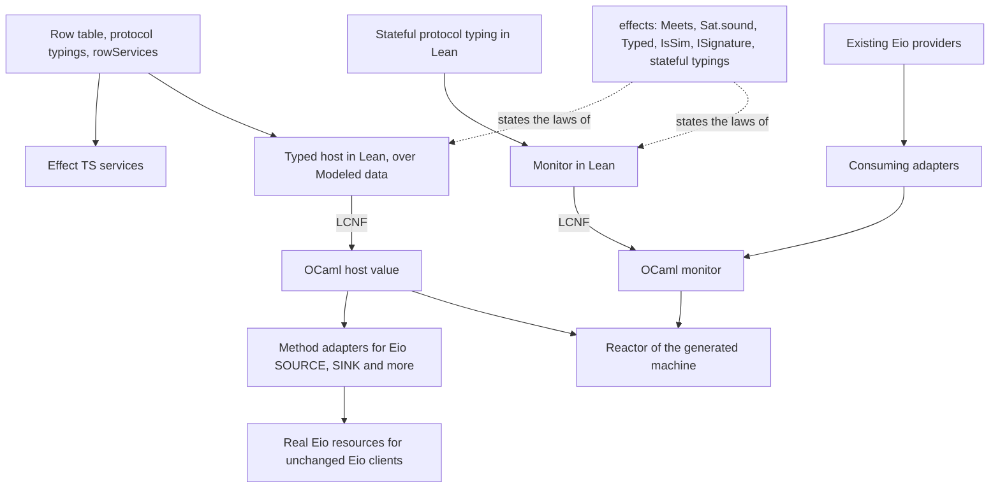
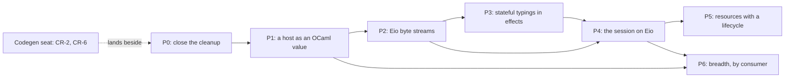

# Native OCaml interfaces as hosts: the review and the unified plan

Status: research note and plan, not authority.
Base: `bdd7cf96e` on `refactor/phase1-phase3`.
Role: the coordinator's review of Codex's seam probes, and the landing order that follows from it.
Scope: the remaining slices of the LCNF lowering and the native-interface work, in one order.

## 1. The one thing to know first

A native OCaml interface is a host. The `effects` package already states hosts, their protocol
typings, client typing, adapter stacks, simulations and lifecycle signatures, with proofs. Codex's
model is right in direction, and most of it is already in the tree. This plan adds one theory
module, one widening of the OCaml syntax and one library of method adapters. They land through
the lowering's own remaining slices.

The words this note uses, with their meanings:

- **host**: the dictionary's (`docs/core/controlled-english.md` §3.7). Here it is often a native
  OCaml value that answers a row's calls.
- **protocol typing**: the dictionary's (§3.2). `Effects.Protocol` and `RowProtocol` are its two
  forms in the tree.
- **stateful protocol typing**: new here. A protocol typing whose admission reads a state, which
  each admitted answer moves.
- **monitor**: new here. A wrapper that admits each host answer against a stateful protocol typing
  and refuses the rest.
- **method adapter**: new here. Fixed OCaml code that implements one native method, such as Eio's
  `single_read`, from a row's answer.
- **typed host**: new here. A Lean structure of typed methods over modeled data, read as the
  reactor of one row service.

## 2. Question

How does the remaining lowering cleanup land? How does the tree reach native OCaml libraries
through modeled interfaces, and which existing theory carries those interfaces?

## 3. What was read or run

| Item | Evidence | Result |
| --- | --- | --- |
| Codex's packet, `docs/research/2026-10-15-ocaml-seam-probes/`: its README, `native-interfaces.md`, `model.md` and the conversion, lowering and Eio notes | reading | reviewed in §4 |
| Codex's native Flow probe and its two compile refusals | tested: rebuilt and run in a scratch directory, `codex-probe-rerun.log` | 14 of 14 pass; both refusals reproduce |
| This note's probe of the plan's two adapters, `lens_probe.ml` | tested, `lens-probe.log` | 7 of 7 pass |
| The same probe with its monitor's check removed | tested, `lens-probe-mutant.log` | the red control fails, as it must |
| The `effects` package's coalgebra modules at v0.10.1 | reading | the mapping in §4.2 |
| `Reactor.ofHost`, `hostGuard` and `runWith_host_denotes` (`src/Effect4/Laws/Api/HostDrive.lean`) | reading | any host of the row signature drives a run |
| `RowProtocol` (`src/Effect4/Program/RowProtocol.lean`), `rowServices` (`src/Effect4/Codegen/RowServices.lean`), `Modeled` (`src/Effect4/Schema/Modeled.lean`) | reading | the description, the grouping and the data model already exist |
| Codex's claims about the generated artifacts | reading of the files named in §4.4 | each holds |
| The installed `effect4` switch | `ocamlfind list` | OCaml 5.1.1, Eio 1.2, Picos 0.6.0, Base and Core v0.16, the Jane Street derivers, Zarith 1.14, Cstruct 6.2.0 |

The probe compiles with `opam exec --switch=effect4 -- ocamlfind ocamlopt -thread -package
eio_main -linkpkg lens_probe.ml`. Its SHA-256 is
`ddbc3c3b190fbf857acc53d9655896d2170f085c48d77ced91c49074c14be6e7`.

## 4. Findings

### 4.1 The probes are good evidence of interoperability

Codex's providers inhabit Eio's own types. The unchanged `Eio.Flow.copy` and `Eio.Buf_read`
consume them, and the same clients consume Eio's standard providers. The controls exercise short
reads, short writes, vectored writes, slice-only writes and an early end of input. Two compile
refusals show that Eio's types reject a missing method and a sink in a source position. These are
finite probes of handwritten providers, as Codex says. They are the right falsifiers for
generated providers.

### 4.2 Most of the proposed model already exists, proved

Codex proposes new semantic records for providers, clients and their composition. The `effects`
package already states each part. The tree already uses it for hosts (row 338, concept 9 of
`docs/core/semantics.md`). Paths under `Effects/` are in the pinned `effects` package.

| Codex's proposal | Existing declaration | File |
| --- | --- | --- |
| A provider meets the interface's laws | `Comodel.Meets` | `Effects/Coalgebra/Protocol.lean` |
| A client relies only on the interface | `Program.Sat` | `Effects/Coalgebra/Sat.lean` |
| Their composition meets the client's contract (Codex's §5) | `Program.Sat.sound`, proved | `Effects/Coalgebra/Sat.lean` |
| An adapter implements one interface over another | `Handler.Typed`, `Comodel.through`, `Comodel.Meets.through`, proved | `Effects/Coalgebra/Sat.lean`, `Comodel.lean` |
| Interfaces combine | `Comodel.route`, `Comodel.share`, `Comodel.rename`, with their `Meets` laws | `Comodel.lean`, `Protocol.lean` |
| The implementation's behaviour lies inside the model's | `IsSim`, `run_of_sim_program`, proved | `Bisim.lean`, `Run.lean` |
| An answer opens new operations: a handle, then its close | `ISignature`, `IProtocol`, `IProgram.Sat.sound`, proved | `Indexed.lean` |
| Recording and replaying a provider | `Comodel.record`, `Comodel.replies`, `run_record_replies` | `Comodel.lean` |
| Admission at the boundary | `Comodel.guard`, `hostGuard` | `Comodel.lean`, `src/Effect4/Laws/Api/HostDrive.lean` |
| Any provider drives the generated machine | `Reactor.ofHost`, `runWith_host_denotes`, proved | `src/Effect4/Laws/Api/HostDrive.lean` |
| The interface description `D` | the row table, its `RowProtocol`s and `rowServices` | `RowProtocol.lean`, `RowServices.lean` |

So the plan builds no second semantic record and no second contract language. A native
interface's description is a row service. Its laws are a protocol typing. Its provider is a host,
and its adapters are typed handlers.

### 4.3 Four things are missing

1. **Reply admission that reads a state.** `Effects.Protocol` admits an answer by its operation alone.
   The stream laws need history: end of input stays ended, and a chunk is a prefix of what
   remains. The session's each-key-once discipline has the same shape.
2. **Methods that write into a caller's buffer.** A row answers a value. Eio's `single_read`
   mutates a caller's `Cstruct.t`. This note's probe shows that one fixed method adapter per
   native method closes the gap (§5.5).
3. **The OCaml module language.** `OCaml5.Ml` (`src/OCaml5/Ml/Syntax.lean`) has no module type,
   first-class module, structured `open` or private type. The generated engines open `Eff_types`
   through a raw declaration. A raw declaration opens the checker's value scope, so the value-name
   check stops there (Codex's lowering note).
4. **Handlers and simulations between indexed signatures.** `Effects/Coalgebra/Indexed.lean` lists
   them as not claimed. Resources with a lifecycle need them (§5.8).

### 4.4 Codex's findings about the public OCaml types hold

| Finding | Where | Consequence |
| --- | --- | --- |
| `service_name` and the service type code are bare `int` | `ocaml/eff/eff_types.ml` | OCaml code can mix the two, and can build negative values |
| `Lit_nat` carries a bare `int` | `ocaml/eff/eff_types.ml` | a negative natural literal type-checks before any admission |
| A `Nat` literal at or above 2^62 becomes `max_int` | `letValueExpr` (`src/OCaml5/Lcnf/Translate.lean`) | right for a comparison bound such as `Val.wf`'s; DI-56 forbids saturating a value |
| The engines open `Eff_types` by a raw declaration | `src/OCaml5/Lcnf/Gen.lean` | the checker's value-name check stops at that declaration |

The engine checks these values at its ingress. The holes concern construction by an OCaml client,
which is exactly the interop face.

### 4.5 Where the proposal goes too far, and where not far enough

- It names a new sort, the external contract `D`, beside the rows. That is a second description of
  host operations. Rows already are the extension point for host operations (R5 and R6 of
  `docs/core/system-map.md`).
- It treats buffer mutation as a modeling problem. It is an adapter problem: the row's answer is
  the value, and one fixed adapter performs the write.
- Its first slice includes cancellation, escaped resources and borrowed buffers. Those need the
  indexed laws of §4.3, so they belong to a later slice.
- It weighs Gospel, Ortac, Rocq, Zoo, Osiris, Ctypes, Picos and `bin_prot` without a consumer
  order. This plan gives each one a consumer or leaves it out (§5.9).
- Its evidence binds Eio 1.2 at OCaml 5.1.1. Eio's current release needs a newer compiler, so a
  later Eio is a separate switch decision.

### 4.6 The clock boundary choice is now evident

The host run's clock refusals come from `Run.drive` calling its reactor, which is a parameter
(`docs/research/2026-10-15-lowering-state/README.md` §6.9). The alternative to host ingress
resolves the known reactor at the call site. A native provider is a reactor that Lean never sees,
so that alternative serves only hosts written in Lean.

**Ruling (the coordinator's, evident under DI-56's ruling):** a reactor's answer is host ingress.
It passes the check that the tape's answers pass (EN8, the numeric profile at ingress). P0 records
it as a decisions row.

## 5. The plan

### 5.1 The picture

Three rules hold the picture together.

- **One description.** A row service names each operation once. The TypeScript face, the OCaml
  face and the monitor read the same rows.
- **One lowering.** Every typed piece is Lean, lowered by LCNF under row 391. OCaml is written by
  hand only for method adapters, one per native method.
- **One theory.** The laws are `effects` declarations. Effect4 instantiates them and adds no second
  host theory.

This note's probe tests the two adapter shapes by hand, in the form the generator would emit. A
source that answers values becomes a real Eio source through one generic `single_read`. A standard
Eio source becomes a row behind a monitor, and the monitor refuses a provider that answers after
end of input.

### 5.2 The order

The codegen seat's CR-2 and CR-6 edit the `Makefile` and `scripts/generate.py`. No P0 step edits
them, so the seat lands beside P0 on its own branch.

### 5.3 P0: close the cleanup

| Step | What lands | Gates |
| --- | --- | --- |
| P0.1 | The owed decisions rows: overwatch A to D, CR-7 (a), the remaining-work rows R to V, the clock ruling (§4.6) and the rules of §5.1 | `make check-docs` |
| P0.2 | F3: a type parameter over a finite index becomes one OCaml type parameter per constructor, in `OCaml5.Lcnf.Types` and the translator's annotations | a narrow build of `OCaml5`; `python3 scripts/generate.py --only lcnf` with no byte moved; `check-compiler`, `check-native`, `check-ocaml` |
| P0.3 | The clock ruling in `OCaml5.Lcnf.ClockFlow`: a reactor's result is ingress, checked where the tape's answers are | the same gates; `serveBuilt` then lowers with no refusal |
| P0.4 | K3, widened: one OCaml emitter; `OCaml5.Ml` gains `open`, module types, first-class modules and private types; `EffGen` emits through it; the checker reads `open` scopes | regeneration of the `eff` and `lcnf` groups, each moved byte read as layout or the `open` line; `check-ocaml` |
| P0.5 | The `TyCore.lean` docstring (CR-10); this note and Codex's packet force-added | `make check-docs` |

### 5.4 P1: a host as an OCaml value (LC-6's face)

The to-do face is the first consumer. It proves the path without Eio.

1. Write the to-do record as a Lean structure that derives `Modeled`, beside the rows in
   `Test/Dogfood/Scenario/Todo.lean`.
2. Write the typed host: a Lean structure of the four methods over that record.
3. Write its reactor in core code. It decodes each request through the record's image and encodes
   each answer.
4. In the laws, state that this reactor is `Reactor.ofHost` of a comodel. Then
   `runWith_host_denotes` applies unchanged.
5. Lower `serveBuilt` over the typed host. An OCaml provider is then a value of the lowered
   methods' record type.
6. Run three providers through the lowered machine: the lowered `repository`, the lowered
   `forgetful` and one handwritten OCaml provider.
7. Check the three providers' records with `apps/todo/Check.lean`. The `forgetful` run must fail
   the check, as the red control.

The gates are the `Test` build of the to-do modules, `check-compiler`, `check-native`,
`check-ocaml` and the face's wiring in `check-host-protocol`.

Measure first whether `Modeled`'s codec lowers. Its carrier comes from a fold over `Ty`, which may
meet the erasure that F3 met. If it does, lower the structure's derived image functions instead,
and record why.

Placement of step 4's lemma:

1. Concept: `host-session-protocol`. It is a step that the face's use of `runWith_host_denotes`
   needs.
2. Question: no new claim. The consumer is the face's reading of `runWith_host_denotes`.
3. Reach: the typed host's reactor, at a table with distinct keys.
4. Not established: anything about the OCaml provider. Its behaviour stays a host assumption
   (`docs/core/host-boundary.md`).
5. Serves: R6, the host.

### 5.5 P2: Eio byte streams, generated (Codex's first slice, reframed)

1. Declare the byte-stream rows. A source's `read` takes a capacity and answers bytes or end of
   input. A sink's `write` takes bytes and answers an accepted count.
2. Write their stateful protocol typings in Lean. A chunk is nonempty and within its capacity.
   End of input is absorbing. An accepted count is within its offer.
3. Write the method adapters in a new library, `ocaml/interop/eio` (dune library
   `effect4_eio`). `Provide` covers `Eio.Flow.Pi.SOURCE` and `SINK`. `Consume` covers any Eio
   source or sink.
4. Lower the monitor from the Lean typing, and bind it inside `Consume`.
5. Port Codex's controls and this note's controls to dune tests against the lowered providers.
6. Give the slice a real consumer: the session's byte framing, written in Lean, as an Eio flow.

The red controls are a provider that answers after end of input, an empty chunk and an oversized
chunk. The two compile refusals stay as type controls. The generated core libraries gain no
dependency: only `effect4_eio` depends on Eio.

This slice tests interoperability at Eio 1.2 and tests the monitor's refusals. It proves no
theorem about Eio.

### 5.6 P3: stateful protocol typing in `effects`, once

P3 starts after P2 runs (row 387: build first). One module, `Effects/Coalgebra/Stateful.lean`,
states the following.

- `StatefulProtocol S`: a state, a start, an admission per state and operation, and a next state
  per admitted answer.
- `Comodel.watch` (the monitor), `Comodel.MeetsFrom` and `Program.SatFrom`.
- `SatFrom.sound`: a host that meets the typing from a related state runs a client typed under it
  only to values that satisfy the client's postcondition.
- `watch_meets`: the monitor of any host meets its typing.
- The one-state case: `Meets` at one state is `MeetsFrom`. `route`, `rename` and `through` lift.
- The reading as worlds: a stateful typing is an indexed protocol typing over its states.

The release is `effects` v0.11.0. The owner pushes it before Effect4, and Effect4 moves its pin.

Placement:

1. Concept: `host-session-protocol`. It serves reply admission of host answers.
2. Question: a new registry claim, `stateful-protocol-sound`, written into
   `docs/core/semantics.md` and the registry in this slice. Its pointer is `SatFrom.sound`.
3. Reach: finished runs of deterministic hosts, over the typing's states. It is a safety claim.
4. Not established: progress, termination or fairness. A native provider meets the typing only by
   a monitor's refusal or by assumption. A run that does not finish gets nothing.
5. Unlocks: R6, the monitors of P2 and P4, and a reading of the session journal's each-key-once
   law as a typing.

### 5.7 P4: the session on OCaml, on Eio (LC-7)

1. Land LC-7 as planned: the session's byte entries in `src/Effect4/Run/Bytes.lean`, the runner
   codec group and `session_gen.ml`.
2. Read commands from an Eio source and write receipts to an Eio sink, through P2's adapters.
3. Perform host calls as Eio jobs with keyed completions. `Rows.receive` and `Rows.answer`
   (`src/Effect4/Run/Basic.lean`) keep receipt apart from application.
4. Generate the session's public `.mli` with abstract types and checked constructors. It closes
   the construction holes of §4.4.
5. Put the sexp, compare and hash derivers in a separate adapter library, by representation
   re-export.

### 5.8 P5: resources with a lifecycle

Files and sockets open a handle, use it and close it. Their typing is indexed: an open answer
moves to a world with the handle, and close moves to a world without it. The host boundary's
lifecycle and handle declarations (`docs/core/host-boundary.md` §4.2 and §4.3) already name the
phases. `effects` gains indexed handlers and simulations as far as this consumer needs. Codex's
escaped-resource, cancellation and switch-hook controls become this slice's tests.

### 5.9 P6: breadth, each library with its consumer

| Library | Consumer | When |
| --- | --- | --- |
| `Base.Type_equal.Id`, `Core.Univ_map` | the native service registry: one process-local key per service, beside its stable service key | with P4 |
| Comparator witnesses | maps and sets in generated data modules | with the first consumer that orders values |
| Ctypes and Cstubs | the C face (LC-9), from the same typed hosts | after P4 |
| Picos | one native client under several schedulers | when a consumer needs it |
| Gospel and Ortac | a stateful typing printed as a Gospel contract on a third-party `.mli`; Ortac's checks are the monitor again | after P3 |
| Sexp, `bin_prot` | inspection and an optional transport, each with its own admission, never the canonical identity | by consumer |
| Rocq, Zoo, Osiris | a selected component's proof | none planned |

LC-8, the carriers as Lean data, stays on its own track. It changes the engine's inside, not its
interfaces.

### 5.10 What stays fixed

- `Eff` stays the one program representation.
- Rows stay the one description of host operations. `Ty` gains no native type.
- Native resources, buffers, closures and continuations never enter stored program syntax.
- Canonical bytes stay the identity. Sexp trees and binary shapes are views.
- The host boundary stays where `docs/core/host-boundary.md` puts it.
- Row 391 holds: the lowering carries no proof obligation. P3's theorems are host theory, placed
  in concept 9.

## 6. Proposed decisions rows

1. **The clock boundary.** A reactor's answer is host ingress, checked as the tape's answers are
   (§4.6).
2. **Native interfaces are hosts.** A row service describes one, and a protocol typing states its
   laws. A host implements it, and typed handlers adapt it. `effects` owns the laws, under row 338.
3. **Method adapters.** They are handwritten OCaml, one per native method, tested once. The
   generated core libraries take no third-party dependency.
4. **The pin.** Eio 1.2 at OCaml 5.1.1 serves until a consumer needs a later Eio.

## 7. What this does not establish

- The probes are finite. They prove nothing of Eio, of any provider or of the generator.
- The planned theorems are conditional. A native provider meets a typing only by a monitor's
  refusal or by assumption.
- Interoperability with an Eio client is tested per client and per control, not for every client.
- No progress, termination, fairness or cancellation bound follows from any step here.
- The order is a plan. Each slice lands with its own narrow builds and its own gates.
