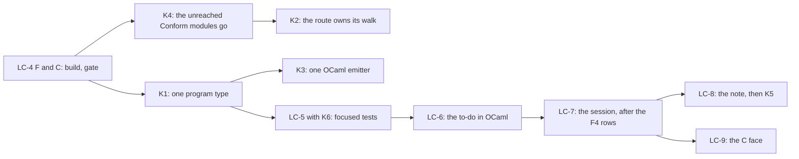

# The LCNF lowering: where it stands, and the consolidations left

Status: the coordinator's probe (history, not authority). Measured on 2026-10-15 at
`b5ff0435e`, on the Mac. The brief is `docs/research/2026-10-14-lowering-cleanup/prompt.md`
(slices LC-1 to LC-9), under decisions row 391. The probe scripts are in `probes/` beside this
note.

## 1. The one thing to know first

The brief's first half has landed, and its second half has not started. The probe finds six
consolidations beyond the brief. The largest one is about 2,300 lines:
`Effect4.Program.Eff` has two OCaml types from two generators, joined by hand code. A probe shows
the engine's program types reach no carrier. So one emitter change can give one type
(§4, K1).

## 2. What has landed, what is ready, what has not started

| Slice | State | Evidence |
| --- | --- | --- |
| LC-1 the type rows as data | merged | `6ce9ff704` |
| LC-2 one primitive table | merged | `6ce9ff704` |
| LC-3 one recipe, the syntax cut, one fold, the dead models gone | merged | `6ce9ff704` (+6,281 and −13,236 lines over LC-1 to LC-3) |
| LC-4 A, B: the clock analysis by worklists, the renaming pass as translation | merged | `630d87f65`; `gen-lcnf` from 35.8 s to 23.8 s, no generated byte moved |
| LC-4 C: one generator process for every artifact | ready, never built | `lc4-unlanded/part-C-and-F.patch` and `Gen.lean`; `git apply --check` passes at `b5ff0435e` |
| LC-4 F: the derived and fixture inputs from the import closure | ready, never built | the same patch; `make -n -W` dry runs only |
| LC-4 D: constructor origins enter the clock graph only once a field holds a fact | draft | `lc4-unlanded/patchD.py`; 93% of 163,368 clock facts are constructor origins |
| LC-5 focused tests | not started | |
| LC-6 the to-do in OCaml from LCNF | the host run landed (§6) | the lowered host run matches Lean byte for byte; the engine takes the row table and admits a reply as Lean's checked replay does; `E4_host`, Lean's `Run.driveFrom` over the engine, reproduces `Run.runWith` byte for byte with the lowered reactors as providers (`test_todo.ml`, T8); open: a provider written in OCaml (a repository not lowered from Lean), and the one report |
| LC-7 the session from LCNF | not started; blocked | the nine F4 rows are absent from `src/OCaml5/Lcnf/Builtins.lean` (checked by name), with F3, the clock refusal of `Effect4.Live.start` and the run-wide heartbeat budget |
| LC-8 the carriers as Lean data | not started | the design note comes first |
| LC-9 the C face | not started | after LC-7 |

F is the larger win of LC-4's rest. Today `$(GEN)/derived` and `$(GEN)/fixtures` depend on every
Lean source. So an edit of a law module or a battery reruns the corpus and the fixtures before
`check-ocaml`. At the base, `check-ocaml` took 368.4 s that way, and 29.4 s with no input changed
(the lowering receipt, LC-2). C saves one import of the environment, about 1.4 to 2 s of 23.8 s.

## 3. The estate, measured

| Part | Files | Lines |
| --- | ---: | ---: |
| `src/OCaml5` (the generators) | 24 | 9,300 |
| `tools/Conform` (the conformance tools) | 40 | 10,562 |
| hand OCaml, library (`ocaml/`, without the generated files below) | | 22,681 |
| hand OCaml, tests, properties and benchmarks | 46 | 20,190 |
| generated by LCNF: `ocaml/gen/api_gen.ml`, `ocaml/engine/api_engine.ml` | 2 | 34,070 |
| generated by `EffGen`: `ocaml/eff/eff_*.ml`, `ocaml/engine/cas/e4_subterm.ml` | 7 | 3,470 |

`opam exec --switch=effect4 -- dune build -j 2` builds the estate in 22.0 s. Every test passes.
`probes/time-tests.py` runs each of the 35 test executables from its build folder, as `dune test`
runs it. Together they take 43 s:

| Test | Time |
| --- | ---: |
| `engine/test/prop_fibers_view` | 15.45 s |
| `engine/test/test_diff` | 4.27 s |
| `engine/cas/test/test_checkpoint` | 3.65 s |
| `engine/test/test_buckets` | 1.93 s |
| `engine/test/test_engine` | 1.84 s |
| the other 30 | 0.10 to 1.16 s each |

## 4. The consolidations found

### K1. One OCaml type for the program

`Effect4.Program.Eff` has two OCaml types:
- `Eff_types.eff`, written by `src/OCaml5/Eff/Emit.lean` (`emitTypes`), at `native_op`;
- `'op eff` inside `Api_engine.Make`, written by `src/OCaml5/Lcnf/Types.lean`.

The two spell the constructors differently (`Action_term_fork` against `ActionTerm_fork`). Hand
code joins them:

| Joint | Lines |
| --- | ---: |
| `ocaml/engine/e4_program.ml` and `.mli`: the conversion and the ordinal pin | 647 |
| `ocaml/engine/e4_program_layout.ml`: the `PROGRAM_TYPES` signature | 238 |
| `scripts/generate-engine-structure.py` and `scripts/lib/program_structure.py`, its producer | 285 |
| `ocaml/eff/eff_manifest.txt`, `ocaml/engine/layout-allowance.json` | 36 |
| `ocaml/eff/eff_types.ml`, the second spelling | 961 |

`E4_program`'s header gives the cause: the engine's type group mentions the carrier parameters,
so each instance of `Make` has its own `eff`. The probe `probes/program-closure.py` reads the
group's 128 types. The 25 types reachable from `node` mention no carrier. Ten types name a
carrier directly (`point`, `capture`, `arg_site`, `sync_op`, `run_machine`, `stores` and four
more), and none of them is in that closure. So `eff` sits inside the functor only because the
emitter writes the 128 types as one recursive group.

The change:
1. The LCNF type emitter writes the types by strongly connected component. A component that
   reaches no carrier goes above the functor. Then `Api_engine.eff` is one type for every
   instance.
2. One naming rule (`src/OCaml5/Lcnf/Naming.lean`) spells both libraries.
3. `EffGen`'s codecs read and write the type that the LCNF route made. `eff_types.ml` as a
   second spelling goes, and so do `E4_program`'s conversion, the pin, the layout, its Python
   producer and the manifest.

This is item A of 2026-09-17 (`docs/research/2026-09-16-ocaml-engine-base-abstractions.md`). It
is the program half of N4, earlier than LC-7 and without it. LC-7 still lowers `Api.ofBytes`
for the session.

### K2. The route owns its walk

The generator imports its checker. Four route modules import `Conform`:
- `src/OCaml5/Lcnf/Builtins.lean` imports `Conform.Lcnf.Semantics` (the evaluator's `Prim` column);
- `Translate.lean` imports `Conform.Lcnf.Index` (`persistedMonoIndex`);
- `Types.lean` imports `Conform.Source.Description`;
- `src/OCaml5/Tools/LcnfGen.lean` imports `Conform.Lcnf.Validity` (the census of each manifest row).

Move the mono index, the census and the source description into `OCaml5.Lcnf`, and let `Conform`
import the route. The evaluator's primitive column stays in the one table (LC-2). `Conform`
computes its `PrimTable` from the route's names.

### K3. One OCaml emitter

`src/OCaml5/Eff/Emit.lean` (503 lines) builds OCaml as strings (`ctorPat`, `emitTypeDecl`,
`ostr`). The LCNF route builds `Ml.Syntax` and renders it through `Ml.Render`, under
`checkModule`. With K1, `EffGen` emits through the same syntax and renderer.

### K4. Conform's unreached modules

`probes/conform-reach.py` walks the imports from every route module, both gate drivers
(`tools/Conform/Effect4/Normalization.lean`, `NativeMain.lean`) and the three `Test` files that
import `Conform`. A search of the scripts, the `Makefile`, `lakefile.toml` and the authority
documents finds no other runner. Fourteen modules, 3,406 lines, are unreached. The `Conform` library's glob builds
them at every build.

| Module | Lines |
| --- | ---: |
| `Conform.Lcnf.Rules`, `Conform.Lcnf.Cases` (the cases policy's audit) | 1,481 |
| `Conform.Manifest.Readers`, `Conform.Manifest.Mirror` | 735 |
| `Conform.Cli.Audit`, `Selftest`, `BoundaryControls`, `LcnfMl`, `LcnfSemantics` | 449 |
| `Conform.Effect4.Lcnf` (a driver with its own `main`) | 235 |
| `Conform.Spec.Reflect`, `Conform.Core.Proof` | 211 |
| `Conform.Model.Container` | 195 |
| `Conform.Effect4.Fixtures.Traffic` | 100 |

Only `tools/Tools/ArchitectureRoles.lean` names them, as role rows. They go with their rows.

### K5. What LC-8 retires, measured

`test_diff` gives the reason for the second generated machine. `api_gen.ml` has no extern
rows, so Gen against Ref catches a wrong extern row. Ref against Fast catches a wrong carrier
law. Once the carriers are Lean data (LC-8), no hand extern row and no hand carrier remains. These
go with them:
- `ocaml/gen/api_gen.ml`: 18,954 generated lines, and 16.2 s of `gen-lcnf` at the base;
- the seven list twins `ocaml/engine/e4_*_list.ml`: 426 lines;
- the prelude `ocaml/engine/tools/api_engine_prelude.ml`: 438 lines, and the hand `fn` rows of
  `ocaml/engine/externs.txt`;
- the carrier property tests: `prop_fibers_view` alone takes 15.45 s of the 43 s.

### K6. Generated codecs that only tests read

No library module reads these generated files. Only tests do:
- `Eff_json` (313 lines) and `Eff_native` (41): `prop_wire`, `test_eff`, `test_lean_wire`;
- `Eff_layout` (63): `test_lean_wire`;
- `Eff_subterm` (314) and `E4_subterm` (194): `test_cache`, `bench_cache`.

LC-5 rules each one by the fault its test catches. `test_lean_wire` reads bytes that Lean wrote,
so it compares two implementations, and it stays.

## 5. The landing order

1. **LC-4 F and C.** One narrow build of `OCaml5`, then `generate.py --only lcnf` with no byte
   moved, then `check-compiler`, `check-native` and `check-ocaml`. Land F first, since it stops
   the needless reruns of the corpus and the fixtures. The codegen refactor's CR-2 and CR-6 edit
   the same `Makefile`, `scripts/generate.py` and manifest, so they rebase onto this landing.
2. **K4.** It changes `tools/Conform` and `ArchitectureRoles` only. Its gates are the build of
   `Conform` and `check-compiler`.
3. **K2.** It moves modules between two tool libraries, with no generated byte moved.
4. **K1, then K3.** These are emitter changes. One regeneration of both groups; the gates are
   `check-ocaml` with `test_diff`, `check-compiler` and `check-native`.
5. **LC-5 with K6, then LC-6 to LC-9,** as the brief orders them. LC-7 starts with the nine F4 rows.

No step edits the machine, `Eff`, `Ty` or `Store.Val`. No step rebuilds the law graph: the
route and `Conform` sit outside `Effect4` and `Effect4.Laws`.

## 6. Progress on 2026-10-15

| Step | Commit | Result |
| --- | --- | --- |
| The merged Codex lines build together | `9c36aff48` | `lake build Effect4 Effect4.Laws Test` passes, with the three gates |
| LC-4 C and F | `eaa45b6b9` | `gen-lcnf` 23.8 s to 20.4 s, no generated byte moved; the three route gates pass |
| K4, narrowed | `212295674` | 9 modules and 11 data files go; `Conform.Cli.Audit` runs the mirror census alone (273 to 148 lines) |
| K1, one OCaml program type | §6.4's commit | hand OCaml +614 and −1,869 lines, generated files +1,527 and −1,983; the route gates pass |
| K2, the route owns its walk | §6.5's commit | the mono index, the census, the primitive alphabet and the constructor telescope move into `OCaml5.Lcnf`; the second `stripRedArg` goes; the route imports nothing of Conform |
| LC-5, the test census | §6.6's commit | the two unrun vector lanes and their drivers go; two duplicate sections of `test_engine` go; every remaining test names its own fault (§6.6) |
| LC-4 D, the clock graph | its commit | constructor origins enter once a field holds a fact; no byte moved; ClockDiff agrees on 24 root sets; the analysis 16% and 30% faster |
| LC-6, the to-do in OCaml from LCNF | its commit | `todo_gen.ml` lowers `Test.Dogfood.Scenario.Todo.HostRun` (1,337 declarations, no clock refusal); the lane `ocaml/engine/test/todo/` matches Lean on 7 requests over 2 hosts, 16 checks; its Lean inputs reach no law module |
| The estate's cleanups beside LC-6 | `eb3c35e83` to `1a55e9b47` | one value codec (`Eff_val`); an unreachable alternative stated, and the generated machine compiled with warnings as errors; `tyO` and `tyV` as folds, no byte moved; the engine takes the row table; one `Api_gen_inst`, whose bench copy had lost a sort |
| Reply admission on the engine | its commit | `Effect4.Program.admit` lowered into both machines; the to-do lane checks a refused natural and an admitted reference answer against Lean on every request, both instances (T6, T7) |
| `E4_host`, the host driver | its commit | the to-do on the engine under a provider matches Lean's run on 7 requests, 2 hosts, both instances; 51 checks |
| K1b, the host boundary in the one module | its commit | `Store.Val`, `Err`, `Defect`, `Reason`, `Exit` and `Completion` join `eff_types.ml`; the engine driver's instance signature drops its ten hand transcriptions of them; every OCaml test and `check-ocaml` pass |
| LC-6, the to-do on OCaml | the Lean half landed (§6.7); the face waits on three generator features | `Test/Dogfood/Scenario/Todo/Host.lean`: `serve` and `serveBuilt` run one request with a recording repository, and their guards pass in Lean |
| K7 | ruled out | the scenario writer needs the authored programs, which import the author's laws by decisions row 332; the fixture rerun costs 20.0 s and moves no byte |

### 6.1 What F does, measured

The derived group now reads 189 of the 1,374 Lean sources. So a law edit no longer reruns the
derived group or the LCNF group. The fixture writers still read 942 files, and so a law edit
still reruns the fixtures. The scenario writer (`ocaml/engine/test/scenarios/write.lean`) imports
`Test.Dogfood.Scenario.Tape`, which reaches 922 files with its proofs. The other four writers
reach 119 to 189.

**K7.** Point the scenario writer at the scenario programs alone. Then a law edit reruns no
fixture.

### 6.2 What K4 keeps, and why

- `Conform.Manifest.Mirror` and `Readers`: `AGENTS.md` names the mirror census as the reader of
  `Test/fixtures/baseline/`.
- `Conform.Cli.LcnfMl` and `Conform.Cli.LcnfSemantics`: the drivers of rungs 2 and 3. No gate
  runs them either. LC-5 rules on them with the evaluators they drive.

### 6.3 The mirror census, run

`lake env lean -M4096 --run tools/Conform/Cli/Audit.lean --config tools/Conform/Effect4/audit.json`
gives 60 subjects: 52 pass, 5 counterexamples and 3 unresolved, exit 2. The red control
(`Fixtures/audit-mirror.json`) gives its one counterexample, exit 1, as designed.

Every counterexample compares the retained baseline `Test/fixtures/baseline/66ee4657/` with a
family that has grown since: `Eff`, `NativeOp`, `Term` and `Ty`. The baseline changes only by a
named promotion, so the census as configured is red until the next promotion. The three
unresolved rows are hand restatements that no grammar reads: `ocaml/eff/test/prop_wire.ml`,
`ocaml/engine/e4_program.ml` and `ts/eff/read.ts`. K1 retires the second.

### 6.4 K1, landed

The LCNF recipe's first artifact is `ocaml/eff/eff_types.ml`: the program types alone, generated
from `Tools.ProgramStructure.blocks` by the route's type generator. `api_gen.ml` and
`api_engine.ml` open it (`--open Eff_types`) and declare none of its types: the generator counts
them as provided, so a type of the run that shares a name is renamed, and `Ml.checkModule` takes
their declarations as an outer scope. `EffGen` keeps the codecs and spells every name by the
route's rule (`OCaml5.Eff.octor`, `ofield`, `Family.tyRef`). A trivial structure (`ServiceName`,
`ServiceTypeCode`) is carried as its field, with unchanged bytes. The constructor tables and a
literal visitor (`lits_<t>`) move to the new generated `ocaml/eff/eff_ctors.ml`.

What goes: `ocaml/engine/e4_program.{ml,mli}`, `e4_program_layout.{ml,json}`,
`layout-allowance.json`, `ocaml/eff/program-structure.json`, `scripts/generate-engine-structure.py`,
`scripts/lib/program_structure.py`, the ordinal pin and its 31 checks in `test_engine`, and the
scenario test's own copy of the conversion. The numeric profile of a natural literal (EN8) moves
to `E4_engine.compile`, through the generated visitor. `eff_manifest.txt` stays: the
conservativity check (`scripts/lib/conservativity.py`) and the mirror census read it.

Evidence, every command through `scratch/lean-slot.sh`:

| Command | Result |
| --- | --- |
| `python3 scripts/generate.py --only eff`, then `--only lcnf` | `eff_manifest.txt` and every golden byte-identical; the three artifacts pass `Ml.checkModule` |
| `dune build`, `dune test eff gen clock`, `dune test engine` | every test passes; `test_engine` 175 checks (206 before, less the 31 of the pin) |
| `make check-compiler`, `make check-native`, `make check-ocaml` | PASS; `gen-check` C3b compiles `api_engine.ml` against `eff_types.ml` alone |
| `make check-conservativity BASE=HEAD` | PASS, 4 of 4 clauses |
| `make check-docs` | PASS, 113 documents |
| the mirror census | 57 subjects: 50 pass, 5 counterexamples (the baseline's, §6.3), 2 unresolved; the red control refuses its mutation |
| `#axiom_audit` of the five touched generator modules | 95 of 565 reach `Classical.choice`, through the toolchain's string search, `Name.toString` and `Meta.isProp`; the library sits outside the trust ceiling |

Left: the docstring of `src/Effect4/Program/TyCore.lean` cites the deleted
`scripts/lib/program_structure.py`. Its fix waits for the next edit of `Ty`, since the module
rebuilds 766 dependents (the codegen refactor's CR-10).

### 6.5 K2, landed

`src/OCaml5/Lcnf/Index.lean` (moved from `tools/Conform/Lcnf/`) holds the persisted mono index and
the constructor telescope `withConstructor`. `src/OCaml5/Lcnf/Census.lean` holds the construct
census, cut out of `Conform.Lcnf.Validity`. `src/OCaml5/Lcnf/Prim.lean` holds the primitive
alphabet, its arity and `PrimTable`. `Conform.Lcnf.Semantics` keeps `Prim.apply`, the meaning of
each primitive on its values. Conform's own `stripRedArg`, identical to the route's, goes.

`grep -rn 'import Conform' src/OCaml5` finds nothing. `lake build OCaml5 Conform` builds 371 jobs.
`python3 scripts/generate.py --only lcnf` moves no byte. `check-compiler`, `check-native`,
`check-ocaml` and `check-docs` pass. The three `ty-rule` fixtures that import Conform or OCaml5
elaborate.

### 6.6 LC-5, the test census

**What went.**
- The two vector lanes of rungs 2 and 3: the `main`s, vectors, differentials and drivers of
  `tools/Conform/Effect4/LcnfSemantics.lean` and `LcnfMl.lean`, with `tools/Conform/Cli/LcnfMl.lean` and
  `LcnfSemantics.lean`. No gate, script or CI job ran them. The readers, the marshalling, the
  primitive table and the mutants stay: the compiler checkpoint runs them.
- `test_engine` §2, the goldens' Fast = Ref differential: `test_diff` compares three engines on
  every corpus at every position. Its drive-loop lines printed and gated nothing.
- `test_engine` §4, `replay_steps` on one instance: `test_replay_steps` holds the same laws on
  both. `test_engine` now runs 159 checks.

**What each remaining test catches.** One subject per test, no second test of it:

| Group | Tests | The fault each catches |
| --- | --- | --- |
| The wire (`ocaml/eff`) | `test_eff`, `test_lean_wire`, `prop_wire`, `test_frame`, `test_val_frames`, `test_metadata` | a codec that disagrees with Lean's bytes or JSON; a decoder that accepts a corrupt or noncanonical frame; a value frame or metadata row read wrong |
| The persistence (`engine/cas`, `engine/bytes`) | `test_bytes`, `test_pack`, `test_index`, `test_control`, `test_cas`, `test_crash`, `test_wal`, `test_checkpoint`, `test_cache`, `test_math` | a broken law of the CRC, pack, index, control file, store, crash recovery, log, checkpoint, cache or 63-bit arithmetic |
| The engine | `test_diff`, `test_engine`, `test_replay_steps`, `test_query`, `test_log`, `test_host`, `test_sched` | a wrong extern row or carrier law (three engines); a drive-loop, profile or prelude fault; the two replay axes; the query API; the log's indexes; the host primitives; the scheduler |
| The lowered libraries | `test_mask`, `test_pool`, `test_queue`, `test_semaphore`, `test_scenarios` | a library program whose generated run differs from the view Lean wrote |
| The hand carriers | `prop_table`, `prop_trace`, `prop_memo`, `prop_point`, `prop_fibers_view`, `test_buckets` | a carrier that drifts from its list twin on random operation sequences the corpora do not reach; they retire with LC-8 (K5) |
| The clock | `test_clock` | an exact clock value or refusal |

`prop_fibers_view` takes 15.45 s of the 43 s. It retires with its carrier in LC-8.

### 6.7 LC-6 and LC-7: the three generator features both faces wait on

`Test/Dogfood/Scenario/Todo/Host.lean` defines one to-do request's host run: `serve` builds the
cached consumer at the entry and arguments and drives it with `Run.runWith`, under a host that
answers as `repository` does and records each call in `apps/todo/Check.lean`'s format.
`serveBuilt` starts from a built program, with the reactor fixed. Its guards pass in Lean.

The reactors alone lower: `repository` and `forgetful` close at 28 declarations, with no missing
row and no clock refusal. The host loop does not, and a hand loop in OCaml would be a second
session layer, so the face waits for the route to lower `Run.runWith`. Measured by
`lake env lean --run src/OCaml5/Tools/LcnfGen.lean` with `--open Eff_types`:

| Roots | Closure | Missing primitive rows | Clock refusals | Fields not spelled |
| --- | ---: | --- | ---: | --- |
| `serve`, `serveForgetful` | 1,713 | 8 | 5 | `EffAlgebra` |
| `serveBuilt`, `serveBuiltForgetful` | 1,338 | the same 8 | 4 | `EffAlgebra` |

The three features, which LC-7's session needs as well:

1. **F4, eight primitive rows** in `OCaml5.Lcnf.builtins`: `String.ofList`, `USize.repr`,
   `Array.getInternal`, `System.Platform.getNumBits`, `String.toByteArray`, `Char.ofNatAux`,
   `ByteArray.emptyWithCapacity`, `ByteArray.push`, with a type row for `ByteArray`.
2. **F3, the algebras' family parameter.** `EffAlgebra`'s fields have types `R EffFam.eff`, a
   type-level function of an index, which no OCaml record type spells.
3. **The clock analysis inside `Run`.** `Run.play`, `Run.drive` and `Run.exit` each reach clock
   ingress "from unknown higher-order Nat production", with the reactor fixed. The same class
   stopped `Effect4.Live.start` in the collation's probe E.

F4 is mechanical. F3 is a design choice: erase the family to one type at the cost of casts in the
generated code, or specialize each algebra at its family. The clock refusal needs its cause read
first.

### 6.8 F4, landed

Eight rows join `OCaml5.Lcnf.builtins` (107 rows), each with the C symbol the environment's
`@[extern]` names: `String.ofList`, `String.toByteArray`, `ByteArray.emptyWithCapacity`,
`ByteArray.push`, `Char.ofNatAux`, `USize.repr`, `System.Platform.getNumBits` and
`Array.getInternal`. Five carry a source-evaluator primitive; three have none. A third verbatim
primitive, `lcnf_utf8_of_code_points`, encodes code points as UTF-8. `ByteArray` spells as
`int list` through a new type spelling, `TySpelling.fixed`. An artifact that translates nothing
now carries no prelude, so `eff_types.ml` declares types alone.

The host run's probe (§6.7) now reports no missing row. Its four clock refusals and `EffAlgebra`
remain. `check-compiler`, which checks each row's runtime column against the environment,
`check-native` and `check-ocaml` pass. The engines gain the one prelude line.

### 6.9 What F3 and the clock refusals need, read

**F3.** The host run reaches `EffAlgebra` through two folds that `Effect4.Run.Basic` imports:
the fork-site reader `superAlg` (`src/Effect4/Api/Supervision.lean`, family `SiteReader`, a
constant family) and the identity fold of the test clock (`src/Effect4/Api/TestClock.lean`).
`R : EffFam → Type` ranges over `EffFam`, a finite inductive whose constructors take no
argument. **The rule:** a type parameter of type `I → Type`, with `I` such a finite index,
becomes one OCaml type parameter per constructor of `I`, and an instance reads each by
reducing `R c`. It is exact and needs no cast. The type generator (`OCaml5.Lcnf.Types`) and the
translator's annotations carry it.

**The clock refusals.** `Run.drive` calls the reactor, a parameter of the function. The analysis
(`OCaml5.Lcnf.ClockFlow`) marks a parameter call's result as unknown higher-order production, and
the answer's values stay in the machine, where a program can read one as a duration. The engine
artifact takes host answers as root data on the tape, and checks them at its ingress (EN8). The
choice is the clock boundary's: treat a reactor's answer as the same host ingress, or resolve the
known reactor through `runWith` and `drive` at the call site. Its owner is the clock boundary's
design (DI-56), so the choice is recorded here, not made.

### 6.10 F3 and the clock boundary, landed (seat CLEANUP's S1 and S2)

Both slices are on the branch inside the merge `68765c384`. The commits record their checks.

- **S1, F3** (`5b1180aae`): `OCaml5.Lcnf.typeParameterSlots` gives a parameter `R : I → Type`,
  over a finite index `I`, one OCaml type parameter per constructor of `I`. The host-run probe
  had 68 unspelled fields of `EffAlgebra`, 10 of `TermAlgebra` and 4 of `CauseTermAlgebra`; it
  now has none. No committed byte moved.
- **S2, the clock boundary** (`ea5371129`): the host-run probe lowers `serveBuilt` and
  `serveBuiltForgetful` with no clock refusal.

**§6.9's diagnosis of the clock refusals was wrong.** The four refusals came from a builtin
callback's arity: `List.appendTR._redArg` has no kernel constant, and the analysis read it as
arity 0. The reactor call did not cause them. S2 fixes the arity. It also adds row 394's rule (a
root reactor's answer is host ingress), with red controls, and `E4_engine.check_answer` (EN9),
which checks each reactor answer's numeric profile.
