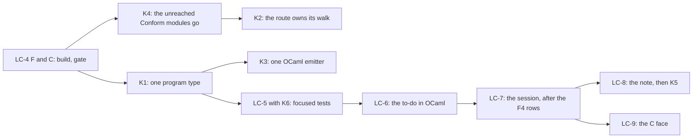

# The LCNF lowering: where it stands, and the consolidations left

Status: the coordinator's probe (history, not authority). Measured on 2026-10-15 at
`b5ff0435e`, on the Mac. The brief is `docs/research/2026-10-14-lowering-cleanup/prompt.md`
(slices LC-1 to LC-9), under decisions row 391. The probe scripts are in `probes/` beside this
note.

## 1. The one thing to know first

The brief's first half has landed, and its second half has not started. The probe finds six
consolidations beyond the brief. The largest one is about 2,300 lines:
`Effect4.Program.Eff` has two OCaml types from two generators, joined by hand code. A probe shows
the engine's program types reach no carrier. So one emitter change can give one type
(§4, K1).

## 2. What has landed, what is ready, what has not started

| Slice | State | Evidence |
| --- | --- | --- |
| LC-1 the type rows as data | merged | `6ce9ff704` |
| LC-2 one primitive table | merged | `6ce9ff704` |
| LC-3 one recipe, the syntax cut, one fold, the dead models gone | merged | `6ce9ff704` (+6,281 and −13,236 lines over LC-1 to LC-3) |
| LC-4 A, B: the clock analysis by worklists, the renaming pass as translation | merged | `630d87f65`; `gen-lcnf` from 35.8 s to 23.8 s, no generated byte moved |
| LC-4 C: one generator process for every artifact | ready, never built | `lc4-unlanded/part-C-and-F.patch` and `Gen.lean`; `git apply --check` passes at `b5ff0435e` |
| LC-4 F: the derived and fixture inputs from the import closure | ready, never built | the same patch; `make -n -W` dry runs only |
| LC-4 D: constructor origins enter the clock graph only once a field holds a fact | draft | `lc4-unlanded/patchD.py`; 93% of 163,368 clock facts are constructor origins |
| LC-5 focused tests | not started | |
| LC-6 the to-do in OCaml from LCNF | not started | both instances still pass `[]` as the row table (`ocaml/engine/api_engine_inst.ml`, `api_engine_ref.ml`); no `e4_host.ml` |
| LC-7 the session from LCNF | not started; blocked | the nine F4 rows are absent from `src/OCaml5/Lcnf/Builtins.lean` (checked by name), with F3, the clock refusal of `Effect4.Live.start` and the run-wide heartbeat budget |
| LC-8 the carriers as Lean data | not started | the design note comes first |
| LC-9 the C face | not started | after LC-7 |

F is the larger win of LC-4's rest. Today `$(GEN)/derived` and `$(GEN)/fixtures` depend on every
Lean source. So an edit of a law module or a battery reruns the corpus and the fixtures before
`check-ocaml`. At the base, `check-ocaml` took 368.4 s that way, and 29.4 s with no input changed
(the lowering receipt, LC-2). C saves one import of the environment, about 1.4 to 2 s of 23.8 s.

## 3. The estate, measured

| Part | Files | Lines |
| --- | ---: | ---: |
| `src/OCaml5` (the generators) | 24 | 9,300 |
| `tools/Conform` (the conformance tools) | 40 | 10,562 |
| hand OCaml, library (`ocaml/`, without the generated files below) | | 22,681 |
| hand OCaml, tests, properties and benchmarks | 46 | 20,190 |
| generated by LCNF: `ocaml/gen/api_gen.ml`, `ocaml/engine/api_engine.ml` | 2 | 34,070 |
| generated by `EffGen`: `ocaml/eff/eff_*.ml`, `ocaml/engine/cas/e4_subterm.ml` | 7 | 3,470 |

`opam exec --switch=effect4 -- dune build -j 2` builds the estate in 22.0 s. Every test passes.
`probes/time-tests.py` runs each of the 35 test executables from its build folder, as `dune test`
runs it. Together they take 43 s:

| Test | Time |
| --- | ---: |
| `engine/test/prop_fibers_view` | 15.45 s |
| `engine/test/test_diff` | 4.27 s |
| `engine/cas/test/test_checkpoint` | 3.65 s |
| `engine/test/test_buckets` | 1.93 s |
| `engine/test/test_engine` | 1.84 s |
| the other 30 | 0.10 to 1.16 s each |

## 4. The consolidations found

### K1. One OCaml type for the program

`Effect4.Program.Eff` has two OCaml types:
- `Eff_types.eff`, written by `src/OCaml5/Eff/Emit.lean` (`emitTypes`), at `native_op`;
- `'op eff` inside `Api_engine.Make`, written by `src/OCaml5/Lcnf/Types.lean`.

The two spell the constructors differently (`Action_term_fork` against `ActionTerm_fork`). Hand
code joins them:

| Joint | Lines |
| --- | ---: |
| `ocaml/engine/e4_program.ml` and `.mli`: the conversion and the ordinal pin | 647 |
| `ocaml/engine/e4_program_layout.ml`: the `PROGRAM_TYPES` signature | 238 |
| `scripts/generate-engine-structure.py` and `scripts/lib/program_structure.py`, its producer | 285 |
| `ocaml/eff/eff_manifest.txt`, `ocaml/engine/layout-allowance.json` | 36 |
| `ocaml/eff/eff_types.ml`, the second spelling | 961 |

`E4_program`'s header gives the cause: the engine's type group mentions the carrier parameters,
so each instance of `Make` has its own `eff`. The probe `probes/program-closure.py` reads the
group's 128 types. The 25 types reachable from `node` mention no carrier. Ten types name a
carrier directly (`point`, `capture`, `arg_site`, `sync_op`, `run_machine`, `stores` and four
more), and none of them is in that closure. So `eff` sits inside the functor only because the
emitter writes the 128 types as one recursive group.

The change:
1. The LCNF type emitter writes the types by strongly connected component. A component that
   reaches no carrier goes above the functor. Then `Api_engine.eff` is one type for every
   instance.
2. One naming rule (`src/OCaml5/Lcnf/Naming.lean`) spells both libraries.
3. `EffGen`'s codecs read and write the type that the LCNF route made. `eff_types.ml` as a
   second spelling goes, and so do `E4_program`'s conversion, the pin, the layout, its Python
   producer and the manifest.

This is item A of 2026-09-17 (`docs/research/2026-09-16-ocaml-engine-base-abstractions.md`). It
is the program half of N4, earlier than LC-7 and without it. LC-7 still lowers `Api.ofBytes`
for the session.

### K2. The route owns its walk

The generator imports its checker. Four route modules import `Conform`:
- `src/OCaml5/Lcnf/Builtins.lean` imports `Conform.Lcnf.Semantics` (the evaluator's `Prim` column);
- `Translate.lean` imports `Conform.Lcnf.Index` (`persistedMonoIndex`);
- `Types.lean` imports `Conform.Source.Description`;
- `src/OCaml5/Tools/LcnfGen.lean` imports `Conform.Lcnf.Validity` (the census of each manifest row).

Move the mono index, the census and the source description into `OCaml5.Lcnf`, and let `Conform`
import the route. The evaluator's primitive column stays in the one table (LC-2). `Conform`
computes its `PrimTable` from the route's names.

### K3. One OCaml emitter

`src/OCaml5/Eff/Emit.lean` (503 lines) builds OCaml as strings (`ctorPat`, `emitTypeDecl`,
`ostr`). The LCNF route builds `Ml.Syntax` and renders it through `Ml.Render`, under
`checkModule`. With K1, `EffGen` emits through the same syntax and renderer.

### K4. Conform's unreached modules

`probes/conform-reach.py` walks the imports from every route module, both gate drivers
(`tools/Conform/Effect4/Normalization.lean`, `NativeMain.lean`) and the three `Test` files that
import `Conform`. A search of the scripts, the `Makefile`, `lakefile.toml` and the authority
documents finds no other runner. Fourteen modules, 3,406 lines, are unreached. The `Conform` library's glob builds
them at every build.

| Module | Lines |
| --- | ---: |
| `Conform.Lcnf.Rules`, `Conform.Lcnf.Cases` (the cases policy's audit) | 1,481 |
| `Conform.Manifest.Readers`, `Conform.Manifest.Mirror` | 735 |
| `Conform.Cli.Audit`, `Selftest`, `BoundaryControls`, `LcnfMl`, `LcnfSemantics` | 449 |
| `Conform.Effect4.Lcnf` (a driver with its own `main`) | 235 |
| `Conform.Spec.Reflect`, `Conform.Core.Proof` | 211 |
| `Conform.Model.Container` | 195 |
| `Conform.Effect4.Fixtures.Traffic` | 100 |

Only `tools/Tools/ArchitectureRoles.lean` names them, as role rows. They go with their rows.

### K5. What LC-8 retires, measured

`test_diff` gives the reason for the second generated machine. `api_gen.ml` has no extern
rows, so Gen against Ref catches a wrong extern row. Ref against Fast catches a wrong carrier
law. Once the carriers are Lean data (LC-8), no hand extern row and no hand carrier remains. These
go with them:
- `ocaml/gen/api_gen.ml`: 18,954 generated lines, and 16.2 s of `gen-lcnf` at the base;
- the seven list twins `ocaml/engine/e4_*_list.ml`: 426 lines;
- the prelude `ocaml/engine/tools/api_engine_prelude.ml`: 438 lines, and the hand `fn` rows of
  `ocaml/engine/externs.txt`;
- the carrier property tests: `prop_fibers_view` alone takes 15.45 s of the 43 s.

### K6. Generated codecs that only tests read

No library module reads these generated files. Only tests do:
- `Eff_json` (313 lines) and `Eff_native` (41): `prop_wire`, `test_eff`, `test_lean_wire`;
- `Eff_layout` (63): `test_lean_wire`;
- `Eff_subterm` (314) and `E4_subterm` (194): `test_cache`, `bench_cache`.

LC-5 rules each one by the fault its test catches. `test_lean_wire` reads bytes that Lean wrote,
so it compares two implementations, and it stays.

## 5. The landing order

1. **LC-4 F and C.** One narrow build of `OCaml5`, then `generate.py --only lcnf` with no byte
   moved, then `check-compiler`, `check-native` and `check-ocaml`. Land F first, since it stops
   the needless reruns of the corpus and the fixtures. The codegen refactor's CR-2 and CR-6 edit
   the same `Makefile`, `scripts/generate.py` and manifest, so they rebase onto this landing.
2. **K4.** It changes `tools/Conform` and `ArchitectureRoles` only. Its gates are the build of
   `Conform` and `check-compiler`.
3. **K2.** It moves modules between two tool libraries, with no generated byte moved.
4. **K1, then K3.** These are emitter changes. One regeneration of both groups; the gates are
   `check-ocaml` with `test_diff`, `check-compiler` and `check-native`.
5. **LC-5 with K6, then LC-6 to LC-9,** as the brief orders them. LC-7 starts with the nine F4 rows.

No step edits the machine, `Eff`, `Ty` or `Store.Val`. No step rebuilds the law graph: the
route and `Conform` sit outside `Effect4` and `Effect4.Laws`.
