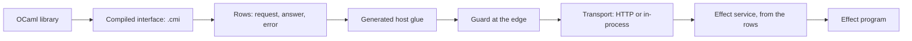
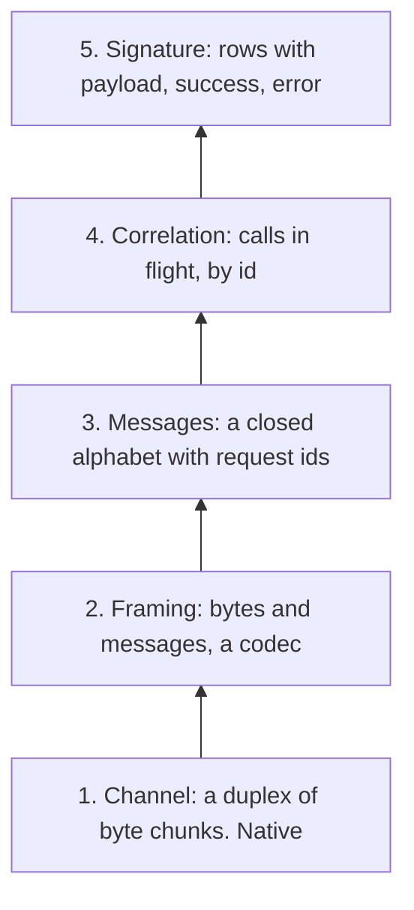

# OCaml libraries as Effect services: an exploration

Status: exploration probes, not authority.
Base: `439155600` on `refactor/phase1-phase3`.
Role: the first vertical slice of row 393 (5), explored before any design is fixed.
Scope: OCaml 5.1.1, Eio 1.2, js_of_ocaml, Effect 4.0.0-rc.112 under bun 1.4.2, tsgo 7.

## 1. The one thing to know first

One description per host operation, a row, carries an OCaml library to an Effect service in
both directions. A generator read Fpath's compiled interface (`fpath.cmi`) and made 39 rows. One
generic HTTP transport and one generic Effect client then served them. An Effect program called
the library over HTTP and in-process through js_of_ocaml, and the two layers answered alike.

Each piece is a finite probe. The Lean tree already owns most seams, and the probes copy them by
hand. §5 lists what moves into Lean so that nothing is copied.

## 2. Question

Can Effect services be generated from OCaml libraries' own types, with the boundary checked? Where
do the OCaml, TypeScript and Lean descriptions meet, and which seams have no Lean model yet?

## 3. What was run

| Probe | Files | Evidence | Result |
| --- | --- | --- | --- |
| The to-do as an Effect HttpApi, served by OCaml on Eio | `http/todo_http.ml`, `http/client.ts` | tested, `http/client.log`, `http/server.log` | Effect's derived client gets typed records, typed `NotFound` and `EmptyTitle` errors with their statuses, and no-content |
| One HTTP transport for every row table | `rows/rows_core.ml`, `rows/transport.ml`, `rows/rows_http.ml` | tested, `rows/selftest.log` | the host behind HTTP answers 6 of 6 calls as the host does; refusals name their path; the guard refuses a lying host |
| An Effect service built at run time from a served table | `rows/rows_client.ts`, `rows/rows_service.ts` | tested, `rows/service.log` | 4 methods built; the request schema refuses a negative natural before sending |
| An OCaml library's interface read as data | `cmi/cmi_rows.ml` | tested, `cmi/report.log` | Fpath: 39 values as rows, 4 refused with reasons, 6 skipped |
| The generated host and service | `cmi/generated/fpath_host.ml`, `cmi/generated/Fpath.service.ts` | tested, `cmi/fpath-program.log`, `cmi/tsgo.log` | an Effect program calls Fpath; tsgo 7 accepts the declaration and refuses `cmi/misuse.ts` |
| Fpath's string image against the image laws | `cmi/fpath_laws.ml` | tested, `cmi/fpath-laws.log` | retraction holds on 13 samples; exactness fails at `a//b` |
| Two layers under one service | `jsoo/fpath_js.ml`, `jsoo/two_layers.ts` | tested, `jsoo/two-layers.log` | native over HTTP and js_of_ocaml in-process answer 7 of 7 calls alike |

Each log's first line names its command and versions. The OCaml probes compile with
`opam exec --switch=effect4 -- ocamlfind ocamlopt -thread -package eio_main,yojson[,fpath] -linkpkg …`.
The TypeScript probes run with `bun --no-install run <file> <url>` beside a link to
`ts/eff/node_modules`.

## 4. Findings

### 4.1 The seams, and their owners

| Seam | The probe's copy | The Lean owner | State |
| --- | --- | --- | --- |
| Interface as data | `cmi_rows.ml` over `Types.signature` | `OCaml5.Ml.Ty` prints OCaml types and reads none | gap |
| The row type language | `Rows_core.ty` | `Ty` (`src/Effect4/Program/TyCore.lean`) | copied |
| A carrier's image | `of_string`, `to_string` | `Image` (`src/Effect4/Store/Carrier/Image.lean`) | copied, laws untested |
| Membership with a path | `Rows_core.refusal` | `Val.hasTy` (`src/Effect4/Program/Typed.lean`) | copied |
| The host and its guard | `Rows_core.host`, `guard` | `Run.Reactor`, `hostGuard`, `Comodel.guard_meets` | copied |
| The transport's law | a finite check | none | gap |
| Ty to Effect Schema | `schemaOf` in `rows_client.ts` | `schema` (`src/Effect4/Schema/Bridge.lean`) | copied |
| Rows to services | `buildRowsOver` | `rowServices`, `rowServiceDecls` (`src/Effect4/Codegen/RowServices.lean`) | copied |
| Two hosts that answer alike | a finite check | `comodel_ext` (`src/Effect4/Laws/Api/HostDrive.lean`) | proved premise shape |

### 4.2 The description picks the encoding

Effect's HttpApi sends a payload given as a field list as `application/x-www-form-urlencoded`. It
sends a payload given as a schema as JSON (`http/form-payload-finding.log`). An edge written by
hand guessed JSON and refused the first request. So the edge must read the same description as
the client, which means generating it from that description.

### 4.3 A library's image needs its laws checked

Fpath's string pair passes retraction on every sample and fails exactness at `a//b`. It is a
widening until its normaliser, the collapse of repeated separators, is named. The generator
assumed the pair was exact from its types alone. A generated law check per image catches this.

### 4.4 What the row language refuses, by cause

| Refusal | Count in Fpath | What lifts it |
| --- | --- | --- |
| A labelled argument | 2 | records as requests |
| A handle (`Format.formatter`) | 2 | resource rows (P5 of the interop plan) |
| An optional argument | 7, kept at its default | optional keys in `Ty` |
| An operator or a submodule | 6, skipped | the named forms; a submodule read on its own |

## 5. Proposals: from probes to infrastructure

1. **One row language.** Lower `Ty`, `Val.hasTy`, `hostGuard` and the JSON image from Lean through
   LCNF, as K1 lowered the program types. The probe's `Rows_core` then goes.
2. **The transport theorem, once.** State a transport in `effects` as a client handler and a
   server host. Prove that the pair gives back the host, through `Comodel.through`. HTTP, a byte
   pipe and an in-process call are then instances.
3. **Interfaces as data in Lean.** Read a `.cmi` into an `OCaml5.Ml` signature description. Make
   the classification a located refusal: a row or a refusal with its cause.
4. **Images with their laws.** Each image names its normaliser and gets a generated law check. A
   library's image without one is a widening, and the generator says so.
5. **The edge from the description.** Print Effect's HttpApi from the application's entries,
   with statuses as data. Generate the OCaml edge from the same description.
6. **Typed rows in OCaml.** Describe rows by a typed GADT (`'a ty`), as Jane Street's `Typerep`
   does. A host's codecs are then one fold, not generated text.
7. **Exceptions by kind.** Decide which OCaml exceptions are failures and which are defects, in
   Effect's sense, as data per row.

## 6. Transports and RPC

### 6.1 The question

Which model of transport is the smallest one that every RPC system fits? The probe reads Effect's
RPC and two installed OCaml RPC libraries at source, and builds one end to end.

### 6.2 The systems

| System | Evidence | Typed descriptions | The channel it assumes | What to take |
| --- | --- | --- | --- | --- |
| Effect RPC (`effect/unstable/rpc`, rc.112) | reading, tested | `RpcGroup` of `Rpc.make` with payload, success and error schemas | `Socket`: a chunk handler and a writer | the message alphabet, `Exit` with its cause, serialization apart from protocol |
| dune-rpc (installed `dune-rpc`) | reading | `Conv`: records, optional fields, sums, a version on each field | `Chan`: `write` a list of csexp, `read` one | version negotiation into a menu; a client over an abstract fiber and channel |
| JSON-RPC 2.0 (installed `jsonrpc`) | reading | none: JSON values | any byte stream | the notification (a request with no reply) and the batch |
| Jane Street `async_rpc_kernel` | named, not installed | `bin_prot` shapes | a reader and a writer, with heartbeats | streaming kinds as their own declarations; version menus |
| Cap'n Proto RPC (`capnp-rpc`, on Eio) | named, not installed | a compiled schema | a byte stream | capabilities in messages; calls on a promised result |
| `rpclib` | named, not installed | an IDL of OCaml values, derived by a PPX | any | the description as values, many protocols from one |

### 6.3 The model: one native layer, four of data

Only the channel is native. Framing is a codec with the read-back law. The messages are a free
object. Effect's alphabet is Request, Ack, Interrupt, Ping and Eof from the client. From the
server it is Chunk, Exit, Defect and Pong. Correlation is a state machine over data: each id is
answered once, and an interrupt names a live id. The host session already holds the server's
half of that law (`session_keys_once`, `src/Effect4/Laws/Run/Journal.lean`).

### 6.4 What ran

| Probe | Files | Evidence | Result |
| --- | --- | --- | --- |
| Effect's `RpcClient` against an OCaml server, over a TCP socket with NDJSON and over HTTP with JSON | `rpc/effect_rpc.ml`, `rpc/client.ts` | tested, `rpc/client.log`, `rpc/server.log` | the two channels answer 9 of 9 calls alike |
| Correlation on one connection | the same | tested, `rpc/server.log` | ids 3 and 4 go out in order and come back as 4, then 3 |
| Interruption | the same | tested, `rpc/server.log` | over the socket, the timed-out call's Interrupt cancels its fiber; over HTTP no Interrupt exists, and id 15 runs on |
| The transport law in Lean | `rpc/Transport.lean` | proved, `rpc/transport-lean.log` | `through_serve`: through a lawful codec, client and server give back the host; `through_serve_stacked`: two layers give it back too |

### 6.5 Findings

- The channel decides which messages exist. HTTP carries no Interrupt and no Ack, so the same
  answers can hide different work on the server. A transport law must name its observation.
- Effect separates serialization from protocol, and its JSON and NDJSON serializations differ only
  in framing (`includesFraming`). That is layer 2 apart from layer 3, as data.
- Effect's `Exit` encoding is a success, or a failure with a cause of Fail, Die and Interrupt. It
  is the machine's own exit and cause, so no conversion sits between them.
- `through_serve` covers a request/response wire. A channel with several calls at once needs
  layer 4 as a host with state. Its law is a simulation of the request/response wire.

### 6.6 Proposals

1. Declare the message alphabet as a Lean inductive, with its JSON image as an `Image`.
2. Move `through_serve` and its codec into `effects`. Add the correlation layer: a host over
   send and receive, whose state is the calls in flight. Prove it simulates the wire.
3. Take dune-rpc's version menu for rows that change: negotiation as data at session start.
4. Take Cap'n Proto's capabilities for P5's resources: a handle in a message is a capability.
5. Generate layers 2 to 4 once, generic over the rows. The OCaml edge then comes from the same
   description as Effect's client.

## 7. The message alphabet, from what exists

### 7.1 The principle

The tree already holds every representation the layers need. The alphabet is a function of the
rows over `Ty`. The existing bridge prints it, and the existing codec admits wire messages
against it. No new representation enters.

### 7.2 What ran

| Probe | Files | Evidence | Result |
| --- | --- | --- | --- |
| Effect's RPC schemas exported as data | `alphabet/export.ts`, `alphabet/vendored/effect-rpc-rc112.json` | tested | the envelope, each RPC's payload, success, error and exit, and five serializations, written by rc.112's own `SchemaRepresentation` |
| Those schemas read into `Ty` | `alphabet/Alphabet.lean` | tested, `alphabet/alphabet.log` | payloads read as they are; exits and errors read after three widenings; the envelope stays refused |
| The alphabet derived from the rows | the same | tested | 6 of 9 recorded server messages admitted; the 3 refused are named in §7.3 |
| The derived alphabet through the bridge | the same | tested | `ofSchema (schema t) = some t` for both directions' alphabets |

`Alphabet.lean` reads rc.112's representation JSON into `Representation` with a small reader
(`repOf`). It then applies the existing `Bridge.ofSchema` (`src/Effect4/Schema/Bridge.lean`), and
decodes with the existing `Schema.decode` (`src/Effect4/Schema/Codec.lean`).

### 7.3 The seams it found

| Seam | Observed | What it needs |
| --- | --- | --- |
| References in a document | `ofSchema` refuses `$ref` | resolve before reading, in the reader |
| Unions of one or of three or more | `Rpc.exitSchema` wraps an error in a one-member union; the envelope has nine members | read a one-member union as its member, many as nested pairs |
| The `~identifier` annotation | a tagged error carries it, and `erasedKeys` lacks it | add it to the erased keys, with `ofSchema_exact` kept |
| A request id is a JS `number` | `Ty.number` is unlowered in the bridge, so the envelope is refused | lower `number`, or restrict ids to integers and strings with a named refusal |
| The failure form | `eff_failure SqlError message` is a pair; the face (`Codegen/Classes.lean`, row 120 (b)) and Effect's wire use the tagged record | one failure form: the tagged record |
| An option on the wire | the codec admitted a bare record at `option` | check against rc.112's `Option` JSON codec, which `check-schema-codec` owns |
| The hand-written client | `Int` for a natural, `Null` for unit, `NullOr` for an option, declared field order | print the RPC group from the rows; compare types modulo `Ty.normalize` |

The two answers of `echoAfter` are refused correctly: `echoAfter` is no row of the table.

### 7.4 Each layer: its owner, its Effect surface and its OCaml surface

| Layer | The Lean owner | The Effect surface | The OCaml surface | What is missing |
| --- | --- | --- | --- | --- |
| 5. Signature | `Row`, `eff_rows`, `rowServices` | `RpcGroup` of `Rpc.make`, printed from the rows | the host: generated glue or the lowered machine | the `RpcGroup` printer |
| 4. Correlation | `session_keys_once`; `Run.Reactor`; `Effects.Comodel` | inside Effect's `RpcClient` and `RpcServer` | one module, generic in the alphabet | the client half's law; correlation as a host over send and receive |
| 3. Messages | `Ty`: the alphabet as `fromClient rows` and `fromServer rows` | Effect's `RpcMessage`, read from the vendored document | the lowered codec at the alphabet's type | the id type and the failure form |
| 2. Framing | `Schema.encode` and `Schema.decode` at a `Ty` | `RpcSerialization` layers: json, ndjson, jsonRpc, msgPack | NDJSON and JSON framing, once | the serialization table as Lean data |
| 1. Channel | none: native and assumed (row 393 (4)) | platform layers: `Socket`, `FetchHttpClient`, workers, stdio | Eio flows | the platform table as Lean data |

### 7.5 The platform model, as data

Effect's own protocols say what each channel carries. The HTTP client sends only `Request`
(`vendor/effect-4.0.0-rc.112/src/unstable/rpc/RpcClient.ts:923`) and declares no acks (`:1002`).
The socket and worker clients declare acks (`:1187`, `:1410`). Each serialization declares its
content type and whether it frames its messages. The platform model is that table:

- a channel: its name, the messages it carries, whether it needs framed messages, and the Effect
  layer that provides it;
- a serialization: its name, its content type and whether it includes framing.

A deployment is a channel with a serialization. It is valid when a channel that needs framing
gets a framed serialization. The transport law observes only the messages the channel carries.
Over HTTP the law covers answers, and interruption stays unobserved.

### 7.6 The vendoring route

1. Export an Effect schema, or a standard's JSON Schema read by `fromJsonSchemaDocument`, as
   rc.112's representation JSON.
2. Vendor the file with its source, version and SHA-256.
3. Read it with `Representation.ofJson`, then `Bridge.ofSchema`, into `Ty`.
4. Generate from `Ty`: the Effect schema (`Bridge.schema`), the codec, and the OCaml lowering.

### 7.7 The slices

| Slice | What lands | Consumer |
| --- | --- | --- |
| A1 | `Representation.ofJson`; the three widenings in `ofSchema`, with `ofSchema_exact` kept | the vendored rc.112 document reads into `Ty` |
| A2 | `fromClient` and `fromServer` as functions of the rows; agreement with the vendored exits | the wire admission of every message |
| A3 | one failure form: the tagged record | the alphabet admits the codec value of Effect's failure |
| A4 | the `RpcGroup` printer from the rows | Effect's `RpcClient` against the OCaml server, with no hand-written schema |
| A5 | the platform and serialization tables as data, and the layer printer | a deployment's Effect layers |
| A6 | correlation in `effects`: a host over send and receive that simulates the request/response wire | the transport law for sockets |
| A7 | the OCaml layers 2 to 4, generated once from the alphabet | replaces `rpc/effect_rpc.ml` |

## 8. What this does not establish

- Each result is a finite probe at the named versions, except the two theorems of
  `rpc/Transport.lean`.
- The probes trust Fpath, Eio, js_of_ocaml and Effect, under row 393 (4).
- The to-do server transcribes the four entries by hand. The lowered machine is P1's work.
- The HTTP reader is minimal: no TLS, no pipelining limits, no timeouts.
- The HTTP transport law holds on the scripted calls only.
- `through_serve` covers a request/response wire with lawful codecs. It covers no correlation, loss
  or interruption.
- The systems marked "named" were not installed or read here.
