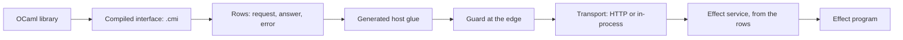

# OCaml libraries as Effect services: an exploration

Status: exploration probes, not authority.
Base: `439155600` on `refactor/phase1-phase3`.
Role: the first vertical slice of row 393 (5), explored before any design is fixed.
Scope: OCaml 5.1.1, Eio 1.2, js_of_ocaml, Effect 4.0.0-rc.112 under bun 1.4.2, tsgo 7.

## 1. The one thing to know first

One description per host operation, a row, carries an OCaml library to an Effect service in
both directions. A generator read Fpath's compiled interface (`fpath.cmi`) and made 39 rows. One
generic HTTP transport and one generic Effect client then served them. An Effect program called
the library over HTTP and in-process through js_of_ocaml, and the two layers answered alike.

Each piece is a finite probe. The Lean tree already owns most seams, and the probes copy them by
hand. §5 lists what moves into Lean so that nothing is copied.

## 2. Question

Can Effect services be generated from OCaml libraries' own types, with the boundary checked? Where
do the OCaml, TypeScript and Lean descriptions meet, and which seams have no Lean model yet?

## 3. What was run

| Probe | Files | Evidence | Result |
| --- | --- | --- | --- |
| The to-do as an Effect HttpApi, served by OCaml on Eio | `http/todo_http.ml`, `http/client.ts` | tested, `http/client.log`, `http/server.log` | Effect's derived client gets typed records, typed `NotFound` and `EmptyTitle` errors with their statuses, and no-content |
| One HTTP transport for every row table | `rows/rows_core.ml`, `rows/transport.ml`, `rows/rows_http.ml` | tested, `rows/selftest.log` | the host behind HTTP answers 6 of 6 calls as the host does; refusals name their path; the guard refuses a lying host |
| An Effect service built at run time from a served table | `rows/rows_client.ts`, `rows/rows_service.ts` | tested, `rows/service.log` | 4 methods built; the request schema refuses a negative natural before sending |
| An OCaml library's interface read as data | `cmi/cmi_rows.ml` | tested, `cmi/report.log` | Fpath: 39 values as rows, 4 refused with reasons, 6 skipped |
| The generated host and service | `cmi/generated/fpath_host.ml`, `cmi/generated/Fpath.service.ts` | tested, `cmi/fpath-program.log`, `cmi/tsgo.log` | an Effect program calls Fpath; tsgo 7 accepts the declaration and refuses `cmi/misuse.ts` |
| Fpath's string image against the image laws | `cmi/fpath_laws.ml` | tested, `cmi/fpath-laws.log` | retraction holds on 13 samples; exactness fails at `a//b` |
| Two layers under one service | `jsoo/fpath_js.ml`, `jsoo/two_layers.ts` | tested, `jsoo/two-layers.log` | native over HTTP and js_of_ocaml in-process answer 7 of 7 calls alike |

Each log's first line names its command and versions. The OCaml probes compile with
`opam exec --switch=effect4 -- ocamlfind ocamlopt -thread -package eio_main,yojson[,fpath] -linkpkg …`.
The TypeScript probes run with `bun --no-install run <file> <url>` beside a link to
`ts/eff/node_modules`.

## 4. Findings

### 4.1 The seams, and their owners

| Seam | The probe's copy | The Lean owner | State |
| --- | --- | --- | --- |
| Interface as data | `cmi_rows.ml` over `Types.signature` | `OCaml5.Ml.Ty` prints OCaml types and reads none | gap |
| The row type language | `Rows_core.ty` | `Ty` (`src/Effect4/Program/TyCore.lean`) | copied |
| A carrier's image | `of_string`, `to_string` | `Image` (`src/Effect4/Store/Carrier/Image.lean`) | copied, laws untested |
| Membership with a path | `Rows_core.refusal` | `Val.hasTy` (`src/Effect4/Program/Typed.lean`) | copied |
| The host and its guard | `Rows_core.host`, `guard` | `Run.Reactor`, `hostGuard`, `Comodel.guard_meets` | copied |
| The transport's law | a finite check | none | gap |
| Ty to Effect Schema | `schemaOf` in `rows_client.ts` | `schema` (`src/Effect4/Schema/Bridge.lean`) | copied |
| Rows to services | `buildRowsOver` | `rowServices`, `rowServiceDecls` (`src/Effect4/Codegen/RowServices.lean`) | copied |
| Two hosts that answer alike | a finite check | `comodel_ext` (`src/Effect4/Laws/Api/HostDrive.lean`) | proved premise shape |

### 4.2 The description picks the encoding

Effect's HttpApi sends a payload given as a field list as `application/x-www-form-urlencoded`. It
sends a payload given as a schema as JSON (`http/form-payload-finding.log`). An edge written by
hand guessed JSON and refused the first request. So the edge must read the same description as
the client, which means generating it from that description.

### 4.3 A library's image needs its laws checked

Fpath's string pair passes retraction on every sample and fails exactness at `a//b`. It is a
widening until its normaliser, the collapse of repeated separators, is named. The generator
assumed the pair was exact from its types alone. A generated law check per image catches this.

### 4.4 What the row language refuses, by cause

| Refusal | Count in Fpath | What lifts it |
| --- | --- | --- |
| A labelled argument | 2 | records as requests |
| A handle (`Format.formatter`) | 2 | resource rows (P5 of the interop plan) |
| An optional argument | 7, kept at its default | optional keys in `Ty` |
| An operator or a submodule | 6, skipped | the named forms; a submodule read on its own |

## 5. Proposals: from probes to infrastructure

1. **One row language.** Lower `Ty`, `Val.hasTy`, `hostGuard` and the JSON image from Lean through
   LCNF, as K1 lowered the program types. The probe's `Rows_core` then goes.
2. **The transport theorem, once.** State a transport in `effects` as a client handler and a
   server host. Prove that the pair gives back the host, through `Comodel.through`. HTTP, a byte
   pipe and an in-process call are then instances.
3. **Interfaces as data in Lean.** Read a `.cmi` into an `OCaml5.Ml` signature description. Make
   the classification a located refusal: a row or a refusal with its cause.
4. **Images with their laws.** Each image names its normaliser and gets a generated law check. A
   library's image without one is a widening, and the generator says so.
5. **The edge from the description.** Print Effect's HttpApi from the application's entries,
   with statuses as data. Generate the OCaml edge from the same description.
6. **Typed rows in OCaml.** Describe rows by a typed GADT (`'a ty`), as Jane Street's `Typerep`
   does. A host's codecs are then one fold, not generated text.
7. **Exceptions by kind.** Decide which OCaml exceptions are failures and which are defects, in
   Effect's sense, as data per row.

## 6. What this does not establish

- Each result is a finite probe at the named versions. None is a theorem.
- The probes trust Fpath, Eio, js_of_ocaml and Effect, under row 393 (4).
- The to-do server transcribes the four entries by hand. The lowered machine is P1's work.
- The HTTP reader is minimal: no TLS, no pipelining limits, no timeouts.
- The transport law holds on the scripted calls only.
