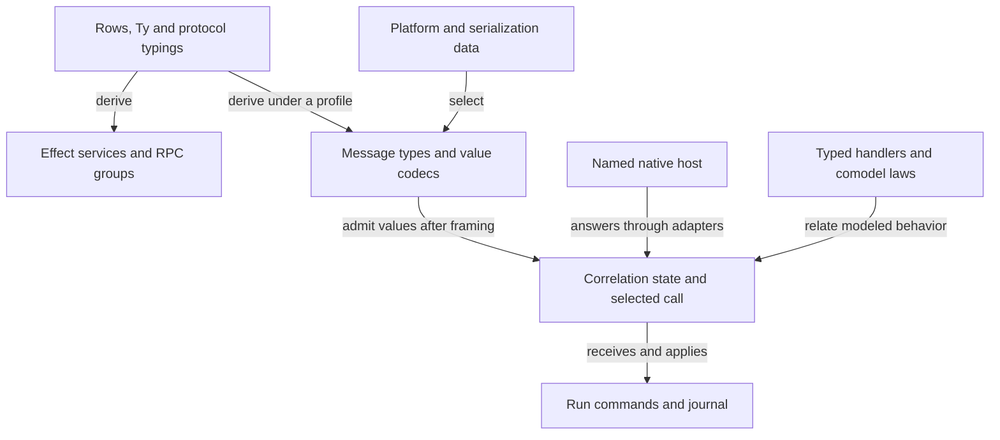
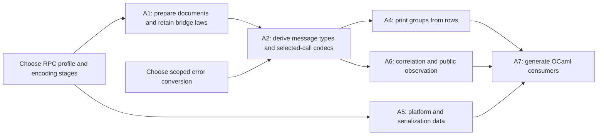

# Review of the OCaml interop plan

**Coordinator action:** Fix reply admission before generating A2 or A7.
The alphabet accepts the recorded `setDone` reply through another row's answer type.
It does not demonstrate a defect in the option codec.
Select the outstanding call before decoding its answer.

Status: research review and proposals, not authority.
Brief base: `fe671be2b6602034da965c03f3b55cc4cbd3ad3c`.
Reviewed head: `bbaa10c0dfbfdbd35087e32686866880f9bce7a1`, on `refactor/phase1-phase3`.
Reviewed `effects` pin: `bf5ab8fd26ee009abbf465821a3664ea20948a49`.
The required plans, probes and named implementation files have no diff between those commits.
Rows 391, 393 and 394 govern this review.
Row 395(10) also records the later dependency on the `Ty.number` bridge extension.

The review covers the brief's source questions, theoretical questions, law placements and executable probes.
Three GPT-6.1 Sol reviewers inspect the conversion, RPC and theory parts independently.
Only this review file changes.

## Findings, ranked by rework

### F1. Message shape does not establish reply admission

Evidence: reading and tested finite probes.
Scope: `Explore.Alphabet.fromServer` and the retained to-do messages.

[`fromServer`](</Users/pooks/Dev/lean4-effect4/docs/research/2026-10-15-ocaml-interop-explore/alphabet/Alphabet.lean>) unions every row's exit type.
Every branch has the same request-id type.
The decoder can therefore accept a reply through a row that did not issue the call.

The fresh counterprobe reports:

```text
bare setDone reply: aggregate=true, selected-row=false
tagged Some reply: selected-row=true
```

[`wireAlgebra.ty_option`](</Users/pooks/Dev/lean4-effect4/src/Effect4/Schema/Codec.lean>) requires tagged `Some` or `None`.
The recorded bare record fits `insert`'s answer instead.
The same alphabet accepts an interruption for `echoAfter`, although the table contains no such row.
Its refusal of the other `echoAfter` replies checks their values, not their association with an outstanding call.

Effect already makes this distinction.
[`RpcClient.make`](</Users/pooks/Dev/lean4-effect4/vendor/effect-4.0.0-rc.112/src/unstable/rpc/RpcClient.ts>) finds the entry by request id, then uses that entry's `decodeExit`.

**Correction:** Keep broad envelope admission separate from reply admission.
Decode the reply at its selected row and checked call instance.
Record the connection between RPC ids and the run's session, call id and key.
Refuse unknown, retired and wrongly typed replies according to the selected protocol.
Keep cross-row replies as the controls for this connection.

[`session_keys_once`](</Users/pooks/Dev/lean4-effect4/src/Effect4/Laws/Run/Journal.lean>) supplies an existing at-most-once result for reached runs.
It does not supply that RPC-id connection or prove that external work occurs once.
[`Rows.receive` and `Rows.answer`](</Users/pooks/Dev/lean4-effect4/src/Effect4/Run/Basic.lean>) already separate receipt from application.
The correlation layer should keep receipt separate from application.

### F2. The exported envelope describes a different encoding stage

Evidence: reading and tested export reproduction.
Scope: §7.4–§7.6 and `alphabet/export.ts`.

[`RpcMessage.EncodedSchema`](</Users/pooks/Dev/lean4-effect4/vendor/effect-4.0.0-rc.112/src/unstable/rpc/RpcMessage.ts>) uses `Uint8Array` for payload, chunk, exit and defect fields.
The pin uses this schema after a binary serializer encodes those fields.
The probe's row-derived alphabet instead places JSON values in those fields.
These are different stages of the same protocol.

[`RpcSerialization`](</Users/pooks/Dev/lean4-effect4/vendor/effect-4.0.0-rc.112/src/unstable/rpc/RpcSerialization.ts>) supplies both `codecFor` and a stateful parser.
The parser handles envelopes.
`codecFor` supplies the schema-dependent field encoding.
The exported content type and framing Boolean omit this choice.
JSON-RPC also changes envelope shapes and batches.
The worker protocol uses structured clone without an `RpcSerialization` layer.

Extending the bridge for `Ty.number` alone cannot make this exported envelope readable.
[`schemaAlg.ty_bytes`](</Users/pooks/Dev/lean4-effect4/src/Effect4/Schema/Bridge.lean>) remains unlowered.
The JSON codec also refuses bytes.

The derived alphabet has further limits:

| Declaration | Current limit | Correction |
| --- | --- | --- |
| `fromServer` | It omits `Chunk`. | Name the unary-call profile, or derive streaming messages from a declared streaming interface. |
| `fromServer` | It omits server-originated requests and notifications allowed by `FromServerEncoded`. | Name the client-initiated profile, or supply the reverse-call protocol. |
| `fromServer`'s `Defect` | Its `.unknown` field always refuses in the JSON codec. The fresh probe confirms this. | Select the defect codec and its admitted values explicitly. |
| `fromClient` | It omits optional tracing and notification fields present in `RequestEncodedSchema`. | Generate the admitted metadata, or refuse those capabilities by name. |
| `method` | It drops the service namespace. | Generate a group per service, or qualified tags with collision refusal. |

**Correction:** Start with client-initiated unary calls over JSON/NDJSON, without notifications or server-originated requests.
Keep field encoding, envelope encoding, framing and protocol capabilities distinct in the tables.
Compare the derived alphabet with the vendored representation after the declared field substitution.
Do not claim direct equality with the binary envelope.

Row 393(5)'s Effect-service model remains useful.
The pinned implementation shows which choices its generated bridges must retain.
A framing Boolean is one compatibility condition, not the whole deployment judgment.

### F3. Reference and union preparation changes the exactness boundary

Evidence: reading and tested finite counterexamples.
Scope: A1 and `Bridge.ofSchema_exact`.

[`ofSchema_exact`](</Users/pooks/Dev/lean4-effect4/src/Effect4/Schema/Bridge.lean>) states:

```text
ofSchema r = some t  →  normS r = schema t
```

`normS` retains reference nodes, union arity and union nesting.
The proposed reader changes cannot retain this statement on the original representation under the current normaliser.

| Preparation | Counterexample | Why the current statement fails |
| --- | --- | --- |
| Resolve a reference | Reference `T`, with `T` naming String | `normS` retains the reference; the writer emits String. |
| Remove a unary union | `anyOf [String]` | `normS` retains the union; the writer emits String. |
| Nest a flat union | `anyOf [String, Boolean, Void]` | `normS` retains three members; the writer emits nested binary unions. |

The fresh probe accepts each prepared representation.
Each original normal form differs from the writer's result.
Each prepared normal form equals that result.

**Correction:** Put this preparation at the existing [`Document`](</Users/pooks/Dev/lean4-effect4/src/Effect4/Schema/Document.lean>) boundary.
Keep `ofSchema_exact` about the prepared representation.
State a separate relationship between the original document and its prepared representation only when a consumer needs it.
Alternatively, propose a changed normaliser explicitly before changing the law.

Preserve ordered `anyOf` branches.
Do not treat `oneOf` as interchangeable with `anyOf`.
Refuse missing references, duplicate reference keys and unsupported cycles with their paths.
The finite depth limit in `widen` is not a recursive-document semantics.

The `~identifier` change differs.
Adding that key to `erasedKeys` changes both the admission guard and `normS` consistently.
The same exactness statement can then hold under the amended annotation policy.
The policy must name the discarded identifier and reference-naming information.
It must not claim identity of original document bytes or reference sharing.

[`SchemaRepresentation.toRepresentation` and `fromJson`](</Users/pooks/Dev/lean4-effect4/vendor/effect-4.0.0-rc.112/src/SchemaRepresentation.ts>) also distinguish AST encoding from persisted-document decoding.
The proposed reader should retain those stages.
The probe's small `repOf` is evidence for its selected constructors, not a general document reader.

### F4. The transport theorem needs a codec domain and an observation

Evidence: reading and fresh Lean elaboration.
Scope: [`Codec`, `through_serve` and `through_serve_stacked`](</Users/pooks/Dev/lean4-effect4/docs/research/2026-10-15-ocaml-interop-explore/rpc/Transport.lean>).

The existing theorem is correct in its stated model.
Its encoder is total on every operation and every answer.
Its two premises require read-back of encoded requests and answers.

The actual [`RowSig`](</Users/pooks/Dev/lean4-effect4/src/Effect4/Laws/Program/DenoteRows.lean>) contains every `Val` request and every `ExitV` answer.
Its carriers deliberately forget the row's types.
`Schema.encode` is partial and checks codec admission.
It cannot instantiate `Codec` on this unrestricted signature without another premise or construction.

**Correction:** Use a signature derived from the admitted domain, or a protocol-relative transport law.
The latter should use `Comodel.Meets` and client admission premises.
Keep unsupported values and scalar refusals explicit.
Do not replace a missing answer with an invented typed failure.

A6 also needs a comparison on one public signature.
[`Effects.IsSim`](</Users/pooks/Dev/lean4-effect4/.lake/packages/effects/Effects/Coalgebra/Bisim.lean>) matches steps over the same signature.
It does not directly compare separate send/receive operations with atomic exchange.
It provides no silent-step or stuttering clause.

Interpret the protocol through a handler, then define its public exchange observation.
Use the existing simulation after that abstraction, or state the smaller asynchronous transition relation the consumer requires.

For the first law, use completed unary calls without cancellation.
Name each request id's answer and the order in which stateful host operations take effect.
Require the chosen delivery and correlation premises.
Do not promise progress from those safety premises.

Hiding `Interrupt` messages does not establish this law for cancelled calls.
The retained [`server.log`](</Users/pooks/Dev/lean4-effect4/docs/research/2026-10-15-ocaml-interop-explore/rpc/server.log>) shows socket cancellation and an HTTP call that later returns success.
An abandoned stateful call could also change a later answer.
The delayed echo probe exercises no such mutation.
Cancellation therefore needs a separate fragment or an explicit specification of continuing abandoned work.

### F5. RPC does not require global failure migration

Evidence: reading.
Scope: §6.5, §7.3 and A3.

[`effMessageDecl`](</Users/pooks/Dev/lean4-effect4/src/Effect4/Program/Authoring/Declare.lean>) constructs the tagged message pair.
The existing record form of `eff_failure` constructs a tagged record.
[`Classes.classTag?`](</Users/pooks/Dev/lean4-effect4/src/Effect4/Codegen/Classes.lean>) recognizes that record form.
It does not already turn every message pair into a class.

The two forms also have different elimination behavior.
[`Decision.tag`](</Users/pooks/Dev/lean4-effect4/src/Effect4/Program/Decision.lean>) binds the pair's payload.
`Decision.recordTag` binds the record.
Changing all failures therefore reaches more than wire encoding.

| Migration scope | What it reaches |
| --- | --- |
| Change message declarations to produce records | Declared error types, construction terms, tag handlers and tests that expect those types. |
| Retire the pair representation | `Ty.isTagged`, `payloadOf`, `taggedColumn`, decision typing, residual laws, `Err.tagged`, `errOf`, `valOfErr` and retained byte images. |
| Migrate the to-do declarations alone | `SqlError`, `EmptyTitle`, scripted replies, claims, application providers, generated faces and corpus expectations. |

[`foundation-wave2.contract.md`](</Users/pooks/Dev/lean4-effect4/Test/contracts/foundation-wave2.contract.md>) explicitly retains the `Err.tagged` image.
[`Ty`](</Users/pooks/Dev/lean4-effect4/src/Effect4/Program/Ty.lean>) and [`Machine.Term`](</Users/pooks/Dev/lean4-effect4/src/Effect4/Machine/Term.lean>) own the affected interpretations.

**Correction:** Prefer a row-specific RPC error conversion for the existing pair representation.
Alternatively, migrate the selected service to the existing record declaration form.
Neither choice requires retiring all tagged pairs.
Do not rewrite every product as a tagged record.

`encodeReason` and `decodeReason` already convert causes at the JSON boundary.
The common success/failure structure permits reuse of those functions.
It does not justify §6.5's claim that no conversion exists.

### F6. Whole-value codecs do not specify incremental framing

Evidence: reading.
Scope: §6.3 and §7.4.

`Schema.encode` and `Schema.decode` operate on JSON values.
They do not specify how byte chunks become whole messages.
NDJSON needs parser state, retained input and an end-of-input policy.
Its accepted whitespace and byte spellings also exceed one canonical encoding.

[`Store.Image`](</Users/pooks/Dev/lean4-effect4/src/Effect4/Store/Carrier/Image.lean>) provides a total writer and an exact partial reader into `Val`.
Its derived byte decoder consumes one whole canonical value.
It cannot by itself describe an incremental stream parser or permissive JSON text.

**Correction:** Reuse the value codec after framing.
Describe parser state as data and its transitions as functions or a comodel.
Name the accepted byte profile, residual input and limits.
Use a named normaliser or parser relation where several byte spellings pass the parser.
Do not add a second codec language.

### F7. Request ids need an explicit scalar profile

Evidence: reading.
Scope: `idTy`, DI-56 and row 395(10).

The pin permits string or number ids.
Its default `RpcClient.makeNoSerialization` generator increments a numeric counter.
It also permits a custom generator.

| Choice | DI-56 | Effect client compatibility |
| --- | --- | --- |
| Strings and bounded safe integers | Fits with explicit ingress and arithmetic refusal. | Fits the default counter within the bound. It excludes custom fractional ids. |
| Full `Ty.number` bridge support | Needs the declared JSON and scalar admission policy. | Covers more custom ids, subject to that policy. It does not solve the byte-envelope gap. |

**Correction:** Keep the full number-lowering dependency recorded by row 395(10).
If an earlier consumer needs ids, propose the restricted profile explicitly.
Neither choice permits silent rounding, saturation or string/number coercion.
State id equality, negative-zero treatment, freshness and retirement.
When the counter reaches the profile boundary, refuse before reuse or loss of identity.

### F8. Reuse is achievable, but the plan needs one declared profile

Evidence: reading.
Scope: §6.6 compared with §7.1–§7.7.

§6.6 proposes a new message inductive.
§7 instead derives message types from the rows.
Use the latter as the canonical plan.
A generated convenience view may exist, but it must not become another independently maintained protocol description.

[`rowServices`](</Users/pooks/Dev/lean4-effect4/src/Effect4/Codegen/RowServices.lean>) already groups methods by service and checks names.
Use that grouping when generating RPC groups.
The last component of a row spelling is not globally unique.

The platform and serialization tables can remain ordinary data over existing types.
They should select named implementations, capabilities and codec profiles.
They should not redeclare field types or store native closures in program syntax.

Generate the client schemas from the chosen rows and profile.
`Ty.normalize` can reconcile field order.
It cannot identify `int` with `nat`, `null` with `unit`, or `NullOr` with `option`.
The current handwritten schemas therefore need replacement or explicit conversions.

## The seams of §7.3

| Seam | Verdict | Required change |
| --- | --- | --- |
| References | The refusal is real. | Prepare an admitted `Document` before the exact bridge, as F3 specifies. |
| Unary and larger unions | The refusal is real. | Keep order and union mode. Separate preparation from the current exactness law. |
| `~identifier` | The missing erasure entry is real. | Propose the annotation-policy amendment and retain its exact scope. |
| Request id | The integer approximation is real. | State the scalar profile. Include the byte-envelope gap from F2. |
| Failure form | The pair/record mismatch is real. | Use a service conversion or a scoped declaration migration, as F5 specifies. |
| Option codec | The reported diagnosis is false. | Fix correlation-indexed admission, not the option codec. |
| Handwritten client | The type mismatches are real. | Generate schemas. Normalization alone cannot remove those mismatches. |

The missing seams are field encoding, correlation-indexed admission, incremental framing and the declared RPC capability profile.
F2 also identifies the refused defect branch and service-name collisions.

## One framework from the existing declarations

The following are interpretations and derived functions, not proposed replacements for stored syntax.
`Eff` remains the program representation.

### Interfaces and their maps

Evidence: reading of the local texts and declarations.

A signature `S` determines the polynomial:

```text
P_S(X) = Σ operation : S.Op, (S.Answer operation → X)
```

Positions are whole requests, including their arguments.
Directions are the answers available at that request.
For `RowSig`, the operation is a row position paired with a `Val`.
Its answer carrier is `ExitV`.
The row's type and protocol judgments constrain these carriers separately.

A native library's methods within the declared first-order profile have this form too.
The signature does not recover every OCaml module feature or the library's behavioral laws.
Callbacks, resource ownership and unsupported type equalities require their declared adaptation or refusal.

[`Signature.Hom`](</Users/pooks/Dev/lean4-effect4/.lake/packages/effects/Effects/Lens.lean>) is the total polynomial morphism:

```text
op   : S.Op → T.Op
back : ∀ o, T.Answer (op o) → S.Answer o
```

The transport codec is not this morphism with a harmless missing detail.
Its answer reader is partial.
The existing `Handler S (Program T)` already expresses the extra operations and unanswered decoding branch.
No new partial-lens representation is needed.

### The precise transport abstraction

For a fixed state carrier and codec, define two maps on existing hosts:

```text
F(wireHost)   = Comodel.through (client c) wireHost
G(sourceHost) = serve c sourceHost
```

`through_serve` states `F(G(host)) = host` under the two read-back premises.
The equality includes the modeled answer and resulting host state.
It is a one-sided retraction.
It does not state `G(F(wireHost)) = wireHost` for arbitrary wire hosts.
It also states no equality of network traces.

`through_serve_stacked` follows by applying the same retraction twice.
It needs no new transport composition theorem or representation.

[`Comodel.route`](</Users/pooks/Dev/lean4-effect4/.lake/packages/effects/Effects/Coalgebra/Comodel.lean>) combines a signature sum with a product of host states.
The client selects one operation from either service.
This differs from pairing two operations with a polynomial product.
`Comodel.share` covers services that share state.
[`Handler.through` and `interpret_through`](</Users/pooks/Dev/lean4-effect4/.lake/packages/effects/Effects/Algebra/Handler/Composition.lean>) supply layer composition by program interpretation.
Polynomial substitution does not automatically prove that implementation law.

[`Handler.Typed` and `Program.Sat.sound`](</Users/pooks/Dev/lean4-effect4/.lake/packages/effects/Effects/Coalgebra/Sat.lean>) already connect admitted clients, adapters and hosts.
Their finished-run conclusions retain their host premises.
They establish neither termination nor conformance of arbitrary native libraries.

### Images, framing and lenses

`Image.ofVal_toVal` is retraction.
`Image.ofVal_exact` excludes accepted values outside the image.
The writer's type gives totality on its carrier.
`Codec.Lawful` instead supplies two retractions, one for requests and one for answers.
It does not supply exactness for either reader.

Foster's get/put lenses retain an original source while updating its view.
That is a different operation from the image reader and writer.
Those laws supply no automatic normaliser for `Image`, JSON or documents.
Use `normJ` and the declared document preparation where their consumers need them.
Reserve get/put lenses for a future editable-view consumer.
Huet's zipper likewise concerns focus and reconstruction, not this transport contract.

### Correlation and observation

An interaction tree represents interaction.
A simulation compares behaviors.
They are not competing answers to the same question.

Use existing [`Effects.System`](</Users/pooks/Dev/lean4-effect4/.lake/packages/effects/Effects/Coalgebra/System.lean>) states and unfoldings for the implementation model.
Use a protocol transition relation for pending ids, receipt and application.
Then expose the public operations required by F4.
This gives the shortest route to the existing simulation laws without adding another stored program language.

For finite multiplexed runs, observe request/completion association and the selected host order.
For streaming, include chunks and the selected acknowledgement behavior.
For replay, include the recorded choices that select the history.
Elapsed time or a matching final return value alone does not determine these observations.

Choice Trees explains why internal choices require an explicit account.
Lamport explains why message order and causal order differ.
Neither supplies a fairness or exactly-once theorem for this adapter.

### Stateful protocols and resource lifetimes

[`ISignature`](</Users/pooks/Dev/lean4-effect4/.lake/packages/effects/Effects/Coalgebra/Indexed.lean>) already describes operations and answers at each world, with the next world after an answer.
P3's stateful protocol can derive an indexed interface from admitted answers:

```text
Op q          = S.Op
Answer q op   = { a : S.Answer op // admitted q op a }
next q op ans = the transition using ans's admission certificate
```

This construction avoids a second lifecycle language.
The one-state connection also needs its host-state premise.
`Comodel.Meets` quantifies every host state.
A reachable-state `MeetsFrom` does not become that predicate merely because the protocol state has one value.
State the universal relation or the narrower reachability relationship explicitly.
For P5, worlds can record live handles and their capabilities.
The native state still needs a relation to those worlds.
Name which native object implements each handle, with which authority and lifetime.
`IComodel` currently uses an unindexed state carrier and supplies no indexed handler or simulation construction.

A monitor checks the answers it accepts.
`Comodel.guard` filters after the host produces an answer.
A native monitor therefore does not undo earlier mutation, allocation or I/O.
Replace P3's broad provider claim with an accepted-reply claim and explicit side-effect assumptions.
Eio conformance remains the named assumption of row 393(4).

### What an agent gains

| Existing structure | Single owner or derived surface | Agent benefit |
| --- | --- | --- |
| Rows, `Ty`, `RowProtocol`, `rowServices` | One interface, its types and admission predicates | Read the interface once and derive the service surfaces. |
| `Representation`, document preparation, JSON codec | Typed descriptions and value conversions | Locate unsupported syntax, annotations and values at the correct boundary. |
| Typed handlers and comodels | Adapters and provider composition | Reuse the same client reasoning for each named implementation. |
| A declared RPC profile and ordinary tables | Serializer and platform selection | Explain why a deployment or capability is refused. |
| Session commands and call-instance linkage | Receipt, application and retirement | Inspect which outstanding call authorizes a reply. |
| `Comodel.record`, `replies`, `run_record_replies` | Recorded modeled answers | Replay the modeled run without claiming repeated external work. |
| `ISignature` and a native-state relation | Handle availability | State which operations remain permitted after open and close. |

The diagram shows the proposed ownership and consumers, not a new proof.



## Placement of the planned laws

These are placement proposals, not new goals or rulings.
No proof work starts in this review.
Each new claim below needs its statement in the existing registry before implementation.
Rows 391 and 393 keep native execution and LCNF lowering assumptions separate.

| Planned law or family | Concept and required property | Question, role and consumer | Reach and assumptions | Does not establish | Requirement |
| --- | --- | --- | --- | --- | --- |
| A1's retained `ofSchema_exact` and retraction | 5, `exact-codecs` | Existing `of-schema-exact` and `of-schema-schema`, compatibility. Consumer: prepared document admission. | Exactness at the prepared representation, under the named annotation policy. | Original-document identity, recursive-reference semantics or native execution. | R3 |
| A1 document preparation | 5, `exact-codecs` | Propose a compatibility claim only after its normalization contract is chosen. Consumer: A1's document reader. | The declared acyclic/reference and union profile, with located refusals. | Every Effect schema, erased callbacks or arbitrary JSON Schema. | R3 |
| A2 message and error images | 5, `exact-codecs` | Reuse `decode-iff`, `decode-encode` and image laws. Consumers: the selected call's codec and A7. | The chosen row, scalar profile, value admission and normaliser. | Reply authorization or a codec for `.unknown`. | R3, R6 |
| A2 agreement with vendored exits | 5, `exact-codecs` | Compatibility helper for the selected message-image claim. Consumer: A4's generated group. | The same serialization stage, error conversion and admitted RPC profile. | Direct equality with the binary envelope or all rc.112 RPC features. | R3, R8 |
| `through_serve` | 10, `translation-simulation` | Propose `rpc-transport-retraction`, compatibility. Consumer: A6's public exchange abstraction and A7. | Lawful total codec, or a separately stated protocol-relative domain. | Correlation, loss, cancellation, exact-image admission or native conformance. | R6, R8 |
| `through_serve_stacked` | 10, `translation-simulation` | Helper of `rpc-transport-retraction`. Consumer: the actual two-layer adapter. | Two instances of the preceding premises. | A second universal transport theory. | R6, R8 |
| A6 call correlation and public observation | 9, `host-session-protocol`; connector in concept 10 | Propose `rpc-correlated-replies`, preservation, and its observation connector. Consumers: A7 and P4. | Live id-to-call relation, selected row, explicit delivery and operation order, first without cancellation. | Progress, physical exactly-once work, replay congruence or equivalence under cancellation. | R6, R8 |
| A7 framing | 5, `exact-codecs` | A profile-specific compatibility helper of message admission. Consumer: the chosen byte parser. | Accepted input prefixes, residual bytes, limits and end-of-input policy. | Arbitrary framing or all byte spellings as canonical images. | R3, R8 |
| P1 reactor connection | 9, `host-session-protocol`; existing connector in concept 10 | Helper of the face's use of `runWith_host_denotes`. Consumer: P1's typed host. | Reactor equality and distinct keys, plus the consumer theorem's fragment, funding and rest premises. | Every built program or any OCaml provider's behavior. | R6 |
| P3 `SatFrom.sound` | 9, `host-session-protocol` | Proposed `stateful-protocol-sound`, fundamentalProperty. Consumers: P2 and P4. | Finished modeled runs, admitted client and host, related protocol state. | Termination, fairness or unmonitored native effects. | R6 |
| P3 `watch_meets` | 9, `host-session-protocol` | Preservation helper of that claim. Consumer: the P2/P4 monitors. | Decidable checks and the admitted-answer transition. | Rollback, successful external completion or checks that need hidden native state. | R6 |
| P3 one-state and indexed readings | 9, `host-session-protocol` | Compatibility helpers of that claim. Consumers: existing `Meets` users and P5. | Constant state with the universal host-state premise, or the admitted-answer subtype construction. | Equality between universal and merely reachable-state predicates. | R6 |
| P3 `route`, `rename`, `through` liftings | 9, `host-session-protocol` | Compatibility helpers of that claim. Consumer: each concrete monitor/adapter composition. | The selected product/shared state and typed-handler premises. | A need to prove every lifting before any consumer exists. | R6 |
| P5 indexed handlers and simulations | 9, `host-session-protocol`; release in concept 3, `scope-lifetime-finalization` | Research proposal, not a placed obligation. The first open/use/close adapter must supply the parent claim. | World/native-state relation, admitted capabilities and declared cancellation behavior. | Native alias safety or actual release from the indexed signature alone. | R6, R11 |

P1's [`runWith_host_denotes`](</Users/pooks/Dev/lean4-effect4/src/Effect4/Laws/Api/HostDrive.lean>) currently requires `StraightRows`, a funded run and a run at rest.
Its placement is concept 10, requirement R6.
The reactor equality does not discharge these other premises.
A face using blocks must select the matching existing connector and retain its hypotheses.

Several attractive generalizations have no named consumer here.
They include polynomial-product theorems, a new partial-lens theory, editable get/put laws and unrestricted indexed simulations.
Leave them out of the landing plan.
A generated finite image check remains a test, not a universal image theorem.
R13 needs a separate recorded-choice connection if A6 later claims replay of the correlation history.

## Literature reading and limits

The marks describe selected passages read during this review.
They do not import a paper's results as Lean proofs.
No numbered locator appears unless the permitted citations audit supplies it.

| Work and local source | Mark | What the review takes |
| --- | --- | --- |
| Plotkin and Power, *Tensors of Comodels and Models for Operational Semantics* (2008), `docs/research/2026-10-09-comodel-papers/text/plotkin-power-2008-tensors-comodels.txt` | read | Comodel interaction with computations. The tree additionally represents unanswered operations with `Option`. |
| Uustalu, *Stateful Runners of Effectful Computations* (2015), `uustalu-2015-stateful-runners.txt` in that directory | read | Running returns a value and state. Handling and running have different roles. |
| Ahman and Bauer, *Runners in Action* (2020), `ahman-bauer-2020-runners-in-action.txt` | read | Co-operations and compositional running. Native conformance remains a premise. |
| Setzer and Hancock, *Interactive Programs and Weakly Final Coalgebras in Dependent Type Theory* (2005), `setzer-hancock-2005-interactive-programs-weakly-final.txt` | read | State-dependent commands, answers and next states. |
| Niu and Spivak, *Polynomial Functors: A Mathematical Theory of Interaction*, `niu-spivak-2023-polynomial-functors.txt` | read | Positions, directions and dependent polynomial maps. The retained text identifies the 2024 v2 revision. |
| Xia et al., *Interaction Trees* (2020), `vendor/papers/program-graphs/interaction-trees-author.pdf` | read | Interpretation and behavior relations. Audit P37 identifies the work. No replacement for `Eff` is proposed. |
| Chappe et al., *Choice Trees*, `vendor/papers/program-graphs/choice-trees-2211.06863.pdf` | read | Explicit internal choices and their observations. No fairness conclusion transfers automatically. |
| Foster et al., *Combinators for Bi-Directional Tree Transformations*, `vendor/papers/program-graphs/foster-bidirectional-tree-transformations.pdf` | read | Get/put update laws. Audit P11 identifies the work and records bibliographic uncertainty. No normaliser follows from those laws. |
| Huet, *The Zipper*, `vendor/papers/program-graphs/huet-zipper.pdf` | read | Focus and reconstruction. No current transport-law consumer. |
| Lamport, *Time, Clocks, and the Ordering of Events in a Distributed System* (1978), `vendor/papers/program-graphs/lamport-1978-time-clocks.pdf` | read | Causal order differs from a chosen total order and elapsed time. |
| Lynch and Vaandrager, *Forward and Backward Simulations I: Untimed Systems* (1995), `docs/research/2026-10-01-semantics/sources/text/lynch-vaandrager-1995-forward-and-backward-simulations.txt` | read | Concept 9's transition-system framework, identified by audit C4/C47. |
| Wadler, *Propositions as Sessions* (2014), `docs/research/2026-10-01-semantics/sources/text/wadler-2014-propositions-as-sessions-jfp.txt` | read | Concept 9's protocol sequencing reference, audit C46. No duality or deadlock-freedom result transfers to this adapter. |
| Honda, Vasconcelos and Kubo (1998), and Wadler, *Propositions as Sessions* (2012) | named | Concept 9's other session references, audit P16 and P35. |

The permitted locator source is [`citations-audit.md`](</Users/pooks/Dev/lean4-effect4/docs/research/2026-10-01-semantics/citations-audit.md>).
Most comodel and polynomial passages have no locator there, so this review supplies none.

**Paper to file:** McBride, *Kleisli arrows of outrageous fortune*.
`Indexed.lean` already names it.
Its status here is named, not read.
The relevant consumer is P5's indexed adapter composition.
Nothing was downloaded.

## Proposed decisions rows

These proposals amend the plan, not the existing register.

| Proposal | Suggested ruling |
| --- | --- |
| PR-1: one description | Rows and existing types own interfaces. Message alphabets and native views are derived functions. Platform tables select named implementations and profiles. |
| PR-2: document preparation | References and union shape changes occur before the exact bridge. Any stronger original-document law names its own normalisation and codec profile. |
| PR-3: first RPC profile | Client-initiated unary JSON/NDJSON comes first, without notifications or server-originated requests. Each reply is decoded at its outstanding call. Encoding stages, unsupported capabilities and scalar refusals are explicit. |
| PR-4: failure adaptation | Use a service-specific error conversion or the existing record declaration form. Do not require global pair retirement for RPC. |
| PR-5: transport scope | Keep the host retraction. Give correlation a public observation and start without cancellation. Keep native conformance and progress as named assumptions. |
| PR-6: resource scope | Monitors certify accepted replies. Indexed worlds describe available operations. Native mutation, ownership and release require their declared connection. |

The dependency order below keeps the existing slices and narrows their claims.



## Verification

The existing Lean probes run through the required slot command:

```sh
/Users/pooks/Dev/lean4-effect4/scratch/lean-slot.sh lake env lean docs/research/2026-10-15-ocaml-interop-explore/rpc/Transport.lean
/Users/pooks/Dev/lean4-effect4/scratch/lean-slot.sh lake env lean docs/research/2026-10-15-ocaml-interop-explore/alphabet/Alphabet.lean
```

Both exit with status 0 under Lean 4.33.1.
The alphabet reproduces the retained codec admission results and both bridge read-backs.
These remain finite tests.
The transport theorem bodies elaborate, and their finite controls pass.
The axiom gate does not run for this probe module during this review.
This review therefore records fresh elaboration, not a new audited proof landing.

The following command runs the finite counterprobes without changing the supplied file:

```sh
python3 - <<'PY' | /Users/pooks/Dev/lean4-effect4/scratch/lean-slot.sh lake env lean --stdin
from pathlib import Path
p = Path('docs/research/2026-10-15-ocaml-interop-explore/alphabet/Alphabet.lean')
print(p.read_text().split('/-! ## The runs -/')[0])
print(r'''
def reviewDecode (t : Ty) (line : String) : Bool :=
  match Lean.Json.parse line >>= jsonOf 64 with
  | .error _ => false
  | .ok j => (Schema.decode t j).isSome

#eval show IO Unit from do
  let some row := todoRows.find? (method · == "setDone")
    | throw (IO.userError "missing setDone row")
  let bare := "{\"_tag\":\"Exit\",\"requestId\":2,\"exit\":{\"_tag\":\"Success\",\"value\":{\"id\":1,\"title\":\"milk\",\"done\":true}}}"
  let typed := msg "Exit" [("requestId", idTy), ("exit", .exitOf row.answer row.error)]
  IO.println s!"bare setDone reply: aggregate={reviewDecode (fromServer todoRows) bare}, selected-row={reviewDecode typed bare}"
  let tagged := "{\"_tag\":\"Exit\",\"requestId\":2,\"exit\":{\"_tag\":\"Success\",\"value\":{\"_tag\":\"Some\",\"value\":{\"id\":1,\"title\":\"milk\",\"done\":true}}}}"
  IO.println s!"tagged Some reply: selected-row={reviewDecode typed tagged}"
  let defect := "{\"_tag\":\"Defect\",\"defect\":\"broken\"}"
  IO.println s!"declared Defect: aggregate={reviewDecode (fromServer todoRows) defect}"
  for (label, r, refs) in [
      ("unary", Representation.union none [] [.string none []] .anyOf, []),
      ("ternary", Representation.union none [] [.string none [], .boolean none [], .void none []] .anyOf, []),
      ("reference", Representation.reference ⟨"T"⟩, [("T", Representation.string none [])])] do
    let prepared := widen refs 64 r
    match Bridge.ofSchema prepared with
    | none => IO.println s!"{label}: prepared refused"
    | some t => IO.println s!"{label}: prepared accepted; original normS = schema? {Bridge.normS r == Bridge.schema t}; prepared normS = schema? {Bridge.normS prepared == Bridge.schema t}"
end Explore.Alphabet
''')
PY
```

It exits with status 0 and reports:

```text
bare setDone reply: aggregate=true, selected-row=false
tagged Some reply: selected-row=true
declared Defect: aggregate=false
unary: prepared accepted; original normS = schema? false; prepared normS = schema? true
ternary: prepared accepted; original normS = schema? false; prepared normS = schema? true
reference: prepared accepted; original normS = schema? false; prepared normS = schema? true
```

Direct execution of `export.ts` beside the probe cannot find the `effect` package.
The same source runs through stdin from `ts/eff`, using its existing dependencies:

```sh
python3 - <<'PY'
from pathlib import Path
import hashlib, subprocess, sys
root = Path('docs/research/2026-10-15-ocaml-interop-explore/alphabet')
p = subprocess.run(['bun', '--no-install', 'run', '-'], cwd='ts/eff',
    input=(root/'export.ts').read_bytes(), stdout=subprocess.PIPE, stderr=subprocess.PIPE)
sys.stderr.write(p.stderr.decode())
old = (root/'vendored/effect-rpc-rc112.json').read_bytes()
print('export via existing ts/eff dependencies exit:', p.returncode)
print('vendored SHA-256:', hashlib.sha256(old).hexdigest())
print('fresh SHA-256:', hashlib.sha256(p.stdout).hexdigest())
print('fresh equals vendored:', p.stdout == old)
sys.exit(p.returncode)
PY
```

The command exits with status 0 and reports byte equality.
Both SHA-256 values are `ae815b4f799e735273d936cc8bb410fa0c90b2545eedb508b22982a22993d748`.
No package is installed.
The OCaml RPC execution evidence comes from the retained logs and source reading, not a new server run.

The report's controlled-English check passes:

```sh
python3 scripts/check-language.py --strict docs/research/2026-10-15-ocaml-interop-explore/codex-review.md
```

The local file links resolve, and the embedded Python reproduction commands pass a syntax check.
The tracked source diff remains empty.
The pre-existing `tools/view/make_videos.py` stays untouched.

## What this review does not establish

No implementation, theorem statement or authority file changes.
No LCNF lowering proof obligation is reopened.
The finite counterprobes establish the stated examples only.
The local literature supplies definitions and design guidance, not proof of this implementation.
The native-library and compiler assumptions remain those of rows 391 and 393.
